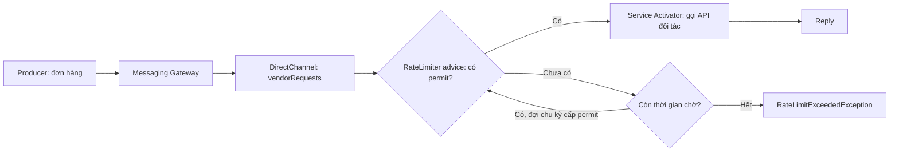
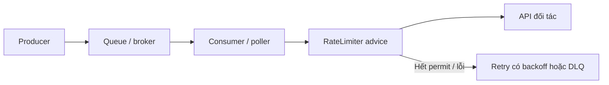

# Rate Limiter giới hạn tốc độ message trong Spring Integration

> **Module:** `SPRING_INTEGRATION_PATTERN` — Học triển khai Enterprise Integration Patterns với Spring Integration để xây dựng luồng thông điệp ít phụ thuộc và dễ mở rộng. Module thực hành Router, Filter, Transformer, Splitter, Aggregator, Gateway, retry, error channel và correlation, đồng thời kiểm thử, theo dõi các nhánh xử lý.
>
> **Chương:** Rate limiter · **Chủ đề:** Rate Limiter giới hạn tốc độ message.

## 1. Vấn đề cần giải quyết

Một hệ thống nhận đơn hàng có thể tiếp nhận hàng trăm message mỗi giây, trong khi API của đơn vị vận chuyển chỉ cho phép **20 yêu cầu/giây**. Nếu mỗi message lập tức kích hoạt một HTTP request, hệ thống có thể nhận HTTP 429, bị khóa API key hoặc gây quá tải cho dịch vụ đối tác.

**Rate Limiter** kiểm soát *tần suất được phép đi vào một bước xử lý*. Trong Spring Integration, có thể đặt rate limiter ngay trước `MessageHandler` gọi đối tác. Khi chưa có quyền thực thi (*permit*), lời gọi sẽ chờ trong thời gian cấu hình hoặc thất bại; các bước xử lý khác vẫn giữ trách nhiệm riêng của chúng.

Sau bài này, người học có thể:

1. Phân biệt giới hạn **số lượt xử lý theo thời gian** với giới hạn **số lượt xử lý đồng thời** và với hàng đợi.
2. Dùng `RateLimiterRequestHandlerAdvice` để bảo vệ một `ServiceActivator`.
3. Giải thích `limitForPeriod`, `limitRefreshPeriod` và `timeoutDuration`; dự đoán điều gì xảy ra khi hết permit.
4. Kết hợp rate limiting với Gateway, retry và error handling mà không vô tình gửi vượt hạn mức.
5. Xác định cách kiểm thử, theo dõi và xử lý giới hạn trong hệ thống có nhiều instance.

## 2. Rate Limiter đứng ở đâu trong message flow?

Một luồng minh họa:



**Vị trí giới hạn quyết định thứ được đếm.** Nếu gắn advice vào handler gọi API, mỗi lượt *đi vào handler* cần một permit. Các thao tác trước handler (validate, transform, route) không tiêu thụ permit của handler này. Nếu một message được tách bằng Splitter thành năm message và cả năm đi qua handler, thông thường chúng cần năm permit.

Đây là một dạng *cross-cutting behavior* của endpoint: `RateLimiterRequestHandlerAdvice` bọc lời gọi handler. Nó không phải bộ giới hạn tốc độ mặc định cho mọi channel trong ứng dụng.

### Phân biệt các cơ chế dễ nhầm

| Cơ chế | Kiểm soát điều gì? | Khi vượt giới hạn |
|---|---|---|
| **Rate Limiter** | Số lượt bắt đầu xử lý trong một khoảng thời gian | Chờ permit có giới hạn hoặc phát sinh lỗi |
| **Bulkhead / semaphore** | Số lượt đang thực thi đồng thời | Chờ hoặc từ chối khi hết chỗ đồng thời |
| **QueueChannel / message broker** | Nơi giữ message chưa được tiêu thụ | Message có thể xếp hàng; cần xử lý sức chứa và độ bền |
| **Filter** | Message có phù hợp điều kiện nghiệp vụ không? | Bỏ, từ chối hoặc định tuyến đến discard channel |
| **Circuit Breaker** | Có nên tiếp tục gọi dịch vụ đang lỗi? | Chặn lời gọi khi circuit ở trạng thái open |
| **Retry** | Có thử lại khi một lần thực thi thất bại? | Sinh thêm lần gọi nếu chính sách cho phép |

Một rate limiter **không tự lưu message vào hàng đợi bền vững**, **không tự retry**, và **không bảo đảm tối đa N lời gọi đang chạy đồng thời**.

## 3. Mô hình permit của Resilience4j

Spring Integration cung cấp `org.springframework.integration.handler.advice.RateLimiterRequestHandlerAdvice`, dựa trên `io.github.resilience4j.ratelimiter.RateLimiter`.

Ba cấu hình cốt lõi:

| Thuộc tính | Ý nghĩa | Ví dụ |
|---|---|---|
| `limitForPeriod` | Số permit có thể cấp trong mỗi chu kỳ làm mới | `2` |
| `limitRefreshPeriod` | Độ dài một chu kỳ cấp lại permit | `Duration.ofSeconds(1)` |
| `timeoutDuration` | Thời gian tối đa lời gọi có thể chờ để nhận permit | `Duration.ofMillis(200)` |

Với cấu hình **2 permit/1 giây, chờ tối đa 200 ms**:

- Hai lời gọi đầu tiên còn permit được đi vào handler ngay.
- Lời gọi thứ ba đến khi đã hết permit có thể chờ tối đa 200 ms. Nếu một chu kỳ làm mới bắt đầu kịp lúc, nó có thể nhận permit và chạy.
- Nếu hết thời gian chờ mà vẫn không có permit, Resilience4j từ chối; advice của Spring Integration phát sinh `RateLimiterRequestHandlerAdvice.RateLimitExceededException` (bao bọc `RequestNotPermitted`).
- Nếu đặt `timeoutDuration = Duration.ZERO`, lời gọi không chờ permit: hết permit thì thất bại ngay.

Resilience4j mặc định chia thời gian thành các **chu kỳ cấp permit**. Đây không phải bảo đảm “cửa sổ trượt” đúng nghĩa: hai permit cuối một chu kỳ và hai permit đầu chu kỳ kế tiếp có thể được sử dụng rất sát nhau. Do đó, hãy phân biệt **tốc độ trung bình/cấp permit theo chu kỳ** với SLA khắt khe như “không bao giờ quá 2 request trong bất kỳ 1 giây trượt nào”.

Ngoài ra, một permit được lấy **trước khi** gọi handler; thời gian handler chạy không làm permit bị “giữ” theo kiểu semaphore. Nếu API cần tối đa năm kết nối đồng thời, cần thêm giới hạn concurrency.

## 4. Ví dụ triển khai với Gateway và Service Activator

Tình huống: hệ thống tiếp nhận thông điệp đơn hàng qua `VendorGateway` và chuyển cho `ServiceActivator` gửi đến đối tác. Để dễ học, handler bên dưới trả về chuỗi giả lập kết quả; khi áp dụng thực tế, thay phần thân handler bằng HTTP client.

### 4.1. Khai báo dependency

Ví dụ dùng Gradle với Spring Boot:

```groovy
dependencies {
    implementation "org.springframework.boot:spring-boot-starter-integration"
    implementation "io.github.resilience4j:resilience4j-ratelimiter:VERSION"
}
```

Thay `VERSION` bằng bản Resilience4j tương thích với Spring Boot/Spring Integration đang dùng hoặc quản lý phiên bản bằng BOM của dự án. `RateLimiterRequestHandlerAdvice` có trong Spring Integration từ phiên bản 5.2; code ví dụ theo API Java hiện đại và cần cấu hình Spring Integration ở ứng dụng.

### 4.2. Bật Spring Integration và quét Gateway

```java
package com.example.ratelimit;

import org.springframework.boot.SpringApplication;
import org.springframework.boot.autoconfigure.SpringBootApplication;
import org.springframework.integration.annotation.IntegrationComponentScan;
import org.springframework.integration.config.EnableIntegration;

@SpringBootApplication
@EnableIntegration
@IntegrationComponentScan
public class RateLimitApplication {

    public static void main(String[] args) {
        SpringApplication.run(RateLimitApplication.class, args);
    }
}
```

`@IntegrationComponentScan` tìm các interface được đánh dấu `@MessagingGateway`; `@ComponentScan` thông thường không đăng ký Gateway interface theo cách đó.

### 4.3. Gateway: điểm vào của message

File `VendorGateway.java`:

```java
package com.example.ratelimit;

import org.springframework.integration.annotation.MessagingGateway;

@MessagingGateway(defaultRequestChannel = "vendorRequests")
public interface VendorGateway {

    String send(String orderPayload);
}
```

Gateway giúp mã nghiệp vụ gọi `gateway.send("order-123")` thay vì phải tự xây dựng và gửi `Message<?>`. Khi handler trả một giá trị, Gateway nhận reply dựa trên ngữ cảnh request-reply của Spring Integration.

### 4.4. Đặt Rate Limiter advice lên handler

File `VendorFlowConfig.java`:

```java
package com.example.ratelimit;

import java.time.Duration;

import io.github.resilience4j.ratelimiter.RateLimiterConfig;
import org.springframework.context.annotation.Bean;
import org.springframework.context.annotation.Configuration;
import org.springframework.integration.annotation.ServiceActivator;
import org.springframework.integration.channel.DirectChannel;
import org.springframework.integration.handler.advice.RateLimiterRequestHandlerAdvice;
import org.springframework.messaging.MessageChannel;

@Configuration
public class VendorFlowConfig {

    @Bean
    public MessageChannel vendorRequests() {
        return new DirectChannel();
    }

    @Bean
    public RateLimiterRequestHandlerAdvice vendorRateLimiter() {
        RateLimiterConfig config = RateLimiterConfig.custom()
                .limitForPeriod(2)
                .limitRefreshPeriod(Duration.ofSeconds(1))
                .timeoutDuration(Duration.ofMillis(200))
                .build();

        return new RateLimiterRequestHandlerAdvice(config, "vendor-api");
    }

    @ServiceActivator(
            inputChannel = "vendorRequests",
            adviceChain = "vendorRateLimiter")
    public String callVendor(String payload) {
        // Demo: thay bằng lời gọi HTTP thực tế khi triển khai.
        return "accepted: " + payload;
    }
}
```

**Đọc đoạn cấu hình:**

1. `vendorRequests()` tạo `DirectChannel`. Lời gọi handler xảy ra trên thread gửi message, trừ khi có thành phần bất đồng bộ khác.
2. `vendorRateLimiter()` tạo một advice bean có tên `vendorRateLimiter`. `adviceChain` tham chiếu **tên bean** này.
3. `callVendor()` là handler bị giới hạn; tối đa hai permit được cấp trong mỗi chu kỳ một giây cho limiter trên instance hiện tại.
4. Khi có permit, handler trả `"accepted: ..."`. Gateway có thể nhận chuỗi đó làm kết quả.
5. Khi không thể lấy permit trước khi hết 200 ms, handler không được gọi; exception đi ngược về caller trong flow đồng bộ.

**Điểm quan trọng:** ở ví dụ này chỉ `callVendor()` bị giới hạn. Nếu có thêm handler khác gọi cùng một API đối tác mà không gắn advice dùng **chung RateLimiter**, handler đó sẽ không chia sẻ ngân sách permit. Nên tái sử dụng một limiter cho cùng ngân sách quota, thay vì tạo một limiter mới cho mỗi message.

### 4.5. Cách thử bằng tay

Từ một Spring bean được inject `VendorGateway`, gọi liên tiếp:

```java
String first = gateway.send("order-001");
String second = gateway.send("order-002");
String third = gateway.send("order-003");
```

Hai lời gọi đầu thường nhận `accepted: ...`. Lời gọi thứ ba, **nếu vẫn nằm trong chu kỳ đã hết permit**, sẽ chờ tối đa 200 ms rồi có thể nhận permit mới hoặc bị từ chối. Kết quả thực tế phụ thuộc thời điểm bắt đầu chu kỳ và tốc độ thực thi, nên không dùng ví dụ này làm một phép thử thời gian tuyệt đối.

Để quan sát hành vi từ chối rõ hơn trong môi trường thử nghiệm, tạm cấu hình `limitForPeriod(1)`, `limitRefreshPeriod(Duration.ofMinutes(1))` và `timeoutDuration(Duration.ZERO)`: hai lời gọi sát nhau thường làm lời gọi thứ hai bị từ chối. Hoàn nguyên cấu hình phù hợp với quota thật trước khi triển khai.

## 5. Khi vượt giới hạn: chờ, báo lỗi hay giữ message?

Quyết định theo ý nghĩa nghiệp vụ của message.

### Cách A — Chờ ngắn rồi báo lỗi (request-reply)

Dùng khi người gửi đang chờ kết quả, chẳng hạn HTTP request đi qua Gateway. `timeoutDuration` cho phép chờ trong phạm vi ngân sách latency. Khi không còn thời gian, trả lỗi có kiểm soát và để lớp gọi quyết định có gửi lại sau hay không.

- Ưu điểm: dễ hiểu, có thời gian chờ tối đa tại điểm lấy permit.
- Đánh đổi: với `DirectChannel`, thread gửi message **bị chặn trong thời gian chờ permit**. Nhiều thread chờ cùng lúc có thể gây nghẽn tài nguyên.
- Quan sát: phân biệt *rate limit nội bộ* với HTTP 429 do **đối tác** trả về. HTTP 429 vẫn có thể xảy ra vì hạn mức chia sẻ bởi các ứng dụng khác hoặc quota thay đổi.

### Cách B — Từ chối ngay (fail fast)

Dùng `timeoutDuration(Duration.ZERO)` nếu hệ thống cần phản hồi nhanh hoặc upstream đã có cơ chế xếp hàng/retry. Caller có thể nhận trạng thái “quá tải tạm thời” và dùng backoff phù hợp.

Không retry ngay trong vòng lặp không giới hạn: điều đó có thể làm tăng lượng request và giữ áp lực lên hệ thống.

### Cách C — Giữ message trong hàng đợi và tiêu thụ theo tốc độ

Nếu đơn hàng phải được xử lý cuối cùng và không được mất, thiết kế một consumer riêng lấy message từ broker/hàng đợi và đẩy vào handler có rate limiter:



Lúc này phải thiết kế thêm **acknowledgment**, **retry**, **dead-letter queue**, **idempotency key**, **độ bền** và **giám sát độ sâu hàng đợi**. `QueueChannel` trong bộ nhớ không mặc nhiên có độ bền qua restart; với dữ liệu quan trọng nên cân nhắc một message broker hoặc message store bền vững.

Rate limiter gắn ở handler **không tự biến lỗi “hết permit” thành việc xếp lại message**. Chính consumer/poller và chính sách xử lý lỗi quyết định retry, chuyển DLQ hay giữ lại.

## 6. Rate Limiter kết hợp với các Enterprise Integration Patterns khác

**Gateway:** cung cấp API gọi thuận tiện cho tầng nghiệp vụ. Nếu dùng `DirectChannel`, từ chối do rate limiter thường thể hiện thành exception ở phía gọi; Gateway có thể unwrap một số lớp exception tùy cấu hình.

**Router và Filter:** lọc những message không cần gọi đối tác trước khi đến handler, giúp giảm tiêu thụ permit. Nếu route đến hai đối tác có quota độc lập, sử dụng các limiter riêng theo quota tương ứng.

**Splitter và Aggregator:** sau Splitter, cần xác định giới hạn theo *message con*, *batch* hay *request HTTP*. Nếu năm message con kích hoạt năm HTTP request, phải tính năm permit; Aggregator có thể gom nhiều message vào một lượt gọi nếu API hỗ trợ batch, nhưng phải bảo đảm correlation và timeout của nhóm.

**Retry:** mỗi lần thử lại có thể trở thành một HTTP request mới, do đó cần được tính vào quota. Thứ tự bọc giữa retry advice và rate limiter advice ảnh hưởng việc một retry attempt có đi qua limiter hay không. Hãy cấu hình và kiểm thử để **mỗi lần gọi thực sự đến đối tác** đều phải lấy permit. Với HTTP 429, tôn trọng `Retry-After` khi có và dùng exponential backoff kèm jitter.

**Error channel:** với flow đồng bộ qua `DirectChannel`, exception thường truyền về thread gửi message. Với flow bất đồng bộ (poller, executor, broker consumer), lỗi thường được chuyển thành `ErrorMessage` qua error channel do framework hoặc consumer cấu hình; cần một handler lỗi tường minh. Không giả định rằng mọi lỗi sẽ xuất hiện trong global `errorChannel` bất kể loại channel.

## 7. Giới hạn ở một instance và toàn hệ thống

Một `RateLimiterRequestHandlerAdvice` tạo với `RateLimiterConfig` giữ state limiter trong tiến trình ứng dụng. Nếu triển khai **ba instance**, mỗi instance có `limitForPeriod(20)` và `limitRefreshPeriod(1 giây)`, từng instance có thể cấp riêng 20 permit mỗi giây. Tổng lưu lượng có thể xấp xỉ 60 request/giây, cộng tác động dồn ở ranh giới các chu kỳ.

Vì vậy, cần hỏi rõ quota của đối tác là:

- **Theo instance / credential riêng:** một limiter cục bộ cho mỗi instance có thể đủ.
- **Theo API key chung của toàn hệ thống:** cần chia quota an toàn giữa các instance hoặc dùng rate limiter phân tán / một điểm dispatch tập trung.
- **Theo tenant / khách hàng:** cân nhắc limiter riêng theo khóa tenant, nhưng phải quản lý vòng đời các limiter để tránh tăng bộ nhớ không giới hạn.

Nếu tổng quota là 100 request/giây cho bốn instance cố định và muốn chừa 20% dự phòng, một phương án vận hành ban đầu là giới hạn khoảng **20 permit/giây/instance**. Đây chỉ là cách phân bổ ngân sách đơn giản; phân bố tải lệch, autoscaling, quota dùng chung và burst ở ranh giới chu kỳ có thể khiến nó không đáp ứng một cam kết giới hạn toàn cục chặt chẽ.

Đặc biệt, thay đổi `limitForPeriod` trong lúc chạy thường áp dụng từ chu kỳ tiếp theo; thay đổi `timeoutDuration` không làm thay đổi thời gian chờ của các thread đã bắt đầu chờ.

## 8. Quan sát và kiểm thử

### Metric và log nên thu thập

- **Permit còn lại:** `vendorRateLimiter().getMetrics().getAvailablePermissions()`.
- **Số thread đang chờ:** `vendorRateLimiter().getMetrics().getNumberOfWaitingThreads()`.
- **Sự kiện lấy permit thành công/thất bại:** sử dụng event publisher của Resilience4j để đếm theo tên limiter.
- **Độ trễ đầu-cuối:** từ lúc message vào Gateway / queue đến khi nhận reply, tách thời gian chờ permit và thời gian gọi đối tác nếu có thể.
- **Dấu hiệu quá tải:** HTTP 429, số lỗi rate limit, độ sâu queue, tuổi message, số lượt retry và DLQ.

Hạn chế log toàn bộ payload nếu dữ liệu có thể nhạy cảm. Ưu tiên message ID, correlation ID, loại nghiệp vụ, tên limiter và nguyên nhân thất bại.

### Bộ tình huống kiểm thử tối thiểu

| Tình huống | Thiết lập | Kết quả cần xác minh |
|---|---|---|
| Dư permit | `limitForPeriod=2`, một request | Handler được gọi, Gateway nhận reply |
| Hết permit, không chờ | `limitForPeriod=1`, refresh dài, timeout = 0, gửi hai request liên tiếp | Chỉ request đủ permit chạy vào handler; request còn lại bị từ chối |
| Hết permit, có chờ | Timeout đủ lớn để chạm lần refresh gần nhất | Request chờ và có thể tiếp tục khi được cấp permit |
| Handler thật sự lỗi | Handler ném exception dù đã có permit | Lỗi nghiệp vụ vẫn được truyền/xử lý theo flow; limiter không thay thế retry |
| Nhiều luồng gửi | Gửi đồng thời vượt quota | Lượt vào handler không vượt permit được cấp trong chu kỳ tương ứng |
| Nhiều instance | Hai app có limiter cục bộ cùng tên | Metric/permit mỗi app độc lập; không suy ra quota toàn cục |
| Flow bất đồng bộ | Message qua poller hoặc executor | Lỗi đi đến kênh/chiến lược xử lý đúng, không mất message âm thầm |

Một cách kiểm thử ổn định là dùng limiter riêng cho bài test với **một permit**, chu kỳ refresh đủ dài và `timeoutDuration = Duration.ZERO`; gửi hai request nhanh, đếm số lần stub handler được gọi và kiểm tra exception. Với bài test thời gian thực, tránh dựa vào `Thread.sleep` ngắn và đồng hồ hệ thống nếu có thể; cần xét khả năng chu kỳ refresh trùng ranh giới test.

### Checklist trước khi đưa vào môi trường thật

1. Xác nhận quota theo **API key**, tenant, node hay endpoint; làm rõ burst và thời gian reset của đối tác.
2. Gắn advice tại đúng handler thực hiện request tốn quota; rà soát cả nhánh Router, Splitter và retry.
3. Chọn `timeoutDuration` phù hợp với latency budget và số thread có thể bị giữ chờ.
4. Quyết định rõ message vượt hạn mức sẽ bị từ chối, retry sau, hay ở lại hàng đợi; có cơ chế xử lý lỗi và idempotency.
5. Kiểm thử nhiều instance và autoscaling; đo actual outbound request rate, HTTP 429 và backlog sau khi chạy tải.

## 9. Bài tập thực hành

**Bài 1 — Bảo vệ API:** mở rộng ví dụ để gọi một stub HTTP endpoint cho phép tối đa ba lượt/giây; cấu hình limiter tương ứng. Tạo hai tình huống `timeoutDuration = 0` và `timeoutDuration = 500 ms`, ghi nhận số request thực tế đến stub và thời gian phản hồi phía Gateway.

**Bài 2 — Nhiều nhánh:** dùng Router chuyển message có header `partner=A` đến handler A (5 request/giây) và `partner=B` đến handler B (2 request/giây). Mỗi handler có limiter riêng; kiểm tra rằng quá tải nhánh A không tự động tiêu thụ permit của B.

**Bài 3 — Đảm bảo eventual processing:** thay nguồn gửi đồng bộ bằng queue hoặc broker, thêm consumer có retry với backoff và DLQ. Mô phỏng đầu vào nhanh gấp ba lần năng lực gửi đi; trình bày biểu đồ độ sâu queue, tuổi message và tỷ lệ lỗi theo thời gian.

**Câu hỏi tự kiểm tra:**

- Nếu `limitForPeriod=10`, `limitRefreshPeriod=1s`, điều đó có bảo đảm không bao giờ có 11 request trong *bất kỳ* một giây trượt nào không? Vì sao?
- Vì sao retry bên trong phạm vi một permit có thể khiến số HTTP request thực tế lớn hơn số permit?
- Vì sao thêm `QueueChannel` không đủ để bảo đảm message được xử lý sau khi ứng dụng restart?
- Một service chạy bốn replica và dùng chung API key cần đo và bảo vệ quota toàn cục như thế nào?

## 10. Tài liệu tham khảo

- [Spring Integration — Rate Limiter Advice](https://docs.spring.io/spring-integration/reference/handler-advice/classes.html): advice có sẵn và ví dụ `@ServiceActivator`.
- [Spring Integration — Annotation Support](https://docs.spring.io/spring-integration/reference/configuration/annotations.html): `@IntegrationComponentScan` và các endpoint annotation.
- [Spring Integration — Messaging Gateways](https://docs.spring.io/spring-integration/reference/gateway.html): request-reply và truyền exception qua Gateway.
- [Spring Integration — Error Handling](https://docs.spring.io/spring-integration/reference/error-handling.html): lỗi trong luồng đồng bộ và bất đồng bộ.
- [Resilience4j — RateLimiter](https://resilience4j.readme.io/docs/ratelimiter): cơ chế cấp permit, cấu hình và metrics.
