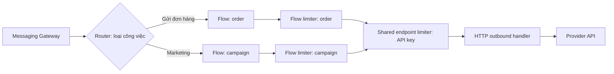
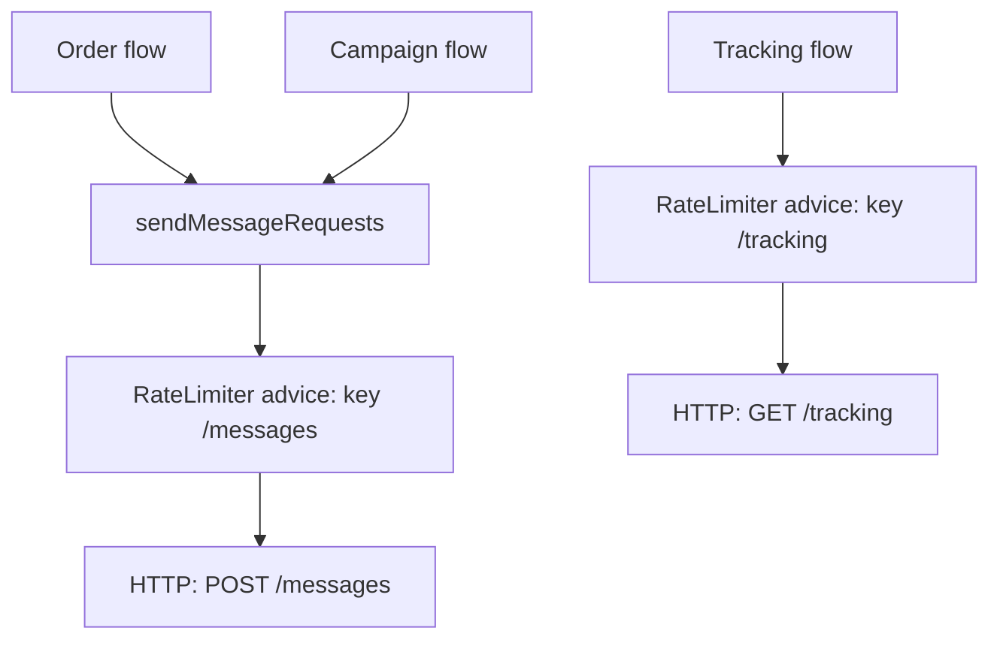
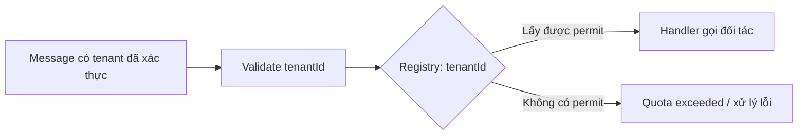
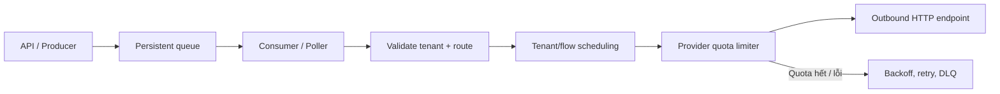

# Giới hạn theo flow, tenant hoặc endpoint trong Spring Integration

> **Module:** `SPRING_INTEGRATION_PATTERN` — Học triển khai Enterprise Integration Patterns với Spring Integration để xây dựng luồng thông điệp ít phụ thuộc và dễ mở rộng. Thực hành Router, Filter, Transformer, Splitter, Aggregator, Gateway, retry, error channel và correlation, đồng thời kiểm thử, theo dõi các nhánh xử lý.
>
> **Chương:** Rate limiter · **Đề bài:** Giới hạn theo flow, tenant hoặc endpoint.

## 1. Vì sao phải xác định phạm vi của rate limiter?

Giả sử hệ thống tích hợp với một đối tác gửi tin nhắn. Hệ thống có ba nguồn message:

- Luồng **xác nhận đơn hàng**: cần ưu tiên tốc độ và độ trễ thấp.
- Luồng **thông báo marketing**: tải lớn nhưng có thể chờ.
- Luồng **tra cứu trạng thái**: gọi một API khác của cùng đối tác.

Bốn tenant dùng chung hệ thống. Đối tác quy định tối đa **30 yêu cầu/giây cho một API key**, nhưng doanh nghiệp cũng muốn ngăn một tenant chiếm toàn bộ tài nguyên. Nếu gắn một limiter tùy ý vào mỗi handler, tổng lượt gọi có thể vượt quota đối tác. Nếu dùng chung đúng một limiter, tenant gửi nhiều message có thể khiến tenant khác phải chờ.

Bài học này trả lời ba câu hỏi:

1. **Theo flow:** mỗi luồng nghiệp vụ được cấp bao nhiêu lượt xử lý?
2. **Theo tenant:** mỗi khách hàng/đơn vị thuê hệ thống được phép tiêu thụ bao nhiêu tài nguyên?
3. **Theo endpoint:** từng API hoặc nhóm API của đối tác có hạn mức nào, và các flow có cần dùng chung hạn mức đó không?

Điểm thiết kế cốt lõi là **rate limiter phải gắn với đơn vị tiêu thụ quota thực sự**. Một lượt message đi qua Router không nhất thiết tương đương một lượt HTTP request: Transformer có thể không tạo request; Splitter có thể tạo nhiều request; Aggregator có thể gom nhiều message thành một request. Đặt limiter trước/sau các bước này sẽ đếm những thứ khác nhau.

## 2. Phân biệt ba kiểu phạm vi

| Phạm vi | Khóa giới hạn điển hình | Giải quyết vấn đề | Điều cần lưu ý |
|---|---|---|---|
| **Flow** | `flow:order-confirmation` | Dành ngân sách riêng cho từng luồng nghiệp vụ | Nếu nhiều flow cùng gọi một API key, giới hạn từng flow không tự bảo vệ tổng quota |
| **Tenant** | `tenant:org-123` | Công bằng và cô lập tải giữa các khách hàng | Cần xác thực tenant, kiểm soát số khóa được tạo và chính sách phân cấp |
| **Endpoint** | `provider-a:send` hoặc `api-key-7` | Tôn trọng giới hạn do hệ thống đích áp đặt | Hạn mức của nhà cung cấp có thể áp dụng cho cả nhóm endpoint/credential, không chỉ một URL |

**Endpoint** ở đây cần được hiểu rõ:

- *Spring Integration endpoint* là thành phần kết nối channel với một message handler, ví dụ `@ServiceActivator`.
- *Remote API endpoint* là API được gọi ra ngoài, ví dụ `POST /messages` hoặc `GET /tracking`.

Khi nói “quota theo endpoint” của đối tác, khóa quota phải phản ánh **cách đối tác tính request**, có thể là endpoint cụ thể, nhóm endpoint, API key hoặc tài khoản. Không nên mặc định một URL là một hạn mức độc lập.

### Minh họa đặt limiter trong luồng



Sơ đồ cho thấy hai mục tiêu độc lập: giới hạn ngân sách của từng flow và bảo vệ **tổng** số request gửi qua API key. Nếu chỉ có `L1` và `L2`, cả hai flow vẫn có thể cộng dồn vượt quota chung. Nếu chỉ có `E`, tổng request được giới hạn nhưng chưa có cơ chế bảo đảm công bằng giữa hai flow.

Trong thực tế, rate limiting **không tự tạo lịch chia lượt công bằng**. Muốn ưu tiên hoặc công bằng giữa flow/tenant, cần thiết kế thêm scheduler, queue, consumer riêng, hoặc điều phối admission.

## 3. Cơ chế cơ bản của Resilience4j RateLimiter

Spring Integration hỗ trợ `RateLimiterRequestHandlerAdvice` dựa trên Resilience4j. Advice kiểm tra permit ngay trước khi message handler thực thi.

Các tham số thông dụng:

| Cấu hình | Diễn giải | Ví dụ |
|---|---|---|
| `limitForPeriod` | Số permit cấp trong một chu kỳ | 10 |
| `limitRefreshPeriod` | Độ dài chu kỳ cấp permit | 1 giây |
| `timeoutDuration` | Thời gian tối đa chờ permit | 100 ms |

Ví dụ 10 permit mỗi giây không có nghĩa là “không bao giờ có hơn 10 request trong **bất kỳ** khoảng 1 giây trượt nào”. Resilience4j thực hiện cấp permit theo chu kỳ, nên các lượt ở hai phía ranh giới chu kỳ có thể đến rất sát nhau.

Khi hết permit:

- Nếu `timeoutDuration` khác 0, caller có thể chờ tối đa thời gian đã cấu hình.
- Nếu `timeoutDuration = Duration.ZERO`, lời gọi được từ chối ngay.
- Với `DirectChannel`, chờ permit sẽ giữ thread của bên gửi message; với poller/ExecutorChannel, cần xem cấu hình thực thi và xử lý exception của consumer.
- Permit giới hạn **tần suất bắt đầu handler**, không giới hạn số request đang chạy đồng thời. Muốn giới hạn concurrency cần thêm semaphore/bulkhead hoặc pool riêng.

Một rate limiter Resilience4j thông thường duy trì state **trong tiến trình JVM**. Nếu ứng dụng chạy nhiều replica, mỗi replica tự có permit trừ khi áp dụng điều phối quota toàn cục.

## 4. Giới hạn theo flow với các advice tĩnh

Trường hợp dễ triển khai nhất: tên flow và số quota đã biết khi khởi động. Ta tạo hai `RateLimiterRequestHandlerAdvice` và gắn vào hai `ServiceActivator` tương ứng.

### 4.1. Dependencies

Ví dụ Gradle dùng Spring Boot và Spring Integration:

```groovy
dependencies {
    implementation "org.springframework.boot:spring-boot-starter-integration"
    implementation "io.github.resilience4j:resilience4j-ratelimiter:VERSION"
}
```

Thay `VERSION` bằng phiên bản Resilience4j tương thích với Spring Framework/Spring Integration trong dự án; có thể quản lý bằng BOM. Ví dụ Java dưới đây dùng annotation-based Spring Integration.

### 4.2. Kích hoạt integration và Gateway

```java
package com.example.integration;

import org.springframework.boot.SpringApplication;
import org.springframework.boot.autoconfigure.SpringBootApplication;
import org.springframework.integration.annotation.IntegrationComponentScan;
import org.springframework.integration.config.EnableIntegration;

@SpringBootApplication
@EnableIntegration
@IntegrationComponentScan
public class IntegrationApplication {
    public static void main(String[] args) {
        SpringApplication.run(IntegrationApplication.class, args);
    }
}
```

`@IntegrationComponentScan` đăng ký các interface `@MessagingGateway`. Ví dụ gọi hai flow:

```java
package com.example.integration;

import org.springframework.integration.annotation.MessagingGateway;

@MessagingGateway(defaultRequestChannel = "orderOut")
public interface OrderGateway {
    String sendOrder(String orderId);
}
```

```java
package com.example.integration;

import org.springframework.integration.annotation.MessagingGateway;

@MessagingGateway(defaultRequestChannel = "campaignOut")
public interface CampaignGateway {
    String sendCampaign(String campaignId);
}
```

### 4.3. Hai flow, hai quota độc lập

```java
package com.example.integration;

import java.time.Duration;

import io.github.resilience4j.ratelimiter.RateLimiterConfig;
import org.springframework.context.annotation.Bean;
import org.springframework.context.annotation.Configuration;
import org.springframework.integration.annotation.ServiceActivator;
import org.springframework.integration.channel.DirectChannel;
import org.springframework.integration.handler.advice.RateLimiterRequestHandlerAdvice;
import org.springframework.messaging.MessageChannel;

@Configuration
public class PerFlowConfiguration {

    @Bean
    public MessageChannel orderOut() {
        return new DirectChannel();
    }

    @Bean
    public MessageChannel campaignOut() {
        return new DirectChannel();
    }

    @Bean
    public RateLimiterRequestHandlerAdvice orderFlowLimit() {
        return new RateLimiterRequestHandlerAdvice(
                config(5), "flow-orders");
    }

    @Bean
    public RateLimiterRequestHandlerAdvice campaignFlowLimit() {
        return new RateLimiterRequestHandlerAdvice(
                config(2), "flow-campaigns");
    }

    private RateLimiterConfig config(int permitsPerSecond) {
        return RateLimiterConfig.custom()
                .limitForPeriod(permitsPerSecond)
                .limitRefreshPeriod(Duration.ofSeconds(1))
                .timeoutDuration(Duration.ofMillis(100))
                .build();
    }

    @ServiceActivator(inputChannel = "orderOut",
                      adviceChain = "orderFlowLimit")
    public String sendOrder(String orderId) {
        // Stub: thay bằng HTTP client / outbound gateway thực tế.
        return "order sent: " + orderId;
    }

    @ServiceActivator(inputChannel = "campaignOut",
                      adviceChain = "campaignFlowLimit")
    public String sendCampaign(String campaignId) {
        // Stub: thay bằng HTTP client / outbound gateway thực tế.
        return "campaign sent: " + campaignId;
    }
}
```

Trong mỗi chu kỳ một giây trên **một instance ứng dụng**, flow đặt hàng có tối đa 5 permit, flow marketing có tối đa 2 permit. Khi flow marketing hết permit, flow đặt hàng vẫn có nguồn permit riêng.

**Giới hạn của ví dụ:** nếu cả hai handler cuối cùng gọi cùng API key chỉ cho phép **6 request/giây**, tổng 5 + 2 = 7 permit/giây vẫn có thể vượt quota của nhà cung cấp. Cần thêm một điểm điều phối chung hoặc cấu hình tổng ngân sách thấp hơn, tính cả các luồng khác và burst.

Một flow có thể đi qua nhiều handler. Gắn advice vào handler nào thì mỗi lượt vào **handler đó** bị kiểm tra. Nếu handler chỉ biến đổi payload rồi chuyển tiếp, việc giới hạn ở đây có thể không phản ánh số outbound request. Ưu tiên đặt limiter sát bước gọi API thực tế khi mục tiêu là bảo vệ API.

## 5. Giới hạn theo remote endpoint hoặc API key

Giả sử provider có hai API:

- `POST /messages`: tối đa **10 request/giây** cho API key.
- `GET /tracking`: tối đa **30 request/giây** cho API key.

Nếu hai flow, ví dụ `order` và `campaign`, đều gọi `POST /messages`, chúng cần chia sẻ **cùng một ngân sách**. Tránh tạo hai đối tượng limiter độc lập chỉ vì chúng có cùng chuỗi tên.

### 5.1. Một endpoint handler chung

Một lựa chọn rõ ràng là hợp nhất các nhánh outbound cùng quota vào một channel và một handler:



Cấu hình giản lược:

```java
@Bean
public RateLimiterRequestHandlerAdvice sendMessageQuota() {
    RateLimiterConfig config = RateLimiterConfig.custom()
            .limitForPeriod(10)
            .limitRefreshPeriod(Duration.ofSeconds(1))
            .timeoutDuration(Duration.ZERO)
            .build();
    return new RateLimiterRequestHandlerAdvice(
            config, "provider-a-messages-key-1");
}

@ServiceActivator(
    inputChannel = "sendMessageRequests",
    adviceChain = "sendMessageQuota")
public String sendMessage(String messageBody) {
    return remoteClient.postMessage(messageBody);
}
```

`remoteClient` trong đoạn trên là client ứng dụng tự cung cấp. Đoạn code minh họa **vị trí** đặt advice; để chạy cần khai báo `MessageChannel sendMessageRequests` và bean client tương ứng.

Điểm lợi của cách này: dù message đến từ flow nào, **mỗi lượt vào handler chung** đều phải xin permit từ cùng một limiter.

### 5.2. Nếu không thể gộp handler

Trường hợp nhiều handler độc lập vẫn dùng chung API key, cần một cơ chế **chia sẻ state quota** thay vì mỗi handler tạo riêng limiter. Có thể dùng chung một Resilience4j `RateLimiter` lấy từ `RateLimiterRegistry` theo cùng khóa quota, rồi kiểm tra permit tại từng điểm gọi HTTP; hoặc tổ chức một outbound gateway/dispatcher chung. Khi chia sẻ một `RateLimiterRequestHandlerAdvice` bean giữa nhiều endpoint, phải kiểm tra cách khởi tạo advice và thứ tự advice chain của phiên bản Spring Integration thực tế đang sử dụng.

**Không dùng tên giống nhau như bằng chứng chia sẻ quota.** Tên chỉ là định danh nếu các đối tượng limiter thực sự khác nhau. Ngoài ra, “cùng một key” trong hai JVM cũng chưa phải state chung.

### 5.3. Chọn khóa dựa trên tài liệu quota thật

Các ví dụ khóa:

```text
provider-a / key=shared-01 / POST /messages
provider-a / key=shared-01 / GET /tracking
provider-a / key=shared-01 / all-endpoints
provider-b / account=acct-42 / all-endpoints
```

Nếu đối tác tính **tổng quota trên toàn API key**, dùng `provider-a:key:shared-01` làm khóa bảo vệ tổng; nếu có quota riêng cho mỗi endpoint, thêm các khóa endpoint. Nếu quota tính theo tài khoản và các API key khác nhau vẫn dùng chung một hạn mức, khóa theo tài khoản.

Cần phân biệt *giới hạn do mình tự đặt* (ví dụ marketing 2 req/s) với *giới hạn do đối tác bắt buộc* (ví dụ API key 10 req/s). Chúng phục vụ các mục tiêu khác nhau và có thể cần kết hợp.

## 6. Giới hạn động theo tenant

Số tenant có thể tăng theo thời gian. Không khả thi khi khai báo một `@Bean RateLimiterRequestHandlerAdvice` cho mỗi tenant trong code. Thay vào đó, dùng `RateLimiterRegistry` để tra cứu hoặc tạo limiter theo khóa tenant.

Luồng ví dụ:



### 6.1. Tạo registry với cấu hình mặc định

```java
package com.example.integration;

import java.time.Duration;

import io.github.resilience4j.ratelimiter.RateLimiterConfig;
import io.github.resilience4j.ratelimiter.RateLimiterRegistry;
import org.springframework.context.annotation.Bean;
import org.springframework.context.annotation.Configuration;
import org.springframework.integration.channel.DirectChannel;
import org.springframework.messaging.MessageChannel;

@Configuration
public class TenantLimitConfiguration {

    @Bean
    public MessageChannel tenantOut() {
        return new DirectChannel();
    }

    @Bean
    public RateLimiterRegistry tenantRateLimiters() {
        RateLimiterConfig config = RateLimiterConfig.custom()
                .limitForPeriod(3)
                .limitRefreshPeriod(Duration.ofSeconds(1))
                .timeoutDuration(Duration.ZERO)
                .build();
        return RateLimiterRegistry.of(config);
    }
}
```

Registry trả về cùng limiter theo tên trong **cùng registry của JVM**, vì vậy mọi message có cùng tenant ID cùng tiêu thụ một ngân sách ba permit/giây.

### 6.2. Gateway truyền tenant đã xác thực

```java
package com.example.integration;

import org.springframework.integration.annotation.MessagingGateway;
import org.springframework.messaging.handler.annotation.Header;
import org.springframework.messaging.handler.annotation.Payload;

@MessagingGateway(defaultRequestChannel = "tenantOut")
public interface TenantGateway {

    String send(@Payload String payload,
                @Header("tenantId") String tenantId);
}
```

**Trong ứng dụng thực tế, tenantId phải được lấy từ thông tin xác thực/ủy quyền đáng tin cậy.** API ở trên chỉ minh họa cách truyền context qua message header. Không lấy tenant ID tùy ý từ body hoặc header do người gọi không đáng tin cậy cung cấp rồi dùng làm khóa quota, vì họ có thể đổi ID để tạo ngân sách mới.

### 6.3. Tra cứu limiter tại handler

```java
package com.example.integration;

import io.github.resilience4j.ratelimiter.RateLimiter;
import io.github.resilience4j.ratelimiter.RateLimiterRegistry;
import org.springframework.integration.annotation.ServiceActivator;
import org.springframework.messaging.Message;
import org.springframework.stereotype.Component;

@Component
public class TenantOutboundHandler {

    private final RateLimiterRegistry registry;

    public TenantOutboundHandler(RateLimiterRegistry registry) {
        this.registry = registry;
    }

    @ServiceActivator(inputChannel = "tenantOut")
    public String send(Message<String> message) {
        // Giả định header đã được thiết lập từ nguồn đã xác thực.
        String tenantId = message.getHeaders().get("tenantId", String.class);

        if (tenantId == null
                || !tenantId.matches("[a-zA-Z0-9_-]{1,64}")) {
            throw new IllegalArgumentException("Invalid tenantId");
        }

        RateLimiter limiter = registry.rateLimiter("tenant:" + tenantId);

        if (!limiter.acquirePermission()) {
            throw new TenantQuotaExceededException(tenantId);
        }

        // Stub: ở production, thay bằng một outbound HTTP call.
        return "sent for " + tenantId + ": " + message.getPayload();
    }

    public static class TenantQuotaExceededException
            extends RuntimeException {
        public TenantQuotaExceededException(String tenantId) {
            super("Tenant quota exceeded: " + tenantId);
        }
    }
}
```

Ở ví dụ này:

1. Tenant `A` được cấp ba permit mỗi giây trên instance đang chạy.
2. Gửi bốn message liên tiếp của A trong cùng chu kỳ: chỉ ba message đầu có thể được nhận permit; message thứ tư bị từ chối nếu chưa sang chu kỳ mới.
3. Tenant `B` dùng một limiter khác nên request của B không tiêu thụ permit của A.
4. `timeoutDuration(Duration.ZERO)` khiến request hết permit bị từ chối ngay, phù hợp với upstream có chính sách retry/queue riêng.

Ví dụ sử dụng trực tiếp `RateLimiter.acquirePermission()` trong handler để **chọn limiter theo message**. Đó là cơ chế tương đương về mục tiêu giới hạn nhưng không sử dụng `RateLimiterRequestHandlerAdvice` như trường hợp flow tĩnh. Có thể xây một custom advice để chọn limiter động; nên chỉ làm khi cần dùng chung logic cho nhiều handler.

### 6.4. Tại sao không nên tạo limiter mới mỗi message?

Sai lầm thường gặp:

```java
// SAI: tạo quota mới ở mọi lượt, không tích lũy sử dụng.
RateLimiter limiter = RateLimiter.of(
        "tenant:" + tenantId, defaultConfig);
limiter.acquirePermission();
```

Mỗi lần tạo mới state, nên các request trước đó không còn ảnh hưởng quota của request sau. Registry hoặc cache limiter theo **khóa quota ổn định** là bắt buộc để cộng dồn lượt sử dụng.

Ngược lại, registry giữ state theo tên cũng đặt ra vấn đề quản lý vòng đời: một client có thể gửi hàng triệu khóa tenant tùy ý nếu không được kiểm soát. Hãy xác thực tenant trước, áp dụng giới hạn số tenant/đối tượng đang hoạt động, cân nhắc chính sách xóa khi tenant bị vô hiệu hóa và cách thu dọn state khi không còn dùng. Việc xóa limiter phải bảo đảm không làm “reset quota” tùy tiện cho tenant còn đang hoạt động.

## 7. Kết hợp nhiều tầng quota

Giả sử đối tác cho phép tối đa 10 request/giây trên một API key. Hệ thống muốn giới hạn mỗi tenant tối đa 3 request/giây và flow marketing tối đa 2 request/giây.

| Tầng | Khóa | Ví dụ quota | Vai trò |
|---|---|---|---|
| Tổng provider | `provider-a:api-key-1` | 10/s | Không vượt ngân sách API key |
| Tenant | `tenant:org-123` | 3/s | Hạn chế một tenant chiếm toàn bộ năng lực |
| Flow | `flow:marketing` | 2/s | Bảo vệ các flow ưu tiên khác |

Nếu có bốn tenant, mỗi tenant được ba permit/giây, tổng tiềm năng **12 request/giây** vẫn vượt hạn mức provider 10/s. Vì vậy, limiter tenant **không thay thế** limiter tổng.

### Thứ tự xin permit có ảnh hưởng

Một cách dễ nghĩ là xin permit lần lượt:

```text
message → [tenant permit] → [flow permit] → [provider permit] → HTTP
```

Nhưng nếu đã lấy được permit tenant mà thất bại ở provider, permit tenant thường đã **bị tiêu thụ**. Các lần xin permit ở nhiều limiter riêng biệt không tạo thành một giao dịch nguyên tử có rollback. Đổi thứ tự cũng chỉ đổi nơi permit có thể bị tiêu thụ trước.

Để có hệ thống công bằng và hiệu quả:

- Dùng một **dispatcher/consumer** đi qua một ngân sách outbound chung khi quota provider là ràng buộc cứng.
- Nếu cần bảo đảm tenant/flow không chiếm hết công suất, tổ chức **queue theo tenant hoặc nhóm ưu tiên**, điều phối với weighted round-robin, fair queueing hoặc cơ chế tương đương.
- Quy định chính sách rõ ràng khi không lấy được permit ở một tầng: trả lỗi, requeue sau backoff hay chuyển DLQ.
- Thiết kế idempotency vì retry có thể làm message được phân phối lại và gửi trùng nếu không có khóa nghiệp vụ.

Trong các hệ thống nhiều replica, muốn quota **toàn cục** đúng theo API key thì cần một dispatcher tập trung, một coordinator/limiter phân tán có trạng thái chia sẻ, hoặc chia ngân sách tĩnh có kiểm soát và dự phòng. Tất cả phải được kiểm thử khi autoscale.

## 8. Gắn limiter đúng chỗ trong Enterprise Integration Patterns

| Pattern | Nguy cơ nếu đặt limiter sai | Gợi ý |
|---|---|---|
| **Router** | Hai nhánh cùng gọi một API nhưng đếm quota riêng | Đặt quota chung sau khi hợp nhánh hoặc dùng cùng limiter |
| **Filter** | Message bị bỏ vẫn tiêu thụ permit nếu giới hạn trước Filter | Lọc điều kiện không cần outbound trước khi lấy permit |
| **Transformer** | Đếm lượt transform thay vì lượt HTTP thực tế | Giới hạn sát outbound handler |
| **Splitter** | Một message đầu vào tách thành N request | Tính N permit nếu thực sự gọi N request |
| **Aggregator** | N message được gom thành một API batch | Đếm theo số request batch, đồng thời xét quota dựa trên số item nếu provider quy định |
| **Gateway** | Thread gọi bị chặn chờ permit | Giới hạn `timeoutDuration` và áp dụng latency budget của caller |
| **Retry** | Một permit có thể bao nhiều HTTP retry nếu thứ tự advice sai | Đảm bảo mỗi outbound attempt đều lấy permit |
| **Error channel** | Lỗi bị gửi sai nơi, làm mất message hoặc retry liên tục | Thiết lập đường xử lý exception theo đồng bộ/bất đồng bộ |
| **Correlation** | Tenant/message metadata bị mất trong split/aggregate | Giữ trusted tenant ID và correlation ID xuyên suốt flow |

Ví dụ: một message đầu vào được Splitter tách thành 50 thông báo, sau đó mỗi thông báo gọi `POST /messages`. Limiter chỉ đặt **trước Splitter** sẽ tính một permit cho 50 lời gọi. Limiter đặt tại handler gửi đi tính 50 lượt, đúng nếu provider giới hạn theo số request. Nếu provider lại tính 50 “recipient units” trong một batch request, cần thêm cơ chế đếm **chi phí/weight** của từng request chứ không mặc định một message tương ứng một permit.

Đối với retry, cân nhắc `Retry-After` khi đối tác trả HTTP 429, exponential backoff có jitter, và giới hạn số lần thử lại. Rate limiter nội bộ hết permit và HTTP 429 của đối tác là **hai tình huống khác nhau**, cần metric phân biệt.

## 9. Đồng bộ, bất đồng bộ và tính bền vững

### Flow đồng bộ

Với `DirectChannel`, lời gọi handler chạy trên thread gửi message. Nếu limiter có thời gian chờ, caller có thể bị giữ thread cho đến khi nhận permit hoặc timeout. Nếu vượt quota và không có xử lý lỗi, exception thường truyền ngược về Gateway/caller.

Một API HTTP cần trả phản hồi trong 300 ms không nên cấu hình chờ permit 2 giây chỉ vì hạn mức đối tác: việc đó có thể gây timeout ở HTTP layer trước, khiến người dùng retry trong khi message cũ vẫn còn ở các khâu xử lý.

### Flow bất đồng bộ hoặc có broker

Để không giữ thread của request đến, có thể nhận message vào broker/hàng đợi bền vững và có consumer giới hạn tốc độ gửi ra ngoài:



**Chú ý:** `QueueChannel` trong bộ nhớ không mặc nhiên đảm bảo message tồn tại sau restart. Nếu yêu cầu không mất đơn hàng, phải cấu hình broker hoặc message store có độ bền, acknowledgment đúng thời điểm và cơ chế xử lý khi handler lỗi.

Trong flow bất đồng bộ, exception có thể được phát thành `ErrorMessage` qua error channel, hoặc được consumer/broker adapter xử lý theo chính sách retry/ack. Không giả định mọi trường hợp đều tự gửi vào global `errorChannel`; phải kiểm tra endpoint và cơ chế giao nhận đang dùng.

## 10. Vận hành khi có nhiều instance, tenant và quota thay đổi

**Ví dụ:** provider cho 40 req/s toàn tài khoản, app có 4 replica, mỗi replica đặt limiter 20 req/s. Tổng có thể chạm khoảng 80 req/s, **vượt quota gấp đôi**. Cùng một khóa `tenant:org-123` xuất hiện ở hai JVM cũng thường có hai bộ đếm permit độc lập.

Các hướng xử lý thường gặp:

1. **Một điểm outbound chung:** các flow gửi vào một dispatcher/worker có limiter chung, dễ quản lý quota nhưng cần tính toán khả năng chịu lỗi và khả năng mở rộng.
2. **Rate limiter phân tán:** trạng thái permit chia sẻ qua dịch vụ/coordinator phù hợp; quan tâm độ trễ, lỗi mạng, tính nguyên tử và chính sách fail-open/fail-closed.
3. **Chia quota theo replica:** tổng phân bổ nhỏ hơn quota thật, có dư địa cho burst/overhead, cập nhật khi số replica thay đổi; cách này vận hành đơn giản nhưng không tự cân bằng khi tải lệch.

Đừng suy ra quota toàn cục chỉ từ **tên limiter giống nhau** trên các pod. Đồng thời, provider có thể áp đặt nhiều ràng buộc: theo API key, endpoint, tài khoản, ngày và cả burst tức thời. Cần chọn phương án đáp ứng *tất cả* ràng buộc quan trọng.

**Tenant premium / standard:** có thể áp dụng các cấu hình khác nhau theo tenant, nhưng cần xác định cấu hình trong nguồn dữ liệu quản trị đáng tin cậy. Nếu quota thay đổi lúc đang chạy, cần hiểu việc cập nhật limiter ảnh hưởng chu kỳ permit và request đang chờ như thế nào. Tạo limiter mới với tên khác mà không di chuyển state có thể vô tình reset quota.

**Số lượng khóa:** theo dõi số limiter đang hoạt động, churn của tenant, memory và thời điểm thu dọn state. Với môi trường multi-tenant lớn, registry cục bộ không kiểm soát có thể trở thành vấn đề bộ nhớ.

## 11. Kiểm thử và observability

### 11.1. Bảng tình huống kiểm thử

| Tình huống | Thiết lập | Kết quả mong đợi |
|---|---|---|
| Hai flow độc lập | Flow A = 1 permit, flow B = 1 permit, refresh dài, timeout = 0 | A hết permit không làm B hết permit |
| Hai flow cùng endpoint | Cả hai đi vào một handler dùng limiter 1 permit | Chỉ một outbound attempt được đi qua trong chu kỳ |
| Hai tenant | A và B, mỗi tenant 1 permit | Request thứ hai của A bị từ chối; request đầu của B vẫn đi được |
| Tenant ID giả | Header thiếu, sai định dạng hoặc không khớp quyền caller | Bị từ chối trước khi cấp/tiêu thụ permit tenant |
| Một message được split | 1 message tạo 5 outbound attempts | Quota tại outbound được kiểm tra 5 lần |
| Retry HTTP 429 | Stub provider trả 429 kèm `Retry-After` | Backoff phù hợp; mỗi lần gọi thật đi qua limiter |
| Đổi quota runtime | Tenant được chuyển gói trong lúc có tải | Không tạo khoảng trống quota bất thường; xác nhận chính sách chuyển cấu hình |
| Hai replica | Cùng tenant gửi vào hai app có registry cục bộ | Hai bộ đếm riêng; ghi nhận nhu cầu quota toàn cục |
| Lỗi khi async | Consumer hết permit hoặc HTTP fail | Message retry/ack/DLQ đúng chính sách, không mất âm thầm |

Để test có tính quyết định, cấu hình `limitForPeriod = 1`, chu kỳ refresh dài và `timeoutDuration = Duration.ZERO`; gửi hai message liên tiếp trong một chu kỳ, kiểm tra số lần outbound stub được gọi và loại exception. Với flow/tenant, cần dùng **cùng registry/limiter instance** trong toàn bộ lượt gửi thuộc một test; tránh test bị ảnh hưởng state từ test khác.

Đối với kiểm thử giới hạn theo thời gian thực, không nên dựa vào `Thread.sleep` ngắn để giả định ranh giới chu kỳ. Với bài test concurrency, kiểm tra **số permit được cấp**, không chỉ thứ tự phản hồi do thread scheduling có thể khác nhau.

### 11.2. Metric quan trọng

- **Permit:** số permit còn lại, số request bị từ chối, số thread chờ permit; phân tích theo quota key.
- **Outbound:** số HTTP request thực tế theo provider, endpoint, status code, API key group (đã ẩn thông tin bí mật).
- **Flow:** latency đầu-cuối, số message vào/ra, tỉ lệ lỗi, throughput mỗi flow.
- **Tenant:** tỉ lệ bị rate limit, độ trễ và mức sử dụng quota theo nhóm tenant; tránh xuất mỗi tenant ID thành một Prometheus label nếu số lượng tenant không giới hạn.
- **Queue / retry:** backlog, tuổi message lớn nhất, số lần retry và DLQ.

Các API Resilience4j hỗ trợ quan sát metric trên limiter, ví dụ:

```java
RateLimiter limiter = registry.rateLimiter("tenant:" + tenantId);

int available = limiter.getMetrics().getAvailablePermissions();
int waiting = limiter.getMetrics().getNumberOfWaitingThreads();
```

Có thể bật tích hợp Micrometer/Actuator phù hợp với phiên bản dự án hoặc đăng ký event listener của Resilience4j. Cần kiểm soát cardinality: metric theo hàng triệu tenant ID có thể làm hệ thống quan sát quá tải. Trong log, dùng tenant identifier nội bộ phù hợp chính sách bảo mật, message ID, correlation ID, tên flow và reason code; không log API key hoặc payload chứa dữ liệu nhạy cảm.

## 12. Các lỗi thiết kế thường gặp

| Sai lầm | Hậu quả | Cách sửa |
|---|---|---|
| Mỗi message tạo một `RateLimiter.of(...)` mới | Quota liên tục bị reset | Reuse limiter theo khóa ổn định |
| Chia riêng limiter cho hai flow cùng API key | Tổng outbound có thể vượt quota | Limiter chung hoặc điều phối tổng |
| Tin tenant ID người dùng tự gửi | Có thể đổi tenant ID để né giới hạn | Lấy từ authentication/authorization context |
| Gắn limiter trước Splitter | Đếm một message nhưng phát N HTTP requests | Đặt quota outbound sau Splitter |
| Có quota tenant nhưng không có quota provider | Tổng nhiều tenant có thể vượt hạn mức nhà cung cấp | Thêm ngân sách provider |
| Cấp permit ở nhiều tầng rồi giả định có rollback | Lãng phí permit, giảm thông lượng | Chấp nhận semantics rõ ràng hoặc dùng dispatcher thích hợp |
| Dùng limiter cục bộ như quota toàn cầu | Mỗi replica tự cấp permit | Dùng điều phối phân tán, dispatcher hoặc chia quota |
| Chờ permit quá lâu trong `DirectChannel` | Giữ thread, request timeout dây chuyền | Chờ ngắn hoặc chuyển sang queue/consumer |
| Không giới hạn số registry key | Tăng memory và metric cardinality | Validate tenant, kiểm soát lifecycle và monitoring |
| Bật retry nhanh vô hạn | Khuếch đại tải và lỗi 429 | Backoff, jitter, số lần retry hữu hạn |

## 13. Bài tập thực hành

**Bài 1 — Hai flow, một provider.** Tạo flow `order` với 5 permit/s và `campaign` với 2 permit/s. Cho cả hai gọi một stub provider chỉ cho phép tổng 6 request/s. Xác định vì sao hai limiter theo flow là chưa đủ, rồi chỉnh kiến trúc để tổng outbound theo một API key được giới hạn.

**Bài 2 — Đa tenant.** Xây Gateway nhận payload và tenant ID lấy từ nguồn xác thực. Tạo registry 2 permit/s/tenant, timeout = 0. Gửi liên tiếp ba message của tenant A và một message của tenant B; kiểm tra handler được gọi bao nhiêu lần và exception từ A có làm mất permit của B hay không.

**Bài 3 — Retry và backlog.** Kết nối consumer từ broker với handler có quota provider 10 req/s. Sinh 100 message trong một giây, giả lập HTTP 429 và `Retry-After`. Đo tuổi message, độ sâu queue, số outbound attempts và trường hợp cần DLQ.

**Bài 4 — Phân tán.** Chạy hai replica nhận cùng tenant. Dùng test tải để chỉ ra giới hạn cục bộ khác với quota toàn cục. Đề xuất một thiết kế quota chung có xử lý khi coordinator tạm thời không truy cập được.

**Câu hỏi tự đánh giá:**

1. Khi nào khóa limiter nên là `tenantId`, khi nào phải là `(tenantId, endpoint)` hoặc `(provider, apiKey)`?
2. Tại sao tổng quota của bốn limiter tenant 3 req/s không thể bảo đảm quota provider 10 req/s?
3. Nếu hai flow cùng dùng bean advice hoặc cùng registry key trên một JVM thì điều gì thay đổi? Điều gì **không** thay đổi khi chạy hai JVM?
4. Tại sao việc lấy permit của ba limiter liên tiếp không đảm bảo điều kiện “all or nothing”?
5. Cần đặt limiter ở đâu khi một message tạo mười request HTTP sau Splitter?

## 14. Tài liệu tham khảo

- [Spring Integration Reference — Request Handler Advice](https://docs.spring.io/spring-integration/reference/handler-advice.html): cách advice bọc handler và thứ tự áp dụng.
- [Spring Integration Reference — Message Routing](https://docs.spring.io/spring-integration/reference/router.html): tách nhánh, điều phối xử lý message.
- [Spring Integration Reference — Messaging Gateways](https://docs.spring.io/spring-integration/reference/gateway.html): gateway và request-reply.
- [Spring Integration Reference — Error Handling](https://docs.spring.io/spring-integration/reference/error-handling.html): lỗi ở luồng đồng bộ và bất đồng bộ.
- [Resilience4j RateLimiter](https://resilience4j.readme.io/docs/ratelimiter): `RateLimiterConfig`, `RateLimiterRegistry`, permit và metrics.
