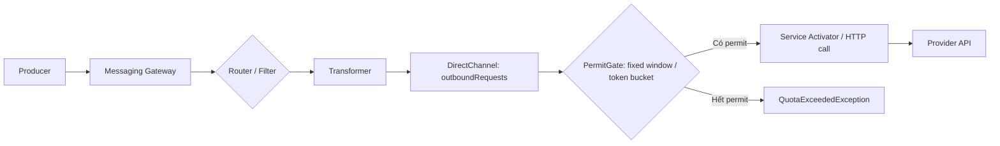
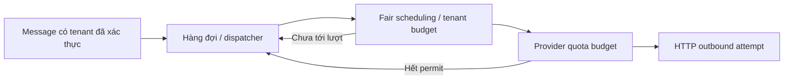

# Token bucket và fixed window trong Spring Integration

> **Module:** `SPRING_INTEGRATION_PATTERN` — Học triển khai Enterprise Integration Patterns với Spring Integration để xây dựng luồng thông điệp ít phụ thuộc và dễ mở rộng. Thực hành Router, Filter, Transformer, Splitter, Aggregator, Gateway, retry, error channel và correlation, đồng thời kiểm thử, theo dõi các nhánh xử lý.
>
> **Chương:** Rate limiter  
> **Đề bài:** Token bucket và fixed window

## 1. Tại sao cần hiểu thuật toán phía sau rate limiter?

Giả sử hệ thống nhận thông điệp đặt hàng và phải gọi API của đối tác vận chuyển. Đối tác cho phép tối đa 60 request/phút. Trong giờ cao điểm, một loạt 20 đơn hàng có thể đến cùng lúc, sau đó không có đơn mới trong nhiều giây.

Hai cách giới hạn phổ biến cho tình huống này là:

- **Fixed window:** chia thời gian thành các khoảng cố định và chỉ cho phép tối đa một số lượt trong mỗi khoảng.
- **Token bucket:** duy trì một “xô” token có dung lượng giới hạn; token được bổ sung theo tốc độ đều và mỗi lượt xử lý tiêu thụ token.

Cả hai đều hỗ trợ ra quyết định **cho phép hay từ chối một lượt xử lý**, nhưng tạo hành vi rất khác nhau trước lưu lượng đột biến (*burst*). Hiểu khác biệt giúp chọn thuật toán phù hợp trước khi cấu hình Router, Filter, Transformer, Splitter, Aggregator, Gateway hoặc một outbound handler trong Spring Integration.

Sau bài này, người học có thể giải thích nguyên tắc của mỗi thuật toán, tự tính số request có thể đi qua theo một lịch thời gian, triển khai bản minh họa Java an toàn trong một JVM, kết nối với `@ServiceActivator`, kiểm thử ở ranh giới cửa sổ và nhận biết giới hạn khi triển khai nhiều replica.

## 2. Một vài khái niệm phải phân biệt

**Rate** là tốc độ trung bình theo thời gian: ví dụ 10 request/giây hoặc 600 request/phút. **Burst** là một nhóm request đến trong khoảng rất ngắn. **Permit** là quyền đi vào bước xử lý; với token bucket, permit thường tương ứng một token. **Concurrency** là số request đang xử lý đồng thời.

Rate limiter không đồng nghĩa với semaphore hay giới hạn số thread. Một handler nhận 10 permit có thể đồng thời xử lý nhiều request kéo dài vài giây. Nếu cần khống chế số kết nối HTTP đang mở, phải kết hợp giới hạn concurrency hoặc connection pool.

Cũng cần xác định rõ *một lượt* là gì:

| Điểm đặt limiter | Đơn vị được đếm | Ví dụ |
|---|---|---|
| Trước Splitter | Message đầu vào | Một message tạo 5 request vẫn chỉ lấy 1 permit |
| Sau Splitter, trước HTTP handler | Lượt gửi ra đối tác | Năm message con gọi HTTP cần 5 permit |
| Trước Aggregator | Message thành phần | N message cho một batch tốn N permit |
| Sau Aggregator, trước HTTP handler | Batch/request HTTP | N message gom thành 1 HTTP request tốn 1 permit |
| Tại endpoint tạo request retry | Mỗi attempt đi ra mạng | Retry cũng tiêu thụ quota |

Nếu đối tác tính tiền hoặc quota theo **số item trong một batch** thay vì số request HTTP, việc mỗi request lấy một permit có thể chưa đủ. Khi đó, cần chính sách permit theo trọng số hoặc bộ đếm đơn vị tiêu thụ.

## 3. Fixed window: đếm số lượt trong mỗi cửa sổ cố định

### 3.1. Nguyên tắc

Chọn:

- \(W\): độ dài một cửa sổ, ví dụ 1 giây.
- \(L\): số request tối đa được chấp nhận trong một cửa sổ.
- \(C\): bộ đếm request đã được chấp nhận trong cửa sổ hiện tại.

Với mốc thời gian \(t\), chỉ số cửa sổ có thể định nghĩa là:

\[
k = \left\lfloor \frac{t}{W} \right\rfloor
\]

Khi request đến:

1. Tính cửa sổ \(k\) của request.
2. Nếu đã sang cửa sổ mới, đặt lại bộ đếm về 0.
3. Nếu \(C < L\), tăng \(C\) và chấp nhận.
4. Nếu \(C \geq L\), từ chối hoặc chuyển sang cơ chế chờ/retry của hệ thống.

Ví dụ **5 request/giây**:

| Thời điểm trong cửa sổ | Số lượt đã dùng | Request mới | Quyết định |
|---|---:|---|---|
| 0,20 s | 0 | Request A | Cho phép, bộ đếm = 1 |
| 0,40 s | 1 | Request B | Cho phép, bộ đếm = 2 |
| 0,60 s | 2 | Ba request tiếp theo | Cho phép cả ba, bộ đếm = 5 |
| 0,90 s | 5 | Request F | Từ chối |
| 1,00 s | Cửa sổ mới | Request G | Cho phép, bộ đếm = 1 |

Ưu điểm là thuật toán đơn giản, dễ đo và dễ biểu diễn qua bộ đếm nguyên.

### 3.2. Vấn đề ranh giới cửa sổ

Fixed window có thể cho phép hai nhóm request sát nhau ngay tại chỗ chuyển cửa sổ:

```text
Giới hạn: 5 request / cửa sổ 1 giây

Cửa sổ [0, 1):                         Cửa sổ [1, 2):
 0.990 s  ● ● ● ● ●  (5 request)        1.010 s  ● ● ● ● ●  (5 request)
          |---------------------|---------------|
                  biên cửa sổ: 1.000 s

=> 10 request được chấp nhận trong 20 ms.
```

Vì vậy, “tối đa 5 request trong mỗi cửa sổ cố định 1 giây” **không tương đương** “không bao giờ quá 5 request trong bất kỳ khoảng 1 giây trượt nào”. Với fixed window, một khoảng trượt đi qua ranh giới có thể chứa gần \(2L\) lượt.

Điểm này đặc biệt quan trọng nếu API đối tác thực thi sliding-window quota hoặc một thuật toán làm mượt burst. Cài fixed window phía client có thể vẫn nhận HTTP 429 từ đối tác.

## 4. Token bucket: tích lũy quyền xử lý, cho phép burst có kiểm soát

### 4.1. Nguyên tắc

Một token bucket gồm:

- \(B\): sức chứa tối đa của xô (*capacity*), ví dụ 5 token.
- \(r\): tốc độ nạp lại token (*refill rate*), ví dụ 1 token/giây.
- \(T(t)\): số token đang có ở thời điểm \(t\), luôn trong khoảng \([0, B]\).

Tại thời điểm \(\Delta t\) giây sau lần cập nhật trước, nếu bỏ qua lượng token đã tiêu thụ trong khoảng này:

\[
T_{\text{mới}} = \min(B,\; T_{\text{cũ}} + r\Delta t)
\]

Khi một request cần 1 token:

1. Cập nhật lượng token theo thời gian đã trôi qua.
2. Nếu còn ít nhất 1 token, trừ 1 rồi cho phép request.
3. Nếu không đủ token, từ chối ngay hoặc chờ theo chính sách ngoài bộ đếm.

**Tốc độ bền vững** được chi phối bởi \(r\); **burst tức thời tối đa** khi xô đầy được chi phối bởi \(B\). Trong khoảng dài \(\Delta t\), số request được chấp nhận có giới hạn xấp xỉ \(B + r\Delta t\) nếu mỗi request tiêu thụ đúng một token, với lượng token ban đầu không vượt \(B\).

### 4.2. Minh họa tính toán

Đặt \(B = 5\) token, \(r = 1\) token/giây và xô ban đầu đầy:

| Thời điểm | Trạng thái trước request | Diễn biến | Token còn lại |
|---|---|---|---:|
| 0,0 s | 5 | Năm request đến đồng thời, đều được phép | 0 |
| 0,3 s | 0,3 | Một request cần 1 token, bị từ chối | 0,3 |
| 1,0 s | 1,0 | Một request được phép | 0 |
| 2,5 s | 1,5 | Một request được phép | 0,5 |
| 7,0 s | 5,0 (chạm dung lượng tối đa) | Một request được phép | 4,0 |

Những phần token lẻ phản ánh lượng đã nạp nhưng chưa đủ cho một request. Một triển khai khác có thể nạp token theo từng bước nguyên; khi ấy các thời điểm chấp nhận cụ thể thay đổi nhưng vẫn giữ nguyên ý tưởng giới hạn dung lượng và tốc độ nạp.

### 4.3. Token bucket không tự biến message thành hàng đợi

Khi thiếu token, một chương trình có thể:

- **Fail fast:** báo thiếu permit ngay, không giữ thread.
- **Chờ có timeout:** chờ token được nạp hoặc bị từ chối khi hết thời gian.
- **Xếp hàng:** để message ở broker/queue, sau đó consumer thử lại.

Thuật toán token bucket chỉ mô tả **khi nào có thể cấp permit**. Độ bền của message, cách retry, timeout, backpressure và tránh mất/trùng message là các phần thiết kế riêng.

## 5. So sánh token bucket và fixed window

| Tiêu chí | Fixed window | Token bucket |
|---|---|---|
| Tham số chính | \(L\) lượt / \(W\) thời gian | \(B\) dung lượng, \(r\) token/giây |
| State tối thiểu | Cửa sổ hiện tại, bộ đếm | Token hiện có, thời điểm nạp gần nhất |
| Burst khi bắt đầu | Cho phép tối đa \(L\) mỗi cửa sổ | Cho phép tối đa \(B\) khi xô đầy |
| Ranh giới thời gian | Có thể nhận \(2L\) gần ranh giới hai cửa sổ | Không có reset đột ngột; nạp dần theo thời gian |
| Tận dụng thời gian nhàn rỗi | Cửa sổ mới chỉ reset lượt, không “tích lũy” từ nhiều cửa sổ | Token có thể tích lũy đến \(B\) |
| Hợp với | Quota theo kỳ được nhà cung cấp định nghĩa rõ | Làm mượt tốc độ và cho phép burst có trần |
| Hạn chế | Burst lớn ở ranh giới; khác sliding window | Cần quản lý thời gian nạp, trạng thái và cấu hình burst |

**Ví dụ chọn tham số:** một hệ thống muốn trung bình 60 request/phút, cho phép tối đa 10 request bất ngờ cùng lúc. Token bucket có thể dùng \(B=10\), \(r=1\) token/giây. Nếu thay bằng fixed window \(L=60\), \(W=60\) giây, hệ thống có thể phát cả 60 request ngay đầu phút — không phù hợp nếu đối tác cần lưu lượng trải đều.

Cũng không nên chọn token bucket nếu hợp đồng API yêu cầu “không quá 10 request trong mọi cửa sổ 60 giây trượt” mà không kiểm chứng; khi yêu cầu là **sliding-window chính xác**, cần một thuật toán hoặc cơ chế thực thi phù hợp hơn.

## 6. Đặt thuật toán trong Spring Integration

Ta muốn giới hạn **mỗi lượt đi vào handler gửi request** thay vì đếm message ở các bước trung gian.



Mẫu dưới đây minh họa **hai thuật toán bằng Java thuần**, vì như vậy có thể thấy chính xác nơi đếm permit. Nó thích hợp cho việc học hoặc ứng dụng nhỏ chạy một JVM. Trong ứng dụng sản xuất, nên cân nhắc thư viện đã được kiểm thử, khả năng quan sát và cơ chế chia sẻ state khi nhiều instance.

Các ví dụ dùng **Java 17+**, `System.nanoTime()` làm đồng hồ **monotonic** để tính thời gian trôi qua và `synchronized` để tránh hai thread cùng vượt quota trong một JVM. Đồng hồ có thể được truyền vào để kiểm thử không cần `Thread.sleep()`.

### 6.1. Interface thống nhất

File `PermitGate.java`:

```java
package com.example.ratelimiter;

public interface PermitGate {
    // Đúng một outbound attempt tiêu thụ một permit.
    boolean tryAcquire();
}
```

Interface này chỉ quyết định có permit **ngay thời điểm gọi**. Nó không chờ, không tự retry và không lưu message.

### 6.2. Token bucket có nạp dần theo thời gian

File `TokenBucketGate.java`:

```java
package com.example.ratelimiter;

import java.util.function.LongSupplier;

public final class TokenBucketGate implements PermitGate {
    private static final double NANOS_PER_SECOND = 1_000_000_000.0;

    private final int capacity;
    private final double refillPerSecond;
    private final LongSupplier nanoTicker;

    private double tokens;
    private long lastRefillNanos;

    public TokenBucketGate(
            int capacity,
            double refillPerSecond,
            LongSupplier nanoTicker) {

        if (capacity <= 0
                || !Double.isFinite(refillPerSecond)
                || refillPerSecond <= 0.0) {
            throw new IllegalArgumentException("Invalid bucket settings");
        }

        this.capacity = capacity;
        this.refillPerSecond = refillPerSecond;
        this.nanoTicker = java.util.Objects.requireNonNull(nanoTicker);
        this.tokens = capacity;             // Ban đầu xô đầy.
        this.lastRefillNanos = nanoTicker.getAsLong();
    }

    @Override
    public synchronized boolean tryAcquire() {
        long now = nanoTicker.getAsLong();
        long elapsedNanos = now - lastRefillNanos;

        if (elapsedNanos > 0L) {
            double refill = (elapsedNanos / NANOS_PER_SECOND)
                    * refillPerSecond;
            tokens = Math.min(capacity, tokens + refill);
            lastRefillNanos = now;
        }

        if (tokens < 1.0) {
            return false;
        }

        tokens -= 1.0;
        return true;
    }
}
```

**Giải thích:**

- `capacity` là lượng permit tối đa được tích lũy; thời gian nhàn rỗi không thể tạo lượng token lớn hơn trần này.
- `refillPerSecond` điều khiển tốc độ dài hạn; ví dụ 2.5 là trung bình 2,5 token/giây.
- `System.nanoTime()` phù hợp đo thời gian trôi qua và không phụ thuộc việc chỉnh giờ hệ thống.
- `synchronized` làm thao tác nạp và tiêu thụ token thành một vùng tới hạn trong **một đối tượng, một JVM**.
- Ví dụ dùng `double` cho dễ hiểu; khi cần hạn mức tiền tệ, số lượng cực lớn, trọng số phức tạp hoặc bảo đảm mạnh, nên dùng thư viện chuyên dụng và kiểm chứng sai số số học.

Hàm `tryAcquire()` không gọi HTTP. Vì thế, không thể xem việc nhận permit là “gửi thành công”; nó chỉ cấp quyền **bắt đầu attempt**.

### 6.3. Fixed window với bộ đếm nguyên

File `FixedWindowGate.java`:

```java
package com.example.ratelimiter;

import java.time.Duration;
import java.util.Objects;
import java.util.function.LongSupplier;

public final class FixedWindowGate implements PermitGate {

    private final int limit;
    private final long windowNanos;
    private final LongSupplier nanoTicker;

    private long activeWindow = Long.MIN_VALUE;
    private int used = 0;

    public FixedWindowGate(
            int limit,
            Duration window,
            LongSupplier nanoTicker) {

        Objects.requireNonNull(window);
        if (limit <= 0 || window.isNegative() || window.isZero()) {
            throw new IllegalArgumentException("Invalid window settings");
        }

        this.windowNanos = window.toNanos();
        this.limit = limit;
        this.nanoTicker = Objects.requireNonNull(nanoTicker);
    }

    @Override
    public synchronized boolean tryAcquire() {
        // Các cửa sổ cố định theo gốc của đồng hồ monotonic.
        long now = nanoTicker.getAsLong();
        long windowIndex = Math.floorDiv(now, windowNanos);

        if (windowIndex != activeWindow) {
            activeWindow = windowIndex;
            used = 0;
        }

        if (used >= limit) {
            return false;
        }

        used++;
        return true;
    }
}
```

Cứ sang cửa sổ mới, bộ đếm được reset. `Math.floorDiv` giúp chia chính xác cả khi giá trị `nanoTime()` âm do gốc thời gian của JVM là tùy ý. Cửa sổ ở đây **cố định so với gốc đồng hồ monotonic**, không nhất thiết trùng mốc phút/giây UTC của đối tác. Nếu nhà cung cấp yêu cầu reset tại đúng 00:00 UTC hoặc đầu mỗi phút UTC, cần một biến thể sử dụng mốc thời gian và xử lý thay đổi đồng hồ thích hợp.

Đoạn code giả định `Duration` có thể biểu diễn thành `long` nanosecond và `nanoTicker` luôn tiến lên (như `System.nanoTime`). Phạm vi `Duration` bất thường quá lớn có thể khiến `toNanos()` báo lỗi; trong cấu hình thực tế nên dùng khoảng giây/phút hợp lý.

### 6.4. Lựa chọn thuật toán qua Spring bean

Ví dụ Spring Boot có dependencies phù hợp với phiên bản Spring Integration đang sử dụng:

```groovy
dependencies {
    implementation "org.springframework.boot:spring-boot-starter-integration"
}
```

Ứng dụng bật cấu hình integration và quét Gateway:

```java
package com.example.ratelimiter;

import org.springframework.boot.SpringApplication;
import org.springframework.boot.autoconfigure.SpringBootApplication;
import org.springframework.integration.annotation.IntegrationComponentScan;
import org.springframework.integration.config.EnableIntegration;

@SpringBootApplication
@EnableIntegration
@IntegrationComponentScan
public class RateLimiterApplication {

    public static void main(String[] args) {
        SpringApplication.run(RateLimiterApplication.class, args);
    }
}
```

File `RateLimitConfiguration.java`:

```java
package com.example.ratelimiter;

import java.time.Duration;

import org.springframework.context.annotation.Bean;
import org.springframework.context.annotation.Configuration;
import org.springframework.integration.channel.DirectChannel;
import org.springframework.messaging.MessageChannel;

@Configuration
public class RateLimitConfiguration {

    @Bean
    public MessageChannel outboundRequests() {
        return new DirectChannel();
    }

    @Bean("outboundPermitGate")
    public PermitGate outboundPermitGate() {
        // Token bucket: burst tối đa 5, nạp 5 token/giây.
        return new TokenBucketGate(5, 5.0, System::nanoTime);

        // Thử fixed window bằng cách thay dòng return:
        // return new FixedWindowGate(
        //        5, Duration.ofSeconds(1), System::nanoTime);
    }
}
```

`@Bean` mặc định tạo một đối tượng singleton trong application context. Các request sử dụng **cùng bean** này sẽ chia sẻ state limiter của một JVM.

File `PartnerGateway.java`:

```java
package com.example.ratelimiter;

import org.springframework.integration.annotation.MessagingGateway;

@MessagingGateway(defaultRequestChannel = "outboundRequests")
public interface PartnerGateway {
    String send(String payload);
}
```

File `OutboundHandler.java`:

```java
package com.example.ratelimiter;

import org.springframework.beans.factory.annotation.Qualifier;
import org.springframework.integration.annotation.ServiceActivator;
import org.springframework.stereotype.Component;

@Component
public class OutboundHandler {

    private final PermitGate gate;

    public OutboundHandler(
            @Qualifier("outboundPermitGate") PermitGate gate) {
        this.gate = gate;
    }

    @ServiceActivator(inputChannel = "outboundRequests")
    public String sendToProvider(String payload) {
        if (!gate.tryAcquire()) {
            throw new QuotaExceededException(
                    "No permit for provider outbound request");
        }

        // Demo: thay bằng một HTTP attempt thật.
        return "accepted: " + payload;
    }

    public static final class QuotaExceededException
            extends RuntimeException {
        public QuotaExceededException(String message) {
            super(message);
        }
    }
}
```

Luồng vận hành:

1. Caller gọi `partnerGateway.send("order-123")`.
2. Gateway gửi message vào `DirectChannel("outboundRequests")`.
3. `@ServiceActivator` kiểm tra permit từ **một** `outboundPermitGate`.
4. Nếu có permit, handler thực thi và Gateway nhận reply; nếu hết permit, handler ném `QuotaExceededException`, thường truyền ngược về caller của flow đồng bộ.
5. Nếu thay stub bằng HTTP client, mỗi attempt thực sự gửi phải đi qua kiểm tra permit. Đặt retry **bên trong** đoạn sau `tryAcquire()` có thể tạo nhiều HTTP attempt nhưng chỉ lấy một permit — cần tránh.

**Lưu ý kỹ thuật:** Đây là bộ giới hạn tự cài minh họa cho mục đích học thuật, được đặt trong handler. Spring Integration còn có `RateLimiterRequestHandlerAdvice` dùng Resilience4j, có thể bọc handler mà không cần tự viết `if (!gate.tryAcquire())`. Tuy nhiên, thuật toán của bộ limiter Resilience4j cấu hình theo `limitForPeriod` và `limitRefreshPeriod` dựa trên cơ chế cấp permit theo chu kỳ, **không nên mặc nhiên gọi nó là token bucket liên tục như ví dụ ở trên**, cũng không xem nó là sliding-window limiter. Chọn thư viện và cách gắn advice dựa trên semantics quota thực tế.

## 7. Kiểm thử deterministic: điều khiển thời gian thay vì ngủ

Để chứng minh tính đúng đắn của hai thuật toán, truyền `LongSupplier` lấy thời gian từ một `AtomicLong` được điều khiển trong bài test. Nhờ đó không cần đợi 1 giây thật và không có race với ranh giới thời gian của máy.

Đây là các ví dụ JUnit 5; thêm `testImplementation "org.junit.jupiter:junit-jupiter"` và cấu hình JUnit Platform theo build của dự án nếu muốn chạy.

### 7.1. Token bucket: cạn token và nạp thêm

```java
package com.example.ratelimiter;

import static org.junit.jupiter.api.Assertions.*;

import java.util.concurrent.atomic.AtomicLong;
import org.junit.jupiter.api.Test;

class RateLimiterGateTest {

    @Test
    void tokenBucketRefillsOverTime() {
        AtomicLong nanos = new AtomicLong(0L);
        TokenBucketGate gate =
                new TokenBucketGate(3, 1.0, nanos::get);

        assertTrue(gate.tryAcquire());
        assertTrue(gate.tryAcquire());
        assertTrue(gate.tryAcquire());
        assertFalse(gate.tryAcquire());

        nanos.addAndGet(1_000_000_000L); // 1 giây
        assertTrue(gate.tryAcquire());     // Vừa nạp thêm 1 token
        assertFalse(gate.tryAcquire());    // Đã tiêu thụ token đó

        nanos.addAndGet(3_000_000_000L);
        assertTrue(gate.tryAcquire());     // Xô có tối đa 3 token
        assertTrue(gate.tryAcquire());
        assertTrue(gate.tryAcquire());
        assertFalse(gate.tryAcquire());
    }

    @Test
    void fixedWindowResetsAtTheBoundary() {
        AtomicLong nanos = new AtomicLong(999_000_000L);
        FixedWindowGate gate = new FixedWindowGate(
                2, java.time.Duration.ofSeconds(1), nanos::get);

        assertTrue(gate.tryAcquire());
        assertTrue(gate.tryAcquire());
        assertFalse(gate.tryAcquire());

        nanos.set(1_001_000_000L); // Cách mốc trước chỉ 2 ms
        assertTrue(gate.tryAcquire());
        assertTrue(gate.tryAcquire());
        assertFalse(gate.tryAcquire());
        // Đã cho qua 4 lượt trong 2 ms quanh ranh giới.
    }
}
```

Hai test minh họa rõ **khác biệt về cách cấp lại permit**: token bucket chỉ nạp theo lượng thời gian trôi qua, trong khi fixed window reset toàn bộ hạn mức ngay lúc chuyển cửa sổ.

### 7.2. Kiểm thử concurrent

Vì nhiều message có thể tới cùng lúc, cần kiểm tra nhiều thread gọi `tryAcquire()` trên **cùng một limiter**. Với một xô ban đầu có 5 token, tốc độ nạp rất thấp, cho 50 thread thử cùng lúc tại cùng giá trị ticker thì đúng **5 lần được phép**. Nếu bỏ `synchronized`, nhiều thread có thể cùng thấy state cũ và cấp quá số token.

Khi test concurrent, hãy chốt ticker vào một mốc giả lập (không tự tăng), dùng `ExecutorService` và đồng bộ thời điểm bắt đầu bằng `CountDownLatch`. Đếm số lượt được chấp nhận và luôn giải phóng executor sau test. Không nên dựa vào thứ tự phản hồi của thread để đánh giá thuật toán; thứ tự đó phụ thuộc scheduler.

### 7.3. Kiểm thử tích hợp với Gateway

| Tình huống | Dữ liệu | Điều cần xác minh |
|---|---|---|
| Xô đầy | Bucket \(B=3,r=1/s\), ba lần gửi liên tiếp | Ba lần vào handler |
| Xô cạn | Gửi lần thứ tư ngay lập tức | Lỗi quota; handler HTTP không được gọi |
| Nạp lại | Tiến đồng hồ giả lập thêm 1 giây | Một request mới có thể qua |
| Cửa sổ đầy | Window \(L=2,W=1s\), ba request | Chỉ hai lượt qua |
| Ranh giới hai cửa sổ | Gửi ở 0,999 s và 1,001 s | Reset có thể tạo burst gần nhau |
| Retry | Stub HTTP trả 429 rồi 200 | Hai attempt HTTP cần được kiểm tra permit riêng |
| Async | Message qua poller/queue | Lỗi quota được retry hoặc chuyển xử lý lỗi theo chính sách |

Trong kiểm thử Gateway thực tế, có thể dùng stub HTTP thay cho đối tác, đếm request **đã gửi ra ngoài** và bảo đảm không có retry ngầm làm sai số lượng được chấp nhận.

## 8. Chọn thuật toán theo flow, tenant và endpoint

Khi thiết kế Enterprise Integration Patterns, thuật toán và **phạm vi state quota** là hai quyết định độc lập.

| Phạm vi | Khóa limiter | Ví dụ |
|---|---|---|
| Flow | `flow:checkout` | Flow đơn hàng dùng bucket \(B=10,r=5/s\) |
| Tenant | `tenant:org-17` | Mỗi tenant có cửa sổ 30 req/phút |
| Endpoint | `provider-a:/messages:api-key-1` | Quota tổng của các flow gọi cùng API key |
| Nhóm endpoint | `provider-a:api-key-1:all` | Tổng quota tính trên tất cả đường dẫn HTTP |

Nếu hai flow cùng dùng một API key, việc tạo hai limiter độc lập với cùng cấu hình **không bảo vệ tổng quota**. Cần chia sẻ **cùng state** trong JVM hoặc dùng một outbound dispatcher/chính sách quota toàn cục. Nếu nhiều tenant dùng chung một quota provider, mỗi tenant có bucket riêng vẫn chưa bảo đảm tổng outbound không vượt quota provider.

Với token bucket **theo tenant**, có thể dùng `ConcurrentHashMap<String, PermitGate>` và `computeIfAbsent` để tạo một bucket cho mỗi tenant trên JVM. Tuy nhiên phải lấy tenant ID từ ngữ cảnh đã xác thực, tránh để caller tự chọn vô hạn ID nhằm né quota; quản lý vòng đời và giới hạn số khóa để tránh tăng bộ nhớ. Việc xóa rồi tạo mới state sẽ làm quota tenant được nạp lại bất ngờ.

Nếu cần đồng thời bảo vệ quota provider và quota từng tenant:



Sơ đồ thể hiện ý tưởng thiết kế, không phải cơ chế được Spring Integration tự sinh. Đặc biệt, việc **xin permit tại nhiều limiter lần lượt không phải giao dịch nguyên tử**: permit ở tầng tenant có thể đã bị tiêu thụ dù tầng provider từ chối. Nếu cần fairness và sử dụng quota hiệu quả, hãy thiết kế dispatcher cấp lịch gửi rõ ràng, cân nhắc cơ chế reservation hoặc một scheduler theo chính sách.

## 9. Hành vi khi hết permit: retry, error channel và backpressure

### 9.1. Đồng bộ với DirectChannel

Trong ví dụ handler ở trên, `tryAcquire()` trả về ngay. Nếu thiếu permit, exception đi ngược qua Gateway. Lớp REST phía ngoài có thể ánh xạ lỗi này thành HTTP 429 hoặc một mã nghiệp vụ thích hợp, nhưng **Spring Integration không tự động biến exception thành HTTP 429**.

Nếu một limiter khác có cơ chế chờ permit, thời gian chờ sẽ giữ thread của flow đồng bộ. Đặt thời gian chờ phù hợp ngân sách latency của Gateway/HTTP request, tránh làm đầy thread pool.

### 9.2. Async với queue hoặc broker

Khi message quan trọng phải được xử lý cuối cùng, gửi message vào hàng đợi rồi cho consumer thử lấy permit:

```text
Producer -> persistent broker -> consumer -> limiter -> outbound API
                                   |
                         không đủ permit / lỗi
                                   |
                         delay + retry / DLQ
```

Chọn thời gian retry theo dự đoán lúc có token hoặc cửa sổ mới, kết hợp jitter để tránh các consumer cùng tỉnh dậy. `QueueChannel` trong bộ nhớ không mặc nhiên giữ message qua restart. Với nghiệp vụ quan trọng cần broker hoặc message store bền vững và cơ chế acknowledgment phù hợp.

### 9.3. Retry cần đi qua limiter ở mỗi attempt

Ví dụ request HTTP lần đầu trả 503, lần hai thành công: nhà cung cấp có thể tính **hai request**. Nếu `tryAcquire()` chỉ chạy trước toàn bộ vòng retry, hệ thống đã tiêu thụ một permit nhưng tạo hai request. Cần đặt bộ giới hạn ngay tại **mỗi outbound attempt**, hoặc sắp xếp advice chain sao cho mỗi lần retry đi qua limiter.

Lỗi thiếu permit nội bộ và lỗi HTTP 429 từ đối tác cần được phân biệt trong metric, retry policy và thông báo. Với HTTP 429, ưu tiên tuân theo `Retry-After` nếu có, rồi mới áp dụng backoff với jitter và số lần thử hữu hạn.

### 9.4. Error channel và correlation

Trong flow đồng bộ, exception thường truyền về caller; trong flow bất đồng bộ, lỗi có thể được đưa vào `ErrorMessage` trên error channel, hoặc consumer/broker adapter xử lý theo cách riêng. Đừng giả định mọi lỗi tự động xuất hiện trong global `errorChannel`.

Khi Splitter tạo message con, giữ message ID, correlation ID, sequence và tenant identity cần thiết để retry/idempotency. Khi Aggregator gom batch, xác định quota theo **request batch** hay **số phần tử** theo hợp đồng API.

## 10. Giới hạn của một JVM và hệ thống phân tán

Cả hai class Java ở ví dụ chỉ đồng bộ thread **trong một JVM**. Khi có ba instance, mỗi instance có bucket \(B=5,r=5/s\), ba instance có thể cùng phát burst 15 request và tốc độ trung bình khoảng 15 request/giây. Tương tự, ba bộ đếm fixed window độc lập không hình thành một quota chung.

Nếu đối tác tính hạn mức theo **API key dùng chung toàn hệ thống**, lựa chọn có thể là:

1. Đưa toàn bộ outbound qua **một dispatcher** có trạng thái quota chung.
2. Dùng **rate limiter phân tán** với thao tác lấy permit nguyên tử tại một nơi quản lý chung (ví dụ cơ chế có trạng thái trong Redis, thực thi atomically).
3. Phân bổ quota cục bộ theo replica cùng mức dự phòng; cách này chỉ phù hợp khi kiểm soát số replica, burst và tổng ngân sách đủ chặt.

Với distributed fixed window, chỉ dùng `GET` rồi `INCR` riêng lẻ ở Redis có thể tạo race. Bộ đếm, bước kiểm tra và TTL cần một thao tác nguyên tử theo key/window. Với distributed token bucket, cả bước nạp và trừ token cần atomicity. Cũng phải xác định cách xử lý khi nơi quản lý quota không khả dụng: **fail closed** giúp bảo vệ quota nhưng giảm availability; **fail open** giữ luồng chạy nhưng có thể vượt hạn mức.

Chênh lệch đồng hồ giữa máy, thay đổi số replica, restart, retry và mất kết nối đều có thể thay đổi hành vi quota. Đặc biệt, trong một JVM, `System.nanoTime()` phù hợp tính elapsed time; **không thể dùng trực tiếp giá trị nanoTime của nhiều JVM làm mốc chung** vì gốc thời gian khác nhau.

## 11. Quan sát và cấu hình thực tế

### Metrics

- `allowed_requests_total` và `rejected_requests_total` theo tên/quota group.
- Token còn lại (`available_tokens`) hoặc lượt đã dùng trong cửa sổ hiện tại.
- HTTP outbound attempts thực tế, response code 429/503 và latency tới provider.
- Độ sâu queue, tuổi message lâu nhất, retry count và DLQ.
- Mức sử dụng quota theo flow/tenant/endpoint, nhưng tránh đưa tenant ID không giới hạn thành nhãn metrics có cardinality cao.

Log nên có quota key ở dạng an toàn, message ID, correlation ID, outcome và reason code. Không ghi nguyên API key, credential hay payload nhạy cảm.

### Quy tắc chọn cấu hình

**Bước 1:** hỏi rõ điều khoản quota của provider: theo rolling window, fixed window UTC, token bucket, API key, endpoint, tài khoản hay số item.

**Bước 2:** chọn thuật toán đúng semantics: fixed window chỉ khi quota cho phép reset theo kỳ; token bucket khi cần giới hạn tốc độ dài hạn và burst có trần.

**Bước 3:** xác định phạm vi chia sẻ state. Nếu hai flow cùng một credential, cần bộ ngân sách tổng; nếu nhiều tenant, thêm chính sách fairness hoặc hạn mức riêng.

**Bước 4:** quyết định thiếu permit sẽ fail fast hay enqueue; thiết kế timeout, backoff, ack/retry và idempotency.

**Bước 5:** kiểm thử ranh giới, đồng thời, nhiều replica, restart và lỗi coordinator; đo **HTTP attempts thực tế** chứ không chỉ đếm message trước Router.

## 12. Bài tập thực hành

**Bài 1 — Mô phỏng cùng một tải.** Dùng 5 permit/giây cho fixed window, và token bucket \(B=5,r=5/s\). Gửi năm request ở 0,990 giây, sau đó năm request ở 1,010 giây. Ghi rõ mỗi thuật toán chấp nhận bao nhiêu lượt và vì sao không nên đánh đồng chúng.

**Bài 2 — Burst theo nghiệp vụ.** Một API gửi email có giới hạn trung bình 120 req/phút nhưng chấp nhận burst tối đa 10. Đề xuất `capacity` và `refillPerSecond` cho token bucket. Giải thích lượng token có sau 4 giây không có request, rồi thử với 12 request đến cùng lúc.

**Bài 3 — Tích hợp Spring Integration.** Từ ví dụ Gateway/ServiceActivator, chuyển bean `outboundPermitGate` từ token bucket sang fixed window. Dùng stub handler ghi số request đã thực thi. Kiểm thử trường hợp hết quota và xử lý exception ở tầng caller.

**Bài 4 — Sau Splitter.** Một message đầu vào chứa 100 đơn hàng; Splitter tạo 100 message con và mỗi message gọi một HTTP request. Đặt limiter đúng nơi để tính 100 outbound attempts. Nêu cách giữ correlation ID, retry và tránh gửi trùng.

**Bài 5 — Multi-instance.** Một API key được chia sẻ bởi bốn replica. Mỗi replica có bucket \(B=10,r=10/s\), trong khi tổng quota của provider là 20 request/giây. Giải thích mức vượt quota có thể xảy ra và phác thảo cách điều phối chung.

**Câu hỏi tự kiểm tra:**

1. Vì sao fixed window `limit=10, period=1s` vẫn có thể cho 20 request đi qua rất sát nhau?
2. Token bucket có `capacity=10, refillRate=1/s` đã cạn token; sau 2 giây có thể cấp bao nhiêu permit một token cho mỗi request?
3. Điểm khác nhau giữa việc tiêu thụ một token và việc giữ một slot trong semaphore là gì?
4. Vì sao `System.nanoTime()` hợp lý trong một JVM nhưng không thể dùng làm thời gian tuyệt đối chia sẻ giữa các instance?
5. Nếu retry HTTP ba lần sau một lần lấy permit thì tác động tới quota provider như thế nào?
6. Nếu đối tác giới hạn tối đa N request trong **bất kỳ** khoảng 60 giây trượt nào, vì sao fixed window 60 giây chưa bảo đảm đáp ứng yêu cầu đó?

## 13. Tài liệu tham khảo

- [Spring Integration Reference — Request Handler Advice](https://docs.spring.io/spring-integration/reference/handler-advice.html): phạm vi áp dụng advice lên message handler.
- [Spring Integration Reference — Messaging Gateways](https://docs.spring.io/spring-integration/reference/gateway.html): Gateway và request-reply.
- [Spring Integration Reference — Error Handling](https://docs.spring.io/spring-integration/reference/error-handling.html): xử lý lỗi đồng bộ và bất đồng bộ.
- [Resilience4j — RateLimiter](https://resilience4j.readme.io/docs/ratelimiter): permit, chu kỳ và cấu hình rate limiter.
- [Bucket4j — Documentation](https://bucket4j.com/): ví dụ thư viện Java triển khai token bucket chuyên dụng.
