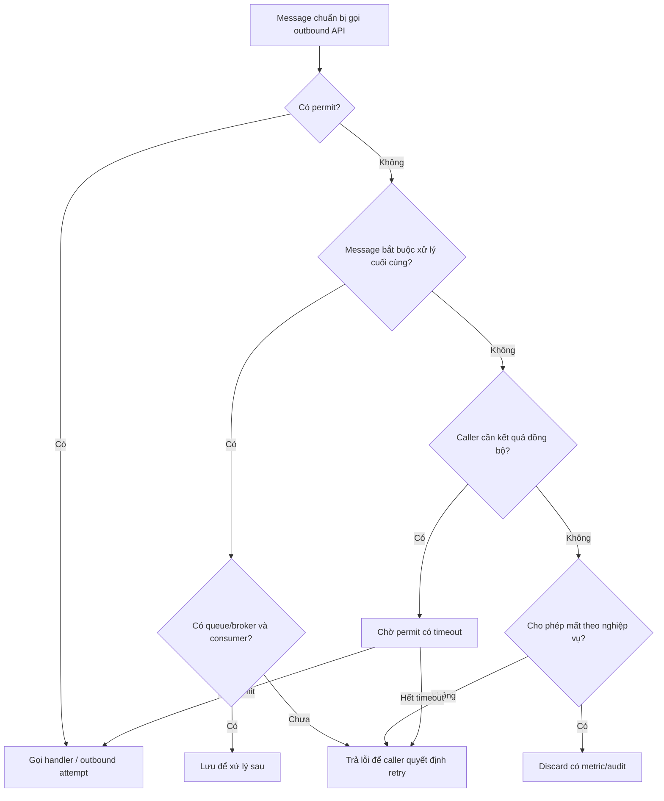
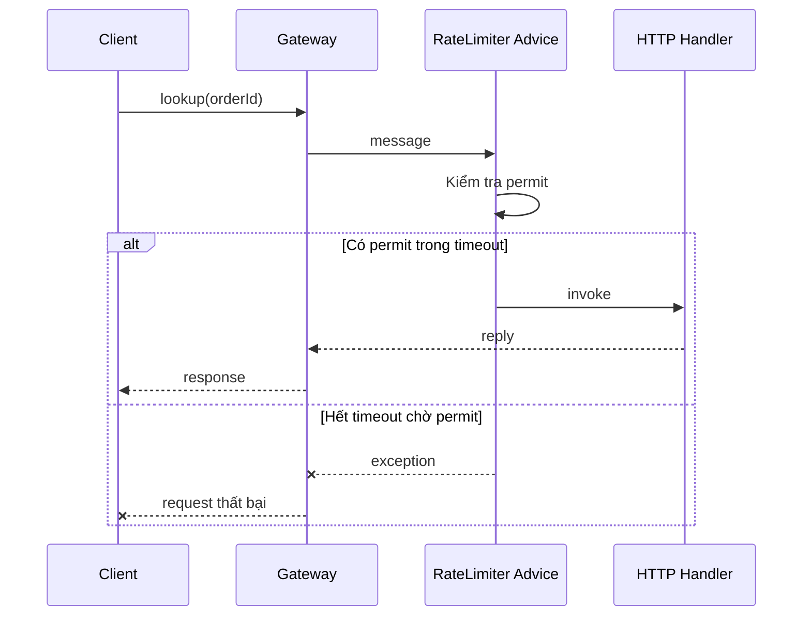
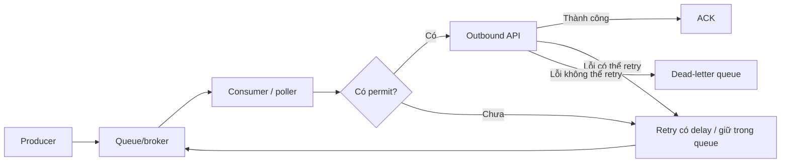
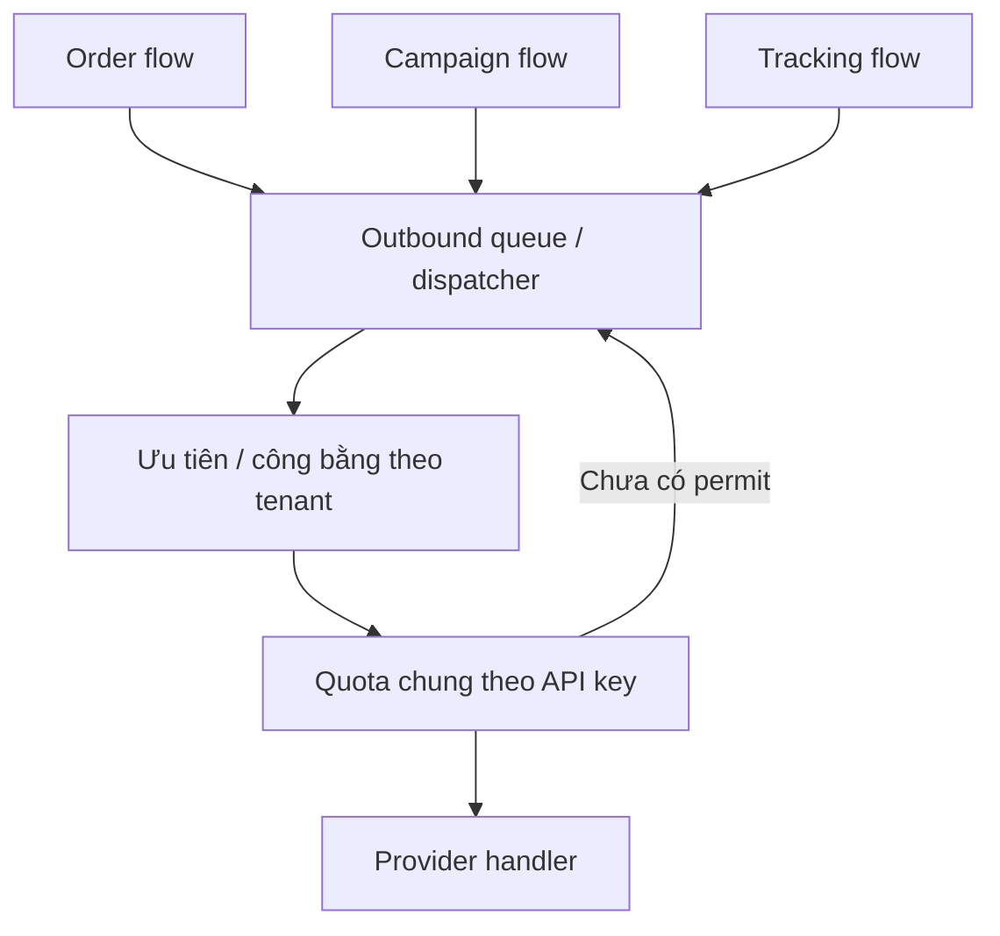

# Message bị chặn, trì hoãn hoặc loại bỏ khi áp dụng Rate Limiter

> **Module:** `SPRING_INTEGRATION_PATTERN` — Học triển khai Enterprise Integration Patterns với Spring Integration để xây dựng luồng thông điệp ít phụ thuộc và dễ mở rộng. Thực hành Router, Filter, Transformer, Splitter, Aggregator, Gateway, retry, error channel và correlation, đồng thời kiểm thử, theo dõi các nhánh xử lý.
>
> **Chương:** Rate limiter  
> **Đề bài:** Message bị chặn, trì hoãn hoặc loại bỏ

## 1. Vì sao hết permit không nhất thiết là một kiểu lỗi duy nhất?

Hệ thống đặt hàng nhận **100 message/giây**, nhưng API đối tác vận chuyển chỉ nhận được **20 request/giây**. Một rate limiter kiểm soát lượt được vào bước gửi API, song còn một quyết định nghiệp vụ quan trọng: **80 message chưa được cấp permit sẽ đi đâu?**

Có ba hành vi thường gặp:

1. **Chặn và chờ (block/wait):** lời gọi tạm dừng để đợi permit, tối đa trong thời gian đã cấu hình.
2. **Trì hoãn (delay/defer):** giữ message để xử lý ở thời điểm khác, thường thông qua queue/broker và consumer.
3. **Loại bỏ (discard/drop):** chủ động không xử lý tiếp message, khi nghiệp vụ cho phép mất hoặc bỏ qua bản tin đó.

Còn một lựa chọn liên quan là **từ chối ngay (fail fast/reject)**: báo cho bên gửi rằng lượt hiện tại không được chấp nhận. **Từ chối không đồng nghĩa với loại bỏ âm thầm.** Nếu bên gửi còn giữ message và retry đúng chính sách, message vẫn có thể được xử lý sau.

Bài này tập trung vào *đời sống của message khi rate limiter hết permit* trong module `SPRING_INTEGRATION_PATTERN`. Chúng ta sẽ dùng Spring Integration Gateway, Service Activator, Filter, channel, poller, error handling và retry để quyết định hành vi một cách tường minh.

## 2. Bảng quyết định: chờ, trì hoãn, từ chối hay bỏ?

| Chính sách | Điều gì xảy ra với message? | Caller có phải chờ? | Hợp với |
|---|---|---|---|
| **Chờ permit có timeout** | Message ở trong lời gọi xử lý hiện tại, chỉ đi tiếp khi được cấp permit | Có, nếu luồng đồng bộ | Request-reply ngắn, quota sẽ sớm hồi phục |
| **Từ chối ngay** | Không chạy handler; trả lỗi để bên gửi quyết định | Gần như không | API tương tác, caller có retry/backoff |
| **Trì hoãn bằng queue/broker** | Message được giữ để consumer xử lý sau | Không nhất thiết; producer và consumer tách nhau | Đơn hàng, sự kiện quan trọng, tải đột biến |
| **Loại bỏ có chủ đích** | Message dừng hẳn và có thể được ghi nhận qua discard flow | Thường không | Telemetry lấy mẫu, preview hoặc cập nhật trạng thái có thể bỏ |
| **Dead-letter sau nhiều lần thất bại** | Message chuyển tới nơi điều tra/replay | Tùy thiết kế | Lỗi kéo dài hoặc message không thể xử lý |

**Nguyên tắc:** Với message mang ý nghĩa nghiệp vụ quan trọng như “ghi nhận thanh toán” hoặc “tạo đơn hàng”, không tự ý bỏ message chỉ vì rate limiter hết permit. Cần đảm bảo đường retry, hàng đợi có độ bền, phát hiện lỗi và cơ chế chống gửi trùng.

### Cây quyết định minh họa



Luồng trên là **hướng dẫn chọn chính sách**, không phải flow được Spring Integration tự tạo. Chính endpoint và ứng dụng phải định nghĩa branch cho các trường hợp chưa được cấp permit.

## 3. Rate limiter thực sự kiểm soát điều gì?

Spring Integration có `RateLimiterRequestHandlerAdvice` sử dụng Resilience4j RateLimiter để kiểm tra permit trước khi gọi message handler. Cấu hình Resilience4j thường có:

| Thuộc tính | Ý nghĩa | Ví dụ |
|---|---|---|
| `limitForPeriod` | Số permit có thể cấp trong một chu kỳ | 2 |
| `limitRefreshPeriod` | Khoảng thời gian cấp permit mới | 1 giây |
| `timeoutDuration` | Thời gian tối đa **chờ lấy permit** | 150 ms |

Đặt `timeoutDuration = Duration.ZERO` nghĩa là **fail fast** khi không lấy được permit. Đặt 150 ms nghĩa là lời gọi có thể chờ đến 150 ms nếu cần; nếu chưa có permit khi hết thời gian, lời gọi thất bại. Đây **không phải timeout tổng của HTTP request**. HTTP client, Gateway và consumer còn có timeout riêng.

Resilience4j cấp permit theo chu kỳ; không đồng nghĩa với hàng đợi có độ bền, không tự sắp xếp lại message và không mặc nhiên bảo đảm công bằng giữa các tenant. Một permit cho phép bắt đầu handler, không bảo đảm handler sẽ thành công.

Giới hạn tốc độ cũng khác giới hạn đồng thời: handler có thể bắt đầu 20 lần/giây nhưng mỗi lượt chạy 5 giây; sẽ có nhiều request cùng hoạt động. Nếu đối tác còn giới hạn concurrent connections, cần thêm pool/semaphore/bulkhead.

## 4. Chặn và chờ: phù hợp với luồng đồng bộ ngắn

Giả sử một HTTP controller gọi Spring Integration Gateway để kiểm tra phí giao hàng. Response cần về trong 500 ms. Nếu quota ngắn hạn sẽ được cấp lại ngay, ứng dụng có thể chờ tối đa 100 ms để lấy permit.



### 4.1. Ví dụ Spring Boot + Spring Integration + Resilience4j

Khai báo dependency phù hợp với phiên bản dự án:

```groovy
dependencies {
    implementation "org.springframework.boot:spring-boot-starter-integration"
    implementation "io.github.resilience4j:resilience4j-ratelimiter:VERSION"
}
```

Thay `VERSION` bằng phiên bản được dự án quản lý hoặc phiên bản tương thích với Spring Integration/Spring Boot.

File `ShippingApplication.java`:

```java
package com.example.limiter;

import org.springframework.boot.SpringApplication;
import org.springframework.boot.autoconfigure.SpringBootApplication;
import org.springframework.integration.annotation.IntegrationComponentScan;
import org.springframework.integration.config.EnableIntegration;

@SpringBootApplication
@EnableIntegration
@IntegrationComponentScan
public class ShippingApplication {

    public static void main(String[] args) {
        SpringApplication.run(ShippingApplication.class, args);
    }
}
```

File `ShippingGateway.java`:

```java
package com.example.limiter;

import org.springframework.integration.annotation.MessagingGateway;

@MessagingGateway(defaultRequestChannel = "shippingRequests")
public interface ShippingGateway {
    String quote(String orderId);
}
```

File `ShippingFlowConfig.java`:

```java
package com.example.limiter;

import java.time.Duration;

import io.github.resilience4j.ratelimiter.RateLimiterConfig;
import org.springframework.context.annotation.Bean;
import org.springframework.context.annotation.Configuration;
import org.springframework.integration.annotation.ServiceActivator;
import org.springframework.integration.channel.DirectChannel;
import org.springframework.integration.handler.advice.RateLimiterRequestHandlerAdvice;
import org.springframework.messaging.MessageChannel;

@Configuration
public class ShippingFlowConfig {

    @Bean
    public MessageChannel shippingRequests() {
        return new DirectChannel();
    }

    @Bean
    public RateLimiterRequestHandlerAdvice shippingQuotaAdvice() {
        RateLimiterConfig config = RateLimiterConfig.custom()
                .limitForPeriod(2)
                .limitRefreshPeriod(Duration.ofSeconds(1))
                .timeoutDuration(Duration.ofMillis(100))
                .build();
        return new RateLimiterRequestHandlerAdvice(
                config, "shipping-quotes");
    }

    @ServiceActivator(
            inputChannel = "shippingRequests",
            adviceChain = "shippingQuotaAdvice")
    public String quoteHandler(String orderId) {
        // Demo: thay bằng HTTP client gọi API đối tác.
        return "quote-ready: " + orderId;
    }
}
```

Khi caller gọi `shippingGateway.quote("order-42")`:

1. `@MessagingGateway` gửi message vào `shippingRequests`.
2. `DirectChannel` gọi handler trên thread gửi, trừ khi luồng đã đổi sang executor/bất đồng bộ ở bước khác.
3. Advice xin permit trước khi gọi `quoteHandler`.
4. Khi chưa có permit, thread có thể **chờ tối đa 100 ms**. Nếu lấy được permit, handler trả reply; nếu quá hạn, lỗi truyền ngược về phía Gateway/caller trong flow đồng bộ.
5. Nếu handler gọi HTTP và HTTP chậm, thời gian HTTP **cộng thêm** vào thời gian chờ permit. Ví dụ đã đợi 90 ms, sau đó HTTP chạy 400 ms, tổng có thể gần 490 ms, chưa tính overhead.

**Quan trọng:** Không có giả định “hết permit thì message tự vào error channel”. Với `DirectChannel` và lời gọi đồng bộ, exception thường truyền về caller. Ứng dụng web cần quyết định HTTP status, thông báo cho người dùng và `Retry-After` một cách riêng biệt.

### 4.2. Khi nào không nên chặn lâu?

Chờ permit có thể hợp lý khi backlog nhỏ và permit hồi phục nhanh. Nó rủi ro khi có hàng nghìn request đồng thời:

- Thread của HTTP server hoặc worker bị giữ chỉ để chờ quota.
- Timeout tổng của caller có thể xảy ra **trước** timeout lấy permit.
- Client retry làm phát sinh lượt gọi trùng, tăng áp lực lên API.
- Một số tenant/flow gửi liên tục có thể chiếm nhiều thread chờ.

Chọn `timeoutDuration` theo **latency budget** thực tế. Nếu tổng ngân sách là 500 ms và HTTP call thông thường mất 300 ms, không nên cho phép chờ quota 450 ms. Cân nhắc giới hạn concurrent threads và chuyển sang queue khi cần chịu các đợt bùng nổ dài.

## 5. Từ chối ngay: fail fast và quy ước trả lỗi

Nếu API tương tác cần phản hồi rất nhanh hoặc caller có chính sách retry rõ ràng, đặt:

```java
RateLimiterConfig config = RateLimiterConfig.custom()
        .limitForPeriod(2)
        .limitRefreshPeriod(Duration.ofSeconds(1))
        .timeoutDuration(Duration.ZERO)
        .build();
```

Giữ nguyên handler/advice như phần 4, chỉ thay cấu hình thời gian chờ. Khi hết permit, handler không được gọi, advice từ chối lượt vào và đưa ra exception theo cơ chế Spring Integration/Resilience4j đang sử dụng.

Cần phân biệt ba loại lỗi:

| Tình huống | Nơi từ chối | Hành động phù hợp |
|---|---|---|
| Không có permit cục bộ | Rate limiter trước outbound handler | Trả lỗi kiểm soát, retry có backoff nếu được phép |
| HTTP 429 | API đối tác đã nhận và từ chối request | Tôn trọng `Retry-After` khi có, điều chỉnh quota client |
| HTTP 500 hoặc lỗi mạng | Dịch vụ đối tác / network | Retry có giới hạn, phân loại lỗi và idempotency |

HTTP controller có thể ánh xạ lỗi quota nội bộ thành **429 Too Many Requests** cho client, nhưng đó là quyết định của ứng dụng. Spring Integration không tự chuyển exception thành HTTP 429, cũng không tự thêm response header.

Với request quan trọng, caller chỉ nên coi giao dịch là **đã nhận xử lý** khi đã có xác nhận tương ứng. Nếu server từ chối trước khi nhận message vào queue, đừng trả “accepted” hoặc “processing” một cách gây hiểu nhầm.

## 6. Trì hoãn: message rời khỏi request thread nhưng vẫn cần được xử lý

**Trì hoãn** khác **chờ permit** ở nơi lưu trạng thái của message. Trì hoãn có thể lưu message trong QueueChannel, broker hoặc message store, rồi consumer xử lý ở thời điểm khác. Khi thiết kế đúng, producer không phải giữ thread chờ quota trong suốt thời gian backlog.



### 6.1. Demo trong một JVM với QueueChannel và Poller

Đoạn này **độc lập** với ví dụ đồng bộ ở phần 4. Nó minh họa việc tách thời điểm nhận message khỏi thời điểm xử lý; không được coi là hệ thống lưu trữ bền vững.

```java
package com.example.limiter;

import org.springframework.context.annotation.Bean;
import org.springframework.context.annotation.Configuration;
import org.springframework.integration.annotation.Poller;
import org.springframework.integration.annotation.ServiceActivator;
import org.springframework.integration.channel.QueueChannel;
import org.springframework.messaging.Message;

@Configuration
public class DeferredFlowConfig {

    @Bean
    public QueueChannel pendingShipments() {
        return new QueueChannel(1000);
    }

    @ServiceActivator(
            inputChannel = "pendingShipments",
            poller = @Poller(
                    fixedDelay = "250",
                    maxMessagesPerPoll = "1"))
    public void sendLater(Message<String> message) {
        // Demo: mỗi lượt poll xử lý tối đa một message.
        // Thay bằng outbound call và chính sách lỗi thực tế.
        System.out.println("send shipment: " + message.getPayload());
    }
}
```

Để gửi event vào queue ở bước khác:

```java
import org.springframework.messaging.support.MessageBuilder;

pendingShipments.send(
        MessageBuilder.withPayload("shipment-123").build());
```

Ở cấu hình này, poller lấy tối đa một message mỗi lượt và đợi khoảng 250 ms giữa các lần poll theo `fixedDelay`. Đây là **cách điều tiết nhịp tiêu thụ bằng poller**, chưa phải chính sách quota chính xác ở mọi hoàn cảnh: thời gian handler, concurrency của poller và retry đều ảnh hưởng tốc độ thực tế. Nếu cần bảo đảm hạn mức provider, vẫn đặt rate limiter tại outbound attempt.

**Giới hạn quan trọng của demo:**

- `QueueChannel` mặc định trong bộ nhớ không đảm bảo message tồn tại sau khi ứng dụng restart.
- Nếu queue đầy, việc gửi thêm message có thể thất bại hoặc phải chờ theo cách gọi `send` và timeout đã chọn; cần chính sách backpressure tại producer.
- Khi poller đã lấy message khỏi queue rồi handler ném exception, **không được giả định message tự động được xếp lại**. Phải thiết kế error flow, retry và lưu giữ phù hợp.
- Nếu producer cần được xác nhận bằng kết quả HTTP đối tác, việc chỉ đặt message vào queue chưa đồng nghĩa “đã gửi thành công”.

### 6.2. Mẫu bảo đảm xử lý cuối cùng với broker

Trong production, với đơn hàng quan trọng nên dùng message broker hoặc persistent message store cùng chiến lược acknowledgment. Pseudocode minh họa trách nhiệm của consumer:

```text
onDelivery(delivery):
    message = delivery.message
    if !quota.tryAcquire():
        broker.deferOrNackWithDelay(delivery, retryDelay)
        return

    try:
        provider.send(message, idempotencyKey=message.businessId)
        broker.ack(delivery)
    catch TemporaryProviderError:
        broker.deferOrNackWithDelay(delivery, exponentialBackoffWithJitter)
    catch PermanentValidationError:
        broker.moveToDeadLetterAndAckOriginal(delivery)
```

Đây **không phải API chuẩn của Spring Integration hay một broker cụ thể**. Cách trì hoãn, ack/nack, TTL, retry và DLQ phải được hiện thực theo broker/adapter đang dùng.

**Lưu ý bảo toàn message:** Để tránh mất message khi lỗi giữa bước nhận và xử lý, cần cơ chế delivery/ack phù hợp. Thông thường ACK chỉ thực hiện sau khi đã hoàn tất việc mà hệ thống có thể xác nhận. Với cơ chế *at-least-once delivery*, một message vẫn có thể được giao lại khi consumer crash sau HTTP thành công nhưng trước ACK; do đó nên sử dụng **idempotency key** và xử lý trùng lặp phía đối tác hoặc ứng dụng.

### 6.3. Tính toán backlog

Giả sử nguồn vào ổn định \( \lambda = 100 \) message/giây, còn consumer gửi ra \( \mu = 20 \) message/giây. Nếu không từ chối hoặc bỏ message và không có giới hạn queue, backlog tăng xấp xỉ:

\[
\Delta Q \approx (\lambda-\mu)t = 80t
\]

Sau 60 giây, backlog tăng khoảng \(80 \times 60 = 4{,}800\) message. Nếu sau đó **không còn message mới** và tốc độ xử lý vẫn 20/giây, consumer cần khoảng \(4{,}800/20 = 240\) giây để xóa hết backlog.

Backlog dài đòi hỏi giám sát độ sâu queue, tuổi message, tốc độ tăng/giảm, disk quota, độ bền và mục tiêu thời gian xử lý. **Queue không tạo thêm năng lực gửi API**, chỉ dịch chuyển thời điểm xử lý.

## 7. Loại bỏ có chủ đích bằng Filter và discard flow

Một số message cho phép bỏ qua khi tải cao: ví dụ telemetry lấy mẫu, heartbeat đến quá dày hoặc thông báo preview không có yêu cầu lưu lâu. Với loại message này, một `Filter` có thể quyết định chấp nhận hoặc chuyển sang `discardChannel`.

**Đây là quyết định nghiệp vụ rõ ràng**, không nên áp dụng cho message thanh toán, đơn hàng hay cập nhật dữ liệu quan trọng.

### 7.1. Ví dụ Filter sử dụng rate limiter không chờ

Các đoạn dưới đây là một ví dụ **độc lập**; có thể đặt trong một project Spring Integration đã bật `@EnableIntegration`. Lưu ý các message chỉ là sự kiện *best effort* và không chờ reply.

```java
package com.example.limiter;

import java.time.Duration;

import io.github.resilience4j.ratelimiter.RateLimiter;
import io.github.resilience4j.ratelimiter.RateLimiterConfig;
import org.springframework.context.annotation.Bean;
import org.springframework.context.annotation.Configuration;
import org.springframework.integration.channel.DirectChannel;
import org.springframework.messaging.MessageChannel;

@Configuration
public class BestEffortChannels {

    @Bean
    public MessageChannel telemetryInput() {
        return new DirectChannel();
    }

    @Bean
    public MessageChannel telemetryAccepted() {
        return new DirectChannel();
    }

    @Bean
    public MessageChannel telemetryDiscarded() {
        return new DirectChannel();
    }

    @Bean
    public RateLimiter telemetryRateLimiter() {
        RateLimiterConfig config = RateLimiterConfig.custom()
                .limitForPeriod(2)
                .limitRefreshPeriod(Duration.ofSeconds(1))
                .timeoutDuration(Duration.ZERO)
                .build();
        return RateLimiter.of("telemetry-best-effort", config);
    }
}
```

```java
package com.example.limiter;

import io.github.resilience4j.ratelimiter.RateLimiter;
import org.springframework.beans.factory.annotation.Qualifier;
import org.springframework.integration.annotation.Filter;
import org.springframework.integration.annotation.ServiceActivator;
import org.springframework.messaging.Message;
import org.springframework.stereotype.Component;

@Component
public class BestEffortFlow {

    private final RateLimiter limiter;

    public BestEffortFlow(
            @Qualifier("telemetryRateLimiter") RateLimiter limiter) {
        this.limiter = limiter;
    }

    @Filter(
            inputChannel = "telemetryInput",
            outputChannel = "telemetryAccepted",
            discardChannel = "telemetryDiscarded")
    public boolean allowTelemetry(Message<String> message) {
        return limiter.acquirePermission();
    }

    @ServiceActivator(inputChannel = "telemetryAccepted")
    public void sendTelemetry(Message<String> message) {
        // Demo: thay bằng outbound telemetry client.
        System.out.println("sent event: " + message.getHeaders().getId());
    }

    @ServiceActivator(inputChannel = "telemetryDiscarded")
    public void noteDiscard(Message<String> message) {
        // Demo: production dùng metrics hoặc audit phù hợp.
        System.out.println("dropped event: " + message.getHeaders().getId());
    }
}
```

Khi hết permit, `allowTelemetry()` trả `false`, nên `Filter` chuyển message sang `telemetryDiscarded`. Event không vào handler gửi telemetry; nhánh discard vẫn có thể đếm hoặc ghi nhận ID để theo dõi. Khi gửi vào `telemetryInput` bằng `DirectChannel`, xử lý Filter và discard handler diễn ra đồng bộ trên thread gửi.

**Phân biệt với fail fast:** Trong mẫu này, `false` là một quyết định bỏ sự kiện và không tự tạo exception. Nếu muốn caller biết rằng request bị từ chối để retry, hãy thiết kế contract trả kết quả/exception rõ ràng thay vì dùng Filter âm thầm với một Gateway request-reply.

**Một cảnh báo quan trọng:** `Filter` đã tiêu thụ permit tại bước xét điều kiện. Nếu bước sau retry HTTP nhiều lần thì số outbound attempts có thể vượt số permit được đếm. Với quota API, đặt rate limiter sát **mỗi HTTP attempt**. Ví dụ Filter phù hợp để lấy mẫu/bỏ bớt message *best effort*; không thay thế toàn bộ chính sách bảo vệ API.

### 7.2. Khi nào có thể discard?

Cần đủ ba điều kiện:

1. Yêu cầu nghiệp vụ **cho phép bỏ** một message cụ thể.
2. Người vận hành có cách quan sát số message bị bỏ, lý do và mức độ ảnh hưởng.
3. Khi bỏ message, hệ thống không làm mất sự kiện duy nhất cần để khôi phục trạng thái.

Một số dữ liệu có thể được **coalesce** thay vì discard tùy ý. Ví dụ trạng thái vị trí liên tục có thể chỉ giữ bản cập nhật mới nhất theo thiết bị, nhưng phải bảo đảm sự kiện cũ không mang ý nghĩa giao dịch độc lập.

## 8. Error channel, retry và tránh mất message

Với `DirectChannel` và Gateway đồng bộ, exception thường quay về caller. Trong flow bất đồng bộ, lỗi có thể đi qua `ErrorMessage`, error channel của poller/adapter hoặc policy ack/nack của broker. **Không có một cơ chế lỗi duy nhất cho mọi loại channel.**

### 8.1. Các điểm cần quan sát

- **Trước khi gửi:** thiếu permit, message chưa được chuyển đến đối tác.
- **Trong khi gửi:** timeout hoặc lỗi mạng, chưa biết chắc đối tác đã thực hiện hay chưa.
- **Sau khi gửi:** HTTP 2xx nhưng ACK broker thất bại có thể khiến message được giao lại.
- **Khi vượt retry:** chuyển DLQ hoặc cảnh báo con người xử lý tùy nghiệp vụ.

Cần log/metric phân biệt `RATE_LIMIT_LOCAL`, `HTTP_429_REMOTE`, `HTTP_5XX`, `NETWORK_TIMEOUT` và `PERMANENT_VALIDATION_ERROR`. Một nhãn “failed” chung không đủ để quyết định retry.

### 8.2. Retry có thể làm vượt quota

Ví dụ một message gọi đối tác và bị HTTP 503, sau đó retry ba lần. Nếu chỉ lấy một permit ở trước toàn bộ vòng retry thì **bốn HTTP attempts** có thể được phát ra sau một permit.

Thứ tự các advice trong advice chain quyết định việc mỗi attempt có đi qua limiter hay không. Hãy thiết kế và kiểm thử để **mỗi attempt thực sự gửi ra ngoài đều phải xin permit**, tránh vòng lặp retry vô hạn hoặc retry ngay lập tức khi gặp HTTP 429.

Khi đối tác trả `Retry-After`, ưu tiên thông tin đó, kết hợp exponential backoff, jitter và giới hạn số lần retry. Bản thân delay/retry không bảo đảm không trùng; cần idempotency.

### 8.3. Correlation và Splitter/Aggregator

Khi một message đầu vào được Splitter chia thành N message con, mỗi lần gửi API của message con có thể cần permit riêng. Ngược lại, Aggregator có thể gom N message thành một batch request, khi đó cần xét quota theo **request** hay **số item trong batch**.

Giữ correlation ID, sequence metadata, business ID và tenant identity xuyên suốt để trace và deduplicate. Đặc biệt, nếu rate limiter được đặt trước Splitter, một permit có thể dẫn đến N HTTP attempts; hãy đặt quota API sát bước gửi thực tế.

## 9. Backpressure, queue đầy và lựa chọn chỗ từ chối

Đẩy mọi message vào queue có thể chuyển quá tải từ HTTP server sang broker mà không giải quyết được công suất xử lý. Khi queue đầy, cần một chính sách admission cụ thể:

| Chính sách khi queue đầy | Ý nghĩa | Rủi ro hoặc yêu cầu |
|---|---|---|
| Trả lỗi “tạm thời quá tải” trước khi nhận | Producer giữ quyền sở hữu message | Caller cần retry với backoff |
| Chờ queue có chỗ trong thời gian ngắn | Backpressure tới producer | Giữ thread, phải có timeout |
| Giới hạn nhận ở tầng ingress | Bảo vệ bộ nhớ/disk, tổng backlog | Cần kế hoạch ưu tiên và quotas theo tenant |
| Loại bỏ event best effort | Bảo vệ hệ thống trước tải không quan trọng | Chỉ khi chấp nhận mất và có metrics |
| Dùng DLQ cho message lỗi vĩnh viễn | Giữ dấu vết để điều tra/replay | Cần quy trình vận hành; DLQ không phải nơi chứa mọi message chỉ vì hết quota |

Không nên dùng DLQ như hàng đợi chờ quota bình thường nếu không có chính sách replay và thời gian giữ rõ ràng. Thông thường, **delay queue hoặc retry scheduler** thích hợp hơn cho thiếu permit tạm thời; DLQ dành cho trường hợp cần xử lý đặc biệt hoặc hết chính sách retry.

Nếu producer gửi nhanh hơn consumer trong thời gian dài, backlog sẽ tăng không giới hạn nếu không có admission control. Các mục tiêu vận hành tối thiểu nên có: số lượng message đang chờ, tuổi của message lâu nhất, thời gian chờ p95/p99, tốc độ nhận/xử lý, số lần từ chối và số event discard.

## 10. Giới hạn theo flow, tenant và endpoint

Một ứng dụng có ba flow gọi API đối tác bằng **cùng một API key**. Nếu mỗi flow có limiter riêng 10 request/giây thì tổng có thể đạt 30 request/giây. Nếu quota của API key là 10 request/giây, đó là một thiết kế sai mặc dù từng flow riêng lẻ “đúng quota”.

Có thể tổ chức ngân sách:



Cần phân biệt:

- **Quota flow:** bảo vệ năng lực xử lý hoặc ưu tiên nội bộ.
- **Quota tenant:** tránh một khách hàng chiếm toàn bộ năng lực.
- **Quota endpoint/API key:** bảo vệ chính xác hợp đồng giới hạn của đối tác.

Với token bucket hoặc rate limiter theo chu kỳ, mỗi limiter có state. Nếu chạy ba replica với limiter cục bộ `limitForPeriod=10`, mỗi replica có thể tự cấp permit riêng; **tên limiter giống nhau không tạo quota toàn cục**. Cần dispatcher tập trung, coordinator/limiter phân tán hoặc phân bổ quota cục bộ có dự phòng và giám sát.

Nếu áp dụng đồng thời nhiều limiter theo tầng (tenant, flow, provider), một permit đã lấy ở limiter trước có thể bị tiêu thụ dù limiter sau từ chối. Đó không phải giao dịch nguyên tử; cần tính tới việc lãng phí permit và chính sách điều phối công bằng.

## 11. Kiểm thử ba hành vi

### 11.1. Bảng tình huống cần có

| Tình huống | Thiết lập | Kết quả mong đợi |
|---|---|---|
| Chặn rồi có permit | `limitForPeriod=1`, refresh ngắn, timeout đủ lớn | Handler được gọi sau khi nhận permit |
| Chặn rồi hết timeout | Permit đã hết, timeout ngắn hơn thời điểm refresh | Handler không được gọi, caller nhận lỗi |
| Fail fast | Permit hết, `timeoutDuration=0` | Lỗi gần như ngay lập tức, không có HTTP outbound |
| Delay bằng queue | Message chờ trong queue khi consumer tạm ngừng | Khi consumer chạy lại, message được xử lý theo policy |
| Queue đầy | Capacity nhỏ, producer gửi vượt ngưỡng | Admission/backpressure hoạt động đúng |
| Discard event | Best-effort limiter hết permit | Message đến discard channel và không đến outbound handler |
| Lỗi sau dequeue | Handler consumer ném exception | Không mất message âm thầm; retry hoặc DLQ theo cấu hình |
| Retry HTTP | Stub trả 503 rồi 200 | Mỗi outbound attempt phải được tính quota |
| Multi-instance | Hai replica có limiter local | Không ngộ nhận quota chung; kiểm tra tổng outbound |
| Message trùng | Broker giao lại sau timeout/ACK lỗi | Có idempotency hoặc dedup theo business ID |

### 11.2. Một test Resilience4j nhỏ, ổn định

Để kiểm tra riêng cơ chế **fail fast**, tạo limiter mới cho mỗi test với chu kỳ rất dài:

```java
import static org.junit.jupiter.api.Assertions.*;

import java.time.Duration;

import io.github.resilience4j.ratelimiter.RateLimiter;
import io.github.resilience4j.ratelimiter.RateLimiterConfig;
import org.junit.jupiter.api.Test;

class AdmissionTest {

    @Test
    void rejectsWhenPermitIsExhausted() {
        RateLimiterConfig config = RateLimiterConfig.custom()
                .limitForPeriod(1)
                .limitRefreshPeriod(Duration.ofMinutes(1))
                .timeoutDuration(Duration.ZERO)
                .build();

        RateLimiter limiter =
                RateLimiter.of("admission-test", config);

        assertTrue(limiter.acquirePermission());
        assertFalse(limiter.acquirePermission());
    }
}
```

Test này chỉ xác minh thuật toán xin permit của Resilience4j. Để xác minh Spring Integration, cần thêm integration test với Gateway, stub handler đếm số lần được gọi và kiểm tra message/error path. Với các test có chờ timeout, đừng dùng `Thread.sleep` rất ngắn rồi suy đoán chính xác ranh giới cấp permit; cấu hình chu kỳ dài/timeout rõ ràng hoặc dùng công cụ kiểm soát thời gian phù hợp.

### 11.3. Kịch bản kiểm thử end-to-end

Một hệ thống nhận 100 message/giây nhưng chỉ có 20 permit/giây:

1. Chạy ở chế độ **fail fast**. Đo số request bị từ chối, thời gian phản hồi và xác nhận số outbound attempts thực tế.
2. Chuyển sang **queue/broker**. Đo backlog, tuổi message lâu nhất và thời gian drain sau khi dừng producer.
3. Cho broker giao trùng một message sau lúc HTTP thành công nhưng trước ACK. Kiểm chứng idempotency.
4. Với luồng telemetry được phép mất, bật **Filter discard** và ghi metric theo reason code.
5. Tăng số replica và kiểm tra quota provider trên toàn hệ thống, không chỉ từng JVM.

## 12. Observability và checklist vận hành

### Chỉ số nên có

- `rate_limit_permit_acquired_total` và `rate_limit_rejected_total` theo quota/flow.
- `rate_limit_wait_duration`: thời gian chờ permit; p50/p95/p99.
- `message_deferred_total`, `queue_depth`, `oldest_message_age`, `retry_attempts_total`.
- `message_discarded_total` với nguyên nhân rõ ràng: `BEST_EFFORT_QUOTA`, `EXPIRED` hoặc `FILTER_POLICY`.
- Số HTTP requests gửi thật, status 429/503 và latency của đối tác.
- `dlq_message_total`, số message replay và tỷ lệ giao trùng.

Không đưa nguyên API key, token hoặc dữ liệu cá nhân vào log. Với multi-tenant lớn, tránh gắn hàng triệu tenant ID làm nhãn metric không kiểm soát vì làm tăng cardinality.

### Checklist trước production

1. Xác nhận quota của đối tác áp dụng theo endpoint, API key, tài khoản hay toàn hệ thống; phân biệt request rate và concurrency.
2. Xác định message nào **bắt buộc xử lý**, message nào **có thể bỏ**. Ghi nhận chính sách bằng contract nghiệp vụ.
3. Đặt limiter sát outbound attempt; kiểm tra các nhánh Router, Splitter, Aggregator và retry.
4. Nếu block, chọn timeout phù hợp với thời gian chờ của Gateway/caller.
5. Nếu delay, dùng queue/broker có độ bền cần thiết, ack/nack/retry và idempotency; có kế hoạch xử lý queue đầy.
6. Nếu discard, có discard channel/metric và không gửi nhầm message quan trọng vào đó.
7. Giám sát backlog và lỗi quota trong môi trường tải cao; kiểm chứng quota toàn hệ thống khi chạy nhiều replica.

## 13. Bài tập thực hành

**Bài 1 — Bounded wait.** Cấu hình limiter hai permit/giây với `timeoutDuration=100 ms` cho Gateway đồng bộ. Gửi nhiều request sát nhau, xác minh chỉ những request nhận permit mới vào handler và caller nhận lỗi khi hết thời gian chờ.

**Bài 2 — Delay bằng QueueChannel.** Tạo `QueueChannel(20)` và poller chỉ lấy một message mỗi 500 ms. Gửi 30 message và xác định tại thời điểm nào producer phải chịu backpressure. Sau đó giải thích vì sao cần persistent broker khi message phải sống qua restart.

**Bài 3 — Discard có kiểm soát.** Tạo `Filter` cho telemetry best effort, limiter một permit/giây và `discardChannel`. Xác minh metric discard tăng khi gửi ba message cùng lúc. Chỉ ra vì sao mẫu này không phù hợp với giao dịch thanh toán.

**Bài 4 — Retry đúng quota.** Dùng HTTP stub trả `503` một lần rồi trả `200`. Tạo retry với backoff, bảo đảm mỗi attempt đi qua quota limiter. Đếm cả số lượt lấy permit lẫn số HTTP attempts.

**Bài 5 — Crash trước ACK.** Thiết kế consumer đọc message từ broker và gọi API. Giả lập ứng dụng crash sau HTTP 2xx nhưng trước ACK, rồi cho broker redeliver. Giải thích cách dùng idempotency key để tránh tác dụng phụ hai lần.

**Câu hỏi tự đánh giá:**

1. Vì sao `timeoutDuration` của limiter không thể dùng thay timeout của HTTP client?
2. Từ chối một message vì hết permit khác với âm thầm discard message như thế nào?
3. Vì sao `QueueChannel` trong bộ nhớ chưa đủ cho eventual processing sau restart?
4. Nếu consumer đã dequeue rồi handler thất bại, vì sao không được mặc định message vẫn còn trong queue?
5. Với input 100 message/giây, consumer 20 message/giây, backlog tăng bao nhiêu sau 2 phút nếu không giới hạn queue và tải duy trì?
6. Nếu retry tạo ba HTTP attempts nhưng chỉ lấy permit một lần, quota tính theo request thực tế có được bảo vệ không?

## 14. Tài liệu tham khảo

- [Spring Integration Reference — Request Handler Advice](https://docs.spring.io/spring-integration/reference/handler-advice.html): advice bọc message handler.
- [Spring Integration Reference — Channels](https://docs.spring.io/spring-integration/reference/channel.html): DirectChannel, QueueChannel và đặc tính channel.
- [Spring Integration Reference — Message Filter](https://docs.spring.io/spring-integration/reference/filter.html): Filter, điều kiện nhận và discard channel.
- [Spring Integration Reference — Poller](https://docs.spring.io/spring-integration/reference/polling-consumer.html): consumer được kích hoạt theo lịch.
- [Spring Integration Reference — Error Handling](https://docs.spring.io/spring-integration/reference/error-handling.html): exception, ErrorMessage và error channel.
- [Resilience4j RateLimiter](https://resilience4j.readme.io/docs/ratelimiter): cơ chế permit, timeout và metrics.
