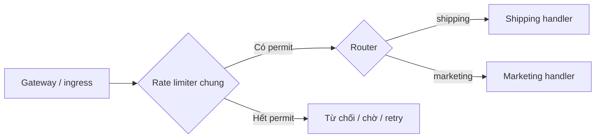
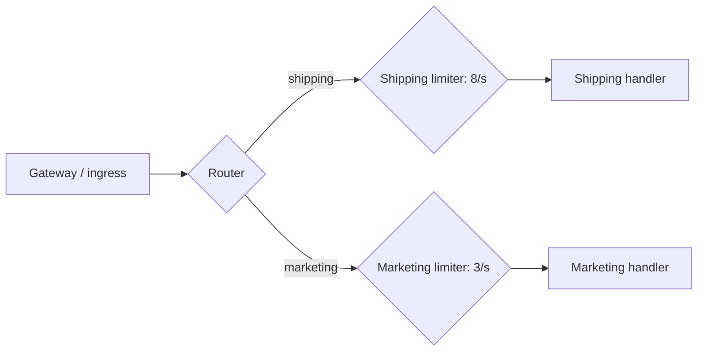
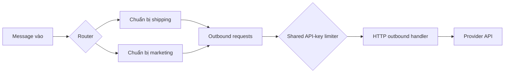
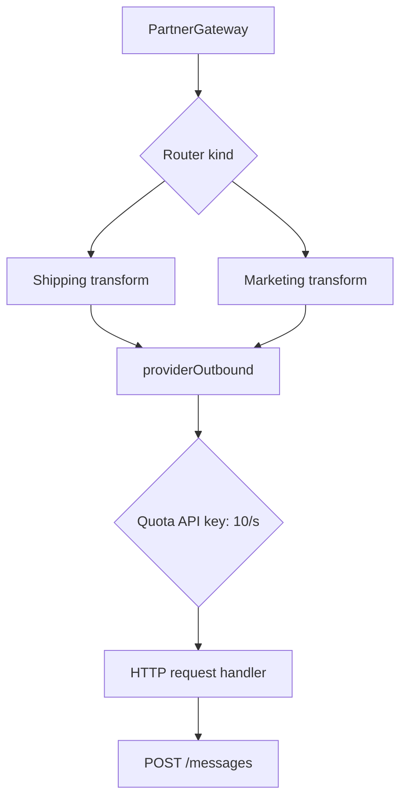
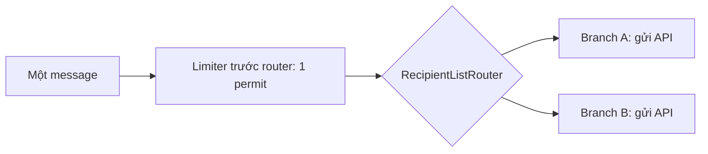
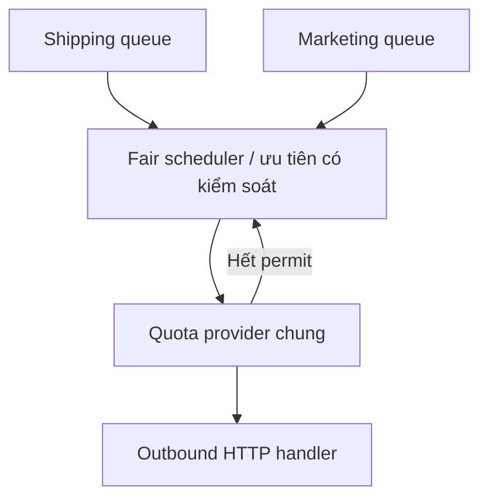
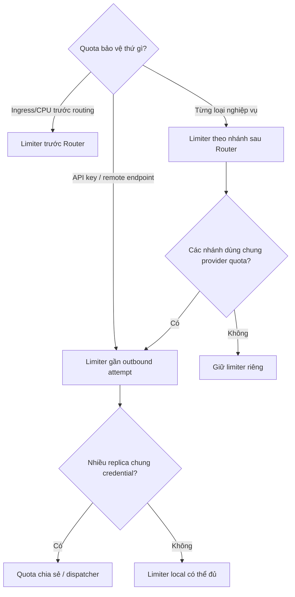

# Rate limit ở trước hay sau Router trong Spring Integration?

> **Module:** `SPRING_INTEGRATION_PATTERN` — Học triển khai Enterprise Integration Patterns với Spring Integration để xây dựng luồng thông điệp ít phụ thuộc và dễ mở rộng. Thực hành Router, Filter, Transformer, Splitter, Aggregator, Gateway, retry, error channel và correlation, đồng thời kiểm thử, theo dõi các nhánh xử lý.
>
> **Chương:** Rate limiter  
> **Đề bài:** Rate limit ở trước hay sau router

## 1. Vấn đề: đặt limiter ở đâu làm thay đổi ý nghĩa của quota

Một hệ thống nhận các message từ khách hàng, sau đó dùng **Router** chuyển từng message tới một trong hai flow:

- `shipping`: gửi yêu cầu giao hàng, cần phản hồi sớm.
- `marketing`: gửi chiến dịch, có thể trì hoãn.

Cả hai flow có thể gọi **cùng API key** của đối tác, bị giới hạn 10 outbound request/giây. Hệ thống cũng muốn dành riêng một ngân sách cho marketing để nó không chiếm hết năng lực của shipping.

Nên kiểm soát permit **trước Router**, **sau Router**, hay tại **handler gọi API cuối cùng**?

Câu trả lời phụ thuộc vào điều cần đo đếm:

- Trước Router: mỗi lượt message được nhận vào khu vực routing có thể tiêu thụ một permit, bất kể rẽ vào nhánh nào.
- Sau Router: mỗi nhánh có thể dùng một limiter riêng; chỉ những message tới nhánh đó mới tiêu thụ permit của nhánh.
- Tại một outbound handler chung sau khi hợp các nhánh: mỗi lượt vào handler gửi request chia sẻ ngân sách của API đích.
- Kết hợp nhiều tầng: có thể vừa có ngân sách riêng theo flow, vừa có quota tổng theo API key; phải hiểu rằng các bước xin permit **không có rollback nguyên tử**.

**Kết quả học tập:** chọn vị trí phù hợp với quota thật, phân biệt số message với số outbound attempts, cấu hình ví dụ trong Spring Integration, xét các tình huống Router nhiều đích/Filter/Splitter/retry, và kiểm thử trường hợp rate limiter từ chối.

## 2. Ba topology thường gặp

### 2.1. Limiter trước Router: quota trên luồng vào



Nếu limiter cấp 10 permit/giây, **tổng lượt đi qua vị trí đó** được kiểm soát theo 10 permit/giây trên instance. Không có cơ chế ưu tiên tự động: 10 message marketing có thể lấy hết permit trước khi shipping đến.

**Ưu điểm:** một điểm chặn dễ hiểu, tiết kiệm tài nguyên routing/nhánh phía sau, hữu ích khi quota áp dụng cho toàn bộ message đầu vào.

**Giới hạn:** message được Router bỏ, message sai định dạng hoặc message dẫn tới nhiều request sau Router đều có thể khiến số permit khác với số outbound attempts. Vì vậy pre-router limiter **không bảo đảm** tuân thủ quota của provider nếu không có quan hệ một-message-một-request.

### 2.2. Limiter sau Router: ngân sách từng nhánh



Mỗi message chỉ đi vào nhánh được định tuyến (với Router đơn đích), nên chỉ tiêu thụ ngân sách của nhánh đó.

**Ưu điểm:** dễ điều chỉnh từng loại công việc, cách ly một nhánh quá tải, ghi metric theo flow.

**Giới hạn:** nếu cả hai handler gọi chung API key với quota 10 request/giây, cấu hình 8 + 3 = **11 request/giây** có thể vượt quota đối tác. Hai limiter độc lập có tên khác nhau hoặc cùng tên nhưng state khác nhau không tự tạo ngân sách tổng.

### 2.3. Limiter tại điểm outbound chung: quota thực tế của API



Khi mỗi lượt vào `HTTP outbound handler` tương ứng **một HTTP attempt**, limiter tại vị trí này đếm đúng đơn vị mà nhà cung cấp thường tính quota. Các nhánh có thể có limiter riêng để kiểm soát ngân sách hoặc độ ưu tiên, nhưng **quota tổng** vẫn đặt ở điểm dùng chung.

Nếu các nhánh gọi những API khác nhau với quota độc lập, hãy tạo limiter theo đúng quota key (`provider + API key + endpoint/nhóm endpoint`) và gắn ở handler tương ứng.

## 3. Bảng so sánh để chọn vị trí

| Tiêu chí | Trước Router | Sau Router tại từng nhánh | Sau khi hợp nhánh, trước API |
|---|---|---|---|
| Đơn vị đếm | Message vào một điểm trước phân nhánh | Lượt vào handler của từng nhánh | Lượt vào outbound handler dùng chung |
| Có kiểm soát tổng số message trước routing? | Có | Không trực tiếp | Không trực tiếp |
| Cách ly quota từng flow? | Không | Có | Không, nếu chỉ dùng một limiter |
| Bảo vệ một API key dùng chung? | Chỉ khi mọi message dẫn tới đúng một attempt và không retry ngoài limiter | Không nếu limiter các nhánh độc lập | Có trong phạm vi các attempt đi qua handler đó |
| Message bị Router bỏ | Có thể đã dùng permit | Không đi vào nhánh nên không dùng permit nhánh | Không đi đến outbound nên không dùng permit |
| Router nhân bản message tới N đích | Một permit có thể dẫn tới N lượt xử lý | Có thể lấy N permit theo N nhánh | Mỗi outbound attempt lấy permit |
| Khi một nhánh hết permit | Chặn ảnh hưởng tất cả nhánh nếu dùng quota chung | Nhánh kia vẫn có quota riêng | Các nhánh tranh cùng quota API |
| Khi chạy nhiều replica | State local theo replica | State local theo replica | State local theo replica nếu không điều phối |

Cả ba cách trên cần xác minh **phạm vi state**. Trong một JVM, nhiều message dùng chung một limiter bean sẽ chia sẻ state đó. Giữa các JVM/replica, tên limiter giống nhau không đồng nghĩa chia sẻ permit.

## 4. Hai ví dụ số: cùng lưu lượng, quyết định khác nhau

### Ví dụ A — Quota chung của nhà cung cấp

Trong một giây, shipping có 6 message, marketing có 6 message. Mỗi message sau routing tạo **một** HTTP request. Nhà cung cấp cho 10 request/giây.

| Cấu hình | Lượt có thể được cấp permit | Đánh giá |
|---|---|---|
| Một limiter 10/s trước Router | Tối đa 10 message được vào Router | Có thể phù hợp nếu tất cả message đều sinh đúng một HTTP attempt; không bảo đảm fairness |
| Hai limiter 10/s sau Router | Tối đa 6 + 6 = 12 request | **Có nguy cơ vượt** quota 10/s |
| Hai limiter 5/s sau Router | Tối đa 5 + 5 = 10 request | Bảo vệ tổng trong giả định này nhưng có thể bỏ phí quota khi một nhánh nhàn rỗi |
| Một limiter 10/s ở handler chung | Tối đa 10 lượt vào handler | Phù hợp nhất khi quota gắn với HTTP attempts và toàn bộ đường gửi đều đi qua handler |

Lưu ý: các con số thể hiện **permit theo chu kỳ** của cơ chế rate limiter minh họa, không phải bảo đảm sliding-window chính xác với mọi thời điểm. Mỗi lần retry gửi request mới phải được tính thêm.

### Ví dụ B — Router nhân bản message

Một message đầu vào được chuyển tới **hai** endpoint nhận thông báo; mỗi endpoint tạo một HTTP attempt.

- Nếu limiter trước Router cấp một permit: phía sau vẫn có thể tạo **hai** HTTP attempts.
- Nếu limiter trên hai outbound handler, mỗi handler cần một permit của quota tương ứng.
- Nếu cả hai endpoint thuộc **cùng quota API key**, chúng phải dùng chung ngân sách quota, kể cả khi khác route.

Tình huống này thường xuất hiện khi dùng `RecipientListRouter`, publish-subscribe hoặc Splitter. Cần đếm **số request thực tế**, không chỉ số message gốc.

## 5. Spring Integration đặt limiter lên handler như thế nào?

Spring Integration triển khai rate limiting ở dạng `RateLimiterRequestHandlerAdvice` với Resilience4j. Advice bọc **một message handler** và xin permit trước khi gọi handler đó.

Các tham số chính của `RateLimiterConfig`:

| Tham số | Nghĩa | Ví dụ |
|---|---|---|
| `limitForPeriod` | Số permit trong mỗi chu kỳ | 10 |
| `limitRefreshPeriod` | Độ dài chu kỳ làm mới permit | 1 giây |
| `timeoutDuration` | Tối đa chờ được cấp permit | 100 ms |

Khi hết permit, lời gọi có thể chờ nếu `timeoutDuration` dương, hoặc bị từ chối ngay nếu dùng `Duration.ZERO`. Với `DirectChannel`, chờ sẽ chiếm thread gửi message; exception thường truyền ngược về phía Gateway/caller.

**Không có việc cứ đặt advice lên annotation `@Router` là toàn bộ nhánh outbound tự chia sẻ quota.** Trong ví dụ sau, chúng ta dùng `@ServiceActivator` làm một bước *admission* trước Router và gắn advice vào các handler sau Router. Cách này thể hiện rõ vị trí của từng bộ đếm.

## 6. Ví dụ Java hoàn chỉnh: vừa giới hạn trước Router, vừa giới hạn từng nhánh

Giả định minh họa:

- Tất cả message vào từ `PartnerGateway` và qua `globalIngressQuota` (10 permit/giây).
- Router dựa trên header `kind` và chỉ gửi message tới **một** trong hai nhánh.
- Shipping có `shippingQuota` (8 permit/giây), marketing có `marketingQuota` (3 permit/giây).
- Mỗi nhánh tạm thời chỉ trả một chuỗi giả lập, chưa thực hiện HTTP thật.

Ví dụ này dùng để so sánh **vị trí** giới hạn. Vì chưa có HTTP outbound chung, đừng suy ra hai limiter nhánh đã bảo vệ quota provider.

### 6.1. Dependencies và ứng dụng

Ví dụ Gradle:

```groovy
dependencies {
    implementation "org.springframework.boot:spring-boot-starter-integration"
    implementation "io.github.resilience4j:resilience4j-ratelimiter:VERSION"
}
```

Chọn `VERSION` tương thích với Spring Boot/Spring Integration đang dùng hoặc quản lý phiên bản bằng BOM của dự án.

```java
package com.example.routingquota;

import org.springframework.boot.SpringApplication;
import org.springframework.boot.autoconfigure.SpringBootApplication;
import org.springframework.integration.annotation.IntegrationComponentScan;
import org.springframework.integration.config.EnableIntegration;

@SpringBootApplication
@EnableIntegration
@IntegrationComponentScan
public class RoutingQuotaApplication {

    public static void main(String[] args) {
        SpringApplication.run(RoutingQuotaApplication.class, args);
    }
}
```

`@IntegrationComponentScan` đăng ký interface được đánh dấu `@MessagingGateway`.

### 6.2. Gateway chuyển message và header định tuyến

```java
package com.example.routingquota;

import org.springframework.integration.annotation.MessagingGateway;
import org.springframework.messaging.handler.annotation.Header;
import org.springframework.messaging.handler.annotation.Payload;

@MessagingGateway(defaultRequestChannel = "incomingRequests")
public interface PartnerGateway {

    String submit(@Payload String payload,
                  @Header("kind") String kind);
}
```

Ví dụ caller:

```java
String shippingResult = partnerGateway.submit("order-123", "shipping");
String marketingResult = partnerGateway.submit("campaign-567", "marketing");
```

`kind` ở ví dụ chỉ là cách lựa chọn route. Với hệ thống thật, nếu route mang quyền ưu tiên hoặc quota theo tenant, phải lấy thông tin này từ nguồn đã xác thực/ủy quyền; không tin toàn bộ dữ liệu header tùy ý của caller bên ngoài.

### 6.3. Khai báo channel và advice

```java
package com.example.routingquota;

import java.time.Duration;

import io.github.resilience4j.ratelimiter.RateLimiterConfig;
import org.springframework.context.annotation.Bean;
import org.springframework.context.annotation.Configuration;
import org.springframework.integration.channel.DirectChannel;
import org.springframework.integration.handler.advice.RateLimiterRequestHandlerAdvice;
import org.springframework.messaging.MessageChannel;

@Configuration
public class RoutingQuotaConfig {

    @Bean
    public MessageChannel incomingRequests() {
        return new DirectChannel();
    }

    @Bean
    public MessageChannel requestsForRouter() {
        return new DirectChannel();
    }

    @Bean
    public MessageChannel shippingRequests() {
        return new DirectChannel();
    }

    @Bean
    public MessageChannel marketingRequests() {
        return new DirectChannel();
    }

    @Bean
    public RateLimiterRequestHandlerAdvice globalIngressQuota() {
        return new RateLimiterRequestHandlerAdvice(
                rateConfig(10), "global-ingress");
    }

    @Bean
    public RateLimiterRequestHandlerAdvice shippingQuota() {
        return new RateLimiterRequestHandlerAdvice(
                rateConfig(8), "shipping-flow");
    }

    @Bean
    public RateLimiterRequestHandlerAdvice marketingQuota() {
        return new RateLimiterRequestHandlerAdvice(
                rateConfig(3), "marketing-flow");
    }

    private RateLimiterConfig rateConfig(int permitsPerSecond) {
        return RateLimiterConfig.custom()
                .limitForPeriod(permitsPerSecond)
                .limitRefreshPeriod(Duration.ofSeconds(1))
                .timeoutDuration(Duration.ZERO)
                .build();
    }
}
```

Ở đây:

- `globalIngressQuota` được gắn vào handler **ngay trước Router**.
- `shippingQuota` và `marketingQuota` được gắn vào handler **sau Router**.
- `Duration.ZERO` giúp ví dụ dễ quan sát việc từ chối ngay khi hết permit.
- Ba limiter là ba ngân sách độc lập trên cùng application instance.

### 6.4. Tạo các endpoint theo đúng thứ tự

```java
package com.example.routingquota;

import org.springframework.integration.annotation.Router;
import org.springframework.integration.annotation.ServiceActivator;
import org.springframework.messaging.Message;
import org.springframework.messaging.handler.annotation.Header;
import org.springframework.stereotype.Component;

@Component
public class RoutingHandlers {

    // PRE-ROUTER: advice này chạy trước khi gọi Router.
    @ServiceActivator(
            inputChannel = "incomingRequests",
            outputChannel = "requestsForRouter",
            adviceChain = "globalIngressQuota")
    public Message<String> admit(Message<String> message) {
        // Chỉ chuyển tiếp message và giữ headers/replyChannel.
        return message;
    }

    @Router(inputChannel = "requestsForRouter")
    public String chooseRoute(@Header("kind") String kind) {
        if ("shipping".equals(kind)) {
            return "shippingRequests";
        }
        if ("marketing".equals(kind)) {
            return "marketingRequests";
        }
        throw new IllegalArgumentException("Unknown kind: " + kind);
    }

    // POST-ROUTER: mỗi branch có advice riêng.
    @ServiceActivator(
            inputChannel = "shippingRequests",
            adviceChain = "shippingQuota")
    public String handleShipping(String payload) {
        // Demo: thay bằng một outbound attempt thực tế.
        return "shipping accepted: " + payload;
    }

    @ServiceActivator(
            inputChannel = "marketingRequests",
            adviceChain = "marketingQuota")
    public String handleMarketing(String payload) {
        // Demo: thay bằng một outbound attempt thực tế.
        return "marketing accepted: " + payload;
    }
}
```

Thứ tự xử lý của một message `kind=shipping`:

1. Gateway gửi message đến `incomingRequests`.
2. `globalIngressQuota` xin permit. Nếu không có permit, `admit()` **không được gọi**.
3. Nếu có permit, `admit()` trả lại `Message<String>` giữ nguyên header và reply channel.
4. Router đọc header `kind`, chọn `shippingRequests`.
5. `shippingQuota` xin permit trước `handleShipping()`. Khi có permit, handler trả reply cho Gateway.
6. Nếu `shippingQuota` từ chối, message **đã tiêu thụ permit của `globalIngressQuota`**; permit này thường không được trả lại.

**Điểm mấu chốt:** hai tầng limiter không tạo ra một giao dịch cấp permit “all or nothing”. Đặt hai tầng quá gần nhau có thể làm lãng phí quota đầu tiên khi tầng sau từ chối. Đây là hành vi cần đánh giá, nhất là khi quota đầu tiên đại diện chi phí thực tế hoặc một tài nguyên khan hiếm.

Ví dụ có ba bean advice để giảng giải. Khi triển khai thực tế, chỉ giữ những tầng thật sự phục vụ ràng buộc nghiệp vụ.

## 7. Nếu mục tiêu là quota API key chung, nên sửa topology thế nào?

Giả sử shipping và marketing đều gọi `POST /messages` qua cùng API key. Ta cần giới hạn ở **một handler gửi API chung**, sau khi các nhánh hoàn tất chuẩn bị payload.

Sơ đồ khuyến nghị:



Các nhánh shipping/marketing có thể còn giữ `shippingQuota`/`marketingQuota` nếu cần phân bổ ngân sách nội bộ. Nhưng **bộ giới hạn bảo vệ provider** nên nằm tại handler outbound chung, vì lúc đó mỗi attempt thật sự đi ra đích đều xin permit.

Cấu trúc Java minh họa sự thay đổi (là **biến thể thay thế** cho hai handler trả reply trong phần 6, không đặt song song hai bộ handler cùng tên channel):

```java
// Trong @Configuration, khai báo channel hợp nhất:
@Bean
public MessageChannel providerOutbound() {
    return new DirectChannel();
}

@Bean
public RateLimiterRequestHandlerAdvice providerQuota() {
    RateLimiterConfig config = RateLimiterConfig.custom()
            .limitForPeriod(10)
            .limitRefreshPeriod(Duration.ofSeconds(1))
            .timeoutDuration(Duration.ZERO)
            .build();
    return new RateLimiterRequestHandlerAdvice(config, "provider-api-key-1");
}
```

```java
// Các method trong một @Component làm endpoint của biến thể này:
@ServiceActivator(
        inputChannel = "shippingRequests",
        outputChannel = "providerOutbound",
        adviceChain = "shippingQuota")
public String prepareShipping(String payload) {
    return "SHIP:" + payload;
}

@ServiceActivator(
        inputChannel = "marketingRequests",
        outputChannel = "providerOutbound",
        adviceChain = "marketingQuota")
public String prepareMarketing(String payload) {
    return "PROMO:" + payload;
}

@ServiceActivator(
        inputChannel = "providerOutbound",
        adviceChain = "providerQuota")
public String sendToProvider(String preparedPayload) {
    // Stub: trong ứng dụng thật, gọi HTTP client MỘT lần tại đây.
    return "provider accepted: " + preparedPayload;
}
```

Trong biến thể này, nếu vẫn giữ `globalIngressQuota` trước Router thì có **ba tầng quota** (ingress, branch, provider). Với đa số hệ thống, không cần cả ba; thường chọn quota theo flow nếu có yêu cầu nội bộ và quota theo API key để bảo vệ đối tác.

**Đối với retry**, một lần gọi `sendToProvider()` không nhất thiết tương đương một outbound attempt nếu bên trong method có vòng retry của HTTP client. Cần bảo đảm mỗi attempt (kể cả retry) đi qua limiter provider. Có thể đặt retry tại tầng gọi lại qua endpoint đã được advise hoặc dùng một cơ chế per-attempt interceptor phù hợp. Kiểm thử thứ tự advice chain và thực tế request qua mạng; không giả định retry tự động được tính quota.

Nếu một lần gọi API gửi được batch gồm N phần tử, hãy xác định provider tính quota theo **request**, theo **recipient**, hay theo **item**; limiter một permit mỗi method invocation không đủ nếu quota tính theo item.

## 8. Tình huống Filter và Router từ chối message

Hình dung một message đầu vào sai định dạng `kind="unknown"`:

- Nếu limiter nằm trước Router, nó có thể **tiêu thụ permit trước khi Router phát hiện route không hợp lệ**.
- Nếu limiter nằm tại từng nhánh hợp lệ, message không vào nhánh nào nên **không tiêu thụ permit nhánh**.
- Nếu có `Filter` kiểm tra message trước limiter, request sai có thể bị loại sớm để tránh tốn permit.

Topology gợi ý:

```text
Gateway → Validate/Filter → Router → Transform → Shared outbound limiter → API
               |             |
           reject invalid   route by kind
```

Tuy nhiên, filter phải áp dụng theo **quy tắc nghiệp vụ**. Với message bắt buộc xử lý, không nên “lọc bỏ” âm thầm. Hãy trả lỗi có kiểm soát hoặc chuyển đến nhánh xử lý lỗi/điều tra. Nếu user được chọn header ưu tiên, router hoặc filter cần kiểm tra quyền, tránh để caller tự chuyển message vào flow có quota cao.

`RateLimiterRequestHandlerAdvice` chỉ kiểm soát khi handler được gọi. Nếu Router được cấu hình bỏ message khi không tìm được route, hay route về `nullChannel`, các message đó không được đếm ở outbound handler. Điều này là **đúng** khi mục tiêu là quota HTTP, nhưng có thể **sai** nếu mục tiêu là giới hạn sức tải ingress (ví dụ yêu cầu chống overload ngay trước bước Router phức tạp).

## 9. Router nhiều người nhận, Splitter và Aggregator

### 9.1. RecipientListRouter / publish-subscribe

Một message nhận từ Gateway có thể chuyển tới hai nhánh cùng lúc:



Nếu hai nhánh tạo hai HTTP attempts, một permit trước Router **không đủ** cho quota chung. Trong trường hợp này:

- Nếu API A và B có quota riêng: giới hạn từng outbound handler theo quota tương ứng.
- Nếu cả hai dùng chung API key hoặc một quota tổng: hai outbound handler phải chia sẻ state/quota theo cùng một khóa, hoặc hợp các attempts qua một dispatcher.
- Nếu branch B chỉ lưu nội bộ và không gọi API: không cần tiêu thụ permit của provider cho nhánh B.

### 9.2. Splitter và Aggregator

Một message đơn hàng được Splitter tách thành 30 message con và mỗi message con gọi một API: limiter trước Splitter tính một permit, limiter tại outbound tính 30 permits (nếu một attempt mỗi message con).

Ngược lại, Aggregator gom 30 message thành **một request batch**. Nếu provider đếm một request là một đơn vị quota, limiter ở handler batch chỉ tốn một permit; nếu provider tính 30 recipients, phải có cơ chế theo trọng số hoặc ngân sách theo item.

Cần giữ `correlationId`, sequence number và business ID xuyên suốt để xử lý retry, dedup và quan sát nhánh thất bại.

## 10. Retry, Error Channel và hành vi khi hết permit

### 10.1. Có ba lựa chọn khi không lấy được permit

| Lựa chọn | Ứng dụng phù hợp | Cần cấu hình thêm |
|---|---|---|
| Chờ permit có timeout | Request-reply ngắn, có latency budget | `timeoutDuration` đủ ngắn, giới hạn thread chờ |
| Fail fast | Caller có thể retry hoặc nhận lỗi ngay | Mapping exception, backoff, chính sách trả lỗi |
| Trì hoãn xử lý | Message bắt buộc hoàn thành, tải đột biến | Queue/broker bền vững, consumer, retry/ack/idempotency |

**Rate limiter không tự giữ message vào queue.** Nếu advice hết thời gian chờ và ném exception, việc retry hay requeue tùy vào flow/adapter. Với `DirectChannel` và Gateway đồng bộ, exception thường truyền về caller. Trong flow bất đồng bộ (poller, executor hoặc broker consumer), lỗi có thể được đưa vào `ErrorMessage` hoặc do cơ chế của adapter quản lý; không mặc định mọi lỗi sẽ vào global `errorChannel`.

### 10.2. Retry phải đếm cả outbound attempts

Ví dụ một message đi qua pre-router limiter và API trả HTTP 503. Nếu retry ba lần **bên trong handler sau Router** mà không đi qua pre-router limiter, một permit ở ingress có thể sinh bốn request ra ngoài.

Vì vậy:

1. Trước Router, rate limit kiểm soát số lượt **đi qua Router**, phù hợp khi đây là mục tiêu.
2. Tại outbound handler, rate limit kiểm soát lượt **bắt đầu handler**. Cần xem cách HTTP client/retry thực thi bên trong handler.
3. Để bảo vệ quota provider theo attempts, đảm bảo **mỗi HTTP attempt thực tế** đi qua limiter provider.
4. Với HTTP 429, nên xử lý `Retry-After` và backoff có jitter; không retry liên tục khi vẫn hết quota.

### 10.3. Tính toàn vẹn khi có QueueChannel/broker

Nếu routing xong rồi xếp message vào `QueueChannel` trong bộ nhớ, message **không tự có độ bền sau restart**. Với giao dịch cần xử lý chắc chắn, dùng broker hoặc message store có persistence cùng acknowledgment/retry hợp lý.

Khi message đã dequeue và handler thất bại, không được suy đoán rằng message tự quay về queue. Lỗi sau HTTP thành công nhưng trước ACK có thể khiến broker phát lại; vì vậy phải dùng **idempotency key** hoặc dedup theo business ID nếu API có tác dụng phụ.

## 11. Thứ tự đặt limiter và tác động tới fairness

Một limiter chung trước Router **đơn giản nhưng không công bằng theo mặc định**. Nếu marketing có 1.000 message chờ, shipping có 10 message, việc ai lấy permit đầu tiên phụ thuộc scheduling và thứ tự đến; không có chính sách ưu tiên bảo đảm riêng cho shipping.

Một limiter riêng ở nhánh giúp bảo vệ nhánh khác khỏi việc bị dùng hết permit **của chính nhánh đó**, nhưng không tự bảo đảm toàn bộ quota provider.

Khi cần đồng thời fairness và quota tổng, có thể dùng:



Một scheduler có thể dùng weighted round-robin hoặc weighted fair queueing và có cơ chế chống starvation. Đây là **thiết kế bổ sung** của ứng dụng/broker, không phải tính năng tự động của RateLimiter advice.

**Đặt limiter theo đúng ngân sách thực** quan trọng hơn việc cố ghép nhiều lớp limiter bất kể tác dụng phụ. Nhiều tầng xin permit lần lượt không nguyên tử: nếu tầng cuối từ chối, permit tầng đầu đã lấy thường không được hoàn lại.

## 12. Vận hành khi nhiều replica và tenant

Giả sử quota nhà cung cấp là 100 request/giây trên một API key chung. Hệ thống có bốn replica, mỗi replica cấu hình một limiter `limitForPeriod=100`. Kết quả, mỗi replica có thể tự cấp permit, tổng outbound có thể xấp xỉ **400 request/giây** (chưa kể burst ở ranh giới chu kỳ).

Các phương án thường dùng:

- **Một outbound dispatcher chung:** dễ kiểm soát quota toàn cục nhưng phải thiết kế high availability và throughput.
- **Rate limiter phân tán:** một hệ thống/cơ chế chia sẻ state cấp permit nguyên tử theo quota key; cần xử lý lỗi mạng, độ trễ và chính sách fail-open/fail-closed.
- **Chia ngân sách cục bộ có dự phòng:** tổng phân bổ thấp hơn quota thật và theo dõi thay đổi số replica; đơn giản nhưng có thể gây thiếu công suất ở replica ít tải và không tuyệt đối trước burst.

Với multi-tenant, có thể cần quota theo `tenantId` để bảo vệ từng khách hàng và quota tổng theo `apiKey`. **Tenant ID phải xuất phát từ thông tin đã xác thực/ủy quyền**, không lấy trực tiếp từ header do client bất kỳ đặt. Tách quota per-tenant và quota provider là hai mục tiêu khác nhau; thứ tự xin permit cần được tính tới khi thiết kế điều phối.

## 13. Kiểm thử vị trí limiter

### 13.1. Ma trận tình huống

| Tình huống | Topology | Kết quả nên xác minh |
|---|---|---|
| Chỉ shipping gửi tải | Limiter trước Router | Số lần qua admission gate nằm trong permit cấp |
| Marketing bùng nổ | Limiter chung trước Router | Shipping có thể bị từ chối dù riêng nó gửi ít; không có fairness tự động |
| Marketing hết ngân sách | Limiter sau Router theo nhánh | Shipping vẫn có permit của chính nhánh |
| Hai nhánh cùng provider | Hai limiter nhánh độc lập | Tổng outbound có thể lớn hơn quota provider |
| Hai nhánh hợp vào outbound chung | Limiter chung ở handler cuối | Mỗi lượt vào handler chung đều lấy permit |
| Router gặp `kind` lạ | Limiter trước Router | Permit có thể bị tiêu thụ trước lỗi định tuyến |
| Router có hai người nhận | Limiter trước Router | Một permit có thể sinh hai outbound attempts |
| Splitter tạo N message | Limiter trước/sau Splitter | Đếm request thực tế tại handler cuối |
| HTTP retry nhiều lần | Retry nằm sau pre-router limiter | Kiểm tra mỗi retry attempt có lấy permit provider hay không |
| Hai replica | State limiter local | Tổng permit tăng theo replica; cần quota chung nếu provider áp dụng global |
| Flow bất đồng bộ | ExecutorChannel / poller | Lỗi permit đi đến error handling/consumer policy đúng |

### 13.2. Bài test đơn giản, không phụ thuộc timing sát ranh giới

Test dưới đây chỉ kiểm tra **permit** của Resilience4j trong một JVM, làm nền tảng trước khi chạy integration test:

```java
import static org.junit.jupiter.api.Assertions.*;

import java.time.Duration;

import io.github.resilience4j.ratelimiter.RateLimiter;
import io.github.resilience4j.ratelimiter.RateLimiterConfig;
import org.junit.jupiter.api.Test;

class QuotaAdmissionTest {

    @Test
    void onePermitRejectsSecondImmediateCall() {
        RateLimiterConfig cfg = RateLimiterConfig.custom()
                .limitForPeriod(1)
                .limitRefreshPeriod(Duration.ofMinutes(1))
                .timeoutDuration(Duration.ZERO)
                .build();

        RateLimiter limiter = RateLimiter.of("test-route-quota", cfg);

        assertTrue(limiter.acquirePermission());
        assertFalse(limiter.acquirePermission());
    }
}
```

Đây **không phải integration test Router**. Để kiểm thử đúng topology Spring Integration:

1. Tạo stub handlers với `AtomicInteger` để đếm lượt vào `shipping`, `marketing` và outbound HTTP.
2. Dùng cấu hình permit nhỏ, chu kỳ refresh dài, `timeoutDuration = Duration.ZERO` để giảm phụ thuộc vào đồng hồ.
3. Gửi message qua `PartnerGateway` với từng `kind`; assert số lượt handler được gọi và đường exception tương ứng.
4. Kiểm tra riêng pre-router gate, post-router quota, Router nhận route không hợp lệ, và variant dùng handler outbound chung.
5. Kiểm thử retry bằng HTTP stub, đếm **outbound attempts thực tế**; không chỉ đếm message đầu vào.
6. Khi kiểm thử đa replica, gửi vào cả hai app và so tổng attempts theo cùng API key.

Không nên cố xác định chính xác ranh giới chu kỳ bằng `Thread.sleep(10)`, vì test có thể chạy gần ranh giới refresh và trở nên không ổn định.

### 13.3. Metric nên quan sát

Theo dõi **số permit được cấp và từ chối theo quota key**, lượt message vào Router, lượt message được route tới từng nhánh, outbound HTTP attempts/status (đặc biệt 429), độ trễ chờ permit, backlog queue, tuổi message, retry và DLQ.

Phân biệt ba nhóm kết quả:

- `REJECTED_BEFORE_ROUTE`: message bị chặn bởi quota ingress.
- `REJECTED_IN_BRANCH`: message đã route nhưng bị chặn ở quota flow.
- `REJECTED_AT_PROVIDER_GATE`: message đã chuẩn bị outbound nhưng không được cấp permit API key.

Khi đối tác trả HTTP 429, ghi riêng `HTTP_429_REMOTE` vì đó là **response từ phía đối tác**, không phải từ chối nội bộ trước outbound.

Với số tenant lớn, tránh đưa tenant ID không kiểm soát thành nhãn metric có cardinality rất cao. Không log API key hoặc toàn bộ payload nhạy cảm.

## 14. Quy trình quyết định topology

Để chọn vị trí rate limiter cho một flow mới, thực hiện lần lượt:

1. **Xác định quota thực tế.** Quota nằm ở ingress, từng flow, từng tenant, remote endpoint, API key hay toàn bộ tài khoản? Provider có quota về burst hoặc sliding-window không?
2. **Xác định một đơn vị quota.** Một incoming message, một lượt handler, một HTTP attempt, một batch hay một item? Có Splitter, recipient-list routing hoặc retry không?
3. **Xác định nơi mọi lượt tiêu thụ quota đều đi qua.** Nếu là quota HTTP attempts, ưu tiên đặt limiter sát outbound attempt chung. Nếu là quota bảo vệ ingress, đặt sớm trước phần xử lý tốn kém.
4. **Cần cách ly các flow không?** Nếu có, thêm limiter theo nhánh hoặc scheduler/queue có chính sách ưu tiên.
5. **Xem xét khi thiếu permit.** Fail fast, bounded wait hay trì hoãn qua broker? Không bỏ message quan trọng nếu chưa có yêu cầu nghiệp vụ cho phép.
6. **Xem xét state phân tán.** Một limiter JVM không bảo vệ tổng quota trên nhiều replica; thiết kế chia sẻ permit hoặc chia ngân sách.
7. **Kiểm thử với output thực tế.** Đếm số HTTP attempts và dấu vết routing/retry, không chỉ nhìn số message vào Gateway.

Một sơ đồ chọn nhanh:



## 15. Bài tập thực hành

**Bài 1 — Hai flow tranh quota.** Chạy ví dụ phần 6 với `globalIngressQuota=2`, `shippingQuota=2`, `marketingQuota=2`, refresh dài và timeout bằng 0. Gửi hai marketing message rồi một shipping message. Giải thích vì sao shipping có thể bị từ chối trước Router dù quota shipping còn.

**Bài 2 — Quota tách nhánh.** Tạm bỏ `globalIngressQuota` khỏi bước `admit`, giữ mỗi branch một permit. Gửi hai shipping rồi một marketing request. Ghi nhận nhánh nào bị từ chối và nhánh nào vẫn xử lý được.

**Bài 3 — Hợp outbound.** Chuyển hai branch sang `providerOutbound` như phần 7. Cấu hình quota provider một permit mỗi chu kỳ, gửi một message shipping và một marketing. Kiểm tra chỉ một lượt tới outbound handler, bất kể loại flow.

**Bài 4 — Router nhiều đích.** Tạo `RecipientListRouter` gửi một message tới hai handler gọi API. Nếu quota nhà cung cấp tính theo tổng request, thiết kế nơi đặt limiter để message gốc dẫn đến hai lần lấy permit.

**Bài 5 — Retry và lỗi.** Stub HTTP trả 503 ở attempt đầu và 200 ở lần sau. Thêm retry có backoff; chứng minh số permit provider tương ứng số outbound attempts. Ghi nhận lỗi quota từ trước Router, tại branch và tại provider gate bằng ba metric riêng.

**Bài 6 — Nhiều replica và tenant.** Hai replica sử dụng cùng API key với quota 10/s; mỗi replica gắn `RateLimiterRequestHandlerAdvice` 10/s. Ước lượng tổng throughput có thể xuất hiện; đề xuất một dispatcher phân tán hoặc cách chia ngân sách có dự phòng và kiểm thử cơ chế đó.

### Câu hỏi tự đánh giá

1. Khi nào một limiter trước Router có thể tương đương về số permit với một limiter sau Router?
2. Vì sao hai limiter 8/s và 3/s ở hai nhánh có thể vi phạm quota provider 10/s?
3. Một RecipientListRouter gửi cùng message tới ba outbound handlers. Cần tính bao nhiêu permit nếu provider tính quota theo số request?
4. Nếu limiter trước Router đã cấp permit nhưng limiter sau Router từ chối, permit đầu tiên có tự quay lại không?
5. Vì sao retry bên trong HTTP handler có thể phá vỡ quan hệ một message – một request?
6. Khi nào nên kết hợp quota ingress, quota flow và quota API key, và khi nào quá nhiều tầng quota làm hệ thống phức tạp không cần thiết?

## 16. Tài liệu tham khảo

- [Spring Integration — Router](https://docs.spring.io/spring-integration/reference/router.html): định tuyến message theo điều kiện và cấu hình endpoint.
- [Spring Integration — Request Handler Advice](https://docs.spring.io/spring-integration/reference/handler-advice.html): bọc handler với advice, bao gồm rate limiting.
- [Spring Integration — Messaging Gateways](https://docs.spring.io/spring-integration/reference/gateway.html): Gateway, request-reply và propagation exception.
- [Spring Integration — Filter](https://docs.spring.io/spring-integration/reference/filter.html): lọc message và discard path.
- [Spring Integration — Error Handling](https://docs.spring.io/spring-integration/reference/error-handling.html): xử lý lỗi đồng bộ và bất đồng bộ.
- [Resilience4j — RateLimiter](https://resilience4j.readme.io/docs/ratelimiter): cấu hình permit, chu kỳ và metrics.
