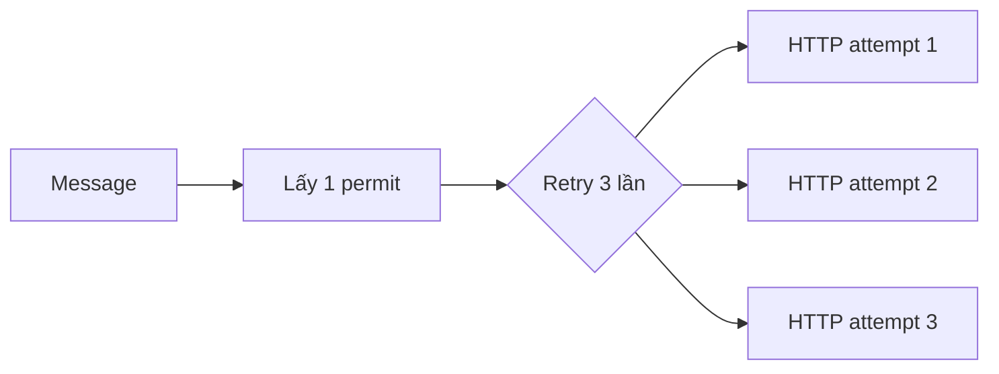
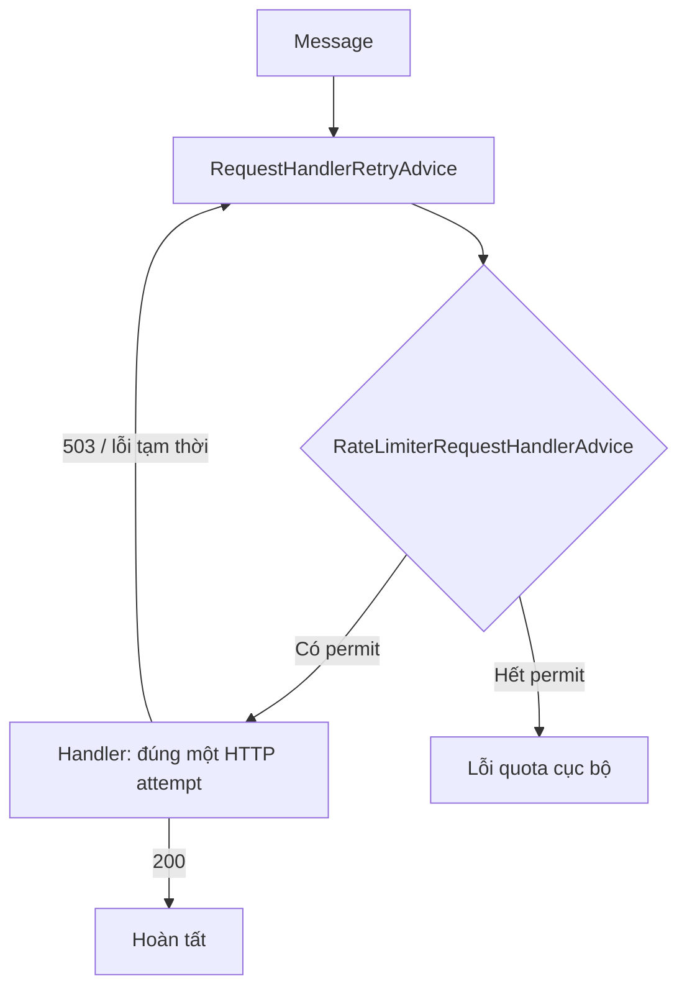
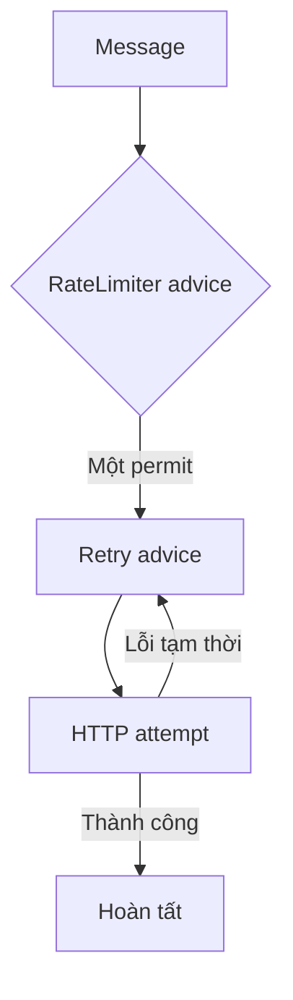
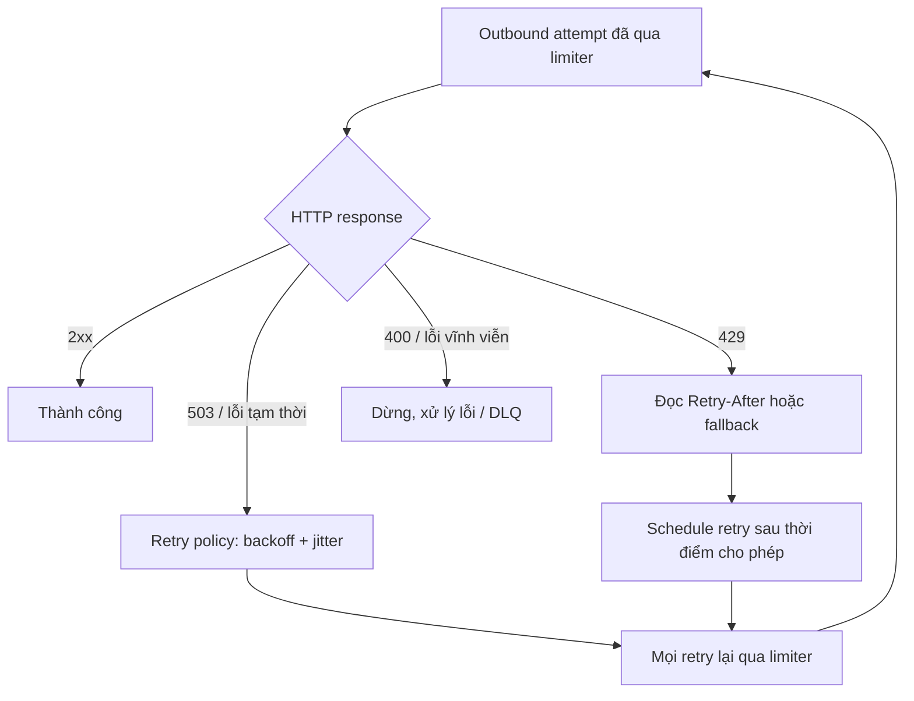
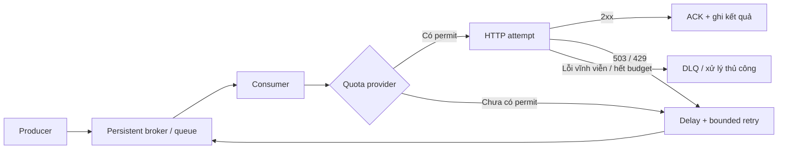

# Kết hợp Rate Limiter với Retry trong Spring Integration

> **Module:** `SPRING_INTEGRATION_PATTERN` — Học triển khai Enterprise Integration Patterns với Spring Integration để xây dựng luồng thông điệp ít phụ thuộc và dễ mở rộng. Thực hành Router, Filter, Transformer, Splitter, Aggregator, Gateway, retry, error channel và correlation, đồng thời kiểm thử, theo dõi các nhánh xử lý.
>
> **Chương:** Rate limiter  
> **Đề bài:** Kết hợp rate limiter với retry

## 1. Vì sao Rate Limiter và Retry phải được thiết kế cùng nhau?

Một hệ thống nhận 8 yêu cầu tạo vận đơn mỗi giây. Đối tác vận chuyển cho phép tối đa **10 HTTP requests/giây** tính theo một API key. Khi mạng chập chờn hoặc đối tác trả HTTP 503, ứng dụng thử gửi lại các yêu cầu bị lỗi.

Một message có thể tạo **nhiều lần gọi HTTP thực tế**:

```text
Message M-101
  ├─ Attempt 1: HTTP 503
  ├─ Attempt 2: timeout
  └─ Attempt 3: HTTP 200
```

Nếu chỉ lấy **một permit trước khi bắt đầu toàn bộ quá trình retry**, ứng dụng đã tiêu thụ một permit nhưng gửi ba request ra đối tác. Bộ đếm permit khi ấy không còn phản ánh quota do đối tác áp đặt. Trong trường hợp khác, retry quá nhanh khi rate limiter đã hết permit có thể tạo vòng lỗi và làm tắc thread.

Ta phải trả lời rõ:

1. **Mỗi permit đại diện điều gì?** Một message nghiệp vụ, một lượt vào handler, hay một HTTP attempt?
2. **Limiter nằm trong hay ngoài vòng retry?** Điều đó quyết định từng lần thử có được kiểm tra quota hay không.
3. **Lỗi nào được retry?** HTTP 503 và lỗi mạng tạm thời có thể cần retry, trong khi payload sai hoặc hết permit nội bộ thường cần cách xử lý khác.
4. **Khi nào retry?** Exponential backoff, jitter, `Retry-After` và lịch cấp permit phải được phối hợp.
5. **Message đang ở đâu?** Gateway đồng bộ có thể giữ caller chờ; broker/queue cần ack/nack, delay và idempotency.

Mục tiêu là làm cho **mọi outbound attempt đều có quyền gửi**, đồng thời không tạo retry storm và không làm mất message quan trọng.

## 2. Phân biệt message, attempt và permit

Các đối tượng có quan hệ khác nhau:

| Thuật ngữ | Ý nghĩa | Ví dụ |
|---|---|---|
| **Message** | Đơn vị thông tin/ý định nghiệp vụ | Tạo vận đơn `order-42` |
| **Handler invocation** | Một lần Spring Integration gọi handler | `sendToPartner(order)` |
| **Outbound attempt** | Một lần client thực sự thử gọi HTTP/đối tác | POST lần 1, POST lần 2 |
| **Permit** | Quyền được bước bảo vệ bởi limiter thực thi | 1 permit cho mỗi outbound attempt |
| **Retry attempt** | Một lần thử lại sau thất bại | Thử lại sau 503 |
| **Business operation** | Kết quả nghiệp vụ cần xảy ra đúng theo quy tắc | Một vận đơn cho `order-42` |

Một lời gọi handler có thể tạo **0 HTTP attempts** (bị từ chối trước khi gọi), **1 HTTP attempt** (không retry bên trong) hoặc **N HTTP attempts** (HTTP client tự retry bên trong). Vì thế, gắn Rate Limiter advice vào handler chỉ bảo vệ số **handler invocations**. Muốn bảo vệ số request thật, hãy làm sao để **mỗi outbound attempt** đi qua handler có limiter, hoặc dùng bộ kiểm tra quota tại tầng HTTP client cho từng attempt.

**Ví dụ tính toán.** Nếu cứ một message được retry tối đa ba lần gọi, xác suất một attempt lỗi tạm thời là \(p=0{,}25\) và giả sử các lần lỗi độc lập, số HTTP attempts kỳ vọng cho mỗi message là:

\[
E[A] = 1 + p + p^2 = 1{,}3125
\]

Với 8 message/giây, tải outbound kỳ vọng là:

\[
8 \times 1{,}3125 = 10{,}5\;\text{attempts/giây}
\]

Tức là vượt ngân sách 10 request/giây dù ingress chỉ có 8 message/giây. Trong thực tế, lỗi của đối tác thường **có tương quan theo thời gian**, nên trường hợp retry storm còn nghiêm trọng hơn mô hình độc lập này. Công thức chỉ mang ý nghĩa minh họa tải kỳ vọng, không dự báo chính xác mọi burst.

### Một mô hình dễ nhầm



Trong mô hình trên, cả ba HTTP attempts có thể đi qua **cùng một permit**. Nếu provider tính request theo lần gọi, đây là vị trí đặt limiter sai.

## 3. Hai thứ tự advice: Retry bọc Rate Limiter hay ngược lại?

Spring Integration cung cấp `RequestHandlerRetryAdvice` để thử lại việc gọi handler và `RateLimiterRequestHandlerAdvice` để xin permit trước khi gọi handler. Khi cả hai nằm trong `adviceChain`, **thứ tự** tác động đến semantics.

### 3.1. Retry bên ngoài, limiter bên trong



**Ý nghĩa:** mỗi lần RetryAdvice gọi lại phần phía trong sẽ gặp RateLimiterAdvice trước khi handler chạy. Đây thường là lựa chọn phù hợp nếu **mỗi lần handler chạy chính xác một HTTP attempt**.

Thứ tự khai báo ý tưởng:

```java
@ServiceActivator(
        inputChannel = "providerRequests",
        adviceChain = {"transientRetryAdvice", "providerQuotaAdvice"})
public String callProvider(String payload) {
    // Đúng một HTTP attempt; không tự retry lần nữa bên trong.
    return providerClient.sendOnce(payload);
}
```

Trong thứ tự này, advice đầu tiên là lớp bao ngoài và advice sau là lớp bao trong. Cần kiểm tra hành vi với phiên bản Spring Integration đang dùng bằng integration test, vì toàn bộ chain còn có thể chịu ảnh hưởng của các interceptor hoặc retry ở HTTP client.

**Lưu ý đặc biệt:** nếu RetryAdvice mặc định retry **mọi exception**, nó có thể retry cả lỗi thiếu permit — một hành vi thường không mong muốn. Phải định nghĩa **RetryPolicy phân loại lỗi**, không để hết permit biến thành retry loop.

### 3.2. Limiter bên ngoài, Retry bên trong



Ví dụ ngược thứ tự:

```java
@ServiceActivator(
        inputChannel = "providerRequests",
        adviceChain = {"providerQuotaAdvice", "transientRetryAdvice"})
public String callProvider(String payload) {
    return providerClient.sendOnce(payload);
}
```

Lúc này Rate Limiter advice bọc **toàn bộ khối retry**. Một permit có thể mở đường cho nhiều HTTP attempts. Cách này chỉ đúng nếu quota cố ý tính theo **một logical operation**, không phải số request thực tế. Với quota thông thường theo HTTP attempts, nó có thể gây vượt hạn mức.

### 3.3. Không có thứ tự nào cứu được retry ẩn trong HTTP client

Nếu `providerClient.sendOnce(...)` thực chất đã bật automatic retry trong HTTP library hoặc SDK, có thể một handler invocation tạo nhiều request. Lúc đó kể cả thứ tự đúng ở `adviceChain` vẫn **chưa kiểm soát được từng outbound attempt**.

Có hai hướng:

- Tắt automatic retry trong SDK, để RetryAdvice lặp lại **mỗi lần gọi HTTP đơn**.
- Hoặc kiểm tra permit bằng interceptor/chính sách bên trong HTTP client **trước mỗi attempt**, bao gồm cả các lần retry do SDK thực hiện.

Quy tắc xác minh: kiểm tra số request **đến stub server**, không chỉ số lần handler được gọi.

## 4. Phân loại lỗi trước khi thiết lập RetryPolicy

Không phải exception nào cũng cần thử lại.

| Tình huống | Nên retry ngay bằng cùng advice? | Gợi ý |
|---|---|---|
| HTTP 503/502 tạm thời | Có thể, có giới hạn | Exponential backoff, jitter, timeout tổng |
| Lỗi mạng tạm thời trước khi biết kết quả | Có thể, thận trọng | Idempotency key, backoff và log uncertainty |
| HTTP 429 từ provider | Thường **không retry ngay lập tức** | Tuân theo `Retry-After`, điều chỉnh quota, trì hoãn |
| Hết permit **nội bộ** | Thường không | Fail fast hoặc delay/requeue tới khi có permit |
| HTTP 400 do payload sai | Không | Sửa dữ liệu, reject hoặc DLQ |
| HTTP 401/403 do credential/quyền | Không retry mù quáng | Kiểm tra config, secret, quyền truy cập |
| Dữ liệu trùng có thể xác nhận | Tùy contract provider | Idempotency hoặc đối chiếu trạng thái |
| Circuit Breaker đang open | Không retry vòng nóng | Chờ cooldown hoặc điều phối lại |

Tách các exception như `TransientPartnerException`, `RemoteRateLimitException` và `InvalidPartnerRequestException` giúp retry policy ra quyết định rõ ràng. Nếu HTTP client ném exception được bọc bởi `MessagingException` của Spring Integration, RetryPolicy cần xét **cause chain** hoặc chuẩn hóa exception ở một lớp adapter.

Không nên giả định HTTP 429 luôn có `Retry-After` hợp lệ. Một số provider trả header này, một số không, hoặc áp dụng quota trên toàn tài khoản với nhiều ứng dụng cùng dùng. Chính sách phải có fallback an toàn.

## 5. Ví dụ Spring Integration: ba attempts, mỗi attempt một permit

Ví dụ Java sau mô phỏng một provider trả 503 ở hai lần đầu rồi thành công ở lần thứ ba. Nó dùng hai advice:

1. `RequestHandlerRetryAdvice` ở **ngoài**, tối đa ba lần gọi handler.
2. `RateLimiterRequestHandlerAdvice` ở **trong**, kiểm tra permit tại **mỗi lần** handler được gọi.

Để giữ ví dụ rõ ràng, ta retry **chỉ** khi gặp `TransientPartnerException`. Hết permit nội bộ, dữ liệu sai và lỗi hợp đồng không thuộc tập retry.

### 5.1. Dependencies

Ví dụ Gradle, chọn phiên bản tương thích với Spring Boot/Spring Integration của dự án:

```groovy
dependencies {
    implementation "org.springframework.boot:spring-boot-starter-integration"
    implementation "org.springframework.retry:spring-retry"
    implementation "io.github.resilience4j:resilience4j-ratelimiter:VERSION"
}
```

Thay `VERSION` bằng phiên bản Resilience4j được dự án quản lý (hoặc khai báo một BOM phù hợp). Spring Retry và Resilience4j là hai dependency có nhiệm vụ khác nhau: **retry attempts** và **quota permits**.

### 5.2. Bật integration, đăng ký Gateway

File `RetryLimiterApplication.java`:

```java
package com.example.integration.retryquota;

import org.springframework.boot.SpringApplication;
import org.springframework.boot.autoconfigure.SpringBootApplication;
import org.springframework.integration.annotation.IntegrationComponentScan;
import org.springframework.integration.config.EnableIntegration;

@SpringBootApplication
@EnableIntegration
@IntegrationComponentScan
public class RetryLimiterApplication {

    public static void main(String[] args) {
        SpringApplication.run(RetryLimiterApplication.class, args);
    }
}
```

File `PartnerGateway.java`:

```java
package com.example.integration.retryquota;

import org.springframework.integration.annotation.MessagingGateway;

@MessagingGateway(defaultRequestChannel = "providerRequests")
public interface PartnerGateway {
    String send(String payload);
}
```

### 5.3. Khai báo channel, RetryAdvice và RateLimiterAdvice

File `RetryLimiterConfig.java`:

```java
package com.example.integration.retryquota;

import java.time.Duration;
import java.util.Map;

import io.github.resilience4j.ratelimiter.RateLimiterConfig;
import org.springframework.context.annotation.Bean;
import org.springframework.context.annotation.Configuration;
import org.springframework.integration.channel.DirectChannel;
import org.springframework.integration.handler.advice.RateLimiterRequestHandlerAdvice;
import org.springframework.integration.handler.advice.RequestHandlerRetryAdvice;
import org.springframework.messaging.MessageChannel;
import org.springframework.retry.backoff.ExponentialBackOffPolicy;
import org.springframework.retry.policy.SimpleRetryPolicy;
import org.springframework.retry.support.RetryTemplate;

@Configuration
public class RetryLimiterConfig {

    @Bean
    public MessageChannel providerRequests() {
        return new DirectChannel();
    }

    @Bean
    public RateLimiterRequestHandlerAdvice providerQuotaAdvice() {
        RateLimiterConfig config = RateLimiterConfig.custom()
                .limitForPeriod(3)
                .limitRefreshPeriod(Duration.ofSeconds(1))
                .timeoutDuration(Duration.ZERO)
                .build();

        return new RateLimiterRequestHandlerAdvice(
                config, "provider-key-shared");
    }

    @Bean
    public RequestHandlerRetryAdvice transientRetryAdvice() {
        SimpleRetryPolicy policy = new SimpleRetryPolicy(
                3,
                Map.of(TransientPartnerException.class, true),
                true,   // Xét cause chain khi exception bị wrap.
                false); // Ngoài các class khai báo: không retry.

        ExponentialBackOffPolicy backoff =
                new ExponentialBackOffPolicy();
        backoff.setInitialInterval(200); // 200 ms
        backoff.setMultiplier(2.0);
        backoff.setMaxInterval(2_000);

        RetryTemplate template = new RetryTemplate();
        template.setRetryPolicy(policy);
        template.setBackOffPolicy(backoff);

        RequestHandlerRetryAdvice advice =
                new RequestHandlerRetryAdvice();
        advice.setRetryTemplate(template);
        return advice;
    }
}
```

Giải thích:

- `limitForPeriod(3)`: tối đa ba permit trong một chu kỳ một giây **trên JVM này**. Đây là quota minh họa; chọn quota từ hợp đồng provider thực tế.
- `timeoutDuration(Duration.ZERO)`: khi hết permit thì từ chối ngay, không giữ thread chờ quota.
- `SimpleRetryPolicy(3, ...)`: tối đa **ba attempts tổng cộng** (một lần đầu và nhiều nhất hai lần thử lại), không phải ba lần retry cộng thêm lần đầu.
- Chỉ `TransientPartnerException` được phép retry, kể cả khi Spring Integration bọc nó trong cause chain; các lỗi quota nội bộ không nằm trong tập retry.
- Backoff mặc định theo cấu hình này là 200 ms trước retry thứ nhất, 400 ms trước retry thứ hai. Đây là khoảng chờ cho **retry lỗi tạm thời**, không phải thời gian chờ permit.

Đối với tải đồng thời lớn, một backoff đồng bộ giữ thread của caller. Không nên kéo dài thời gian retry đồng bộ vượt ngân sách latency của Gateway và HTTP ingress. `ExponentialBackOffPolicy` này **không tự đọc `Retry-After`** của HTTP 429; phần 7 trình bày cách xử lý riêng.

### 5.4. Handler thực thi đúng một outbound attempt

File `TransientPartnerException.java`:

```java
package com.example.integration.retryquota;

public final class TransientPartnerException extends RuntimeException {

    public TransientPartnerException(String message) {
        super(message);
    }
}
```

File `PartnerClient.java`:

```java
package com.example.integration.retryquota;

public interface PartnerClient {
    // Contract: mỗi lần gọi hàm chỉ tạo TỐI ĐA MỘT HTTP attempt.
    // Không bật retry ẩn trong HTTP SDK.
    String sendOnce(String payload);
}
```

File `StubPartnerClient.java` để học và chạy thử:

```java
package com.example.integration.retryquota;

import java.util.concurrent.atomic.AtomicInteger;
import org.springframework.stereotype.Component;

@Component
public class StubPartnerClient implements PartnerClient {

    private final AtomicInteger actualAttempts = new AtomicInteger();

    @Override
    public String sendOnce(String payload) {
        int attempt = actualAttempts.incrementAndGet();

        if (attempt <= 2) {
            // Mô phỏng hai lượt HTTP 503 liên tiếp.
            throw new TransientPartnerException(
                    "Simulated HTTP 503 at attempt " + attempt);
        }

        return "provider accepted: " + payload;
    }

    public int getActualAttempts() {
        return actualAttempts.get();
    }
}
```

Stub trên đếm attempts trên toàn bộ vòng đời bean; nó chỉ là mô phỏng cho một chuỗi gửi thử. Khi kiểm thử nhiều case, khởi tạo stub/limiter riêng hoặc reset state qua cơ chế test phù hợp.

File `PartnerOutboundHandler.java`:

```java
package com.example.integration.retryquota;

import org.springframework.integration.annotation.ServiceActivator;
import org.springframework.stereotype.Component;

@Component
public class PartnerOutboundHandler {

    private final PartnerClient client;

    public PartnerOutboundHandler(PartnerClient client) {
        this.client = client;
    }

    @ServiceActivator(
            inputChannel = "providerRequests",
            adviceChain = {"transientRetryAdvice", "providerQuotaAdvice"})
    public String send(String payload) {
        return client.sendOnce(payload);
    }
}
```

Khi một caller gọi `gateway.send("order-42")` với limiter còn đủ permit:

1. RetryAdvice gọi RateLimiterAdvice.
2. RateLimiterAdvice cấp **permit 1**, handler gọi client: lỗi 503.
3. RetryAdvice đợi backoff, sau đó gọi lại RateLimiterAdvice.
4. RateLimiterAdvice cấp **permit 2**, handler gọi client: lại lỗi 503.
5. RetryAdvice đợi tiếp, rồi gọi lại RateLimiterAdvice.
6. RateLimiterAdvice cấp **permit 3**, handler gọi client: thành công.
7. Gateway nhận kết quả `provider accepted: order-42`.

Như vậy trong điều kiện này có **3 HTTP attempts và 3 permits**. Nếu permit không đủ ở lần thử thứ hai hoặc thứ ba, RateLimiterAdvice từ chối trước HTTP attempt và retry policy được cấu hình **không retry lỗi thiếu permit**. Caller nhận exception theo đường lỗi đồng bộ thay vì tiếp tục thử vòng nóng.

*Giới hạn của bản demo:* `StubPartnerClient` không gọi HTTP thật nên không thể chứng minh byte nào đã tới provider; integration test nên thay stub bằng fake HTTP server đếm số request đã nhận.

### 5.5. Những điểm cần rà soát khi áp dụng vào HTTP client thật

Với Java HTTP client / WebClient / SDK, hãy đảm bảo:

- Tắt hoặc kiểm soát **automatic retry** ẩn trong thư viện HTTP.
- Phân loại HTTP 503/502 và lỗi mạng tạm thời thành `TransientPartnerException` (hoặc một loại lỗi đã được RetryPolicy nhận biết).
- Không biến `RateLimitExceededException` của advice thành `TransientPartnerException` một cách vô ý.
- Mọi lần gửi thực tế, kể cả retry do lỗi timeout, phải đi qua limiter.
- Nếu API tạo ra tác dụng phụ, cung cấp **idempotency key** ổn định theo operation từ attempt đầu đến attempt cuối.
- Dùng timeout của HTTP client và giới hạn tổng thời gian retry hợp lý; `timeoutDuration` của limiter chỉ kiểm soát **thời gian chờ permit**.

## 6. Khi hết permit giữa vòng retry: chuyện gì xảy ra?

Hãy đổi thử quota của ví dụ từ 3 xuống **1 permit/chu kỳ dài**, giữ `timeoutDuration = 0`. Lần đầu có permit, handler gửi HTTP và nhận 503. RetryAdvice muốn gọi lại nhưng ở lần thứ hai, RateLimiterAdvice không còn permit.

Kết quả dự kiến:

```text
Attempt #1: lấy permit -> gửi HTTP -> 503
Backoff:    chờ 200 ms
Attempt #2: không có permit -> từ chối trước khi gửi HTTP
RetryPolicy: không retry lỗi quota cục bộ
=> Số HTTP requests thực tế: 1
```

Đây là hành vi **an toàn hơn về quota** so với tiếp tục gửi HTTP, nhưng nó có nghĩa là business operation chưa hoàn thành. Cần quyết định việc **trả lỗi cho caller**, **xếp lại message** hoặc **trì hoãn đến chu kỳ tiếp theo**, tùy độ quan trọng của nghiệp vụ.

Không nên chỉ tăng số lần retry từ 3 lên 30 để “đợi cho tới khi có permit”, vì:

- Tạo nhiều lần chạy policy không cần thiết.
- Có thể giữ thread Gateway/poller lâu.
- Dễ khuếch đại tải khi nhiều message cùng hết permit.
- Không xử lý được trường hợp backlog bền vững hoặc ứng dụng restart.

Nếu mục tiêu là **đợi quota hồi phục để xử lý cuối cùng**, nên cân nhắc queue/delayed retry có kiểm soát ở tầng orchestration.

## 7. HTTP 429 và Retry-After: trì hoãn theo thông tin đối tác

HTTP **429 Too Many Requests** là do **đối tác đã nhận request** và từ chối dựa trên chính sách của họ. Nó khác với tình huống **local limiter hết permit** trước khi gửi: trong trường hợp local rejection, đối tác không nhận request mới.

Đối tác có thể trả:

```http
HTTP/1.1 429 Too Many Requests
Retry-After: 3
```

Header này gợi ý client nên đợi khoảng ba giây trước khi thử lại. `Retry-After` cũng có thể là một **HTTP-date**. Phần tính toán phải kiểm tra định dạng, giới hạn mức chờ và xử lý trường hợp thiếu/không hợp lệ.

### Quy trình khuyến nghị



Một lịch retry có thể dựa vào:

\[
\text{nextAttemptAt} =
\max(\text{now}+\text{backoff},\ \text{now}+\text{RetryAfter})
\]

Công thức giả định cả hai thời lượng đã được tính hợp lệ tại cùng thời điểm lập lịch. Nếu local limiter vẫn thiếu permit khi đến thời điểm dự kiến, **không được bỏ qua limiter**; trì hoãn tiếp hoặc từ chối theo chính sách.

### Vì sao không nên retry 429 ngay trong vòng lặp ngắn?

- Mỗi HTTP 429 đã tiêu tốn **một outbound attempt**.
- Nhiều client retry đồng thời có thể tạo *thundering herd*.
- Provider có thể áp dụng quota theo API key/tài khoản trên nhiều app hoặc nhiều pod; local quota riêng không nhìn thấy mọi nguồn tải.
- Nếu response có `Retry-After` vài giây, một vòng retry đồng bộ kéo dài có thể vượt timeout của HTTP caller.

Với công việc cần hoàn thành sau nhiều giây/phút, nên đưa message vào broker/delayed retry và duy trì idempotency. Một `ExponentialBackOffPolicy` tĩnh không tự tuân theo `Retry-After`; muốn làm vậy cần xử lý chuyên biệt tại client, scheduler hoặc custom backoff policy.

## 8. Jitter, retry budget và giới hạn độ trễ

**Exponential backoff** tăng thời gian chờ giữa các lần retry. Với `initial=200 ms`, `multiplier=2`, lịch cơ bản là 200 ms, 400 ms, 800 ms, ... tới mức trần. **Jitter** làm lệch ngẫu nhiên có kiểm soát để nhiều client không retry đồng thời.

Ví dụ công thức **full jitter**:

\[
d_n \sim U\left(0,\min(d_{\max},d_0 2^{n-1})\right)
\]

Với `d0 = 200 ms`, `dmax = 5 s`, mỗi message chọn độ trễ ngẫu nhiên trong khoảng từ 0 đến mốc trần của lần retry đó. Khi có `Retry-After`, thời điểm retry không được sớm hơn yêu cầu của provider, kể cả khi jitter tạo độ trễ thấp.

Một hệ thống nên có **hai ngân sách**:

1. **Quota budget:** số outbound attempts có permit trong mỗi kỳ.
2. **Retry budget:** số retry attempts tối đa theo operation hoặc theo hệ thống, cùng deadline/TTL.

Hạn mức retry ba attempts cho mỗi message không ngăn được **một triệu message cùng retry**. Có thể cần giới hạn số retry toàn hệ thống, số consumer đang retry và dung lượng queue.

### Tính timeout tổng

Một Gateway đồng bộ có thời gian phản hồi tối đa 1 giây. Giả sử:

- Mỗi HTTP attempt timeout 350 ms.
- Backoff giữa các lần: 200 ms và 400 ms.
- Tối đa ba attempts.

Thời gian tối đa gần đúng:

\[
3 \times 350 + 200 + 400 = 1650\text{ ms}
\]

Con số này **chưa kể chờ permit, overhead và scheduling**. Vì vậy chính sách ba attempts không phù hợp nếu caller thực sự chỉ chờ 1 giây. Phải giảm attempts/timeout hoặc chuyển sang xử lý bất đồng bộ. Không nên để client HTTP bên ngoài timeout rồi tự retry trong khi request cũ vẫn còn chạy không kiểm soát.

## 9. Retry không đồng nghĩa với exactly-once: idempotency và lỗi mơ hồ

Khi HTTP call bị timeout, ta có thể **không biết** đối tác đã thực hiện nghiệp vụ hay chưa:

```text
Client                        Provider
  |--- POST /shipments ------->|
  |                            | Tạo shipment thành công
  |<--- response bị mất --------|
  |   Timeout                  |
  |--- Retry POST ------------>|
  |                            | Có nguy cơ tạo shipment thứ hai
```

Nếu mỗi attempt chỉ kiểm tra permit thì **quota được bảo vệ**, nhưng nghiệp vụ vẫn có thể bị thực hiện **hai lần**. Đây là hai vấn đề khác nhau.

Giải pháp thường dùng:

- Gắn **idempotency key cố định theo business operation** vào mỗi outbound attempt của cùng message.
- Provider hỗ trợ nhận diện và trả lại kết quả của request đã thực hiện trước đó.
- Nếu provider không hỗ trợ idempotency, lưu trạng thái và đối chiếu kết quả theo business ID trước khi retry, tùy mức bảo đảm của API.
- Ghi `messageId`, `correlationId`, `businessId`, attempt number và quota key để quan sát; không log API key hoặc payload nhạy cảm.

**Không tạo idempotency key mới cho mỗi retry.** Key thay đổi có thể khiến provider coi attempt mới là một nghiệp vụ độc lập.

### Ví dụ interface client có idempotency key

```java
public record ShipmentCommand(
        String businessId,
        String recipient,
        String address) {}

public interface ShipmentClient {
    // Chỉ một HTTP attempt; HTTP header Idempotency-Key giữ nguyên.
    String createOnce(ShipmentCommand command, String idempotencyKey);
}
```

Trong handler, có thể truyền `command.businessId()` làm key nếu business ID có tính ổn định/duy nhất và phù hợp contract provider. Nếu một operation được tái thực hiện có chủ đích với cùng business ID, cần một key theo **operation version**, không tái sử dụng bừa bãi.

## 10. Gateway đồng bộ, queue bất đồng bộ và Error Channel

### 10.1. Request-reply đồng bộ

Với `DirectChannel` và `@MessagingGateway`, các bước retry/backoff đồng bộ chạy trên thread gửi message. Exception sau khi hết policy thường quay về Gateway/caller, có thể được Spring Integration bọc trong `MessagingException` hoặc lớp exception khác.

Ứng dụng HTTP bao quanh Gateway phải quyết định trả lỗi nào (chẳng hạn 429 cho quota cục bộ, 503 cho lỗi đối tác tạm thời), có ghi `Retry-After` hay không, và liệu caller được phép retry toàn bộ operation. Không xem một response “đã nhận yêu cầu” là đồng nghĩa operation đã hoàn thành nếu chưa xử lý.

### 10.2. Queue và consumer cho retry kéo dài

Với operation quan trọng nhưng latency không cho phép chờ nhiều giây:



Các bước trong sơ đồ là **trách nhiệm thiết kế của adapter/broker và ứng dụng**, không phải hành vi tự động của RateLimiter advice.

Cần làm rõ:

- Queue/broker **bền vững** và acknowledgment đúng thời điểm; `QueueChannel` trong bộ nhớ không tự tồn tại qua restart.
- Consumer không ACK message trước khi có cơ chế ghi nhận kết quả hoặc lưu retry an toàn.
- Khi consumer đã lấy message khỏi queue và handler thất bại, đừng giả định message sẽ tự được đưa lại queue.
- Retry có giới hạn lần thử, TTL và lịch delay; message lỗi vĩnh viễn chuyển DLQ hoặc một quy trình xử lý khác.
- Khi provider đã xử lý nhưng ACK bị mất, message có thể được redeliver: idempotency là bắt buộc đối với tác dụng phụ quan trọng.

### 10.3. Error Channel không phải hàng đợi retry tự động

Với flow đồng bộ, lỗi thường truyền về caller. Với poller, executor hoặc broker-driven adapter, exception có thể được chuyển thành `ErrorMessage`, phát vào error channel tương ứng hoặc được adapter/consumer xử lý trực tiếp. Không nên giả định global `errorChannel` luôn nhận mọi lỗi.

Một error handler cần phân biệt:

| Nhóm lỗi | Gợi ý hướng xử lý |
|---|---|
| Local permit exhausted | Trả lỗi hoặc schedule sau khi quota hồi phục |
| HTTP 429 remote | Tính thời điểm từ `Retry-After` rồi trì hoãn |
| HTTP 503 / timeout | Retry có backoff, jitter, budget và idempotency |
| Payload invalid / missing fields | Reject hoặc DLQ theo hợp đồng |
| Retry exhausted | DLQ/alert/reconcile; lưu đủ dấu vết |

## 11. Tương tác với Router, Filter, Splitter, Aggregator và Circuit Breaker

Khi Spring Integration flow có nhiều Enterprise Integration Patterns, vị trí limiter và retry phải dựa trên **đơn vị quota thật**.

| Pattern | Điều dễ sai | Gợi ý |
|---|---|---|
| **Router** | Hai nhánh dùng chung API key nhưng có limiter độc lập | Hợp outbound qua một dispatcher hoặc chia sẻ quota provider |
| **Filter** | Permit bị lấy trước khi message bị lọc bỏ | Lọc message không cần gửi trước bước xin permit |
| **Transformer** | Lấy permit cho lượt transform dù chưa gọi mạng | Giới hạn sát handler outbound |
| **Splitter** | Một message thành N HTTP attempts nhưng chỉ lấy một permit | Mỗi outbound attempt phải qua limiter |
| **Aggregator** | Một batch chứa N items nhưng quota provider theo item | Tính quota theo trọng số/items nếu cần |
| **Gateway** | Retry/backoff giữ thread lâu, timeout caller xảy ra trước | Tính deadline; chuyển sang async khi cần |
| **Error Channel** | Lỗi local/remote đều xử lý như nhau | Phân loại lý do và định tuyến retry/DLQ |
| **Correlation** | Retry mất business ID / idempotency key | Giữ context ổn định qua mọi attempt |
| **Circuit Breaker** | Retry tiếp khi provider đang open circuit | Dừng retry nóng, chờ chính sách circuit/queue |

Một Circuit Breaker có thể bao ngoài hoặc bên trong vòng retry tùy đơn vị được đo: **mỗi HTTP attempt** hay **toàn bộ logical operation**. Chọn chính sách rõ ràng và kiểm thử metric vì thứ tự advice ảnh hưởng số failure được ghi nhận.

Nếu sau Splitter có 10 message con và mỗi con có retry tối đa ba attempts, hệ thống có thể phát **tối đa 30 HTTP attempts** cho một message đầu vào. Một limiter trước Splitter chỉ lấy một permit và không bảo vệ quota 30 lần gửi đó. Đặt limiter tại handler thực hiện từng attempt là lựa chọn dễ kiểm chứng hơn.

## 12. Quota theo flow, tenant, endpoint và nhiều replica

### 12.1. Phạm vi chia sẻ permit

Giả sử có flow `orders` và `campaigns` cùng dùng API key `shared-key-1`. Nếu mỗi flow có limiter 10/s, tổng lưu lượng có thể vượt quota provider 10/s. Retry làm tình hình tệ hơn vì mỗi message có thể tạo nhiều request.

Cần tách:

- **Quota flow:** bảo vệ ngân sách và độ ưu tiên giữa các luồng nghiệp vụ.
- **Quota tenant:** tránh một tenant tiêu thụ quá nhiều tài nguyên.
- **Quota provider/API key:** giới hạn tổng outbound attempts sử dụng cùng credential.
- **Retry budget:** giới hạn lượng attempts sinh thêm do lỗi, độc lập với quota provider.

Để quota tổng chính xác, tất cả các outbound attempts dùng chung credential phải đi qua **một state ngân sách chung**; tên limiter giống nhau không bảo đảm hai instance chia sẻ state.

### 12.2. Nhiều replica

Một `RateLimiterRequestHandlerAdvice` khởi tạo từ config thường giữ state rate limiter **trong JVM**. Nếu có ba replica, mỗi replica `limitForPeriod(10)`, tổng throughput có thể xấp xỉ 30 requests/giây cộng burst giữa chu kỳ. Đó không phải quota toàn cục 10/s.

Các hướng xử lý:

1. Dùng **outbound dispatcher** chung để điều phối request từ nhiều flow.
2. Sử dụng **limiter phân tán** với thao tác cấp permit nguyên tử theo quota key.
3. Chia ngân sách có kiểm soát cho từng replica, cộng dự phòng và cập nhật khi autoscaling, biết rằng cách này kém linh hoạt khi tải lệch.

Đặc biệt, mỗi replica có retry backlog riêng; nếu cả ba replica đồng loạt retry vào cùng thời điểm, HTTP 429 có thể bùng nổ. Áp dụng jitter, retry budget và giám sát tổng HTTP attempts, không chỉ tổng message vào.

### 12.3. Tenant identity và cardinality

Tenant ID phải lấy từ authentication/authorization đáng tin cậy. Không dùng một header tùy ý của caller để tạo limiter mới vì caller có thể đổi tenant ID để lấy quota mới. Hãy quản lý vòng đời limiter theo tenant và giới hạn độ lớn registry/cached keys. Trong monitoring, cân nhắc tổng hợp theo nhóm tenant thay vì tạo nhãn Prometheus cho hàng triệu tenant ID.

## 13. Kiểm thử kết hợp Rate Limiter và Retry

### 13.1. Ma trận kiểm thử nên có

| Tình huống | Thiết lập | Kỳ vọng |
|---|---|---|
| Thành công ngay | 1 permit, handler trả 200 | 1 attempt, 1 permit, không retry |
| Lỗi 503 hai lần | 3 permits, retry tối đa 3 | 3 HTTP attempts, 3 permits, cuối cùng thành công |
| Hết permit trước retry thứ hai | 1 permit, handler lần 1 trả 503, timeout=0 | Chỉ 1 HTTP attempt; lần hai bị chặn local |
| Exception không retryable | HTTP 400 mapped vào exception vĩnh viễn | Dừng ngay, không có attempt tiếp |
| HTTP 429 + Retry-After | Provider chỉ ra thời gian chờ | Không retry trước thời điểm cho phép |
| Retry hidden trong SDK | SDK tự gửi thêm request | Test phát hiện attempts vượt số permit; sửa vị trí limiter |
| Gateway timeout | Retry/backoff lâu hơn deadline | Giảm retry hoặc chuyển sang xử lý async |
| Queue redelivery | HTTP thành công rồi mất ACK | Idempotency không tạo tác dụng phụ trùng |
| Splitter tạo nhiều message | 1 message thành 5 con, mỗi con có retry | Đếm quota theo tổng HTTP attempts |
| Nhiều instance | Ba replica dùng cùng API key | Tổng request không vượt policy global đã chọn |
| Error channel | Consumer không đủ permit | Exception phân loại đúng, requeue/DLQ theo hợp đồng |

### 13.2. Bài kiểm tra nhỏ cho permit fail fast

Ví dụ JUnit 5 bên dưới kiểm tra Resilience4j trực tiếp:

```java
import static org.junit.jupiter.api.Assertions.*;

import java.time.Duration;
import io.github.resilience4j.ratelimiter.RateLimiter;
import io.github.resilience4j.ratelimiter.RateLimiterConfig;
import org.junit.jupiter.api.Test;

class RateLimiterRetryAdmissionTest {

    @Test
    void secondAttemptHasNoPermit() {
        RateLimiterConfig cfg = RateLimiterConfig.custom()
                .limitForPeriod(1)
                .limitRefreshPeriod(Duration.ofMinutes(1))
                .timeoutDuration(Duration.ZERO)
                .build();

        RateLimiter limiter = RateLimiter.of("test-one-permit", cfg);

        assertTrue(limiter.acquirePermission());  // HTTP attempt #1
        assertFalse(limiter.acquirePermission()); // Attempt #2 phải chặn
    }
}
```

Test này chỉ kiểm tra rate limiter. Nó **không kiểm tra advice ordering**. Muốn chứng minh Spring Integration RetryAdvice bọc RateLimiterAdvice đúng cách, tạo integration test dùng `PartnerGateway` và **HTTP stub đếm requests**:

1. Cấu hình quota 3 permit trong chu kỳ dài, retry tối đa 3, handler 503 hai lần rồi 200; assert stub nhận đúng **3 request** và Gateway nhận reply.
2. Cấu hình quota chỉ 1 permit, retry tối đa 3; stub trả 503 ở lần đầu; assert stub nhận đúng **1 request** và Gateway nhận lỗi do permit cục bộ ở lần tiếp theo.
3. Đảo thứ tự advice **chỉ trong test minh họa** và chứng minh khác biệt: limiter ngoài retry có thể cho ba HTTP attempts sau một permit. Không dùng cấu hình ngược trong production nếu quota theo HTTP requests.
4. Bật thử automatic retry trong HTTP SDK; nếu stub nhận nhiều requests hơn số handler invocations, chứng minh cần kiểm tra permit bên trong từng SDK attempt.
5. Khi test refresh và backoff thực, tránh phụ thuộc vào `Thread.sleep(10)` gần ranh giới chu kỳ. Dùng chu kỳ đủ dài hoặc môi trường kiểm soát thời gian; không để state limiter từ test trước ảnh hưởng test sau.

### 13.3. Metrics và log

Tách tối thiểu các metric:

| Metric | Ý nghĩa |
|---|---|
| `outbound_attempts_total` | Số HTTP attempts đã thực hiện |
| `outbound_attempt_result_total{status}` | Phân loại status mạng/HTTP |
| `rate_limiter_acquired_total` | Permit đã cấp |
| `rate_limiter_rejected_total` | Local permit thiếu |
| `retry_attempts_total` | Số attempts phát sinh thêm sau lần đầu |
| `retry_exhausted_total` | Số logical operations hết retry budget |
| `remote_http_429_total` | Số HTTP 429 thực tế từ provider |
| `retry_delay_seconds` | Phân bố thời gian chờ giữa attempts |
| `queue_backlog` / `oldest_message_age_seconds` | Áp lực xử lý bất đồng bộ |

Nếu mọi HTTP attempt phải lấy một permit, trong một flow ổn định số lượt HTTP attempt được phép gửi không được **lớn hơn** số lượt permit cấp trong cùng phạm vi đo, ngoại trừ khác biệt do cách đặt điểm ghi nhận và thời điểm quan sát. Nếu metric cho thấy HTTP attempts vượt permit, hãy kiểm tra retry ẩn, branch bỏ qua limiter hoặc nhiều replica cấp quota độc lập.

## 14. Các sai lầm thường gặp

| Sai lầm | Hệ quả | Cách khắc phục |
|---|---|---|
| Limiter bọc toàn bộ vòng retry | Một permit tạo nhiều HTTP requests | RetryAdvice ở ngoài, RateLimiterAdvice ở trong, nếu mỗi handler call là một attempt |
| Retry mọi exception | Hết permit nội bộ cũng bị retry ngay | Dùng RetryPolicy phân loại exception |
| Giữ automatic retry trong SDK | Advice chỉ đếm một lần trong khi SDK gửi nhiều lần | Tắt retry ẩn hoặc quota mỗi client attempt |
| Retry 429 không theo `Retry-After` | Tiếp tục bị từ chối, gây storm | Schedule retry sau thời điểm được phép |
| Không có jitter | Nhiều client cùng retry một lúc | Backoff kèm jitter |
| Retry đồng bộ quá lâu | Gateway/HTTP caller timeout, giữ thread | Tính deadline hoặc chuyển queue/consumer |
| Không có idempotency key | Retry sau timeout có thể tạo tác dụng phụ hai lần | Giữ một key ổn định xuyên suốt attempts |
| Chỉ giới hạn ingress trước Router/Splitter | Một message tạo nhiều requests sau đó | Đặt quota ở từng outbound attempt |
| Mỗi pod một limiter “cùng tên” | Tổng quota vượt giới hạn tài khoản | Dispatcher/limiter phân tán |
| ACK trước khi hoàn tất xử lý | Crash có thể làm mất message | Thiết kế ack/retry/transaction theo broker |
| Retry vô hạn | Backlog tăng không kiểm soát | Retry budget, TTL và DLQ |
| Xem HTTP 503 và 400 như nhau | Lỗi dữ liệu bị retry vô ích | Phân loại transient/permanent |

## 15. Bài tập thực hành

**Bài 1 — Thứ tự advice.** Dùng handler giả lập trả 503 hai lần rồi 200. Cấu hình quota ba permit, tối đa ba attempts. Đặt `transientRetryAdvice` bên ngoài `providerQuotaAdvice`, đo số permit và HTTP attempts. Sau đó đảo thứ tự trong môi trường test để giải thích sự khác biệt.

**Bài 2 — Hết permit giữa retry.** Giữ retry tối đa ba attempts, nhưng quota chỉ một permit trong chu kỳ dài, `timeoutDuration=0`. Lần đầu trả 503. Xác minh có một HTTP attempt, lần thứ hai bị chặn trước khi gọi provider và không tạo vòng retry liên tục cho lỗi permit.

**Bài 3 — Xử lý HTTP 429.** Dùng HTTP stub trả `429 Retry-After: 3` rồi 200. Thiết kế delay scheduler không thử lại trước ba giây, tôn trọng quota cục bộ và có jitter cho nhiều message cùng đến hạn.

**Bài 4 — Retry và idempotency.** Stub giả lập tạo vận đơn thành công nhưng làm mất response. Retry sau timeout với cùng idempotency key. Kiểm tra hệ thống nhận một vận đơn duy nhất dù có hai HTTP attempts.

**Bài 5 — Queue bất đồng bộ.** Gửi 100 message đến broker, consumer có quota provider 10 request/giây. Với provider trả 503 cho 20% attempts, đo backlog, tuổi message, retry budget và DLQ. Đề xuất cảnh báo khi backlog tăng liên tục.

**Bài 6 — Multi-instance.** Chạy ba replica cùng gọi một API key, mỗi replica có limiter 10/s, provider chỉ cho phép tổng 10/s. Mô phỏng retries đồng thời rồi thiết kế limiter toàn cục hoặc outbound dispatcher để không vượt quota.

### Câu hỏi tự đánh giá

1. Vì sao ba HTTP attempts sau một permit có thể vi phạm quota provider?
2. Khi `RequestHandlerRetryAdvice` được khai báo trước `RateLimiterRequestHandlerAdvice`, điều kiện nào phải đúng để mỗi retry attempt đi qua limiter?
3. Nếu HTTP SDK tự retry bên trong handler, lời khuyên nào cần thay đổi?
4. Hết permit nội bộ và HTTP 429 từ provider khác nhau thế nào về số request đã gửi?
5. Vì sao `Retry-After` không thể được thay thế bằng backoff cố định 200 ms?
6. Nếu một API call đã thành công nhưng response bị mất, làm sao retry an toàn cho tác dụng phụ?
7. Một message được Splitter tách làm 10 message, mỗi message tối đa ba attempts: cần dự toán tối đa bao nhiêu outbound requests?
8. Khi nào nên chuyển retry sang broker thay vì giữ caller đồng bộ chờ?

## 16. Tài liệu tham khảo

- [Spring Integration — Request Handler Advice](https://docs.spring.io/spring-integration/reference/handler-advice.html): cấu hình advice chain, retry và rate limiter.
- [Spring Integration — Retry and More](https://docs.spring.io/spring-integration/reference/handler-advice/classes.html): các loại advice có sẵn cho handler.
- [Spring Integration — Messaging Gateways](https://docs.spring.io/spring-integration/reference/gateway.html): request-reply và exception propagation.
- [Spring Integration — Error Handling](https://docs.spring.io/spring-integration/reference/error-handling.html): lỗi trong flow đồng bộ và bất đồng bộ.
- [Spring Retry](https://github.com/spring-projects/spring-retry): `RetryTemplate`, retry policies và backoff.
- [Resilience4j — RateLimiter](https://resilience4j.readme.io/docs/ratelimiter): permit, timeout và chu kỳ cấp lại permit.
- [HTTP Semantics — Retry-After](https://www.rfc-editor.org/rfc/rfc9110.html#name-retry-after): header `Retry-After` theo giây hoặc ngày HTTP.
