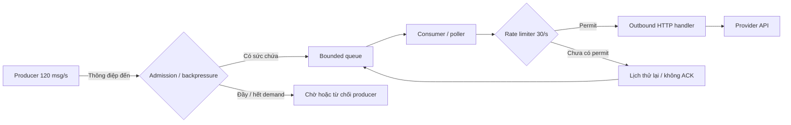
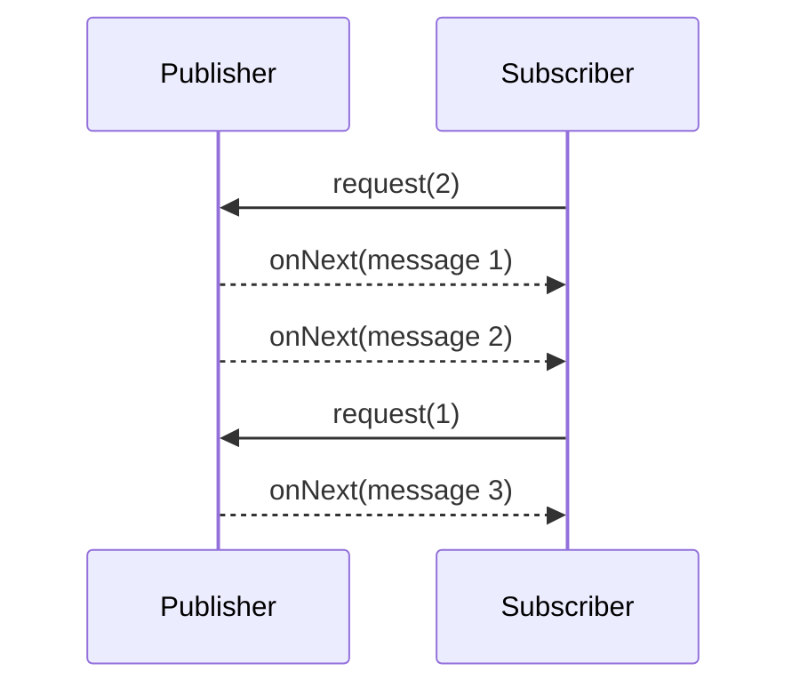
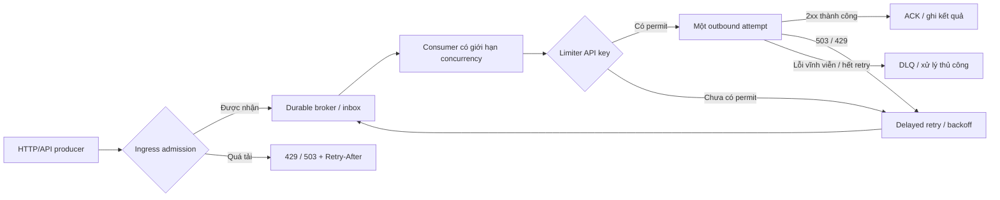

# Backpressure và rate limiting khác nhau thế nào?

> **Module:** `SPRING_INTEGRATION_PATTERN` — Học triển khai Enterprise Integration Patterns với Spring Integration để xây dựng luồng thông điệp ít phụ thuộc và dễ mở rộng. Thực hành Router, Filter, Transformer, Splitter, Aggregator, Gateway, retry, error channel và correlation, đồng thời kiểm thử, theo dõi các nhánh xử lý.
>
> **Chương:** Rate limiter  
> **Đề bài:** Backpressure và rate limiting khác nhau thế nào?

## 1. Tình huống xuất phát: phía nhận chậm hơn phía gửi

Một hệ thống thương mại điện tử nhận **120 message/giây** về đơn hàng. Mỗi message cần được chuyển thành một request gửi cho đối tác vận chuyển, nhưng API đối tác chỉ cho phép **30 request/giây**.

Nếu nguồn gửi giữ nguyên 120 message/giây và không message nào bị loại bỏ, backlog sẽ tăng xấp xỉ 90 message/giây. Bộ nhớ, số thread đang chờ hoặc dung lượng broker cuối cùng cũng có giới hạn.

Ta cần giải quyết **hai câu hỏi khác nhau**:

1. **Rate limiting:** Trong một khoảng thời gian, cho phép tối đa bao nhiêu lượt đi vào bước gọi API đối tác?
2. **Backpressure:** Khi tốc độ đến vượt quá tốc độ xử lý, hệ thống thông báo, làm chậm, tạm ngừng hoặc từ chối nguồn gửi bằng cách nào để không tích tụ công việc vô hạn?

Rate limiter kiểm soát **ngân sách lượt xử lý theo thời gian**. Backpressure là **cơ chế phản hồi áp lực từ downstream về upstream**; khi được triển khai đúng, nó giúp tốc độ hoặc số lượng công việc đang chờ phù hợp với năng lực thực tế.

Hai cơ chế thường đi cùng nhau trong Spring Integration, nhưng không thể thay thế nhau.

### Sau bài này, người học có thể

- Phân biệt giới hạn tốc độ, điều khiển lưu lượng, giới hạn đồng thời và backpressure.
- Tính được backlog, thời gian lấp đầy hàng đợi và các hệ quả về latency.
- Nhận biết nơi tín hiệu backpressure có thể truyền ngược trong `DirectChannel`, `QueueChannel`, executor, broker và reactive flow.
- Dùng `RateLimiterRequestHandlerAdvice` để giới hạn một outbound handler và dùng bounded queue để giới hạn số message chờ.
- Chọn chính sách xử lý khi queue đầy hoặc hết permit: chờ có timeout, từ chối, trì hoãn, hoặc loại bỏ theo hợp đồng nghiệp vụ.
- Thiết kế retry, error handling, acknowledgment và idempotency sao cho không làm mất hoặc gửi trùng đơn hàng.
- Kiểm thử rate limit và backpressure bằng số liệu đầu-cuối thay vì chỉ nhìn cấu hình.

## 2. Định nghĩa ngắn gọn và sự khác biệt cốt lõi

**Rate limiting** là quá trình quyết định có cho một hoạt động bắt đầu hay không dựa trên ngân sách, ví dụ **10 permit mỗi giây** cho API key. Các thuật toán thường gặp là token bucket, fixed window, sliding window hoặc cơ chế cấp permit theo chu kỳ.

**Backpressure** xuất hiện khi bên xử lý chậm/đầy có cách **tác động ngược** để bên cấp dữ liệu không tiếp tục đẩy vô hạn. Tín hiệu có thể ở dạng: chưa cấp demand mới, `send` bị chặn có thời hạn, bounded queue từ chối, HTTP 429/503, pause consumer, giới hạn số job đang xử lý hoặc điều chỉnh tốc độ producer.

| Câu hỏi | Rate limiting | Backpressure |
|---|---|---|
| Mục tiêu chính | Giữ tốc độ tại một điểm trong ngân sách/quota | Tránh nguồn vào làm downstream hoặc buffer quá tải |
| Điều kiện kích hoạt | Hết permit, đến giới hạn kỳ, hoặc chờ permit | Không còn năng lực nhận/xử lý, buffer đầy hoặc hết demand |
| Tham số thường gặp | Permit/chu kỳ, refill rate, burst capacity, timeout xin permit | Queue capacity, outstanding demand, concurrency, timeout gửi, high/low watermarks |
| Tín hiệu cho upstream | Có thể có lỗi hoặc chờ, tùy flow | Cần một đường truyền áp lực thật sự về upstream |
| Có tự lưu message bền vững? | Không | Không; độ bền phụ thuộc broker/store và hợp đồng giao nhận |
| Có tự bảo vệ quota API? | Có nếu đặt đúng tại từng outbound attempt và chia sẻ quota đúng phạm vi | Không; upstream có thể được điều tiết nhưng vẫn gửi vượt quota theo thời gian |
| Có tự ngăn backlog vô hạn? | Không, nếu ingress vẫn đẩy vào queue vô hạn | Có thể, nếu giới hạn buffer và upstream thực sự tôn trọng tín hiệu |

**Ví dụ phản chứng:** Đặt rate limiter **30 request/giây** trước API nhưng cho producer đưa vào một queue **không giới hạn** với tốc độ 120 message/giây. API không vượt quota, tuy nhiên queue tiếp tục phình ra. Rate limiter hoạt động đúng mà hệ thống vẫn có nguy cơ hết bộ nhớ hoặc ổ đĩa.

**Ví dụ ngược lại:** Consumer chỉ cho phép nhận 5 message đang xử lý cùng lúc và dừng yêu cầu thêm cho tới khi có chỗ. Đó là dạng backpressure/concurrency control, nhưng nếu 5 message xử lý rất nhanh, số HTTP requests mỗi giây vẫn có thể vượt quota của nhà cung cấp. Cần rate limiter riêng.

## 3. Hình dung quan hệ giữa producer, buffer, consumer và quota



Sơ đồ mô tả **trách nhiệm kiến trúc**, không phải một flow mà Spring Integration tự tạo. Đặc biệt, việc consumer không lấy được permit **không có nghĩa message tự động trở lại queue**. Tính năng retry/requeue và ACK phải được thiết kế theo đúng kênh/broker sử dụng.

### 3.1. Công thức backlog

Ký hiệu:

- \(\lambda\): tốc độ message đến, đơn vị message/giây.
- \(\mu\): tốc độ message được xử lý thành công và rời hệ thống, đơn vị message/giây.
- \(Q(t)\): số message chờ trong backlog tại thời điểm \(t\).

Trong một khoảng mà tốc độ gần như ổn định, không bỏ hoặc chuyển hướng message:

\[
\Delta Q \approx \max(0,\lambda-\mu)\Delta t
\]

Với \(\lambda=120\) và \(\mu=30\):

\[
\Delta Q \approx (120-30)\times 10 = 900
\]

Sau 10 giây, backlog tăng khoảng **900 message**. Nếu queue ban đầu rỗng, capacity 900 và tốc độ giữ nguyên, nó có thể đầy sau **xấp xỉ 10 giây**. Trong thực tế cần chừa chỗ cho burst, retry, message đang xử lý, sự khác biệt giữa tốc độ nhận và tốc độ ACK, và overhead vận hành.

Nếu phía gửi dừng hẳn sau 10 giây, consumer tiếp tục 30 message/giây và không có lỗi/retry, cần khoảng **900/30 = 30 giây** để tiêu hết backlog vừa tạo.

**Kết luận từ phép tính:** tăng queue capacity chỉ tăng **thời gian chịu đựng quá tải**, không làm biến mất chênh lệch năng lực giữa producer và consumer.

### 3.2. Độ trễ cũng tăng

Ngay cả khi queue còn dung lượng, message phải chờ các message phía trước. Với backlog 900 và tốc độ xử lý ổn định 30 message/giây, thời gian chờ của một message ở cuối queue có thể khoảng **30 giây** trong mô hình FIFO đơn giản. Đây là ước lượng năng lực xử lý, không phải cam kết latency: concurrency, batch, retry và ưu tiên có thể thay đổi thứ tự.

Trong trạng thái ổn định, Little's Law liên hệ số công việc trung bình trong hệ thống \(L\), throughput hoàn tất \(\lambda_{\text{effective}}\) và thời gian lưu trú trung bình \(W\):

\[
L = \lambda_{\text{effective}} W
\]

Công thức này **không cho phép giả định** hệ thống đang ổn định khi producer liên tục nhanh hơn consumer. Với \(\lambda > \mu\) kéo dài và không có giới hạn nguồn vào, backlog không đạt trạng thái ổn định.

## 4. Các cách truyền backpressure trong Spring Integration

Spring Integration dựa trên kiến trúc message channels, handlers, gateways và adapters. Không có một cơ chế backpressure duy nhất áp dụng tự động cho mọi channel.

### 4.1. DirectChannel: truyền áp lực qua thread gọi

`DirectChannel` chuyển message trực tiếp tới subscriber trên **thread của bên gửi**. Khi handler chậm hoặc bị chặn để chờ permit, lệnh `send()` của producer cũng chậm hoặc bị chặn.

```text
HTTP/Gateway thread
    -> DirectChannel.send(message)
        -> handler: chờ permit / gọi API
    <- handler hoàn tất hoặc ném exception
    <- send() kết thúc / exception truyền về
```

Điều này có thể làm producer **chậm lại theo downstream** nếu producer thực sự gửi tuần tự và chờ `send()` trả về. Nhưng nếu có hàng nghìn HTTP request đến song song, hàng nghìn thread vẫn có thể đồng loạt chờ permit. `DirectChannel` **không tự giới hạn tổng số producer đang chờ**.

Cần quan tâm các timeout ở nhiều tầng: thời gian chờ permit, HTTP client timeout, Gateway timeout và HTTP ingress deadline. Nếu caller chỉ có 300 ms mà permit có thể chờ 2 giây, cấu hình không phù hợp.

### 4.2. QueueChannel: buffer hữu hạn tạo điểm chặn

`QueueChannel` là `PollableChannel`. Một consumer dùng poller gọi `receive()` để lấy message. Có thể cấu hình **capacity hữu hạn** để ngăn queue phát triển không giới hạn:

```java
@Bean
public QueueChannel pendingOutbound() {
    return new QueueChannel(50);
}
```

Với queue có capacity 50, phương thức `send(message, timeoutMillis)` có thể **chờ tới timeout** khi queue đầy và trả `false` nếu không đưa message vào được. Điều này tạo khả năng admission/backpressure tại **điểm gửi vào queue**.

Tuy nhiên, buffer tồn tại không có nghĩa upstream tự động điều chỉnh. Caller phải kiểm tra kết quả `send()`, timeout và tình huống lỗi. Nếu caller thấy `false` rồi bỏ qua message mà không báo lỗi/giữ message, hệ thống vẫn mất dữ liệu.

**Đặc tính độ bền:** `QueueChannel` mặc định trong bộ nhớ không bảo đảm message tồn tại sau restart. Nếu là đơn hàng bắt buộc xử lý, cần persistent message store hoặc broker phù hợp, cùng cơ chế giao nhận/ACK.

### 4.3. ExecutorChannel: bất đồng bộ có thể che giấu quá tải

`ExecutorChannel` dùng `TaskExecutor` để chạy handler trên worker thread. Producer thường trả về nhanh hơn vì việc xử lý chuyển sang executor.

Nếu executor có **queue không giới hạn**, hệ thống có thể tiếp nhận nhiều message hơn khả năng xử lý và gom backlog trong bộ nhớ. Cần chọn thread pool, queue capacity và `RejectedExecutionHandler`/chính sách từ chối phù hợp.

Ví dụ chính sách:

- Giới hạn số worker và số task đang chờ.
- Khi pool/queue đầy, producer nhận lỗi để thực hiện backoff hoặc từ chối có kiểm soát.
- `CallerRunsPolicy` có thể chạy công việc trên thread gửi, tạo hiệu ứng làm chậm producer trong một số trường hợp, nhưng phải kiểm chứng hành vi khi executor bị shutdown, timeout và loại công việc.

Việc chuyển từ `DirectChannel` sang executor **không tự tăng throughput của API bị quota giới hạn**.

### 4.4. Broker: áp lực đi qua ranh giới hệ thống

Kafka, RabbitMQ hoặc broker khác có thể giữ message khi consumer xử lý chậm; producer và consumer được tách thời gian. Nhưng broker cũng có dung lượng, retention, partition, quota và flow control riêng.

Để truyền áp lực upstream một cách hữu ích, cần thiết kế:

- Producer admission: client thấy backlog quá lớn thì nhận tín hiệu chậm lại/từ chối/giảm batch.
- Consumer flow control: giới hạn concurrency, số message chưa ACK, prefetch hoặc số record poll.
- Retry có delay và DLQ: tránh consume rồi requeue nóng liên tục khi hết permit.
- Storage retention: khi đầy disk hoặc quá hạn, có chính sách rõ ràng; không mặc định mọi message được giữ mãi.

Broker là nơi **đệm và phân phối**, không phải lời giải cho một nguồn gửi liên tục nhanh hơn đích nhận.

### 4.5. Reactive Streams: backpressure bằng demand

Trong Reactive Streams, subscriber thể hiện nhu cầu bằng `Subscription.request(n)`. Publisher phải tôn trọng demand theo hợp đồng Reactive Streams. Project Reactor và các thành phần reactive của Spring Integration (ví dụ `FluxMessageChannel` trong những flow phù hợp) có thể dùng cơ chế này.



**`request(2)` không có nghĩa “2 message/giây”.** Nó là số phần tử được phép phát theo nhu cầu chưa tiêu thụ, không chứa khái niệm khoảng thời gian. Publisher có thể gửi hai message gần như tức thời. Vì vậy, reactive backpressure **không thay thế rate limiter theo giây**.

Ngoài ra, backpressure theo demand chỉ có ý nghĩa ở những đoạn đường ống mà producer/publisher và các adapter **thực sự hỗ trợ và tôn trọng** tín hiệu. Một HTTP webhook, TCP sender hoặc message broker có thể tiếp tục gửi dữ liệu theo giao thức riêng; cần bridge/ingress admission thích hợp.

## 5. Ví dụ Java: queue hữu hạn kết hợp quota outbound

Mục tiêu của ví dụ:

1. Chấp nhận tối đa **20 message chờ** trong `QueueChannel`.
2. Dùng poller lấy message từ queue, sau đó dùng `RateLimiterRequestHandlerAdvice` giới hạn **2 lượt vào outbound handler trong mỗi giây**.
3. Giữ `send(message, 50)` tại producer để không chờ vô hạn khi queue đầy.
4. Phân biệt rõ **demo trong bộ nhớ** với giải pháp durable production.

### 5.1. Dependencies và cấu hình khởi động

Ví dụ Gradle với Spring Boot/Spring Integration và Resilience4j:

```groovy
dependencies {
    implementation "org.springframework.boot:spring-boot-starter-integration"
    implementation "io.github.resilience4j:resilience4j-ratelimiter:VERSION"
}
```

Thay `VERSION` bằng bản Resilience4j tương thích với Spring Boot/Spring Integration đang dùng, hoặc dùng BOM quản lý dependency.

File `FlowApplication.java`:

```java
package com.example.backpressure;

import org.springframework.boot.SpringApplication;
import org.springframework.boot.autoconfigure.SpringBootApplication;
import org.springframework.integration.config.EnableIntegration;

@SpringBootApplication
@EnableIntegration
public class FlowApplication {
    public static void main(String[] args) {
        SpringApplication.run(FlowApplication.class, args);
    }
}
```

Trong ví dụ này producer trực tiếp gọi một channel qua bean, chưa dùng interface `@MessagingGateway`; nếu khai báo annotation Gateway interface trong cùng ứng dụng, cần đăng ký qua `@IntegrationComponentScan` phù hợp.

### 5.2. Bounded QueueChannel và Rate Limiter advice

File `OutboundConfiguration.java`:

```java
package com.example.backpressure;

import java.time.Duration;

import io.github.resilience4j.ratelimiter.RateLimiterConfig;
import org.springframework.context.annotation.Bean;
import org.springframework.context.annotation.Configuration;
import org.springframework.integration.channel.QueueChannel;
import org.springframework.integration.handler.advice.RateLimiterRequestHandlerAdvice;

@Configuration
public class OutboundConfiguration {

    @Bean
    public QueueChannel pendingOutbound() {
        // Tối đa 20 message đang chờ, trong bộ nhớ của JVM này.
        return new QueueChannel(20);
    }

    @Bean
    public RateLimiterRequestHandlerAdvice outboundQuotaAdvice() {
        RateLimiterConfig config = RateLimiterConfig.custom()
                .limitForPeriod(2)
                .limitRefreshPeriod(Duration.ofSeconds(1))
                .timeoutDuration(Duration.ZERO)
                .build();

        return new RateLimiterRequestHandlerAdvice(
                config, "partner-api-key");
    }
}
```

**Điểm quan trọng:** Rate limiter được cấu hình `timeoutDuration(Duration.ZERO)`, nghĩa là khi hết permit, advice từ chối ngay. Nó **không tự đưa message bị từ chối quay lại queue**. Ví dụ giới thiệu cấu trúc tích hợp; phần 6 sẽ phân tích yêu cầu vận hành để bảo toàn message.

### 5.3. Producer nhìn thấy khi queue đầy

File `MessageIntake.java`:

```java
package com.example.backpressure;

import org.springframework.beans.factory.annotation.Qualifier;
import org.springframework.integration.channel.QueueChannel;
import org.springframework.messaging.support.MessageBuilder;
import org.springframework.stereotype.Service;

@Service
public class MessageIntake {

    private final QueueChannel pendingOutbound;

    public MessageIntake(
            @Qualifier("pendingOutbound") QueueChannel pendingOutbound) {
        this.pendingOutbound = pendingOutbound;
    }

    public boolean tryAccept(String orderId) {
        if (orderId == null || orderId.isBlank()) {
            throw new IllegalArgumentException("orderId required");
        }

        // QueueChannel.send(message, timeoutMillis) có thể trả false
        // khi queue đầy và chưa có slot trống trước thời hạn.
        return pendingOutbound.send(
                MessageBuilder.withPayload(orderId).build(),
                50L);
    }
}
```

Nếu `tryAccept("order-123")` trả `true`, điều đó chỉ xác nhận message **đã vào queue trong bộ nhớ**, **chưa phải** API đối tác đã xử lý xong, cũng **không phải** đảm bảo message còn sau restart.

Nếu trả `false`, lớp gọi phải xử lý theo hợp đồng:

- Với HTTP request, có thể trả `429 Too Many Requests` hoặc `503 Service Unavailable` kèm gợi ý retry/backoff.
- Với một producer nội bộ, có thể giảm nhịp gửi, thử lại có giới hạn hoặc giữ lại message ở nguồn bền vững.
- Không trả lời “đã nhận xử lý” nếu thực tế không còn nơi giữ message.

### 5.4. Consumer/poller và giới hạn tại outbound handler

File `OutboundConsumer.java`:

```java
package com.example.backpressure;

import org.springframework.integration.annotation.Poller;
import org.springframework.integration.annotation.ServiceActivator;
import org.springframework.stereotype.Component;

@Component
public class OutboundConsumer {

    @ServiceActivator(
            inputChannel = "pendingOutbound",
            poller = @Poller(
                    fixedDelay = "250",
                    maxMessagesPerPoll = "1"),
            adviceChain = "outboundQuotaAdvice")
    public void deliver(String orderId) {
        // Demo: thay bằng đúng một HTTP attempt thật.
        System.out.println("sent order: " + orderId);
    }
}
```

Poller kiểm tra queue định kỳ và lấy tối đa một message mỗi lần poll. Khoảng `fixedDelay = 250 ms` **không phải bộ giới hạn tốc độ chính xác 4 request/giây**: thời gian handler, cấu hình task executor, concurrency và error/retry policy có thể thay đổi tốc độ thực tế.

Advice kiểm tra quota **mỗi lần handler được gọi**. Nếu limiter cấp 2 permit/giây, trong cùng một chu kỳ, sau hai lượt vào handler được phép, lượt thứ ba bị từ chối khi không có permit.

### 5.5. Cảnh báo: có thể mất message sau khi dequeue

Ở ví dụ dùng `QueueChannel` và poller:

```text
QueueChannel (đang chứa order-3)
   → poller receive(): lấy order-3 ra khỏi queue
   → RateLimiter advice: không có permit
   → exception
   → ??? (phải có chiến lược recovery)
```

`QueueChannel` mặc định trong bộ nhớ **không tự khôi phục message về queue** khi handler đã được gọi sau bước poll và ném exception. Tùy cấu hình endpoint/poller, lỗi có thể tới error channel, log hoặc được xử lý khác, nhưng **không được giả định có retry/requeue bền vững**.

Do đó, đây là **demo kiến trúc để học**; muốn dùng production với đơn hàng bắt buộc xử lý phải có **cơ chế giao nhận/ACK, retry và lưu trữ phù hợp**. Một lựa chọn là broker có delayed retry và ACK sau khi xử lý thành công, hoặc một dispatcher chỉ lấy message khi đã đặt lịch gửi theo quota. Nếu giữ `QueueChannel`, cần thiết kế recovery flow và store bền vững, kiểm thử failure modes trước khi tin vào tính toàn vẹn.

Tương tự, một message đã được poller lấy ra để chạy HTTP và bị timeout có thể đã được đối tác xử lý. Khi thử lại phải có **idempotency key**.

## 6. Thiết kế production: backpressure có kiểm soát và không mất message

Với message có giá trị nghiệp vụ, thường nên dùng broker hoặc persistent store và consumer xử lý có ACK/retry rõ ràng:



Sơ đồ này chỉ thể hiện luồng nghiệp vụ. API cụ thể của `ack/nack`, delay, retry và DLQ phụ thuộc broker và adapter Spring Integration đang sử dụng.

### 6.1. Nguyên tắc lưu giữ trách nhiệm sở hữu message

Phân biệt các trạng thái:

| Trạng thái | Ai đang chịu trách nhiệm giữ message? | Cần bảo đảm |
|---|---|---|
| Producer chưa được accept | Producer/upstream | Có phản hồi lỗi rõ, retry/backoff phù hợp |
| Message đã lưu bền vững | Broker/store | Kiểm soát retention, replication, disk quota |
| Consumer đang xử lý | Consumer + cơ chế delivery/in-flight của broker | Visibility timeout, ACK hoặc redelivery theo broker |
| Đối tác xử lý thành công | Provider và hệ thống ghi nhận kết quả | ACK sau khi xử lý/ghi nhận thành công |
| Outcome mơ hồ do timeout | Consumer không biết chắc provider đã xử lý hay chưa | Idempotency hoặc reconciliation |
| Hết retry / lỗi vĩnh viễn | DLQ hoặc quy trình xử lý thủ công | Không mất thông tin điều tra và có replay policy |

Không thể hứa **exactly-once external side effects** chỉ nhờ queue bền vững. Một consumer có thể gọi HTTP thành công rồi crash trước ACK, khiến message được giao lại. Idempotency key ổn định theo business operation giúp tránh thực hiện tác dụng phụ hai lần nếu provider hỗ trợ.

### 6.2. Ba cách phản hồi khi downstream quá tải

1. **Chặn producer trong thời gian ngắn:** `send(message, timeout)` hoặc chờ demand. Cần timeout và giới hạn thread. Phù hợp khi áp lực ngắn và upstream có thể đợi.
2. **Từ chối có kiểm soát:** HTTP `429`/`503`, lỗi admission hoặc phản hồi rõ ràng để upstream giảm tốc; không ACK một message chưa được nhận vào nơi lưu an toàn.
3. **Nhận rồi trì hoãn:** nếu broker có sức chứa và yêu cầu nghiệp vụ bắt buộc xử lý cuối cùng, lưu message bền vững rồi trả trạng thái “đã nhận”, consumer gửi sau theo quota.

**Loại bỏ best-effort:** với telemetry hoặc event có thể bỏ theo yêu cầu nghiệp vụ, có thể dùng `Filter` và `discardChannel` để đếm sự kiện bị bỏ. Không được dùng “drop” như backpressure ngầm cho thanh toán, đơn hàng hoặc trạng thái không thể tái tạo.

### 6.3. ACK và retry an toàn khi hết permit

Pseudocode (không phải API chuẩn của một broker cụ thể):

```text
onMessage(delivery):
    if !providerQuota.tryAcquire():
        scheduleDelayedDelivery(delivery, nextPermitTime)
        return  // Chưa ACK cho tới khi đã đặt lại message an toàn.

    try:
        result = provider.sendOnce(
            delivery.payload,
            idempotencyKey=delivery.businessOperationId
        )
        persistResult(result)
        ack(delivery)
    catch RetryableFailure:
        scheduleDelayedDelivery(delivery, exponentialBackoffWithJitter)
    catch PermanentFailure:
        moveToDLQWithTrace(delivery)
```

`scheduleDelayedDelivery` và `moveToDLQWithTrace` phải bảo đảm message vẫn được sở hữu bởi broker hoặc một store phù hợp trong mọi tình huống lỗi; không được chỉ “gửi một message retry rồi ACK bản gốc” mà bỏ qua nguy cơ crash giữa hai bước. Tùy broker, có thể dùng negative acknowledgment với delay, delay queue, transaction hoặc outbox.

Nếu broker chỉ hỗ trợ requeue **ngay lập tức**, việc lặp requeue liên tục khi limiter hết permit có thể tạo vòng nóng, làm tăng CPU và tải broker. Cần delay/backoff thực sự hoặc pause consumer.

## 7. Phối hợp rate limiter và backpressure tại các điểm EIP

Các pattern trong Spring Integration tác động trực tiếp đến số message và số request thật:

| Pattern | Nguy cơ nếu chỉ dùng một trong hai cơ chế | Thiết kế phù hợp |
|---|---|---|
| **Gateway** | Caller chờ permit quá lâu, giữ thread | Giới hạn deadline và ingress concurrency; nhận async khi phù hợp |
| **Router** | Một nhánh chậm làm backlog của nhánh khác tăng nếu dùng queue chung | Queue/consumer theo nhánh hoặc scheduler có ưu tiên; quota chung theo API key |
| **Filter** | Message không cần gọi provider vẫn tiêu thụ permit nếu giới hạn quá sớm | Lọc trước điểm xin quota outbound; reject invalid có thông báo |
| **Transformer** | Giới hạn quá sớm tính cả lượt chuyển đổi payload | Đặt limiter sát bước có tài nguyên/quota cần bảo vệ |
| **Splitter** | Một message thành N outbound attempts, một permit trước Splitter không đủ | Mỗi outbound attempt kiểm tra limiter; capacity queue sau Splitter cần tính N |
| **Aggregator** | Một batch lớn giữ nhiều message chờ, timeout/correlation phức tạp | Giới hạn group size/timeout; tính quota theo batch hoặc item theo contract |
| **Retry** | Một message phát sinh nhiều HTTP attempts, làm tăng tải | Mỗi attempt lấy permit; retry budget, backoff, jitter |
| **Error Channel** | Lỗi sau dequeue không tự requeue | Phân loại exception và có recovery/ACK policy |
| **Correlation** | Trì hoãn/replay làm mất liên kết nghiệp vụ | Giữ business ID, correlation ID, idempotency key và attempt metadata |

### Rate limiter trước Router hay sau Router?

Nếu mục tiêu là bảo vệ **CPU của ingress** khỏi quá tải, giới hạn/điều tiết sớm trước Router có thể hợp lý. Nếu mục tiêu là quota của **remote endpoint**, đặt limiter gần handler gọi HTTP **sau Router** thường chính xác hơn.

Với Router đa đích, một message có thể tạo nhiều outbound attempts. Với Splitter, một message có thể trở thành hàng chục/hàng trăm message con. Queue capacity tại upstream phải tính tới mức **fan-out**; ví dụ một message đầu vào tạo 100 message con sẽ làm queue sau Splitter đầy nhanh hơn rất nhiều.

Nếu nhiều nhánh dùng chung API key, hạn mức provider phải được chia sẻ; mỗi nhánh có limiter 10/s **không bảo đảm** tổng 10/s. Backpressure của từng queue không tự biết provider quota chung nếu không có dispatcher hoặc coordinator.

## 8. Retry, local rejection và HTTP 429

Cần phân biệt ba nhóm tín hiệu:

| Tình huống | Đã gửi outbound attempt chưa? | Hướng xử lý |
|---|---|---|
| Queue đầy tại ingress | Chưa | Từ chối/giảm tốc upstream hoặc giữ ở nguồn |
| Local limiter hết permit | Chưa, nếu limiter nằm trước đúng attempt | Chờ/đặt lịch lại; không tạo vòng retry nóng |
| HTTP 429 do provider trả về | Rồi | Tuân thủ `Retry-After` nếu có; giảm quota client, có delay |

HTTP 429 từ phía provider có thể phản ánh hạn mức tài khoản/API key **chia sẻ với những ứng dụng khác**. Một limiter cục bộ không biết lưu lượng ngoài JVM hoặc từ hệ thống khác, vì vậy vẫn có thể nhận 429 dù các phép đo nội bộ cho thấy còn permit.

Khi retry:

- **Mỗi HTTP attempt** (kể cả retry) phải đi qua limiter quota provider.
- Không retry nóng với interval gần 0 khi lỗi là thiếu permit hoặc HTTP 429.
- Dùng exponential backoff có jitter, retry budget, TTL/deadline và idempotency.
- Không ACK broker trước khi message đã được xử lý hoặc đặt lại an toàn theo chính sách.
- Giữ nguyên idempotency key khi thử lại cùng business operation.

**Thứ tự advice có ảnh hưởng:** nếu `RequestHandlerRetryAdvice` nằm ngoài `RateLimiterRequestHandlerAdvice`, mỗi lần retry gọi lại handler phía trong có thể đi qua limiter — với điều kiện handler tạo **đúng một HTTP attempt** và HTTP SDK không retry ẩn. Nếu limiter bọc toàn bộ vòng retry, một permit có thể cho phép nhiều request.

## 9. Reactive demand khác giới hạn tốc độ theo giây

Một nhầm lẫn phổ biến là coi `Subscription.request(n)` như một rate limiter:

```text
Subscriber: request(5)
Publisher: onNext(m1), onNext(m2), onNext(m3), onNext(m4), onNext(m5)
```

Bên nhận có quyền nhận tối đa **năm phần tử theo demand chưa tiêu thụ**, nhưng publisher có thể đẩy cả năm trong vài microsecond. Nó không hề yêu cầu phải trải đều năm phần tử trong một giây.

Nếu provider yêu cầu tối đa **5 HTTP requests/giây**, cần rate limiting độc lập tại outbound attempt. Nếu flow reactive cần kiểm soát lượng đang xử lý đồng thời, dùng demand/concurrency phù hợp. Tách **rate**, **burst**, **in-flight concurrency** và **buffer size** thành bốn tham số khác nhau:

| Tham số | Câu hỏi |
|---|---|
| Permit/s | Có bao nhiêu attempt được phép bắt đầu mỗi giây? |
| Burst capacity | Có bao nhiêu attempt có thể bắt đầu rất sát nhau khi còn permit? |
| In-flight concurrency | Tối đa bao nhiêu request còn đang xử lý? |
| Buffer capacity | Có thể giữ bao nhiêu message chờ? |

Một flow có thể có rate limit 5/s, concurrency 2 và queue capacity 100. Điều đó **không mâu thuẫn**: ba giới hạn giải quyết ba dạng áp lực khác nhau.

## 10. Kiểm thử backpressure và rate limiting riêng biệt

### 10.1. Test hàng đợi hữu hạn không cần ngủ

Để kiểm tra `QueueChannel` capacity, không chạy poller; tạo channel trực tiếp trong unit test. Ví dụ JUnit 5:

```java
import static org.junit.jupiter.api.Assertions.*;

import org.junit.jupiter.api.Test;
import org.springframework.integration.channel.QueueChannel;
import org.springframework.messaging.support.MessageBuilder;

class QueueBackpressureTest {

    @Test
    void boundedQueueRejectsWhenFull() {
        QueueChannel channel = new QueueChannel(2);

        assertTrue(channel.send(
                MessageBuilder.withPayload("order-1").build(), 0));
        assertTrue(channel.send(
                MessageBuilder.withPayload("order-2").build(), 0));

        // Đủ 2 message đang chờ: gửi ngay phải thất bại.
        assertFalse(channel.send(
                MessageBuilder.withPayload("order-3").build(), 0));

        // Consumer lấy một message ra -> có chỗ.
        assertNotNull(channel.receive(0));

        assertTrue(channel.send(
                MessageBuilder.withPayload("order-3").build(), 0));
    }
}
```

Test trên xác minh **bounded queue admission** trong một JVM. Nó **không chứng minh** message đã được gửi ra HTTP thành công hay được lưu bền vững.

### 10.2. Test rate limiter không phụ thuộc thời điểm refresh

Dùng Resilience4j limiter có một permit, chu kỳ dài, fail fast:

```java
import static org.junit.jupiter.api.Assertions.*;

import java.time.Duration;
import io.github.resilience4j.ratelimiter.RateLimiter;
import io.github.resilience4j.ratelimiter.RateLimiterConfig;
import org.junit.jupiter.api.Test;

class OutboundQuotaTest {

    @Test
    void secondImmediateAttemptIsRejected() {
        RateLimiterConfig config = RateLimiterConfig.custom()
                .limitForPeriod(1)
                .limitRefreshPeriod(Duration.ofMinutes(1))
                .timeoutDuration(Duration.ZERO)
                .build();

        RateLimiter limiter = RateLimiter.of("test-api-key", config);

        assertTrue(limiter.acquirePermission());  // Attempt thứ nhất
        assertFalse(limiter.acquirePermission()); // Attempt thứ hai
    }
}
```

Test này chỉ kiểm tra **permit**, chưa kiểm tra Spring Integration advice. Integration test cần đếm số HTTP attempts thực tế tại stub server, bao gồm retry.

### 10.3. Ma trận kiểm thử tích hợp

| Trường hợp | Thiết lập | Điều phải xác minh |
|---|---|---|
| Producer nhanh hơn consumer | 120 vào/s, 30 ra/s, queue hữu hạn | Backlog tăng đến ngưỡng, ingress bắt đầu chịu áp lực |
| Queue đầy | Capacity nhỏ, `send(msg, 0)` | Caller thấy `false` và xử lý đúng hợp đồng |
| Permit hết | Limiter fail fast | Handler HTTP không được gọi |
| Permit hồi phục | Chu kỳ tiếp theo | Consumer tiếp tục xử lý theo policy |
| DirectChannel có wait | Nhiều caller cùng gửi | Thread/latency và timeout nằm trong ngân sách |
| Executor queue giới hạn | Worker bận, task queue đầy | Chính sách rejection có tín hiệu cho upstream |
| Poller lỗi sau dequeue | Handler ném exception | Message được retry/giữ/DLQ đúng quy định, không mất âm thầm |
| Retry HTTP 503 | Hai HTTP attempts | Mỗi attempt tiêu thụ permit |
| HTTP 429 | Provider yêu cầu Retry-After | Retry không trước thời điểm cho phép |
| Provider xử lý rồi mất ACK | Broker redeliver | Idempotency ngăn tác dụng phụ trùng |
| Nhiều replica | Cùng API key và limiter cục bộ | Tổng outbound tuân theo quota toàn cục **nếu** có coordinator/dispatcher |
| Reactive demand | `request(2)` | Không nhầm 2 outstanding items với 2 items/s |

**Bài test tải quan trọng nhất:** tăng dần \(\lambda\) vượt \(\mu\), theo dõi xem hệ thống **giảm admission hoặc phát tín hiệu về upstream ở đâu**. Nếu các biểu đồ chỉ cho thấy queue tăng không ngừng, chưa có backpressure hiệu quả.

## 11. Quan sát: nhìn cả tốc độ, backlog và tín hiệu ngược

Các metric nên thu thập:

| Metric | Ý nghĩa |
|---|---|
| `ingress_messages_total` | Tốc độ message đến và được nhận |
| `ingress_rejected_total` | Message bị từ chối khi admission/queue đầy |
| `queue_depth` | Số message đang chờ |
| `oldest_message_age_seconds` | Tuổi message lâu nhất trong queue |
| `consumer_processing_rate` | Tốc độ message hoàn tất |
| `rate_limit_acquired_total` | Số permit cấp |
| `rate_limit_rejected_total` | Số lần bị từ chối do quota |
| `outbound_http_attempts_total` | HTTP requests thực sự gửi đi |
| `remote_http_429_total` | Lượt provider trả HTTP 429 |
| `producer_block_duration_seconds` | Thời gian sender bị chặn/chờ |
| `retry_attempts_total` và `dlq_depth` | Tác động của retry và xử lý lỗi |
| `inflight_requests` | Số outbound requests đang thực thi |

Có ba câu hỏi cần trả lời bằng số liệu:

1. **Quota có được tôn trọng không?** Đo outbound attempts thực tế theo API key/endpoint, không chỉ permit của một bean.
2. **Backlog có bị kiểm soát không?** Queue depth/oldest age có xu hướng ổn định hay tăng liên tục?
3. **Upstream có phản ứng với áp lực không?** Tỷ lệ từ chối admission, độ trễ gửi, giảm tốc producer hoặc tín hiệu demand có được ghi nhận?

Một queue luôn gần đầy nhưng upstream không giảm nhịp có thể là dấu hiệu hệ thống đang **dịch chuyển quá tải**, chứ chưa có flow control tốt.

Trong môi trường multi-tenant, tránh gắn tenant ID tùy ý thành label Prometheus có cardinality cao. Không ghi API key, credential hay payload chứa thông tin nhạy cảm vào log.

## 12. Phạm vi nhiều instance và quota chung

Nếu một API key có quota tổng **30 request/giây** và ứng dụng chạy ba replica, mỗi replica có một limiter local 30/s, tổng có thể tới khoảng **90 request/giây**. Cấu hình cùng tên trên ba JVM không tự chia sẻ permit.

Hướng xử lý có thể là:

- **Một outbound dispatcher dùng chung quota** cho tất cả message từ các replica.
- **Distributed rate limiter** có state và thao tác cấp permit nguyên tử theo API key.
- **Chia ngân sách có dự phòng** cho replica, có cơ chế cập nhật khi autoscale và đo tổng request thực tế.

Đồng thời, backpressure phải được điều phối ở những ranh giới cần thiết: mỗi replica có bounded queue cục bộ vẫn có thể cùng làm đầy broker trung tâm; cần quan sát quota storage/broker và admission tổng, không chỉ giới hạn riêng từng JVM.

Khi không thể truy cập distributed quota coordinator, phải chọn rõ hành vi **fail closed** (bảo vệ quota nhưng giảm availability) hoặc **fail open** (duy trì gửi nhưng có nguy cơ vượt quota). Với nghiệp vụ quan trọng, lựa chọn này liên quan tới hợp đồng API và khả năng replay/đối soát.

## 13. Các sai lầm thường gặp

| Sai lầm | Hệ quả | Điều chỉnh |
|---|---|---|
| Cho rằng rate limiter tự tạo backpressure upstream | Producer vẫn đẩy vào queue vô hạn | Bounded buffer và admission feedback |
| Cho rằng queue làm tăng công suất provider | Backlog và độ trễ cứ tăng | Giảm ingress, điều tiết producer hoặc nâng năng lực đích |
| Bỏ qua `send() == false` | Message bị mất hoặc caller tưởng đã nhận | Kiểm tra kết quả và trả lỗi/giữ message ở nguồn |
| Poller lấy message rồi limiter từ chối | Message có thể rời queue mà chưa được gửi | Recovery/ACK/delayed retry theo broker hoặc dispatcher phù hợp |
| Dùng `QueueChannel` trong bộ nhớ cho đơn hàng quan trọng | Restart mất message đang đợi | Persistent store hoặc durable broker |
| Dùng executor queue không giới hạn | Tăng heap/latency đến khi lỗi tài nguyên | Bound task queue, timeout và rejection policy |
| Dùng Reactive Streams `request(n)` làm req/s | Burst vượt quota theo giây | Kết hợp limiter theo thời gian |
| Chờ permit vô hạn trong `DirectChannel` | Cạn thread, Gateway timeout | Bounded wait, concurrency cap hoặc async |
| HTTP client tự retry trong handler | N HTTP attempts sau một permit | Mỗi attempt đi qua limiter |
| Nhiều pod dùng quota local giống nhau | Tổng request vượt provider quota | Coordinator/dispatcher hoặc phân bổ quota |
| Consumer ACK trước khi lưu kết quả an toàn | Crash làm mất công việc | ACK đúng mốc, idempotency và recovery |
| Dùng discard cho đơn hàng quan trọng | Mất tác dụng nghiệp vụ | Từ chối rõ hoặc delayed retry bền vững |

## 14. Bài tập thực hành

**Bài 1 — Tính toán backlog.** Nguồn vào ổn định 150 message/giây, consumer có quota 50 request/giây, queue capacity 2.000 và ban đầu rỗng. Nếu mỗi message có đúng một HTTP attempt, không retry và không thất bại, ước lượng thời gian queue đầy và thời gian drain backlog khi producer dừng.

**Bài 2 — So sánh hai cơ chế.** Tạo `QueueChannel(5)` và limiter 2 permit/giây. Gửi liên tiếp tám message. Xác định message nào được queue nhận, khi nào producer gặp `false`, và vì sao câu trả lời còn phụ thuộc poller đã kịp lấy message hay chưa.

**Bài 3 — Fail fast vs bounded wait.** Cấu hình `RateLimiterRequestHandlerAdvice` với `timeoutDuration=0` rồi `timeoutDuration=100 ms`. Đo số handler invocations, thời gian caller bị chặn và trạng thái trả về. Giải thích thời gian chờ này khác `QueueChannel.send(message, timeout)` như thế nào.

**Bài 4 — Bảo toàn message.** Dùng một broker hỗ trợ ACK và delayed retry. Mô phỏng consumer nhận message, hết permit rồi bị restart trước khi ACK. Kiểm chứng message vẫn được giao lại và không xảy ra retry nóng liên tục.

**Bài 5 — Reactive demand.** Dùng Project Reactor với publisher và subscriber yêu cầu từng nhóm ba phần tử. Chứng minh giới hạn demand khác giới hạn “3 request/giây” bằng cách đo thời điểm các phần tử được phát, sau đó thêm limiter theo thời gian ở handler gọi API.

**Bài 6 — Multi-instance.** Chạy ba replica có mỗi instance limiter 20/s trong khi provider cho tổng 20/s theo API key. Thiết kế quota coordinator hoặc outbound dispatcher và thử tải từ cả ba replica. Đo tổng HTTP attempts thực tế và backlog.

### Câu hỏi tự đánh giá

1. Vì sao một limiter outbound 30/s có thể hoạt động đúng nhưng queue upstream vẫn tăng vô hạn?
2. Khi `DirectChannel` có handler chờ permit 500 ms, đây có phải cơ chế backpressure hoàn chỉnh cho hàng nghìn HTTP request đồng thời không?
3. `QueueChannel(10)` trả `false` cho message thứ mười một. Hệ thống đã bảo toàn message đó chưa?
4. Vì sao `request(5)` của Reactive Streams không có nghĩa là 5 phần tử mỗi giây?
5. Tại sao giới hạn concurrency 2 không tự bảo vệ quota 20 request/giây?
6. Sau khi poller lấy message khỏi `QueueChannel` mà handler ném exception, phải kiểm tra điều gì để bảo đảm xử lý cuối cùng?
7. Khi nào producer nên nhận 429/503, khi nào nên nhận “đã ghi nhận yêu cầu”?
8. Một message sau Splitter tạo 50 outbound requests; limiter và bounded queue cần đặt ở những điểm nào để kiểm soát cả quota và backlog?

## 15. Tài liệu tham khảo

- [Spring Integration Reference — Message Channels](https://docs.spring.io/spring-integration/reference/channel.html): khác biệt DirectChannel, QueueChannel và ExecutorChannel.
- [Spring Integration Reference — Polling Consumer](https://docs.spring.io/spring-integration/reference/polling-consumer.html): poller và mức độ tiêu thụ.
- [Spring Integration Reference — Rate Limiter Request Handler Advice](https://docs.spring.io/spring-integration/reference/handler-advice.html): advice trước message handler.
- [Spring Integration Reference — Error Handling](https://docs.spring.io/spring-integration/reference/error-handling.html): lỗi theo loại flow và error channel.
- [Spring Integration Reference — Reactive Streams](https://docs.spring.io/spring-integration/reference/reactive-streams.html): tích hợp các đoạn luồng reactive.
- [Reactive Streams Specification](https://www.reactive-streams.org/): hợp đồng demand của Publisher/Subscriber.
- [Resilience4j RateLimiter](https://resilience4j.readme.io/docs/ratelimiter): cấu hình permit, chu kỳ làm mới và metrics.
