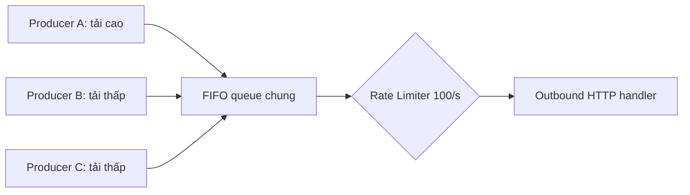
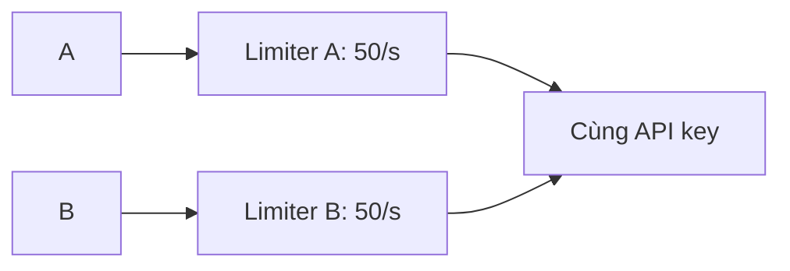
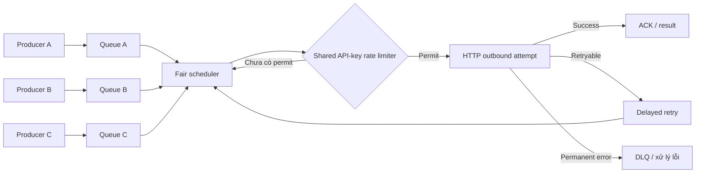

# Tính công bằng giữa nhiều producer khi áp dụng Rate Limiter

> **Module:** `SPRING_INTEGRATION_PATTERN` — Học triển khai Enterprise Integration Patterns với Spring Integration để xây dựng luồng thông điệp ít phụ thuộc và dễ mở rộng. Thực hành Router, Filter, Transformer, Splitter, Aggregator, Gateway, retry, error channel và correlation, đồng thời kiểm thử, theo dõi các nhánh xử lý.
>
> **Chương:** Rate limiter  
> **Đề bài:** Tính công bằng giữa nhiều producer

## 1. Bài toán: rate limit đúng nhưng một producer vẫn bị đói tài nguyên

Một hệ thống nhận message từ ba producer:

- **Producer A:** sinh 1.000 message/giây, thường gửi hàng loạt vào đầu mỗi giây.
- **Producer B:** sinh 20 message/giây, cần phản hồi tương đối nhanh.
- **Producer C:** sinh 5 message/giây, phát những lệnh vận hành quan trọng.

Tất cả message cuối cùng gọi cùng API đối tác, nhưng đối tác chỉ cho phép **100 HTTP request/giây** trên một API key.

Nếu đặt một Rate Limiter chung 100 permit/giây ở outbound handler, quota API được giới hạn theo lượt gọi handler. Tuy nhiên, A có thể đẩy hàng nghìn message vào hàng đợi trước, khiến B và C phải chờ rất lâu dù tổng số request không vượt giới hạn. **Đúng quota không đồng nghĩa với công bằng giữa producer.**

Ngược lại, nếu chia sẵn 100 permit/giây đều cho A, B và C, mỗi producer được khoảng 33 permit/giây. Khi B hoặc C ít tải, phần permit của họ có thể bỏ phí nếu cơ chế chia không cho phép mượn. Hệ thống cần cân bằng ba mục tiêu: **tuân thủ quota tổng, công bằng theo chính sách, và sử dụng tốt công suất còn trống**.

Bài học tập trung vào thiết kế quota, hàng đợi, điều phối và quan sát fairness trong Spring Integration. Sau bài này, người học có thể:

1. Phân biệt fairness của **số lượt gửi**, **thời gian chờ**, **tốc độ xử lý thành công** và **quyền ưu tiên nghiệp vụ**.
2. Giải thích vì sao FIFO, một limiter chung hoặc nhiều limiter riêng không tự bảo đảm fairness.
3. Thiết kế lịch cấp lượt Round Robin, Weighted Round Robin hoặc Deficit Round Robin phù hợp.
4. Kết hợp lịch công bằng với một Rate Limiter chung đặt sát outbound attempt.
5. Áp dụng bounded queue và backpressure cho từng producer; xử lý retry, ACK, idempotency, Router và Splitter.
6. Kiểm thử starvation, quota toàn cục và tính công bằng bằng metric có thể đo được.

## 2. “Công bằng” cần được định nghĩa trước khi thiết kế

Fairness không nhất thiết có nghĩa “tất cả producer nhận cùng số permit” ở mọi thời điểm. Cần biết doanh nghiệp muốn công bằng trên đơn vị nào.

| Tiêu chí | Ý nghĩa | Khi hữu ích |
|---|---|---|
| **Equal share** | Mỗi producer đang có nhu cầu được một phần công suất gần như bằng nhau | Các producer có cùng mức ưu tiên |
| **Weighted share** | Phân bổ tỷ lệ theo trọng số/gói dịch vụ | Tenant premium và standard |
| **Work conserving** | Nếu producer khác không có nhu cầu, producer còn việc có thể dùng công suất trống | Tăng throughput, tránh lãng phí quota |
| **No starvation** | Producer hợp lệ có công việc chờ sẽ được phục vụ sau một khoảng hợp lý | Các luồng quan trọng không thể chờ vô hạn |
| **Latency fairness** | Đánh giá thời gian chờ hoặc tuổi message theo producer | Bảo vệ trải nghiệm của producer lưu lượng thấp |
| **Cost fairness** | Phân bổ theo chi phí request (số item, thời gian CPU, số token) | Request có kích thước/chi phí khác nhau |

Một chính sách cụ thể có thể là: “A và B có trọng số 1:1 khi cả hai còn backlog, C được tối thiểu một phần công suất và không bị starvation; nếu producer nào không có việc, phần công suất chưa sử dụng được phân phối cho producer còn việc”.

**Fairness về permit** khác **fairness về thành công**. Nếu message của A bị HTTP 503 liên tục và phải retry, A có thể tiêu thụ nhiều permit nhưng hoàn tất ít nghiệp vụ. Khi đo, hãy tách số **attempts được phép gửi** khỏi số **business operations hoàn thành**.

## 3. Ba mô hình dễ bị nhầm là công bằng

### 3.1. Một limiter chung, một FIFO queue



FIFO thường phục vụ message theo **thứ tự đã vào queue**, không theo producer. Nếu A đã xếp trước 1.000 message, B và C phải đợi tới lượt cho dù họ gửi rất ít. FIFO là công bằng theo **thứ tự message đến**, không phải chia suất công bằng giữa nhiều producer.

Trong thực tế, thứ tự còn có thể bị thay đổi bởi nhiều partition, consumer, ưu tiên, retry hoặc message broker. Không nên dựa vào FIFO để hứa thời gian chờ tối đa cho mỗi producer khi upstream có tốc độ không kiểm soát.

### 3.2. Mỗi producer có một limiter riêng



Với hai producer A, B, cấu hình 50/s mỗi bên có thể giới hạn tổng tối đa 100 permit/s **trong điều kiện hai limiter cục bộ, không có đường gửi bổ sung và cùng kiểu cấp quota được dự tính**. Nhưng nếu B chỉ cần 5 request/s, A vẫn bị khóa ở 50/s; 45 permit/s được dành cho B không được A tận dụng.

Tệ hơn, nếu mỗi producer có limiter **100/s** mà API key chung chỉ cho phép 100/s, tổng outbound có thể vượt quota. Các limiter riêng cần được thiết kế theo tổng ngân sách và số producer thay đổi; một tên limiter giống nhau trên nhiều bean/JVM không làm state tự chia sẻ.

### 3.3. Một limiter chung với nhiều thread tranh permit

Nếu để A, B, C gọi trực tiếp vào cùng Rate Limiter và mỗi bên có nhiều thread, thread đến đúng thời điểm có permit có thể nhận trước. **RateLimiter không mặc nhiên bảo đảm Round Robin giữa producer hoặc FIFO công bằng giữa thread đang chờ.** Kết quả còn phụ thuộc scheduling và lưu lượng của từng bên.

Muốn fairness **theo producer**, cần một lớp điều phối có biết producer nào đang chờ và áp dụng chính sách chia lượt.

## 4. Kiến trúc khuyến nghị: queue theo producer, scheduler chung, quota outbound chung

Một cách tiếp cận rõ ràng là phân tách:

1. **Admission/backpressure:** nhận message vào queue hữu hạn tương ứng với từng producer/tenant.
2. **Fair scheduler:** quyết định producer nào nhận lượt tiếp theo.
3. **Shared provider limiter:** xin permit của API key trước mỗi outbound attempt.
4. **Outcome/recovery:** ghi nhận thành công, retry có delay, ACK hoặc DLQ theo hợp đồng nghiệp vụ.



Sơ đồ là **thiết kế kiến trúc**. Spring Integration cung cấp channel, endpoint, poller, Gateway, advice và error handling; **nó không tự tạo lịch Round Robin theo producer chỉ vì có Rate Limiter advice**.

Nếu producer có số lượng lớn hoặc thay đổi liên tục, “queue theo producer” có thể là queue logic trong cùng một broker hoặc các nhóm khóa/partition, không nhất thiết một broker queue vật lý cho mỗi producer. Cần giới hạn số khóa active và quản lý vòng đời các queue.

## 5. Round Robin: lần lượt phục vụ từng producer còn backlog

Với ba producer A, B, C và mỗi message tiêu thụ **một đơn vị quota**, Round Robin đơn giản chọn:

```text
A -> B -> C -> A -> B -> C -> ...
```

Nếu A có 100 message, B có 100 message, C có 100 message thì mỗi bên được phục vụ lần lượt. Nếu B đã hết việc, scheduler nên **bỏ qua B** để công suất không bị giữ trống:

```text
A -> C -> A -> C -> ...   (B không có backlog)
```

Một scheduler như vậy có thể **work conserving**: còn người cần dùng công suất thì không bỏ trống lượt chỉ vì producer khác nhàn rỗi.

### 5.1. Bảng tiến trình

Cho quota provider 6 permit/giây, cả A và B đều tồn đọng ít nhất 10 message.

| Lượt permit | FIFO, A đã vào queue trước | Round Robin A/B |
|---:|---|---|
| 1 | A | A |
| 2 | A | B |
| 3 | A | A |
| 4 | A | B |
| 5 | A | A |
| 6 | A | B |
| **Tổng** | A=6, B=0 | A=3, B=3 |

Round Robin cho B cơ hội được gửi sớm dù A có backlog lớn. Nó không tự bảo đảm rằng mỗi request của A/B mất thời gian bằng nhau: handler chậm, số lần retry và số item trong batch có thể làm **latency/throughput hoàn tất** khác nhau.

### 5.2. Điểm hạn chế của Round Robin

- Công bằng theo **số message/lượt** khi mỗi message có chi phí tương tự nhau.
- Nếu request của A chứa 1 item còn request của B chứa 100 item, một lượt cho mỗi bên chưa công bằng theo **chi phí**.
- Một producer có thể tạo nhiều định danh giả để chiếm nhiều lượt nếu khóa producer không được xác thực.
- Nếu một message thất bại và được retry nóng, scheduler có thể lặp lại cùng request, tiêu tốn permit mà không tạo nhiều kết quả thành công.

Vì vậy, phải định nghĩa quota key đáng tin cậy, cơ chế retry có delay và cách đo fairness đúng đơn vị.

## 6. Weighted Round Robin và Deficit Round Robin

### 6.1. Weighted Round Robin

Giả sử doanh nghiệp muốn dành tỷ lệ **3:1** cho producer premium A và standard B khi cả hai đều có backlog.

Một lịch đơn giản:

```text
A -> A -> A -> B -> A -> A -> A -> B -> ...
```

Trong 40 permit có đủ nhu cầu từ cả hai bên, dự kiến A khoảng 30 lượt, B khoảng 10 lượt. Nếu A không có message, B có thể sử dụng các permit còn trống nếu scheduler hỗ trợ work conserving. **Trọng số là tỷ lệ chia khi các bên đang cạnh tranh**, không nhất thiết là quota cố định riêng biệt ở mọi thời điểm.

Cần tránh starvation: nếu có producer trọng số thấp, quy trình cấp lượt vẫn phải đảm bảo họ nhận phục vụ khi có nhu cầu. Một hệ thống ưu tiên tuyệt đối (luôn lấy A nếu A còn backlog) có thể khiến B chờ vô hạn.

### 6.2. Chi phí mỗi message khác nhau: Deficit Round Robin

Nếu message có chi phí khác nhau, ví dụ quota provider tính theo số recipient hoặc item, Round Robin theo số message có thể lệch mục tiêu.

**Deficit Round Robin (DRR)** là một cách lập lịch hỗ trợ message có trọng số chi phí:

- Mỗi producer có **deficit counter** và **quantum** (mức ngân sách cộng mỗi vòng).
- Mỗi lượt xét producer, cộng quantum vào deficit.
- Nếu chi phí message đầu queue không vượt deficit và còn điều kiện gửi, scheduler có thể gửi và trừ chi phí.
- Nếu chưa đủ deficit, giữ lượt chi phí tích lũy cho vòng sau; nếu producer hết backlog, áp dụng quy tắc reset phù hợp để tránh tích lũy vô hạn khi nhàn rỗi.

Ví dụ quantum A=B=5 đơn vị; A có nhiều message chi phí 1, B có message chi phí 5. DRR có thể giúp chia gần tương đương **đơn vị chi phí** trong thời gian dài, thay vì mỗi bên đúng một message.

**Lưu ý:** nếu một outbound request tiêu thụ nhiều đơn vị quota mà limiter được gắn chỉ cấp **một permit mỗi handler invocation**, phải có cơ chế permit theo **chi phí** ở tầng outbound. Chỉ thay đổi scheduler thành DRR chưa đủ để tuân thủ hợp đồng tính quota theo số item.

### 6.3. Khi nào chọn thuật toán nào?

| Tình huống | Lựa chọn ban đầu |
|---|---|
| Số producer ít, công việc tương đồng | Round Robin |
| Producer có gói dịch vụ/trọng số cố định, chi phí mỗi request gần như bằng nhau | Weighted Round Robin |
| Chi phí request thay đổi đáng kể, cần chia công suất theo cost | Deficit Round Robin / weighted fair scheduling |
| Luồng khẩn cấp có SLA riêng | Queue ưu tiên **kèm hạn mức chống starvation** cho luồng khác |
| Nhiều nghìn producer động | Scheduler theo nhóm/tenant, quản lý state và scale; kiểm soát số khóa |

Cả ba thuật toán giải quyết **ai nhận lượt**, còn Rate Limiter giải quyết **khi nào một lượt được phép gọi API**. Hai nhiệm vụ bổ sung cho nhau.

## 7. Ví dụ Java: bộ lập lịch Round Robin trong một JVM

Ví dụ dưới đây dùng Java 17+, không phụ thuộc Spring Integration ở lớp thuật toán, để việc kiểm thử fairness được rõ ràng. Đây là **mô hình trong bộ nhớ**, dành cho học tập và kiểm thử. Chưa có persistence, delayed retry hoặc ACK.

### 7.1. Định nghĩa message và queue

Giả sử hệ thống có ba producer được quản trị trước: A, B, C. Không cho request bên ngoài tự khai tên producer bất kỳ để tạo thêm queue/nhận thêm phần quota.

File `FairMailbox.java`:

```java
package com.example.fairness;

import java.util.ArrayDeque;
import java.util.LinkedHashMap;
import java.util.List;
import java.util.Map;
import java.util.Objects;
import java.util.Queue;

public final class FairMailbox {

    public record Work(String producerId, String businessId, String payload) {
        public Work {
            Objects.requireNonNull(producerId);
            Objects.requireNonNull(businessId);
            Objects.requireNonNull(payload);
        }
    }

    private final Map<String, Queue<Work>> queues = new LinkedHashMap<>();
    private final List<String> order;
    private final int capacityPerProducer;
    private int cursor;

    public FairMailbox(List<String> producerIds, int capacityPerProducer) {
        if (producerIds == null || producerIds.isEmpty()
                || capacityPerProducer <= 0) {
            throw new IllegalArgumentException("Invalid mailbox settings");
        }

        for (String producerId : producerIds) {
            if (producerId == null || producerId.isBlank()
                    || queues.containsKey(producerId)) {
                throw new IllegalArgumentException("Invalid producer ID");
            }
            queues.put(producerId, new ArrayDeque<>());
        }

        order = List.copyOf(queues.keySet());
        this.capacityPerProducer = capacityPerProducer;
    }

    public synchronized boolean offer(Work work) {
        Objects.requireNonNull(work);
        Queue<Work> queue = queues.get(work.producerId());

        if (queue == null) {
            throw new IllegalArgumentException("Unknown producer");
        }
        if (queue.size() >= capacityPerProducer) {
            return false; // Producer này đã hết chỗ chờ.
        }

        queue.add(work);
        return true;
    }

    public synchronized Work pollNext() {
        int count = order.size();

        for (int checked = 0; checked < count; checked++) {
            int index = (cursor + checked) % count;
            Queue<Work> queue = queues.get(order.get(index));

            if (!queue.isEmpty()) {
                cursor = (index + 1) % count;
                return queue.remove();
            }
        }

        return null; // Chưa producer nào có message chờ.
    }

    public synchronized int backlog(String producerId) {
        Queue<Work> queue = queues.get(producerId);
        if (queue == null) {
            throw new IllegalArgumentException("Unknown producer");
        }
        return queue.size();
    }
}
```

**Phân tích:**

- `LinkedHashMap` và `List.copyOf(...)` giữ thứ tự xét A, B, C có thể dự đoán.
- `cursor` chỉ sang producer kế tiếp sau mỗi lần cấp lượt thành công.
- `pollNext()` bỏ qua queue rỗng để không lãng phí lượt khi còn producer khác chờ.
- `synchronized` bảo vệ trạng thái queue/cursor trước nhiều producer thread trong **một JVM**.
- `capacityPerProducer` giới hạn backlog trong bộ nhớ của từng producer: A không thể lấp kín **queue của B**.
- Hàm `pollNext()` **loại message khỏi queue**; class này chưa có cơ chế bảo toàn khi consumer crash sau khi poll hoặc HTTP gửi thất bại. Vì vậy không dùng nó như durable queue cho đơn hàng sản xuất.

### 7.2. Unit test kiểm chứng lượt công bằng

Ví dụ JUnit 5:

```java
package com.example.fairness;

import static org.junit.jupiter.api.Assertions.*;

import java.util.ArrayList;
import java.util.List;
import org.junit.jupiter.api.Test;

class FairMailboxTest {

    @Test
    void roundRobinSkipsEmptyProducers() {
        FairMailbox box = new FairMailbox(List.of("A", "B", "C"), 10);

        for (int i = 1; i <= 3; i++) {
            assertTrue(box.offer(new FairMailbox.Work("A", "a" + i, "payload")));
            assertTrue(box.offer(new FairMailbox.Work("B", "b" + i, "payload")));
        }

        List<String> selected = new ArrayList<>();
        for (int i = 0; i < 6; i++) {
            selected.add(box.pollNext().producerId());
        }

        assertEquals(List.of("A", "B", "A", "B", "A", "B"), selected);
        assertNull(box.pollNext());
    }

    @Test
    void oneProducerCannotFillTheOtherQueue() {
        FairMailbox box = new FairMailbox(List.of("A", "B"), 2);

        assertTrue(box.offer(new FairMailbox.Work("A", "a1", "x")));
        assertTrue(box.offer(new FairMailbox.Work("A", "a2", "x")));
        assertFalse(box.offer(new FairMailbox.Work("A", "a3", "x")));

        assertTrue(box.offer(new FairMailbox.Work("B", "b1", "x")));
        assertEquals(2, box.backlog("A"));
        assertEquals(1, box.backlog("B"));
    }
}
```

Bài test dùng scheduler thuần, không có thời gian thực hay thread sleep. Nó kiểm chứng **chọn lượt và admission**; chưa kiểm chứng Spring Integration Gateway, API quota hoặc độ bền message.

## 8. Gắn FairMailbox vào Spring Integration như thế nào?

Spring Integration cung cấp nhiều kiểu endpoint và message channel. Một cách tổ chức minh họa là:

```text
@MessagingGateway -> admission DirectChannel
                         |
                  @ServiceActivator
                         |
               FairMailbox.offer(...)
                         |
                  Fair dispatcher
                         |
             Shared RateLimiter gate
                         |
            @ServiceActivator gửi HTTP
```

Điểm **admission** chỉ nhận/ghi message vào mailbox. Dispatcher tách riêng, chọn công việc từ mailbox rồi mới xin permit và gọi outbound.

### 8.1. Phần Spring Boot và channels

Dependencies mẫu:

```groovy
dependencies {
    implementation "org.springframework.boot:spring-boot-starter-integration"
    implementation "io.github.resilience4j:resilience4j-ratelimiter:VERSION"
}
```

Dùng phiên bản Resilience4j tương thích với Spring Boot/Spring Integration của dự án; `VERSION` là chỗ để điền phiên bản theo dependency management.

```java
package com.example.fairness;

import java.time.Duration;
import java.util.List;

import io.github.resilience4j.ratelimiter.RateLimiter;
import io.github.resilience4j.ratelimiter.RateLimiterConfig;
import org.springframework.context.annotation.Bean;
import org.springframework.context.annotation.Configuration;
import org.springframework.integration.channel.DirectChannel;
import org.springframework.messaging.MessageChannel;

@Configuration
public class FairFlowConfig {

    @Bean
    public MessageChannel admissionInput() {
        return new DirectChannel();
    }

    @Bean
    public MessageChannel providerOutbound() {
        return new DirectChannel();
    }

    @Bean
    public FairMailbox fairMailbox() {
        return new FairMailbox(List.of("A", "B", "C"), 100);
    }

    @Bean
    public RateLimiter providerQuota() {
        RateLimiterConfig config = RateLimiterConfig.custom()
                .limitForPeriod(10)
                .limitRefreshPeriod(Duration.ofSeconds(1))
                .timeoutDuration(Duration.ZERO)
                .build();

        return RateLimiter.of("provider-api-key", config);
    }
}
```

`providerQuota()` là một limiter chung **trong JVM**. Nó kiểm soát ngân sách của API key nếu mọi outbound attempt đều đi qua nơi xin permit. `DirectChannel` giúp dispatcher nhận kết quả lỗi đồng bộ từ handler trong ví dụ; nó không tự retry hoặc bảo đảm message bền vững.

### 8.2. Gateway và admission

```java
package com.example.fairness;

import org.springframework.integration.annotation.MessagingGateway;
import org.springframework.messaging.handler.annotation.Header;
import org.springframework.messaging.handler.annotation.Payload;

@MessagingGateway(defaultRequestChannel = "admissionInput")
public interface ProducerGateway {

    boolean submit(@Payload String payload,
                   @Header("producerId") String producerId);
}
```

Để đăng ký Gateway interface, bật `@IntegrationComponentScan` cùng cấu hình Spring Integration trong ứng dụng. Ví dụ cấu hình khởi động:

```java
package com.example.fairness;

import org.springframework.boot.SpringApplication;
import org.springframework.boot.autoconfigure.SpringBootApplication;
import org.springframework.integration.annotation.IntegrationComponentScan;
import org.springframework.integration.config.EnableIntegration;
import org.springframework.scheduling.annotation.EnableScheduling;

@SpringBootApplication
@EnableIntegration
@EnableScheduling
@IntegrationComponentScan
public class FairnessApplication {

    public static void main(String[] args) {
        SpringApplication.run(FairnessApplication.class, args);
    }
}
```

Handler admission:

```java
package com.example.fairness;

import org.springframework.integration.annotation.ServiceActivator;
import org.springframework.messaging.Message;
import org.springframework.stereotype.Component;

@Component
public class ProducerAdmissionHandler {

    private final FairMailbox mailbox;

    public ProducerAdmissionHandler(FairMailbox mailbox) {
        this.mailbox = mailbox;
    }

    @ServiceActivator(inputChannel = "admissionInput")
    public boolean accept(Message<String> message) {
        // producerId phải được ánh xạ từ danh tính đã xác thực.
        String producerId =
                message.getHeaders().get("producerId", String.class);
        if (producerId == null) {
            throw new IllegalArgumentException("producerId required");
        }

        String businessId = message.getPayload();
        return mailbox.offer(
                new FairMailbox.Work(producerId, businessId, businessId));
    }
}
```

Trong demo này, `gateway.submit(...)` nhận `true` khi đã được đưa vào **mailbox trong bộ nhớ**, không phải đã hoàn tất HTTP. Nếu `false`, chính caller phải giữ message hoặc nhận lỗi có kiểm soát; không được trả trạng thái “đã xử lý thành công”.

**Bảo mật quota:** `producerId` là header minh họa; trong ứng dụng có caller không đáng tin cậy, phải xác định producer từ authentication/authorization context. Nếu cho phép một actor tự khai nhiều producer IDs, họ có thể chiếm nhiều lượt Round Robin và né hạn mức per-producer.

### 8.3. Dispatcher và xử lý khi không có permit

Đây là **pseudocode thiết kế** (chưa bao gồm durable recovery), chỉ ra thứ tự cần thiết:

```text
repeat while dispatcher is active:
    work = durableFairQueue.reserveNextEligibleWork()
    if work is absent:
        wait for work
        continue

    // Một thao tác lấy permit: vừa kiểm tra vừa ghi nhận cấp quyền.
    if not sharedProviderLimiter.acquirePermission():
        durableFairQueue.releaseReservation(work)
        wait until a later dispatch opportunity
        continue

    try:
        callProviderExactlyOnce(work, stableIdempotencyKey)
        markCompletedAndAck(work)
    catch RetryableException:
        scheduleDelayedRetryWithoutLosingOwnership(work)
    catch PermanentException:
        moveToDLQAndAckAccordingToContract(work)
```

Mỗi message được **giữ quyền sở hữu** qua bước reservation; từ chối permit phải **giải phóng reservation** mà không mất message. Một lượt `acquirePermission()` vừa xét điều kiện vừa tiêu thụ permit nếu thành công; không tách thành hai lời gọi `hasPermitNow()` rồi `acquirePermit()` vì giữa chúng state có thể thay đổi. Khi HTTP thất bại, message đi qua delayed retry hoặc DLQ theo chính sách và cần bảo đảm thao tác chuyển trạng thái an toàn trước khi ACK.

`durableFairQueue` và các hàm reservation/ACK trong pseudocode là **thành phần cần tự triển khai trên broker/store phù hợp**, không phải API có sẵn của Spring Integration. `FairMailbox.pollNext()` ở phần 7 chỉ dành cho mô phỏng thuật toán: nó xóa work khỏi queue ngay khi lấy, nên không có tính năng recovery. Không dùng nguyên xi `pollNext()` để gửi message nghiệp vụ quan trọng. Khi sản xuất cần durable scheduler với reservation, ACK, delayed retry và xử lý crash; đảm bảo mỗi HTTP attempt thật đi qua permit chung đúng một lần.

### 8.4. RateLimiterRequestHandlerAdvice đặt ở đâu?

Nếu sử dụng `RateLimiterRequestHandlerAdvice` thay vì gọi `RateLimiter.acquirePermission()` trực tiếp, gắn advice **sát handler outbound**:

```java
@ServiceActivator(
        inputChannel = "providerOutbound",
        adviceChain = "providerQuotaAdvice")
public void callProvider(FairMailbox.Work work) {
    providerClient.sendOnce(work.payload(), work.businessId());
}
```

`providerQuotaAdvice` là bean advice dùng `RateLimiterConfig` và hạn mức API key tương ứng. Đây là biến thể thay thế cho việc tự xin permit ở dispatcher: **đừng lấy permit cả ở dispatcher lẫn advice** cho cùng một attempt trừ khi chủ đích có hai quota độc lập.

Dù dùng advice, việc quota từ chối sau khi dispatcher đã lấy work khỏi queue **vẫn phải được xử lý an toàn**. Khi message bắt buộc xử lý cuối cùng, nên dùng cơ chế broker/queue cho phép giữ ownership đến khi có kết quả hoặc đưa message vào delayed retry bền vững.

## 9. Backpressure và giới hạn backlog từng producer

Fair scheduling chỉ giải quyết **ai nhận lượt**, không ngăn producer A gửi vô hạn message để tràn bộ nhớ. Cần bounded admission:

```text
Producer A -> Queue A (capacity 100) --+
Producer B -> Queue B (capacity 100) --+--> Fair scheduler
Producer C -> Queue C (capacity 100) --+
```

Với ví dụ `FairMailbox`:

- A đã có 100 message chờ thì `offer(A)` trả `false`.
- B còn trống thì `offer(B)` vẫn có thể nhận.
- Tổng backlog trong ba queue không quá 300 message **khi chưa xét message đã lấy ra/in-flight và retry state**.

Đặt thêm hạn mức tổng memory/broker, vì có thể có hàng nghìn producer với mỗi người một queue. Nếu mỗi producer được 100 message nhưng có 100.000 producer, lý thuyết có thể cần tới 10 triệu message chờ.

Khi admission trả `false`:

1. Trả tín hiệu rõ cho nguồn gửi và yêu cầu backoff.
2. Nếu upstream có quyền sở hữu message bền vững, có thể retry sau; không ACK khi chưa nhận.
3. Với HTTP API, có thể trả 429/503 tùy hợp đồng và `Retry-After` khi tính được.
4. Với event **best effort**, chỉ discard khi hợp đồng nghiệp vụ cho phép và có metric lý do.

Không nên giữ thread Gateway trong thời gian dài để đợi lượt Round Robin. Nếu cần xử lý kéo dài, nhận vào broker có độ bền, sau đó consumer trả kết quả qua cơ chế async/status.

## 10. Công bằng khi retry, lỗi và tác dụng phụ

### 10.1. Retry có thể lấy mất lượt của producer khác

Nếu producer A có nhiều HTTP 503 và retry liên tục, mỗi retry tạo thêm một outbound attempt. Nếu scheduler cho retry của A luôn có ưu tiên cao, A có thể chiếm đa số permit ngay cả khi B và C đang có backlog.

Một chính sách vận hành có thể là:

- **Retry budget** riêng cho toàn hệ thống hoặc từng producer.
- Retry chỉ được chạy khi đến hạn backoff, không được requeue nóng.
- Retry giữ nguyên `producerId` để được tính về đúng ngân sách fairness.
- Mỗi lần retry HTTP vẫn đi qua limiter provider chung.
- Giới hạn số lần retry và tuổi message; lỗi vĩnh viễn chuyển DLQ.

Tùy yêu cầu, scheduler có thể đo fairness trên **mọi outbound attempts** hoặc **các business operations mới**; nếu cần ưu tiên công việc mới, dành một phần ngân sách riêng cho retry nhưng luôn bảo vệ quota tổng API key.

### 10.2. Lỗi sau khi dequeued và ACK

Khi message đã bị lấy khỏi `QueueChannel` trong bộ nhớ, handler thất bại không tự bảo đảm message quay lại queue. Với đơn hàng quan trọng nên dùng broker/persistent store, xử lý reservation/ack/nack/delayed retry và kiểm thử mất kết nối.

Ngay cả khi một HTTP request đã thành công, client có thể timeout trước khi nhận response hoặc crash trước ACK. Message có thể được giao lại; vì vậy nên dùng **idempotency key ổn định theo business operation**. Không đổi key giữa các retry attempts của cùng nghiệp vụ.

### 10.3. Error Channel không tự mang ý nghĩa retry công bằng

Với flow đồng bộ qua `DirectChannel`, lỗi thường truyền về caller. Với poller, executor hoặc broker adapter, lỗi có thể được phát thành `ErrorMessage` vào error channel tương ứng, hoặc được adapter xử lý theo chính sách của nó. **Không được giả định** mọi lỗi đều tự vào global `errorChannel` hoặc tự requeue với đúng producer ID.

Một error handler cần mang theo producer ID, business ID, correlation ID, attempt count, loại lỗi và lịch thử lại. Nếu mất producer ID trong error/retry flow, message có thể đi vào queue chung và làm méo fairness.

## 11. Router, Filter, Splitter và Aggregator ảnh hưởng fairness ra sao?

| Pattern | Tác động đến số lượt/chi phí | Gợi ý thiết kế |
|---|---|---|
| **Router** | Hai producer có thể đi tới các API quota khác nhau | Đặt fairness ở đúng nhóm tài nguyên chung; mỗi API key có scheduler/quota phù hợp |
| **Filter** | Message bị lọc không nên tính lượt HTTP | Lọc điều kiện nghiệp vụ trước khi cấp permit outbound |
| **Transformer** | Có thể tạo payload lớn/nhỏ nhưng chưa gọi API | Đo chi phí tại bước tài nguyên thực tế |
| **Splitter** | Một message có thể tạo N outbound attempts | Giữ producer identity ở message con; tính fairness theo attempts/chi phí |
| **Aggregator** | Gộp nhiều message thành một batch, có thể chứa nhiều producer | Xác định quota theo request hay item; tránh một producer chiếm batch |
| **Gateway** | Caller đồng bộ có thể chờ quota/queue | Chọn timeout và async admission contract |
| **Retry** | Một operation tạo nhiều attempts | Retry vẫn tính producer budget, backoff và idempotency |
| **Error Channel** | Message thất bại có thể bị xử lý ngoài scheduler | Đưa retry về đúng lịch, giữ context và tránh mất message |
| **Correlation** | Cần nối lại message con/batch/retry | Giữ `correlationId`, producerId và businessId đã xác thực |

**Ví dụ Splitter:** A gửi một message chứa 1.000 bản ghi và được Splitter chia thành 1.000 requests. B gửi 10 message, mỗi message tạo một request. Nếu fairness chỉ đo **message trước Splitter**, A có thể chiếm 1.000 outbound permits sau khi chỉ nhận một lượt ở đầu. Nếu API giới hạn theo request, nên thực hiện điều phối **sau Splitter** hoặc tính chi phí tương ứng.

**Ví dụ Aggregator:** một batch có 100 item nhưng provider tính quota theo **recipient/item**. Một permit mỗi batch request không phản ánh chi phí. Cần công cụ tính cost/weighted quota phù hợp, đồng thời giữ correlation của message trong batch để retry/đối soát chính xác.

## 12. Nhiều instance và distributed fairness

Một lịch Round Robin trong một JVM chỉ xét những message ở **JVM đó**. Nếu có hai replica, producer A gửi chủ yếu vào replica 1, B vào replica 2, mỗi replica không nhìn thấy đầy đủ backlog còn lại.

Tương tự, nếu mỗi replica có limiter 100/s nhưng API key chung chỉ cho phép tổng 100/s, hệ thống có thể phát **xấp xỉ 200 outbound attempts/giây** trước khi tính burst, dù từng JVM tự tuân quota của mình.

Các lựa chọn:

| Mô hình | Ưu điểm | Giới hạn |
|---|---|---|
| **Một dispatcher chung** | Dễ nhìn backlog của mọi producer, áp dụng quota chung | Cần high availability, phân vùng và scaling đúng cách |
| **Broker phân vùng theo producer + nhóm consumer điều phối** | Có thể scale, giữ ordering theo producer nếu thiết kế đúng | Fairness giữa partition không tự động; cần scheduler/coordinator |
| **Distributed quota coordinator** | Cấp permit nguyên tử theo API key toàn hệ thống | Chưa tự giải quyết fairness nếu nơi lấy permit thiếu lịch chia producer |
| **Chia cứng quota cho replica** | Dễ triển khai khi số replica cố định | Dễ lãng phí công suất khi tải lệch, khó autoscale |

**Quan trọng:** distributed rate limiter giải quyết **quota toàn cục**, còn distributed fair scheduling giải quyết **ai nhận quyền dùng quota**. Một hệ thống có thể làm đúng một phần nhưng vẫn không đạt phần còn lại.

Với tenant động, producer identity cần được xác thực; tránh tạo một queue/limiter cho mỗi ID do người dùng tùy ý gửi. Khi hệ thống chuyển đổi quota/trọng số tại runtime, cần giữ state in-flight và độ bền message sao cho không tự “reset” suất bằng cách thay ID.

## 13. Đo fairness: ngoài số lượt còn cần tuổi message

### 13.1. Các metric cần theo dõi

- `admitted_messages_total{producer_group}`: số message đã được nhận vào queue.
- `rejected_messages_total{reason}`: số message bị từ chối vì capacity/quota.
- `pending_messages{producer_group}`: backlog hiện tại theo nhóm producer.
- `oldest_pending_age_seconds{producer_group}`: message chờ lâu nhất.
- `dispatch_attempts_total{producer_group}`: số outbound attempts được chọn.
- `dispatch_success_total{producer_group}`: số nghiệp vụ hoàn tất thành công.
- `rate_limit_acquired_total` và `rate_limit_rejected_total` theo API key/quota group.
- `retry_attempts_total{producer_group}` và `dlq_messages_total`.
- `dispatch_wait_duration_seconds`: p50/p95/p99 theo nhóm.
- `outbound_http_attempts_total` và số HTTP 429 từ provider.

Nếu có hàng triệu producer, **không gắn producerId tùy ý** thành nhãn Prometheus vì cardinality quá cao. Có thể tổng hợp theo gói dịch vụ, nhóm ưu tiên hoặc mẫu có kiểm soát; chi tiết per-producer lưu trong hệ thống chuyên dụng khi cần đối soát.

### 13.2. Jain's fairness index

Một chỉ số tham khảo cho việc phân bổ suất là **Jain's fairness index**:

\[
J = \frac{(\sum_{i=1}^{n} x_i)^2}{n\sum_{i=1}^{n} x_i^2}
\]

Ở đây \(x_i\) là mức tài nguyên/throughput đo được của producer \(i\) trong một cửa sổ phân tích. Với hai producer **đều có backlog liên tục và cùng trọng số**:

- Nếu A nhận 50 lượt, B nhận 50 lượt: \(J = (100)^2/[2(50^2+50^2)] = 1\).
- Nếu A nhận 90 lượt, B nhận 10 lượt: \(J = 100^2/[2(90^2+10^2)] \approx 0{,}610\).

Với \(n\) producer có giá trị không âm và tổng khác 0, chỉ số nằm từ \(1/n\) đến 1; giá trị 1 biểu thị phân bổ bằng nhau.

**Đừng diễn giải chỉ số một cách máy móc:** nếu A muốn 90 lượt nhưng B chỉ gửi 10 lượt, việc nhận 90/10 không nhất thiết là bất công. Nếu trọng số A:B là 3:1, so sánh throughput bằng nhau cũng sai mục tiêu. Hãy đo **demand/backlog đủ điều kiện**, SLA và normalized share theo trọng số trước khi kết luận.

### 13.3. Fairness về latency

Hai producer có thể được cấp cùng số permit trong một phút, nhưng B vẫn phải chờ 40 giây rồi mới được nhận lượt. Vì vậy cần theo dõi **thời gian chờ p95/p99 và tuổi message lâu nhất**, không chỉ đếm tổng attempts.

Một yêu cầu vận hành có thể là: “Khi producer B còn backlog và quota provider có throughput, B phải nhận một lượt trong tối đa N chu kỳ điều phối”. Giá trị N phụ thuộc số producer đang hoạt động, trọng số, chi phí request, backlog và chính sách ưu tiên. Không tự hứa bound đó nếu scheduler/broker không có cơ chế bảo đảm.

## 14. Kiểm thử công bằng và chống starvation

### 14.1. Ma trận kiểm thử

| Tình huống | Thiết lập | Kỳ vọng |
|---|---|---|
| Hai producer cùng backlog | A=100, B=100, Round Robin | Lịch A,B,A,B,… trong ví dụ đơn luồng |
| Một producer rỗng | A=100, B=0, C=50 | Scheduler bỏ qua B, không lãng phí lượt |
| Producer lớn flood queue | A gửi vượt capacity, B gửi ít | A bị admission reject; B vẫn nhận vào queue riêng |
| Producer A có request chậm | A handler chậm, B nhanh | Xác định fairness theo dispatch hay completion, không giả định giống nhau |
| Weighted 3:1 | A/B đều backlog lớn | Phân bổ xấp xỉ 3:1 trong cửa sổ đủ dài |
| Chi phí không đồng nhất | A cost=1, B cost=5 | Dùng DRR/weighted cost, không suy fairness chỉ qua message count |
| Retry lỗi tạm thời | A HTTP 503 nhiều lần | B không starvation; retry A có backoff/budget |
| Quota API key hết | Dispatcher còn nhiều message | Không vượt permit; message chưa được cấp vẫn được giữ an toàn |
| Consumer crash sau HTTP | ACK chưa hoàn tất | Recovery và idempotency không nhân đôi tác dụng phụ |
| Multi-instance | A/B ở hai JVM | Kiểm tra quota chung và fairness thực tế toàn hệ thống |

### 14.2. Đếm lượt thay vì đo thread scheduling

Với `FairMailboxTest`, thứ tự lựa chọn được kiểm tra **deterministically**. Các bài test concurrency cần thêm producer thread cùng `offer()`, nhưng không nên assert thứ tự gửi của OS scheduler. Chỉ cần chứng minh:

- Không có vượt capacity per producer do race.
- Không làm mất message trong quá trình offer/poll của mô hình đơn giản.
- Lượt dispatch theo Round Robin không bỏ qua queue có backlog mãi mãi trong điều kiện ổn định.
- Bất kỳ message nào được chuyển tới outbound thật đều phải xin permit.
- Khi có lỗi/timeout, đường recovery giữ đúng producer ID và business ID.

Với broker production, tạo HTTP stub để đếm outbound attempts; chạy tải từ nhiều producer có backlog; theo dõi Jain index, p99 wait, quota và message age. Kết luận fairness phải gắn với **nhu cầu của từng producer** và mục tiêu kinh doanh, không chỉ một số trung bình.

## 15. Các lỗi thiết kế thường gặp

| Sai lầm | Hệ quả | Cách xử lý |
|---|---|---|
| Một FIFO queue chung và gọi đó là fair | Producer gửi nhiều có thể đẩy producer ít xuống cuối | Queue logic theo producer + scheduler |
| Chia quota cứng nhưng không tái phân bổ | Permit nhàn rỗi bị lãng phí | Work-conserving scheduler |
| Dùng priority tuyệt đối cho một flow | Producer khác starvation | Quota sàn hoặc weighted fairness |
| Tạo limiter riêng 100/s cho mỗi producer khi quota tổng 100/s | Vượt quota API key | Limiter tổng/dispatcher chung |
| Tin producerId từ request tùy ý | Caller tạo nhiều ID để chiếm nhiều lượt | Identity từ auth context |
| Chọn lượt trước Splitter | Một permit tạo N outbound attempts | Fairness và quota gần outbound |
| Retry nóng với ưu tiên cao | Producer lỗi chiếm permit | Retry delay, budget và fairness cả retry |
| Dùng QueueChannel trong bộ nhớ cho message bắt buộc xử lý | Restart có thể mất message | Durable broker/store + ACK/recovery |
| Dequeue rồi không có recovery | Hết permit/lỗi HTTP làm mất message | Reservation/requeue an toàn, delayed retry |
| Chỉ đo số attempts toàn hệ thống | Không phát hiện B bị đói suất | Metric theo producer group và tuổi message |
| Dùng Jain index mà không xét demand/trọng số | Đánh giá công bằng sai | Chuẩn hóa theo nhu cầu và chính sách |
| Nhiều replica đều fair local | Chưa chắc fair toàn cục | Central scheduler/coordinator hoặc kiểm chứng distributed |

## 16. Bài tập thực hành

**Bài 1 — FIFO so với Round Robin.** A và B cùng có 100 message chờ, quota chung cho phép 10 permits trong chu kỳ. Nếu A điền FIFO trước B, hãy tính số lượt mỗi bên trong 10 permit đầu. Thay bằng Round Robin và so sánh chỉ số Jain.

**Bài 2 — Weighted Round Robin.** A là premium trọng số 3, B là standard trọng số 1. Cả hai luôn có backlog. Viết lịch 16 lượt theo tỷ lệ 3:1, sau đó mô tả điều gì nên xảy ra khi A hết message nhưng B còn backlog.

**Bài 3 — Bounded queue theo producer.** Dùng `FairMailbox` với capacity 2 cho A/B. Gửi ba message của A và một message B. Kiểm tra admission results và thứ tự scheduler. Giải thích tại sao producer ID phải được xác thực.

**Bài 4 — Retry không được chiếm quota.** Một producer có 100 request đang retry HTTP 503, producer khác có 10 yêu cầu mới. Thiết kế retry queue/delay sao cho producer lỗi không chiếm toàn bộ permit; mỗi HTTP attempt vẫn phải đi qua quota provider chung.

**Bài 5 — Splitter tạo 100 requests.** Producer A gửi một message có 100 item, producer B gửi 10 message đơn. Đặt fairness scheduler trước hay sau Splitter để công bằng theo HTTP attempts? Nếu provider tính quota theo số item, cần thay đổi cost như thế nào?

**Bài 6 — Distributed fairness.** Ba replica cùng gọi API key tổng quota 30/s. Mỗi replica được gửi các producer khác nhau. Phác thảo outbound dispatcher hoặc distributed scheduler để chia lượt theo trọng số, dùng quota chung và xử lý crash trước ACK.

### Câu hỏi tự đánh giá

1. Tại sao Rate Limiter chung giữ đúng quota nhưng vẫn có thể khiến một producer bị starvation?
2. FIFO công bằng theo điều gì và khác Round Robin theo producer ở điểm nào?
3. Weighted Round Robin 3:1 có bắt buộc luôn giữ đúng 75%/25% ngay cả khi producer B không có message không?
4. Khi nào Deficit Round Robin phù hợp hơn Round Robin đơn giản?
5. Nếu rate limiter đã có permit, tại sao vẫn cần bounded queue/backpressure ở ingress?
6. Làm thế nào đảm bảo producer A không thể tạo nhiều quota identities bằng header giả?
7. Tại sao retry phải giữ producer identity, business ID và idempotency key?
8. Vì sao một distributed limiter dùng chung state vẫn chưa đảm bảo fairness giữa các producer?
9. Jain index bằng 0,61 có luôn chứng minh lịch không công bằng không? Cần dữ liệu gì để kết luận?
10. Vì sao một queue trong bộ nhớ không đủ để cam kết eventual processing sau restart?

## 17. Tài liệu tham khảo

- [Spring Integration — Channels](https://docs.spring.io/spring-integration/reference/channel.html): DirectChannel, QueueChannel và cơ chế truyền message.
- [Spring Integration — Message Routing](https://docs.spring.io/spring-integration/reference/router.html): Router, điều phối theo nhánh và lựa chọn route.
- [Spring Integration — Polling Consumer](https://docs.spring.io/spring-integration/reference/polling-consumer.html): poller, nhịp tiêu thụ và giới hạn consumer.
- [Spring Integration — Request Handler Advice](https://docs.spring.io/spring-integration/reference/handler-advice.html): rate limiting trước handler và advice chain.
- [Spring Integration — Error Handling](https://docs.spring.io/spring-integration/reference/error-handling.html): ngoại lệ và error channel theo loại flow.
- [Resilience4j — RateLimiter](https://resilience4j.readme.io/docs/ratelimiter): permit, timeout, chu kỳ và metrics.
- [Jain's Fairness Index](https://en.wikipedia.org/wiki/Fairness_measure): chỉ số tham khảo để đánh giá công bằng khi so sánh phân bổ tài nguyên.
