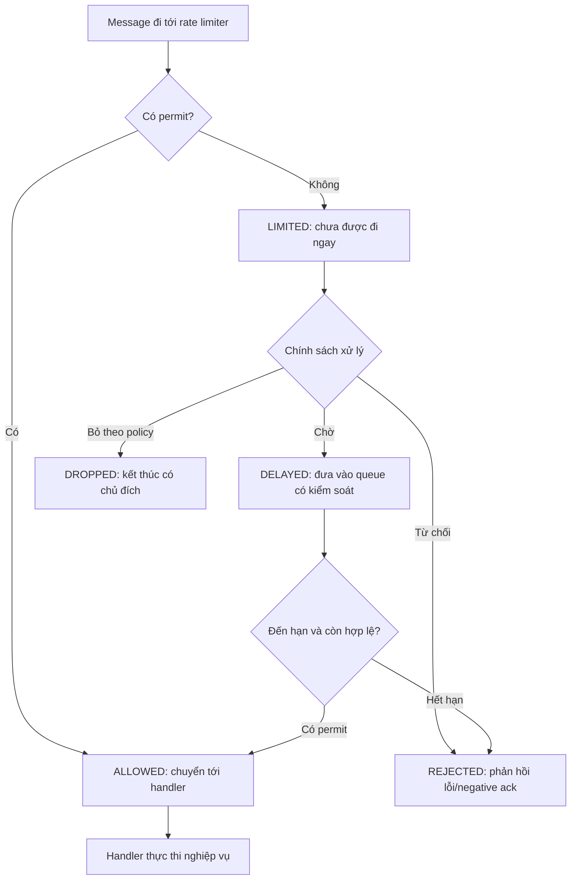
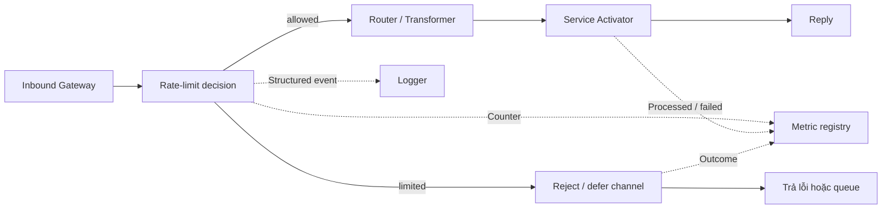
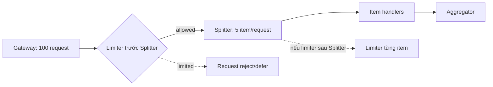
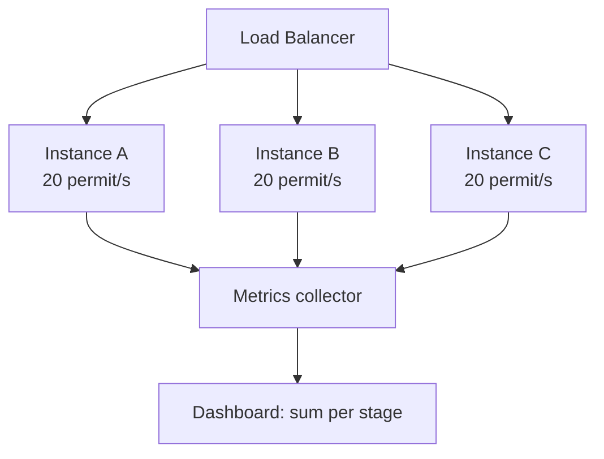

# Theo dõi số message bị giới hạn

Trong Spring Integration, Rate Limiter bảo vệ một endpoint hoặc hệ thống phụ thuộc khi lưu lượng message vượt khả năng xử lý. Nhưng chỉ thiết lập giới hạn, ví dụ “20 message/giây”, chưa đủ để vận hành: nhóm kỹ thuật cần biết **bao nhiêu message được phép đi tiếp, bao nhiêu message bị giới hạn, những message đó được hoãn hay từ chối, và tác động cuối cùng tới nghiệp vụ**.

Bài thuộc chương **Rate limiter** trong module **SPRING_INTEGRATION_PATTERN**. Module hướng tới triển khai Enterprise Integration Patterns (EIP) bằng Spring Integration để tạo luồng thông điệp ít phụ thuộc, dễ mở rộng; thực hành Router, Filter, Transformer, Splitter, Aggregator, Gateway, retry, error channel và correlation, đồng thời kiểm thử và theo dõi các nhánh xử lý. Ở đây, chúng ta học cách quan sát một quyết định giới hạn tốc độ thay vì chỉ nhìn các dòng log hoặc trạng thái của một thư viện rate limiting.

Sau bài học, bạn có thể:

- Phân biệt **allowed**, **limited/denied**, **delayed**, **rejected**, **dropped** và **eventually processed**.
- Thiết kế metric Counter và các chỉ số bổ sung để đo chính xác số *lần quyết định* của limiter.
- Tính lưu lượng giới hạn và tỷ lệ bị giới hạn trong một cửa sổ, đồng thời hiểu giới hạn của phép đo khi retry và có nhiều instance.
- Tích hợp một cổng kiểm tra permit vào Spring Integration Java DSL và ghi metric bằng Micrometer.
- Tổ chức xử lý message bị giới hạn: trả phản hồi phù hợp, chờ có giới hạn, retry/backoff hoặc chuyển kênh thay vì làm mất message âm thầm.
- Tạo dashboard, cảnh báo và kiểm thử cho burst, luồng lỗi, Splitter, idempotency và điều phối nhiều replica.

## 1. “Message bị giới hạn” có thể mang nhiều nghĩa

Một bộ giới hạn tốc độ thường kiểm tra xem một message có được **cấp quyền xử lý ngay** hay không. Nếu không được cấp permit, hành động kế tiếp tùy chính sách:



Hình trên là **mô hình ra quyết định**, không phải các trạng thái Spring Integration tự động xuất dưới đúng tên này.

| Khái niệm | Ý nghĩa | Nên đếm ở đâu? |
| --- | --- | --- |
| `attempted` | Một message/lần thử đã đến điểm kiểm tra | Ngay trước khi đánh giá limiter |
| `allowed` | Limiter cấp permit tại lần kiểm tra | Ngay khi quyết định cấp quyền |
| `limited` hoặc `denied` | Limiter không cấp permit lúc kiểm tra | Ngay khi quyết định không cấp quyền |
| `delayed` | Message được đưa vào nơi chờ để thử lại | Sau khi enqueue thành công |
| `rejected` | Message được trả về nguồn với mã từ chối | Sau khi quyết định trả lỗi được thực hiện theo contract |
| `dropped` | Message thật sự bị loại khỏi đường xử lý theo policy | Tại điểm kết thúc xử lý có chủ đích |
| `processed` | Business handler thực thi xong theo định nghĩa | Sau khi công việc thành công hoặc hoàn tất |
| `failed` | Xử lý đã được phép nhưng thất bại | Ở handler/recovery theo đơn vị đếm rõ ràng |

**Một message có thể bị limited nhiều lần nhưng sau đó vẫn được processed.** Do đó, `limited` không đồng nghĩa `lost`. Ngược lại, message được `allowed` có thể thất bại ở downstream, nên `allowed` không đồng nghĩa `succeeded`.

### Ví dụ ý nghĩa nghiệp vụ

Một inbound HTTP Gateway nhận 100 yêu cầu; limiter cho qua 80 và từ chối 20 với chính sách “fail fast”. Khi ấy có thể có 80 lần `allowed`, 20 lần `limited` và 20 phản hồi từ chối. Nhưng nếu chính sách là “đợi permit rồi mới xử lý”, có thể có 20 lần `limited` mà **không có message bị bỏ**; một số được xử lý sau khi chờ.

Trước khi dựng dashboard, phải ghi rõ câu hỏi đang đo:

- Có bao nhiêu **lần xin permit** bị từ chối?
- Có bao nhiêu **message duy nhất** từng chạm giới hạn?
- Có bao nhiêu **request từ client** nhận phản hồi HTTP 429?
- Có bao nhiêu message **được đưa vào queue, hết hạn hoặc mất**?
- Có bao nhiêu yêu cầu **cuối cùng thành công**?

Các con số không thể dùng thay nhau.

## 2. Xác định điểm đo trong IntegrationFlow

Spring Integration không quy định một duy nhất cách cài Rate Limiter cho mọi ứng dụng. Có thể sử dụng một `Filter` gọi chính sách lấy permit, một advice, một handler kiểm tra rate limit, hoặc thư viện bên ngoài. Tùy cách thực hiện, giới hạn có thể *drop*, *delay*, *throw* hoặc *route* message.

Một luồng minh họa:



**Điểm đo chuẩn của `allowed/limited` là ngay tại chỗ đưa ra quyết định cấp permit.** Nếu đếm ở handler sau Router, một message bị Filter loại hoặc gặp lỗi trước handler sẽ không được tính đúng. Nếu đếm ở logger, log level, sampling hoặc async appender có thể khiến số đếm nhỏ hơn sự thật.

Giữ riêng ít nhất ba tầng:

1. **Admission**: message có được limiter cho phép đi tiếp không?
2. **Disposition**: message chưa được cho phép được từ chối, đợi hay loại bỏ?
3. **Execution**: message được xử lý thành công, thất bại, retry hoặc hết hạn?

Nhờ đó, khi quan sát “limited tăng mạnh”, bạn có thể phân biệt bảo vệ upstream hoạt động đúng với trường hợp hệ thống thực sự đang mất message.

## 3. Bộ metric nền tảng

### Counter cho từng quyết định

Có thể dùng một `Counter` Micrometer tên logic `integration.rate.limit.decisions` với tag `decision`:

```text
integration.rate.limit.decisions{stage="ordersIngress", decision="allowed"}
integration.rate.limit.decisions{stage="ordersIngress", decision="limited"}
```

Đây là **tên đề xuất của ứng dụng**, không phải một meter mặc định chắc chắn do Spring Integration hay thư viện Rate Limiter tạo ra. Khi xuất sang Prometheus, tên có thể được chuẩn hóa theo quy tắc của registry/exporter, ví dụ `integration_rate_limit_decisions_total`.

Đếm đúng một lần cho **mỗi lần gọi hàm ra quyết định**, trong cả nhánh allowed và limited. Đừng tạo counter riêng chỉ cho limited rồi dự đoán allowed từ tổng message nhận ở Gateway nếu một số message bị Filter, Router hoặc lỗi trước khi đến limiter.

### Metric sau quyết định

| Metric ứng dụng đề xuất | Loại | Đơn vị | Khi tăng/cập nhật |
| --- | --- | --- | --- |
| `integration.rate.limit.decisions` | Counter | Lần xin permit | Khi có quyết định `allowed` hoặc `limited` |
| `integration.rate.limit.dispositions` | Counter | Message/lần xử lý | Khi đã `rejected`, `enqueued`, `expired` hoặc `dropped` theo policy |
| `integration.rate.limit.wait` | Timer | Thời gian | Khi một message kết thúc chờ permit |
| `integration.rate.limit.queue.depth` | Gauge | Message đang chờ | Theo độ sâu queue tại thời điểm đo |
| `integration.rate.limit.queue.oldest.age` | Gauge/Timer phù hợp | Thời gian | Tuổi message cũ nhất nếu backend đo được |
| `integration.rate.limit.config.rate` | Gauge hoặc trạng thái cấu hình | Permit/giây | Theo cấu hình giới hạn hiện tại |
| `integration.handler.processed` | Counter | Message/lần xử lý thành công | Sau khi xử lý xong, định nghĩa rõ đơn vị |
| `integration.handler.failed` | Counter | Lỗi nghiệp vụ | Theo điểm xử lý hoặc terminal failure |
| `integration.rate.limit.effective.retries` | Counter | Lần thử lại | Tại cơ chế retry admission, nếu cần tách riêng |

Tên metric và điểm đếm phải được văn bản hóa. `enqueued` không được coi là `processed`; queue có thể đầy hoặc message có thể hết hạn trước khi được thực hiện.

### Nhãn metric có cardinality hữu hạn

Dùng những tag được kiểm soát, chẳng hạn:

```text
service = orders
stage = ordersIngress | inventoryOutbound
decision = allowed | limited
policy = standard | priority
disposition = rejected | enqueued | expired | dropped
instance_role = api | worker
```

Không gắn `requestCorrelationId`, `messageId`, email, token, số tài khoản, URL tự do hoặc ngoại lệ nguyên văn vào metric labels. Các ID có nhiều giá trị khác nhau sẽ làm số chuỗi thời gian tăng lớn. Những ID này phù hợp hơn trong **structured log** hoặc trace đã có phân quyền.

## 4. Tính số message bị giới hạn và tỷ lệ giới hạn

Counter thường tăng dần theo thời gian; với Prometheus hoặc hệ thống tương đương, nên dùng **delta/increase** hoặc **rate trong cửa sổ** thay vì lấy giá trị tích lũy của counter để làm “lượng trong một phút”.

Nếu cùng một điểm limiter có:

- `A`: số quyết định allowed trong cửa sổ;
- `L`: số quyết định limited trong cửa sổ;

thì:

\[
\text{limitedRate} = \frac{L}{A+L}\times 100\%
\]

với điều kiện `A + L > 0`. Nếu không có lượt thử trong cửa sổ, tỷ lệ là **không xác định**, không phải mặc nhiên 0%.

### Ví dụ minh họa

Trong 5 phút, một điểm limiter đo được:

```text
allowed decisions: 9.000
limited decisions: 1.000
total decisions:  10.000

limitedRate = 1.000 / 10.000 = 10%

limited throughput = 1.000 / 300 s ≈ 3,33 decisions/s
allowed throughput = 9.000 / 300 s = 30 decisions/s
```

Đây là **tỷ lệ quyết định giới hạn**, không mặc nhiên là 10% khách hàng mất đơn. Nếu các message bị giới hạn được đưa vào queue rồi xử lý sau, terminal rejection có thể thấp hơn hoặc bằng 0 trong thời gian tương ứng.

### Ví dụ PromQL với metric do ứng dụng tạo

Giả định Micrometer xuất các Counter sang Prometheus như `integration_rate_limit_decisions_total` và có tag `decision`:

```promql
# Số lần limiter không cấp permit trong 5 phút, cộng tất cả instance.
sum(increase(integration_rate_limit_decisions_total{
  stage="ordersIngress", decision="limited"
}[5m]))
```

```promql
# Tốc độ bị giới hạn trung bình, đơn vị decision/giây.
sum(rate(integration_rate_limit_decisions_total{
  stage="ordersIngress", decision="limited"
}[5m]))
```

```promql
# Tỷ lệ quyết định limited trên tổng allowed + limited, theo stage.
sum by (stage) (
  rate(integration_rate_limit_decisions_total{decision="limited"}[5m])
)
/
sum by (stage) (
  rate(integration_rate_limit_decisions_total[5m])
)
```

Trong ví dụ, giả định **chỉ** có hai decision `allowed` và `limited` trong metric này. Nếu có thêm `error`, `unknown` hoặc outcome khác, mẫu số cần chọn lại theo định nghĩa. Với cửa sổ không có traffic, phép chia có thể thiếu dữ liệu hoặc cho `NaN`; dashboard/alert cần xử lý riêng, không tự báo “100% lỗi”.

Nếu dùng Grafana/Prometheus trên nhiều replica, hãy tổng hợp theo `stage`/`policy` trước khi tính tỷ lệ. **Không lấy trung bình cộng các tỷ lệ của từng instance** khi lưu lượng của chúng chênh lệch; phải tính trên tổng số quyết định.

## 5. Ví dụ Java: Token Bucket cục bộ và Counter Micrometer

Một limiter với thư viện ngoài có thể cung cấp sẵn metric, nhưng để thấy rõ **đếm tại điểm quyết định**, ví dụ sau triển khai Token Bucket đơn giản trong JVM. Đây là **bài tập minh họa**, không phải một rate limiter production đầy đủ hoặc cơ chế quota phân tán.

Các giả định:

- Mỗi instance có một bucket riêng.
- Burst capacity là 40 permit.
- Tốc độ nạp lại là 20 permit/giây.
- Mỗi lượt `tryAdmit()` xin một permit, không chờ.
- Khi bucket hết permit, lời gọi trả `false`.
- Việc đồng bộ bảo đảm mỗi instance đếm quyết định thread-safe trong ví dụ.

```java
import java.util.function.LongSupplier;

import io.micrometer.core.instrument.Counter;
import io.micrometer.core.instrument.MeterRegistry;

final class AdmissionGate {

    private final LongSupplier nanoTicker;
    private final int capacity;
    private final double permitsPerNanosecond;
    private final Counter allowedCounter;
    private final Counter limitedCounter;

    private double tokens;
    private long lastRefillNanos;

    AdmissionGate(
            MeterRegistry registry,
            LongSupplier nanoTicker,
            int capacity,
            double permitsPerSecond) {

        if (capacity <= 0 || !Double.isFinite(permitsPerSecond)
                || permitsPerSecond <= 0.0) {
            throw new IllegalArgumentException("Invalid rate-limit policy");
        }

        this.nanoTicker = nanoTicker;
        this.capacity = capacity;
        this.permitsPerNanosecond = permitsPerSecond / 1_000_000_000.0;
        this.tokens = capacity;
        this.lastRefillNanos = nanoTicker.getAsLong();

        this.allowedCounter = Counter.builder("integration.rate.limit.decisions")
                .tag("stage", "ordersIngress")
                .tag("decision", "allowed")
                .register(registry);

        this.limitedCounter = Counter.builder("integration.rate.limit.decisions")
                .tag("stage", "ordersIngress")
                .tag("decision", "limited")
                .register(registry);
    }

    synchronized boolean tryAdmit() {
        long now = nanoTicker.getAsLong();
        long elapsed = now - lastRefillNanos;

        if (elapsed > 0L) {
            tokens = Math.min(capacity,
                    tokens + elapsed * permitsPerNanosecond);
            lastRefillNanos = now;
        }

        if (tokens >= 1.0) {
            tokens -= 1.0;
            allowedCounter.increment();
            return true;
        }

        limitedCounter.increment();
        return false;
    }
}
```

**Đọc đúng semantics:**

1. `Counter` tăng ở **cả hai nhánh** của một quyết định, bất kể message có được xử lý thành công phía sau hay không.
2. `System.nanoTime()` là nguồn thời gian đơn điệu phù hợp với khoảng thời gian trong một JVM; không sử dụng timestamp hệ thống để quyết định nạp permit.
3. `synchronized` bảo vệ trạng thái bucket trong cùng process. Nó **không** làm limiter trở thành global quota cho nhiều pod.
4. Bucket bắt đầu đầy 40 permit, nên có thể chấp nhận một burst ban đầu vượt con số 20/giây trong một khoảng rất ngắn. Đây là đặc điểm Token Bucket, không phải lỗi của Counter.
5. Khi không cấp permit, ví dụ **chưa quyết định** message phải được trả lỗi, đợi hay chuyển queue. Bước tiếp theo thuộc chính sách của IntegrationFlow.
6. Counter được lưu ở meter registry của instance. Sau process crash hoặc restart, số liệu quan sát phụ thuộc exporter/scraper và không tự trở thành sổ kiểm toán bền vững.

Nếu ứng dụng dùng Resilience4j, Bucket4j hoặc cơ chế limiter từ gateway/broker, hãy tận dụng sự kiện/metric có sẵn khi đúng semantics, tránh đếm trùng. Vẫn cần xác minh metric đó đo *lần xin permit*, *lần chờ*, *lần từ chối* hay *lần xử lý*.

## 6. Đưa quyết định vào Spring Integration Java DSL

Giả định luồng xử lý `OrderSubmitted` (Java 17+), backend Micrometer đã cấu hình. Chúng ta dùng `Filter` như **cổng admission**: message được phép đi tới handler; message chưa được cấp permit đi vào một discard channel được **xử lý rõ ràng**. Tên “discard” trong Spring Integration không có nghĩa chắc chắn dữ liệu đã bị xóa vĩnh viễn.

```java
import org.slf4j.Logger;
import org.slf4j.LoggerFactory;

import org.springframework.context.annotation.Bean;
import org.springframework.context.annotation.Configuration;
import org.springframework.integration.channel.DirectChannel;
import org.springframework.integration.dsl.IntegrationFlow;
import org.springframework.messaging.Message;
import org.springframework.messaging.MessageChannel;
import org.springframework.stereotype.Service;

import io.micrometer.core.instrument.MeterRegistry;

record OrderSubmitted(String orderId, int itemCount) { }

@Service
class OrderProcessor {
    public void process(OrderSubmitted order) {
        // Nghiệp vụ đơn hàng thực tế.
    }
}

final class RateLimitRejectedException extends RuntimeException {
    RateLimitRejectedException() {
        super("RATE_LIMIT_EXCEEDED");
    }
}

@Service
class RateLimitRejectionHandler {
    public void reject(Message<?> message) {
        // Không ghi raw payload hoặc Authorization header.
        // Trong ví dụ sync: cho caller bắt exception và ánh xạ sang HTTP 429
        // tại boundary HTTP nếu giao thức sử dụng HTTP.
        throw new RateLimitRejectedException();
    }
}

@Configuration
class OrdersRateLimitConfig {

    private static final Logger log =
            LoggerFactory.getLogger("app.orders.rate-limit");

    @Bean
    AdmissionGate admissionGate(MeterRegistry meters) {
        return new AdmissionGate(meters, System::nanoTime, 40, 20.0);
    }

    @Bean
    MessageChannel ordersInput() {
        return new DirectChannel();
    }

    @Bean
    MessageChannel ordersLimited() {
        return new DirectChannel();
    }

    @Bean
    IntegrationFlow ordersFlow(AdmissionGate gate, OrderProcessor processor) {
        return IntegrationFlow.from("ordersInput")
                .filter(OrderSubmitted.class, order -> gate.tryAdmit(),
                        spec -> spec.discardChannel("ordersLimited"))
                .handle(processor, "process")
                .get();
    }

    @Bean
    IntegrationFlow rejectedOrdersFlow(RateLimitRejectionHandler handler) {
        return IntegrationFlow.from("ordersLimited")
                .handle(handler, "reject")
                .get();
    }
}
```

Phạm vi ví dụ là **message vào cùng tiến trình qua `DirectChannel`**, do đó ngoại lệ được phát ở nhánh từ chối có thể truyền về caller đồng bộ. Để tạo HTTP 429, ứng dụng thực tế phải có inbound HTTP boundary/exception handler **ánh xạ** `RateLimitRejectedException` sang response phù hợp, gồm `Retry-After` nếu có chính sách. Một `Gateway` request/reply không được cấu hình đúng có thể timeout hoặc trả lỗi khác; code trên không tự tạo HTTP server hay response 429.

Với message lấy từ Kafka/JMS/RabbitMQ, **không** mặc định ném exception sẽ tương đương trả 429. Cần thiết kế ack/nack, delayed retry/backoff, queue, dead-letter và idempotency theo adapter. Nếu không, một message bị từ chối có thể bị gửi lại liên tục, làm tăng cả tải và số quyết định `limited`.

### Vai trò của Filter và discard channel

- `.filter(... gate.tryAdmit())` không phải lọc vì payload không hợp lệ; nó kiểm tra quyền admission trước khi xử lý.
- `gate.tryAdmit()` tăng Counter `allowed` hoặc `limited` **ngay khi quyết định được đưa ra**.
- `discardChannel("ordersLimited")` định tuyến message không được cấp permit đến một flow khác. Đây là **outcome tiếp theo**, không phải số message bị mất.
- `RateLimitRejectionHandler` minh họa chính sách từ chối request đồng bộ; nếu muốn hoãn, thay bằng kênh chờ có giới hạn và quy trình thử lại.
- Handler nghiệp vụ chỉ chạy khi được cấp permit. Một message `allowed` chưa chắc xử lý thành công; cần metric/trace riêng cho kết quả downstream.

**Cảnh báo:** Đừng chọn `Filter` rồi đơn giản bỏ message nếu hệ thống đang xử lý đơn hàng hoặc thanh toán có yêu cầu giao nhận đầy đủ. Phải nêu rõ semantics **reject, defer hay drop** trong contract nghiệp vụ và đảm bảo lỗi đến được bên gửi hoặc có recovery phù hợp.

### Đếm ở Filter hay ở discard flow?

Nếu chỉ đếm message trong `ordersLimited`, bạn đang đo **số message thực sự đến nhánh discard**. Nếu channel đó đầy, gửi lỗi, hoặc cấu hình đổi sang cách xử lý khác, số liệu có thể khác số lần limiter không cấp permit.

Muốn biết **bao nhiêu lần bị giới hạn**, đếm trong `tryAdmit()`. Muốn biết **bao nhiêu lần đã phản hồi/đưa vào queue/drop**, đếm **sau hành động xử lý tương ứng** bằng meter thứ hai. Tách hai bộ số sẽ giúp phát hiện message bị kẹt hoặc lỗi ở chính nhánh recovery.

## 7. Retry có thể làm Counter tăng nhiều lần cho cùng message

Một lỗi phổ biến là nhìn `limitedCounter` tăng rồi kết luận có từng ấy message/khách hàng riêng biệt bị ảnh hưởng.

Giả sử một message được thử gửi ba lần:

```text
10:00:00  try #1 -> LIMITED
10:00:01  try #2 -> LIMITED
10:00:02  try #3 -> ALLOWED -> PROCESSED
```

Khi đếm theo **lần xin permit**:

```text
limited decisions: +2
allowed decisions: +1
unique business messages limited at least once: 1
messages ultimately processed: 1
messages ultimately lost: 0
```

Các đại lượng này khác nhau và có thể đều đúng.

Cần ghi rõ:

- Retry do limiter chủ động lên lịch hay do adapter/broker redeliver?
- Một message bị giới hạn có trả về queue không?
- Mỗi lần xử lý lại có qua limiter không?
- Limiter đặt trước hay sau Splitter?
- Meter đo theo request gốc, message con, hay một attempt handler?

Nếu muốn đo **số message duy nhất từng bị giới hạn**, cần có ID ổn định, kho trạng thái/dedup phù hợp cửa sổ và định nghĩa “duy nhất”. Không nên thêm `messageId` trực tiếp thành nhãn metric để giải quyết bài toán vì cardinality quá cao. Có thể lưu `requestCorrelationId` trong structured log/audit có phân quyền, hoặc duy trì bảng dedupe riêng nếu đây là yêu cầu nghiệp vụ chính thức.

## 8. Giới hạn ở đâu: trước hay sau Splitter?

Tác động của vị trí limiter đến cả hệ thống lẫn cách hiểu Counter.



Nếu 100 request, mỗi request tách thành 5 message con:

- Limiter **trước Splitter** sẽ nhận tối đa 100 lần xin permit cho 100 request (giả định mỗi request chỉ kiểm tra một lần).
- Limiter **sau Splitter** sẽ nhận tối đa 500 lần xin permit cho 500 message con.
- Nếu một item bị limited ở sau Splitter, Aggregator có thể phải chờ, timeout hoặc áp dụng release strategy khác. Không được mặc định loại item một cách im lặng.

**Quyết định vị trí theo tài nguyên cần bảo vệ.** Nếu cần bảo vệ một API request/second của downstream, limiter thường phải áp dụng theo **số outbound calls** tương ứng, không chỉ theo request đầu vào. Nếu mỗi request tạo 10 lời gọi, giới hạn ở Gateway có thể không bảo vệ được outbound dependency.

Ngược lại, nếu quota áp dụng theo đơn hàng đầu vào, kiểm tra sau Splitter sẽ nhân số lần xin permit và có thể từ chối quá nhiều.

### Ví dụ nhánh ưu tiên và tuyến tiêu chuẩn

Router có thể chia `priority` và `standard`, mỗi nhánh có một policy rate limit khác nhau. Lúc này metric nên có tag `policy=priority|standard` và `stage` cố định, không dùng tên route do client nhập tự do. Khi thay policy trong runtime, giữ nguồn thông tin cấu hình và phiên bản để biết các số liệu trước/sau thay đổi đang so sánh cái gì.

## 9. Delay, queue và backpressure cần metric riêng

Một limiter có thể **chặn chờ** permit thay vì trả `false`. Ví dụ thread gọi handler bị block 200 ms rồi được cấp permit. Trong trường hợp đó, việc không có quyết định “limited” theo API `tryAcquire` không chứng minh không có tác động giới hạn: thời gian chờ tăng và throughput bị khống chế.

Cần theo dõi:

| Trường hợp | Metric gợi ý | Nguy cơ |
| --- | --- | --- |
| Chờ đồng bộ để lấy permit | `rate_limit.wait` Timer | Block thread, tăng latency |
| Queue chờ retry | Queue depth, oldest age, enqueue/dequeue/expire Counter | Tăng bộ nhớ, backlog, vượt TTL |
| Queue đầy | `enqueue_failed` hoặc `dropped` outcome | Message bị mất nếu không có chính sách khác |
| Defer bằng broker | Retry scheduled, redelivery, lag/age | Message bị lặp hoặc quá hạn |
| Timeout khi xin permit | Counter `timeout` và Timer | Caller timeout, ảnh hưởng nghiệp vụ |
| Downstream chậm | Handler latency, in-flight, failures | Rate limiter có thể đang bảo vệ dependency nhưng không sửa được độ trễ |

### Phân biệt chặn thread với chặn message

Nếu `RateLimiter.acquire()` đợi trong handler trên `DirectChannel`, thread caller có thể bị giữ trong lúc đợi. Nếu hệ thống cần throughput lớn hoặc request có timeout ngắn, cân nhắc dùng hàng đợi/điều phối bất đồng bộ được thiết kế và giám sát. Cũng không được để queue vô hạn: bạn có thể chuyển sự cố “429 tăng” thành “RAM/latency tăng”.

Với QueueChannel, executor, poller hoặc broker, cần xác định capacity, TTL, ack và cách xử lý sau restart. Rate limiter quyết định nhịp xử lý; **nó không tự tạo tính bền vững** cho message đang chờ.

## 10. Multi-instance: tổng Counter không phải quota toàn cụm

Ví dụ `AdmissionGate` là **in-memory bucket theo instance**. Nếu chạy 3 replica và mỗi replica cho tối đa trung bình 20 permit/s, tổng khả năng cấp phép lý thuyết có thể tiến gần 60 permit/s khi tải phân bố đều và hệ thống đủ bận. Đây không phải quota chung 20 permit/s.



Trong multi-instance, phân biệt:

- **Limit cục bộ:** mỗi replica tự cấp permit; tổng cluster phụ thuộc số replica và phân phối tải.
- **Limit phân tán:** các replica phối hợp trên cùng quota bằng store/service phù hợp; cần xử lý race, network latency, failure mode và tính nhất quán.
- **Limit tại API gateway/load balancer:** giới hạn trước khi message đi vào ứng dụng; Counter trong Spring Integration có thể **không thấy** request bị chặn tại gateway.
- **Limit theo tenant/key:** cần quan tâm fairness và tính đúng quota theo key, nhưng không nên dùng mọi tenant ID làm tag metric trực tiếp nếu số lượng lớn.

Nếu metric bị tổng hợp từ 3 replica, có thể dùng `sum(rate(...))` để tính tổng lưu lượng; không kết luận từ metric tổng rằng quota global được bảo đảm. Metric chỉ là số đã quan sát.

### Thống kê chính xác khi autoscaling

Khi scale từ 3 lên 6 replica, khả năng cho phép của hệ thống local bucket cũng có thể tăng. Dashboard cần hiển thị đồng thời **replica count, configured rate/burst, allowed/s, limited/s và downstream saturation**. Nếu limited rate giảm sau scale, có thể do capacity tăng chứ không phải traffic giảm.

Counter trong RAM reset khi process restart; time series và Prometheus `rate()/increase()` thường có cơ chế xử lý reset tùy exporter. Không dùng giá trị counter vừa reset làm dữ liệu kiểm toán tuyệt đối.

## 11. Structured logging và tracing để tìm message cụ thể

Metrics cho biết **bao nhiêu**, còn log/trace giúp biết **message nào** và **vì sao**. Một structured event phù hợp:

```json
{
  "event": "integration.rate_limited",
  "flow": "orderFulfillment",
  "stage": "inventoryOutbound",
  "policy": "standard",
  "requestCorrelationId": "req_42",
  "messageId": "a9d82998-b276-41ed-a416-53d3e61c44d7",
  "decision": "limited",
  "action": "defer",
  "attempt": 2
}
```

Không cần ghi mỗi message bị limited ở `WARN` trong production lưu lượng lớn; nếu không, chính rate limit tạo thêm quá nhiều log. Có thể dùng `INFO/DEBUG`, sampling có kiểm soát và counter luôn được cập nhật tại điểm quyết định. Nhưng nếu lệnh yêu cầu audit hoặc kết quả xử lý cuối không được phép mất, dùng đường lưu bền vững riêng.

Giữ `requestCorrelationId` hoặc trace context khi message được hoãn/chuyển queue; nếu tạo message mới, kiểm tra header mapping và khả năng truyền context qua thread. ID request giúp tra log, `traceId` giúp điều tra hành trình khi trace được lấy mẫu. Không đưa email, token, `Authorization`, raw payload hoặc `Throwable.getMessage()` vào log để theo dõi limiter.

**Một quyết định limited không tự động là exception.** Việc dùng error channel phụ thuộc policy và endpoint: trả lỗi đồng bộ có thể đi về caller; xử lý bất đồng bộ có thể phát `ErrorMessage` nếu đã cấu hình error publishing. Không được giả định mọi message tới discard channel sẽ tự tạo một error event.

## 12. Dashboard và ngưỡng cảnh báo

Một dashboard Rate Limiter có thể có:

| Panel | Nguồn | Câu hỏi |
| --- | --- | --- |
| `allowed/s` | `rate(Counter allowed)` | Bao nhiêu lượt được cấp permit? |
| `limited/s` | `rate(Counter limited)` | Tải vượt policy thường xuyên không? |
| `limited percentage` | `limited/(allowed+limited)` theo cửa sổ | Bao nhiêu phần trăm lượt xin permit bị giới hạn? |
| `reject/s`, `defer/s`, `drop/s` | Disposition Counter | Tác động thật tới message sau quyết định |
| Queue depth / oldest age | Gauge/Timer | Có backlog tích tụ không? |
| Time to permit / end-to-end latency | Timer | Giới hạn khiến người dùng phải chờ bao lâu? |
| Retry/s và terminal failures | Retry/error metrics | Message có bị retry vô hạn hoặc cuối cùng mất? |
| Configured capacity/burst | Config/metric | Chính sách hiện tại là gì? |
| Replica count và limiter mode | Deployment/config | Đây là quota local hay toàn cụm? |
| Downstream 429/503/timeout | Adapter metrics | Có quota từ bên ngoài hoặc dependency quá tải không? |

### Các ví dụ cảnh báo

- **Tỷ lệ limited tăng đột ngột:** trong 10 phút vượt ngưỡng đã xác định, kèm điều kiện có đủ tổng số quyết định để tránh báo động do mẫu quá nhỏ.
- **Queue depth hoặc oldest age tăng liên tục:** đang tích lũy backlog, khả năng xử lý thấp hơn tải đến.
- **Limited thấp nhưng downstream 429 tăng:** giới hạn của ứng dụng chưa phù hợp quota bên ngoài hoặc phân phối traffic sai.
- **Limited cao và error/rejection tăng:** nhiều request không được phục vụ; cần kiểm tra có quá tải, thay policy hay cần scale.
- **Throughput allowed gần 0 dù traffic vào có:** có thể cấu hình limiter quá thấp, lỗi cấp permit hoặc dependency bị ngừng.

Một ngưỡng “limited > 10%” tự nó không phải luôn là sự cố. Với bảo vệ chống abuse, giới hạn nhiều request vượt quota có thể là **đúng ý đồ**. Cần phân biệt lưu lượng hợp lệ, nguồn traffic, chính sách người dùng và SLA. Cảnh báo nên kết hợp tỷ lệ với volume, latency, backlog và kết quả cuối.

## 13. Kiểm thử Counter đúng semantics

Với `AdmissionGate` ở mục 5, có thể dùng `SimpleMeterRegistry` và đồng hồ giả để kiểm thử **không phải chờ thời gian thật**. Bộ test sau dùng capacity 2, nạp lại 1 permit/s; một lần limited sau hai lần allowed, sau đó một permit được cấp lại.

```java
import static org.junit.jupiter.api.Assertions.assertEquals;
import static org.junit.jupiter.api.Assertions.assertFalse;
import static org.junit.jupiter.api.Assertions.assertTrue;

import java.util.concurrent.atomic.AtomicLong;

import io.micrometer.core.instrument.simple.SimpleMeterRegistry;
import org.junit.jupiter.api.Test;

class AdmissionGateTest {

    @Test
    void countsAllowedAndLimitedDecisions() {
        var registry = new SimpleMeterRegistry();
        var ticker = new AtomicLong(1_000_000_000L);
        var gate = new AdmissionGate(registry, ticker::get, 2, 1.0);

        assertTrue(gate.tryAdmit());
        assertTrue(gate.tryAdmit());
        assertFalse(gate.tryAdmit());

        ticker.addAndGet(1_000_000_000L);
        assertTrue(gate.tryAdmit());

        double allowed = registry.get("integration.rate.limit.decisions")
                .tag("stage", "ordersIngress")
                .tag("decision", "allowed")
                .counter().count();

        double limited = registry.get("integration.rate.limit.decisions")
                .tag("stage", "ordersIngress")
                .tag("decision", "limited")
                .counter().count();

        assertEquals(3.0, allowed);
        assertEquals(1.0, limited);
    }
}
```

**Giới hạn của unit test:** nó xác nhận phép cấp permit và counter trong một instance, không chứng minh Spring Integration Filter đã route chính xác, không kiểm tra phản hồi HTTP, tính bền của queue hay quota phân tán. Cần integration test trên channel/endpoint thực khi đưa vào ứng dụng.

### Ma trận tình huống kiểm thử

| Tình huống | Kết quả quan sát cần có |
| --- | --- |
| N message được phép | Counter allowed tăng đúng N lần quyết định |
| Burst vượt capacity | Phần vượt bị limited, không làm Counter âm/sai |
| Refill theo thời gian | Sau thời gian đủ dài, permit khả dụng trở lại |
| Nhiều thread cùng xin permit | Tổng allowed không vượt semantics bucket trong cùng instance |
| Message limited chuyển discard channel | Counter limited tăng; disposition phù hợp được ghi nhận |
| Reject đồng bộ | Caller nhận lỗi/response đã định nghĩa, không bị timeout âm thầm |
| Deferred rồi processed | Có limited ban đầu, enqueued và processed sau đó; không gọi là dropped |
| Retry ba lần trên một message | Counter đếm số quyết định, không gán thành ba message duy nhất |
| Filter nghiệp vụ trước limiter | Metric không bao gồm message bị Filter loại trước điểm admission |
| Limiter sau Splitter | Mỗi item đi qua limiter được đếm theo lần kiểm tra |
| Limiter trước Splitter | Counter đại diện request trước khi fan-out |
| Counter reset khi restart | Dashboard vẫn xử lý time-series reset đúng theo backend |
| Hai replica | Mỗi replica có quota local; tổng metric là sum chứ không là global enforcement |
| Payload có secret giả | Không có secret trong metric tag/log/trace attributes |
| Lỗi outbound 429 | Đo riêng lỗi/quota downstream, không nhầm với `limited` cục bộ |
| Metrics exporter chậm | Nghiệp vụ xử lý theo policy; kiểm tra chi phí và dữ liệu telemetry bị thiếu |

### Kiểm tra hiệu năng và công bằng

Một bài kiểm thử tải cần đo traffic thực, số lần cấp permit, thời gian chờ, số message bị chặn, queue depth và p95/p99 latency ở các rate khác nhau. Với quota theo nhóm ưu tiên, kiểm tra tải cao ở nhánh `priority` có làm nghẽn nhánh `standard` không. Nếu service bảo đảm fairness theo tenant, cần thử nhiều tenant nhưng không tạo metric label có cardinality không kiểm soát.

## 14. Các sai lầm phổ biến

| Dấu hiệu | Nguyên nhân thường gặp | Cách sửa |
| --- | --- | --- |
| Báo “20 message bị mất” từ 20 lần limited | Nhầm admission denied với dropped | Tách decision và disposition; theo dõi terminal outcome |
| Đếm limited bằng số dòng WARN | Log bị sample, mất, rate limit hoặc lặp | Dùng Micrometer Counter tại điểm quyết định |
| Đếm allowed ở handler cuối | Message có thể lỗi hoặc bị Filter loại | Đếm ở cổng admission; processed đếm riêng |
| Rate limiter chặn một lần nhưng Counter tăng hai | Instrument cả filter lẫn thư viện có sẵn | Chọn một nguồn đo và định nghĩa rõ |
| Có nhiều lỗi HTTP 429 nhưng local limited=0 | 429 đến từ API gateway hoặc downstream | Đo ở đúng ranh giới phát sinh |
| Multi-instance vượt quota global | Mỗi pod giữ bucket riêng | Chọn global limiter/store hoặc điều phối quota |
| Limited giảm sau autoscale | Tăng tổng capacity local | Theo dõi replica count và config rate |
| Nhiều limited dù ít business request | Retry/redelivery hoặc Splitter nhân số message | Xác định đơn vị đếm, group/message ID |
| Queue ngày càng dài dù limited không cao | Deferred backlog hoặc throughput downstream thấp | Theo dõi queue depth, oldest age và processed/s |
| Request gateway không phản hồi | Filter bỏ message mà không có reply/error | Thiết kế reject response hoặc recovery rõ ràng |
| Cảnh báo 100% limited khi traffic rất ít | Mẫu số nhỏ, thiếu dữ liệu | Dùng ngưỡng lưu lượng tối thiểu và cửa sổ hợp lý |
| Metric cardinality quá cao | Gắn messageId/customerId vào tag | Chuyển ID sang log/trace, giữ enum tags |
| Log lộ token khi bật DEBUG | In raw Message/headers | Chỉ xuất trường đã được phép, kiểm thử canary |

## 15. Bài thực hành: đo rate limiting trong luồng đơn hàng

**Bối cảnh:** Gateway nhận 600 request/s; Router chia nhánh `priority` và `standard`; một số đơn được Splitter tạo 1–10 item. Mỗi item gọi API tồn kho có giới hạn quota. Khi vượt quota, có thể từ chối ngay hoặc hoãn để thử lại. Aggregator gom kết quả theo group ID và cơ chế release đã định.

### Yêu cầu

1. Vẽ sơ đồ từ Gateway, Filter, Router, Splitter đến outbound inventory và Aggregator. Đánh dấu điểm đặt limiter và xác định **đơn vị xin permit**: request, item hay outbound API call.
2. Thiết kế ba tầng số đo: `decision` (allowed/limited), `disposition` (rejected/enqueued/expired/dropped) và `execution` (processed/failed). Đặt tên metric, tag và mô tả thời điểm tăng.
3. Viết `AdmissionGate` dùng Micrometer Counter hoặc thay bằng một thư viện limiter có sự kiện/metric tương đương. Nếu dùng thư viện, tránh tăng counter trùng với metric tích hợp.
4. Tạo IntegrationFlow với cổng admission; message vượt quota phải đi vào một luồng xử lý cụ thể, không bị mất âm thầm. Nếu dùng HTTP request/reply, xác định phản hồi khi bị giới hạn; nếu dùng broker, xác định ack/nack và retry backoff.
5. Bật metric exporter thử nghiệm, tạo dashboard: allowed/s, limited/s, limited%, dispositions, queue depth, processed/s và retry/terminal failure.
6. Gửi một burst vượt capacity. So allowed/limited Counter với số lượt xin permit trong test; dùng đồng hồ giả hoặc thời điểm kiểm soát được để xác minh refill.
7. Gửi một message bị limited hai lần rồi được cấp permit; chứng minh `limited=2` không có nghĩa hai message bị mất.
8. Di chuyển limiter **trước và sau Splitter** trong mô hình thử, ghi rõ số lượt quyết định thay đổi thế nào.
9. Chạy hai instance với limiter local rồi tăng lên ba instance; so thông lượng tổng với quota cục bộ. Nếu yêu cầu quota toàn cụm, đề xuất cơ chế phân tán và kiểm tra đúng semantics.
10. Gây upstream trả HTTP 429, so metric quota cục bộ với metric lỗi outbound. Xác định liệu cần giảm rate, đổi backoff hay tăng capacity.
11. Kiểm tra dữ liệu an toàn: không có token/email trong labels; log chỉ ghi `event`, request ID đã kiểm soát, stage, policy và decision; bật DEBUG vẫn không lộ canary.
12. Viết báo cáo gồm traffic đến, số lần allowed/limited, tỷ lệ, số message được hoãn, đã xử lý, hết hạn hoặc bị bỏ, p95 latency và số lần retry.

### Tiêu chí hoàn thành

- Counter đếm **đúng quyết định admission** tại mỗi điểm được mô tả.
- Có thể giải thích chênh lệch giữa limited decisions và số message duy nhất hoặc số yêu cầu thất bại cuối.
- Không message nghiệp vụ quan trọng nào bị drop âm thầm do Filter/discard channel.
- Quota cục bộ và quota toàn cụm được phân biệt rõ.
- Dashboard, cảnh báo và kiểm thử vẫn phản ánh đúng khi retry, scale và thay đổi cấu hình.
- Không có dữ liệu nhạy cảm trong metric, log và trace.

### Câu hỏi tự kiểm tra

1. Khi nào `limited=100` nhưng `dropped=0` là hoàn toàn hợp lý?
2. Vì sao nên tăng Counter tại quyết định cấp permit thay vì đếm số log WARN?
3. Tỷ lệ `limited/(allowed+limited)` đo điều gì và không đo điều gì?
4. Tại sao không thể lấy trung bình giản đơn tỷ lệ giới hạn của ba instance có lưu lượng khác nhau?
5. Một message bị denied hai lần rồi allowed một lần tạo ra bao nhiêu quyết định?
6. Vì sao đặt limiter sau Splitter có thể nhân số lượt xin permit?
7. `discardChannel` trong Spring Integration có tự đảm bảo HTTP 429 hoặc dead-letter không?
8. Vì sao ném exception ở consumer của broker có thể làm Counter limited tăng liên tục?
9. Khi cần quota chung 20 permit/s cho ba pod, vì sao dùng ba bucket 20/s không phù hợp?
10. Những field nào nên để trong structured log thay vì metric label?
11. Nếu queue vẫn tăng dù tỷ lệ limited đã giảm, cần xem thêm những tín hiệu nào?
12. Cần phân biệt lỗi 429 do ứng dụng phát với lỗi 429 từ upstream ra sao?

## 16. Tài liệu tham khảo

- [Spring Integration — Message Filter](https://docs.spring.io/spring-integration/reference/filter.html): lọc message và discard channel.
- [Spring Integration — Java DSL](https://docs.spring.io/spring-integration/reference/dsl.html): xây dựng IntegrationFlow, các operator và endpoint.
- [Spring Integration — Message Channels](https://docs.spring.io/spring-integration/reference/channel.html): DirectChannel, QueueChannel và cách chuyển message.
- [Spring Integration — Error Handling](https://docs.spring.io/spring-integration/reference/error-handling.html): exception, error channel và xử lý bất đồng bộ.
- [Spring Integration — Splitter](https://docs.spring.io/spring-integration/reference/splitter.html) và [Aggregator](https://docs.spring.io/spring-integration/reference/aggregator.html): fan-out, sequence và việc gom kết quả.
- [Micrometer — Counters](https://docs.micrometer.io/micrometer/reference/concepts/counters.html): cách dùng và hiểu Counter.
- [Micrometer — Timers](https://docs.micrometer.io/micrometer/reference/concepts/timers.html): đo thời gian chờ và xử lý.
- [Prometheus — Query Functions](https://prometheus.io/docs/prometheus/latest/querying/functions/): `rate()` và `increase()` với counter.
- [Spring Boot — Metrics](https://docs.spring.io/spring-boot/reference/actuator/metrics.html): xuất và cấu hình metric ứng dụng.
- [OWASP Logging Cheat Sheet](https://cheatsheetseries.owasp.org/cheatsheets/Logging_Cheat_Sheet.html): không đưa dữ liệu bí mật vào telemetry.

**Ghi nhớ:** để theo dõi số message bị giới hạn, trước hết phải xác định **đếm lần quyết định, message duy nhất hay kết quả xử lý cuối**. Hãy ghi Counter tại cổng admission, theo dõi disposition và execution riêng, tính tỷ lệ theo cửa sổ thời gian và đối chiếu với queue, retry, lỗi downstream, số replica. Rate Limiter bảo vệ khả năng phục vụ; metric cho biết cách chính sách tác động; xử lý message bị giới hạn vẫn cần một hợp đồng nghiệp vụ và đường recovery rõ ràng.
