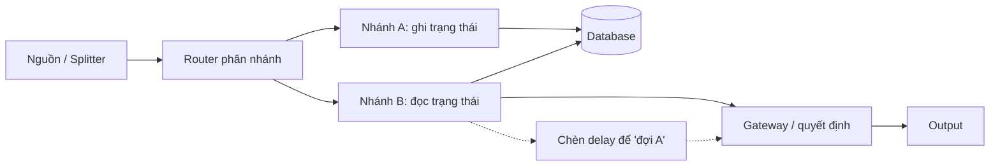
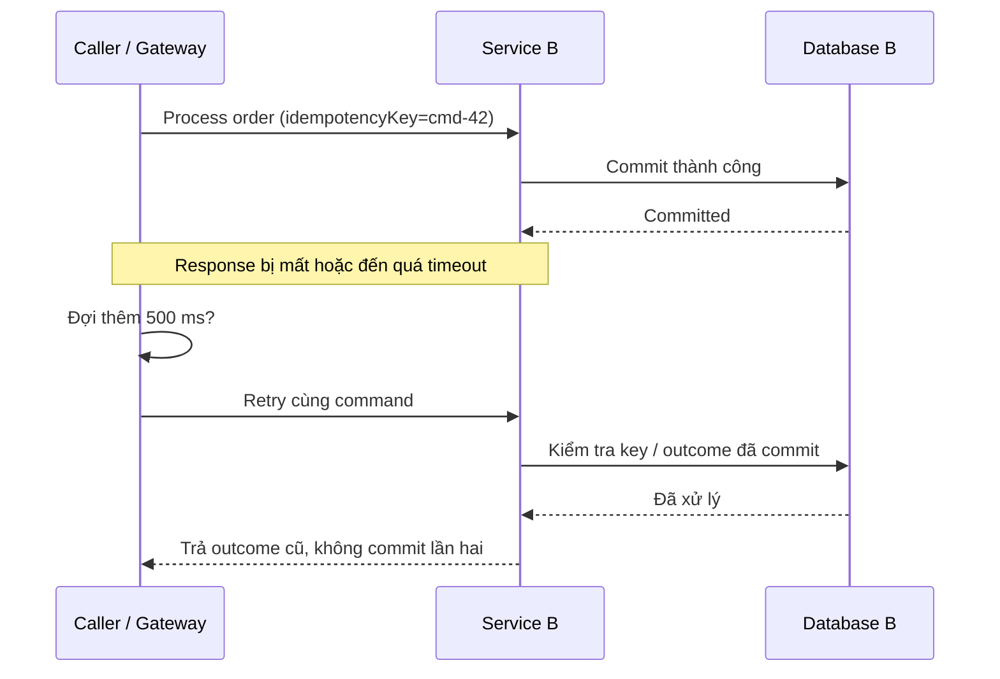

# Không dùng delay để che race condition

Trong chương **Delay** của **SPRING_INTEGRATION_PATTERN**, Delayer là một Enterprise Integration Pattern hữu ích khi ứng dụng **chủ động muốn trì hoãn việc chuyển một message**. Nhưng đôi khi lập trình viên thêm `delay(500 ms)`, `Thread.sleep(1000)` hoặc tăng timeout chỉ để “đợi cho service kia kịp ghi dữ liệu”. Cách xử lý này có thể khiến lỗi tạm thời biến mất khi chạy thử, trong khi **race condition vẫn còn nguyên** và sẽ tái xuất hiện khi tải tăng, máy chậm, retry, restart hoặc có nhiều instance.

Bài học **“Không dùng delay để che race condition”** giải thích sự khác nhau giữa thời gian chờ và quan hệ đồng bộ, chỉ ra các ví dụ trong luồng Router, Filter, Transformer, Splitter, Aggregator, Gateway, retry, error channel và correlation, đồng thời hướng dẫn thay “ngủ thêm một chút” bằng **bất biến dữ liệu, điều phối, transaction, idempotency và kiểm thử đồng thời có kiểm soát**.

> **Ghi nhớ từ đầu:** Delay có thể thay đổi **thời điểm** một thao tác được thực hiện; nó **không tự tạo ra quan hệ bảo đảm thao tác khác đã hoàn tất**. Nếu tính đúng đắn phụ thuộc vào việc B phải xảy ra sau A, cần mô hình hóa và kiểm chứng quan hệ ấy, không đoán bằng số mili giây.

## 1. Delay và race condition là hai khái niệm khác nhau

### 1.1. Delay làm gì?

Trong Spring Integration, **Delayer** giữ một message để chuyển tiếp sau một khoảng trì hoãn hoặc tại một thời điểm được tính theo cấu hình. Nó phục vụ những nhu cầu như:

- Trì hoãn gửi thông báo trong khoảng thời gian đã quy định.
- Chờ tới cửa sổ xử lý hợp lệ do nghiệp vụ đặt ra.
- Giãn thời điểm xử lý theo chính sách, ví dụ tránh thực hiện một hành động quá sớm.
- Đưa một message sang giai đoạn tiếp theo sau một mốc lịch được tính trước.

Một Delayer có thể cần scheduler và cơ chế lưu message đang chờ. **Thời điểm kích hoạt thực tế chịu ảnh hưởng của scheduler, tải hệ thống và store**, vì vậy nó không phải bộ đồng hồ thời gian thực bảo đảm thực thi đúng một mili giây cụ thể.

### 1.2. Race condition là gì?

*Race condition* xuất hiện khi kết quả đúng/sai của chương trình phụ thuộc vào **thứ tự tương đối hoặc sự xen kẽ không được kiểm soát giữa các thao tác đồng thời**. Ví dụ hai consumer cùng đọc tồn kho còn 1 sản phẩm, đều cho rằng có thể giữ hàng, rồi cùng trừ kho.

```text
Stock ban đầu = 1

Worker A                    Worker B
--------                    --------
read stock -> 1             read stock -> 1
"còn hàng"                  "còn hàng"
write stock = 0             write stock = 0
ghi nhận giữ hàng A         ghi nhận giữ hàng B

Kết quả: hai đơn được xác nhận giữ cùng một đơn vị hàng.
```

Ở đây “thêm 500 ms trước thao tác của B” có thể làm B đến sau A trong một lượt chạy, nhưng **không chứng minh** kết quả luôn đúng: lúc tải cao A có thể bị chậm hơn 500 ms, hay một worker khác C cũng đọc tồn kho cùng lúc.

### 1.3. Những bảo đảm cần phân biệt

| Cơ chế | Cung cấp điều gì? | Không tự bảo đảm |
| --- | --- | --- |
| `Thread.sleep` | Thread hiện tại ngừng chạy tối thiểu gần khoảng yêu cầu theo scheduler | Thread khác đã hoàn tất, memory visibility, transaction đã commit |
| Spring Integration Delayer | Message được chuyển tiếp sau độ trễ theo cấu hình | Điều kiện nghiệp vụ khác đã đúng, loại race condition |
| Retry với backoff | Trì hoãn **giữa các lần thử lại** sau thất bại | Thao tác an toàn khi gọi lặp, request trước chắc chắn chưa thành công |
| Lock / atomic operation | Một số thao tác tranh chấp được phối hợp theo phạm vi khóa | Tính nguyên tử qua dịch vụ/DB khác nếu lock chỉ ở JVM |
| Transaction / unique constraint | Bảo vệ một số bất biến bên trong ranh giới database | Exactly-once qua broker/API ngoài một cách tự động |
| Version/CAS | Chỉ cập nhật khi trạng thái/version vẫn khớp | Toàn bộ workflow tự được sắp thứ tự |
| Resequencer | Phát các message theo sequence metadata và release strategy | Thứ tự commit ở các consumer phía sau nếu vẫn xử lý song song |
| ACK/response đã được xác minh | Bằng chứng về giai đoạn cụ thể đã được nhận/thực hiện | Tất cả hệ thống bên ngoài đã đạt trạng thái cuối |

**Một khoảng thời gian không phải một sự kiện đồng bộ.** Trong Java Memory Model, `Thread.sleep` tự nó không thiết lập quan hệ *happens-before* để chứng minh một thread khác đã ghi xong và giá trị đã được nhìn thấy. Các primitive đồng bộ, volatile/atomic, Future completion hoặc giao dịch phải được dùng phù hợp với kiểu trạng thái cần bảo vệ.

## 2. Vì sao “ngủ thêm một chút” có vẻ hiệu quả?

Một lỗi thường thấy trong môi trường phát triển:

```java
// Ví dụ ANTI-PATTERN: không dùng để đồng bộ nghiệp vụ.
sendOrderToAnotherService(orderId);

Thread.sleep(500);

OrderStatus status = queryOrderStatus(orderId);
assert status == OrderStatus.READY;
```

Lệnh `sleep` không trả lời được câu hỏi “service kia đã xử lý xong chưa?”. Nó chỉ làm giảm khả năng truy vấn quá sớm **trong một số điều kiện**. Kết quả phụ thuộc độ trễ mạng, scheduler, GC, transaction, queue, retry và tải của service khác.

Tình huống có thể xảy ra:

```text
T=0 ms      A gửi sự kiện tạo đơn hàng.
T=50 ms     B đã nhận sự kiện, bắt đầu xử lý.
T=500 ms    A hết delay, đọc trạng thái.
T=750 ms    B mới commit xong.

→ A vẫn đọc trạng thái cũ dù đã "chờ 500 ms".
```

Nếu tăng delay lên 2 giây, lỗi có thể ít xảy ra hơn nhưng chưa biến mất. Đồng thời mọi yêu cầu phải chờ thêm, throughput giảm và latency p95/p99 tăng.

Các nguyên nhân khiến lỗi trở lại:

1. **Tải thay đổi:** cùng thao tác có thể cần 20 ms hoặc vài giây.
2. **Nhiều instance:** một lệnh chờ trong instance A không khóa B hoặc C.
3. **Retry:** lời gọi trước có thể đã thành công dù phản hồi bị mất.
4. **Transaction chưa commit:** handler đã chạy nhưng dữ liệu chưa nhìn thấy ở ranh giới đọc.
5. **Message đảo thứ tự:** Delayer chỉ lùi thời gian của một message; message khác vẫn có thể vượt.
6. **Kiểm thử CI:** máy chậm hoặc bị tranh tài nguyên làm test `sleep` đỗ ở máy cá nhân nhưng lỗi trên CI.

## 3. Trong luồng Spring Integration, race xuất hiện ở đâu?



Ví dụ Router gửi hai message cho hai nhánh:

- Nhánh A cập nhật trạng thái thanh toán thành `PAID`.
- Nhánh B đọc trạng thái thanh toán để phát thông báo giao hàng.

Nếu hai nhánh độc lập, B có thể chạy trước khi A commit. Thêm Delayer ở nhánh B **không ràng buộc** B với transaction của A. Một cách đúng hơn là **phát sự kiện `PaymentCommitted` sau khi việc ghi đã commit**, rồi cho nhánh giao hàng tiêu thụ sự kiện đó.

Những điểm rủi ro thường gặp:

| Pattern / thành phần | Race có thể gặp | Giải pháp theo bất biến |
| --- | --- | --- |
| Router / Publish–Subscribe | Hai nhánh độc lập cùng thao tác một đối tượng | Xác định phụ thuộc, sự kiện sau commit, transaction hoặc lock |
| Splitter + xử lý song song | Hai phần cùng cập nhật tổng hoặc cùng slot | Atomic update, partition theo khóa, optimistic locking |
| Filter | Quyết định lọc dựa trên trạng thái đã lỗi thời | Kiểm tra điều kiện ngay tại điểm commit/transaction |
| Transformer | Đọc shared mutable state không đồng bộ | Immutable payload hoặc dữ liệu đồng bộ/không chia sẻ |
| Aggregator | Cùng group nhận nhiều phần đồng thời hoặc phần đến sát expiry | MessageGroupStore và release/cleanup phối hợp đúng, test race |
| Resequencer | Message đến sai thứ tự, duplicate và late arrival | Sequence metadata, idempotency, release policy |
| Gateway | Client retry khi response timeout dù server đã commit | Idempotency key và xác nhận outcome |
| Retry / error channel | Retry và recovery cùng tác động một bản ghi | State machine, claim/lease, transaction và terminal state |
| Control Bus | Stop/start endpoint khi còn message đang xử lý | Lifecycle policy, drain/ack và xác nhận trạng thái |

Đặt `delay(1000)` ở trước mỗi nhánh **không thay thế** các cơ chế trên.

## 4. Ví dụ sai: kiểm tra rồi cập nhật mà không nguyên tử

Giả sử một service giữ hàng có tồn kho bằng 1:

```java
// Mô hình cố ý sai để giải thích check-then-act race.
// Không dùng trong production.
final class UnsafeStock {
    private int available = 1;

    boolean reserveOne() {
        if (available > 0) {
            available = available - 1;
            return true;
        }
        return false;
    }

    int remaining() {
        return available;
    }
}
```

Hai thread có thể cùng đọc `available > 0` trước khi bất kỳ thread nào ghi giá trị mới. Cả hai đều có thể trả `true`. Thử thêm `Thread.sleep(50)` trong một thread chỉ khiến lỗi phụ thuộc lịch chạy mới, không sửa được thao tác *check-then-act* vốn không nguyên tử.

**Chú ý:** Không có bảo đảm rằng test ngẫu nhiên với hai thread sẽ luôn tái hiện race. Ngược lại, test “chạy 100 lần đều pass” cũng **không chứng minh code an toàn**. Cần kiểm tra và bảo vệ bất biến bằng primitive đúng, rồi thiết kế test cạnh tranh có kiểm soát.

### 4.1. Cách sửa: thao tác atomic trong cùng JVM

Với một biến trạng thái chỉ dùng trong **một tiến trình Java**, có thể sử dụng `AtomicInteger.compareAndSet`:

```java
import java.util.concurrent.atomic.AtomicInteger;

public final class AtomicStock {
    private final AtomicInteger available;

    public AtomicStock(int initial) {
        if (initial < 0) {
            throw new IllegalArgumentException("Negative stock");
        }
        this.available = new AtomicInteger(initial);
    }

    public boolean reserveOne() {
        while (true) {
            int current = available.get();
            if (current == 0) {
                return false;
            }
            if (available.compareAndSet(current, current - 1)) {
                return true;
            }
            // Có thread khác vừa sửa; đọc và thử lại.
        }
    }

    public int remaining() {
        return available.get();
    }
}
```

Bất biến cần giữ: số lượng **không âm**, một đơn vị tồn kho không được dành cho hai request. Compare-and-set làm cho kiểm tra số lượng và cập nhật trở thành một quyết định nguyên tử đối với biến này.

**Giới hạn:** `AtomicInteger` chỉ bảo vệ giá trị trong một JVM. Nếu tồn kho nằm trong database và có hai instance cùng xử lý, mỗi instance giữ một `AtomicInteger` riêng vẫn có thể bán vượt số hàng. Phải chuyển ranh giới tính nguyên tử tới **nguồn dữ liệu chia sẻ**.

### 4.2. Khi có nhiều instance: cập nhật có điều kiện ở database

Một mẫu SQL diễn tả thao tác nguyên tử hơn “SELECT rồi UPDATE”:

```sql
-- Ví dụ cấu trúc; tên bảng/cột tùy schema.
UPDATE inventory
SET available = available - 1
WHERE sku = :sku
  AND available >= 1;
```

Handler phải kiểm tra **số dòng thực sự được cập nhật**:

- `1` dòng: reservation có thể tiếp tục theo transaction và hợp đồng.
- `0` dòng: không còn hàng hoặc khóa không hợp lệ; không được thông báo giữ hàng thành công.

Nếu nghiệp vụ còn cần chèn một bản ghi giữ hàng, cần bảo vệ **toàn bộ bất biến** trong transaction phù hợp, kết hợp khóa idempotency để retry không trừ thêm một lần nữa. Câu lệnh SQL trên **một mình** chưa giải quyết việc client gửi lại cùng request hoặc ghi dữ liệu qua hệ thống ngoài.

### 4.3. Đúng khi có optimistic locking

Với một entity có cột `version`, có thể kiểm soát cập nhật đồng thời:

```sql
UPDATE orders
SET status = 'PAID',
    version = version + 1
WHERE id = :orderId
  AND version = :expectedVersion
  AND status = 'AWAITING_PAYMENT';
```

Hai handler cùng đọc version cũ không thể đều cập nhật thành công theo điều kiện này. Handler nhận `0` dòng cập nhật phải **đọc lại trạng thái rồi quyết định**: yêu cầu đã được thực hiện bởi lần trước, có conflict hay cần retry? Không nên retry vô hạn trên version đã lỗi thời.

## 5. Kiểm thử cạnh tranh: dùng rào đồng bộ thay vì ngủ

Một test sử dụng `Thread.sleep(500)` để “cho thread kia chạy xong” thường vừa chậm vừa flaky. Với `AtomicStock`, có thể cho hai worker chuẩn bị, rồi **cùng bắt đầu** nhờ `CountDownLatch`:

```java
import static org.junit.jupiter.api.Assertions.*;

import java.util.concurrent.Callable;
import java.util.concurrent.CountDownLatch;
import java.util.concurrent.ExecutorService;
import java.util.concurrent.Executors;
import java.util.concurrent.Future;
import java.util.concurrent.TimeUnit;
import org.junit.jupiter.api.Test;

class AtomicStockTest {

    @Test
    void onlyOneWorkerCanReserveLastUnit() throws Exception {
        AtomicStock stock = new AtomicStock(1);
        CountDownLatch ready = new CountDownLatch(2);
        CountDownLatch start = new CountDownLatch(1);
        ExecutorService pool = Executors.newFixedThreadPool(2);

        Callable<Boolean> task = () -> {
            ready.countDown();
            if (!start.await(2, TimeUnit.SECONDS)) {
                throw new IllegalStateException("Start was not signaled");
            }
            return stock.reserveOne();
        };

        try {
            Future<Boolean> first = pool.submit(task);
            Future<Boolean> second = pool.submit(task);

            assertTrue(ready.await(2, TimeUnit.SECONDS));
            start.countDown();

            int successes = (first.get(2, TimeUnit.SECONDS) ? 1 : 0)
                    + (second.get(2, TimeUnit.SECONDS) ? 1 : 0);

            assertEquals(1, successes);
            assertEquals(0, stock.remaining());
        }
        finally {
            start.countDown(); // Tránh giữ thread đang chờ nếu assertion lỗi.
            pool.shutdownNow();
            assertTrue(pool.awaitTermination(2, TimeUnit.SECONDS));
        }
    }
}
```

Ưu điểm của test:

1. **Có điểm đồng bộ rõ ràng:** chỉ cho các worker bắt đầu sau khi cả hai đã sẵn sàng.
2. **Kiểm tra kết quả cuối:** số reservation thành công đúng 1, số hàng còn lại bằng 0.
3. **Có timeout hữu hạn:** không treo CI vô thời hạn nếu task không tiến triển.
4. **Dọn tài nguyên:** đóng executor trong `finally`.

Một lưu ý chuyên môn: latch làm hai thread bắt đầu gần nhau, **không ép từng thao tác `get()/compareAndSet()` xen kẽ theo đúng một lịch cố định**. Để tái hiện một lỗi rất cụ thể, nên chèn barrier ở các điểm read/write trong mã thử nghiệm được kiểm soát hoặc sử dụng test concurrency chuyên dụng; không cài barrier debug vào mã production.

## 6. Chuyển từ “chờ cho xong” sang “biết chắc đã xong”

Nhiều tình huống không phải cạnh tranh cập nhật một biến, mà là **thiếu quan hệ nhân quả giữa hai công việc**. Có thể lựa chọn cơ chế dựa trên điều cần chờ:

| Muốn B chờ điều gì? | Cơ chế phù hợp | Vì sao tốt hơn delay |
| --- | --- | --- |
| Một `Future` thực sự hoàn tất | `CompletableFuture.thenCompose`/`join` với timeout phù hợp | B phụ thuộc completion signal, không đoán thời gian |
| Một nhóm tác vụ cùng hoàn tất | `CountDownLatch` / `Phaser` (trong JVM) | Có điều kiện đồng bộ rõ |
| Một thay đổi trong database đã commit | Transaction boundary + sự kiện/outbox sau commit | Downstream không dựa vào dữ liệu chưa commit |
| Một object đạt version mới | Conditional write, polling có deadline và so sánh version | Kiểm tra điều kiện thật sau mỗi lần thử |
| Message đến sai thứ tự | Resequencer với correlation/sequence phù hợp | Khôi phục thứ tự theo dữ liệu, không theo thời gian đến |
| Một command ở dịch vụ ngoài được xử lý | Correlation ID, response/event xác nhận, truy vấn trạng thái | Phân biệt success, failure và outcome chưa rõ |
| Một tác vụ có thể retry an toàn | Retry với backoff **và** idempotency key | Backoff chỉ là nhịp retry; idempotency giữ tính đúng |
| Một nhóm message đủ điều kiện release | Aggregator/release strategy đúng hợp đồng | Điều kiện dựa trên dữ liệu, không chỉ “đã chờ lâu” |

### 6.1. Ví dụ: phụ thuộc vào completion thay vì ngủ

```java
import java.util.concurrent.CompletableFuture;
import java.util.concurrent.TimeUnit;

public final class AfterCommitCoordinator {

    public CompletableFuture<String> processAfterCommit(
            CompletableFuture<String> committedOrderId) {

        // committedOrderId phải thật sự biểu diễn một commit đã hoàn tất,
        // không chỉ việc queue/handler đã nhận request.
        return committedOrderId.thenApply(orderId ->
                "Order " + orderId + " can now be published");
    }

    public String awaitResult(
            CompletableFuture<String> result) throws Exception {
        return result.get(3, TimeUnit.SECONDS);
    }
}
```

Đây là ví dụ **đồng bộ trong một JVM**. Nếu `committedOrderId` được complete **trước khi commit database**, việc dùng Future cũng không sửa được sai lầm. Tín hiệu completion phải phản ánh đúng **sự kiện nghiệp vụ mà B phụ thuộc**.

Khi hai dịch vụ giao tiếp qua broker, có thể cần một sự kiện `OrderCommitted` được phát qua outbox sau khi transaction thành công, thay vì trông cậy vào Future nội bộ của service phát.

## 7. Spring Integration Delayer nên được dùng khi nào?

Delayer phù hợp khi **việc trì hoãn tự nó là yêu cầu**, ví dụ một thông báo không nên gửi trước mốc thời gian đã định, một lời nhắc được lên lịch hoặc một chính sách giãn tải. Nó không phù hợp để chứng minh một thao tác độc lập khác đã xảy ra.

### 7.1. Ví dụ Java DSL minh họa

```java
import org.springframework.context.annotation.Bean;
import org.springframework.context.annotation.Configuration;
import org.springframework.integration.dsl.IntegrationFlow;

@Configuration
public class NotificationDelayFlow {

    @Bean
    IntegrationFlow delayedNotifications() {
        return IntegrationFlow.from("acceptedNotifications")
                .delay("notificationDelayGroup",
                        spec -> spec.defaultDelay(1_000L))
                .channel("notificationsDue")
                .get();
    }
}
```

Ví dụ thể hiện **một khoảng trì hoãn được định nghĩa trong hợp đồng gửi thông báo**; nó không kiểm tra một order đã commit, payment đã authorized hoặc một worker khác đã chạy xong. Cấu hình scheduler, store, timeout và cách phát message cần được xác minh theo phiên bản Spring Integration và yêu cầu phục hồi cụ thể.

Nếu yêu cầu là “chỉ gửi sau khi payment đã commit”, thiết kế đúng hơn là để **sự kiện xác nhận commit** kích hoạt luồng thông báo. Có thể dùng Delayer *sau sự kiện commit* để trì hoãn thông báo thêm một phút nếu đó là quy tắc nghiệp vụ.

### 7.2. Delay không thay thế rate limiter hay backpressure hoàn chỉnh

Giãn mỗi message một thời gian cố định có thể làm giảm tốc độ trong một số cấu hình, nhưng không tự giới hạn concurrency, số message đang chờ hoặc thông lượng toàn hệ thống nhiều instance.

Nếu downstream bị quá tải, hãy dùng giải pháp phù hợp với mục tiêu: queue có giới hạn, consumer concurrency, rate limiter, backpressure, circuit breaker, retry/backoff và cơ chế từ chối hoặc hoãn nhận có kiểm soát. Việc đẩy thêm message vào store của Delayer có thể chỉ chuyển backlog sang vị trí khác.

## 8. Race condition trong retry và Gateway

Một race rất phổ biến không nằm ở nhiều thread cùng đọc một biến, mà nằm ở **kết quả thực thi và phản hồi bị lệch nhau**:



Ở đây thêm `delay` **không cho caller biết** lần đầu đã commit hay chưa. Cần idempotency key ổn định và cơ chế tra cứu outcome. Nếu một thao tác bên ngoài không hỗ trợ idempotency, phải thiết kế trạng thái `UNKNOWN`/đối soát hoặc bù trừ phù hợp; không retry mù quáng khi có nguy cơ phát sinh hiệu ứng lặp.

Một số quy tắc:

- `retry backoff` hữu ích để tránh dồn tải và cho hệ thống thời gian phục hồi, **nhưng không cung cấp tính nguyên tử**.
- `errorChannel` có thể thu nhận lỗi tùy cơ chế dispatch; nó **không tự chứng minh** thao tác ở hệ thống ngoài đã rollback.
- Nếu dùng DLQ và replay, cùng command vẫn phải mang **idempotency key gốc**.
- Tránh để hai tiến trình (retry worker và recovery worker) cùng commit kết quả cuối bằng cách dùng state transition có điều kiện/lock phù hợp.

## 9. Race condition khi Resequencer và Aggregator xử lý nhóm

Nếu một nhóm cần ba phần, thứ tự đến có thể là `3, 1, 2`. Với Resequencer, đó là out-of-order hợp lệ; với Aggregator, mỗi phần góp vào một kết quả nhóm. Các tình huống nguy hiểm hơn:

| Tình huống | Hậu quả tiềm ẩn | Điều cần kiểm thử |
| --- | --- | --- |
| Phần cuối đến đúng lúc group timeout | Group có thể được xử lý hai đường cạnh tranh | Chỉ một kết quả cuối theo hợp đồng |
| Duplicate `#2` đến đồng thời | Cùng slot bị xử lý lặp | Dedup/idempotency theo slot |
| Group được release rồi có late arrival | Một batch mới bị tạo nhầm hoặc phát kết quả lần hai | Lifecycle/retention và chính sách late arrival |
| Hai instance cùng xử lý một group | Tranh chấp store hoặc release | Phối hợp store/transaction/locking |
| Splitter/Filter bỏ một phần | Group chờ mãi nếu thiếu sequence | Skip/reindex hợp lệ, expiry/recovery rõ ràng |

**Đừng thêm delay ở đầu vào Resequencer để “chờ phần trước”.** Chính correlation, sequence metadata, release strategy và MessageGroupStore mới là cơ chế liên quan đến tính đúng thứ tự. Nếu metadata hoặc hợp đồng nhóm sai, việc chờ lâu hơn không sửa được nó.

Khi test, tạo message thiếu/trùng/trễ theo lịch có chủ đích, chứ không chỉ thêm `Thread.sleep` trong mỗi worker. Đặc biệt kiểm tra state cuối ở store và downstream để phát hiện phát trùng.

## 10. Test race trong luồng Spring Integration

Một chiến lược kiểm thử gồm nhiều tầng:

1. **Unit test** cho tính nguyên tử và các quy tắc state machine.
2. **Integration test** với channel, handler, Gateway và retry thật.
3. **Test với database** bằng transaction riêng và lỗi tại điểm commit.
4. **Test với broker** để mô phỏng ACK fail, redelivery, DLQ replay.
5. **Test nhiều instance** cho trường hợp hai process đồng thời tác động cùng một key.
6. **End-to-end test** để xác nhận side effect và thứ tự commit.

### 10.1. Test “sự kiện tới trước khi data commit”

Giả sử handler cập nhật database và phát `OrderReady`. Hãy tạo điều kiện để consumer nhận event **trong lúc transaction của writer chưa commit**:

```text
T1: Writer bắt đầu transaction cập nhật order.
T2: Writer phát event ra broker (sai ranh giới).
T3: Reader nhận event và tra database, thấy trạng thái cũ.
T4: Writer commit.

Nếu thêm delay vào reader:
  Có thể reader đọc sau T4 ở lần chạy này.
  Nhưng không chứng minh T4 luôn xảy ra trước reader.

Thiết kế đúng:
  Ghi business state + outbox trong cùng transaction.
  Publisher chỉ đưa event đã commit ra broker.
  Consumer có idempotency và cơ chế xử lý retry an toàn.
```

Thử nghiệm cần tạo được khoảng dừng điều khiển ở **trước commit** (ví dụ hook test hoặc barrier trong mã test), sau đó xác nhận consumer **không nhìn thấy một sự kiện khẳng định đã commit** trước khi trạng thái thực sự bền vững.

### 10.2. Test order sau async channel

Resequencer có thể phát `#1` rồi `#2` đúng thứ tự, nhưng một `ExecutorChannel` sau đó chạy hai worker đồng thời và làm `#2` commit trước `#1`. Không có lượng delay cố định nào đảm bảo điều đó không xảy ra trong mọi tải.

Test phải xác định rõ:

- **Emission order:** đo ngay sau Resequencer.
- **Commit order:** đo tại database/API hoặc sổ ghi nhận trạng thái cuối.
- **Yêu cầu nghiệp vụ:** có cần commit tuần tự theo `correlationId` không?

Nếu cần, tạo lane tuần tự theo group hoặc dùng expected version ở datastore. Không đánh đồng `QueueChannel` đã nhận message theo thứ tự với việc nhiều consumer đã xử lý theo thứ tự.

### 10.3. Tiêm lỗi tại các ranh giới nguy hiểm

| Lỗi tiêm trong test | Cần khẳng định |
| --- | --- |
| Worker chậm hơn delay dự kiến | Flow vẫn đúng mà không phụ thuộc thời gian đoán |
| Commit thất bại sau khi event đã được tạo | Event không bị công bố sai hoặc có cơ chế recovery |
| Commit thành công nhưng response mất | Retry không tạo side effect thứ hai |
| ACK thất bại sau xử lý | Redelivery idempotent |
| Hai consumer cùng cập nhật phiên bản cũ | Một thao tác có hiệu lực, thao tác còn lại retry/đối soát |
| Timer expiry và message cuối cùng đồng thời | Không phát hai kết quả cuối |
| Restart giữa delay và thời điểm phát | Mức độ bền vững đúng với store/scheduler được chọn |
| Phần đến trễ từ DLQ | Không mở lại batch trái hợp đồng |

## 11. Đo và cảnh báo thay vì che lỗi

Các metric/trace hữu ích nên phản ánh **nguyên nhân**, không chỉ độ trễ trung bình:

| Tín hiệu | Phát hiện điều gì? |
| --- | --- |
| `optimisticLockConflictCount` | Hai tác vụ cố cập nhật cùng version |
| `idempotencyDuplicateCount` | Cùng command/event được gửi lại |
| `retryAttemptCount` | Tỷ lệ retry và số lần thử |
| `unknownOutcomeCount` | Caller không biết phía ngoài đã commit hay chưa |
| `outboxPendingAge` | Event đã commit nhưng chưa được xuất bản |
| `groupTimeoutCount` | Aggregator/Resequencer bị kẹt hoặc thiếu phần |
| `lateArrivalCount` | Message đến sau completion/expiry |
| `delayerPendingCount` | Số message đang chờ trong cơ chế delay |
| `commitOrderViolationCount` | Tác động được commit sai thứ tự nghiệp vụ |
| `transactionConflictRate` | Áp lực cạnh tranh ở database |

Các tên trên là **metric gợi ý để ứng dụng instrument**, không phải tên mặc định mà Spring Integration luôn tự xuất. Tránh biến `correlationId`, `orderId` thành label metric cardinality cao; dùng chúng trong log/traces/bảng audit để điều tra từng trường hợp.

Khi một đội muốn “tăng delay lên 2 giây vì lâu lâu lỗi”, nên yêu cầu các bằng chứng sau:

1. **Bất biến nào đang bị vi phạm?** Ví dụ đơn đã phát nhưng trạng thái chưa commit.
2. **Hai hành động nào đang chạy cạnh tranh?** A và B thuộc thread/service/instance nào?
3. **Điểm quan sát nào cho biết A đã xong?** Commit, ACK, event xác nhận, version tăng hay Future complete?
4. **Ranh giới dữ liệu nào cần bảo vệ?** JVM, database, broker hoặc API ngoài?
5. **Test nào tái hiện được khi bỏ delay?** Dùng latch/barrier/fault injection thay vì đợi ngẫu nhiên.
6. **Sau khi sửa, điều gì chứng minh đúng?** Bất biến, log trạng thái đã commit, outcome idempotent và test nhiều vòng.

## 12. Checklist tránh dùng delay sai mục đích

1. **Tách nhu cầu về thời gian khỏi phụ thuộc dữ liệu.** Nếu “chờ vì hợp đồng quy định gửi sau 1 phút”, Delayer có thể đúng; nếu “chờ để service khác kịp xử lý”, cần cơ chế xác nhận.
2. **Không coi `Thread.sleep` là đồng bộ.** Trong Java hãy dùng Future, latch, lock, atomic hoặc event theo đúng phạm vi.
3. **Đặt tính nguyên tử ở nguồn sự thật.** Nhiều instance cần transaction, khóa hoặc conditional update ở database, không dựa vào lock nội bộ một JVM.
4. **Thiết kế bất biến và state machine.** Xác định trạng thái nào được phép chuyển và ai có quyền commit.
5. **Giữ idempotency qua retry.** Cùng command phải giữ key ổn định, chống lặp tác động khi phản hồi mất.
6. **Tách thứ tự phát và thứ tự commit.** Resequencer không tự bảo đảm các worker downstream hoàn tất tuần tự.
7. **Xử lý partial, timeout và late arrival.** Delay thêm không sửa được message thiếu, group đã hết hạn hoặc metadata sai.
8. **Đặt event sau commit bằng giao thức bền vững.** Sử dụng outbox/transaction thích hợp khi liên kết DB và broker.
9. **Viết test đồng thời có kiểm soát.** Dùng barrier/latch, transaction riêng, lỗi quanh commit/ACK và timeout hữu hạn.
10. **Không dùng delay để xử lý tràn tải vô hạn.** Cần giới hạn queue, concurrency và backpressure.
11. **Theo dõi tín hiệu nguyên nhân.** Metric retry, conflict, timeout, late arrival và tình trạng transaction hữu ích hơn việc chỉ tăng thời gian chờ.
12. **Giữ Delayer cho yêu cầu thật sự cần trì hoãn.** Khi dùng, vẫn kiểm thử scheduler, persistence và khả năng phục hồi sau restart.

## 13. Câu hỏi tự đánh giá

**Câu 1:** Nếu thêm `Thread.sleep(1000)` rồi test chạy ổn định hơn, có thể kết luận race đã được sửa?

**Không.** Test ít thất bại hơn không tạo ra bất biến đồng bộ. Khi tải hoặc lịch thread thay đổi, race có thể xuất hiện lại.

**Câu 2:** Một Delayer có thể bảo đảm payment đã commit trước khi `OrderShipped` được phát không?

**Không chỉ bằng thời gian chờ.** Phải có sự kiện/điều kiện payment committed được xác minh, hoặc kiểm tra trạng thái bằng giao thức phù hợp; Delayer chỉ có thể thêm chờ **sau** điều kiện đó nếu nghiệp vụ cần.

**Câu 3:** Dùng `AtomicInteger` đã đủ để bảo vệ tồn kho khi có ba instance ứng dụng?

**Chưa đủ.** Mỗi JVM có biến riêng. Cần bảo vệ trạng thái tồn kho tại nguồn dữ liệu chia sẻ bằng transaction/conditional update và idempotency.

**Câu 4:** Tại sao retry với backoff không loại được tác động kép?

**Vì** lần đầu có thể đã commit nhưng phản hồi thất lạc. Backoff chỉ thay đổi thời điểm gửi lại; idempotency key và outcome check mới giúp tránh thực hiện cùng lệnh lần hai.

**Câu 5:** Resequencer đã phát `#1` rồi `#2`, vậy chắc chắn database commit theo thứ tự đó?

**Không.** Nếu còn worker bất đồng bộ, `#2` có thể commit trước. Phải kiểm tra thứ tự tại database và thiết kế tuần tự theo group hoặc version check nếu đó là yêu cầu.

**Kết luận:** Delay là một công cụ **điều khiển thời điểm chuyển message**. Race condition là lỗi **thiếu bảo đảm về thứ tự nhân quả, trạng thái chia sẻ hoặc tính nguyên tử**. Chỉ tăng số mili giây thường che triệu chứng và làm hệ thống chậm hơn. Với Spring Integration, hãy dùng Delayer cho các thời hạn có chủ đích, và dùng đồng bộ đúng phạm vi, event sau commit, idempotency, Resequencer/Aggregator theo hợp đồng, transaction cùng kiểm thử cạnh tranh để giải quyết tận gốc tính đúng đắn của luồng thông điệp.

