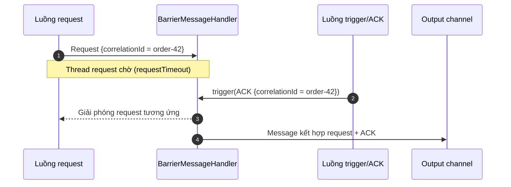

# Barrier chờ message đạt điều kiện đồng bộ

## 1. Bài toán: một luồng đã gửi yêu cầu nhưng chưa được phép đi tiếp

Trong hệ thống tích hợp, một thông điệp có thể đã được gửi thành công đến thành phần kế tiếp nhưng quy trình nghiệp vụ vẫn cần **một sự kiện xác nhận độc lập** trước khi hoàn tất. Ví dụ: một API nhận yêu cầu tạo đơn hàng, gửi lệnh tới message broker và chỉ trả kết quả “đã tiếp nhận” khi nhận được tín hiệu xác nhận tương ứng. Nếu tiếp tục ngay sau thao tác gửi, hệ thống có thể trả lời quá sớm; nếu tự viết vòng lặp kiểm tra trạng thái, luồng trở nên khó kiểm soát.

Trong phạm vi **SPRING_INTEGRATION_PATTERN**, chúng ta học các *Enterprise Integration Patterns* với Spring Integration để xây dựng luồng thông điệp ít phụ thuộc, dễ mở rộng. Cùng với Router, Filter, Transformer, Splitter, Aggregator, Gateway, retry, error channel và correlation, **Thread Barrier** giải quyết riêng bài toán: **tạm dừng một luồng xử lý cho tới khi một thông điệp kích hoạt (*trigger*) khớp điều kiện tương quan xuất hiện, hoặc cho tới khi hết thời gian chờ**.

Một Barrier trong Spring Integration không đơn thuần kiểm tra “payload có hợp lệ không”. Nó điều phối hai thời điểm bất đồng bộ:

- **Request message**: thông điệp đi vào Barrier và cần chờ.
- **Trigger message**: thông điệp báo hiệu có thể giải phóng request tương ứng.
- **Correlation key**: khóa xác định trigger nào thuộc về request nào, thường lấy từ header `correlationId`.

Chỉ khi request và trigger có **cùng khóa tương quan** thì Barrier mới tạo thông điệp đầu ra. Việc “đạt điều kiện đồng bộ” ở đây chủ yếu là **ghép đúng cặp request–trigger**, không phải đợi đủ một số lượng bản tin bất kỳ.

## 2. Cơ chế hoạt động

Spring Integration cung cấp `BarrierMessageHandler`, thực thi `MessageTriggerAction`. Khi request đi vào handler, thread đang xử lý request tạm dừng tối đa `requestTimeout` mili giây. Một thread khác gọi `trigger(message)` với cùng correlation key sẽ đánh thức request. Nếu trigger đến trước request, **thread gọi trigger cũng có thể bị chặn** tối đa `triggerTimeout` để đợi request đến.



**Các bước chính:**

1. Thành phần phía trước gắn correlation key có ý nghĩa nghiệp vụ cho request, ví dụ `order-42`, rồi gửi nó đến `input-channel` của Barrier.
2. Handler lưu trạng thái chờ theo khóa đó và giữ thread request trong giới hạn timeout.
3. Hệ thống nhận ACK hoặc sự kiện nghiệp vụ từ một đường xử lý khác, chuyển nó thành trigger có cùng correlation key và gọi `trigger()`.
4. Khi ghép cặp thành công, Barrier xử lý hai message bằng `MessageGroupProcessor` và gửi kết quả đến `output-channel`.
5. Khi hết hạn chờ, Barrier xử lý nhánh timeout thay vì giữ thread vô thời hạn.

Theo mặc định, `CorrelationStrategy` dùng `IntegrationMessageHeaderAccessor.CORRELATION_ID`; `DefaultAggregatingMessageGroupProcessor` tạo payload đầu ra dạng `Collection<?>` gồm **hai payload** (request và trigger), đồng thời tổng hợp headers. Nếu nghiệp vụ chỉ muốn xuất một DTO xác nhận, cần cấu hình `MessageGroupProcessor` riêng hoặc Transformer sau Barrier; không nên mặc định ép payload đầu ra thành kiểu của request.

### Hai thứ tự đến đều cần được thiết kế

| Tình huống | Hành vi quan trọng |
| --- | --- |
| Request đến trước, trigger khớp đến trong `requestTimeout` | Thread request được giải phóng; message đi tới output. |
| Trigger đến trước, request khớp đến trong `triggerTimeout` | Thread trigger có thể chờ; khi request đến, cặp được xử lý. |
| Trigger có correlation key khác | Nó **không** giải phóng request đang chờ; mỗi khóa theo đuổi cặp riêng. |
| Request hết `requestTimeout` | Không có output thành công; `requiresReply=false` (mặc định) trả `null` và kết thúc luồng, còn `true` ném `ReplyRequiredException`. |
| Trigger đến rất muộn hoặc chờ request quá hạn | Có thể chuyển trigger vào `discard-channel` để theo dõi/xử lý. |
| Hai request đồng thời có cùng correlation key | Barrier không cho phép hai thread request chờ đồng thời trên cùng khóa; request thứ hai phát sinh ngoại lệ. |

**Điểm dễ nhầm:** `requestTimeout` không phải thời gian tối đa của toàn bộ quy trình ở mọi tầng; đó là thời gian thread request chờ tại Barrier. Ngoài nó còn có thời hạn của API Gateway/HTTP, broker, RPC, hàng đợi và các công đoạn khác. Khi cấu hình cần cân đối toàn bộ các thời hạn.

## 3. Cấu hình Java bằng Spring Integration

Ví dụ dưới dùng `DirectChannel` cho hai đường đầu vào và `QueueChannel` để có thể đọc đầu ra trong bài thực hành. Hai timeout khác nhau làm rõ rủi ro khi trigger tới trước. Đây là cấu hình cho một ứng dụng đã sử dụng `spring-integration-core` (hoặc Spring Boot có dependency Spring Integration phù hợp).

```java
import org.springframework.beans.factory.annotation.Qualifier;
import org.springframework.context.annotation.Bean;
import org.springframework.context.annotation.Configuration;
import org.springframework.integration.annotation.ServiceActivator;
import org.springframework.integration.aggregator.BarrierMessageHandler;
import org.springframework.integration.channel.DirectChannel;
import org.springframework.integration.channel.QueueChannel;
import org.springframework.integration.config.EnableIntegration;
import org.springframework.messaging.MessageChannel;
import org.springframework.messaging.MessageHandler;

@Configuration
@EnableIntegration
public class BarrierConfiguration {

    @Bean
    public MessageChannel barrierRequests() {
        return new DirectChannel();
    }

    @Bean
    public MessageChannel barrierTriggers() {
        return new DirectChannel();
    }

    @Bean
    public QueueChannel barrierResults() {
        return new QueueChannel();
    }

    @Bean
    public QueueChannel lateTriggers() {
        return new QueueChannel();
    }

    @Bean
    @ServiceActivator(inputChannel = "barrierRequests")
    public BarrierMessageHandler awaitConfirmation(
            @Qualifier("barrierResults") MessageChannel results,
            @Qualifier("lateTriggers") MessageChannel discarded) {
        // Request chờ tối đa 5 giây, trigger tới trước chờ 2 giây.
        BarrierMessageHandler handler = new BarrierMessageHandler(5_000L, 2_000L);
        handler.setOutputChannel(results);
        handler.setDiscardChannel(discarded);
        handler.setRequiresReply(true);
        return handler;
    }

    @Bean
    @ServiceActivator(inputChannel = "barrierTriggers")
    public MessageHandler releaseOnConfirmation(BarrierMessageHandler awaitConfirmation) {
        return awaitConfirmation::trigger;
    }
}
```

Ở đây, `@ServiceActivator(inputChannel = "barrierRequests")` đưa request vào Barrier. `releaseOnConfirmation` là adapter của đường trigger: nó gọi đúng `trigger(message)` trên **cùng instance** `BarrierMessageHandler`. Đây là điểm quyết định; chỉ gửi ACK tới một channel thông thường mà không có handler chuyển thành `trigger()` thì Barrier không được giải phóng.

Vì `DirectChannel` mặc định chạy handler trên thread gọi `send()`, việc gửi request trực tiếp trên thread phục vụ HTTP có thể chiếm thread ấy trong suốt thời gian chờ. Trong ví dụ tiếp theo ta dùng executor riêng cho request để thấy rõ hai dòng xử lý độc lập.

### Gửi request và ACK có cùng correlation ID

Sau khi đưa `BarrierConfiguration` vào Spring context, một đoạn sử dụng các bean ở trên có thể viết như sau:

```java
import java.util.concurrent.ExecutorService;
import java.util.concurrent.Executors;
import java.util.concurrent.Future;
import org.springframework.beans.factory.annotation.Qualifier;
import org.springframework.integration.channel.QueueChannel;
import org.springframework.integration.IntegrationMessageHeaderAccessor;
import org.springframework.integration.support.MessageBuilder;
import org.springframework.messaging.Message;
import org.springframework.messaging.MessageChannel;
import org.springframework.stereotype.Component;

@Component
public class BarrierDemo {
    private final MessageChannel requests;
    private final MessageChannel triggers;
    private final QueueChannel results;

    public BarrierDemo(
            @Qualifier("barrierRequests") MessageChannel requests,
            @Qualifier("barrierTriggers") MessageChannel triggers,
            @Qualifier("barrierResults") QueueChannel results) {
        this.requests = requests;
        this.triggers = triggers;
        this.results = results;
    }

    public Message<?> runDemo(String orderId) throws Exception {
        Message<String> command = MessageBuilder.withPayload("PUBLISH_ORDER")
                .setHeader(IntegrationMessageHeaderAccessor.CORRELATION_ID, orderId)
                .build();
        Message<String> ack = MessageBuilder.withPayload("BROKER_ACK")
                .setHeader(IntegrationMessageHeaderAccessor.CORRELATION_ID, orderId)
                .build();

        ExecutorService workers = Executors.newSingleThreadExecutor();
        try {
            // Thread nền đi vào Barrier và có thể bị chặn khi chờ ACK.
            Future<?> pendingSend = workers.submit(() -> requests.send(command));

            // Thực tế ACK thường đi qua inbound adapter/callback độc lập.
            // Nếu ACK đến trước request, trigger có thể chờ tối đa 2 giây.
            triggers.send(ack);

            Message<?> released = results.receive(5_000L);
            if (released == null) {
                throw new IllegalStateException("Không thấy kết quả đồng bộ");
            }
            pendingSend.get(); // Quan sát cả lỗi nếu nhánh request thất bại.
            return released;
        } finally {
            workers.shutdownNow();
        }
    }
}
```

`BarrierDemo` là thành phần minh họa có thể được inject/gọi trong một ứng dụng Spring chứa `BarrierConfiguration`. Chạy ví dụ với một `orderId` duy nhất ở mỗi lần gọi; khi làm bài kiểm thử đồng thời, nên tách việc lưu kết quả theo correlation để tránh đọc nhầm từ cùng `QueueChannel`. Trong hệ thống thật, nguồn trigger thường là một inbound flow nhận callback/ACK từ broker, webhook hoặc một bộ xử lý khác. Cả request lẫn ACK cần bảo toàn cùng khóa khi chuyển đổi/định tuyến message.

`MessageChannel.send()` trả về trạng thái **gửi vào channel**, không đồng nghĩa ACK nghiệp vụ đã đến. Tín hiệu thành công cần được xác định từ message ở `barrierResults`, không suy ra từ giá trị boolean của `send()`.

### Tùy biến correlation khi hệ thống dùng khóa khác

Nếu cả hai nhánh dùng header `orderId` thay vì `correlationId`, có thể cấu hình handler theo header đó:

```java
import org.springframework.integration.aggregator.HeaderAttributeCorrelationStrategy;

BarrierMessageHandler handler = new BarrierMessageHandler(
        5_000L,
        2_000L,
        new HeaderAttributeCorrelationStrategy("orderId"));
```

Thay constructor tương ứng trong bean `awaitConfirmation` và gắn header `orderId` trên **cả hai message**. Không nên dùng `message.getId()` của từng message làm khóa ghép vì request và ACK được tạo độc lập, có ID khác nhau. Correlation key phải có giá trị khác `null`, ổn định và nhất quán giữa các bước.

## 4. Khi nào Barrier phù hợp, và khi nào không?

| Thành phần | Quyết định chính | Phù hợp khi |
| --- | --- | --- |
| **Filter** | Message có được đi tiếp dựa trên predicate? | Chặn message không đạt quy tắc nội dung. |
| **Router** | Chuyển message đến nhánh nào? | Phân luồng theo loại sự kiện, trạng thái, tenant. |
| **Aggregator** | Đã gom đủ các message của một nhóm chưa? | Đợi N kết quả hoặc một release strategy cho nhiều phần. |
| **Barrier (Thread Barrier)** | Đã xuất hiện trigger khớp với request đang chờ chưa? | Cần nối một bước đồng bộ với sự kiện xác nhận bất đồng bộ. |
| **Gateway** | Cách caller gọi/nhận kết quả từ integration flow? | Cần giao diện request–reply; có thể kết hợp với Barrier. |

Barrier **giữ thread** trong thời gian chờ, nên phù hợp với tương tác ngắn, concurrency được giới hạn và có deadline rõ ràng. Nếu cần đợi hàng phút/giờ, có lượng request đồng thời rất lớn, cần giữ trạng thái xuyên qua restart hoặc nhiều instance, hãy cân nhắc mô hình bất đồng bộ có lưu trạng thái bền vững (ví dụ cơ sở dữ liệu và callback/event) thay vì giữ một thread request tại Barrier.

Không dùng một correlation ID cho hai request đang đợi đồng thời. Có thể tái sử dụng ID ở **những đợt khác nhau** sau khi cặp trước kết thúc, nhưng trong thực tế khóa duy nhất theo từng lần yêu cầu thường an toàn hơn, đặc biệt khi broker có cơ chế gửi lại ACK.

## 5. Timeout, lỗi và thông điệp đến muộn

Một luồng tích hợp dễ mở rộng phải quy định rõ cả nhánh không thành công:

1. **Request timeout:** đặt `requestTimeout` theo SLA. `setRequiresReply(true)` khiến thiếu ACK trở thành lỗi `ReplyRequiredException` để tầng gọi và xử lý lỗi nhận biết. Với mặc định `false`, handler trả `null` và flow dừng ở đó; nếu phía trước là Gateway, cần thiết kế cả timeout ở Gateway.
2. **Trigger timeout:** đặt `triggerTimeout` đủ cho tình huống ACK đến sớm nhưng request chưa vào Barrier. Vì lời gọi `trigger()` cũng có thể block, không nên dùng thread của listener có thông lượng cao để chờ lâu; chuyển sang executor phù hợp nếu cần.
3. **Late/unmatched trigger:** cấu hình `discard-channel` và tiêu thụ channel ấy trong ứng dụng thật để ghi nhận sự kiện muộn, cập nhật metrics hoặc xử lý bù. `QueueChannel` trong ví dụ chỉ phục vụ việc quan sát.
4. **Correlation sai/thiếu:** xác nhận mọi message đi qua Transformer, Router hay bridge đều giữ đúng header cần thiết; nếu dùng custom strategy, thống nhất tên và kiểu khóa.
5. **Thông điệp trùng:** xây dựng idempotency và nhận diện ACK lặp ở ranh giới tích hợp. Barrier không thay thế cơ chế xử lý trùng và bảo đảm giao nhận của broker.
6. **Ngoại lệ:** với kênh đồng bộ như `DirectChannel`, exception có thể lan về thread gọi; với các điểm vào bất đồng bộ, cấu hình `errorChannel` / error flow tương ứng để ghi nhận và retry theo nghiệp vụ. Retry gửi lệnh không có nghĩa được phép tạo nhiều request chờ chung một correlation ID.

Ví dụ timeline khi thời hạn request là 5 giây:

```text
t=0s    Request(order-42) đến Barrier -> chờ
t=2s    Trigger(order-99) đến       -> không giải phóng order-42
t=5s    Request(order-42) timeout    -> nhánh lỗi, không có output thành công
t=7s    Trigger(order-42) đến muộn   -> không thể hồi sinh request đã hết hạn
```

Không giả định thứ tự nhận giữa hai nhánh, và đừng nhầm “ACK đã phát ra” với “ACK đã được đưa vào `trigger()`”. Ở môi trường nhiều instance, cần bảo đảm request và trigger tới cùng một cơ chế điều phối phù hợp; một Barrier cục bộ trong JVM không tự tạo bộ nhớ trạng thái chung giữa các instance.

## 6. Kiểm thử và quan sát từng nhánh

Để kiểm thử một Barrier, nên gửi hai luồng bằng các thread độc lập và sử dụng timeout hữu hạn khi đọc output. Các ca tối thiểu cần có:

| Ca kiểm thử | Dữ liệu | Kết quả mong đợi |
| --- | --- | --- |
| Ghép đúng | Request và ACK đều có `order-42` | Một kết quả ở `barrierResults`, chứa dữ liệu từ hai phía. |
| Trigger đến trước | ACK `order-42` đến trước request trong `triggerTimeout` | Vẫn ghép thành công; không treo vĩnh viễn. |
| Sai khóa | Request `order-42`, trigger `order-99` | Không giải phóng request `order-42`. |
| Thiếu ACK | Chỉ có request | Hết `requestTimeout`; với `requiresReply=true` nhận ngoại lệ. |
| ACK đến muộn | ACK xuất hiện sau khi request đã timeout | Không tạo kết quả thành công cho request cũ; quan sát đường discard nếu áp dụng. |
| Request trùng khóa | Hai request cùng `correlationId` đồng thời | Có ngoại lệ ở request đến thứ hai, tránh chờ hai thread cùng khóa. |

Khi kiểm thử timeout, dùng `Future` / executor, `CountDownLatch` hoặc công cụ đồng bộ thích hợp để kiểm soát thời điểm, tránh phụ thuộc vào `Thread.sleep()` và các khẳng định thời gian quá sít. Luôn giải phóng executor sau test.

Trong môi trường vận hành, gắn các thông tin `correlationId`, tên flow, loại sự kiện, kết quả ghép, thời gian chờ và nguyên nhân timeout vào log/trace; theo dõi số lượng request chờ, thời gian chờ trung bình, tỷ lệ timeout và số trigger bị discard. Chỉ log những trường cần thiết; payload đơn hàng hoặc thông tin cá nhân có thể chứa dữ liệu nhạy cảm. Với luồng nhiều nhánh, các chỉ số này giúp phân biệt “chưa nhận ACK”, “ACK đến nhưng sai ID” và “ACK đã đến sau deadline”.

## 7. Bài thực hành đề xuất

Xây dựng flow gửi lệnh `PublishOrder` rồi nhận `BrokerAck` từ kênh khác:

1. Tạo hai kênh `barrierRequests`, `barrierTriggers` và một `barrierResults`; cấu hình Barrier với request timeout 3 giây, trigger timeout 1 giây.
2. Đưa `orderId` vào cùng một header ở cả lệnh và ACK. Dùng một Transformer đổi payload ACK thành đối tượng `AckResult` trước khi gửi trigger.
3. Thử gửi ACK sau request, trước request và với khóa sai; ghi lại kết quả trên output.
4. Thử ACK đến sau 3 giây, quan sát nhánh lỗi và discard; xác định Gateway sẽ trả trạng thái gì cho caller.
5. Thử hai request có cùng ID, giải thích vì sao thiết kế phải tránh xử lý đồng thời khóa trùng; đề xuất cách tạo khóa mới hoặc kiểm soát idempotency.
6. Thêm log theo `correlationId` và đo thời gian chờ để so sánh các kịch bản.

**Câu hỏi tự đánh giá:** Vì sao một Filter không thể thay Barrier trong trường hợp phải chờ ACK độc lập? Nếu request và ACK chạy trên hai instance ứng dụng khác nhau, cấu hình cần thay đổi theo hướng nào? Vì sao tăng `requestTimeout` liên tục không phải giải pháp cho một tác vụ kéo dài?

## 8. Tài liệu tham khảo

- [Spring Integration Reference — Thread Barrier](https://docs.spring.io/spring-integration/reference/barrier.html): cơ chế ghép cặp, timeout, `requires-reply` và cấu hình Java/XML.
- [Javadoc — BarrierMessageHandler](https://docs.spring.io/spring-integration/docs/current/api/org/springframework/integration/aggregator/BarrierMessageHandler.html): constructor, `trigger()`, `setDiscardChannel()`.
- [Spring Integration Reference — Aggregator](https://docs.spring.io/spring-integration/reference/aggregator.html): so sánh với cơ chế nhóm message và chiến lược correlation.

> **Ghi nhớ:** Barrier chỉ tiếp tục khi có trigger **đúng correlation key** hoặc xử lý nhánh timeout; nó không tự suy luận một thao tác gửi thông điệp là thành công nghiệp vụ. Thiết kế đáng tin cậy cần cả deadline, lỗi, discard, khóa tương quan và theo dõi từng nhánh.
