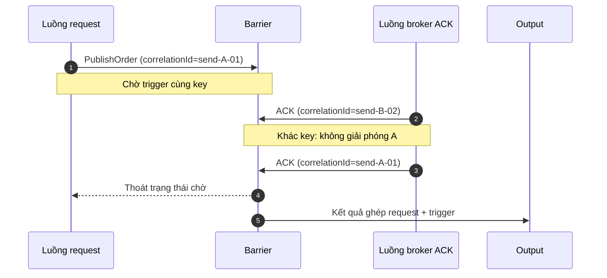

# Correlation key cho barrier

## 1. Vì sao Barrier cần một correlation key?

Trong **SPRING_INTEGRATION_PATTERN**, các Enterprise Integration Patterns như Router, Filter, Transformer, Splitter, Aggregator, Gateway, retry và error channel phối hợp để tạo các luồng thông điệp ít phụ thuộc, dễ mở rộng và có thể theo dõi. **Barrier** giải quyết một tình huống rất cụ thể: một request đã đi vào luồng xử lý nhưng phải chờ **một sự kiện kích hoạt độc lập** trước khi có thể đi tiếp. Để xác định sự kiện nào giải phóng request nào, Barrier cần **correlation key** (khóa tương quan).

Hãy tưởng tượng một hệ thống nhận lệnh gửi đơn hàng tới broker. Ứng dụng muốn chỉ xác nhận đã gửi khi nhận được ACK từ broker. Trong cùng thời điểm có nhiều đơn hàng, ACK có thể đến không theo thứ tự request; vì vậy việc nhận được một ACK bất kỳ chưa đủ. Cần ghép đúng:

| Request | Trigger/ACK | Correlation key | Kết quả |
| --- | --- | --- | --- |
| Gửi đơn A, lần gửi 01 | ACK cho A, lần gửi 01 | `send-A-01` | Ghép đúng, giải phóng A-01 |
| Gửi đơn B, lần gửi 02 | ACK cho B, lần gửi 02 | `send-B-02` | Ghép đúng, giải phóng B-02 |
| Gửi đơn A, lần gửi 01 | ACK cho B, lần gửi 02 | Khác nhau | Không giải phóng A-01 |
| Gửi lại đơn A, lần gửi 03 | ACK cũ của lần gửi 01 | `send-A-03` và `send-A-01` | Không ghép nhầm ACK cũ với lần gửi mới |

**Correlation key là danh tính của lần tương tác cần đồng bộ**, không nhất thiết là ID của thực thể nghiệp vụ. Trong ví dụ, `orderId` xác định đơn hàng còn `sendAttemptId` xác định đúng một lần gửi. Nếu một đơn có thể được gửi hai lần đồng thời, chọn riêng `orderId` làm key sẽ gây xung đột hoặc nhận nhầm ACK.

### Kết quả học tập

Sau bài này, bạn có thể:

- Chỉ ra Barrier lấy khóa tương quan từ đâu và cách khóa quyết định cặp request–trigger.
- Đặt một khóa ổn định, duy nhất trong phạm vi các thao tác đang chờ, đồng nhất kiểu dữ liệu giữa hai nhánh.
- Tạo message với header `correlationId`, hoặc dùng header riêng bằng `CorrelationStrategy`.
- Phát hiện tình huống thiếu khóa, sai khóa, trùng khóa, trigger đến trước hoặc đến muộn.
- Viết thử nghiệm và log giúp truy ngược nguyên nhân một request bị timeout.

## 2. Cách Spring Integration xác định cặp message

Spring Integration dùng `BarrierMessageHandler`; khi request được gửi vào input channel của handler, luồng xử lý request chờ trigger tương ứng, tối đa trong `requestTimeout`. Một nhánh độc lập gọi `trigger(Message<?>)` với ACK. Cả hai phía đều được đưa qua **cùng một `CorrelationStrategy`** để lấy khóa. Khi khóa của request và trigger bằng nhau, Barrier có thể giải phóng luồng request và xây dựng thông điệp đầu ra.

Mặc định, `CorrelationStrategy` của Barrier là một `HeaderAttributeCorrelationStrategy` đọc header:

```java
IntegrationMessageHeaderAccessor.CORRELATION_ID
// Giá trị tên header là "correlationId".
```

Không cần tên header tùy biến nếu hai nhánh có thể cùng gắn `correlationId`. Nếu muốn dùng một trường khác, chẳng hạn `commandId`, hãy cấu hình strategy đọc trường đó; Spring Integration không tự suy ra `orderId` từ payload.



Trong Java, hợp đồng của strategy rất ngắn:

```java
@FunctionalInterface
public interface CorrelationStrategy {
    Object getCorrelationKey(Message<?> message);
}
```

Giá trị trả về cần **khác `null`**. Nếu không xác định được khóa, strategy nên ném ngoại lệ rõ ràng. Vì key được dùng để định danh trong cấu trúc tra cứu, kiểu key cần có `equals()` và `hashCode()` nhất quán, không bị thay đổi sau khi message đã đi vào Barrier. Hai giá trị trông giống nhau trên log chưa chắc bằng nhau trong Java: ví dụ chuỗi `"42"` và số nguyên `42` là **hai key khác nhau**.

Barrier mặc định dùng `DefaultAggregatingMessageGroupProcessor` để kết hợp hai payload thành một `Collection<?>` và tổng hợp headers. **Correlation key xác định cặp nào được ghép**, còn `MessageGroupProcessor` quyết định **kết quả ghép có hình dạng gì**; đây là hai trách nhiệm khác nhau.

## 3. Thiết kế key từ nghiệp vụ

### 3.1. Chọn đúng độ hạt

| Ứng viên | Có nên dùng? | Giải thích |
| --- | --- | --- |
| `message.getId()` của request | Không, nếu ACK là message mới | ID hệ thống sinh cho từng message; ACK thường có ID độc lập. |
| `traceId` | Chỉ khi một trace đúng một thao tác chờ | Một trace có thể chứa nhiều lệnh; tracing phục vụ quan sát, không bảo đảm tính duy nhất của thao tác. |
| `orderId` | Có điều kiện | Chỉ an toàn nếu không có hai request đồng thời của cùng đơn hàng trong Barrier. |
| `commandId` / `sendAttemptId` | Thường phù hợp | Xác định một lần yêu cầu cụ thể; ACK mang lại chính ID này. |
| `tenantId + commandId` | Phù hợp với đa tenant | Tránh đụng key khi mã lệnh không duy nhất giữa các tenant. |
| UUID sinh ngẫu nhiên ở cả hai nhánh | Không | Sinh độc lập sẽ tạo hai khóa khác nhau; ACK phải mang lại khóa đã cấp cho request. |

Một quy tắc thực dụng: **cấp khóa một lần ở nơi phát lệnh**, truyền nó ra hệ thống nhận và yêu cầu nhánh callback/ACK gửi trả nguyên khóa ấy. Không tạo lại khóa khi mỗi nhánh chạy qua một Transformer hoặc adapter.

### 3.2. Chọn phạm vi duy nhất

Giả sử hệ thống chấp nhận cùng một `orderId` được gửi tới hai đối tác cùng lúc. Khóa `order-42` không đủ vì hai request cùng chờ trong một Barrier sẽ xung đột. Có thể chọn `partnerCode + commandId` hoặc phát sinh một `dispatchId` mới cho từng lần gửi.

Đối với retry, cần xác định nghiệp vụ là **thử lại cùng một lệnh logic** hay **một lần gửi mới**:

- Retry truyền tải cùng một lệnh có idempotency token cố định: callback có thể tiếp tục sử dụng cùng `commandId`, miễn là không tạo hai request đang chờ đồng thời trên một key.
- Một lần gửi mới sau khi lần cũ đã hết hạn và ACK cũ vẫn có thể đến: nên dùng `attemptId` mới để ACK cũ không đánh thức request mới; đồng thời lưu quan hệ tới `orderId` để đối soát.

Không có lựa chọn key chung đúng cho mọi trường hợp: yêu cầu là hai nhánh phải thống nhất **cùng định nghĩa của một lần tương tác**.

### 3.3. Khóa phải ổn định qua biên giới hệ thống

Một message qua HTTP, RabbitMQ, Kafka hoặc một service khác có thể không giữ nguyên toàn bộ Spring Message headers. Khi phát request ra ngoài, hãy đặt key vào **trường giao thức/metadata** mà bên nhận thực sự phản hồi; khi ACK quay về, tạo lại header `correlationId` trên message nội bộ trước khi gọi `trigger()`. Kiểm soát thao tác đổi tên, chuẩn hóa kiểu, cắt chuỗi và phân biệt chữ hoa/thường. Không giả định một header chưa được cấu hình mapping sẽ tự đi xuyên mọi transport.

Ví dụ hợp đồng dữ liệu:

```json
{
  "commandId": "send-A-01",
  "orderId": "order-A",
  "operation": "publish"
}
```

ACK:

```json
{
  "commandId": "send-A-01",
  "accepted": true
}
```

Giá trị `commandId` ở hai JSON phải giống hệt nhau. Sự thành công của thao tác (`accepted`) là nội dung nghiệp vụ riêng; **matching key không có nghĩa nghiệp vụ đã thành công**. Một ACK từ chối cũng có thể là trigger hợp lệ, sau đó flow cần phân tích trạng thái để trả kết quả thất bại.

## 4. Ví dụ Java: dùng `correlationId` mặc định

Ví dụ sau dùng Spring Integration Java configuration. Hai input channel tách request và ACK, kết quả đặt vào `QueueChannel` để dễ quan sát khi thực hành. Ở hệ thống thật, đầu ra có thể nối tiếp một Transformer, Gateway hoặc kênh xử lý lỗi thích hợp.

```java
import org.springframework.beans.factory.annotation.Qualifier;
import org.springframework.context.annotation.Bean;
import org.springframework.context.annotation.Configuration;
import org.springframework.integration.annotation.ServiceActivator;
import org.springframework.integration.aggregator.BarrierMessageHandler;
import org.springframework.integration.channel.DirectChannel;
import org.springframework.integration.channel.QueueChannel;
import org.springframework.integration.config.EnableIntegration;
import org.springframework.messaging.MessageChannel;
import org.springframework.messaging.MessageHandler;

@Configuration
@EnableIntegration
public class CorrelationBarrierConfig {

    @Bean
    public MessageChannel publishRequests() {
        return new DirectChannel();
    }

    @Bean
    public MessageChannel brokerAcks() {
        return new DirectChannel();
    }

    @Bean
    public QueueChannel pairedResults() {
        return new QueueChannel();
    }

    @Bean
    public QueueChannel unmatchedTriggers() {
        return new QueueChannel();
    }

    @Bean
    @ServiceActivator(inputChannel = "publishRequests")
    public BarrierMessageHandler correlationBarrier(
            @Qualifier("pairedResults") MessageChannel resultChannel,
            @Qualifier("unmatchedTriggers") MessageChannel discardChannel) {

        // Mặc định: dùng header IntegrationMessageHeaderAccessor.CORRELATION_ID.
        BarrierMessageHandler barrier = new BarrierMessageHandler(5_000L, 1_500L);
        barrier.setOutputChannel(resultChannel);
        barrier.setDiscardChannel(discardChannel);
        barrier.setRequiresReply(true);
        return barrier;
    }

    @Bean
    @ServiceActivator(inputChannel = "brokerAcks")
    public MessageHandler triggerOnAck(
            @Qualifier("correlationBarrier") BarrierMessageHandler barrier) {
        return barrier::trigger;
    }
}
```

Ở đây `publishRequests` gửi vào nhánh **request** của handler; `brokerAcks` dùng **cùng instance handler** nhưng gọi `trigger()`. Hai nhánh cần chạy độc lập, vì `DirectChannel` gọi handler trên thread gửi message và có thể chặn cho tới khi cặp tương quan xuất hiện hoặc hết timeout.

Đoạn tạo message minh họa hai payload khác nhau nhưng chung một correlation key:

```java
import java.util.UUID;
import org.springframework.integration.IntegrationMessageHeaderAccessor;
import org.springframework.integration.support.MessageBuilder;
import org.springframework.messaging.Message;

String commandId = UUID.randomUUID().toString();

Message<String> request = MessageBuilder.withPayload("PUBLISH:order-A")
        .setHeader(IntegrationMessageHeaderAccessor.CORRELATION_ID, commandId)
        .setHeader("orderId", "order-A")
        .build();

Message<String> trigger = MessageBuilder.withPayload("BROKER_ACK:accepted")
        .setHeader(IntegrationMessageHeaderAccessor.CORRELATION_ID, commandId)
        .setHeader("orderId", "order-A")
        .build();

// Gửi request vào publishRequests từ worker/caller.
// Đưa trigger vào brokerAcks từ callback/listener khác.
// Không lần lượt gọi cả hai lệnh trên cùng thread khi request có thể đang chờ.
```

Với hai message trên, `CorrelationStrategy` trích được cùng chuỗi `commandId` nên Barrier có thể phát kết quả khi cả hai đến trong thời hạn. Nếu trigger chứa một UUID mới do listener tự sinh, hai thông điệp **không** khớp dù payload cùng nhắc đến `order-A`.

## 5. Tái tạo correlation header khi nhận callback

Giả sử broker gửi ACK theo dạng đối tượng:

```java
public record BrokerAck(String commandId, boolean accepted) {}
```

Adapter ở biên hệ thống có thể chuẩn hóa thông điệp trước khi chuyển vào channel trigger:

```java
import org.springframework.integration.IntegrationMessageHeaderAccessor;
import org.springframework.integration.support.MessageBuilder;
import org.springframework.messaging.Message;

public Message<BrokerAck> normalizeAck(BrokerAck ack) {
    if (ack.commandId() == null || ack.commandId().isBlank()) {
        throw new IllegalArgumentException("ACK thiếu commandId");
    }

    return MessageBuilder.withPayload(ack)
            .setHeader(IntegrationMessageHeaderAccessor.CORRELATION_ID, ack.commandId())
            .build();
}
```

Message trả về từ `normalizeAck` được gửi vào `brokerAcks`. Sau đó `triggerOnAck` gọi `BarrierMessageHandler.trigger()`. Đây là cách rõ ràng để tách việc **đọc giao thức ngoài** khỏi **đồng bộ nội bộ**.

Khi dùng Transformer, Filter hoặc Router trước Barrier:

1. Quy định chỗ nào phát sinh key và chỗ nào tái tạo key từ dữ liệu ngoài.
2. Giữ key khi tạo message mới, hoặc gắn lại key bằng `MessageBuilder`/Header Enricher.
3. Không ghi đè key bằng mã đơn hàng khác, trace ID hoặc ID message mới.
4. Coi key thiếu là lỗi cần xử lý trước khi gửi vào Barrier; không để nó âm thầm đi vào đường chờ.

## 6. Dùng một header nghiệp vụ khác: `HeaderAttributeCorrelationStrategy`

Nếu hai nhánh đã có header `commandId` và bạn không muốn chuẩn hóa sang `correlationId`, có thể chỉ định trực tiếp:

```java
import org.springframework.integration.aggregator.BarrierMessageHandler;
import org.springframework.integration.aggregator.HeaderAttributeCorrelationStrategy;

BarrierMessageHandler barrier = new BarrierMessageHandler(
        5_000L,
        1_500L,
        new HeaderAttributeCorrelationStrategy("commandId"));
```

Đây là **cấu hình thay thế** constructor `new BarrierMessageHandler(5_000L, 1_500L)` trong bean `correlationBarrier`; các channel và đường gọi `trigger()` vẫn như trên. Sau đó request và ACK cần gắn cùng:

```java
Message<String> request = MessageBuilder.withPayload("PUBLISH:order-A")
        .setHeader("commandId", "send-A-01")
        .build();

Message<String> trigger = MessageBuilder.withPayload("ACK:accepted")
        .setHeader("commandId", "send-A-01")
        .build();
```

**Lưu ý:** header `commandId` là một tên tùy chọn trong ví dụ; không phải header mặc định do Spring Integration tự sinh. Header được đọc theo đúng tên đã cấu hình. Chỉ thay strategy ở **một phía** là không đủ, vì request và trigger đều đi qua strategy thuộc cùng handler.

## 7. Composite key với `CorrelationStrategy` tùy biến

Trong hệ thống đa tenant, các đối tác có thể tái sử dụng cùng một `commandId`. Khi đó một key gồm `tenantId` và `commandId` an toàn hơn. Đừng ghép chuỗi `tenantId + ":" + commandId` nếu dữ liệu có thể chứa dấu phân cách gây nhập nhằng; dùng một kiểu key bất biến sẽ rõ ràng hơn.

```java
import org.springframework.integration.aggregator.BarrierMessageHandler;
import org.springframework.integration.aggregator.CorrelationStrategy;
import org.springframework.messaging.Message;

// Java 17+
record DispatchKey(String tenantId, String commandId) {}

CorrelationStrategy strategy = (Message<?> message) -> {
    Object tenant = message.getHeaders().get("tenantId");
    Object command = message.getHeaders().get("commandId");

    if (!(tenant instanceof String tenantId) || tenantId.isBlank()) {
        throw new IllegalArgumentException("Message thiếu tenantId");
    }
    if (!(command instanceof String commandId) || commandId.isBlank()) {
        throw new IllegalArgumentException("Message thiếu commandId");
    }
    return new DispatchKey(tenantId, commandId);
};

BarrierMessageHandler barrier =
        new BarrierMessageHandler(5_000L, 1_500L, strategy);
```

Đoạn này thay thế phần tạo `BarrierMessageHandler` trong cấu hình trước. Kiểu `record DispatchKey` tự cung cấp `equals()` và `hashCode()` dựa trên hai trường. Điều quan trọng là **cả request và trigger** đều chứa `tenantId` và `commandId` đúng kiểu chuỗi.

Ví dụ:

| Request headers | Trigger headers | Ghép? |
| --- | --- | --- |
| `tenantId=T1, commandId=C5` | `tenantId=T1, commandId=C5` | Có |
| `tenantId=T1, commandId=C5` | `tenantId=T2, commandId=C5` | Không |
| `tenantId=T1, commandId=C5` | `tenantId=T1, commandId=C6` | Không |
| `tenantId=T1, commandId=C5` | `commandId=C5` | Strategy từ chối trigger thiếu tenant |

Khi xây dựng khóa gồm nhiều thành phần, hãy chuẩn hóa biểu diễn ở **biên hệ thống** (chẳng hạn tenant có phân biệt chữ hoa/thường hay không), rồi dùng chính xác cùng quy tắc cho cả hai nhánh. Tránh biến đổi tùy tiện trong strategy khiến hai thao tác khác nhau bị gộp thành một.

## 8. Các lỗi correlation thường gặp

### 8.1. Hai request có cùng key cùng chờ

**Barrier chỉ cho phép một request thread đang chờ trên một correlation key tại một thời điểm.** Nếu một request thứ hai tới với key trùng khi request đầu còn chờ, handler ném ngoại lệ; hai request không tự biến thành một nhóm giống Aggregator.

```text
R1: correlationId=send-A-01  ---> Barrier (đang chờ)
R2: correlationId=send-A-01  ---> Lỗi: cùng key đã có request chờ
ACK: correlationId=send-A-01 --> Giải phóng request phù hợp
```

Cách phòng ngừa: cấp key theo lần tác vụ, hạn chế submit trùng và dùng idempotency ở biên gửi lệnh. Nếu cần nhiều kết quả cho cùng một nhóm, cân nhắc **Aggregator** với release strategy thay vì sử dụng Barrier để chờ N message.

### 8.2. Request và trigger có key nhìn giống nhưng khác kiểu

```java
request.getHeaders().get("commandId"); // String "7001"
trigger.getHeaders().get("commandId"); // Integer 7001
```

`"7001".equals(7001)` là `false`. Hãy chuẩn hóa cả hai thành một kiểu ngay khi nhận message, ví dụ `String`, và kiểm tra bằng unit test. Cũng cần đề phòng khoảng trắng thừa và Unicode được chuẩn hóa không nhất quán.

### 8.3. Mất key khi chuyển message

Một component tạo message mới chỉ với payload hoặc một transport adapter không mang theo header sẽ làm trigger không tìm được request tương ứng. Trong log, sự kiện nghiệp vụ dường như xuất hiện đầy đủ, nhưng Barrier vẫn timeout. Hãy theo dõi **key trước và sau mỗi ranh giới** quan trọng; đừng chỉ xem payload.

### 8.4. Trigger đến trước request

Spring Integration hỗ trợ trigger đến trước: thread gọi `trigger()` có thể chờ tới `triggerTimeout` để request đến. Nếu trigger quá hạn trước khi request xuất hiện, nó có thể bị chuyển sang `discard-channel`. Nếu handler đang chạy trực tiếp trên listener thread, việc chờ này cũng chiếm tài nguyên của listener; cân nhắc đưa trigger sang một `TaskExecutor` nếu không muốn block thread nhận.

### 8.5. Trigger đến sau request timeout

Nếu request đã kết thúc do `requestTimeout`, trigger đến sau không thể hồi sinh kết quả thành công đã quá hạn. Khóa đúng vẫn không đủ: **matching phụ thuộc cả key lẫn cửa sổ thời gian**. Có thể xử lý ACK muộn qua discard flow hoặc quy trình đối soát riêng.

| Tình huống | Triệu chứng | Điểm cần kiểm tra |
| --- | --- | --- |
| Sai header | Có ACK nhưng request vẫn timeout | `correlationId` hay `commandId` đang được strategy đọc? |
| Sai kiểu key | Log in `7001` ở cả hai phía nhưng không ghép | Kiểu Java của giá trị header, chuẩn hóa dữ liệu |
| Request trùng | Ngoại lệ khi request thứ hai đi vào | Hai lần gửi đang chờ có dùng chung key không? |
| ACK tới trước quá lâu | Không có kết quả ghép | `triggerTimeout` và kênh discard |
| ACK tới quá muộn | Request timeout trước khi ACK tới | `requestTimeout`, callback latency, deadline upstream |
| Khác instance | Mỗi phía thấy key đúng nhưng không gặp nhau | Request và trigger có đi vào cùng Barrier/điều phối dùng chung không? |

## 9. Kiểm thử correlation có kiểm soát

Với test tích hợp, nên dùng **hai luồng độc lập** vì thao tác gửi request vào `DirectChannel` có thể chặn thread. Mẫu sau minh họa ca trùng key hợp lệ giữa một request và một ACK; nó dùng các bean của `CorrelationBarrierConfig` ở mục 4. Dùng một key mới cho mỗi lần chạy test để tránh kết quả còn sót trong `QueueChannel`.

```java
import static org.junit.jupiter.api.Assertions.*;

import java.util.Collection;
import java.util.UUID;
import java.util.concurrent.ExecutorService;
import java.util.concurrent.Executors;
import java.util.concurrent.Future;
import java.util.concurrent.TimeUnit;
import org.junit.jupiter.api.Test;
import org.springframework.beans.factory.annotation.Autowired;
import org.springframework.beans.factory.annotation.Qualifier;
import org.springframework.boot.test.context.SpringBootTest;
import org.springframework.integration.IntegrationMessageHeaderAccessor;
import org.springframework.integration.channel.QueueChannel;
import org.springframework.integration.support.MessageBuilder;
import org.springframework.messaging.Message;
import org.springframework.messaging.MessageChannel;

@SpringBootTest
class BarrierCorrelationTest {

    @Autowired @Qualifier("publishRequests")
    MessageChannel requests;

    @Autowired @Qualifier("brokerAcks")
    MessageChannel triggers;

    @Autowired @Qualifier("pairedResults")
    QueueChannel results;

    @Test
    void releasesOnlyWhenKeysMatch() throws Exception {
        String key = "test-" + UUID.randomUUID();
        Message<String> request = MessageBuilder.withPayload("command")
                .setHeader(IntegrationMessageHeaderAccessor.CORRELATION_ID, key)
                .build();
        Message<String> ack = MessageBuilder.withPayload("ack")
                .setHeader(IntegrationMessageHeaderAccessor.CORRELATION_ID, key)
                .build();

        ExecutorService executor = Executors.newSingleThreadExecutor();
        try {
            Future<Boolean> requestSend =
                    executor.submit(() -> requests.send(request));
            // ACK có thể đến trước hoặc sau khi worker bắt đầu chờ.
            // Cả hai thứ tự đều được Barrier hỗ trợ trong timeout tương ứng.
            assertTrue(triggers.send(ack));

            Message<?> completed = results.receive(4_000);
            assertNotNull(completed);
            assertInstanceOf(Collection.class, completed.getPayload());
            assertEquals(2, ((Collection<?>) completed.getPayload()).size());
            assertTrue(requestSend.get(6, TimeUnit.SECONDS));
        } finally {
            executor.shutdownNow();
        }
    }
}
```

Để thử các tình huống khác, hãy bổ sung ca có **khóa khác nhau**, **thiếu header**, **sai kiểu**, **hai request đồng thời trùng khóa**, **trigger tới trước**, và **ACK muộn**. Các phép thử về timeout nên đặt giới hạn hữu hạn, có executor được giải phóng trong `finally`, và không dùng `Thread.sleep()` để giả định thread đã đến Barrier ở thời điểm nhất định. Khi muốn khẳng định thứ tự cụ thể, hãy bổ sung cơ chế đồng bộ kiểm thử (chẳng hạn latch hoặc hook quan sát bước nhận message).

Trong các ca âm tính, kiểm tra cả nhánh lỗi/discard chứ không chỉ kiểm tra `results.receive() == null`. Ví dụ `setRequiresReply(true)` làm request timeout ném `ReplyRequiredException` tại luồng xử lý; nếu request chạy trong `Future`, ngoại lệ được quan sát khi gọi `Future.get()`. Nếu để mặc định `requiresReply=false`, nhánh request timeout trả về `null` và kết thúc flow.

## 10. Theo dõi và vận hành

Để phân biệt “ACK chưa đến” với “ACK đến nhưng key không khớp”, nên ghi log có cấu trúc tại các ranh giới:

```text
event=request_entered    key=send-A-01 orderId=order-A flow=publish
event=trigger_received  key=send-B-02 ackStatus=accepted
event=request_timeout   key=send-A-01 timeoutMs=5000
event=late_ack_discard  key=send-A-01
```

Các dòng trên chỉ là mẫu minh họa từng tình huống, không phải một chuỗi sự kiện được bảo đảm sẽ luôn xuất hiện cùng nhau. Trong thực tế, đo **thời gian chờ**, số request timeout, trigger discard, số lỗi trùng key, tỷ lệ ACK thiếu key và tỷ lệ ACK được ghép. Nên gắn cả `traceId` phục vụ quan sát và `correlationId` phục vụ ghép cặp, hiểu rõ hai mục đích khác nhau. Tránh ghi log payload hoặc trường dữ liệu khách hàng không cần thiết.

Với nhiều instance, một `BarrierMessageHandler` trong một JVM **không tự đồng bộ trạng thái chờ sang instance khác**. Dù hai message có cùng key, nếu request ở instance A còn ACK tới instance B thì hai phía có thể không gặp nhau. Hãy thiết kế định tuyến nhất quán tới cùng nơi điều phối hoặc dùng cơ chế điều phối trạng thái ngoài tiến trình phù hợp. Nếu thao tác có thể kéo dài nhiều phút/giờ, giữ thread chờ tại Barrier thường không phù hợp; nên chuyển sang workflow bất đồng bộ lưu trạng thái bền vững và phát kết quả qua callback/event.

## 11. Bài thực hành

Giả sử API nhận lệnh gửi hóa đơn điện tử, broker trả ACK có `invoiceId` và `commandId`; một khách hàng có thể gửi lại cùng hóa đơn. Hãy triển khai và giải thích:

1. Chọn `commandId` là key cho từng lần gửi, gắn vào header `correlationId` ở request. Giữ `invoiceId` như metadata nghiệp vụ.
2. Viết một adapter nhận ACK, kiểm tra `commandId` hợp lệ và gắn cùng key lên trigger.
3. Gửi hai lệnh có cùng `invoiceId` nhưng `commandId` khác nhau; cho ACK về đảo thứ tự và kiểm tra không ghép nhầm.
4. Thử ACK cũ của lần gửi trước đến khi request mới đang đợi. Chỉ ra vì sao không được dùng `invoiceId` làm key trong trường hợp này.
5. Đổi sang `HeaderAttributeCorrelationStrategy("commandId")`; chứng minh cả hai nhánh phải mang header `commandId`.
6. Mở rộng cho đa tenant bằng `DispatchKey(tenantId, commandId)` và kiểm tra cùng `commandId` của hai tenant không khớp nhau.
7. Thêm error flow và discard flow, log key ở từng chặng và đếm các trường hợp timeout, ACK muộn, thiếu key.

**Câu hỏi tự đánh giá**

- Vì sao `MessageHeaders.ID` của request không phù hợp làm correlation key cho ACK được tạo độc lập?
- Khi nào `orderId` đủ làm key, và khi nào bắt buộc dùng `attemptId` hoặc `commandId`?
- Nếu log hiển thị cùng ID nhưng Barrier vẫn timeout, bạn sẽ kiểm tra thứ tự các bước, tên header và kiểu dữ liệu như thế nào?
- Vì sao cùng correlation key không đủ để ghép nếu hai nhánh chạy ở hai Barrier khác instance?
- Sự khác nhau giữa correlation key của Barrier và `correlationId` dùng trong nhóm Aggregator nằm ở yêu cầu đồng bộ/release nào?

## 12. Nguồn tham khảo

- [Spring Integration Reference — Thread Barrier](https://docs.spring.io/spring-integration/reference/barrier.html): mặc định dùng `CORRELATION_ID`, trigger theo khóa, timeout, cấu hình Java/XML và giới hạn một request chờ trên mỗi key.
- [Spring Integration Javadoc — BarrierMessageHandler](https://docs.spring.io/spring-integration/docs/6.4.x/api/org/springframework/integration/aggregator/BarrierMessageHandler.html): các constructor nhận `CorrelationStrategy`, `trigger()` và `setDiscardChannel()`.
- [Spring Integration Javadoc — CorrelationStrategy](https://docs.spring.io/spring-integration/docs/6.5.1/api/org/springframework/integration/aggregator/CorrelationStrategy.html): hợp đồng `getCorrelationKey` và yêu cầu không trả `null`.
- [Spring Integration Reference — Aggregator](https://docs.spring.io/spring-integration/reference/aggregator.html): nguyên tắc correlation, `HeaderAttributeCorrelationStrategy` và phân biệt với cơ chế tập hợp message.

> **Ghi nhớ:** Một Barrier ghép request và trigger bằng **cùng key, cùng kiểu, cùng ý nghĩa nghiệp vụ và còn trong thời hạn chờ**. Thiết kế khóa ngay tại nơi phát request, truyền nguyên định danh qua callback và kiểm tra toàn bộ điểm chuyển đổi message là nền tảng để tránh timeout giả và ghép nhầm ACK.
