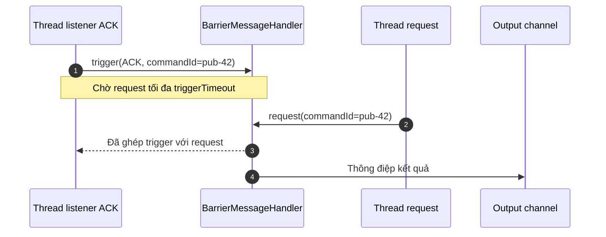

# Barrier message và trigger message

## 1. Bài toán: hai thông điệp, hai vai trò

Trong một luồng tích hợp doanh nghiệp, việc gửi yêu cầu và việc nhận được tín hiệu cho phép tiếp tục thường diễn ra ở **hai thời điểm và hai đường xử lý khác nhau**. Ví dụ, hệ thống gửi lệnh phát hành hóa đơn tới một dịch vụ bên ngoài; sau khi gửi, ứng dụng cần đợi một sự kiện xác nhận từ dịch vụ đó trước khi hoàn tất bước đồng bộ.

Trong module **SPRING_INTEGRATION_PATTERN**, ta học triển khai các *Enterprise Integration Patterns* bằng Spring Integration để xây dựng luồng message ít phụ thuộc, dễ mở rộng, kiểm thử và theo dõi được từng nhánh. Router chọn đường đi, Filter loại message không đạt điều kiện, Transformer đổi hình dạng dữ liệu, Splitter/Aggregator phân tách và gom nhóm, Gateway kết nối cách gọi đồng bộ với message flow; retry và error channel xử lý các nhánh thất bại. **Thread Barrier** có trách nhiệm riêng: **chờ một trigger message tương quan với barrier message** trước khi giải phóng luồng đang chờ.

Trong bài này:

- **Barrier message**, còn gọi là *request message*: message được gửi vào đầu vào chính của `BarrierMessageHandler`, mang yêu cầu mà luồng xử lý phải tạm dừng.
- **Trigger message**: message báo hiệu sự kiện giải phóng, được đưa vào phương thức `trigger(Message<?>)` của **cùng handler**.
- **Correlation key**: khóa dùng để ghép đúng request với trigger, mặc định lấy từ header `correlationId`.
- **Released/output message**: message được xử lý và phát ra sau khi request và trigger ghép thành công; mặc định chứa dữ liệu từ cả hai phía.

Hai message có thể mang payload hoàn toàn khác nhau. Chúng không nhất thiết phải cùng kiểu, cùng channel hoặc xuất hiện theo cùng thứ tự.

## 2. Phân biệt barrier message và trigger message

| Khía cạnh | Barrier / request message | Trigger message |
| --- | --- | --- |
| Ý nghĩa | Yêu cầu một thao tác hoặc một bước nghiệp vụ đang chờ xác nhận | Tín hiệu cho biết sự kiện liên quan đã xảy ra |
| Đường vào | Input channel của `BarrierMessageHandler` | `BarrierMessageHandler.trigger(message)`, thường qua một input channel và service activator riêng |
| Ai tạo? | API Gateway, producer, inbound flow hoặc bước xử lý nghiệp vụ | Listener nhận ACK, callback, kết quả xử lý từ một nhánh khác |
| Payload mẫu | `PublishInvoice(invoiceId, commandId)` | `InvoiceAck(commandId, accepted, reason)` |
| Khóa tương quan | Có `correlationId=publish-42` | Cùng `correlationId=publish-42` |
| Hành vi chờ | Thread xử lý request có thể chờ tối đa `requestTimeout` | Nếu trigger tới trước, thread gọi trigger có thể chờ tối đa `triggerTimeout` |
| Điều kiện khớp | Chờ trigger có cùng key | Chờ request có cùng key |
| Khi khớp | Request được giải phóng, handler phát kết quả | Cung cấp dữ liệu cho cặp request–trigger |
| Khi quá hạn | Có thể kết thúc không có kết quả hoặc ném lỗi tùy `requiresReply` | Có thể đưa trigger không ghép được vào `discardChannel` nếu cấu hình |

Tên gọi *barrier message* không nói rằng message có một loại payload hay header đặc biệt. **Vai trò được quyết định bởi đường vào handler**: gửi payload `InvoiceAck` vào input channel của request thì nó vẫn là request; gửi payload `PublishInvoice` tới `trigger()` thì nó lại đóng vai trò trigger. Vì vậy tách hai đường vào rõ ràng là điều thiết yếu.

### Ví dụ nghiệp vụ

```text
HTTP/API hoặc producer                    Dịch vụ ngoài/broker
          |                                         |
          |  PublishInvoice(commandId=pub-42)       |
          v                                         |
    requestChannel                                  |
          |                                         | ACK(pub-42, accepted=true)
          v                                         v
    +---------------------------------------------------------+
    |                    Thread Barrier                       |
    |     barrier message <-> correlation <-> trigger message  |
    +---------------------------------------------------------+
                             |
                         outputChannel
                             |
             Kiểm tra accepted, trả kết quả nghiệp vụ
```

Barrier chỉ giải quyết **thời điểm được phép tiếp tục**. Nó không tự kiểm tra `accepted=true` là thành công nghiệp vụ: ACK từ chối với correlation key chính xác vẫn có thể giải phóng request, rồi một bước tiếp theo mới xử lý thất bại nghiệp vụ.

## 3. Vòng đời của cặp message

Một Barrier có thể xử lý hai thứ tự xuất hiện của request và trigger. Cần hiểu rõ cả hai để thiết kế timeout và thread pool.

### 3.1. Request đến trước, trigger đến sau

```mermaid
sequenceDiagram
    autonumber
    participant R as Thread request
    participant B as BarrierMessageHandler
    participant L as Thread listener ACK
    participant O as Output channel
    R->>B: request(commandId=pub-42)
    Note over R,B: Đang chờ trigger khớp key
    L->>B: trigger(ACK, commandId=pub-99)
    Note over B,L: Khác key; không giải phóng pub-42
    L->>B: trigger(ACK, commandId=pub-42)
    B-->>R: Giải phóng request
    B->>O: Thông điệp ghép request + ACK
```

Các bước:

1. Một thread gửi request vào input channel; handler lấy correlation key và đăng ký trạng thái chờ.
2. Nếu chưa có trigger khớp, thread request chờ tối đa `requestTimeout`.
3. Nhánh listener nhận ACK độc lập; adapter chuyển ACK vào `trigger()` trên cùng handler.
4. Khi key bằng nhau trong thời gian cho phép, handler ghép hai message và gửi kết quả đến output channel.

Đừng nhầm “đã nhận ACK từ broker” với “ACK đã được gọi qua `trigger()`”. Nếu một ACK chỉ được log rồi bị Filter loại bỏ, request sẽ tiếp tục chờ.

### 3.2. Trigger đến trước, request đến sau



Spring Integration cho phép trường hợp này: lời gọi `trigger()` có thể chờ **`triggerTimeout`** để request tương ứng đến. Tính năng này hữu ích khi hai nhánh dùng executor hoặc broker độc lập nên thứ tự giao nhận không được đảm bảo. Tuy nhiên việc chờ vẫn chiếm thread gọi trigger. Nếu listener có ít thread, đặt `triggerTimeout` quá dài có thể làm giảm thông lượng tiếp nhận ACK.

### 3.3. Hai chiều đều có giới hạn thời gian

| Mốc | Sự kiện | Hành vi |
| --- | --- | --- |
| `t=0` | Request `pub-42` đến | Bắt đầu chờ, chịu `requestTimeout` |
| `t=1` | Trigger `pub-43` đến | Không khớp, không giải phóng `pub-42` |
| `t=2` | Trigger `pub-42` đến | Cặp khớp, có output |
| `t=5` | Nếu không có trigger đúng key | Request hết hạn; xử lý theo `requiresReply` |

Một ví dụ đảo thứ tự:

| Mốc | Sự kiện | Hành vi |
| --- | --- | --- |
| `t=0` | Trigger `pub-42` đến | Bắt đầu chờ `triggerTimeout` |
| `t=0.5` | Request `pub-42` đến | Ghép thành công |
| `t=2` | Nếu request vẫn chưa đến và trigger timeout 1.5 giây | Trigger không còn chờ cặp đó |

Ví dụ thời gian là **minh họa**; thời điểm chính xác phụ thuộc lịch chạy thread và cấu hình handler. Đừng dùng các mốc này làm cam kết về độ trễ cho hệ thống thực.

## 4. Correlation: một yêu cầu phải gặp đúng trigger của nó

Giả sử có hai lệnh:

```text
request-1: publish invoice A, correlationId=pub-A-01
request-2: publish invoice B, correlationId=pub-B-01

trigger-1: ACK B, correlationId=pub-B-01
trigger-2: ACK A, correlationId=pub-A-01
```

ACK cho B đến trước nhưng chỉ giải phóng request B; ACK cho A chỉ giải phóng request A. Mặc định `BarrierMessageHandler` lấy key từ `IntegrationMessageHeaderAccessor.CORRELATION_ID` (header chuỗi `correlationId`). Có thể cấu hình `CorrelationStrategy` khác nếu giao thức ngoài trả `commandId`, nhưng **cả request và trigger phải có cùng giá trị và kiểu key**.

Một số quy tắc thiết kế:

1. Sinh `commandId` đúng một lần tại nơi phát lệnh và truyền ra phía nhận; ACK phải trả lại ID đó.
2. Không lấy `MessageHeaders.ID` được sinh độc lập ở mỗi message làm correlation key.
3. Nếu nhiều lần gửi của cùng một hóa đơn có thể chạy đồng thời hoặc ACK cũ đến muộn, hãy dùng ID cho **lần gửi** thay vì chỉ dùng `invoiceId`.
4. Nếu chuyển giữa HTTP, Kafka, RabbitMQ hoặc định dạng JSON, phải ánh xạ lại ID từ metadata bên ngoài vào Spring Message header phù hợp.
5. Không để message thiếu key đi tới Barrier; validate sớm để báo lỗi dễ hiểu.

Hai request cùng key cùng chờ tại một Barrier là xung đột; Barrier không được dùng như một Aggregator gom nhiều request trùng khóa. Nếu cần chờ nhiều kết quả, dùng Aggregator và chiến lược release phù hợp.

## 5. Cấu hình Java: hai channel, cùng một handler

Ví dụ cấu hình sau dùng Java 17+ và Spring Integration. Đầu vào request và trigger dùng `DirectChannel`; output và discard dùng `QueueChannel` để bài thực hành dễ đọc kết quả. Các bean được khởi tạo trong Spring context có `spring-integration-core`.

```java
import org.springframework.beans.factory.annotation.Qualifier;
import org.springframework.context.annotation.Bean;
import org.springframework.context.annotation.Configuration;
import org.springframework.integration.annotation.ServiceActivator;
import org.springframework.integration.aggregator.BarrierMessageHandler;
import org.springframework.integration.channel.DirectChannel;
import org.springframework.integration.channel.QueueChannel;
import org.springframework.integration.config.EnableIntegration;
import org.springframework.messaging.MessageChannel;
import org.springframework.messaging.MessageHandler;

@Configuration
@EnableIntegration
public class MessageAndTriggerBarrierConfig {

    @Bean
    public MessageChannel commandRequests() {
        return new DirectChannel();
    }

    @Bean
    public MessageChannel confirmationTriggers() {
        return new DirectChannel();
    }

    @Bean
    public QueueChannel releasedPairs() {
        return new QueueChannel();
    }

    @Bean
    public QueueChannel discardedTriggers() {
        return new QueueChannel();
    }

    @Bean
    @ServiceActivator(inputChannel = "commandRequests")
    public BarrierMessageHandler publishBarrier(
            @Qualifier("releasedPairs") MessageChannel output,
            @Qualifier("discardedTriggers") MessageChannel discarded) {
        // Request chờ tối đa 5 giây; trigger đến trước chờ tối đa 1.5 giây.
        BarrierMessageHandler barrier = new BarrierMessageHandler(5_000L, 1_500L);
        barrier.setOutputChannel(output);
        barrier.setDiscardChannel(discarded);
        barrier.setRequiresReply(true);
        return barrier;
    }

    @Bean
    @ServiceActivator(inputChannel = "confirmationTriggers")
    public MessageHandler forwardTrigger(
            @Qualifier("publishBarrier") BarrierMessageHandler barrier) {
        return barrier::trigger;
    }
}
```

Các dòng quyết định:

- `@ServiceActivator(inputChannel = "commandRequests")` đưa **barrier message** đến `publishBarrier`.
- `forwardTrigger` nhận **trigger message** và gọi `barrier.trigger(message)` trên **cùng instance** `publishBarrier`. Chỉ gửi ACK vào một channel không nối tới `trigger()` sẽ không giải phóng request.
- `setOutputChannel(...)` xác định nơi nhận kết quả ghép; `setDiscardChannel(...)` cho phép quan sát trigger không sử dụng được khi timeout.
- `setRequiresReply(true)` làm nhánh request timeout phát sinh `ReplyRequiredException` thay vì im lặng kết thúc. Cần một error flow hay caller xử lý ngoại lệ.

`DirectChannel` chuyển xử lý sang handler ngay trên thread gửi; nếu đặt việc gửi request và trigger tuần tự trong **cùng một thread**, lệnh gửi request có thể đang chờ khiến mã gửi trigger không bao giờ chạy kịp. Trong hệ thống thực, hãy cấp hai nguồn sự kiện/luồng xử lý độc lập, hoặc dùng executor thích hợp.

## 6. Xây dựng hai message có payload khác nhau

Định nghĩa payload nghiệp vụ để thấy rõ hai vai trò:

```java
public record PublishInvoice(String commandId, String invoiceId) {}

public record InvoiceAck(
        String commandId,
        boolean accepted,
        String reason) {}
```

Khi tạo message, cả hai nhánh gắn **cùng correlation key**. Dưới đây là ví dụ trong một thành phần ứng dụng sử dụng Spring Integration:

```java
import org.springframework.integration.IntegrationMessageHeaderAccessor;
import org.springframework.integration.support.MessageBuilder;
import org.springframework.messaging.Message;

String commandId = "publish-2026-00042";

Message<PublishInvoice> request =
        MessageBuilder.withPayload(new PublishInvoice(commandId, "inv-42"))
                .setHeader(IntegrationMessageHeaderAccessor.CORRELATION_ID, commandId)
                .build();

Message<InvoiceAck> trigger =
        MessageBuilder.withPayload(new InvoiceAck(commandId, true, "ACCEPTED"))
                .setHeader(IntegrationMessageHeaderAccessor.CORRELATION_ID, commandId)
                .build();
```

Gửi `request` tới `commandRequests` và gửi `trigger` tới `confirmationTriggers` từ hai luồng độc lập. Không cần payload có tên/kiểu giống nhau: vai trò request/trigger dựa trên đầu vào handler, còn việc ghép cặp dựa trên correlation.

### Tạo trigger từ callback ngoài

Nếu ACK là một JSON hoặc DTO nhận từ REST callback, không thể giả định Spring Message header cũ còn tồn tại. Một mapper có thể dựng lại trigger:

```java
import org.springframework.integration.IntegrationMessageHeaderAccessor;
import org.springframework.integration.support.MessageBuilder;
import org.springframework.messaging.Message;

public Message<InvoiceAck> asTrigger(InvoiceAck ack) {
    if (ack.commandId() == null || ack.commandId().isBlank()) {
        throw new IllegalArgumentException("ACK thiếu commandId");
    }
    return MessageBuilder.withPayload(ack)
            .setHeader(IntegrationMessageHeaderAccessor.CORRELATION_ID, ack.commandId())
            .build();
}
```

Nếu ACK mang `accepted=false`, vẫn gửi trigger có key đúng để giải phóng request, rồi kiểm tra trạng thái trong bước downstream. Không được dùng hành vi “trigger tới” làm bằng chứng hóa đơn đã phát hành thành công.

## 7. Message nào được gửi ra sau khi Barrier giải phóng?

Đầu ra không mặc định là request nguyên vẹn, cũng không chỉ là trigger. Với cấu hình mặc định, `BarrierMessageHandler` dùng bộ xử lý nhóm message để xây dựng **một message** có payload là một tập hợp chứa payload của request và trigger. Vì vậy đoạn mã downstream không nên ép trực tiếp toàn bộ output thành `PublishInvoice`.

Ví dụ một bước kiểm tra an toàn, khi đã nhận `Message<?> released` từ `releasedPairs`:

```java
import java.util.Collection;
import org.springframework.messaging.Message;

public boolean isAccepted(Message<?> released) {
    if (!(released.getPayload() instanceof Collection<?> values)) {
        throw new IllegalArgumentException("Payload không phải tập hợp");
    }
    boolean hasRequest = values.stream().anyMatch(PublishInvoice.class::isInstance);
    InvoiceAck ack = values.stream()
            .filter(InvoiceAck.class::isInstance)
            .map(InvoiceAck.class::cast)
            .findFirst()
            .orElseThrow(() -> new IllegalArgumentException("Thiếu ACK"));
    return hasRequest && ack.accepted();
}
```

Trong ứng dụng thật, nên xây dựng DTO kết quả có cấu trúc, ví dụ `PublishOutcome(commandId, invoiceId, accepted, reason)`, bằng Transformer hoặc một `MessageGroupProcessor` tùy biến. Không dựa vào vị trí phần tử trong tập hợp nếu thiết kế/phiên bản chưa đảm bảo thứ tự; phân biệt theo kiểu hoặc metadata rõ ràng.

**Điểm cần nhớ:** Khớp correlation chỉ giải phóng luồng. Tính hợp lệ của ACK, chữ ký phản hồi, trạng thái từ chối, tính idempotent và đối soát là những bước nghiệp vụ khác.

## 8. Timeout, lỗi, trigger lạc và message trùng

### 8.1. Không có trigger cho request

Request có thể chờ đến `requestTimeout`. Với `requiresReply=true`, Spring Integration ném `ReplyRequiredException`; với `false` (mặc định), luồng có thể kết thúc không có message đầu ra. Nếu request được gửi qua một Gateway, thời hạn của Gateway cũng cần phù hợp với thời hạn Barrier; không tăng vô hạn các timeout chỉ để che độ trễ.

### 8.2. Trigger không gặp request

Nếu trigger đến trước nhưng request khớp không đến trong `triggerTimeout`, lời gọi trigger kết thúc mà không tạo kết quả thành công. Có thể cấu hình `discardChannel` để chuyển trigger đã hết khả năng ghép cặp tới nhánh theo dõi hoặc đối soát. Trigger sai key cũng không thể đánh thức request đúng key; đừng tự “đoán” key bằng cách so payload gần giống.

### 8.3. Trigger đến muộn

```text
t=0s   request(pub-42) -> Barrier đang chờ
t=5s   request(pub-42) -> timeout
t=7s   trigger(pub-42) -> đã quá hạn; không hồi sinh request cũ
```

Một ACK muộn vẫn có thể có ý nghĩa nghiệp vụ: ví dụ hóa đơn thực sự đã được chấp nhận nhưng caller đã nhận timeout. Cần cơ chế đối soát bền vững hoặc callback hậu xử lý; Barrier cục bộ không lưu một workflow kéo dài để tự ghép sự kiện sau khi request đã hết hạn.

### 8.4. Duplicates và retry

Không dùng Barrier để xử lý hai request đang chờ đồng thời với cùng correlation ID: request thứ hai sẽ gặp ngoại lệ. ACK lặp cũng cần idempotency ở lớp tiếp nhận, bởi một trigger hợp lệ đã dùng để giải phóng request không có nghĩa hệ thống sẽ chấp nhận mọi bản sao trễ. Với retry, phân biệt một lần gửi lại packet của cùng lệnh và một lần thực hiện nghiệp vụ mới; nếu cần tách ACK của hai lần, dùng `attemptId`/`commandId` khác nhau.

### 8.5. Lỗi đồng bộ với lỗi bất đồng bộ

Vì `DirectChannel` chạy handler trên thread gọi, một exception có thể được ném trở lại lời gọi `send()`. Khi input là nguồn bất đồng bộ dùng executor/adapter, cần cấu hình error flow hoặc `errorChannel` thích hợp. Nếu request đang chờ trong `Future`, hãy quan sát `Future.get()` để không bỏ sót lỗi timeout. Khi triển khai retry, tránh phát sinh thêm request đang chờ trùng key.

| Tình huống | Barrier output | Hướng xử lý |
| --- | --- | --- |
| Request và ACK đúng key trong thời hạn | Có kết quả ghép | Kiểm tra trạng thái nghiệp vụ của ACK |
| ACK đúng key nhưng `accepted=false` | Vẫn có thể có kết quả ghép | Chuyển sang luồng từ chối/compensation |
| ACK sai key | Không giải phóng request đang chờ | Kiểm tra header, mapping, discard và timeout |
| Request hết hạn | Không có kết quả thành công | Error flow, trả trạng thái chưa xác định, đối soát |
| ACK đến sau deadline | Không làm request cũ thành công | Ghi nhận ACK muộn và xử lý bù |
| Hai request cùng key đồng thời | Xung đột / ngoại lệ | Cấp khóa riêng hoặc chặn submit trùng trước Barrier |

## 9. Kiểm thử bằng hai luồng

Sau khi có cấu hình ở mục 5, có thể viết một bài test Spring Boot minh họa gửi request trên executor và trigger trên thread test. Test này chấp nhận cả hai thứ tự tương đối do lập lịch thread; cả `requestTimeout` và `triggerTimeout` đều phải đủ để ghép cặp.

```java
import static org.junit.jupiter.api.Assertions.*;

import java.util.Collection;
import java.util.UUID;
import java.util.concurrent.ExecutorService;
import java.util.concurrent.Executors;
import java.util.concurrent.Future;
import java.util.concurrent.TimeUnit;
import org.junit.jupiter.api.Test;
import org.springframework.beans.factory.annotation.Autowired;
import org.springframework.beans.factory.annotation.Qualifier;
import org.springframework.boot.test.context.SpringBootTest;
import org.springframework.integration.IntegrationMessageHeaderAccessor;
import org.springframework.integration.channel.QueueChannel;
import org.springframework.integration.support.MessageBuilder;
import org.springframework.messaging.Message;
import org.springframework.messaging.MessageChannel;

@SpringBootTest
class MessageTriggerBarrierTest {

    @Autowired @Qualifier("commandRequests")
    MessageChannel requests;

    @Autowired @Qualifier("confirmationTriggers")
    MessageChannel triggers;

    @Autowired @Qualifier("releasedPairs")
    QueueChannel output;

    @Test
    void correlatesRequestAndTrigger() throws Exception {
        String key = "test-" + UUID.randomUUID();
        Message<PublishInvoice> request =
                MessageBuilder.withPayload(new PublishInvoice(key, "inv-7"))
                        .setHeader(IntegrationMessageHeaderAccessor.CORRELATION_ID, key)
                        .build();
        Message<InvoiceAck> ack =
                MessageBuilder.withPayload(new InvoiceAck(key, true, "OK"))
                        .setHeader(IntegrationMessageHeaderAccessor.CORRELATION_ID, key)
                        .build();

        ExecutorService executor = Executors.newSingleThreadExecutor();
        try {
            Future<Boolean> sendResult = executor.submit(() -> requests.send(request));
            assertTrue(triggers.send(ack));
            Message<?> released = output.receive(4_000L);
            assertNotNull(released, "Cần có một output khi khớp key");
            assertInstanceOf(Collection.class, released.getPayload());
            Collection<?> values = (Collection<?>) released.getPayload();
            assertTrue(values.stream().anyMatch(PublishInvoice.class::isInstance));
            assertTrue(values.stream().anyMatch(InvoiceAck.class::isInstance));
            assertTrue(sendResult.get(6, TimeUnit.SECONDS));
        } finally {
            executor.shutdownNow();
        }
    }
}
```

Test dùng `@SpringBootTest` khi dự án đã có `spring-boot-starter-test` và cấu hình tích hợp được quét vào context. Nếu dự án chỉ dùng Spring Integration thuần, thay bằng cấu hình Spring Test thích hợp. `PublishInvoice` và `InvoiceAck` là hai `record` được khai báo ở mục 6.

### Bảng ca kiểm thử đề xuất

| Kịch bản | Đầu vào | Điều cần khẳng định |
| --- | --- | --- |
| Request trước | Request A, ACK A sau đó | Giải phóng A trong timeout |
| Trigger trước | ACK A trước, request A trong `triggerTimeout` | Vẫn ghép được |
| Sai correlation | Request A, ACK B | Không có kết quả thành công của A |
| ACK bị từ chối | Request A, ACK A `accepted=false` | Barrier vẫn ghép; business processor xử lý từ chối |
| Không ACK | Chỉ request A | Timeout/ngoại lệ theo `requiresReply` |
| ACK muộn | ACK A sau request timeout | Không có kết quả thành công cho A |
| Request trùng key | Hai request A cùng chờ | Phát hiện xung đột |
| ACK callback mất header | ACK có payload nhưng không có correlation header | Validate/mapping báo lỗi; không ghép ngầm |
| Khác instance | Request ở node 1, trigger ở node 2 | Cần cơ chế điều phối để hai sự kiện gặp nhau |

Không nên tạo test phụ thuộc chặt vào `Thread.sleep()`. Khi cần kiểm tra thứ tự đến chính xác, có thể dùng `CountDownLatch` hoặc hook nhận message để đồng bộ thời điểm; đặt timeout hữu hạn và dọn executor trong `finally`. Đối với ca timeout, kiểm tra **cả output lẫn nhánh lỗi/discard**.

## 10. Theo dõi hai nhánh trong vận hành

Để hiểu vì sao request chưa được giải phóng, log nên có các trường:

```text
event=request_entered   correlationId=pub-42 source=http
event=trigger_received correlationId=pub-42 source=broker ackStatus=accepted
event=pair_released    correlationId=pub-42 durationMs=178

event=request_timeout  correlationId=pub-99 requestTimeoutMs=5000
event=trigger_discard  correlationId=pub-99 reason=late_or_unmatched
```

Đây là các mẫu log của **những kịch bản khác nhau**, không phải các dòng tự động có sẵn từ Spring Integration. Bạn cần instrument flow để ghi nhận chúng. Các chỉ số hữu ích: số request đang chờ, thời gian ghép trung bình và p95, tỷ lệ timeout, số ACK không ghép được, ACK lặp, lỗi thiếu key và tỷ lệ ACK bị từ chối. Gắn correlation ID trên log cả hai đường vào; đồng thời giữ trace ID riêng cho quan sát chuỗi gọi nếu có.

Thread Barrier là **cơ chế chờ trong tiến trình**, nên việc chạy nhiều instance không tự tạo trạng thái chờ dùng chung. Nếu request tới instance A còn trigger tới instance B, dù correlation key trùng nhau, hai message không thể được ghép chỉ nhờ hai instance cùng cấu hình. Với số lượng request chờ lớn hoặc công việc kéo dài, cân nhắc mô hình bất đồng bộ có trạng thái bền vững, thay vì giữ một thread trên mỗi yêu cầu chờ.

## 11. Bài thực hành: đồng bộ phát hành hóa đơn

Xây dựng flow nhận `PublishInvoice` và nhận callback `InvoiceAck`:

1. Tạo hai channel riêng cho request và trigger, output channel, error flow và discard channel. Đặt `requestTimeout=3000ms`, `triggerTimeout=1000ms`.
2. Cấp `commandId` cho mỗi yêu cầu và gắn vào `correlationId`. Biên callback xác thực và chuyển `commandId` từ JSON ACK vào cùng header.
3. Gửi ba yêu cầu A, B, C; cho ACK về theo thứ tự C, A, B. Chứng minh mỗi ACK chỉ giải phóng đúng yêu cầu.
4. Gửi ACK từ chối cho D, xác nhận Barrier vẫn giải phóng D rồi business processor đánh dấu thất bại.
5. Thử ACK đến trước request, ACK sai key, ACK quá hạn và hai request chung key. Ghi lại nhánh output, lỗi và discard.
6. Thử dùng một executor đơn thread cho cả request và trigger rồi giải thích vì sao cần tách concurrency để tránh chờ lẫn nhau.
7. Đề xuất cách thay đổi thiết kế nếu callback có thể đến sau vài giờ hoặc được nhận ở node khác với node giữ request.

**Câu hỏi tự đánh giá:** Điểm khác biệt quan trọng nhất giữa barrier message và trigger message là payload, header hay đường vào handler? Nếu trigger có cùng correlation ID nhưng `accepted=false`, vì sao Barrier có thể vẫn phát output? Nếu kết quả đã quá timeout và ACK đến sau, ai chịu trách nhiệm cập nhật trạng thái nghiệp vụ?

## 12. Tài liệu tham khảo

- [Spring Integration Reference — Thread Barrier](https://docs.spring.io/spring-integration/reference/barrier.html): vai trò message đầu vào và trigger, hai thời hạn chờ, correlation, output và cấu hình.
- [Spring Integration API — BarrierMessageHandler](https://docs.spring.io/spring-integration/docs/current/api/org/springframework/integration/aggregator/BarrierMessageHandler.html): constructor, `trigger(Message<?>)`, output/discard channel và các thuộc tính của handler.
- [Spring Integration Reference — Aggregator](https://docs.spring.io/spring-integration/reference/aggregator.html): phân biệt Barrier với việc tập hợp nhiều message bằng release strategy.

> **Ghi nhớ:** Barrier message mang yêu cầu phải chờ; trigger message mang sự kiện cho phép tiếp tục. **Hai đường vào, một handler, một correlation key và giới hạn thời gian phù hợp** là nền tảng để ghép đúng cặp. Sau khi ghép, flow vẫn phải xác minh ý nghĩa nghiệp vụ của ACK và xử lý các trường hợp timeout hoặc phản hồi muộn.
