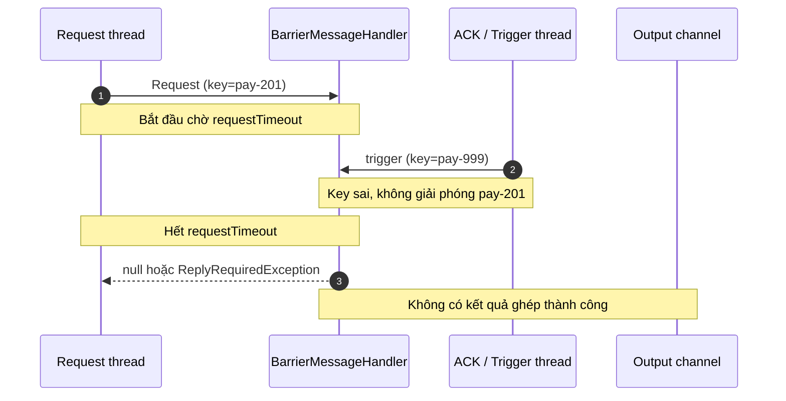
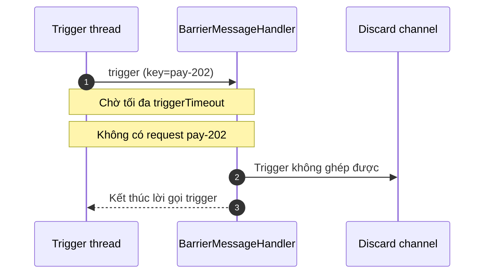

# Timeout khi điều kiện không đủ

## 1. Bài toán: chờ xác nhận nhưng điều kiện đồng bộ không xuất hiện

Trong module **SPRING_INTEGRATION_PATTERN**, chúng ta xây dựng luồng thông điệp theo *Enterprise Integration Patterns* với Spring Integration để các thành phần ít phụ thuộc và dễ mở rộng. Router, Filter, Transformer, Splitter, Aggregator, Gateway, retry, error channel và correlation đảm nhiệm những vai trò khác nhau. **Thread Barrier** phục vụ một yêu cầu riêng: **giữ luồng xử lý một request cho tới khi nhận được trigger tương ứng, hoặc kết thúc chờ khi hết thời hạn**.

Ví dụ, một API tiếp nhận yêu cầu thanh toán, gửi lệnh tới broker và đợi thông điệp ACK. Trường hợp bình thường, ACK có cùng `correlationId` giải phóng request. Nhưng thực tế có thể xảy ra:

- Broker chưa phát ACK vì lỗi mạng hoặc xử lý chậm.
- ACK đã tới nhưng bị đánh mất header correlation trong quá trình chuyển đổi.
- ACK mang `correlationId` khác request nên không thể ghép cặp.
- ACK đến sau thời hạn mà API được phép chờ.
- Trigger đến quá sớm, trước cả khi request đi vào Barrier.
- Hệ thống nhận phản hồi nghiệp vụ “từ chối”, dù correlation vẫn khớp.

Nếu chờ vô hạn, thread và kết nối bị chiếm; nếu mặc định coi việc gửi lệnh là thành công, hệ thống trả kết quả sai. **Timeout của Barrier là một giới hạn thời gian chờ ghép cặp**, giúp ứng dụng kết thúc có kiểm soát khi request và trigger không hội tụ trong cửa sổ cho phép.

> **Phân biệt quan trọng:** Điều kiện để Barrier giải phóng request mặc định là **đã xuất hiện trigger có cùng correlation key**. Barrier **không tự kiểm tra** ACK có `accepted=true` hay nghiệp vụ đã thành công. Nếu ACK từ chối cũng được chuyển tới `trigger()`, request vẫn có thể được giải phóng và bước sau phải xử lý kết quả từ chối.

### Mục tiêu bài học

Sau bài này, bạn có thể:

1. Giải thích thời điểm phát sinh `requestTimeout` và `triggerTimeout`.
2. Cấu hình giới hạn thời gian, `requiresReply` và `discardChannel` bằng Java.
3. Phân biệt kết thúc luồng vì timeout với lỗi nghiệp vụ hoặc lỗi giao nhận message.
4. Xử lý trigger đến muộn, sai correlation và giới hạn đồng thời của Barrier.
5. Kiểm thử các nhánh thành công, timeout, discard và theo dõi chúng trong môi trường vận hành.

## 2. Hai cửa sổ chờ độc lập của Thread Barrier

Spring Integration dùng `BarrierMessageHandler`. Một request vào input channel sẽ làm thread xử lý request chờ tối đa **`requestTimeout` mili giây**, trừ khi được giải phóng trước bởi thông điệp truyền vào `trigger()` có cùng correlation key. Ngược lại, nếu `trigger()` được gọi **trước request**, chính thread gọi trigger có thể chờ tối đa **`triggerTimeout` mili giây** để đợi request đến. Hai giới hạn này có thể khác nhau.

Từ Spring Integration 5.4, constructor và cấu hình hỗ trợ phân biệt `requestTimeout` / `triggerTimeout`; phiên bản cũ hơn dùng một cấu hình `timeout` chung cho cả hai phía.

| Thuộc tính | Bắt đầu đếm khi nào? | Thread bị chờ | Khi quá hạn |
| --- | --- | --- | --- |
| `requestTimeout` | Request đến Barrier, chưa có trigger khớp | Thread gọi handler xử lý request | Request kết thúc chờ; hành vi trả về phụ thuộc `requiresReply`. |
| `triggerTimeout` | `trigger()` nhận ACK nhưng chưa có request khớp | Thread gọi `trigger()` | Trigger hết thời gian đợi; có thể được chuyển vào `discardChannel`. |
| `requiresReply` | Được kiểm tra khi handler không tạo reply cho request | Luồng request | `false`: trả `null` và kết thúc flow; `true`: ném `ReplyRequiredException`. |
| `discardChannel` | Cấu hình nơi tiếp nhận trigger không thể ghép trong thời gian chờ | Đường xử lý trigger | Nhận trigger đến muộn hoặc trigger hết thời hạn đợi request; không phải kênh nhận request timeout. |

Các timeout trong bảng thuộc **một Barrier**, không phải timeout toàn hệ thống. Gateway, HTTP client, broker, listener, database hoặc các bước trước/sau có thể có deadline riêng.

### 2.1. Request tới trước, ACK không đủ điều kiện ghép



Ở đây việc ACK “đã đến” không có nghĩa điều kiện đồng bộ được đáp ứng. Hai key khác nhau tạo hai tình huống chờ độc lập; trigger `pay-999` còn có thể bị discard sau `triggerTimeout` nếu không có request `pay-999` xuất hiện.

### 2.2. Trigger tới trước, request không tới



Nếu nhánh nhận ACK dùng một `DirectChannel` từ listener, thread listener có thể bị chặn ngay tại `trigger()`. Khi tần suất ACK lớn, đặt `triggerTimeout` quá dài có thể làm cạn tài nguyên của listener. Có thể chuyển công việc trigger sang `TaskExecutor` thích hợp, đồng thời kiểm soát số task chờ.

## 3. Khi request timeout, luồng thực sự xảy ra điều gì?

Hành vi mặc định của `BarrierMessageHandler` khi không nhận được trigger khớp trước `requestTimeout` là **không tạo output message**.

| `requiresReply` | Kết quả tại Barrier | Tác động tới caller |
| --- | --- | --- |
| `false` (mặc định) | Handler trả `null`, flow hiện tại kết thúc | Caller có thể không có reply; nếu phía trước là Gateway, cần hiểu thêm reply timeout của Gateway. |
| `true` | Handler ném `ReplyRequiredException` | Caller hoặc luồng lỗi phù hợp có thể nhận biết request timeout và đưa ra phản hồi thất bại có chủ đích. |

`ReplyRequiredException` không chứng minh broker đã từ chối hoặc lệnh chưa từng được xử lý. Nó chỉ cho biết **Barrier không tạo được kết quả tương ứng trong giới hạn chờ**. Broker vẫn có thể hoàn thành thao tác sau khi request đã timeout.

Vì vậy đừng tự động trả “giao dịch thất bại chắc chắn” hoặc gửi lại lệnh không có idempotency. Một API thường nên công bố trạng thái trung thực, ví dụ “chưa xác nhận kết quả, hãy tra cứu bằng request ID”, rồi thực hiện đối soát nếu cần.

### 3.1. Timeout không phải một message bình thường trên output

Nếu cần sinh một DTO lỗi thay vì ném ngoại lệ, hãy thiết kế **đường xử lý lỗi** hoặc tầng gọi chuyển ngoại lệ thành kết quả có kiểu rõ ràng. Không nên chờ ở `outputChannel` để nhận một “timeout payload” mặc định: Thread Barrier không tự phát thông điệp thành công giả vào output khi request hết hạn.

### 3.2. Phân biệt các lớp deadline

Ví dụ một hệ thống có deadline HTTP 6 giây, thời gian xử lý trước Barrier khoảng 500 ms và dự phòng xử lý sau Barrier 500 ms. Có thể bắt đầu với `requestTimeout=4_000ms`, `triggerTimeout=800ms`, đồng thời chọn thời hạn Gateway và HTTP nhất quán với toàn bộ luồng. Đây là **ví dụ tính ngân sách**, không phải công thức cố định cho mọi ứng dụng:

```text
HTTP client deadline             6000 ms
  |-- routing / validation        500 ms
  |-- Barrier request wait       4000 ms
  |-- transform / response        500 ms
  |-- network / scheduling      1000 ms dự phòng
```

Lưu ý: `requestTimeout` bắt đầu khi request **đã vào Barrier**, không tính thời gian hàng đợi hoặc xử lý trước đó. Với Gateway, hãy xem xét cả `requestTimeout` dùng cho thao tác gửi vào channel và `replyTimeout` dùng cho việc nhận reply; các thuộc tính trùng tên ở các thành phần khác nhau có thể có ngữ nghĩa khác nhau. Không chọn thời hạn dựa riêng vào số giây của Barrier.

## 4. Cấu hình Java: timeout, lỗi và discard

Ví dụ dưới mô phỏng hệ thống phát lệnh thanh toán, nhận ACK từ một kênh callback độc lập. Hai timeout được đặt rõ ràng, `requiresReply=true` giúp phát hiện nhánh request timeout, và `discardChannel` nhận trigger không ghép được.

```java
import org.springframework.beans.factory.annotation.Qualifier;
import org.springframework.context.annotation.Bean;
import org.springframework.context.annotation.Configuration;
import org.springframework.integration.annotation.ServiceActivator;
import org.springframework.integration.aggregator.BarrierMessageHandler;
import org.springframework.integration.channel.DirectChannel;
import org.springframework.integration.channel.QueueChannel;
import org.springframework.integration.config.EnableIntegration;
import org.springframework.messaging.MessageChannel;
import org.springframework.messaging.MessageHandler;

@Configuration
@EnableIntegration
public class TimeoutBarrierConfig {

    public static final long REQUEST_TIMEOUT_MS = 4_000L;
    public static final long TRIGGER_TIMEOUT_MS = 800L;

    @Bean
    public MessageChannel paymentRequests() {
        return new DirectChannel();
    }

    @Bean
    public MessageChannel paymentAcks() {
        return new DirectChannel();
    }

    @Bean
    public QueueChannel pairedResults() {
        return new QueueChannel();
    }

    @Bean
    public QueueChannel discardedAcks() {
        return new QueueChannel();
    }

    @Bean
    @ServiceActivator(inputChannel = "paymentRequests")
    public BarrierMessageHandler paymentBarrier(
            @Qualifier("pairedResults") MessageChannel outputChannel,
            @Qualifier("discardedAcks") MessageChannel discardChannel) {

        BarrierMessageHandler barrier =
                new BarrierMessageHandler(REQUEST_TIMEOUT_MS, TRIGGER_TIMEOUT_MS);
        barrier.setOutputChannel(outputChannel);
        barrier.setDiscardChannel(discardChannel);
        barrier.setRequiresReply(true);
        return barrier;
    }

    @Bean
    @ServiceActivator(inputChannel = "paymentAcks")
    public MessageHandler releaseOnAck(
            @Qualifier("paymentBarrier") BarrierMessageHandler barrier) {
        return barrier::trigger;
    }
}
```

**Ý nghĩa của cấu hình:**

- `paymentRequests` chuyển message vào nhánh xử lý request, có thể giữ thread tới 4 giây.
- `paymentAcks` nhận ACK từ callback; handler `releaseOnAck` gọi đúng `trigger()` của **cùng instance** `paymentBarrier`.
- `pairedResults` chỉ nhận kết quả khi cặp request–trigger được ghép thành công; payload mặc định là tập hợp hai payload của hai phía.
- `discardedAcks` nhận trigger không khớp được trong thời gian chờ, kể cả trigger đến muộn hoặc tới trước quá lâu. `QueueChannel` trong ví dụ phục vụ quan sát và kiểm thử; môi trường production cần có consumer và cơ chế lưu/đối soát hợp lý.
- `setRequiresReply(true)` khiến request timeout trở thành lỗi để tầng gọi xử lý. Thao tác này không làm trigger timeout ném cùng một loại lỗi về request.

Trước Spring Integration 5.4, constructor một tham số `new BarrierMessageHandler(timeout)` dùng chung timeout cho cả request và trigger. Với phiên bản hỗ trợ hai tham số, chọn hai giá trị riêng giúp ngăn trigger sớm chiếm listener lâu hơn mức cần thiết.

## 5. Gắn correlation ID và xử lý ACK nghiệp vụ

Mặc định Barrier dùng `IntegrationMessageHeaderAccessor.CORRELATION_ID`, tức header `correlationId`, để ghép cặp. Giá trị phải được gắn trên cả request và trigger, giữ nguyên qua adapter và các bước chuyển đổi.

```java
import org.springframework.integration.IntegrationMessageHeaderAccessor;
import org.springframework.integration.support.MessageBuilder;
import org.springframework.messaging.Message;

String attemptId = "pay-201-attempt-01";

Message<String> request = MessageBuilder.withPayload("CHARGE:order-201")
        .setHeader(IntegrationMessageHeaderAccessor.CORRELATION_ID, attemptId)
        .build();

Message<String> successAck = MessageBuilder.withPayload("ACK:ACCEPTED")
        .setHeader(IntegrationMessageHeaderAccessor.CORRELATION_ID, attemptId)
        .build();

Message<String> wrongAck = MessageBuilder.withPayload("ACK:ACCEPTED")
        .setHeader(IntegrationMessageHeaderAccessor.CORRELATION_ID, "pay-999")
        .build();
```

Request và `successAck` có key giống nhau nên có thể ghép; `wrongAck` không thể giải phóng request đang chờ `pay-201-attempt-01`. Ngay cả khi ACK có key đúng, nếu tới sau `requestTimeout` thì request cũ đã kết thúc. ACK đó có thể đợi một request tương ứng khác trong `triggerTimeout` rồi bị discard nếu không tìm thấy.

**Nếu ACK trả về trạng thái từ chối:** Đừng để request phải timeout chỉ vì đã nhận một câu trả lời “rejected”. Một lựa chọn hợp lý là **vẫn gọi `trigger()` với ACK từ chối có key đúng**, để giải phóng request đúng thời hạn; bước xử lý sau Barrier đọc trạng thái ACK và tạo kết quả thất bại nghiệp vụ. Khi chỉ dùng trigger cho ACK thành công, cần có một đường báo lỗi trực tiếp cho ACK từ chối, tránh biến một kết quả đã biết thành timeout khó chẩn đoán.

### 5.1. Vì sao không được gọi hai phía tuần tự trên cùng một thread?

Vì `paymentRequests` là `DirectChannel`, lệnh `paymentRequests.send(request)` chạy handler trên thread gọi; nếu chưa có trigger, lời gọi này sẽ chặn. Đoạn mã sau dễ dẫn tới timeout:

```java
// Phản ví dụ: cùng một thread, không có callback độc lập
paymentRequests.send(request); // Chờ tối đa 4 giây rồi ném exception
paymentAcks.send(successAck);  // Không được thực hiện kịp thời
```

Trong thực tế, lời gọi `paymentAcks.send(...)` phải xuất phát từ **một listener/callback hoặc worker độc lập**, hoặc phần request được đưa qua executor có kiểm soát. Việc gửi vào channel (phương thức `send` trả `true`) cũng không phải bằng chứng đã nhận xác nhận nghiệp vụ.

## 6. Trigger muộn và cơ chế discard

Phân biệt ba thời điểm của trigger:

| Thời điểm trigger tới | Trạng thái request | Hành vi cần quan sát |
| --- | --- | --- |
| Sau request nhưng trước `requestTimeout` | Đang đợi cùng key | Ghép cặp, xuất message kết quả. |
| Trước request, request tới trong `triggerTimeout` | Trigger đang đợi | Ghép cặp thành công, dù thứ tự bị đảo. |
| Trước request quá lâu, không có request trước `triggerTimeout` | Chưa có request khớp | Trigger hết hạn và được gửi tới discard nếu có cấu hình. |
| Sau khi request cũ đã timeout | Request cũ đã kết thúc | Trigger không thể phục hồi reply cũ; có thể chờ request mới cùng key tới hoặc bị discard. |
| Có trigger nhưng correlation khác | Request cần thiết vẫn đợi | Không ghép; trigger khác key có cửa sổ chờ riêng. |

`discardChannel` chỉ giúp **quan sát và xử lý trigger không được ghép**; nó không tự phát lệnh hoàn tác thanh toán, không bảo đảm broker đã xử lý thất bại và không thay cơ chế Dead Letter Queue bền vững. Nếu cần lưu các trigger muộn qua restart, hãy chuyển chúng sang cơ chế lưu trữ bền vững do ứng dụng chọn.

### 6.1. Khi trigger muộn có cùng key với request mới

Đây là lỗi thiết kế khó phát hiện: giả sử request A dùng `orderId=201` làm key, hết hạn, sau đó ứng dụng gửi lại order 201 với **cùng** key. Một ACK cũ có thể được ghép với request mới nếu rơi đúng cửa sổ chờ, khiến ứng dụng tưởng lần gửi mới đã được xác nhận.

Phòng ngừa bằng cách cấp `attemptId` hoặc `commandId` duy nhất cho từng lần yêu cầu được xác nhận, giữ khóa đó xuyên suốt đường gửi và ACK, và có idempotency ở broker/đích xử lý. Correlation key xác định **một tương tác chờ**, không chỉ xác định một đối tượng nghiệp vụ.

### 6.2. Có nên dùng retry ngay sau timeout?

Timeout có nghĩa là **chưa có bằng chứng xác nhận trong thời hạn**, không đồng nghĩa “lệnh không được thực thi”. Retry vô điều kiện có thể làm trùng tác vụ. Trước khi gửi lại lệnh, cần xác định:

1. Bên nhận có hỗ trợ idempotency key hoặc tra cứu trạng thái theo `commandId` không?
2. Lần gửi cũ có thể còn chạy hay ACK còn trên đường truyền không?
3. Một lần retry được coi là cùng thao tác logic hay một attempt mới? Correlation và idempotency phải được quản lý nhất quán.
4. Khi hết thời hạn API, trạng thái được trả cho caller là “chưa rõ kết quả” hay một kết luận nghiệp vụ đã được xác minh?

`RequestHandlerRetryAdvice`, error channel và Dead Letter Channel là những cơ chế hữu ích trong toàn flow, nhưng chính sách retry cần căn cứ tính idempotent của thao tác, không chỉ vào loại exception.

## 7. Không nhầm timeout với lỗi nội dung hoặc logic đồng bộ khác

### 7.1. Correlation sai hoặc bị mất

ACK đến trước deadline nhưng thiếu header `correlationId` sẽ không thể tạo cặp đúng theo strategy mặc định. Trong các flow có Transformer, Router, Gateway hay tích hợp RabbitMQ/HTTP, kiểm tra header tại **ranh giới vào Barrier** và **trước khi gọi trigger**. Không nên dựa vào `MessageHeaders.ID` vì request và ACK thường là hai message khác nhau.

Nếu dùng header tùy biến, cả hai nhánh phải áp dụng **cùng `CorrelationStrategy`**. Ví dụ dùng `commandId`:

```java
import org.springframework.integration.aggregator.BarrierMessageHandler;
import org.springframework.integration.aggregator.HeaderAttributeCorrelationStrategy;

BarrierMessageHandler barrier = new BarrierMessageHandler(
        4_000L,
        800L,
        new HeaderAttributeCorrelationStrategy("commandId"));
```

Đây là **phương án thay thế constructor** trong `paymentBarrier`, không phải một Barrier thứ hai phải tạo thêm. Khi dùng nó, request và ACK cần cùng header `commandId`; giá trị của cả hai phải cùng kiểu và có quy tắc `equals()/hashCode()` ổn định.

### 7.2. Một key đang có request chờ

Spring Integration chỉ cho phép **một request đang chờ trên một correlation key tại cùng thời điểm**. Nếu request thứ hai dùng lại key trong khi request thứ nhất vẫn đợi, handler ném ngoại lệ; đây là lỗi concurrency, không phải request timeout. Với tình huống chờ đủ N kết quả hoặc chờ một nhóm nhiều message, xem xét Aggregator với release strategy phù hợp thay vì Barrier.

### 7.3. “Điều kiện nghiệp vụ” chưa đạt

Barrier không có predicate mặc định để hiểu `payment.status == APPROVED`. Nó chủ yếu đợi một trigger **khớp khóa**. Nếu nghiệp vụ cần đủ ba sự kiện như `paymentConfirmed`, `inventoryReserved` và `shippingBooked`, hãy thiết kế Aggregator hoặc một quy trình giữ trạng thái với release strategy rõ ràng. Tăng `requestTimeout` của Barrier sẽ không biến nó thành một cơ chế chờ đủ nhiều sự kiện.

## 8. Xử lý lỗi ở ranh giới đồng bộ và bất đồng bộ

`setRequiresReply(true)` giúp báo timeout về nhánh xử lý request, nhưng **nơi bắt được exception phụ thuộc cách kết nối channel**:

- Với `DirectChannel`, handler chạy đồng bộ và exception thường lan về bên gọi `send()` hoặc Gateway phía trên.
- Với `ExecutorChannel`, Queue-backed flow hoặc listener bất đồng bộ, exception phát sinh trên thread worker. Cần cấu hình `errorChannel` / error flow tương ứng với điểm vào để ghi nhận và phản hồi.
- Nếu Gateway cần reply, đừng quên `replyTimeout` của Gateway. Timeout của Gateway không thay thế `requestTimeout` bên trong Barrier; chúng có thể kết thúc ở thời điểm khác nhau.
- Nếu một client HTTP đã ngắt kết nối trước, Barrier có thể vẫn chờ cho tới deadline riêng nếu luồng không có cơ chế hủy thích hợp. Vì vậy ngân sách thời gian phải được quản trị từ đầu đến cuối.

Một ma trận xử lý lỗi hữu ích:

| Dấu hiệu | Phân loại | Hành động gợi ý |
| --- | --- | --- |
| `ReplyRequiredException` sau khoảng `requestTimeout` | Hết hạn chờ ACK tương ứng | Đánh dấu trạng thái “chưa xác nhận”, trả mã/lỗi phù hợp với hợp đồng API, đối soát. |
| Trigger bị gửi tới `discardedAcks` | ACK chưa tìm được request trong `triggerTimeout` | Ghi correlation, latency, nguồn ACK; kiểm tra ACK cũ, sai key hoặc đảo thứ tự quá lâu. |
| Request trùng correlation đồng thời | Lỗi khóa hoặc điều phối request | Sửa logic cấp key/idempotency, giới hạn concurrency. |
| ACK đúng key nhưng mang `accepted=false` | Kết quả nghiệp vụ từ chối | Giải phóng request rồi chuyển sang nhánh thất bại nghiệp vụ; không gọi đây là timeout. |
| Không có log trigger nào tại ứng dụng | Sự kiện chưa tới adapter hoặc mất trên đường truyền | Kiểm tra broker/listener/transport trước khi chỉnh timeout Barrier. |

Không gửi toàn bộ message chứa dữ liệu nhạy cảm vào log. Sử dụng các trường nhận diện cần thiết như `correlationId`, loại sự kiện, elapsed time, trạng thái xử lý và tên nhánh.

## 9. Kiểm thử các trường hợp hết thời gian chờ

Khi kiểm thử Barrier, phải điều khiển cả request lẫn trigger theo **hai luồng độc lập** nếu có thể chờ. Để kiểm thử nhánh timeout, cố tình không gửi counterpart; cách này giúp kiểm tra đúng chính sách thay vì phụ thuộc vào tốc độ scheduler. Ví dụ sau dùng JUnit 5 và Spring Test, giả định `TimeoutBarrierConfig` ở mục 4 đã nằm trong nguồn thử nghiệm.

```java
import static org.junit.jupiter.api.Assertions.assertEquals;
import static org.junit.jupiter.api.Assertions.assertNotNull;
import static org.junit.jupiter.api.Assertions.assertNull;
import static org.junit.jupiter.api.Assertions.assertThrows;
import static org.junit.jupiter.api.Assertions.assertTrue;

import java.util.UUID;
import org.junit.jupiter.api.Test;
import org.springframework.beans.factory.annotation.Autowired;
import org.springframework.beans.factory.annotation.Qualifier;
import org.springframework.integration.IntegrationMessageHeaderAccessor;
import org.springframework.integration.channel.QueueChannel;
import org.springframework.integration.handler.ReplyRequiredException;
import org.springframework.integration.support.MessageBuilder;
import org.springframework.messaging.Message;
import org.springframework.messaging.MessageChannel;
import org.springframework.messaging.MessagingException;
import org.springframework.test.context.junit.jupiter.SpringJUnitConfig;

@SpringJUnitConfig(TimeoutBarrierConfig.class)
class TimeoutBarrierTest {

    @Autowired @Qualifier("paymentRequests")
    MessageChannel requests;

    @Autowired @Qualifier("paymentAcks")
    MessageChannel acks;

    @Autowired @Qualifier("pairedResults")
    QueueChannel results;

    @Autowired @Qualifier("discardedAcks")
    QueueChannel discarded;

    private Message<String> message(String payload, String key) {
        return MessageBuilder.withPayload(payload)
                .setHeader(IntegrationMessageHeaderAccessor.CORRELATION_ID, key)
                .build();
    }

    @Test
    void requestWithoutMatchingAckTimesOut() {
        String key = "no-ack-" + UUID.randomUUID();

        // DirectChannel cho phép quan sát exception tại thread test.
        MessagingException error = assertThrows(
                MessagingException.class,
                () -> requests.send(message("PAY", key)));

        assertTrue(error.contains(ReplyRequiredException.class));
        assertNull(results.receive(0));
    }

    @Test
    void triggerWithoutRequestIsDiscarded() {
        String key = "early-ack-" + UUID.randomUUID();

        // trigger() chờ tối đa 800ms theo cấu hình.
        assertTrue(acks.send(message("ACK", key)));

        Message<?> late = discarded.receive(1_000);
        assertNotNull(late);
        assertEquals(key, late.getHeaders()
                .get(IntegrationMessageHeaderAccessor.CORRELATION_ID));
    }
}
```

Hai test âm tính trên có các khoảng chờ thực tế vì chúng kiểm tra timeout. Không nên assert thời gian chính xác đến mili giây; thời gian chạy còn chịu ảnh hưởng của lịch thread và máy CI. Test `requestWithoutMatchingAckTimesOut` không gửi ACK, nên nó kiểm tra riêng trường hợp **request không được giải phóng**; test `triggerWithoutRequestIsDiscarded` không gửi request, nên kiểm tra riêng đường discard.

### Những ca nên có trong bộ kiểm thử hoàn chỉnh

| Test case | Cách tạo dữ liệu | Kết quả mong đợi |
| --- | --- | --- |
| Ghép trong deadline | Request và ACK đúng `correlationId`, gửi từ hai thread | `pairedResults` nhận đúng một kết quả ghép trước timeout. |
| Trigger đến trước nhưng chưa hết hạn | ACK trước, request cùng key xuất hiện sớm | Vẫn ghép cặp, không discard ACK. |
| Request không có trigger | Chỉ gửi request | Nếu `requiresReply=true`, quan sát `ReplyRequiredException`; không có success output. |
| Trigger không có request | Chỉ gửi ACK | Sau `triggerTimeout`, ACK chuyển tới `discardedAcks`. |
| Sai correlation | Request `A`, trigger `B` | Không giải phóng `A`; cả hai phía kết thúc theo timeout tương ứng. |
| ACK muộn | Chờ request `A` timeout rồi gửi ACK `A` | Không tạo kết quả cho request đã hết hạn; kiểm tra discard/đối soát. |
| ACK từ chối nhưng đúng key | Cặp đúng key, ACK `accepted=false` | Barrier có thể giải phóng; bước nghiệp vụ tạo kết quả từ chối. |
| Request trùng key đồng thời | Hai request cùng `A` còn đang chờ | Handler ném ngoại lệ cho request trùng. |
| Đổi kiểu correlation | Request key chuỗi `"123"`, ACK key số `123` | Không khớp; lỗi phải được phát hiện bởi chuẩn hóa dữ liệu. |

Với test cần khẳng định thứ tự tới trước/tới sau, dùng `ExecutorService` và cơ chế đồng bộ kiểm thử (latch, hook quan sát hoặc các điểm kiểm soát rõ ràng), luôn có thời hạn hữu hạn khi đợi `Future`. Không dùng `Thread.sleep()` như bằng chứng rằng request đã chắc chắn vào Barrier. Sau test, dọn các worker và kiểm tra không còn message tồn đọng trong những `QueueChannel` dùng chung.

## 10. Quan sát timeout trong vận hành

Khi thấy nhiều request hết `requestTimeout`, tăng giá trị timeout là một phản ứng dễ hiểu nhưng có thể chỉ che đi vấn đề. Trước khi điều chỉnh, hãy phân loại theo:

- **Thiếu trigger:** broker thực sự chưa phát ACK hoặc listener ngừng hoạt động.
- **Sai correlation:** trigger đến nhưng key không khớp, thiếu header, sai kiểu, hoặc bị đổi khi chuyển message.
- **Trigger đến muộn:** độ trễ callback vượt ngân sách; request cũ đã kết thúc.
- **Cạn tài nguyên:** quá nhiều thread chờ hoặc listener bị chặn ở `triggerTimeout`, khiến sự kiện mới chậm hơn.
- **Điều phối nhiều instance:** request và trigger cùng key vào hai instance khác nhau; Barrier trong JVM không tự chia sẻ trạng thái chờ giữa các tiến trình.

Một tập metrics hữu ích là số request chờ, tỷ lệ request timeout, phân phối thời gian đợi đến ACK, số trigger bị discard, số lỗi trùng key, thời gian xử lý callback và độ trễ tổng của API. Dùng cùng `correlationId` trong các log của request và ACK để biết lỗi xảy ra trước hay sau khi trigger vào ứng dụng.

```text
event=request_enter key=pay-201-attempt-01 flow=payment
event=trigger_received key=pay-999 flow=payment
event=request_timeout key=pay-201-attempt-01 waitMs=4000
event=trigger_discarded key=pay-999 reason=unmatched
```

Đây là **log minh họa cần ứng dụng tự ghi**, không phải định dạng log mặc định được Spring Integration tự phát. Cần phân biệt `request_timeout` với `gateway_reply_timeout` và `client_timeout` trong dashboard, vì chúng cho biết những vấn đề khác nhau.

### Checklist quyết định timeout

1. Xác định SLA của caller và timeout của Gateway/HTTP, trừ thời gian cần cho các bước trước/sau Barrier.
2. Đo phân phối ACK latency thực tế; chọn `requestTimeout` dựa trên khả năng đáp ứng SLA và tỷ lệ timeout chấp nhận được.
3. Chọn `triggerTimeout` theo độ lệch dự kiến giữa callback và request; đánh giá tác động chiếm thread listener.
4. Dùng correlation key theo từng lần tương tác và chuẩn hóa header tại cả hai phía.
5. Bật nhận diện request timeout (`requiresReply=true` nếu phù hợp), xử lý error flow và tiêu thụ discard channel.
6. Thiết kế quy trình đối soát, idempotency và xử lý ACK đến muộn trước khi triển khai retry tự động.

Với công việc phải chờ hàng phút hoặc hàng giờ, hoặc nhiều nghìn request đồng thời, **giữ một thread chờ ở Barrier thường không phù hợp**. Một quy trình bất đồng bộ lưu trạng thái bền vững, phát kết quả bằng sự kiện/callback và có cơ chế timeout theo lịch sẽ thích hợp hơn. Barrier không bảo đảm phục hồi các thread đang chờ khi ứng dụng restart.

## 11. Bài thực hành: xác nhận publish có thời hạn

Xây dựng flow `PublishInvoice` → broker → `InvoiceAck` trong đó API chỉ chờ ACK tối đa 3 giây:

1. Cấu hình Barrier với `requestTimeout=3000ms`, `triggerTimeout=500ms` và `requiresReply=true`.
2. Mỗi lần phát lệnh cấp một `commandId`; đặt nó trong header `correlationId` của request và ACK.
3. Tạo hai kênh độc lập. Trong ca thành công, để ACK đến sau request 300–800 ms; quan sát output.
4. Không gửi ACK. Ghi nhận exception và cách chuyển nó thành trạng thái “chưa xác nhận” cho caller.
5. Gửi ACK có ID sai. Chứng minh ACK đó không giải phóng request dù đã đến trước 3 giây.
6. Gửi ACK trước request hơn 500 ms. Quan sát `discardChannel`; sau đó thay đổi thời điểm để thử trường hợp trigger trước nhưng vẫn ghép thành công.
7. Gửi một ACK từ chối với cùng ID và giải thích vì sao nên xử lý từ chối nghiệp vụ riêng thay vì chỉ đợi timeout.
8. Mô phỏng retry cùng hóa đơn: đánh dấu attempt mới, kiểm tra ACK của attempt cũ không khớp attempt mới.

**Câu hỏi tự đánh giá**

- Khi request không có trigger khớp, giá trị `requiresReply` thay đổi điều gì trong kết quả?
- Vì sao `triggerTimeout` có thể làm chậm thread listener ngay cả khi không có request đang chờ?
- Khi ACK đến muộn, vì sao timeout của Barrier không chứng minh thao tác broker đã thất bại?
- Nếu tăng `requestTimeout` từ 3 lên 30 giây, tác động lên lượng thread chờ và timeout phía Gateway/HTTP sẽ ra sao?
- Vì sao một ACK có `accepted=false` nhưng đúng key vẫn có thể giải phóng Barrier?
- Khi cần đủ nhiều sự kiện mới release, vì sao Aggregator phù hợp hơn Barrier?

## 12. Tài liệu tham khảo

- [Spring Integration Reference — Thread Barrier](https://docs.spring.io/spring-integration/reference/barrier.html): mô tả `requestTimeout`, `triggerTimeout`, `requires-reply`, correlation, discard và giới hạn một request mỗi key.
- [Javadoc — BarrierMessageHandler](https://docs.spring.io/spring-integration/docs/6.5.x/api/org/springframework/integration/aggregator/BarrierMessageHandler.html): constructor hai timeout, `trigger()`, `setDiscardChannel()`.
- [Javadoc — ReplyRequiredException](https://docs.spring.io/spring-integration/api/org/springframework/integration/handler/ReplyRequiredException.html): ý nghĩa của lỗi khi handler bắt buộc phải tạo reply.
- [Spring Integration Reference — Messaging Gateways](https://docs.spring.io/spring-integration/reference/gateway.html): các deadline request/reply tại ranh giới Gateway.

> **Ghi nhớ:** Timeout của Barrier báo rằng **không có cặp request–trigger phù hợp trong thời gian chờ**, chứ không khẳng định tác vụ nghiệp vụ thất bại. Thiết kế hoàn chỉnh phải phân biệt request timeout, trigger timeout, correlation sai, ACK đến muộn và ACK từ chối; sau đó xử lý lỗi, discard, quan sát và đối soát theo hợp đồng nghiệp vụ.
