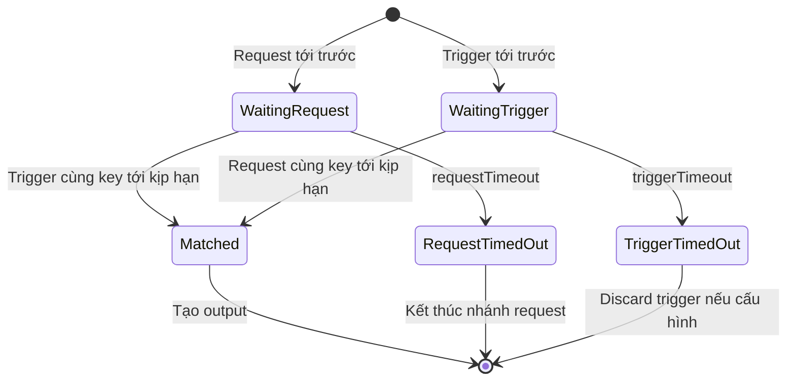
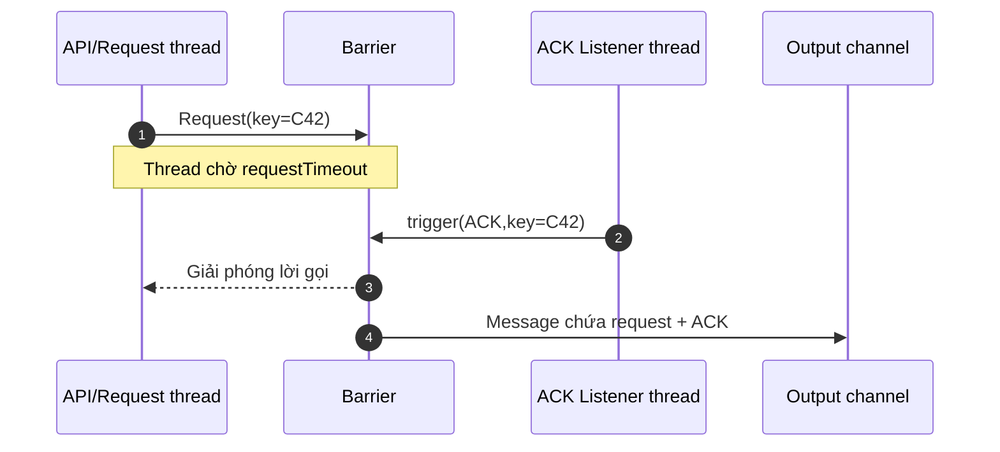
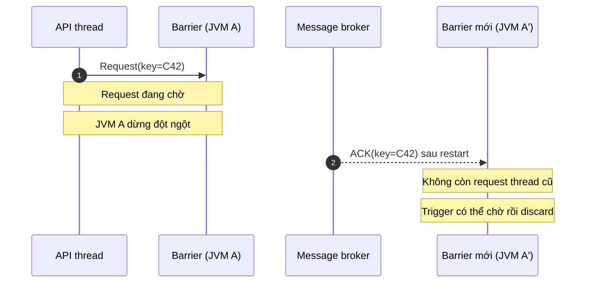
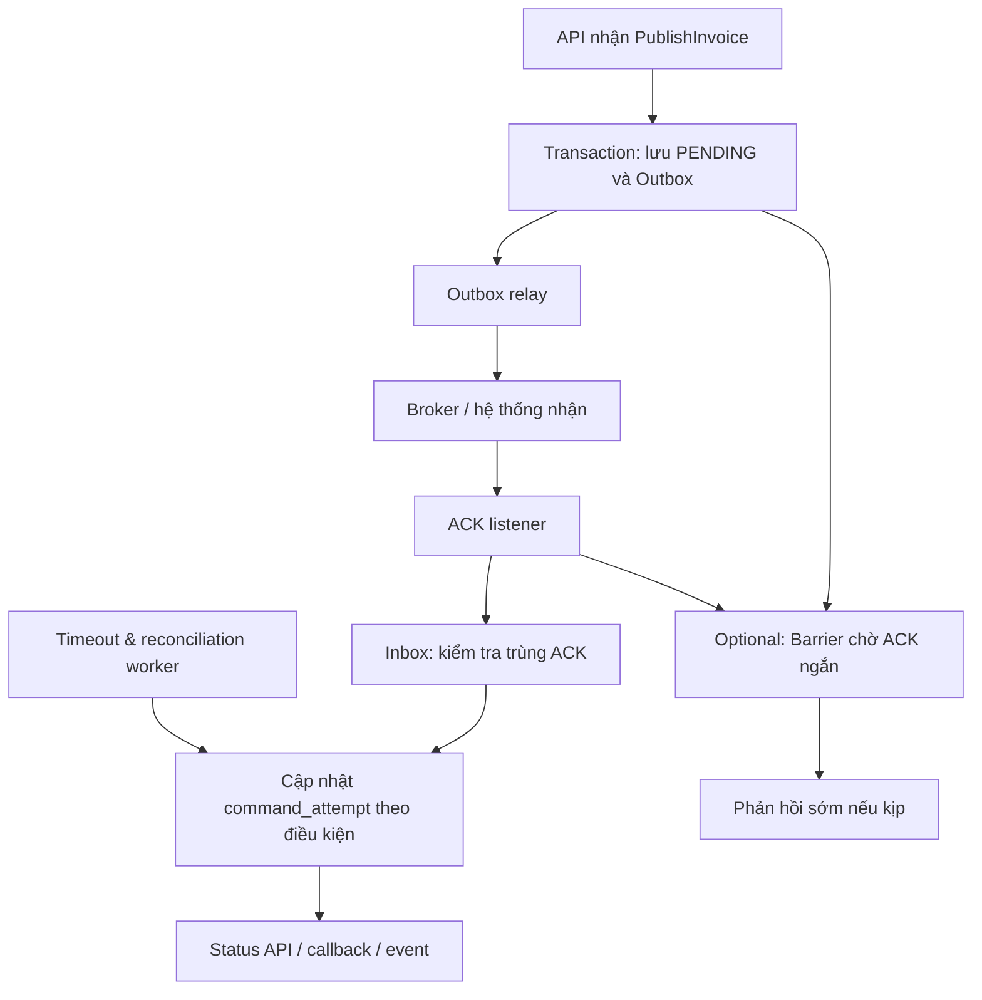
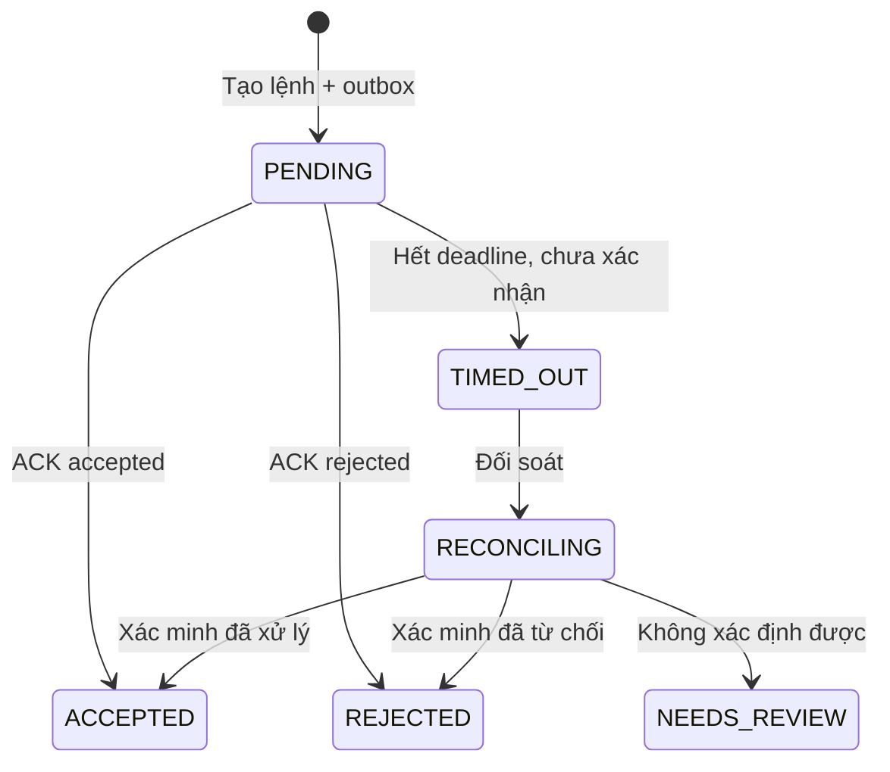

# Barrier state và persistence

## 1. Bài toán: điều gì xảy ra nếu ứng dụng tắt khi đang đợi ACK?

Trong module **SPRING_INTEGRATION_PATTERN**, chúng ta thực hành *Enterprise Integration Patterns* với Spring Integration để xây dựng các luồng message ít phụ thuộc, có thể mở rộng, kiểm thử và quan sát. Router, Filter, Transformer, Splitter, Aggregator, Gateway, retry, error channel và correlation giải quyết các trách nhiệm khác nhau. **Thread Barrier** tạo một điểm đồng bộ giữa request và một trigger bất đồng bộ, chẳng hạn lệnh xuất hóa đơn chờ ACK của broker.

Một câu hỏi quan trọng khi đưa Barrier vào production là: **trạng thái chờ tồn tại ở đâu, và có thể khôi phục sau lỗi tiến trình không?**

Xét luồng sau:

1. API nhận lệnh `PublishInvoice` với `commandId=inv-42-attempt-1`.
2. Ứng dụng gửi lệnh tới broker, rồi đưa request vào `BarrierMessageHandler`.
3. Barrier chờ ACK có cùng `correlationId` tối đa 5 giây.
4. Ứng dụng bị restart sau 2 giây, trước khi ACK đến.
5. Broker phát ACK ở giây thứ 3, sau khi ứng dụng khởi động lại.

ACK có đúng khóa không có nghĩa thread chờ cũ còn tồn tại. Khi JVM đã dừng, **thread, call stack và phiên chờ của Barrier cũ đã mất**. Một instance Barrier mới không tự tiếp nối lời gọi trước restart. Đây là giới hạn thiết kế có ảnh hưởng trực tiếp tới độ tin cậy, quy mô triển khai và cách ứng dụng báo trạng thái cho caller.

### Sau bài này, bạn có thể

- Phân biệt **trạng thái chờ trong bộ nhớ** của Barrier với **trạng thái nghiệp vụ được lưu bền vững**.
- Giải thích vì sao timeout, restart, crash hoặc phân phối request/ACK qua nhiều instance có thể làm mất khả năng ghép cặp.
- Cấu hình Barrier cho tương tác ngắn và nhận biết các giới hạn của `BarrierMessageHandler`.
- Thiết kế một workflow bền vững bằng database, outbox/inbox, idempotency và tác vụ đối soát.
- Kiểm thử các tình huống mất tiến trình, ACK muộn, ACK trùng và tranh chấp giữa timeout với ACK.

## 2. “State” của Thread Barrier có nghĩa là gì?

Spring Integration cung cấp `BarrierMessageHandler`, đồng thời hiện thực `MessageTriggerAction`. Một request đi vào handler; một message khác được truyền tới `trigger(message)`. Handler sử dụng `CorrelationStrategy` để tìm cặp có cùng khóa. Mặc định chiến lược correlation đọc header `IntegrationMessageHeaderAccessor.CORRELATION_ID`.

Khi request đến trước trigger, **thread xử lý request bị chặn** cho tới khi trigger khớp hoặc hết `requestTimeout`. Khi trigger đến trước request, **thread gọi `trigger()` có thể bị chặn** tối đa `triggerTimeout`. Chỉ một request thread có thể đang chờ trên cùng correlation key tại một thời điểm; request thứ hai đồng thời dùng cùng key sẽ gây ngoại lệ.

Có thể mô tả *vòng đời quan sát được* của một cặp message như sau. Đây là **mô hình khái niệm phục vụ thiết kế và vận hành**, không phải tên enum trạng thái hay bảng dữ liệu do Spring Integration tạo ra:



| Thông tin | Vì sao Barrier cần | Có phải trạng thái nghiệp vụ bền vững? |
| --- | --- | --- |
| Correlation key | Ghép request và trigger tương ứng | Không. Key được dùng trong logic ghép, có thể cũng được lưu ngoài ứng dụng. |
| Request/trigger đang chờ | Phối hợp hai lời gọi tới handler | Không. Liên quan trực tiếp tới thread và thời gian sống của tiến trình. |
| Thời hạn chờ | Ngừng chờ và giải phóng tài nguyên | Không. `requestTimeout`/`triggerTimeout` là cấu hình hành vi chờ. |
| Kết quả ghép thành công | Trả message cho downstream | Không tự bảo đảm được lưu hoặc giao nhận bền vững. |
| Trạng thái lệnh `PENDING`/`ACKED` | Cho phép tra cứu và đối soát nghiệp vụ | **Có**, nếu ứng dụng chủ động ghi vào kho bền vững. |

Không nên suy từ việc Spring Integration có các khái niệm `MessageStore` hay `MessageGroupStore` mà cho rằng Barrier tự lưu phiên chờ vào cơ sở dữ liệu. **API cấu hình `BarrierMessageHandler` không cung cấp một cơ chế `MessageStore` để phục hồi thread đang chờ**. Tài liệu chính thức mô tả thành phần này là cơ chế *suspend thread*; đây là bản chất cần ghi nhớ khi chọn kiến trúc.

### 2.1. Vòng đời khi mọi thứ hoạt động



Thông điệp ở output mặc định có payload là tập hợp hai payload request và trigger, do `DefaultAggregatingMessageGroupProcessor` xây dựng. Tính đúng đắn của **kết quả nghiệp vụ** vẫn cần được xử lý riêng (ACK “từ chối” có thể khớp khóa nhưng không phải thành công).

### 2.2. Vòng đời khi crash



Nếu message nguồn đã được broker giao lại hoặc API client gửi lại request sau restart, đó là **một lần xử lý mới** cần được kiểm soát bằng hợp đồng idempotency và trạng thái đã lưu; không phải JVM đã “khôi phục” thread cũ.

## 3. Persistence: ba phạm vi phải tách bạch

Trong hệ thống message, từ “persistence” thường bị dùng cho ba mục tiêu khác nhau:

| Phạm vi | Ví dụ | Dữ liệu được lưu | Điều không được bảo đảm |
| --- | --- | --- | --- |
| **Message transport** | Durable queue, persistent broker message, lưu hàng đợi bằng `JdbcChannelMessageStore` | Message còn trong queue, tùy bảo đảm của transport | Không khôi phục call stack/thread đang chờ trong Barrier. |
| **Message aggregation** | Aggregator với `MessageGroupStore` và quản lý nhóm | Dữ liệu nhóm message theo correlation | Không biến Thread Barrier thành durable workflow; cơ chế release khác. |
| **Business workflow** | Bảng `command_attempt`, outbox, inbox, trạng thái ACK và deadline | Danh tính tác vụ, trạng thái đã xác nhận, lịch sử, điều kiện tiếp tục | Không tự động gửi reply cho HTTP connection đã mất; ứng dụng phải thiết kế kênh thông báo/kết quả. |

**Thông điệp được lưu bền vững ≠ phiên chờ thread được lưu bền vững.** Ví dụ, đặt `QueueChannel` với kho JDBC trước Barrier có thể giúp một message chưa tiêu thụ được lấy lại sau restart, nhưng không phục hồi lời gọi `handleRequestMessage` đã bị ngắt trong JVM. Cũng cần quản lý cơ chế ACK/commit của nguồn message để biết message nào sẽ được giao lại.

### 3.1. Không nên áp dụng nguyên xi hướng dẫn của Aggregator cho Barrier

Aggregator quản lý **nhóm message** và release strategy, có thể sử dụng `MessageGroupStore` bền vững theo cấu hình. Barrier điều phối **hai lời gọi có tương quan và giữ thread**. Chúng có thể cùng dùng `CorrelationStrategy` nhưng có vòng đời và mục tiêu khác nhau.

Nếu cần chờ đủ ba sự kiện nghiệp vụ như `paymentAccepted`, `inventoryReserved`, `shippingBooked`, một Aggregator hoặc workflow lưu trạng thái thường phù hợp hơn. Nếu chỉ cần ACK rất nhanh trong cùng tiến trình, Barrier là phương án đơn giản và rõ ràng.

## 4. Cấu hình Barrier cho đoạn chờ ngắn

Ví dụ Java dưới đây dùng hai đường message: request đi vào handler, ACK đi vào một `MessageHandler` gọi `trigger()` trên **cùng instance**. Kết quả và trigger không ghép được lần lượt đi vào hai channel riêng. Đây là cấu hình cho tương tác ngắn trong cùng tiến trình; phần persistence nghiệp vụ được thiết kế ở các mục sau.

```java
import org.springframework.beans.factory.annotation.Qualifier;
import org.springframework.context.annotation.Bean;
import org.springframework.context.annotation.Configuration;
import org.springframework.integration.annotation.ServiceActivator;
import org.springframework.integration.aggregator.BarrierMessageHandler;
import org.springframework.integration.channel.DirectChannel;
import org.springframework.integration.channel.QueueChannel;
import org.springframework.integration.config.EnableIntegration;
import org.springframework.messaging.MessageChannel;
import org.springframework.messaging.MessageHandler;

@Configuration
@EnableIntegration
public class ShortWaitBarrierConfig {

    @Bean
    public MessageChannel shortWaitRequests() {
        return new DirectChannel();
    }

    @Bean
    public MessageChannel brokerAcknowledgements() {
        return new DirectChannel();
    }

    @Bean
    public QueueChannel shortWaitResults() {
        return new QueueChannel();
    }

    @Bean
    public QueueChannel lateAcknowledgements() {
        return new QueueChannel();
    }

    @Bean
    @ServiceActivator(inputChannel = "shortWaitRequests")
    public BarrierMessageHandler shortWaitBarrier(
            @Qualifier("shortWaitResults") MessageChannel results,
            @Qualifier("lateAcknowledgements") MessageChannel lateAcks) {
        // Request đợi tối đa 3 giây, ACK tới trước đợi tối đa 500ms.
        BarrierMessageHandler handler = new BarrierMessageHandler(3_000L, 500L);
        handler.setOutputChannel(results);
        handler.setDiscardChannel(lateAcks);
        handler.setRequiresReply(true);
        return handler;
    }

    @Bean
    @ServiceActivator(inputChannel = "brokerAcknowledgements")
    public MessageHandler releaseBarrier(
            @Qualifier("shortWaitBarrier") BarrierMessageHandler barrier) {
        return barrier::trigger;
    }
}
```

Khi request timeout, `requiresReply=true` làm nhánh request ném `ReplyRequiredException`. Nếu để mặc định `false`, handler trả `null` và flow kết thúc. Trigger đến sau khi request timeout có thể tiếp tục chờ một request tương ứng trong `triggerTimeout` rồi bị chuyển tới `lateAcknowledgements`. **`discardChannel` giúp quan sát trigger đến muộn; nó không phải persistence cho request chưa được xác nhận.**

Để ghép đúng hai phía:

```java
import org.springframework.integration.IntegrationMessageHeaderAccessor;
import org.springframework.integration.support.MessageBuilder;
import org.springframework.messaging.Message;

String commandId = "inv-42-attempt-1";

Message<String> request = MessageBuilder.withPayload("PUBLISH_INVOICE")
        .setHeader(IntegrationMessageHeaderAccessor.CORRELATION_ID, commandId)
        .build();

Message<String> ack = MessageBuilder.withPayload("ACK:ACCEPTED")
        .setHeader(IntegrationMessageHeaderAccessor.CORRELATION_ID, commandId)
        .build();

// Hai message cần được gửi từ các nhánh/thread độc lập.
// Gửi request tuần tự rồi mới gửi ACK trên cùng thread có thể bị block.
```

Lưu ý hiệu năng: với `DirectChannel`, thread gửi request có thể chờ cho tới khi khớp hoặc timeout; thread gọi `trigger()` cũng có thể chờ nếu ACK tới trước. Một số lượng lớn request chờ tạo áp lực lên thread pool. Nếu cần tách khỏi thread của listener, có thể đưa lời gọi trigger sang một executor có giới hạn, nhưng điều này **không** tạo ra persistence hay tính chịu lỗi xuyên restart.

## 5. Ma trận lỗi: trạng thái nào còn sau restart?

| Sự kiện | Điều xảy ra với Barrier | Việc ứng dụng cần làm |
| --- | --- | --- |
| Request đang chờ, JVM crash | Thread request mất; không có lời gọi cũ để giải phóng | Dựa vào `commandId` đã lưu để xác định tác vụ đang `PENDING` và khôi phục theo quy trình nghiệp vụ. |
| Trigger đang chờ, JVM crash | Thread trigger mất | Đảm bảo nguồn ACK có khả năng giao lại hoặc dữ liệu ACK được lưu trước khi xử lý tiếp. |
| Request timeout, broker vẫn xử lý | Flow chờ kết thúc; chưa chứng minh nghiệp vụ thất bại | Ghi nhận “chưa rõ kết quả”, đối soát với broker/đối tác, tránh retry gây trùng thao tác. |
| Request ở JVM A, ACK tới JVM B | Hai Barrier local không tự nhìn thấy cặp của nhau | Định tuyến tới cùng nơi điều phối hoặc chuyển sang durable workflow dùng trạng thái chung. |
| Restart xong nhận ACK cũ | Barrier mới không biết phiên chờ trước đó | Dùng inbox/idempotency và bảng trạng thái để áp dụng ACK đúng tác vụ; không ghép nhầm sang lần gửi khác. |
| Hai request cùng key đến đồng thời | Barrier không cho phép hai request thread đang chờ cùng key | Dùng key theo từng lần tương tác, kiểm soát trùng và xử lý idempotent trước Barrier. |

### 5.1. Sticky routing không giải quyết crash

Định tuyến cùng `commandId` tới một instance có thể giúp request và ACK gặp nhau **khi instance đó còn sống**. Nhưng nếu instance chết hoặc bị thay trong quá trình rolling deployment, lời gọi đang đợi đã mất. Sticky routing là tối ưu điều phối cho đường chờ ngắn, **không phải cơ chế failover bền vững**.

### 5.2. Đừng đồng nhất `timeout` với trạng thái `FAILED`

Giới hạn thời gian của Barrier là kết luận về **trạng thái đồng bộ cục bộ**: chưa ghép được cặp trong khoảng chờ. Broker có thể đã nhận lệnh, xử lý xong nhưng ACK đang trên đường truyền. Trong một mô hình bền vững, nên có trạng thái `TIMED_OUT` hoặc `UNKNOWN` phản ánh chính xác sự bất định, rồi đối soát trước khi kết luận thất bại.

## 6. Kiến trúc bền vững: để database giữ sự thật nghiệp vụ

Nếu một giao dịch phải tiếp tục đúng sau restart, cần thiết kế một **durable workflow**. Phần chờ đồng bộ ở Barrier khi đó chỉ là tối ưu cho caller muốn kết quả sớm, không phải nơi duy nhất lưu sự thật.

Một thiết kế cơ bản gồm:

1. **State table** lưu từng `commandId`, `businessId`, `status`, `deadlineAt` và kết quả ACK.
2. **Transactional outbox** lưu sự kiện cần gửi trong cùng transaction với việc tạo trạng thái `PENDING`; worker riêng gửi message ra broker.
3. **Inbox/deduplication** nhận ACK, lưu dấu đã xử lý theo định danh sự kiện ổn định, rồi cập nhật trạng thái idempotent.
4. **Reconciler/timeout worker** quét các lệnh quá hạn, đối soát với hệ thống nhận và đánh dấu trạng thái phù hợp.
5. **Status API hoặc callback/event** cho caller lấy kết quả sau khi HTTP request ban đầu đã hết hạn hoặc JVM đã restart.



**Điểm quyết định:** Nếu `I` chết, các phần `B`, `F`, `G` và `K` vẫn có thể tiếp tục xác định kết quả từ dữ liệu bền vững. Không hứa rằng một HTTP connection cũ sẽ tự được nối lại sau khi server restart.

### 6.1. Hợp đồng correlation và idempotency

Một request có thể có nhiều lần gửi. Ví dụ:

```json
{
  "orderId": "INV-42",
  "commandId": "inv-42-attempt-1",
  "idempotencyKey": "publish-inv-42"
}
```

- `orderId` xác định hóa đơn nghiệp vụ.
- `commandId` xác định **một lần tương tác** cần ghép với ACK; đồng thời dùng làm correlation key.
- `idempotencyKey` xác định hành động logic để phía nhận tránh thực hiện trùng khi broker giao lại hoặc client retry.

Hai khóa sau có thể trùng trong mô hình đơn giản, nhưng không nên mặc định chúng có cùng vòng đời. Nếu ACK cũ có thể đến sau khi gửi attempt mới, `commandId` cần phân biệt lần gửi. Khi cần kiểm soát trùng nghiệp vụ xuyên các attempt, phía nhận cần cùng một idempotency contract hoặc cơ chế tra cứu phù hợp.

### 6.2. Lược đồ dữ liệu minh họa

Các câu SQL dưới đây minh họa **ý tưởng mô hình dữ liệu**; tên kiểu cột, constraint và cú pháp thời gian cần điều chỉnh theo hệ cơ sở dữ liệu đang dùng:

```sql
CREATE TABLE command_attempt (
    command_id      VARCHAR(128) PRIMARY KEY,
    business_id     VARCHAR(128) NOT NULL,
    idempotency_key VARCHAR(128) NOT NULL,
    status          VARCHAR(32) NOT NULL, -- PENDING, ACCEPTED, REJECTED, TIMED_OUT...
    ack_result      VARCHAR(32),
    deadline_at     TIMESTAMP WITH TIME ZONE NOT NULL,
    created_at      TIMESTAMP WITH TIME ZONE NOT NULL,
    updated_at      TIMESTAMP WITH TIME ZONE NOT NULL,
    version         BIGINT NOT NULL DEFAULT 0
);

CREATE TABLE outbox_event (
    event_id        VARCHAR(128) PRIMARY KEY,
    command_id      VARCHAR(128) NOT NULL,
    payload_json    TEXT NOT NULL,
    publish_state   VARCHAR(32) NOT NULL, -- NEW, SENT
    created_at      TIMESTAMP WITH TIME ZONE NOT NULL
);

CREATE TABLE processed_ack (
    ack_event_id    VARCHAR(128) PRIMARY KEY,
    command_id      VARCHAR(128) NOT NULL,
    received_at     TIMESTAMP WITH TIME ZONE NOT NULL
);
```

Tối thiểu cần index phù hợp trên `status` và `deadline_at` để worker kiểm tra các lệnh đang chờ quá hạn. `processed_ack.ack_event_id` phải là định danh ACK **ổn định giữa các lần giao lại**; nếu broker không cung cấp ID này, thiết kế quy tắc khử trùng theo hợp đồng giao thức, tránh tạo UUID mới cho mỗi lần nhận lại.

### 6.3. State machine bền vững



Đây là **state machine do ứng dụng định nghĩa**. Có thể bổ sung `CANCELLED` hoặc trạng thái nghiệp vụ khác tùy hợp đồng. Điều quan trọng là timeout và ACK có thể đến đồng thời nên việc chuyển trạng thái phải **nguyên tử**.

Ví dụ với transaction và cập nhật có điều kiện:

```sql
-- Nhánh ACK: chỉ hoàn tất lệnh còn PENDING và chưa quá deadline.
UPDATE command_attempt
SET status = 'ACCEPTED',
    ack_result = 'ACCEPTED',
    updated_at = :now,
    version = version + 1
WHERE command_id = :commandId
  AND status = 'PENDING'
  AND deadline_at > :now;

-- Nhánh timeout: chỉ đổi những lệnh PENDING đã hết hạn.
UPDATE command_attempt
SET status = 'TIMED_OUT',
    updated_at = :now,
    version = version + 1
WHERE command_id = :commandId
  AND status = 'PENDING'
  AND deadline_at <= :now;
```

Ứng dụng cần kiểm tra **số dòng được cập nhật**. Nếu bằng 0, đọc lại trạng thái để quyết định: ACK trùng, ACK tới sau deadline, đã REJECTED, hoặc worker khác vừa cập nhật. ACK đến muộn vẫn nên lưu dấu và chuyển đến quy trình đối soát phù hợp; không được bỏ qua lặng lẽ chỉ vì `UPDATE` không khớp.

**Transaction boundary:** Việc insert `processed_ack` và cập nhật `command_attempt` nên nằm trong cùng database transaction. Việc phát sự kiện tiếp theo cũng nên đi qua outbox nếu cần bảo đảm quá trình được phục hồi sau crash. Một transaction database thông thường không bảo đảm atomicity với việc publish lên broker; đây là lý do outbox hữu ích.

### 6.4. Thứ tự gửi và ACK tới sớm

Nếu ACK đến trước khi database có bản ghi `PENDING`, listener không biết gắn vào lệnh nào. Một cách tránh race là:

1. Trong một transaction, tạo bản ghi lệnh `PENDING` và sự kiện outbox.
2. **Commit** transaction này.
3. Relay chỉ publish các sự kiện outbox đã commit.
4. ACK listener dùng `commandId` để cập nhật đúng bản ghi đã tồn tại.

Nếu relay bị crash sau khi publish nhưng trước khi đánh dấu `SENT`, sự kiện có thể được publish lại. Bên nhận phải xử lý idempotent; không khẳng định outbox tự động cung cấp “exactly once”. Nếu ACK có thể đi tới trước việc đánh dấu outbox `SENT`, điều đó bình thường: **trạng thái command** mới là nguồn sự thật để quyết định kết quả.

## 7. Dùng Barrier cùng với durable workflow

Có thể kết hợp cả hai khi phần lớn ACK đến nhanh, nhưng đôi khi cần phục hồi:

```text
API tạo commandId và lưu PENDING + outbox
    |
    +--> Trả 202 Accepted + status URL ngay (an toàn nhất cho tác vụ dài)
    |
    +--> Tùy chọn: thử chờ ACK ngắn qua Barrier
                      |
                      +-- ACK kịp: tra cứu state đã lưu, trả kết quả
                      |
                      +-- Timeout/crash: caller tra cứu status theo commandId

ACK listener --> lưu/dedupe ACK + cập nhật state --> tùy chọn trigger local Barrier
Reconciler   --> xử lý PENDING quá deadline và các ACK đến muộn
```

Nếu chọn nhánh “chờ ngắn”, **lưu trạng thái nghiệp vụ trước khi bắt đầu chờ**. Listener ACK cần xử lý database trước (hoặc cùng một quy trình xác nhận có bảo đảm rõ ràng), rồi mới dùng `trigger()` để đánh thức request đang sống. Nếu không có request thread đang chờ tại instance hiện tại, ACK vẫn phải được xử lý bền vững và caller sau đó lấy kết quả bằng Status API.

Ở hệ thống nhiều instance, không nên gửi ACK vào một Barrier bất kỳ rồi tin rằng request đang ở đó. Có thể định tuyến ổn định theo key để tối ưu đường trả lời tức thì, nhưng nếu không kiểm soát được điều phối và failover thì nên coi việc giải phóng Barrier là **best effort**. Database và trạng thái nghiệp vụ vẫn bảo đảm tính nhất quán.

### 7.1. Không giữ thread quá lâu

Thread Barrier phù hợp với thời gian chờ ngắn, lượng request có giới hạn và yêu cầu reply đồng bộ. Ví dụ 100 request/giây với thời gian chờ trung bình 3 giây có thể dẫn tới khoảng 300 lượt chờ đồng thời ở trạng thái ổn định (ước lượng theo quan hệ throughput × latency, chưa kể các queue và đỉnh tải). Đó là nhiều thread nếu đường vào dùng thread blocking.

Với quy trình phải chờ phút, giờ hoặc hàng triệu tác vụ song song, tránh giữ một thread cho từng tác vụ. Dùng persistent state + event/callback/polling và worker phục hồi sẽ phù hợp hơn.

## 8. Kịch bản kiểm thử persistence và recovery

Một bài kiểm thử Barrier chỉ xác nhận ACK trong vài mili giây là chưa đủ để chứng minh độ tin cậy. Nên bổ sung những bài test dựa trên **trạng thái database**:

| Kịch bản | Thao tác | Kết quả cần chứng minh |
| --- | --- | --- |
| ACK bình thường | Tạo `PENDING`, publish, nhận ACK đúng key | DB chuyển thành `ACCEPTED`/`REJECTED` đúng một lần; Barrier có thể trả sớm. |
| Crash sau khi lưu outbox, trước publish | Dừng relay rồi khởi động lại | Sự kiện outbox còn để relay gửi sau restart. |
| Crash sau publish, trước đánh dấu `SENT` | Publish rồi dừng relay ở điểm giữa | Relay có thể gửi lại; bên nhận dedupe bằng idempotency key. |
| Crash khi Barrier đang đợi | Dừng instance đang chờ, sau đó nhận ACK | Không hứa khôi phục HTTP thread cũ; DB nhận ACK và Status API trả kết quả. |
| ACK đến hai lần | Giao lại cùng `ackEventId` | Không cập nhật/trả thông báo nghiệp vụ hai lần; ghi nhận trùng. |
| ACK đến sau deadline | Timeout worker đã đánh dấu `TIMED_OUT`, ACK tới | Lưu ACK và đối soát; không coi timeout là bằng chứng chưa xử lý. |
| Timeout chạy cùng ACK | Cho hai worker cùng cạnh tranh update `PENDING` | Chỉ một chuyển trạng thái thắng bằng điều kiện `status`/`deadline`; đường còn lại đọc và xử lý kết quả. |
| Hai instance | Request ở A, ACK ở B | Trạng thái trong DB đúng; không phụ thuộc Barrier A có được đánh thức hay không. |
| ACK sai key | Gửi ACK thuộc command khác | Không cập nhật sai bản ghi; phát hiện khóa thiếu/không tồn tại. |
| Request trùng key đang chờ | Hai request song song cùng correlation | Có xử lý trùng trước Barrier hoặc chấp nhận ngoại lệ và đánh dấu đúng trong log. |

Để mô phỏng restart, dùng kiểm thử tích hợp với database/broker có vòng đời thật hoặc môi trường container phù hợp; unit test chỉ tạo một instance handler mới không đủ mô phỏng toàn bộ transaction, redelivery và crash. Cố định điểm dừng bằng hook/latch thay vì `Thread.sleep()` đoán thời điểm. Khi thử timeout, dùng deadline hữu hạn và đo kết quả trạng thái, không kiểm tra mili giây tuyệt đối.

### 8.1. Invariants nên kiểm tra tự động

1. Cùng một `commandId` không tạo hai tác vụ nghiệp vụ đồng thời không mong muốn.
2. Một `ackEventId` chỉ tạo một tác động trạng thái được chấp nhận.
3. Trạng thái hoàn tất không bị ghi đè bởi một timeout worker chạy muộn.
4. Khi ACK đến muộn, có đường lưu dấu và đối soát; không mất sự kiện âm thầm.
5. Sau crash, bất kỳ `PENDING` nào cũng có cơ chế tiếp tục hoặc hết hạn rõ ràng.
6. Client có cách tra cứu kết quả bằng ID ổn định ngay cả khi kết nối đầu tiên đã đóng.

## 9. Quan sát trạng thái chờ và trạng thái bền vững

Khi gặp sự cố, cần quan sát **hai lớp khác nhau**:

| Lớp | Thông tin cần đo | Ý nghĩa |
| --- | --- | --- |
| Barrier local | Số request đang đợi (đo theo ứng dụng nếu cần), thời gian đợi, timeout, trigger discard | Tình trạng đồng bộ ngắn hạn và tài nguyên JVM. |
| Workflow bền vững | Số command `PENDING`, tuổi PENDING, ACK đã nhận, outbox chưa gửi, số lần retry | Khả năng tiếp tục công việc xuyên restart. |
| Khôi phục | Số `TIMED_OUT` cần đối soát, số ACK muộn, số duplicate, số lệnh cần kiểm tra thủ công | Chất lượng xử lý lỗi và tính đầy đủ của kết quả nghiệp vụ. |

Ví dụ log có cấu trúc:

```text
event=command_created    commandId=inv-42-attempt-1 status=PENDING
event=barrier_wait_start commandId=inv-42-attempt-1 timeoutMs=3000
event=barrier_timeout    commandId=inv-42-attempt-1
event=ack_received       commandId=inv-42-attempt-1 ackEventId=ack-9001
event=state_reconciled   commandId=inv-42-attempt-1 status=ACCEPTED
```

Các dòng trên chỉ minh họa một tình huống ACK đến muộn và là **log ứng dụng cần chủ động phát**, không phải log mặc định của `BarrierMessageHandler`. Nên ghi thêm `traceId` để theo dõi đường đi và `commandId` để tra cứu nghiệp vụ, nhưng tránh đặt `commandId` làm nhãn metric có cardinality quá lớn. Không ghi payload thanh toán, token hoặc thông tin khách hàng nhạy cảm vào log.

**Cảnh báo vận hành:** `QueueChannel` không giới hạn dung lượng trong ví dụ Java chỉ thích hợp minh họa; nếu không có consumer đọc `lateAcknowledgements`/`shortWaitResults` thì message có thể tích tụ trong bộ nhớ. Với production cần cấu hình chính sách dung lượng, consumer, retry và persistence thực sự theo nhu cầu.

## 10. Những quyết định kiến trúc cần trả lời

Trước khi chọn Barrier, đội ngũ nên xác định:

- **SLA:** Caller có thể đợi bao lâu? Timeout của HTTP/Gateway/broker có nhất quán với `requestTimeout` không?
- **Độ bền:** Nếu process chết khi đang chờ, tác vụ có cần được tiếp tục/đối soát không?
- **Quy mô:** Có bao nhiêu thread có thể đang chờ? Listener có bị block vì `triggerTimeout` không?
- **Correlation:** Key theo đối tượng hay theo từng attempt? ACK cũ có thể ghép nhầm attempt mới không?
- **Idempotency:** Nếu outbox/broker gửi lại, thao tác có thể thực hiện hai lần không?
- **Nhiều instance:** Request và ACK có thể đi vào các node khác nhau không? Cơ chế lưu trạng thái chung là gì?
- **Kết quả chưa rõ:** Khi hết hạn chờ, UI/API trả `UNKNOWN`, `202 Accepted`, hay trạng thái nào theo hợp đồng?
- **Khôi phục:** Ai chạy reconciliation, xem backlog `PENDING` và xử lý ACK đến muộn?

Một cách chọn nhanh:

| Nhu cầu | Cách làm nên cân nhắc |
| --- | --- |
| ACK rất nhanh, caller cần reply ngay và cùng một instance xử lý | Thread Barrier với timeout rõ ràng, correlation đúng và đường lỗi/discard. |
| Có restart/multi-instance, bắt buộc không mất kết quả nghiệp vụ | Trạng thái bền vững + outbox/inbox + reconciliation; Barrier chỉ là phần chờ tùy chọn. |
| Chờ đủ nhiều message cho cùng nhóm | Aggregator với release strategy và MessageStore theo nhu cầu lưu bền vững. |
| Công việc kéo dài nhiều phút hoặc giờ | Event-driven workflow, status API/callback, deadline và worker khôi phục; không chờ thread. |

## 11. Bài thực hành

Thiết kế một dịch vụ phát hóa đơn có thể restart giữa lúc chờ ACK:

1. Tạo request với `commandId` riêng cho từng lần phát, lưu bản ghi `PENDING` và một outbox event trong cùng transaction.
2. Cho outbox relay gửi lệnh đến một broker mô phỏng; ACK nhận lại chứa `commandId` và `ackEventId`.
3. Cấu hình `BarrierMessageHandler` với `requestTimeout=3000ms`, `triggerTimeout=500ms` để **tùy chọn** trả kết quả nhanh cho caller. Tách các thread của request và trigger.
4. ACK listener trước hết ghi inbox và cập nhật DB idempotent; sau đó thử phát trigger cho Barrier local.
5. Dừng ứng dụng khi Barrier đang chờ; khởi động lại và nhận ACK. Kiểm tra Status API vẫn đọc được kết quả từ database.
6. Gửi cùng một ACK hai lần, cho timeout worker và ACK listener chạy cạnh tranh, xác nhận cập nhật trạng thái có điều kiện ngăn ghi đè sai.
7. Cho outbox relay dừng sau publish nhưng trước khi đánh dấu `SENT`, rồi restart để kiểm tra xử lý trùng.
8. Cho ACK đến sau deadline và kiểm tra lịch sử/đường đối soát; không suy ra tự động rằng broker thất bại.

**Câu hỏi tự đánh giá:**

1. Vì sao lưu message vào một persistent queue không đồng nghĩa lưu được thread đang chờ trong Barrier?
2. Nếu ACK đi vào instance B còn request ở A, tại sao cùng correlation key vẫn có thể không tạo output?
3. Khi outbox relay gửi lại message sau crash, vai trò của idempotency key là gì?
4. Vì sao phải kiểm tra số dòng ảnh hưởng của câu `UPDATE ... WHERE status='PENDING'`?
5. Tại sao một thao tác đã bị `requestTimeout` vẫn có thể được broker xác nhận thành công sau đó?
6. Nếu yêu cầu chỉ là ACK ngắn trong một JVM, khi nào không cần thêm một hệ thống workflow bền vững?

## 12. Tài liệu tham khảo

- [Spring Integration Reference — Thread Barrier](https://docs.spring.io/spring-integration/reference/barrier.html): mục đích giữ thread, correlation, timeout, `requires-reply`, discard và giới hạn một request cùng key.
- [Spring Integration Javadoc — BarrierMessageHandler](https://docs.spring.io/spring-integration/docs/6.4.x/api/org/springframework/integration/aggregator/BarrierMessageHandler.html): API `trigger()`, constructor timeout, `setDiscardChannel()`.
- [Spring Integration Reference — Aggregator](https://docs.spring.io/spring-integration/reference/aggregator.html): quản lý nhóm message, release strategy, MessageStore và xử lý nhóm quá hạn.
- [Spring Integration Reference — Message Store](https://docs.spring.io/spring-integration/reference/message-store.html): các cơ chế lưu message dành cho những thành phần hỗ trợ.

> **Ghi nhớ:** Barrier giữ **trạng thái đồng bộ ngắn hạn gắn với thread trong tiến trình**. Nếu nghiệp vụ phải tiếp tục sau crash, restart hoặc chuyển instance, hãy lưu **trạng thái nghiệp vụ riêng** cùng correlation key, deadline và kết quả ACK; dùng outbox/inbox, idempotency và reconciliation để khôi phục. Không nhầm timeout của Barrier với kết luận nghiệp vụ thất bại, cũng không nhầm lưu message với khôi phục một thread đang chờ.
