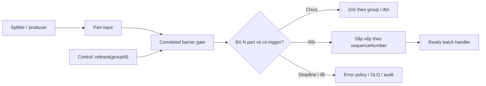
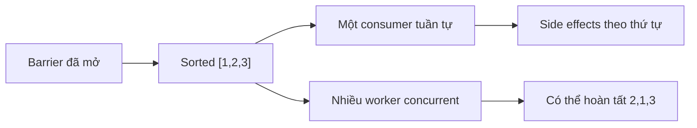

# Xử lý message đến sai thứ tự với Barrier trong Spring Integration

> **Module:** `SPRING_INTEGRATION_PATTERN` — Học triển khai Enterprise Integration Patterns với Spring Integration để xây dựng luồng thông điệp ít phụ thuộc và dễ mở rộng. Thực hành Router, Filter, Transformer, Splitter, Aggregator, Gateway, retry, error channel và correlation, đồng thời kiểm thử, theo dõi các nhánh xử lý.
>
> **Chương:** Barrier  
> **Đề bài:** Xử lý message đến sai thứ tự

## 1. Bài toán: message thứ ba về trước message thứ nhất

Một hệ thống nhận một batch gồm ba đơn hàng, sau đó tách từng đơn ra để xác thực, tính phí và lưu kết quả. Thời gian xử lý mỗi phần tử khác nhau:

- **Phần tử 1:** xử lý 450 ms.
- **Phần tử 2:** xử lý 120 ms.
- **Phần tử 3:** xử lý 200 ms.

Nếu các nhánh chạy đồng thời, kết quả có thể đến theo **2 → 3 → 1**. Trong lúc đó, một luồng điều khiển phát tín hiệu “cho phép phát hành batch” khi điều kiện bên ngoài đã đạt.

Nghiệp vụ yêu cầu:

1. **Không phát hành** kết quả batch khi chưa nhận đủ ba phần tử.
2. Chỉ phát hành **sau khi** tín hiệu cho phép đã đến.
3. Khi phát hành, các phần tử phải được sắp theo **thứ tự logic 1 → 2 → 3**, không theo thứ tự hoàn tất.
4. Không phát hành hai lần nếu có message hoặc tín hiệu bị giao lại.
5. Nếu thiếu phần tử, có deadline, cảnh báo và chính sách xử lý rõ ràng; không chờ vô hạn.

Đây là tình huống cần kết hợp ý tưởng **Barrier** (chờ điều kiện mở) với **correlation, đếm đủ nhóm và xử lý thứ tự**. Một Barrier đơn thuần không phải bộ sắp xếp lại message.

### Kết quả học tập

Sau bài này, bạn có thể phân biệt **thứ tự đến**, **thứ tự xử lý**, **thứ tự hoàn tất** và **thứ tự phát ra**; xác định đúng thời điểm mở Barrier; dùng correlation ID và sequence metadata để tập hợp message; thiết kế trigger đến sớm hoặc muộn; lựa chọn Barrier, Resequencer và Aggregator đúng mục đích; viết ví dụ Java kết nối Spring Integration; đồng thời kiểm thử duplicate, timeout, retry và nhiều instance.

## 2. Bốn loại thứ tự thường bị đánh đồng

| Loại thứ tự | Ý nghĩa | Ví dụ |
|---|---|---|
| **Arrival order** | Message đến channel hoặc adapter theo thứ tự nào | 2 → 3 → 1 |
| **Processing order** | Handler bắt đầu xử lý message nào trước | 2 → 1 → 3 |
| **Completion order** | Nhánh hoàn thành công việc theo thứ tự nào | 3 → 2 → 1 |
| **Emission order** | Message/kết quả được downstream nhìn thấy theo thứ tự nào | 1 → 2 → 3, nếu có bước điều phối |

Một `DirectChannel` với một caller đồng bộ có thể giúp dễ dự đoán đường đi của từng lần gửi, nhưng **không biến nhiều producer đồng thời thành một thứ tự nghiệp vụ toàn cục**. Với `ExecutorChannel`, poller, broker partition hoặc retry, thời điểm hoàn tất và thứ tự nhận ở downstream có thể khác đầu vào.

Để định nghĩa “đúng thứ tự”, phải có **sequence number mang ý nghĩa nghiệp vụ**. Thứ tự sẵn có trong một thread, log timestamp hoặc message ID không luôn là thứ tự batch được yêu cầu.

Ví dụ:

```text
Tín hiệu phát hành batch:      release(B-42)
Message hoàn tất thực tế:      part 2, part 3, part 1
Kết quả nghiệp vụ mong muốn:   [part 1, part 2, part 3]
```

Không thể đạt yêu cầu cuối bằng cách đơn giản “đợi 300 ms rồi gửi tất cả”.

## 3. Barrier, Resequencer, Aggregator: khác nhiệm vụ

Trong Enterprise Integration Patterns, ba cơ chế liên quan nhưng không tương đương.

| Cơ chế | Câu hỏi chính | Đảm bảo riêng của nó |
|---|---|---|
| **Barrier** | *Khi nào được phép cho dữ liệu đi tiếp?* | Chờ tín hiệu/điều kiện giải phóng theo khóa correlation |
| **Resequencer** | *Các message cần được phát ra theo thứ tự nào?* | Sắp xếp hoặc chờ phần tử để phát theo sequence có quy tắc |
| **Aggregator** | *Khi nào đủ một nhóm và kết hợp thành kết quả gì?* | Gom nhiều message thành một group và release theo strategy |
| **Splitter** | *Một message đầu vào chia thành những message con nào?* | Fan-out; có thể tạo sequence/correlation metadata |
| **Router** | *Message đi tới nhánh nào?* | Chọn channel/đích; không tự bảo đảm thứ tự hoàn tất |

Spring Integration có cơ chế Barrier cho việc đồng bộ hóa luồng dữ liệu với điều kiện giải phóng. Việc dùng API Barrier cụ thể phụ thuộc phiên bản và loại flow. **Không nên mặc định rằng một Barrier tự xếp các message theo `sequenceNumber`.** Khi đầu ra cần sắp thứ tự, phải kết hợp Resequencer, Aggregator có kết quả sắp xếp, hoặc một bộ điều phối minh bạch.

### Khi nào không cần Barrier?

Nếu chỉ cần kết quả của ba phần tử theo thứ tự, không có tín hiệu giải phóng bên ngoài, bạn có thể dùng **Aggregator** với correlation/release strategy và sắp thứ tự đầu ra; hoặc **Resequencer** nếu downstream phải nhận từng message theo sequence.

Nếu yêu cầu chỉ là “đừng gửi tới API trước khi đối tác báo sẵn sàng” nhưng không cần sắp thứ tự, một Barrier theo tín hiệu điều khiển có thể đủ. Đừng thêm Resequencer chỉ vì đã có nhiều thread.

## 4. Topology tham khảo cho message sai thứ tự



Có **hai nguồn dữ liệu độc lập**:

- **Nhánh dữ liệu:** mang các message con, `correlationId`, `sequenceNumber` và `sequenceSize`.
- **Nhánh điều khiển:** gửi tín hiệu mở theo cùng correlation key, ví dụ sau khi một điều kiện xác thực/duyệt được hoàn tất.

**Đầu ra chỉ được phát khi cả hai điều kiện đều đúng:**

\[
\mathrm{ready}(g)
=
\mathrm{triggerSeen}(g)
\land
\mathrm{allExpectedPartsPresent}(g)
\]

Nếu thứ tự là một yêu cầu nghiệp vụ, sau khi `ready(g)` phải tạo danh sách theo số thứ tự thay vì lấy thứ tự iterator của một map không bảo đảm sắp xếp.

Trong ứng dụng production, trạng thái chờ không nên sống mãi: cần timeout, giới hạn group đang mở, message store thích hợp, chính sách cho tín hiệu muộn và khả năng khôi phục sau restart.

## 5. Dùng correlation và sequence metadata đúng cách

Một batch có thể được biểu diễn bằng ba phần tử:

| Payload | `correlationId` | `sequenceNumber` | `sequenceSize` |
|---|---|---:|---:|
| `order-a` | `batch-42` | 1 | 3 |
| `order-b` | `batch-42` | 2 | 3 |
| `order-c` | `batch-42` | 3 | 3 |

- `correlationId` định danh **nhóm**, không phải ID riêng của từng message.
- `sequenceNumber` đánh dấu vị trí **logic**; thường lấy 1 làm vị trí đầu.
- `sequenceSize` là số phần tử dự kiến khi biết tổng.
- `MessageHeaders.ID` là ID của từng message và có thể khác nhau sau một số bước tạo/deserialize; **không thay thế correlation ID**.
- **Trigger** phải mang khóa nhóm phù hợp, ví dụ `release(batch-42)`.

Khi dùng Spring Integration Splitter chuẩn cho một collection hữu hạn, sequence metadata có thể được tạo trong quá trình split. Hãy kiểm tra điều kiện `applySequence` và cấu hình của loại Splitter đang dùng. Một custom Transformer hoặc header mapper qua broker có thể làm mất metadata dù Splitter đã phát ra đúng.

### Nguồn không biết trước tổng số

Nếu nguồn tạo message theo stream chưa biết số lượng, `sequenceSize` có thể không đủ để biết “đã nhận hết”. Khi đó **đừng giả định nhận đến số lớn nhất hiện tại là đã đủ**. Có thể cần marker kết thúc có số phần tử kỳ vọng, một tín hiệu terminal với hợp đồng rõ ràng, hoặc ReleaseStrategy theo domain.

**Tín hiệu release không mặc nhiên cho biết số lượng phần tử**. Nếu muốn “đã đủ N và đã được duyệt”, phải bảo đảm biết N từ metadata/manifest đáng tin cậy, hoặc định nghĩa marker đóng nhóm sao cho không làm rơi các phần tử đến muộn.

## 6. Timeline race: release đến trước hay sau data

Một Barrier phải xác định hành vi ở cả hai phía của cuộc đua giữa message dữ liệu và tín hiệu.

### 6.1. Release đến sau cùng

```text
t0: part(B-42, seq=2/3) -> giữ lại
t1: part(B-42, seq=3/3) -> giữ lại
t2: part(B-42, seq=1/3) -> đủ 3, nhưng chưa được duyệt
t3: release(B-42)       -> mở; phát [1,2,3] đúng một lần
```

Nếu chỉ đếm đủ ba phần tử rồi phát ngay ở t2, bạn đã **bỏ qua Barrier điều khiển**.

### 6.2. Release đến trước dữ liệu

```text
t0: release(B-42)       -> ghi nhận trigger đã thấy
t1: part(B-42, seq=2/3) -> chưa đủ
t2: part(B-42, seq=3/3) -> chưa đủ
t3: part(B-42, seq=1/3) -> mở; phát [1,2,3]
```

Nếu hệ thống **bỏ tín hiệu release** ở t0 vì chưa thấy message data, batch có thể chờ mãi dù thực tế đã được duyệt. Cần lưu trigger theo correlation key đủ lâu, hoặc thiết kế một giao thức handshake bảo đảm không đánh mất tín hiệu đến sớm.

### 6.3. Duplicate và late arrivals

```text
t0: part(B-42, 1/3)
t1: part(B-42, 2/3)
t2: part(B-42, 2/3)  # broker redelivery
t3: release(B-42)
t4: part(B-42, 3/3)  # lúc này mới đủ 1,2,3
t5: part(B-42, 1/3)  # late duplicate sau phát hành
```

Một bộ đếm kiểu “nhận đủ ba message” có thể sai vì `2/3` xuất hiện **hai lần**. Phải phân biệt **số message nhận được** và **số vị trí sequence duy nhất đã có**. Sau phát hành, cần tombstone/idempotency để không mở lại một group với cùng batch ID mà phát lần hai.

## 7. Ví dụ Java: Correlated Barrier có sắp xếp đầu ra

Để nhìn rõ điều kiện mở, ta xây một **coordinator đơn giản trong một JVM**:

- Giữ dữ liệu từng batch theo `batchId`.
- Nhận message theo thứ tự bất kỳ.
- Ghi nhớ trigger dù trigger đến trước dữ liệu.
- Chỉ tạo một `ReadyBatch` khi đã có đủ **các vị trí duy nhất** và đã nhận release.
- Sắp xếp bằng `TreeMap` theo `sequenceNumber`.
- Chống duplicate cùng vị trí; phát hiện duplicate mâu thuẫn nội dung.

Đây là **ví dụ thuật toán độc lập**, không phải API triển khai Barrier có sẵn của Spring Integration. Nó minh họa yêu cầu nghiệp vụ để gắn vào Spring Integration dễ quan sát; phần production phải bổ sung durable store, timeout và atomic output.

### 7.1. Coordinator dùng Java 17+

File `CorrelatedBatchBarrier.java`:

```java
package com.example.barrier;

import java.util.ArrayList;
import java.util.HashMap;
import java.util.HashSet;
import java.util.List;
import java.util.Map;
import java.util.Objects;
import java.util.Optional;
import java.util.Set;
import java.util.TreeMap;

public final class CorrelatedBatchBarrier {

    public record Part(
            String batchId,
            int position,
            int total,
            String payload) {

        public Part {
            if (batchId == null || batchId.isBlank()
                    || total < 1
                    || position < 1
                    || position > total
                    || payload == null) {
                throw new IllegalArgumentException("Invalid part");
            }
        }
    }

    public record ReadyBatch(
            String batchId,
            List<String> orderedPayloads) {
    }

    private static final class Pending {
        Integer expected;
        boolean releaseSeen;
        final TreeMap<Integer, String> parts = new TreeMap<>();
    }

    private final Map<String, Pending> waiting = new HashMap<>();
    private final Set<String> completed = new HashSet<>();

    private final int maxOpenGroups;
    private final int maxPartsPerGroup;

    public CorrelatedBatchBarrier(
            int maxOpenGroups, int maxPartsPerGroup) {

        if (maxOpenGroups < 1 || maxPartsPerGroup < 1) {
            throw new IllegalArgumentException("Invalid limits");
        }
        this.maxOpenGroups = maxOpenGroups;
        this.maxPartsPerGroup = maxPartsPerGroup;
    }

    public synchronized Optional<ReadyBatch> accept(Part part) {
        Objects.requireNonNull(part);

        // Không phát lại batch đã hoàn tất trong vòng đời đối tượng này.
        if (completed.contains(part.batchId())) {
            return Optional.empty();
        }

        if (part.total() > maxPartsPerGroup) {
            throw new IllegalArgumentException("Batch too large");
        }

        Pending state = stateFor(part.batchId());
        if (state.expected == null) {
            state.expected = part.total();
        } else if (state.expected != part.total()) {
            throw new IllegalArgumentException(
                    "Conflicting sequenceSize");
        }

        String previous = state.parts.putIfAbsent(
                part.position(), part.payload());

        if (previous != null && !previous.equals(part.payload())) {
            throw new IllegalArgumentException(
                    "Conflicting duplicate position");
        }

        return emitIfReady(part.batchId(), state);
    }

    public synchronized Optional<ReadyBatch> release(String batchId) {
        if (batchId == null || batchId.isBlank()) {
            throw new IllegalArgumentException("batchId required");
        }
        if (completed.contains(batchId)) {
            return Optional.empty();
        }

        Pending state = stateFor(batchId);
        state.releaseSeen = true;
        return emitIfReady(batchId, state);
    }

    private Pending stateFor(String batchId) {
        Pending state = waiting.get(batchId);
        if (state != null) {
            return state;
        }
        if (waiting.size() >= maxOpenGroups) {
            throw new IllegalStateException("Too many open batches");
        }

        state = new Pending();
        waiting.put(batchId, state);
        return state;
    }

    private Optional<ReadyBatch> emitIfReady(
            String batchId, Pending state) {

        if (!state.releaseSeen
                || state.expected == null
                || state.parts.size() != state.expected) {
            return Optional.empty();
        }

        // Các vị trí bắt buộc nằm trong 1..expected do Part validate.
        List<String> ordered =
                new ArrayList<>(state.parts.values());

        waiting.remove(batchId);
        completed.add(batchId);

        return Optional.of(new ReadyBatch(
                batchId, List.copyOf(ordered)));
    }
}
```

### 7.2. Phân tích các bất biến

- `Part` xác nhận `1 ≤ position ≤ total`, tổng dương và payload không null.
- Mỗi group có **một sequenceSize nhất quán**. Message khai total khác với group ban đầu là lỗi dữ liệu, không nên âm thầm chấp nhận.
- `TreeMap` lưu một payload trên mỗi vị trí. Duplicate cùng payload không làm tăng số vị trí đã nhận; duplicate khác payload bị từ chối có kiểm soát.
- `releaseSeen` giữ tín hiệu release ngay cả khi chưa nhận phần tử đầu tiên.
- `emitIfReady` chỉ mở khi có cả trigger và số lượng vị trí đủ. Vì mọi vị trí đều nằm trong khoảng `1..expected` và không trùng, đủ `expected` vị trí duy nhất nghĩa là đã có mọi vị trí từ 1 đến N.
- `synchronized` làm các cập nhật và quyết định phát một lần **nguyên tử trong cùng đối tượng/JVM**. Không có nghĩa phát ra ngoài hoặc ghi database cũng nguyên tử.

**Giới hạn không được bỏ qua:** `completed` tăng theo số batch mãi mãi; đây chỉ là demo. Production cần tombstone có TTL/lifecycle và chính sách không tái sử dụng batch ID khi tombstone hết hạn. `waiting`/`parts` sống trong RAM; restart sẽ mất trạng thái. `emitIfReady` đánh dấu completed **trước khi gửi output thực tế**, nên crash giữa hai bước có thể làm mất kết quả; cần outbox/transactional delivery hoặc một storage/recovery policy đủ mạnh.

### 7.3. Khi nào không nên dùng coordinator này?

Không dùng nguyên mẫu cho thanh toán, tạo vận đơn hoặc batch quan trọng khi cần cam kết durability, exactly-once effect, đồng bộ nhiều replica, deadline chặt hoặc khối lượng batch lớn. Nên dùng MessageGroupStore/broker/coordinator phù hợp và kiểm thử failure modes. Mã mẫu chỉ **minh họa ordering + barrier condition** một cách có thể kiểm thử.

## 8. Gắn vào Spring Integration qua Gateway và ServiceActivator

Ta tạo hai kênh vào:

- `partsIn` nhận dữ liệu kèm batch ID, position, total.
- `releaseSignals` nhận trigger giải phóng cho một batch ID.

Chỉ khi điều kiện hoàn tất được đáp ứng, một handler trả `ReadyBatch` đến channel `readyBatches`. Nếu chưa đủ điều kiện, handler trả `null`, không có output vào downstream.

Điều này có nghĩa Gateway gửi **một chiều (void)**, không chờ reply của từng part. Nếu tạo Gateway request-reply và chờ batch cuối tại mỗi lời gọi gửi part, các part đầu có thể timeout vì Barrier chưa mở.

### 8.1. Dependencies và ứng dụng khởi động

Ví dụ Gradle, chọn versions theo dự án:

```groovy
dependencies {
    implementation "org.springframework.boot:spring-boot-starter-integration"
    testImplementation "org.springframework.boot:spring-boot-starter-test"
}
```

File `BarrierApplication.java`:

```java
package com.example.barrier;

import org.springframework.boot.SpringApplication;
import org.springframework.boot.autoconfigure.SpringBootApplication;
import org.springframework.integration.annotation.IntegrationComponentScan;
import org.springframework.integration.config.EnableIntegration;

@SpringBootApplication
@EnableIntegration
@IntegrationComponentScan
public class BarrierApplication {

    public static void main(String[] args) {
        SpringApplication.run(BarrierApplication.class, args);
    }
}
```

### 8.2. Channel và bean coordinator

File `BarrierConfiguration.java`:

```java
package com.example.barrier;

import org.springframework.context.annotation.Bean;
import org.springframework.context.annotation.Configuration;
import org.springframework.integration.channel.DirectChannel;
import org.springframework.messaging.MessageChannel;

@Configuration
public class BarrierConfiguration {

    @Bean
    public MessageChannel partsIn() {
        return new DirectChannel();
    }

    @Bean
    public MessageChannel releaseSignals() {
        return new DirectChannel();
    }

    @Bean
    public MessageChannel readyBatches() {
        return new DirectChannel();
    }

    @Bean
    public CorrelatedBatchBarrier correlatedBatchBarrier() {
        return new CorrelatedBatchBarrier(1000, 100);
    }
}
```

Sức chứa tối đa **1.000 group đang mở** và **100 phần tử mỗi group** là giới hạn bộ nhớ minh họa; không có eviction/deadline trong class. Khi vượt ngưỡng, nó ném exception để bên gửi biết có quá tải. Khi có producer không tin cậy, cần xác thực batch ID, phân quyền và admission/bounded queue.

### 8.3. Hai Gateway độc lập

File `PartGateway.java`:

```java
package com.example.barrier;

import org.springframework.integration.annotation.MessagingGateway;
import org.springframework.messaging.handler.annotation.Header;
import org.springframework.messaging.handler.annotation.Payload;

@MessagingGateway(defaultRequestChannel = "partsIn")
public interface PartGateway {

    void submit(
            @Payload String payload,
            @Header("batchId") String batchId,
            @Header("position") int position,
            @Header("total") int total);
}
```

File `BarrierReleaseGateway.java`:

```java
package com.example.barrier;

import org.springframework.integration.annotation.MessagingGateway;

@MessagingGateway(defaultRequestChannel = "releaseSignals")
public interface BarrierReleaseGateway {

    void release(String batchId);
}
```

Bài học dùng header `batchId`, `position`, `total` **riêng cho demo** để việc truyền qua Gateway được tường minh. Nếu upstream là Splitter chuẩn, có thể ánh xạ từ `IntegrationMessageHeaderAccessor.CORRELATION_ID`, `SEQUENCE_NUMBER`, `SEQUENCE_SIZE` sang `Part`. Không nên đưa các header này ra mạng bên ngoài mà không có header mapper/envelope phù hợp.

### 8.4. Service Activator nối các phần của flow

File `BarrierEndpoints.java`:

```java
package com.example.barrier;

import org.springframework.integration.annotation.ServiceActivator;
import org.springframework.messaging.Message;
import org.springframework.stereotype.Component;

@Component
public class BarrierEndpoints {

    private final CorrelatedBatchBarrier barrier;

    public BarrierEndpoints(CorrelatedBatchBarrier barrier) {
        this.barrier = barrier;
    }

    @ServiceActivator(
            inputChannel = "partsIn",
            outputChannel = "readyBatches")
    public CorrelatedBatchBarrier.ReadyBatch onPart(
            Message<String> message) {

        String batchId = message.getHeaders()
                .get("batchId", String.class);
        Integer position = message.getHeaders()
                .get("position", Integer.class);
        Integer total = message.getHeaders()
                .get("total", Integer.class);

        if (batchId == null || position == null || total == null) {
            throw new IllegalArgumentException("Missing part metadata");
        }

        CorrelatedBatchBarrier.Part part =
                new CorrelatedBatchBarrier.Part(
                        batchId, position, total, message.getPayload());

        return barrier.accept(part).orElse(null);
    }

    @ServiceActivator(
            inputChannel = "releaseSignals",
            outputChannel = "readyBatches")
    public CorrelatedBatchBarrier.ReadyBatch onRelease(String batchId) {
        return barrier.release(batchId).orElse(null);
    }

    @ServiceActivator(inputChannel = "readyBatches")
    public void processReady(
            CorrelatedBatchBarrier.ReadyBatch ready) {

        // Demo: in kết quả đã sắp xếp.
        // Production: ghi kết quả bền vững/đẩy vào outbox rồi ACK.
        System.out.println(
                "ready " + ready.batchId() +
                " -> " + ready.orderedPayloads());
    }
}
```

Cách dùng:

```java
releaseGateway.release("batch-42");

partGateway.submit("order-2", "batch-42", 2, 3);
partGateway.submit("order-3", "batch-42", 3, 3);
partGateway.submit("order-1", "batch-42", 1, 3);

// Sau part thứ ba: ReadyBatch(batch-42, [order-1, order-2, order-3]).
```

Lưu ý: trong flow đồng bộ có `DirectChannel`, exception tại `processReady()` có thể truyền ngược về lời gọi Gateway gửi part cuối. **Không có bảo đảm rằng trạng thái barrier sẽ tự rollback** nếu downstream lỗi. Production cần lưu kết quả và trạng thái hoàn tất theo một giao thức có thể recovery.

### 8.5. Vì sao không gắn trực tiếp một Aggregator đơn giản?

Nếu chỉ cần “đợi đủ N part”, Aggregator thường là lựa chọn phù hợp. Trong ví dụ này còn có **một tín hiệu release độc lập** có thể đến trước hoặc sau dữ liệu; coordinator phải ghi nhớ cả hai điều kiện. Có thể thiết kế bằng Barrier endpoint cùng một flow aggregation/resequence, hoặc custom gate như mẫu trên.

Điều quan trọng không phải tên component mà là **định nghĩa chính xác điều kiện giải phóng, khóa correlation, ordering và recovery**.

## 9. JUnit 5 kiểm thử các trạng thái khó

Ta có thể kiểm thử thuật toán mà không chờ thời gian thật hoặc khởi động Spring context.

File `CorrelatedBatchBarrierTest.java`:

```java
package com.example.barrier;

import static org.junit.jupiter.api.Assertions.*;

import java.util.List;
import org.junit.jupiter.api.Test;

class CorrelatedBatchBarrierTest {

    @Test
    void outOfOrderPartsReleaseInSequence() {
        CorrelatedBatchBarrier gate =
                new CorrelatedBatchBarrier(10, 10);

        assertTrue(gate.accept(
                new CorrelatedBatchBarrier.Part(
                        "b-1", 2, 3, "second")).isEmpty());
        assertTrue(gate.accept(
                new CorrelatedBatchBarrier.Part(
                        "b-1", 3, 3, "third")).isEmpty());
        assertTrue(gate.accept(
                new CorrelatedBatchBarrier.Part(
                        "b-1", 1, 3, "first")).isEmpty());

        var result = gate.release("b-1");
        assertTrue(result.isPresent());
        assertEquals(List.of("first", "second", "third"),
                result.orElseThrow().orderedPayloads());
        assertTrue(gate.release("b-1").isEmpty());
    }

    @Test
    void earlyReleaseIsRemembered() {
        CorrelatedBatchBarrier gate =
                new CorrelatedBatchBarrier(10, 10);

        assertTrue(gate.release("b-2").isEmpty());
        assertTrue(gate.accept(
                new CorrelatedBatchBarrier.Part(
                        "b-2", 2, 2, "second")).isEmpty());

        var result = gate.accept(
                new CorrelatedBatchBarrier.Part(
                        "b-2", 1, 2, "first"));

        assertEquals(List.of("first", "second"),
                result.orElseThrow().orderedPayloads());
    }

    @Test
    void duplicateDoesNotCountAsMissingPosition() {
        CorrelatedBatchBarrier gate =
                new CorrelatedBatchBarrier(10, 10);

        gate.release("b-3");
        assertTrue(gate.accept(
                new CorrelatedBatchBarrier.Part(
                        "b-3", 1, 2, "first")).isEmpty());

        // Duplicate seq=1 không làm group đủ hai phần tử.
        assertTrue(gate.accept(
                new CorrelatedBatchBarrier.Part(
                        "b-3", 1, 2, "first")).isEmpty());

        var result = gate.accept(
                new CorrelatedBatchBarrier.Part(
                        "b-3", 2, 2, "second"));

        assertEquals(2, result.orElseThrow().orderedPayloads().size());
    }

    @Test
    void conflictingDuplicateIsRejected() {
        CorrelatedBatchBarrier gate =
                new CorrelatedBatchBarrier(10, 10);

        gate.accept(new CorrelatedBatchBarrier.Part(
                "b-4", 1, 2, "original"));

        assertThrows(IllegalArgumentException.class,
                () -> gate.accept(
                        new CorrelatedBatchBarrier.Part(
                                "b-4", 1, 2, "changed")));
    }

    @Test
    void groupMustNotEmitTwice() {
        CorrelatedBatchBarrier gate =
                new CorrelatedBatchBarrier(10, 10);

        gate.release("b-5");
        assertTrue(gate.accept(
                new CorrelatedBatchBarrier.Part(
                        "b-5", 1, 1, "only")).isPresent());

        assertTrue(gate.accept(
                new CorrelatedBatchBarrier.Part(
                        "b-5", 1, 1, "only")).isEmpty());
    }
}
```

Các test xác minh **điều kiện mở, ordering, duplicate và phát một lần trong RAM**. Chúng chưa chứng minh tính bền vững khi crash, khả năng đọc lại từ broker, timeout, cấu hình native Barrier hoặc concurrency trong multi-instance.

### Kiểm thử tích hợp Spring Integration

Trong integration test, tạo hai Gateway gửi part và trigger rồi dùng một `QueueChannel` hoặc test subscriber để nhận `ReadyBatch`. Kiểm tra:

1. Gửi `2/3` rồi `3/3`; output chưa xuất hiện.
2. Gửi trigger; output vẫn chưa xuất hiện vì thiếu `1/3`.
3. Gửi `1/3`; output xuất hiện đúng một lần, có danh sách `[1,2,3]`.
4. Gửi lại `2/3` và trigger; không có output thứ hai.
5. Mô phỏng lỗi downstream rồi xác minh recovery theo chính sách nếu có durable store.

Nếu đổi `readyBatches` sang executor/broker, test không nên assert thứ tự **thời điểm nhận ở các consumer khác nhau** chỉ từ một danh sách đã sắp xếp. Thứ tự payload trong `ReadyBatch` và thứ tự thực thi nhiều tác dụng phụ là hai việc riêng.

## 10. Mở Barrier không có nghĩa message đã được gửi theo thứ tự ở mọi nơi

Khi Barrier mở, bạn có thể:

- **Phát một message chứa danh sách đã sắp xếp:** thứ tự phần tử bên trong danh sách được xác định. Đây là kiểu ví dụ đang dùng.
- **Phát từng message con theo thứ tự:** cần một dispatcher/resequencer bảo đảm thứ tự phát; nếu phát vào nhiều consumer song song, thứ tự **hoàn tất** vẫn có thể khác.
- **Phát nhiều nhánh downstream:** Router/RecipientListRouter có thể làm fan-out, thứ tự các nhánh khác nhau không được đảm bảo chỉ vì Barrier vừa mở.



Nếu nghiệp vụ yêu cầu các tác dụng phụ xảy ra **chính xác theo thứ tự** (ví dụ cập nhật trạng thái phiên), hãy chọn consumer tuần tự theo khóa, khóa giao dịch hoặc một protocol sequence với ACK. Barrier cộng sắp xếp dữ liệu **không tự biến hệ thống song song thành tuần tự**.

## 11. Thiếu message, timeout và quyết định giữ hay thả

### 11.1. Không nên chờ vô hạn

Nếu part `2/3` không bao giờ đến, điều kiện đủ nhóm không đạt. Nếu trigger đến nhưng một phần tử lỗi vĩnh viễn, bạn phải có **deadline cho batch** và một chính sách:

| Chính sách | Ý nghĩa | Khi phù hợp |
|---|---|---|
| Fail entire batch | Không phát thành công, chuyển trạng thái thất bại | Batch phải đầy đủ tuyệt đối |
| Partial result | Phát danh sách phần tử nhận được kèm thông tin thiếu | Nghiệp vụ cho phép phần thiếu |
| Retry missing part | Thử lại phần tử lỗi có giới hạn, giữ correlation | Lỗi tạm thời và có khả năng phục hồi |
| DLQ/quarantine | Lưu dữ liệu/chẩn đoán để điều tra | Lỗi vĩnh viễn, hết retry, nguồn sai schema |
| Expire/cancel | Đóng batch theo hợp đồng timeout | Hết deadline hoặc người dùng hủy |

Không nên coi **timeout == đã đủ**. Nếu phát partial, schema đầu ra phải biểu thị rõ `partial=true`, danh sách vị trí thiếu và nguyên nhân, không giả lập như kết quả hoàn chỉnh.

### 11.2. Cleanup có thể gây race

Một job cleanup xóa state của batch khi hết hạn, nhưng ngay sau đó part cuối hoặc trigger có thể tới. Nếu batch ID được dùng lại và không lưu tombstone, hệ thống có nguy cơ mở group mới rồi phát kết quả sai.

Cần định nghĩa:

- Thời điểm kết thúc và khóa nhóm phải không nhập nhằng.
- Late arrivals được từ chối, audit hoặc đưa vào reconciliation.
- Lưu tombstone/trạng thái terminal đủ thời gian so với cửa sổ redelivery/retention.
- Cleanup phải được phối hợp với thao tác release, retry và ghi kết quả theo một cơ chế atomic/lock phù hợp.

### 11.3. Không giữ toàn bộ batch vô hạn trong RAM

Trong demo, `maxOpenGroups` và `maxPartsPerGroup` giới hạn số group và kích thước mỗi group. Tuy nhiên `completed` vẫn tăng không giới hạn. Ở production, cần TTL, lưu bền vững, giới hạn buffer bytes, giám sát độ tuổi group và admission/backpressure.

Nếu mỗi batch có 100 part và 10.000 batch đồng thời, hệ thống có thể phải giữ tới **một triệu phần tử**, chưa kể headers và message payload. Khi payload lớn, hãy cân nhắc lưu tham chiếu/ID trong state thay vì giữ toàn bộ body.

## 12. Retry, Filter, Router và Splitter có thể làm sai điều kiện mở

| Pattern / tình huống | Nguy cơ | Cách thiết kế |
|---|---|---|
| **Splitter** | Tạo N child nhưng header sequence bị mất | Bảo tồn `correlationId`, `sequenceNumber`, `sequenceSize` |
| **Filter** | Bỏ một child nên nhóm không bao giờ đủ | Lọc trước Splitter hoặc tạo kết quả `SKIPPED` có chủ đích |
| **Router** | Child đi nhánh không quay về coordinator | Định tuyến đầu ra hợp lệ hoặc đánh dấu nhánh không cần xử lý |
| **Transformer** | Tạo message mới làm mất headers | Chuyển tiếp header cần thiết hoặc mapping envelope |
| **Retry** | Một child bị xử lý lại, có thể tạo duplicate | Dedup theo batchId + sequenceNumber và business ID |
| **Gateway** | Mỗi part đợi reply trước khi gửi part tiếp | Dùng giao thức one-way/async cho part; reply chỉ ở batch result |
| **Error Channel** | Exception bị log nhưng không có terminal outcome cho part | Ghi kết quả lỗi/skip hoặc fail nhóm theo policy |
| **Aggregator** | Đủ số message vật lý nhưng có duplicate vị trí | Đếm **unique sequence positions** hoặc strategy xử lý duplicate |
| **Rate Limiter** | Từng nhánh bị trì hoãn khác nhau | Không dựa vào thời điểm đến làm thứ tự logic |
| **Circuit Breaker** | Nhánh lỗi kéo dài, batch bị giữ | Timeout/failure policy, không chờ vô hạn |

Ví dụ Filter bỏ `seq=2/3` nhưng coordinator vẫn đợi đủ 3 part. Một cách an toàn có thể là phát một result `SKIPPED` ở vị trí 2 (nếu nghiệp vụ cho phép), hoặc đánh dấu toàn batch thất bại. **Không tự ý giảm `sequenceSize` ở một message** nếu các message khác vẫn nói tổng là 3.

### Bảo đảm idempotency khi retry outbound

Nếu xử lý mỗi part tạo HTTP request có tác dụng phụ, retry có thể lặp ngay cả khi coordinator chỉ nhận một kết quả. Dùng idempotency key ổn định theo **batchId + position + operation version** khi provider hỗ trợ, và đặt quota API tại từng outbound attempt. Barrier chỉ đảm nhận **điều kiện release**, không bảo vệ hạn mức rate limiting hay exactly-once HTTP effects.

## 13. Hệ thống nhiều instance: cùng group phải có chung state

Một coordinator trong JVM 1 không biết trạng thái JVM 2. Nếu part 1 tới replica A, part 2/3 tới replica B và trigger tới replica C, ba nơi này có thể đều chờ vô hạn dù hệ thống đã nhận đủ dữ liệu.

Các phương án thường gặp:

1. **Partition theo correlation ID:** mọi message data và trigger của một group được route về cùng key/consumer. Vẫn cần chính sách khôi phục state khi consumer chuyển sở hữu/restart.
2. **Shared durable state:** lưu trạng thái group và trigger trong một data store dùng chung, có atomic update/locking và dedup.
3. **Một coordinator service:** nhận mọi sự kiện theo group, lưu state bền vững và phát kết quả qua outbox.
4. **Kết hợp MessageGroupStore và điều phối release:** khi dùng Aggregator/Resequencer chuẩn, lựa chọn store thích hợp; với trigger bên ngoài cần bảo toàn event và logic phát một lần.

**Thao tác “đã đủ part + có trigger + đánh dấu phát + ghi output” phải được phối hợp an toàn**. Khóa ở JVM không đủ cho nhiều replica. Khi dùng at-least-once delivery, việc ghi output vào broker và ACK input thường không nguyên tử nếu thiếu transaction/outbox, nên hệ thống có thể phát lại; downstream cần idempotency.

### Correlation ID phải đáng tin cậy

Một client bên ngoài tự tạo batch ID tùy ý có thể khiến hai tenant dùng cùng ID hoặc cố tình làm đầy state chờ. Nên tạo ID có phạm vi tenant/operation, xác thực quyền truy cập, giới hạn kích thước payload và số group đang mở. Không đưa correlation ID nhạy cảm hoặc credential vào log không kiểm soát.

## 14. Observability: cần đo cả thiếu part lẫn release trễ

Các metric/trace hữu ích:

| Metric | Mục đích |
|---|---|
| `barrier_open_groups` | Số nhóm còn chờ |
| `barrier_parts_received_total` | Số phần tử đi vào gate |
| `barrier_unique_parts_total` | Số vị trí sequence duy nhất được chấp nhận |
| `barrier_duplicate_parts_total` | Lượt redelivery/duplicate |
| `barrier_release_signals_total` | Trigger nhận được |
| `barrier_early_release_total` | Trigger đến trước đủ dữ liệu |
| `barrier_ready_batches_total` | Batch đủ điều kiện phát |
| `barrier_expired_batches_total` | Batch quá deadline |
| `barrier_conflicting_metadata_total` | Sequence size/vị trí/payload mâu thuẫn |
| `barrier_wait_duration_seconds` | Thời gian đợi từ part đầu tiên đến release |
| `barrier_missing_positions_count` | Số vị trí còn thiếu theo group |
| `ready_batch_delivery_failures_total` | Lỗi sau khi đã quyết định mở Barrier |

Log nên có `batchId`, `sequenceNumber`, `sequenceSize`, loại event (`PART`/`RELEASE`/`EXPIRE`), trạng thái trước/sau và trace/correlation ID. Không log payload nhạy cảm, tenant credentials hoặc toàn bộ object headers bên ngoài có thể chứa bí mật.

Một cảnh báo quan trọng là **group có releaseSeen=true nhưng vẫn thiếu vị trí quá lâu**; tình trạng này cho thấy đã được duyệt nhưng có part không đến/không xử lý được, khác với nhóm đủ dữ liệu nhưng đang đợi tín hiệu duyệt.

## 15. Checklist kiểm thử thực tế

| Tình huống | Đầu vào | Điều phải xác minh |
|---|---|---|
| Out-of-order | 3/3, 1/3, 2/3 | Chỉ phát khi đủ; payload đầu ra 1,2,3 |
| Trigger đến cuối | 2/3, 3/3, 1/3, release | Chưa phát trước trigger |
| Trigger đến đầu | release, 2/3, 3/3, 1/3 | Không mất release đến sớm |
| Duplicate vị trí | 1/2, 1/2, 2/2, release | Không đếm thành đủ trước khi có 2/2 |
| Conflict vị trí | 1/2 cùng index, khác payload | Lỗi có kiểm soát, không âm thầm ghi đè |
| Conflict sequence size | 1/2 và 2/3 cùng group | Từ chối dữ liệu mâu thuẫn |
| Release lặp | release cùng group hai lần | Không phát hai batch |
| Late arrival | part sau khi group completed | Có policy tombstone/audit, không mở lại group |
| Missing part | Không bao giờ có 2/3 | Timeout/partial/failure theo contract |
| Filter discard | 2/3 bị bỏ | Không giả định nhóm đầy đủ |
| Retry | Child bị giao lại nhiều lần | Idempotency theo position/business ID |
| Lỗi output | Handler sau ready ném exception | Có recovery/outbox, không mất kết quả |
| Multi-instance | Part/trigger rải ở nhiều replica | Group vẫn đúng nhờ partition/store chung |
| Broker restart | Group chưa đủ, service restart | State/trigger được khôi phục nếu yêu cầu durability |
| Nhiều batch trùng thời điểm | A/B cùng có seq 1..N | Không trộn group hoặc phát kết quả sai |

Khi test thứ tự, hãy **khẳng định thứ tự logic trong kết quả**, không dựa vào timing của `Thread.sleep(10)` hoặc thứ tự thread OS scheduler. Với concurrency, dùng `CountDownLatch`/`ExecutorService` để tạo tranh chấp, rồi kiểm chứng chỉ một result và state nhất quán; không yêu cầu thread nào phải thắng cuộc đua.

## 16. Quy trình chẩn đoán khi Barrier không mở hoặc mở sai

1. **Xác định nhóm nghiệp vụ.** Mọi part có cùng batch/correlation key không? Có trùng key giữa hai batch?
2. **Đo ở input coordinator.** Đã nhận thực tế bao nhiêu **vị trí duy nhất**, không chỉ bao nhiêu message vật lý?
3. **Kiểm tra sequence metadata.** Tổng N có nhất quán, vị trí nằm trong 1..N và có vị trí bị thiếu không?
4. **Kiểm tra release signal.** Đã nhận trigger đúng key chưa? Trigger có đến trước part đầu tiên rồi bị đánh rơi không?
5. **Kiểm tra đường đi.** Filter, Router, Transformer hoặc adapter broker có bỏ part/headers không?
6. **Kiểm tra lỗi và retry.** Child có ở error channel, retry queue hoặc DLQ? Có duplicate xuất hiện không?
7. **Kiểm tra deadline/cleanup.** Group đã hết hạn, bị xóa hoặc bị tái sử dụng ID sau timeout chưa?
8. **Kiểm tra nơi giữ state.** Các replica có cùng store/partition theo group không?
9. **Kiểm tra downstream.** Barrier đã phát nhưng handler tiếp theo lỗi, output chưa được lưu hoặc ACK bị mất?
10. **Bổ sung test hồi quy** theo đúng tình huống đã tìm được, bao gồm release-early, missing part và crash.

Một bảng triage nhanh:

| Dấu hiệu | Khả năng cao | Bước đầu |
|---|---|---|
| Đủ part nhưng chưa phát | Chưa có trigger, hoặc trigger sai key | So correlation ID của dữ liệu và trigger |
| Có trigger nhưng chưa phát | Thiếu part, duplicate bị đếm sai, hoặc total sai | Kiểm tập sequence positions |
| Phát [2,3,1] thay vì [1,2,3] | Dùng arrival order thay vì sequence order | Sắp xếp theo sequenceNumber/Resequencer |
| Phát hai lần | Chưa có tombstone/atomic completion | Kiểm đường retry, release và output |
| Chỉ lỗi khi nhiều pod | State cục bộ và message đi nhiều nơi | Route cùng key hoặc shared durable store |
| Barrier mở nhưng kết quả mất | Output không có recovery/outbox | Kiểm crash giữa completed và send |
| Group chờ mãi sau Filter | Một part đã bị discard | Sửa contract xử lý thiếu part |
| Group mở sai batch | Correlation ID bị trùng/ghi đè | Khôi phục identity theo batch |

## 17. Bài tập thực hành

**Bài 1 — Đảo thứ tự.** Dùng `CorrelatedBatchBarrier` gửi 3/3 → 1/3 → 2/3 rồi `release`. Xác minh chỉ có một `ReadyBatch` và danh sách được sắp 1,2,3. Giải thích vì sao Barrier một mình không phải Resequencer.

**Bài 2 — Trigger đến trước.** Gửi `release(batch-early)` trước bất kỳ part nào. Sau đó gửi hai part trong thứ tự 2/2 rồi 1/2. Kiểm tra coordinator vẫn mở và không làm mất trigger. Mô tả race nếu triển khai bằng một biến boolean không có correlation.

**Bài 3 — Duplicate và conflict.** Gửi part 1/3 hai lần với payload giống nhau; xác minh không tính thành hai phần tử. Sau đó gửi part 1/3 với payload khác; kiểm tra exception và chính sách audit/DLQ.

**Bài 4 — Missing part.** Không gửi part 2/3. Định nghĩa deadline 30 giây và chọn chính sách fail, partial hoặc retry. Giải thích cần ghi trạng thái terminal thế nào để late part không mở lại group.

**Bài 5 — Tích hợp Gateway.** Dùng hai interface Gateway và `BarrierEndpoints`. Tạo integration test với test channel quan sát `ReadyBatch`, gửi release trước/giữa/sau part; đếm số output và nội dung có thứ tự.

**Bài 6 — Nhiều instance.** Hai replica cùng nhận part và trigger của một batch. Mô tả cách partition theo batch ID hoặc shared store; thiết kế record đã hoàn tất/outbox để tránh gửi kết quả hai lần khi consumer crash sau khi xử lý.

**Bài 7 — EIP phức hợp.** Luồng có Splitter → Filter → Transformer → Router → Barrier → Aggregator. Nêu vị trí cần giữ `correlationId/sequenceNumber/sequenceSize`, chính sách cho child bị Filter discard và cách tránh Aggregator đếm duplicate thành đủ.

### Câu hỏi tự đánh giá

1. Vì sao message đến theo 2,3,1 không phải lỗi tự thân, mà chỉ lỗi khi vi phạm thứ tự logic của downstream?
2. Barrier khác Resequencer và Aggregator ở nhiệm vụ chính nào?
3. Khi đã đủ N part nhưng chưa thấy release, có được phát kết quả không?
4. Khi release đến trước part đầu, một implementation đúng cần làm gì?
5. Vì sao đếm ba message nhận được không đủ khi có duplicate `sequenceNumber`?
6. Nếu một part bị Filter loại bỏ, phải xử lý `sequenceSize`/release contract thế nào?
7. Khi nhiều worker xử lý các result trong danh sách đã sắp, có chắc side effects hoàn tất theo thứ tự không?
8. Vì sao khóa `synchronized` trong JVM chưa bảo đảm phát kết quả đúng một lần qua broker?
9. Một tombstone giúp ngăn lỗi nào, và vì sao nó cần chính sách TTL/lifecycle?
10. Nếu barrier đã đánh dấu completed nhưng outbound handler lỗi ngay sau đó, phải khôi phục thế nào?

## 18. Tài liệu tham khảo

- [Spring Integration Reference — Barrier](https://docs.spring.io/spring-integration/reference/barrier.html): cơ chế đồng bộ hóa các thông điệp theo điều kiện giải phóng.
- [Spring Integration Reference — Resequencer](https://docs.spring.io/spring-integration/reference/resequencer.html): xử lý thứ tự message theo sequence.
- [Spring Integration Reference — Aggregator](https://docs.spring.io/spring-integration/reference/aggregator.html): correlation, release strategy và message group.
- [Spring Integration Reference — Splitter](https://docs.spring.io/spring-integration/reference/splitter.html): sequence metadata khi chia message.
- [Spring Integration Reference — Message Channels](https://docs.spring.io/spring-integration/reference/channel.html): DirectChannel, ExecutorChannel và PollableChannel.
- [Spring Integration Reference — Error Handling](https://docs.spring.io/spring-integration/reference/error-handling.html): exception và xử lý lỗi đồng bộ/bất đồng bộ.
