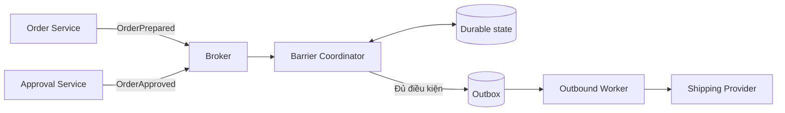
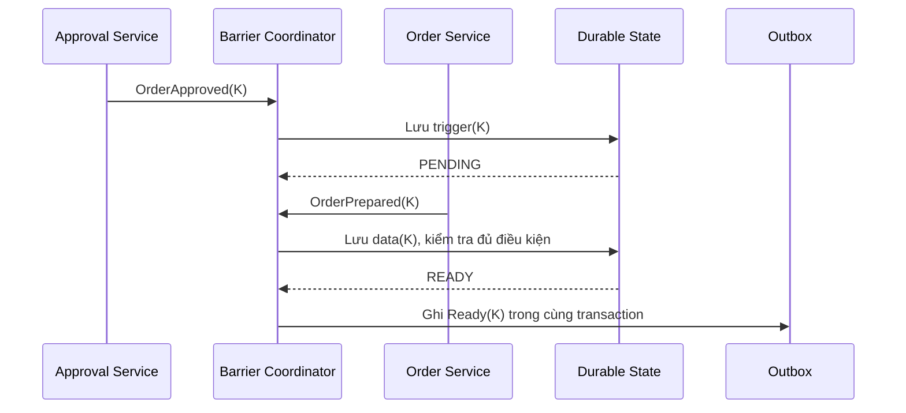
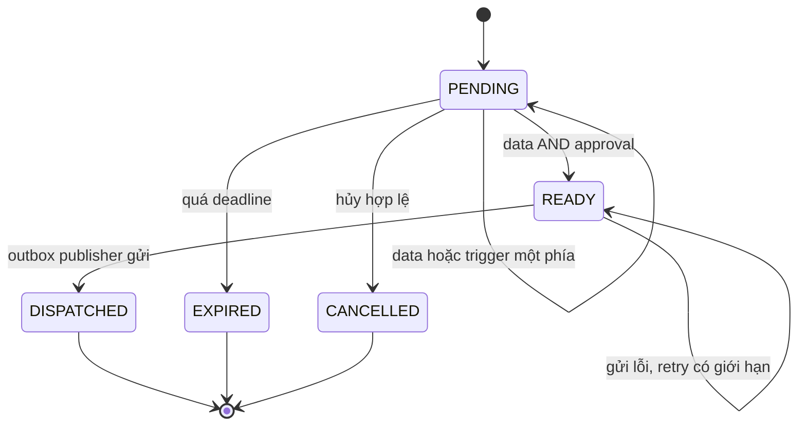
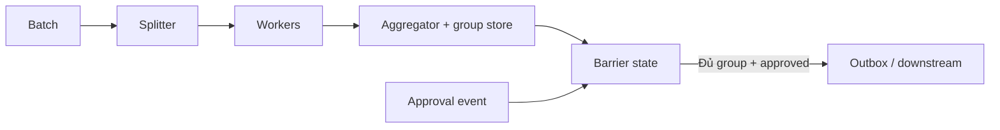

# Barrier trong flow phân tán với Spring Integration

> **Module:** `SPRING_INTEGRATION_PATTERN` — Học triển khai Enterprise Integration Patterns với Spring Integration để xây dựng luồng thông điệp ít phụ thuộc và dễ mở rộng. Thực hành Router, Filter, Transformer, Splitter, Aggregator, Gateway, retry, error channel và correlation, đồng thời kiểm thử, theo dõi các nhánh xử lý.
>
> **Chương:** Barrier  
> **Đề bài:** Barrier trong flow phân tán

## 1. Vấn đề: dữ liệu và tín hiệu mở Barrier nằm ở những service khác nhau

Trong hệ thống xử lý đơn hàng, **Order Service** tạo dữ liệu cần gửi cho đối tác vận chuyển. **Approval Service** xác nhận đơn hàng đủ điều kiện phát hành. Hai service chạy trên nhiều replica, gửi sự kiện qua broker tới một thành phần điều phối.

Yêu cầu nghiệp vụ:

- **Không gửi** yêu cầu vận chuyển khi chưa có cả dữ liệu hợp lệ và phê duyệt.
- Phê duyệt có thể tới **trước hoặc sau** dữ liệu.
- Broker có thể giao **lặp lại** một sự kiện khi consumer gặp sự cố.
- Một operation chỉ được **quyết định sẵn sàng một lần**; phát ra ngoài phải có cơ chế chống tác dụng phụ trùng.
- Nếu tín hiệu không đến trong một khoảng thời gian, operation phải hết hạn hoặc chuyển xử lý lỗi thay vì chờ mãi.
- Một replica bị restart không được làm biến mất trạng thái cần thiết để hoàn tất operation.

Đây là một **Barrier phân tán**: chỉ cho operation đi tiếp khi nhiều điều kiện do các thành phần khác nhau cung cấp đã được thỏa mãn.



Ví dụ này thuộc module `SPRING_INTEGRATION_PATTERN`, kết hợp ý tưởng Barrier với Gateway, Router, Filter, Transformer, Splitter, Aggregator, retry, error channel và correlation khi thiết kế Enterprise Integration Patterns.

**Mục tiêu học tập:** xác định đúng khóa tương quan, xây state machine không phụ thuộc thứ tự nhận sự kiện, giải thích tại sao khóa `synchronized` hay `CountDownLatch` trong một JVM không tạo Barrier phân tán, minh họa Spring Integration Gateway/ServiceActivator, thiết kế durable state và outbox, xử lý duplicate/timeout, và viết test cho các race quan trọng.

## 2. Barrier giải quyết điều kiện phát hành, không giải quyết mọi loại thứ tự

Một Barrier trả lời câu hỏi: **“Đã đủ điều kiện để một công việc tiếp tục chưa?”**

Trong ví dụ này:

\[
\operatorname{ready}(k)
=
\operatorname{prepared}(k)
\land
\operatorname{approved}(k)
\land
\neg\operatorname{terminal}(k)
\]

Trong đó \(k\) là **khóa của operation**, không phải ID riêng của event broker. Hai sự kiện khác nhau phải trỏ về cùng \(k\).

Phân biệt các khái niệm liên quan:

| Thành phần | Vai trò | Không tự bảo đảm |
|---|---|---|
| **Barrier** | Chờ dữ liệu và tín hiệu/điều kiện mở | Sắp xếp các message thành chuỗi |
| **Aggregator** | Gom các message cùng correlation key và xác định group hoàn tất | Một phê duyệt từ service khác, nếu chưa thiết kế |
| **Resequencer** | Sắp message theo `sequenceNumber` | Trạng thái phê duyệt nghiệp vụ |
| **Splitter** | Chia một message thành nhiều message con | Mọi child được xử lý thành công |
| **Router** | Chọn nhánh xử lý | Dữ liệu và tín hiệu luôn đến cùng replica |
| **Retry** | Thử lại khi có lỗi có thể hồi phục | Exactly-once side effects |
| **Idempotency** | Tránh xử lý lặp cùng operation theo contract | Một trạng thái Barrier được lưu bền vững nếu chỉ nằm trong RAM |

Một hệ thống có ba phần tử đến theo thứ tự 2 → 3 → 1 cần thêm **Aggregator/Resequencer hoặc phép sắp xếp có xác nhận đủ phần tử** nếu output phải là 1 → 2 → 3. Barrier chỉ được mở khi điều kiện đã định nghĩa đạt; nó không tự khôi phục thứ tự của các child.

### Hai kiểu Barrier thường gặp

1. **Một message data, một trigger:** data chờ một lệnh mở tương ứng. Đây là ví dụ chính trong bài.
2. **N message data, một trigger:** cần đủ N phần tử **và** trigger. Khi đó phải bổ sung cơ chế group completion, sequence metadata và chống duplicate.

Mọi quyết định về thứ tự, completeness và identity cần được thể hiện trong contract; không dựa vào việc message nào tới broker sớm hơn.

## 3. Vì sao một Barrier cục bộ không đủ cho flow phân tán?

Trong Spring Integration, các message handler và channel chạy trong application context của từng JVM. Một Barrier dùng đối tượng đồng bộ hóa, map trạng thái hoặc thread chờ **trong một instance** chỉ nhìn thấy sự kiện đi qua instance đó.

Giả sử có ba replica:

```text
OrderPrepared(K)  -> replica A
OrderApproved(K)  -> replica B
Outbound wait(K)  -> replica C

A biết "đã có dữ liệu", không biết "đã duyệt".
B biết "đã duyệt", không biết "đã có dữ liệu".
C không có trạng thái phù hợp.
=> Hệ thống có đủ hai event nhưng không replica nào tự thấy đủ.
```

Việc cùng đặt tên channel `barrierChannel`, cùng tên bean hay cùng chuỗi correlation ID **không chia sẻ dữ liệu trong bộ nhớ** giữa các JVM.

Một cơ chế Barrier trong JVM có thể được sử dụng đúng khi tất cả message liên quan đã được định tuyến về cùng một instance và state tồn tại trong khoảng cần thiết. Với flow phân tán, cần ít nhất một trong các lựa chọn:

- **Partition/routing theo khóa:** mọi event cùng operation đi về cùng coordinator có quyền sở hữu group, cộng cơ chế khôi phục state khi chuyển owner.
- **Durable state dùng chung:** các replica đọc/ghi cùng state theo khóa operation, với update nguyên tử và khóa/phiên bản.
- **Dịch vụ điều phối tập trung về mặt logic:** lưu trạng thái trong database/broker và cấp quyết định phát hành qua outbox; service có thể có nhiều replica nếu locking được thiết kế đúng.

**Không nên giữ một thread chờ signal từ service khác trong thời gian dài**. Network timeout, autoscaling hoặc restart sẽ làm mô hình thread chờ khó quản lý. Thay vào đó, lưu trạng thái “đang chờ” bền vững và tiếp tục bằng event khi điều kiện đến.

## 4. Định nghĩa contract và khóa correlation

Hai nguồn sự kiện phải nói về **cùng một operation**, nhưng không nên tin vào ID do client ngoài hệ thống tùy ý đặt.

Ví dụ event dạng JSON để giải thích contract:

```json
{
  "eventId": "evt-prepared-101",
  "eventType": "OrderPrepared",
  "tenantId": "org-17",
  "operationId": "ship-785",
  "payload": {
    "orderId": "ord-785",
    "destination": "warehouse-A"
  },
  "schemaVersion": 1
}
```

```json
{
  "eventId": "evt-approved-204",
  "eventType": "OrderApproved",
  "tenantId": "org-17",
  "operationId": "ship-785",
  "approvalId": "approval-204",
  "schemaVersion": 1
}
```

Hai event có `eventId` khác nhau nhưng có cùng cặp (`tenantId`, `operationId`). Trong ví dụ, cặp này là **khóa Barrier**.

| Thuộc tính | Mục đích | Quy tắc |
|---|---|---|
| `tenantId` | Ranh giới khách hàng/quyền truy cập | Nguồn tin cậy, đã xác thực |
| `operationId` | Định danh nghiệp vụ cần đồng bộ hóa | Ổn định qua retry và redelivery |
| `eventId` | Nhận diện bản ghi sự kiện cụ thể | Hỗ trợ dedup event |
| `approvalId` | Bằng chứng một quyết định phê duyệt | Phải được kiểm tra nguồn/quyền |
| `schemaVersion` | Version hóa contract | Có kế hoạch tương thích khi rollout |
| `correlationId` | Khóa nhóm trong Spring Integration khi cần | Ánh xạ nhất quán tới operation key |
| `causationId` / trace ID | Quan sát nguyên nhân và đường đi | Không dùng thay business operation ID |

**Không nên dùng MessageHeaders.ID của từng message** làm khóa Barrier: ID có thể khác khi broker redelivery hoặc khi adapter tạo message mới. Nếu cần dùng `IntegrationMessageHeaderAccessor.CORRELATION_ID`, hãy ánh xạ từ operation key một cách nhất quán và có kiểm chứng.

### Composite key quan trọng hơn nối chuỗi tùy ý

Khóa (`tenantId="a:b"`, `operationId="c"`) có thể bị trùng với (`tenantId="a"`, `operationId="b:c"`) nếu chỉ dùng phép nối chuỗi thiếu escaping. Production nên sử dụng hai cột khóa riêng, hoặc một encoding nhất quán không nhập nhằng.

## 5. Race giữa data và trigger: đến trước hay sau đều phải đúng

Trong phân tán, **không thể giả định thứ tự toàn cục** giữa hai producer độc lập. Ngay cả khi mỗi producer giữ thứ tự ở topic của mình, hai topic hoặc partition khác nhau không tạo một thứ tự chung.

### 5.1. Dữ liệu đến trước


Nếu chỉ lưu `OrderPrepared` vào RAM và service restart trước khi `OrderApproved` đến, dữ liệu có thể biến mất. Vì vậy cần xác định state store và thời điểm ACK nguồn.

### 5.2. Trigger đến trước



Nếu nhận trigger mà chưa thấy data rồi **bỏ trigger**, operation có thể không bao giờ mở. Một coordinator đúng phải giữ tín hiệu đến sớm đủ lâu, hoặc dùng handshake/protocol có thể truy vấn và tái phát tín hiệu một cách đáng tin cậy.

### 5.3. Trùng event và cạnh tranh đồng thời

Broker có thể giao lại `OrderApproved(K)` hai lần. Hai consumer cũng có thể nhận data/trigger cùng lúc. Một implementation đúng phải giữ các **bất biến**:

1. Hai bản sao cùng event không làm phát hành hai lần.
2. Data và approval của **tenant/operation khác nhau** không bị ghép chung.
3. Hai lần update đồng thời không làm mất một trường state (*lost update*).
4. Khi điều kiện đạt, chỉ **một transition hợp lệ** tạo ý định phát hành trong outbox.
5. Lỗi downstream sau transition không làm mất vĩnh viễn ý định phát hành.

Các bất biến này phải được bảo vệ bởi transaction/locking hoặc cơ chế xử lý tuần tự có khả năng recovery; một phép kiểm tra `if (data != null && approved)` ở hai replica không đủ.

## 6. Mô hình trạng thái cho operation

Một mô hình tối thiểu:

| Trạng thái | Data? | Trigger? | Hành động |
|---|---|---|---|
| `PENDING` | Không | Không | Chờ một trong hai event |
| `PENDING` | Có | Không | Chờ approval |
| `PENDING` | Không | Có | Chờ data |
| `READY` | Có | Có | Ghi ý định phát hành và chuyển state |
| `EXPIRED` | Có thể thiếu | Có thể thiếu | Terminal failure/điều tra theo chính sách |
| `CANCELLED` | Bất kỳ | Bất kỳ | Không phát hành; xử lý sự kiện đến muộn |
| `DISPATCHED` | Có | Có | Đã gửi output theo contract quan sát được |

**Lưu ý thiết kế:** có thể tách `READY` (đã có một outbox record) và `DISPATCHED` (outbox worker đã chuyển event tới broker), nhưng **DISPATCHED không đồng nghĩa đối tác ngoài đã thực hiện side effect đúng một lần**. Cần sự xác nhận của downstream và idempotency/reconciliation.



Đối với hai điều kiện độc lập, `PENDING` cần giữ cả hai cờ/bản ghi. Đừng dùng một boolean `released` duy nhất rồi quên dữ liệu, hoặc một danh sách chỉ chứa event cuối cùng.

### Terminal state và sự kiện đến muộn

Khi operation hết hạn hoặc đã bị hủy, sự kiện `OrderApproved` đến sau **không được tự hồi sinh** operation đã terminal. Khi một operation hoàn thành, hãy giữ một tombstone/trạng thái kết thúc đủ lâu để nhận biết redelivery. Chính sách TTL phải phù hợp thời gian retention và lịch retry của broker.

## 7. Triển khai minh họa: một coordinator Java trong một JVM

Để học rõ thuật toán, ta bắt đầu bằng class Java 17+ với state in-memory. Class này:

- Chấp nhận data/trigger theo **bất kỳ thứ tự**.
- Giữ state theo composite key `tenantId + operationId`.
- Bỏ qua duplicate có nội dung giống nhau.
- Từ chối duplicate mâu thuẫn.
- Quyết định `Ready` đúng một lần **trong một instance**.
- Giới hạn số group đang mở để tránh giữ vô hạn data trong RAM.

**Đây không phải Barrier phân tán production**. Phần 10 giải thích cách thay cơ chế giữ state bằng database transaction/outbox.

### 7.1. Coordinator và event records

File `LocalBarrierCoordinator.java`:

```java
package com.example.distributedbarrier;

import java.util.HashMap;
import java.util.HashSet;
import java.util.Map;
import java.util.Objects;
import java.util.Optional;
import java.util.Set;

public final class LocalBarrierCoordinator {

    public record Key(String tenantId, String operationId) {
        public Key {
            if (tenantId == null || tenantId.isBlank()
                    || operationId == null || operationId.isBlank()) {
                throw new IllegalArgumentException("Invalid correlation key");
            }
        }
    }

    public record Data(Key key, String payload) {
        public Data {
            Objects.requireNonNull(key);
            Objects.requireNonNull(payload);
        }
    }

    public record Approval(Key key, String approvalId) {
        public Approval {
            Objects.requireNonNull(key);
            if (approvalId == null || approvalId.isBlank()) {
                throw new IllegalArgumentException("approvalId required");
            }
        }
    }

    public record Ready(
            Key key,
            String payload,
            String approvalId) {
    }

    private static final class Pending {
        String payload;
        String approvalId;
    }

    private final Map<Key, Pending> pending = new HashMap<>();
    private final Set<Key> completed = new HashSet<>();
    private final int maxOpenOperations;

    public LocalBarrierCoordinator(int maxOpenOperations) {
        if (maxOpenOperations < 1) {
            throw new IllegalArgumentException("Invalid state limit");
        }
        this.maxOpenOperations = maxOpenOperations;
    }

    public synchronized Optional<Ready> onData(Data event) {
        Objects.requireNonNull(event);

        if (completed.contains(event.key())) {
            return Optional.empty();
        }

        Pending state = stateFor(event.key());
        if (state.payload != null
                && !state.payload.equals(event.payload())) {
            throw new IllegalArgumentException(
                    "Conflicting data for operation");
        }

        state.payload = event.payload();
        return completeIfReady(event.key(), state);
    }

    public synchronized Optional<Ready> onApproval(Approval event) {
        Objects.requireNonNull(event);

        if (completed.contains(event.key())) {
            return Optional.empty();
        }

        Pending state = stateFor(event.key());
        if (state.approvalId != null
                && !state.approvalId.equals(event.approvalId())) {
            throw new IllegalArgumentException(
                    "Conflicting approval for operation");
        }

        state.approvalId = event.approvalId();
        return completeIfReady(event.key(), state);
    }

    private Pending stateFor(Key key) {
        Pending state = pending.get(key);
        if (state != null) {
            return state;
        }

        if (pending.size() >= maxOpenOperations) {
            throw new IllegalStateException("Too many pending operations");
        }

        state = new Pending();
        pending.put(key, state);
        return state;
    }

    private Optional<Ready> completeIfReady(Key key, Pending state) {
        if (state.payload == null || state.approvalId == null) {
            return Optional.empty();
        }

        // Atomic decision chỉ trong một JVM, CHƯA có durable outbox.
        pending.remove(key);
        completed.add(key);

        return Optional.of(new Ready(
                key, state.payload, state.approvalId));
    }
}
```

### 7.2. Phạm vi bảo đảm của code

- `synchronized` ngăn hai thread trong **cùng coordinator object** đồng thời phát hai lần.
- Composite `Key` làm hai tenant có cùng operation ID không bị ghép nhầm.
- `completed` giúp bỏ qua redelivery sau khi operation được quyết định ready, **khi object còn sống**.
- Duplicate approval với cùng `approvalId` không tăng số điều kiện.
- Duplicate với payload hoặc approvalId mâu thuẫn bị từ chối, thay vì âm thầm ghi đè.

**Những thứ code chưa làm:**

1. Không có TTL, expiry, cancellation và cleanup.
2. Không persist data/trigger và tombstone; restart làm mất state.
3. Không kiểm tra quyền phát approval; bước upstream phải xác thực.
4. Không chuyển trạng thái và gửi Ready vào broker trong **một transaction**.
5. Không đủ cho nhiều replica hoặc exactly-once external side effects.

Điểm (4) đặc biệt quan trọng: nếu `completeIfReady()` đã đánh dấu completed nhưng handler phát Ready ra ngoài lỗi/crash, operation có thể bị mất. Trong production cần ghi **outbox event và state transition nguyên tử**.

## 8. Kiểm thử thuật toán với JUnit 5

Bản demo có thể được kiểm thử **không dùng thời gian thật, không Thread.sleep** và không cần broker.

File `LocalBarrierCoordinatorTest.java`:

```java
package com.example.distributedbarrier;

import static org.junit.jupiter.api.Assertions.*;

import org.junit.jupiter.api.Test;

class LocalBarrierCoordinatorTest {

    private static LocalBarrierCoordinator.Key key(
            String tenant, String operation) {
        return new LocalBarrierCoordinator.Key(tenant, operation);
    }

    @Test
    void dataBeforeApprovalOpensOnce() {
        LocalBarrierCoordinator gate = new LocalBarrierCoordinator(10);
        var key = key("tenant-a", "op-1");

        assertTrue(gate.onData(
                new LocalBarrierCoordinator.Data(key, "order"))
                .isEmpty());

        var result = gate.onApproval(
                new LocalBarrierCoordinator.Approval(key, "approval-1"));

        assertEquals("order", result.orElseThrow().payload());
        assertTrue(gate.onApproval(
                new LocalBarrierCoordinator.Approval(key, "approval-1"))
                .isEmpty());
    }

    @Test
    void approvalBeforeDataIsRemembered() {
        LocalBarrierCoordinator gate = new LocalBarrierCoordinator(10);
        var key = key("tenant-a", "op-2");

        assertTrue(gate.onApproval(
                new LocalBarrierCoordinator.Approval(key, "approval-2"))
                .isEmpty());

        var result = gate.onData(
                new LocalBarrierCoordinator.Data(key, "shipping-request"));

        assertEquals("approval-2", result.orElseThrow().approvalId());
    }

    @Test
    void duplicatesDoNotProduceAnotherReady() {
        LocalBarrierCoordinator gate = new LocalBarrierCoordinator(10);
        var key = key("tenant-a", "op-3");

        gate.onData(new LocalBarrierCoordinator.Data(key, "payload"));
        gate.onData(new LocalBarrierCoordinator.Data(key, "payload"));

        assertTrue(gate.onApproval(
                new LocalBarrierCoordinator.Approval(key, "approval-3"))
                .isPresent());

        assertTrue(gate.onData(
                new LocalBarrierCoordinator.Data(key, "payload"))
                .isEmpty());
    }

    @Test
    void tenantsWithSameOperationIdStayIsolated() {
        LocalBarrierCoordinator gate = new LocalBarrierCoordinator(10);
        var a = key("tenant-a", "shared-id");
        var b = key("tenant-b", "shared-id");

        gate.onData(new LocalBarrierCoordinator.Data(a, "order-a"));
        gate.onData(new LocalBarrierCoordinator.Data(b, "order-b"));

        var readyB = gate.onApproval(
                new LocalBarrierCoordinator.Approval(b, "approval-b"));

        assertEquals("order-b", readyB.orElseThrow().payload());
        assertTrue(gate.onApproval(
                new LocalBarrierCoordinator.Approval(a, "approval-a"))
                .isPresent());
    }

    @Test
    void conflictingDataIsRejected() {
        LocalBarrierCoordinator gate = new LocalBarrierCoordinator(10);
        var key = key("tenant-a", "op-4");

        gate.onData(new LocalBarrierCoordinator.Data(key, "original"));

        assertThrows(IllegalArgumentException.class,
                () -> gate.onData(
                        new LocalBarrierCoordinator.Data(key, "changed")));
    }
}
```

Các test trên chỉ xác nhận **quyết định trong bộ nhớ**. Chúng không chứng minh recovery khi crash, durable delivery hoặc việc các event từ nhiều broker partition được gom vào cùng một khóa phân tán.

## 9. Kết nối với Spring Integration: hai Gateway, một coordinator

Ví dụ này cho thấy vị trí các **adapter/endpoint**, không biến class in-memory thành dịch vụ distributed. Khi sản xuất, ServiceActivator cần gọi implementation dựa trên durable state thay cho `LocalBarrierCoordinator`.

### 9.1. Dependencies

Ví dụ Gradle:

```groovy
dependencies {
    implementation "org.springframework.boot:spring-boot-starter-integration"
    testImplementation "org.springframework.boot:spring-boot-starter-test"
}
```

File `BarrierApplication.java`:

```java
package com.example.distributedbarrier;

import org.springframework.boot.SpringApplication;
import org.springframework.boot.autoconfigure.SpringBootApplication;
import org.springframework.integration.annotation.IntegrationComponentScan;
import org.springframework.integration.config.EnableIntegration;

@SpringBootApplication
@EnableIntegration
@IntegrationComponentScan
public class BarrierApplication {

    public static void main(String[] args) {
        SpringApplication.run(BarrierApplication.class, args);
    }
}
```

### 9.2. Channels và bean state

```java
package com.example.distributedbarrier;

import org.springframework.context.annotation.Bean;
import org.springframework.context.annotation.Configuration;
import org.springframework.integration.channel.DirectChannel;
import org.springframework.messaging.MessageChannel;

@Configuration
public class BarrierChannels {

    @Bean(name = "barrier.data.in")
    public MessageChannel dataIn() {
        return new DirectChannel();
    }

    @Bean(name = "barrier.approval.in")
    public MessageChannel approvalIn() {
        return new DirectChannel();
    }

    @Bean(name = "barrier.ready.out")
    public MessageChannel readyOut() {
        return new DirectChannel();
    }

    @Bean
    public LocalBarrierCoordinator localBarrierCoordinator() {
        return new LocalBarrierCoordinator(1000);
    }
}
```

### 9.3. Two one-way Gateways

```java
package com.example.distributedbarrier;

import org.springframework.integration.annotation.MessagingGateway;
import org.springframework.messaging.handler.annotation.Payload;

@MessagingGateway(defaultRequestChannel = "barrier.data.in")
public interface OrderPreparedGateway {
    void submit(@Payload LocalBarrierCoordinator.Data data);
}
```

```java
package com.example.distributedbarrier;

import org.springframework.integration.annotation.MessagingGateway;
import org.springframework.messaging.handler.annotation.Payload;

@MessagingGateway(defaultRequestChannel = "barrier.approval.in")
public interface ApprovalGateway {
    void approve(@Payload LocalBarrierCoordinator.Approval approval);
}
```

Hai Gateway cung cấp API nội bộ để mô phỏng hai nhánh nguồn. Chúng là các lời gọi **one-way**; caller gửi event không chờ điều kiện Barrier mở. Trong hệ thống phân tán, broker inbound adapters sẽ thay thế hoặc gọi vào các channel này sau bước deserialize và xác thực dữ liệu.

### 9.4. Service Activator điều phối

```java
package com.example.distributedbarrier;

import org.springframework.integration.annotation.ServiceActivator;
import org.springframework.stereotype.Component;

@Component
public class BarrierEndpoints {

    private final LocalBarrierCoordinator coordinator;

    public BarrierEndpoints(LocalBarrierCoordinator coordinator) {
        this.coordinator = coordinator;
    }

    @ServiceActivator(
            inputChannel = "barrier.data.in",
            outputChannel = "barrier.ready.out")
    public LocalBarrierCoordinator.Ready onData(
            LocalBarrierCoordinator.Data data) {
        return coordinator.onData(data).orElse(null);
    }

    @ServiceActivator(
            inputChannel = "barrier.approval.in",
            outputChannel = "barrier.ready.out")
    public LocalBarrierCoordinator.Ready onApproval(
            LocalBarrierCoordinator.Approval approval) {
        return coordinator.onApproval(approval).orElse(null);
    }

    @ServiceActivator(inputChannel = "barrier.ready.out")
    public void onReady(LocalBarrierCoordinator.Ready ready) {
        // DEMO: production phải lưu outbox trước rồi publish an toàn.
        System.out.println(
                "ready " + ready.key().operationId() +
                " approvedBy=" + ready.approvalId());
    }
}
```

Ví dụ:

```java
var key = new LocalBarrierCoordinator.Key("org-17", "ship-785");

approvalGateway.approve(
    new LocalBarrierCoordinator.Approval(key, "approval-204"));
preparedGateway.submit(
    new LocalBarrierCoordinator.Data(key, "order-payload"));

// Handler ready chỉ được gọi khi đã nhận đủ cả hai sự kiện.
```

**Giới hạn của flow minh họa:** các channel đều là `DirectChannel`, state nằm trong một instance, và việc gọi `onReady` không có transaction chung với cập nhật state. Khi handler gửi output thất bại, exception thường truyền ngược qua channel đồng bộ nhưng state đã được thay đổi; message không tự được khôi phục.

Nếu muốn thử nghiệm native Barrier component của Spring Integration trong một flow nội bộ, hãy dùng tài liệu API phù hợp phiên bản dự án. Nhưng **native Barrier cục bộ không tự tạo lưu trữ/đồng bộ phân tán**; cần làm rõ mode triển khai, timeout và cách phối hợp signal trong mọi tình huống lỗi.

## 10. Chuyển từ demo sang Barrier phân tán có durable state

### 10.1. Thiết kế database record

Ví dụ schema theo phong cách PostgreSQL, dùng composite key (`tenant_id`, `operation_id`):

```sql
CREATE TABLE barrier_state (
    tenant_id         TEXT NOT NULL,
    operation_id      TEXT NOT NULL,
    prepared_payload  JSONB,
    approval_id       TEXT,
    state             TEXT NOT NULL DEFAULT 'PENDING',
    deadline_at       TIMESTAMPTZ NOT NULL,
    updated_at        TIMESTAMPTZ NOT NULL DEFAULT now(),
    PRIMARY KEY (tenant_id, operation_id)
);

CREATE TABLE barrier_outbox (
    id                BIGSERIAL PRIMARY KEY,
    tenant_id         TEXT NOT NULL,
    operation_id      TEXT NOT NULL,
    event_type        TEXT NOT NULL,
    payload           JSONB NOT NULL,
    published_at      TIMESTAMPTZ,
    created_at        TIMESTAMPTZ NOT NULL DEFAULT now(),
    UNIQUE (tenant_id, operation_id, event_type)
);
```

Đây là **mẫu ý tưởng**. Production cần bổ sung constraints, payload encryption/minimization, các bản ghi hủy/expiry, retention, version schema, indexes và vận hành migration.

Khóa duy nhất ở outbox giúp ngăn tạo **hai record Ready cho cùng operation và event type**. Nó không ngăn broker giao lại cùng record hoặc ngăn downstream thực hiện tác dụng phụ trùng; cần idempotency ở người nhận.

### 10.2. Transaction xử lý mỗi event

Pseudocode sau nêu thứ tự các thao tác trong **một transaction database**:

```text
onEvent(event):
    key = authenticateAndValidate(event.tenantId, event.operationId)

    begin transaction

    INSERT barrier_state(key, PENDING, deadline)
        ON CONFLICT DO NOTHING

    row = SELECT barrier_state WHERE key = ?
          FOR UPDATE

    if row.state in {READY, DISPATCHED, EXPIRED, CANCELLED}:
        verifyDuplicateOrLateEvent(event)
        commit transaction
        ackInboundAfterCommit()
        return

    if databaseNow >= row.deadline_at:
        UPDATE row SET state = EXPIRED
        recordTerminalFailureIfRequired()
        commit transaction
        ackInboundAfterCommit()
        return

    verifyNoConflictingValue(row, event)
    updateOnlyTheFieldProvidedBy(event)

    if row.prepared_payload is not null
       and row.approval_id is not null:
        UPDATE row SET state = READY
        INSERT INTO barrier_outbox(key, ReadyEvent)
            ON CONFLICT DO NOTHING

    commit transaction
    ackInboundAfterCommit()
```

Ý tưởng cốt lõi:

- Event thứ nhất **tạo row chờ**, event thứ hai **bổ sung trường còn thiếu**.
- `SELECT ... FOR UPDATE`/optimistic compare-and-set hoặc cơ chế tương đương bảo vệ cập nhật đồng thời vào **cùng operation key**.
- Khi đủ hai điều kiện, **transition state và ghi outbox phải nằm trong cùng transaction**.
- Consumer chỉ ACK input khi trạng thái tương ứng **đã được lưu bền vững**; nếu crash trước ACK, redelivery phải an toàn.
- Deadline do server/store tin cậy kiểm soát; không lấy timestamp không kiểm chứng từ client làm chuẩn duy nhất.

**Quan trọng:** với một số broker, transaction database và broker acknowledgment không thể được gom thành một transaction xuyên hệ thống. Cách phổ biến là DB commit trước, sau đó ACK; nếu crash giữa hai bước, broker giao lại event, nhưng thao tác xử lý phải **idempotent**.

### 10.3. Transactional outbox giải quyết lỗ hổng nào?

Hai cách ghi sai dễ gặp:

```text
A) UPDATE state=READY; COMMIT
   crash
   publish Ready -> KHÔNG CHẠY
   => Mất tín hiệu phát hành.

B) publish Ready
   crash
   UPDATE state=READY -> KHÔNG CHẠY
   => Có output nhưng state chưa ghi, có thể publish lại.
```

Thay bằng:

```text
BEGIN
   UPDATE barrier_state SET state=READY ...
   INSERT barrier_outbox(... ReadyEvent ...)
COMMIT

Outbox publisher:
   đọc record chưa published
   gửi broker
   ghi nhận published (có thể lặp khi mất ACK)
```

Khi broker publish thành công nhưng outbox worker crash trước khi đánh dấu `published_at`, record có thể được publish **hai lần**. Đó là điều bình thường trong mô hình **at-least-once**. Consumer phải dedup/idempotent bằng key ổn định (ví dụ event ID hoặc operation key + loại hành động).

**Outbox không tự cam kết exactly-once HTTP side effects.** Nếu kết quả cuối cùng là gọi provider tạo vận đơn, cần idempotency key phía provider hoặc reconciliation có cơ chế chống tạo trùng.

## 11. Partitioning và ordering qua broker

### 11.1. Cùng key chưa chắc cùng consumer khi dùng hai topic

Nếu `OrderPrepared` và `OrderApproved` nằm ở **hai topic** hoặc hai consumer group riêng, việc cùng đặt message key không tạo một thứ tự toàn cục giữa các topic. Hai event có thể đến coordinator ở bất kỳ thứ tự nào, thậm chí ở hai replica khác nhau.

Nếu muốn xử lý tuần tự theo operation:

- Chuẩn hóa cả hai loại event vào **một stream được phân vùng theo cùng key** và dùng một nhóm consumer phù hợp; hoặc
- Đưa chúng qua coordinator có **durable shared state với khóa theo operation**, không phụ thuộc event đến instance nào.

Dù dùng một keyed stream, crash và redelivery vẫn cần dedup và state recovery. Ordering trong một partition không đồng nghĩa toàn bộ hệ thống có total order.

### 11.2. Khi consumer rebalance

Một consumer đang giữ state của operation trong RAM có thể mất partition khi rebalance. Consumer mới sẽ nhận sự kiện tiếp theo nhưng không biết trạng thái trước đó nếu state không được restore.

Cần xác định:

1. State lưu ở đâu và được checkpoint/commit thế nào.
2. Commit offset/ACK gắn với trạng thái đã persist ra sao.
3. Trường hợp event bị replay sau crash có idempotent không.
4. Khi chuyển owner, có **fencing/lease/version** để owner cũ không tiếp tục phát Ready sai không.
5. Có giới hạn backlog, số group và thời gian khôi phục sau rebalance không.

**Phân vùng cùng khóa giúp tính cục bộ và giảm tranh chấp, không thay thế tính bền vững.**

## 12. Timeout, hủy, tín hiệu đến muộn và xử lý partial

Một Barrier thiếu một trong hai điều kiện có thể chờ mãi. Ví dụ data đã chuẩn bị nhưng không có phê duyệt vì Approval Service bị lỗi.

Định nghĩa trước:

- `deadline_at` cho operation.
- Chính sách khi hết hạn: `EXPIRED`, cảnh báo, đưa vào điều tra, bù trừ hay gửi thông báo.
- Điều gì xảy ra nếu approval đến **sau** expiry.
- Có cho phép admin **reopen** operation hay bắt buộc tạo operation version mới.
- Retention/tombstone để chống xử lý redelivery vào state đã terminal.

### Ví dụ deadline

```text
10:00:00  OrderPrepared(ship-785)
10:00:30  deadline chưa đến; đang chờ approval
10:01:00  hết hạn -> EXPIRED
10:01:15  OrderApproved(ship-785) tới muộn
          -> Không mở Barrier; ghi late approval
```

**Không tự chuyển operation từ `EXPIRED` về `READY` chỉ vì cuối cùng đã có đủ event.** Nếu nghiệp vụ cho phép khôi phục, cần quy trình có quyền, version operation và bằng chứng rõ ràng.

Nếu cần chờ **N part data + một approval**, hãy thêm một thành phần gom nhóm:

\[
\operatorname{ready}(k)
=
(\operatorname{receivedUniqueParts}(k)=N(k))
\land
\operatorname{approved}(k)
\land
\neg\operatorname{terminal}(k)
\]

Khi chưa biết N, phải có hợp đồng **end marker** hoặc release strategy thay thế; approval đơn thuần không chứng minh nhóm đã đủ. Không đếm duplicate child là các vị trí mới.

### Timeout khác release thành công

Một hệ thống có thể quyết định phát partial result khi deadline tới, **nhưng đó là một nhánh nghiệp vụ riêng**. Không đánh đồng timeout với “đã đủ điều kiện”. Nếu partial được phép, event đầu ra phải ghi rõ `partial=true` và các dữ liệu thiếu, không dùng cùng schema “fully approved” gây hiểu nhầm.

## 13. Error channel, retry và dead-letter khi Barrier phân tán

### 13.1. DirectChannel và các adapter bất đồng bộ

Trong demo `DirectChannel`, exception thường chạy ngược về Gateway/caller. Trong broker inbound adapter, poller hoặc executor, exception có thể được xử lý qua `ErrorMessage`/error channel hoặc chính sách ACK/NACK của adapter. **Không được giả định mọi lỗi tự xuất hiện trong global `errorChannel`.**

Tùy nguồn inbound, cần chỉ định:

- Lỗi schema/quyền: reject hoặc DLQ, **không ghi dữ liệu nguy hiểm vào state**.
- Lỗi database tạm thời: retry có backoff, để broker redeliver theo cơ chế an toàn.
- Duplicate hợp lệ: ACK sau khi nhận diện trạng thái đã xử lý.
- Duplicate mâu thuẫn: giữ chứng cứ và gửi tới quarantine/điều tra.
- State terminal: ghi late event/audit theo policy rồi ACK để không requeue nóng.

### 13.2. Tránh feedback loop

Một anti-pattern là gửi event lỗi trở về kênh đầu vào Barrier không có attempt count:

```text
barrierInbound -> coordinator -> DB timeout
                      |
                      v
                 errorChannel
                      |
                      v
                 barrierInbound (gửi lại ngay)
```

Nếu DB vẫn lỗi, vòng lặp có thể làm đầy queue/thread pool. Với broker, NACK/requeue tức thời hoặc route DLQ trở lại main queue cũng tạo vòng nóng.

**Thiết kế đúng:** retry được giới hạn bởi attempts/deadline, dùng backoff với jitter, lưu quyền sở hữu message, và có terminal DLQ/quarantine. Không để error handler tự tạo một chuỗi ErrorMessage mới gửi về chính errorChannel.

### 13.3. Retry sau khi Barrier đã mở

Khi Ready event đã ghi vào outbox, outbound worker có thể gọi provider và nhận HTTP 503 hoặc 429. Retry outbound phải có **budget riêng** với idempotency key. Không nên “đóng rồi mở lại” Barrier cho mỗi lần retry HTTP.

Nếu provider có rate limit theo API key, **mỗi HTTP attempt** phải xin permit. `Retry-After` từ HTTP 429 cần được tôn trọng nếu có và hợp lệ. Barrier chỉ kiểm soát điều kiện phát hành, không thay thế Rate Limiter hay Circuit Breaker.

## 14. Tương tác với các Enterprise Integration Patterns

| Pattern | Điều cần chú ý khi chạy phân tán |
|---|---|
| **Gateway** | Không bắt caller đồng bộ chờ Barrier nhiều phút; nhận event bất đồng bộ và trả trạng thái chấp nhận rõ ràng |
| **Router** | Route theo operation key hoặc quota group; đừng để data/trigger bị chia state cục bộ không chia sẻ |
| **Filter** | Nếu lọc bỏ data/approval, phải có terminal outcome; không im lặng khiến group chờ mãi |
| **Transformer** | Bảo toàn operation key, event ID và metadata; tránh chỉ serialize payload làm mất correlation |
| **Splitter** | N child phải có sequence/correlation; hoàn tất nhóm phải đếm unique positions |
| **Aggregator** | Dùng khi điều kiện cần đủ N part; có store/release strategy/timeout phù hợp |
| **Resequencer** | Dùng nếu cần phát message theo thứ tự logic thay vì thứ tự arrival |
| **Retry** | Giữ business operation ID và idempotency key, budget không reset qua restart |
| **Error Channel** | Phân biệt lỗi đồng bộ/bất đồng bộ; có DLQ và terminal handling thay vì loop |
| **Rate Limiter** | Giới hạn outbound attempts thật; không coi Barrier là bộ hạn chế tốc độ |
| **Correlation** | Data/trigger và mọi retry dùng cùng khóa từ nguồn tin cậy |
| **Circuit Breaker** | Khi provider không khỏe, trì hoãn outbound; không mở lại Barrier để thử qua cửa khác |

### Splitter và Aggregate trước Barrier

Một batch 100 item có thể được Splitter tạo thành 100 child, chạy qua Router và Transformer rồi Aggregator tổng hợp. Nếu Approval Service phát approval từ sớm, Barrier vẫn không được phát hành batch cho đến khi Aggregator có **kết quả nhóm hợp lệ** theo business contract.



Đặt Barrier ở đâu quyết định **đơn vị cần duyệt**: một child, một batch hay toàn operation. Cần mô tả rõ trong tên event, khóa và thời điểm transition.

## 15. Observability và bảo mật

### Metrics quan trọng

| Metric | Câu hỏi trả lời |
|---|---|
| `barrier_pending_operations` | Đang có bao nhiêu operation chờ? |
| `barrier_pending_age_seconds` | Operation chờ lâu nhất bao lâu? |
| `barrier_data_events_total` | Có bao nhiêu data events được nhận? |
| `barrier_approval_events_total` | Có bao nhiêu trigger được nhận? |
| `barrier_early_approval_total` | Bao nhiêu trigger đến trước data? |
| `barrier_ready_transitions_total` | Bao nhiêu transition sang READY thành công? |
| `barrier_duplicate_events_total` | Tỷ lệ redelivery/duplicate? |
| `barrier_conflicting_events_total` | Có event mâu thuẫn cần điều tra? |
| `barrier_expired_total` | Bao nhiêu operation hết deadline? |
| `barrier_late_events_total` | Bao nhiêu event đến sau terminal state? |
| `barrier_outbox_lag_seconds` | Từ READY đến lúc publish mất bao lâu? |
| `barrier_outbox_retry_total` | Outbox publisher đang gặp lỗi gì? |
| `barrier_downstream_duplicate_suppressed_total` | Consumer đã ngăn tác dụng phụ trùng bao nhiêu lần? |

Log/traces nên có `tenantId` (đã kiểm soát dữ liệu), `operationId`, `eventId`, `eventType`, `stateBefore`, `stateAfter`, `decisionReason` và correlation/trace ID. Không log nguyên credential, token, payload nhạy cảm hoặc security context.

Với nhiều tenant, đừng tạo metric labels tùy ý chứa hàng triệu `operationId`, vì cardinality có thể gây quá tải hệ thống metrics. Chi tiết theo operation nên để trong audit/tracing có retention phù hợp.

### Bảo vệ tín hiệu release

Approval là một **quyết định bảo mật/nghiệp vụ**, không chỉ là message “mở cửa”. Một actor không được ủy quyền phát `OrderApproved` có thể khiến hệ thống phát hàng sai.

Vì vậy:

1. Xác thực producer/inbound adapter và nguồn phê duyệt.
2. Kiểm tra quyền theo tenant, operation, trạng thái đơn hàng và version.
3. Không lấy `approved=true` từ header do caller bất kỳ gửi như sự thật cuối cùng.
4. Chống replay tín hiệu cũ sang operation mới; dùng operation ID/version, event ID và quy tắc terminal.
5. Audit ai/điều kiện nào đã cấp phép, không chỉ log thời điểm nhận event.

## 16. Kiểm thử tích hợp bắt buộc cho mô hình phân tán

### 16.1. Ma trận lỗi và race

| Tình huống | Cách mô phỏng | Điều phải đúng |
|---|---|---|
| Data tới trước | Gửi Data(K), sau đó Approval(K) | Một READY |
| Approval tới trước | Gửi Approval(K), sau đó Data(K) | Một READY, không mất trigger |
| Hai event đồng thời | Cho hai consumer update cùng key | Không lost update, không có hai outbox records |
| Duplicate approval | Gửi cùng event hai lần | Một READY, không thay đổi state sai |
| Duplicate data mâu thuẫn | Cùng key, payload khác | Reject/quarantine |
| Khác tenant cùng operationId | Data tenant A, approval tenant B | Không ghép hai event |
| Crash trước commit | Tắt consumer khi transaction chưa commit | Redelivery xử lý lại an toàn |
| Crash sau commit trước ACK | DB có state, broker chưa ACK | Redelivery không tạo thêm READY |
| Crash sau broker publish trước outbox mark | Outbox worker gửi lại | Consumer idempotent |
| State local, nhiều replica | Data/trigger đi hai instance | Phát hiện lỗi; thay bằng shared state hoặc partition đúng |
| Rebalance giữa group | Chuyển partition owner | Restore state, không mất/nhân đôi output |
| Approval tới sau expiry | Tạo deadline ngắn, gửi late event | Không mở lại terminal operation |
| Mất kết nối DB | Inject transient DB failure | Retry có backoff, không requeue nóng |
| HTTP 503 sau READY | Outbound worker lỗi | Retry outbound riêng, không phát lại Barrier transition |
| HTTP 429 | Provider gửi Retry-After | Tôn trọng delay và limiter API key |
| Một trong N child thiếu | Splitter/Aggregator | Không release như nhóm hoàn chỉnh |

### 16.2. Test với database thật và broker

Unit test của `LocalBarrierCoordinator` **không đủ** để xác nhận hệ thống phân tán. Một bộ integration test nên:

1. Khởi tạo database test với bảng state/outbox và một broker test hoặc adapter giả lập có khả năng redelivery.
2. Gửi hai loại event vào **hai consumer/thread/instance độc lập**.
3. Chặn execution ngay tại điểm “sau UPDATE state, trước COMMIT” để mô phỏng crash.
4. Kiểm tra `UNIQUE(tenant_id, operation_id, event_type)` ngăn hai outbox rows.
5. Phát cùng một outbox event hai lần, kiểm chứng downstream idempotency.
6. Cho operation timeout và gửi event tới muộn, xác nhận terminal state không bị mở lại.
7. Kiểm tra ACK đầu vào xảy ra **sau** commit hoặc có cơ chế recovery tương đương.
8. Nếu dùng distributed lock/lease, kiểm tra fencing khi owner cũ tỉnh lại sau pause dài.

Nên assert bằng **state cuối và số side effects** thay vì dùng `Thread.sleep(10)` để suy đoán race có xảy ra. Có thể điều khiển các điểm đồng bộ bằng latch/barrier test helper và transaction hooks phù hợp; không chạy loại test này trong mỗi request production.

## 17. Những sai lầm thường gặp

| Sai lầm | Hệ quả | Hướng sửa |
|---|---|---|
| Dùng `synchronized` như distributed lock | Hai JVM vẫn cập nhật/phát riêng | Lock/version trên shared store hoặc single-owner partition |
| Tin rằng cùng broker key tạo thứ tự qua hai topic | Không có total order xuyên topic | Thiết kế bất kỳ thứ tự + durable state |
| Bỏ trigger khi chưa có data | Operation chờ mãi | Persist trigger đến sớm |
| Chỉ đếm số event đến | Duplicate có thể làm “đủ” giả | Dedup theo eventId và business key |
| Chỉ giữ completed trong RAM | Restart làm mất tombstone | Persist trạng thái terminal |
| UPDATE READY rồi publish tách biệt | Crash gây mất output hoặc duplicate | Transactional outbox + idempotency |
| ACK input trước DB commit | Crash làm mất event | ACK sau khi persist an toàn |
| Ghi outbox nhưng không dedup consumer | Broker redelivery tạo side effect trùng | Stable idempotency key |
| Đợi Barrier bằng thread vô hạn | Cạn thread và khó recovery | Event-driven state machine |
| Nhận release từ actor không đáng tin cậy | Phát hành khi chưa được duyệt | AuthN/AuthZ và validation |
| Tự mở lại EXPIRED khi có event muộn | Vi phạm deadline/contract | Terminal state + phiên bản operation |
| Retry lỗi DB ngay vô hạn | Feedback loop, broker quá tải | Bounded retry/backoff/DLQ |
| Nhầm Barrier với Resequencer | Đầu ra không đúng thứ tự logic | Thêm ordering/completeness riêng |
| Dùng in-memory MessageGroupStore ở nhiều pod | Group bị chia và không đủ điều kiện | Shared store, ownership hoặc partition |

## 18. Checklist trước khi đưa vào production

- [ ] Có khóa correlation composite, duy nhất và được xác thực theo tenant/operation.
- [ ] Event contract xác định rõ data, approval, cancellation, version, idempotency.
- [ ] Cho phép data và trigger đến theo **bất kỳ thứ tự**.
- [ ] Dedup event và phát hiện duplicate mâu thuẫn.
- [ ] State transition READY được bảo vệ bằng transaction/lock/version.
- [ ] Cùng transaction ghi **outbox event** với cập nhật state.
- [ ] ACK broker input sau khi trạng thái đã persist an toàn.
- [ ] Outbox publisher có retry/backoff; downstream idempotent.
- [ ] Có deadline, terminal states, TTL/tombstone và late-event policy.
- [ ] Không giữ thread/chờ trong RAM như cơ chế phối hợp dài hạn giữa các service.
- [ ] Partition/routing hoặc shared store hoạt động đúng khi rebalance/autoscale.
- [ ] Error channel có terminal policy, không tạo feedback loop/requeue nóng.
- [ ] Rate limiter/circuit breaker ở outbound; mỗi HTTP attempt được quản lý riêng.
- [ ] Metric/trace phân biệt pending, ready, duplicate, expired, outbox lag, late event.
- [ ] Có kiểm thử crash giữa từng bước, redelivery và concurrency đa replica.

## 19. Bài tập thực hành

**Bài 1 — Race giữa hai service.** Data Service và Approval Service gửi hai event cho cùng operation theo hai thứ tự khác nhau. Mô tả state chuyển biến ra sao và tại sao không được bỏ trigger đến trước.

**Bài 2 — Từ demo sang production.** Lấy `LocalBarrierCoordinator`, thay state in-memory bằng database theo composite key, thêm outbox và một unique constraint. Chỉ rõ transaction cần bao trùm các bước nào.

**Bài 3 — Crash sau READY.** Coordinator commit READY và outbox, nhưng worker crash trước broker ACK. Mô phỏng broker giao lại event. Giải thích vì sao không tạo thêm outbox record và làm cách nào biết message đã được lưu an toàn.

**Bài 4 — Crash sau publish.** Outbox worker gửi ReadyEvent thành công rồi crash trước khi ghi `published_at`. Chứng minh downstream có thể nhận event hai lần và thiết kế idempotency key để tránh tạo hai vận đơn.

**Bài 5 — Multi-instance và rebalance.** Data tới pod A, approval tới pod B. So sánh phương án shared database và single-owner partition. Thiết kế cơ chế restore state khi đổi owner.

**Bài 6 — N-part Barrier.** Một order được Splitter thành năm message con và một Approval event. Cần đủ năm vị trí sequence duy nhất, không có lỗi terminal và đã duyệt mới phát hành. Thiết kế correlation/release strategy và thử duplicate vị trí 3.

**Bài 7 — Hủy và deadline.** Một operation bị `CANCELLED` trước khi Approval đến. Gửi Approval muộn và một Data redelivery. Kiểm chứng state terminal không đổi, có audit nhưng không phát hành.

**Bài 8 — Bảo mật release.** Một client thuộc tenant B giả event approval của tenant A. Thiết kế xác thực nguồn, authorization, nonce/version và audit để không cho mở Barrier sai.

### Câu hỏi tự đánh giá

1. Tại sao `CountDownLatch` hoặc `synchronized` trong một JVM chưa đủ cho Barrier giữa nhiều service?
2. Cùng correlation ID trên hai broker topic có bảo đảm cùng thứ tự xử lý không?
3. Vì sao phải giữ trigger khi nó đến trước data?
4. Trong nhiều replica, thao tác “đủ data + approval” cần bảo vệ atomicity như thế nào?
5. Vì sao cập nhật state READY rồi mới publish một cách rời rạc có thể làm mất message?
6. Transactional outbox có bảo đảm provider HTTP chỉ thực hiện side effect một lần không? Còn thiếu gì?
7. Một event đến sau `EXPIRED` nên được xử lý thế nào?
8. Khi nào cần thêm Aggregator hoặc Resequencer ngoài Barrier?
9. Vì sao ACK broker sau DB commit có thể gây redelivery nhưng vẫn là thiết kế an toàn nếu idempotent?
10. Nếu một attacker có thể phát `OrderApproved`, hệ quả là gì và cần kiểm soát ở lớp nào?

## 20. Tài liệu tham khảo

- [Spring Integration Reference — Barrier](https://docs.spring.io/spring-integration/reference/barrier.html): cơ chế điều khiển release tại Barrier.
- [Spring Integration Reference — Message Channels](https://docs.spring.io/spring-integration/reference/channel.html): channel đồng bộ, bất đồng bộ và ranh giới thread.
- [Spring Integration Reference — Message Routing](https://docs.spring.io/spring-integration/reference/router.html): định tuyến theo khóa/correlation và nhánh nghiệp vụ.
- [Spring Integration Reference — Aggregator](https://docs.spring.io/spring-integration/reference/aggregator.html): group completion, release strategy và MessageGroupStore.
- [Spring Integration Reference — Splitter](https://docs.spring.io/spring-integration/reference/splitter.html): message fan-out và sequence metadata.
- [Spring Integration Reference — Error Handling](https://docs.spring.io/spring-integration/reference/error-handling.html): error channel và xử lý failure.
- [Spring Integration Reference — Messaging Gateways](https://docs.spring.io/spring-integration/reference/gateway.html): Gateway nhận message và request-reply semantics.
- [Microservices Patterns — Transactional Outbox](https://microservices.io/patterns/data/transactional-outbox.html): lưu sự kiện với transaction của trạng thái nghiệp vụ.
