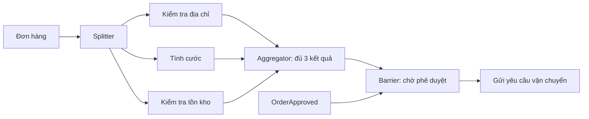
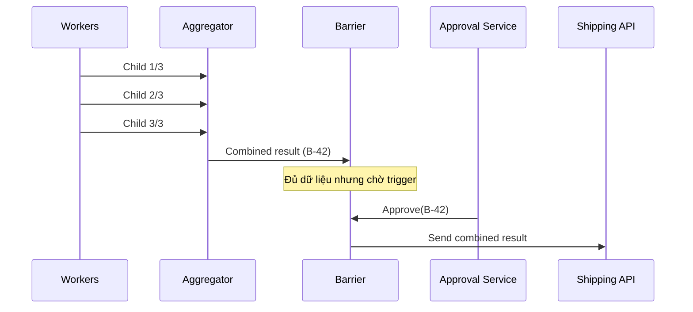
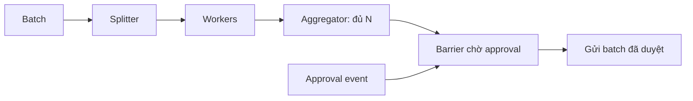
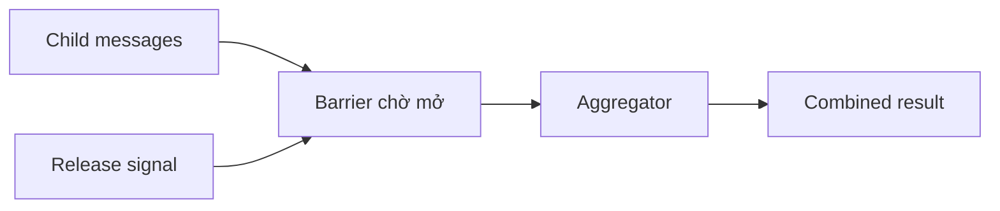
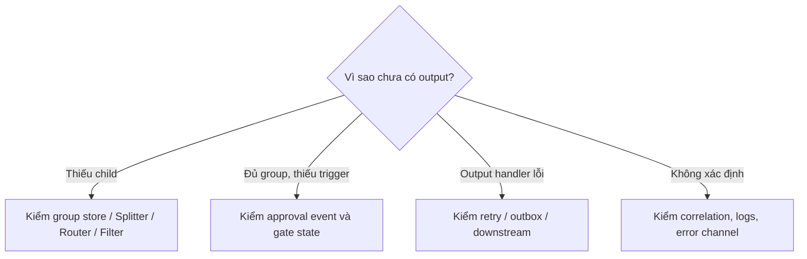
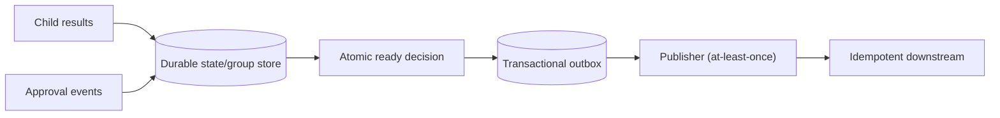

# Phân biệt Barrier với Aggregator trong Spring Integration

> **Module:** `SPRING_INTEGRATION_PATTERN` — Học triển khai Enterprise Integration Patterns với Spring Integration để xây dựng luồng thông điệp ít phụ thuộc và dễ mở rộng. Thực hành Router, Filter, Transformer, Splitter, Aggregator, Gateway, retry, error channel và correlation, đồng thời kiểm thử, theo dõi các nhánh xử lý.
>
> **Chương:** Barrier  
> **Đề bài:** Phân biệt barrier với aggregator

## 1. Hai yêu cầu nghe giống nhau nhưng không cùng bản chất

Một hệ thống tạo vận đơn cần thực hiện hai việc:

1. **Tập hợp kết quả:** chia một đơn hàng thành ba tác vụ xác minh địa chỉ, tính cước và kiểm tra tồn kho; chỉ khi các tác vụ cần thiết hoàn thành, hệ thống mới có kết quả đủ thông tin.
2. **Chờ quyền phát hành:** dù dữ liệu đã đầy đủ, hệ thống không được gửi yêu cầu tạo vận đơn cho đối tác trước khi nhận sự kiện `OrderApproved` từ dịch vụ phê duyệt.

Câu hỏi đầu tiên là **“Đã nhận đủ các thành phần của một nhóm chưa, và cần kết hợp chúng thành gì?”** — đây là bài toán **Aggregator**.

Câu hỏi thứ hai là **“Một thông điệp/kết quả đã sẵn sàng có được đi qua một cổng chặn chưa?”** — đây là bài toán **Barrier**.



Trong sơ đồ, **Aggregator tạo kết quả nhóm**, còn **Barrier quyết định thời điểm cho kết quả đó đi tiếp**. Hai thành phần có thể cùng xuất hiện; không phải hai tên gọi thay thế cho nhau.

Bài này tập trung so sánh trực tiếp hai pattern, chỉ rõ trường hợp ngoại lệ khi một Aggregator tùy biến có thể đóng vai trò gate, cách tránh nhầm lẫn giữa correlation và trigger, và những hệ quả về thread, state, retry và tính bền vững.

### Kết quả học tập

Sau bài này, người học có thể:

- Phát biểu đúng trách nhiệm của Barrier và Aggregator.
- Chọn pattern theo **điều kiện release** và **đơn vị dữ liệu** cần xử lý.
- Phân biệt `correlationId`, `sequenceNumber`, `sequenceSize` với event cho phép mở Barrier.
- Đọc sơ đồ Splitter → Aggregator → Barrier và dự đoán hành vi khi dữ liệu, trigger đến đảo thứ tự.
- Hiểu giới hạn của các flow chạy đồng bộ/trong bộ nhớ so với nhiều replica.
- Viết một ví dụ Aggregator bằng Java DSL và một gate Barrier minh họa qua Gateway/ServiceActivator.
- Kiểm thử thiếu child, trigger sớm/muộn, duplicate, timeout và lỗi sau release.

## 2. Định nghĩa cốt lõi

### 2.1. Aggregator: gom nhiều message thành một kết quả logic

Trong Enterprise Integration Patterns, **Aggregator** nhận nhiều message liên quan, giữ chúng theo nhóm rồi phát kết quả khi **release strategy** cho biết có thể hoàn tất nhóm. Nó cần xác định:

- **Correlation:** message nào thuộc cùng một nhóm?
- **Release:** khi nào nhóm được xem là hoàn tất?
- **Aggregation:** các payload/message được kết hợp thành kết quả gì?
- **Message group state:** các message đang chờ được lưu ở đâu và xử lý expiry thế nào?

Một ví dụ phổ biến: nhận đủ ba child từ Splitter, gộp thành một danh sách hoặc một kết quả nghiệp vụ.

```text
Input:
  result(group=G1, seq=2/3, payload="fee")
  result(group=G1, seq=1/3, payload="address")
  result(group=G1, seq=3/3, payload="stock")

Aggregator:
  chờ đủ các phần tử theo release strategy
  kết hợp payload

Output:
  combined(G1, address, fee, stock)
```

Output là **một kết quả tổng hợp** trong ví dụ. Framework có khả năng tùy biến processor/release strategy; không phải mọi Aggregator luôn tạo danh sách hay có cùng thứ tự đầu ra.

### 2.2. Barrier: giữ message cho đến khi có điều kiện giải phóng

**Barrier** đóng vai trò **cổng đồng bộ hóa**. Một message đã có thể xử lý được nhưng cần đợi **tín hiệu** hoặc **điều kiện** trước khi được tiếp tục.

```text
Input:
  readyShipment(operation=G1, payload="shipment data")

Barrier:
  chờ release(operation=G1)

Output sau khi có release:
  readyShipment(operation=G1, payload="shipment data")
```

Trong mô hình Barrier ở đây, message được **giữ/chặn** rồi cho qua; Barrier không nhất thiết phải gom N child thành một payload mới. Tùy cách triển khai, tín hiệu có thể đến từ một luồng điều khiển độc lập, từ scheduler hoặc từ một sự kiện nghiệp vụ.

Spring Integration có các thành phần hỗ trợ Barrier/synchronization. API cụ thể, điều kiện phát, thread blocking và việc xử lý trigger đến trước data phụ thuộc loại endpoint/cấu hình/phiên bản. **Không nên suy diễn rằng native Barrier tự có durable queue, thứ tự toàn cục hoặc tính phân tán**. Đoạn code ở phần 8 là mô hình gate rõ ràng về mặt nghiệp vụ, không giả vờ là API native của framework.

## 3. Bảng so sánh quyết định chọn pattern

| Tiêu chí | Barrier | Aggregator |
|---|---|---|
| Vấn đề chính | *Cho phép đi tiếp khi nào?* | *Nhóm nào đã hoàn tất và gom thành gì?* |
| Đơn vị chính | Một message/công việc đang chờ điều kiện | Nhiều message tạo thành group |
| Dữ liệu vào | Message dữ liệu và tín hiệu/điều kiện release | Các message có cùng khóa correlation |
| Đầu ra thường gặp | Message được phép đi tiếp hoặc sự kiện Ready | Kết quả gom nhóm |
| Điều kiện mở | Trigger, approval, resource ready, latch theo khóa | Release strategy: đủ N, marker, timeout, rule nghiệp vụ |
| Có bắt buộc `sequenceSize`? | Không, nếu chỉ chờ một trigger cho một message | Thường hữu ích khi cần đủ N child; không bắt buộc với custom release strategy |
| Có bắt buộc tín hiệu bên ngoài? | Không nhất thiết; tùy hợp đồng đồng bộ hóa | Không; có thể release thuần theo dữ liệu, cũng có thể tích hợp tín hiệu tùy biến |
| Có sắp xếp message không? | Không tự động | Không mặc định bảo đảm thứ tự nghiệp vụ trong mọi cấu hình |
| Trạng thái phải giữ | Message đang chờ và điều kiện release | Các message trong group cùng metadata/tình trạng release |
| Lỗi phổ biến | Trigger bị mất, chờ vô hạn, mở sai khóa | Thiếu child, sai correlation, duplicate, release sớm |
| Khi nhiều replica | State/tín hiệu phải cùng owner hoặc có store chung | Group phải cùng owner hoặc dùng group store phù hợp |

**Quy tắc chọn nhanh:** nếu vấn đề nằm ở **sự đầy đủ và kết hợp dữ liệu**, bắt đầu với Aggregator. Nếu vấn đề nằm ở **quyền/điều kiện cho phép một kết quả đi tiếp**, bắt đầu với Barrier. Nếu cần cả hai, đặt rõ hai điều kiện và phối hợp hai pattern.

### Một ngoại lệ quan trọng

Một **Aggregator tùy biến** có thể nhận cả dữ liệu lẫn event phê duyệt trong một group và chỉ release khi đủ những loại event cần thiết. Khi đó Aggregator đang được dùng như **một coordinator nhiều điều kiện**, tương tự bài toán Barrier về nghiệp vụ.

Điều này **không làm hai pattern đồng nghĩa**. Bạn đã phải thiết kế correlation, kiểu event, release strategy và group store tùy biến để Aggregator xử lý logic gate; một Aggregator mặc định chỉ gom dữ liệu không tự hiểu tín hiệu phê duyệt.

## 4. Timeline 1: đủ dữ liệu nhưng chưa có quyền phát hành

Giả sử batch B-42 cần ba kết quả:

```text
t0: AddressChecked(B-42, seq=1/3)
t1: FeeCalculated(B-42, seq=2/3)
t2: StockVerified(B-42, seq=3/3)
t3: Aggregator release -> ReadyShipment(B-42)
t4: Chưa có approval -> Barrier vẫn giữ
t5: OrderApproved(B-42)
t6: Barrier mở -> gửi ReadyShipment(B-42)
```

Nếu chỉ dùng Aggregator phát thẳng vào outbound API ở `t3`, yêu cầu “phải được duyệt trước khi gửi” bị vi phạm, dù nhóm dữ liệu đã hoàn chỉnh.

Nếu chỉ dùng Barrier chờ `OrderApproved` cho **từng child**, bạn có thể mở ba message riêng mà không hề tạo một kết quả tổng hợp. Yêu cầu gom nhóm vẫn chưa được giải quyết.



**Điểm cần nhớ:** Aggregator đạt **điều kiện hoàn tất nhóm**, Barrier đạt **điều kiện cho phép tiếp tục**; hai điều kiện có thể độc lập về thời gian.

## 5. Timeline 2: phê duyệt đến trước khi đủ dữ liệu

```text
t0: OrderApproved(B-42)
t1: AddressChecked(B-42, seq=1/3)
t2: StockVerified(B-42, seq=3/3)
t3: FeeCalculated(B-42, seq=2/3)
t4: Aggregator release -> ReadyShipment(B-42)
t5: Barrier thấy approval đã lưu -> mở
```

Một thiết kế đúng phải **quy định rõ cách giữ trigger đến sớm**. Nếu bên nhận trigger chỉ kiểm tra “đã có message chờ chưa?” và bỏ qua tín hiệu khi chưa có, Barrier có thể không mở dù tất cả điều kiện cuối cùng đã đạt.

Trong implementation native, không được mặc nhiên cho rằng trigger đến trước luôn được nhớ: hành vi này phụ thuộc cơ chế correlation, lưu trạng thái và thứ tự đăng ký. Với giao thức nghiệp vụ cần bảo đảm “approval trước/sau đều đúng”, hãy thiết kế **coordinator lưu trạng thái trigger**, hoặc dùng hệ thống event/store có thể khôi phục signal.

### Bảng trạng thái cho Barrier một data + một approval

| Data | Approval | Kết quả |
|---|---|---|
| Chưa | Chưa | PENDING |
| Có | Chưa | PENDING, giữ data |
| Chưa | Có | PENDING, giữ approval |
| Có | Có | READY đúng một lần trong phạm vi state |
| Đã READY | Trigger/message trùng | Không tạo kết quả thứ hai |
| Đã EXPIRED/CANCELLED | Signal đến muộn | Không tự mở lại |

Đây là **state machine nghiệp vụ**; nó có thể được hiện thực bằng một component phối hợp, không phải hứa hẹn rằng mọi Barrier implementation đều có sẵn các trạng thái này.

## 6. Correlation và sequence metadata: đừng nhầm group với trigger

Đối với luồng Splitter → Aggregator, các header phổ biến là:

| Header | Ý nghĩa | Ví dụ |
|---|---|---|
| `correlationId` | Khóa nhóm các child liên quan | `batch-42` |
| `sequenceNumber` | Vị trí logic trong chuỗi | 1, 2, 3 |
| `sequenceSize` | Tổng số child dự kiến khi biết kích thước | 3 |
| `MessageHeaders.ID` | ID của từng message, có thể khác nhau khi tái tạo message | khác nhau ở mỗi child |

Spring Integration định danh các header liên quan qua `IntegrationMessageHeaderAccessor`:

```java
import org.springframework.integration.IntegrationMessageHeaderAccessor;
import org.springframework.messaging.Message;

Object key = message.getHeaders().get(
        IntegrationMessageHeaderAccessor.CORRELATION_ID);
Integer number = message.getHeaders().get(
        IntegrationMessageHeaderAccessor.SEQUENCE_NUMBER, Integer.class);
Integer total = message.getHeaders().get(
        IntegrationMessageHeaderAccessor.SEQUENCE_SIZE, Integer.class);
```

Aggregator cần **khóa nhóm** và một **quy tắc hoàn tất**. Với Splitter tạo Collection hữu hạn và cấu hình sequence phù hợp, `sequenceSize` giúp biết nhóm dự kiến có bao nhiêu child. Khi dùng Iterator/stream chưa biết kích thước, `sequenceSize` có thể không biểu thị số N rõ ràng; cần end marker hoặc release strategy khác.

Trong mô hình Barrier, trigger thường có **khóa nghiệp vụ** phù hợp với message đang chờ:

```json
{
  "type": "OrderApproved",
  "tenantId": "tenant-7",
  "operationId": "batch-42",
  "approvalId": "ap-91"
}
```

Đừng dùng `MessageHeaders.ID` riêng của trigger làm khóa để tìm data, vì ID đó không nhất thiết liên quan tới ID message dữ liệu. Có thể ánh xạ `operationId` thành correlation key ở cả hai nhánh.

**Bảo mật:** nếu trigger có thể mở khóa một hành động nhạy cảm, nguồn phát phải được xác thực và phân quyền theo tenant/operation. Không tin `approved=true` hoặc `tenantId` do client bất kỳ gửi.

## 7. Ví dụ Aggregator bằng Spring Integration Java DSL

Đầu tiên minh họa **chỉ vấn đề gom nhóm**, không có approval. Luồng nhận một danh sách mã, tách thành message con, biến đổi rồi aggregate thành một kết quả.

### 7.1. Dependencies và ứng dụng

Ví dụ dùng Spring Boot/Spring Integration và Java 17+. Chọn dependency versions theo dự án:

```groovy
dependencies {
    implementation "org.springframework.boot:spring-boot-starter-integration"
    testImplementation "org.springframework.boot:spring-boot-starter-test"
}
```

```java
package com.example.barriervsaggregator;

import org.springframework.boot.SpringApplication;
import org.springframework.boot.autoconfigure.SpringBootApplication;
import org.springframework.integration.annotation.IntegrationComponentScan;
import org.springframework.integration.config.EnableIntegration;

@SpringBootApplication
@EnableIntegration
@IntegrationComponentScan
public class PatternDemoApplication {

    public static void main(String[] args) {
        SpringApplication.run(PatternDemoApplication.class, args);
    }
}
```

### 7.2. Flow gom nhóm

```java
package com.example.barriervsaggregator;

import java.util.Locale;
import org.springframework.context.annotation.Bean;
import org.springframework.context.annotation.Configuration;
import org.springframework.integration.dsl.IntegrationFlow;

@Configuration
public class AggregationFlowConfig {

    @Bean
    public IntegrationFlow batchAggregationFlow() {
        return IntegrationFlow.from("aggregationInput")
                .split()       // Với input collection: tạo các phần tử.
                .transform(String.class,
                        value -> value.toUpperCase(Locale.ROOT))
                .aggregate()   // Gom theo correlation/release strategy.
                .get();
    }
}
```

Một `@MessagingGateway` đồng bộ minh họa request-reply:

```java
package com.example.barriervsaggregator;

import java.util.List;
import org.springframework.integration.annotation.MessagingGateway;

@MessagingGateway(defaultRequestChannel = "aggregationInput")
public interface AggregationGateway {
    List<String> combine(List<String> values);
}
```

Giả sử gọi `aggregationGateway.combine(List.of("a","b","c"))`, flow Splitter/Transformer/Aggregator có thể trả collection kết quả chuẩn hóa theo cơ chế của Aggregator. **Kiểu/ thứ tự kết quả cụ thể cần được xác nhận bằng integration test ở phiên bản dự án.** Nếu nghiệp vụ cần đúng thứ tự gốc khi có executor hoặc xử lý song song, hãy kiểm soát ordering bằng sequence metadata, reordering hoặc group processor phù hợp; đừng suy ra mọi Aggregator luôn phát theo thứ tự arrival.

### 7.3. Aggregator release được nhóm bằng cách nào?

Mỗi nhóm cần một **CorrelationStrategy** và **ReleaseStrategy**. Trong ví dụ Splitter với collection hữu hạn, message con có thể mang correlation/sequence metadata phù hợp để Aggregator mặc định biết nhóm. Với custom Splitter, Filter làm mất child, message đi qua broker mất header hoặc nhóm có nguồn không biết kích thước, kết quả có thể không release.

```text
Group G:
  seq 1/3 -> received
  seq 2/3 -> received
  seq 3/3 -> received

ReleaseStrategy cho nhóm đủ -> aggregate payloads -> output
```

Nếu một child bị Filter discard, Aggregator có thể chờ vì nó kỳ vọng đủ ba thành phần. Giải pháp là sửa hợp đồng phần tử cần có, gửi một kết quả `SKIPPED` phù hợp, hoặc dùng release strategy có hiểu trạng thái thiếu; **không sửa sequenceSize một cách tùy tiện cho từng child**.

**Aggregator không tự biến sự kiện phê duyệt bên ngoài thành điều kiện giải phóng** chỉ vì nó xuất hiện cùng module.

## 8. Ví dụ Barrier bằng coordinator Java, không gom dữ liệu

Ta xây một gate **chỉ có một data event và một approval** cho cùng operation. Code Java 17+ minh họa ý tưởng Barrier, tách biệt với flow Aggregator ở phần 7.

Mục tiêu:

1. Data đến trước thì đợi approval.
2. Approval đến trước thì đợi data, không bỏ tín hiệu.
3. Khi có cả hai, phát một `Ready`.
4. Duplicate cùng nội dung không mở hai lần; duplicate mâu thuẫn bị từ chối.
5. Không làm một operation của tenant này trộn với tenant khác.
6. Giới hạn group đang chờ trong RAM.

**Đây là coordinator in-memory để học, không phải class native Barrier của Spring Integration.** Mã chưa có timeout, persistent store, distributed locking, outbox hoặc chính sách phục hồi sau crash.

### 8.1. Class `LocalApprovalBarrier`

```java
package com.example.barriervsaggregator;

import java.util.HashMap;
import java.util.HashSet;
import java.util.Map;
import java.util.Objects;
import java.util.Optional;
import java.util.Set;

public final class LocalApprovalBarrier {

    public record Key(String tenantId, String operationId) {
        public Key {
            if (tenantId == null || tenantId.isBlank()
                    || operationId == null || operationId.isBlank()) {
                throw new IllegalArgumentException("Invalid key");
            }
        }
    }

    public record Prepared(Key key, String payload) {
        public Prepared {
            Objects.requireNonNull(key);
            Objects.requireNonNull(payload);
        }
    }

    public record Approved(Key key, String approvalId) {
        public Approved {
            Objects.requireNonNull(key);
            if (approvalId == null || approvalId.isBlank()) {
                throw new IllegalArgumentException("Invalid approval");
            }
        }
    }

    public record Ready(
            Key key, String payload, String approvalId) {}

    private static final class Pending {
        String payload;
        String approvalId;
    }

    private final Map<Key, Pending> awaiting = new HashMap<>();
    private final Set<Key> completed = new HashSet<>();
    private final int maxPending;

    public LocalApprovalBarrier(int maxPending) {
        if (maxPending < 1) {
            throw new IllegalArgumentException("maxPending must be > 0");
        }
        this.maxPending = maxPending;
    }

    public synchronized Optional<Ready> accept(Prepared prepared) {
        Objects.requireNonNull(prepared);
        Key key = prepared.key();

        if (completed.contains(key)) {
            return Optional.empty();
        }

        Pending state = findOrCreate(key);

        if (state.payload != null
                && !state.payload.equals(prepared.payload())) {
            throw new IllegalArgumentException("Conflicting data");
        }

        state.payload = prepared.payload();
        return releaseIfReady(key, state);
    }

    public synchronized Optional<Ready> approve(Approved approved) {
        Objects.requireNonNull(approved);
        Key key = approved.key();

        if (completed.contains(key)) {
            return Optional.empty();
        }

        Pending state = findOrCreate(key);

        if (state.approvalId != null
                && !state.approvalId.equals(approved.approvalId())) {
            throw new IllegalArgumentException("Conflicting approval");
        }

        state.approvalId = approved.approvalId();
        return releaseIfReady(key, state);
    }

    private Pending findOrCreate(Key key) {
        Pending state = awaiting.get(key);
        if (state != null) {
            return state;
        }
        if (awaiting.size() >= maxPending) {
            throw new IllegalStateException("Too many pending operations");
        }

        state = new Pending();
        awaiting.put(key, state);
        return state;
    }

    private Optional<Ready> releaseIfReady(Key key, Pending state) {
        if (state.payload == null || state.approvalId == null) {
            return Optional.empty();
        }

        // Chỉ atomic trong JVM này, CHƯA có durable output.
        awaiting.remove(key);
        completed.add(key);

        return Optional.of(
                new Ready(key, state.payload, state.approvalId));
    }
}
```

### 8.2. Phân tích vì sao đây là Barrier chứ không phải Aggregator

- Hai event đại diện cho **hai điều kiện khác nhau**: có payload và được duyệt.
- Lúc release, gate không ghép một danh sách child theo sequence; nó **mở đường** cho payload sẵn sàng.
- `approvalId` là bằng chứng/metadata của điều kiện mở, không phải một “phần tử thứ hai” cần kết hợp về mặt nội dung đơn hàng.
- Không có `sequenceNumber` hoặc `sequenceSize`; chúng không cần thiết cho hợp đồng một data + một approval.
- `synchronized` bảo vệ quyết định emit-once trong một JVM; không bảo đảm exactly-once external side effects.

Nếu thay bằng Aggregator với một group gồm `Prepared` và `Approved`, vẫn có thể đạt cùng nghiệp vụ **nếu** custom release strategy hiểu đúng hai loại event. Nhưng mã đã bổ sung một gate hai điều kiện, tức là logic Barrier được cài vào cấu trúc Aggregator.

### 8.3. Những giới hạn cần ghi rõ

`LocalApprovalBarrier` **không dùng nguyên xi trong production** vì:

- Sau restart, `awaiting` và `completed` biến mất.
- `completed` tăng không giới hạn theo số operation; cần TTL/tombstone và chính sách ID không tái sử dụng.
- Nếu data và trigger tới hai replica khác nhau, mỗi replica có state riêng.
- Nếu downstream ném exception **sau khi** `releaseIfReady()` đánh dấu completed, output có thể bị mất.
- Không có deadline/cancellation/quarantine cho operation thiếu trigger.
- `approvalId` được xem là dữ liệu đầu vào; nguồn approval cần AuthN/AuthZ thực sự.

Muốn xử lý thông tin nghiệp vụ quan trọng trong flow phân tán, cần shared durable state với transaction/version locking, ghi outbox event trong cùng transaction lúc chuyển READY và downstream idempotent.

## 9. Tích hợp Barrier minh họa với Spring Integration Gateway

Để thấy rõ hai cổng dữ liệu và điều khiển, dùng các channel **khác tên** so với `aggregationInput` ở phần 7:

```text
PreparedGateway ---> preparedInput ----+
                                       +--> LocalApprovalBarrier --> readyOutput
ApprovedGateway ---> approvedInput ----+                          |
                                                                  v
                                                             ReadyHandler
```

### 9.1. Cấu hình kênh

```java
package com.example.barriervsaggregator;

import org.springframework.context.annotation.Bean;
import org.springframework.context.annotation.Configuration;
import org.springframework.integration.channel.DirectChannel;
import org.springframework.messaging.MessageChannel;

@Configuration
public class BarrierChannelConfig {

    @Bean
    public MessageChannel preparedInput() {
        return new DirectChannel();
    }

    @Bean
    public MessageChannel approvedInput() {
        return new DirectChannel();
    }

    @Bean
    public MessageChannel readyOutput() {
        return new DirectChannel();
    }

    @Bean
    public LocalApprovalBarrier localApprovalBarrier() {
        return new LocalApprovalBarrier(1_000);
    }
}
```

### 9.2. Hai Gateway one-way

```java
package com.example.barriervsaggregator;

import org.springframework.integration.annotation.MessagingGateway;
import org.springframework.messaging.handler.annotation.Payload;

@MessagingGateway(defaultRequestChannel = "preparedInput")
public interface PreparedGateway {
    void submit(@Payload LocalApprovalBarrier.Prepared event);
}
```

```java
package com.example.barriervsaggregator;

import org.springframework.integration.annotation.MessagingGateway;
import org.springframework.messaging.handler.annotation.Payload;

@MessagingGateway(defaultRequestChannel = "approvedInput")
public interface ApprovedGateway {
    void signal(@Payload LocalApprovalBarrier.Approved event);
}
```

Hai Gateway nhận sự kiện **một chiều**, không đợi Barrier mở mới trả về. Nếu thiết kế một Gateway request-reply cho mỗi sự kiện Prepared và chờ kết quả của approval có thể đến vài phút sau, caller rất dễ timeout và giữ thread không cần thiết.

### 9.3. ServiceActivator đưa dữ liệu vào gate

```java
package com.example.barriervsaggregator;

import org.springframework.integration.annotation.ServiceActivator;
import org.springframework.stereotype.Component;

@Component
public class ApprovalBarrierEndpoints {

    private final LocalApprovalBarrier barrier;

    public ApprovalBarrierEndpoints(LocalApprovalBarrier barrier) {
        this.barrier = barrier;
    }

    @ServiceActivator(
            inputChannel = "preparedInput",
            outputChannel = "readyOutput")
    public LocalApprovalBarrier.Ready onPrepared(
            LocalApprovalBarrier.Prepared event) {
        return barrier.accept(event).orElse(null);
    }

    @ServiceActivator(
            inputChannel = "approvedInput",
            outputChannel = "readyOutput")
    public LocalApprovalBarrier.Ready onApproved(
            LocalApprovalBarrier.Approved event) {
        return barrier.approve(event).orElse(null);
    }

    @ServiceActivator(inputChannel = "readyOutput")
    public void onReady(LocalApprovalBarrier.Ready ready) {
        // Demo: một nơi nhận kết quả Barrier đã mở.
        // Production: ghi outbox/publish durable + idempotency.
        System.out.println(
                "Approved operation: " + ready.key().operationId());
    }
}
```

Khi `onPrepared` hoặc `onApproved` trả `null`, ServiceActivator không gửi output. Khi cả hai điều kiện đã có, một `Ready` được gửi vào `readyOutput`.

**Lưu ý:** các channel đều là `DirectChannel`. Nếu `onReady` ném exception, lỗi có thể truyền ngược về Gateway đã gửi sự kiện cuối. Tuy vậy, state in-memory đã chuyển sang completed **trước khi downstream thành công**; đây là lỗ hổng cần giải quyết bằng durable state/outbox, không phải bằng cách retry lại Gateway một cách mù quáng.

### 9.4. Gọi thử hai thứ tự

```java
var key = new LocalApprovalBarrier.Key("tenant-7", "op-101");

// Data trước, approval sau.
preparedGateway.submit(
        new LocalApprovalBarrier.Prepared(key, "shipment"));
approvedGateway.signal(
        new LocalApprovalBarrier.Approved(key, "approval-101"));

// Operation khác: approval trước, data sau.
var otherKey = new LocalApprovalBarrier.Key("tenant-7", "op-102");
approvedGateway.signal(
        new LocalApprovalBarrier.Approved(otherKey, "approval-102"));
preparedGateway.submit(
        new LocalApprovalBarrier.Prepared(otherKey, "shipment-2"));
```

Hai chuỗi đều đi qua Barrier khi đủ dữ liệu và phê duyệt, nhưng `aggregationInput` của flow Aggregator **không hề tham gia**. Điều này làm nổi bật ranh giới giữa *group completion* và *permission to proceed*.

## 10. Unit test chứng minh hai điều kiện khác nhau

### 10.1. Kiểm thử Gate Barrier

File `LocalApprovalBarrierTest.java`:

```java
package com.example.barriervsaggregator;

import static org.junit.jupiter.api.Assertions.*;

import org.junit.jupiter.api.Test;

class LocalApprovalBarrierTest {

    private static LocalApprovalBarrier.Key key(String operationId) {
        return new LocalApprovalBarrier.Key("tenant-7", operationId);
    }

    @Test
    void dataAloneDoesNotRelease() {
        LocalApprovalBarrier gate = new LocalApprovalBarrier(10);
        var result = gate.accept(
                new LocalApprovalBarrier.Prepared(
                        key("x1"), "payload"));

        assertTrue(result.isEmpty());
    }

    @Test
    void dataThenApprovalReleases() {
        LocalApprovalBarrier gate = new LocalApprovalBarrier(10);
        var k = key("x2");

        assertTrue(gate.accept(
                new LocalApprovalBarrier.Prepared(k, "payload"))
                .isEmpty());

        var ready = gate.approve(
                new LocalApprovalBarrier.Approved(k, "ap-1"));

        assertEquals("payload", ready.orElseThrow().payload());
        assertTrue(gate.approve(
                new LocalApprovalBarrier.Approved(k, "ap-1"))
                .isEmpty());
    }

    @Test
    void approvalBeforeDataIsRemembered() {
        LocalApprovalBarrier gate = new LocalApprovalBarrier(10);
        var k = key("x3");

        assertTrue(gate.approve(
                new LocalApprovalBarrier.Approved(k, "ap-2"))
                .isEmpty());

        var ready = gate.accept(
                new LocalApprovalBarrier.Prepared(k, "payload"));

        assertEquals("ap-2", ready.orElseThrow().approvalId());
    }

    @Test
    void conflictingDuplicateIsRejected() {
        LocalApprovalBarrier gate = new LocalApprovalBarrier(10);
        var k = key("x4");

        gate.accept(new LocalApprovalBarrier.Prepared(k, "original"));

        assertThrows(IllegalArgumentException.class,
                () -> gate.accept(
                        new LocalApprovalBarrier.Prepared(k, "changed")));
    }

    @Test
    void tenantsDoNotShareAnOperation() {
        LocalApprovalBarrier gate = new LocalApprovalBarrier(10);
        var a = new LocalApprovalBarrier.Key("tenant-a", "shared-op");
        var b = new LocalApprovalBarrier.Key("tenant-b", "shared-op");

        gate.accept(new LocalApprovalBarrier.Prepared(a, "A-data"));
        gate.approve(new LocalApprovalBarrier.Approved(b, "B-approval"));

        // Chưa bên nào đủ cả data và approval.
        assertTrue(gate.accept(
                new LocalApprovalBarrier.Prepared(a, "A-data"))
                .isEmpty());

        assertEquals("A-data",
                gate.approve(
                        new LocalApprovalBarrier.Approved(a, "A-approval"))
                        .orElseThrow().payload());
    }
}
```

Test tập trung vào **gate condition**, không có sequence metadata hay gom N child. Những assertion này chưa chứng minh bền vững khi crash hoặc tương tác native Barrier framework.

### 10.2. Test Aggregator riêng

Một integration test cho `batchAggregationFlow()` nên:

1. Gửi một `List` hữu hạn gồm ba giá trị đến `aggregationInput`.
2. Quan sát có **một** kết quả sau khi nhóm được release.
3. Kiểm tra payload của kết quả chứa đủ ba giá trị đã transform.
4. Đảm bảo correlation/sequence header có mặt trong các child của splitter theo cấu hình.
5. Khi thay bằng custom Splitter hoặc Filter bỏ một child, xác minh hành vi timeout/release phù hợp.

Như vậy **test Aggregator kiểm chứng completeness của nhóm**, còn **test Barrier kiểm chứng điều kiện tín hiệu**. Trộn hai nhóm test có thể che giấu nguyên nhân khi một flow không phát output.

## 11. Khi cần kết hợp Aggregator và Barrier trong cùng flow

### 11.1. Aggregator trước Barrier: dễ diễn đạt nhất



**Ưu điểm:**

- Cơ chế gom nhóm tập trung ở Aggregator.
- Điều kiện nghiệp vụ phát hành tập trung ở Barrier.
- Retry một child không nhất thiết phải phát lại toàn bộ batch.
- Error metrics có thể phân biệt `GROUP_INCOMPLETE` và `APPROVAL_MISSING`.
- Dễ đánh giá tác động của timeout: nhóm đủ nhưng thiếu approval khác nhóm chưa đủ N.

**Hạn chế:** hai component có thể cùng giữ state; cần định nghĩa correlation, deadline và storage nhất quán. Nếu Aggregator hoàn tất rồi Barrier không được duyệt, phải có nơi giữ kết quả đã gom và chính sách expiry.

### 11.2. Barrier trước Aggregator: đôi khi đúng nhưng khác semantics



Mô hình này phù hợp khi **mỗi child không được phép đi tới Aggregator** trước một trigger chung. Nhưng có các hệ quả:

- Nếu chờ trong memory/thread, có N child bị giữ thay vì một kết quả tổng hợp.
- Nếu Barrier giữ một message theo khóa hoặc một phiên chờ, cần kiểm tra cách hỗ trợ nhiều child để tránh ghi đè/mất dữ liệu.
- Sau khi mở, Aggregator vẫn cần đủ N child và release strategy hợp lệ.
- Nếu trigger đến sớm hoặc child tới muộn, phải xác định liệu trigger áp dụng cho cả group hay chỉ một lần chặn.

Không nên thay đổi thứ tự hai pattern chỉ để “cho flow chạy được” mà không làm rõ ý nghĩa mỗi điều kiện.

### 11.3. Một Aggregator nhận cả data lẫn approval

Có thể xây group gồm các event kiểu `AddressChecked`, `FeeCalculated`, `StockVerified` và `OrderApproved`, rồi dùng custom ReleaseStrategy chỉ release khi đã thấy tất cả loại bắt buộc.

```text
groupKey = (tenantId, operationId)

release if:
    has AddressChecked
    AND has FeeCalculated
    AND has StockVerified
    AND has OrderApproved
```

Đây là một **thiết kế hợp lệ** khi bạn chủ động xây coordinator bằng Aggregator. Nhưng lưu ý:

- `sequenceSize=4` tự nó không chứng minh bốn *loại event khác nhau* đã xuất hiện; duplicate có thể làm đếm sai.
- Phải có correlation strategy cho cả bốn nguồn.
- Approval có thể đến sớm; group store phải giữ nó.
- Cần idempotency và trạng thái terminal sau release.
- Không nên xử lý approval như một phần tử payload đơn hàng nếu nó chỉ là quyền phát hành.
- Với broker phân tán, group store/ownership vẫn là bài toán riêng.

**Kết luận:** kiến trúc hai bước thường rõ nghĩa hơn; một Aggregator tùy biến có thể hợp lý khi muốn gom nhiều loại sự kiện trong một state machine duy nhất và đã kiểm soát toàn bộ contract.

## 12. Timeout: hết thời gian chờ có nghĩa gì?

Barrier và Aggregator đều có thể phải chờ, nhưng **lý do chờ khác nhau**, nên chính sách timeout không nên giống nhau một cách máy móc.

| Tình huống | Ràng buộc chưa đạt | Hành động tham khảo |
|---|---|---|
| Aggregator còn thiếu child `2/3` | Group chưa đủ dữ liệu | Retry child, chờ trong deadline, hoặc fail group |
| Aggregator đủ child nhưng lỗi merge | Lỗi xử lý kết quả | Fix data, retry có giới hạn hoặc DLQ |
| Barrier có data nhưng chưa có approval | Chưa được phép phát | Chờ event, hết hạn/hủy, hoặc trả trạng thái PENDING |
| Barrier có approval nhưng chưa có data | Thiếu thông điệp chờ | Giữ trigger, deadline và alert nếu cần |
| Kết quả đã ready nhưng outbound lỗi | Lỗi sau release, không phải lỗi gom nhóm | Retry outbound với idempotency, không mở lại Barrier |
| Message đến sau group terminal | Event muộn/duplicate | Audit, suppress hoặc reconciliation theo policy |

**Timeout không đồng nghĩa với release thành công.** Nếu business cho phép phát kết quả thiếu dữ liệu, output phải đánh dấu `partial=true` và liệt kê phần thiếu. Nếu chưa có phê duyệt, không nên tự phát hành chỉ vì đến hạn trừ khi đã có quy tắc nghiệp vụ cho phép rõ ràng.

Một cặp deadline ví dụ:

- Group data cần hoàn thành trong **30 giây**.
- Approval được chờ tối đa **10 phút** kể từ khi operation được tạo.
- Outbound gửi sau release có retry budget riêng trong **2 phút**.

Các mốc này chỉ là ví dụ; phải được xác định từ SLA, độ trễ thực và quy trình vận hành của ứng dụng.

## 13. Error Channel, retry và xử lý duplicate

### 13.1. Hai loại lỗi không nên nhập chung

Một Aggregator có thể gặp **correlation error** hoặc **missing child**. Một Barrier có thể gặp **missing trigger** hoặc **invalid approval**. Cả hai đều có thể xảy ra cùng lúc, nhưng đường khắc phục khác nhau.



### 13.2. Đừng giả định errorChannel tự gom mọi exception

Với `DirectChannel` và Gateway đồng bộ, exception có thể truyền trực tiếp về caller. Với poller, executor hoặc broker adapter, lỗi có thể được chuyển thành `ErrorMessage` tới error channel đã cấu hình hoặc do adapter xử lý bằng ACK/NACK. Đường lỗi phụ thuộc flow và loại endpoint.

Một error handler **không nên tự gửi failed message vô hạn về input channel**. Nếu group thiếu child hoặc approval chưa có, requeue nóng có thể tạo feedback loop mà vẫn không giải quyết điều kiện thiếu.

### 13.3. Retry làm biến dạng group và gate như thế nào?

- Một child được broker giao lại: Aggregator có thể gặp duplicate sequence; cần dedup theo group + logical member key.
- Approval được giao lại: Barrier phải tránh phát Ready lần thứ hai.
- Một batch đã xử lý xong nhưng outbound HTTP timeout: retry có thể tạo side effect trùng dù Barrier mở một lần.
- Một lỗi khiến toàn batch cha bị gửi lại trước Splitter: có nguy cơ tạo lại N child và tăng tải không cần thiết.
- Nếu retry được đặt bên trong handler HTTP, **một invocation** có thể tạo nhiều outbound attempts; nếu provider áp quota, mỗi attempt cần limiter.

Idempotency key nên gắn với **business operation ổn định**, hoặc (`operationId`, `partId`) khi xử lý từng child có tác dụng phụ, không dùng ID message mới mỗi lần redelivery.

## 14. Tính bền vững, nhiều replica và bảo đảm phát kết quả

Một sơ đồ chỉ có một JVM có thể thành công trong test nhưng không an toàn khi triển khai:

```text
Replica A: nhận child 1, child 2
Replica B: nhận child 3
Replica C: nhận approval

Không ai thấy đủ state cục bộ, dù toàn hệ thống có đủ điều kiện.
```

Cả Aggregator và Barrier cần giải quyết:

- **Ownership/correlation routing:** tất cả sự kiện cùng operation tới một owner có thể khôi phục state; hoặc dùng shared store.
- **Durability:** message/group/trigger/tombstone tồn tại qua restart nếu nghiệp vụ yêu cầu.
- **Concurrency:** transaction, locking, optimistic version hoặc partition ownership chống race khi release.
- **Duplicate:** redelivery có thể xảy ra, nên các bước nhận event và quyết định release phải idempotent.
- **Late arrival:** event đến sau terminal state không được tự tạo nhóm mới gây phát hai lần.
- **Outbox:** nếu state đã chuyển sang READY nhưng publish output lỗi, phải có ý định phát hành được lưu bền vững.



### Tại sao phải dùng outbox?

Nếu coordinator ghi trạng thái `COMPLETED`/`READY` rồi crash **trước khi gửi Ready event**, hệ thống có thể mất kết quả phát hành dù group đã xong. Nếu publish trước khi ghi trạng thái, crash có thể khiến lần chạy lại publish thêm lần nữa.

Ghi **state transition và outbox record trong cùng transaction** giúp không mất ý định phát. Outbox publisher vẫn có thể gửi trùng khi crash sau broker publish nhưng trước khi đánh dấu published; downstream cần dedup/idempotency. **Không hứa exactly-once HTTP side effects chỉ nhờ Barrier/Aggregator/outbox.**

### Khi nào native MessageGroupStore phù hợp?

Nếu dùng Aggregator chuẩn của Spring Integration, chọn `MessageGroupStore` tương thích với nhu cầu persistence/concurrency. Khi dữ liệu đi qua nhiều replica, cần xác minh store chia sẻ, group locking, ownership, timeout/expiry và late messages. Không phải cứ thay map bằng JDBC store là có ngay exactly-once output.

Với Barrier dùng trigger độc lập, bản thân native Barrier endpoint không mặc nhiên cung cấp một state machine phân tán có outbox. Có thể cần custom coordinator bền vững hoặc một giao thức event kết hợp group store và trigger persistence rõ ràng.

## 15. Performance và backpressure: chờ cái gì, ở đâu?

Khi chọn pattern, cần xem **điểm giữ dữ liệu**:

| Thiết kế | Dữ liệu được giữ | Nguy cơ |
|---|---|---|
| Barrier đồng bộ giữ thread | Message và thread đang đợi trigger | Cạn thread/Gateway timeout khi trigger chậm |
| Barrier lưu state rồi xử lý async | Message hoặc tham chiếu trong store | Backlog tăng; cần capacity, TTL và recovery |
| Aggregator gom child in-memory | N message trong group | Heap tăng, mất state sau restart |
| Aggregator với persistent store | Group trong DB/message store | I/O, contention, cleanup và retention |
| Aggregator xong mới Barrier | Một kết quả tổng hợp chờ trigger | Dễ giảm số object chờ nhưng vẫn cần state bền vững |
| Barrier trước Aggregator | N child có thể bị giữ trước khi group | Số pending item lớn, dễ tạo tắc nghẽn |

Giả sử 1.000 group cùng chờ, mỗi group 100 child, payload trung bình 2 KiB. Phần payload thô nếu giữ tất cả child là khoảng:

\[
1000 \times 100 \times 2\,\mathrm{KiB} = 200{,}000\,\mathrm{KiB}
\approx 195{,}3\,\mathrm{MiB}
\]

Con số này **chưa gồm headers, object overhead, map, thread stack, retry state**. Vì vậy cần bounded group count, giới hạn bytes, expiration, backpressure và khả năng từ chối admission rõ ràng khi quá tải.

Tương tự, nếu một Gateway giữ 2.000 thread chờ phê duyệt trong 10 phút, thiết kế có thể cạn tài nguyên ngay cả khi không mất message. Với chờ dài, ưu tiên **event-driven wait state** thay vì thread blocking.

## 16. Observability: cần biết đang đợi thiếu dữ liệu hay thiếu tín hiệu

Các metric nên theo dõi:

| Metric | Đọc như thế nào? |
|---|---|
| `aggregator_open_groups` | Nhóm dữ liệu còn đang chờ bao nhiêu? |
| `aggregator_missing_members` | Có bao nhiêu child logic chưa tới? |
| `aggregator_group_age_seconds` | Group chờ lâu nhất bao lâu? |
| `aggregator_released_total` | Bao nhiêu group đã hoàn tất dữ liệu? |
| `aggregator_duplicate_members_total` | Có redelivery/duplicate trong nhóm không? |
| `barrier_pending_operations` | Bao nhiêu result đang chờ trigger? |
| `barrier_trigger_received_total` | Bao nhiêu tín hiệu điều khiển đã nhận? |
| `barrier_early_trigger_total` | Trigger đến trước data bao nhiêu lần? |
| `barrier_ready_total` | Bao nhiêu operation đã qua Barrier? |
| `barrier_expired_total` | Bao nhiêu operation hết hạn khi chưa đủ điều kiện? |
| `ready_event_delivery_failure_total` | Output đã sẵn sàng nhưng phát đi thất bại? |
| `outbox_lag_seconds` | Thời gian từ trạng thái READY đến lúc publish? |

Không xem `aggregator_released_total` và `barrier_ready_total` là cùng một chỉ số. Nếu group data đã hoàn tất nhưng approval chậm, hai số có thể khác nhau trong một khoảng quan sát.

Các log nên có `tenantId`, `operationId/correlationId`, `sequenceNumber`, `eventType`, `groupState`, `triggerState`, `decisionReason` và `attempt`, nhưng tránh log credential, dữ liệu cá nhân hoặc payload nhạy cảm. Với cardinality lớn, đừng đưa mỗi operationId tùy ý thành label metric.

## 17. Ma trận kiểm thử tích hợp

| Tình huống | Kỳ vọng cho Aggregator | Kỳ vọng cho Barrier |
|---|---|---|
| Đã đủ 3 child, chưa approval | Release kết quả tổng hợp | Tiếp tục PENDING |
| Approval đến trước mọi child | Chưa đủ dữ liệu để aggregate | Ghi nhớ trigger theo contract |
| Child đến 2 → 3 → 1 | Gom đúng ba child, không coi arrival order là logic | Chỉ mở khi có kết quả nhóm và trigger |
| Child 2 bị Filter discard | Có thể không đủ nhóm | Không tự coi batch đã đầy đủ |
| Child 1 bị giao lại hai lần | Dedup/đếm thành viên logic đúng | Không tự mở nếu dữ liệu vẫn thiếu |
| Approval bị giao lại | Không làm thay đổi nhóm dữ liệu | Không tạo Ready thứ hai |
| Correlation ID không khớp | Sai hoặc tách nhóm | Trigger không mở nhầm operation khác |
| Hết timeout chờ child | Xử lý partial/failure theo policy | Không giả định đã đủ dữ liệu |
| Hết timeout chờ approval | Group có thể đã hoàn tất | EXPIRED/CANCELLED, không phát khi chưa có quyền |
| Crash sau release trước output | Cần store/outbox nếu quan trọng | Cần outbox/recovery tương ứng |
| Data/trigger sang hai replica | Group store/partition phải phù hợp | Gate state/partition phải phù hợp |
| Downstream HTTP 503 | Không nhất thiết chạy lại toàn bộ aggregation | Retry outbound riêng, không mở lại gate |
| Một approval giả mạo | Không thuộc logic release nhóm dữ liệu | Phải xác thực/ủy quyền nguồn trigger |

### Test contract cần tách thành hai lớp

**Tầng Aggregator:** gửi dữ liệu N phần tử; assert **đã đủ dữ liệu/đã phát kết quả nhóm** theo release strategy. Nếu dùng Splitter chuẩn, assert correlation/sequence headers còn sau Transformer; kiểm tra riêng việc thiếu child và duplicate.

**Tầng Barrier:** gửi một result Ready và một approval theo cả hai thứ tự; assert **chỉ một output** được phép đi tiếp. Test thêm duplicate trigger, sai tenant, cancel/expire và crash/downstream failure (khi implementation có lưu state bền vững).

Khi kết hợp hai tầng, thử trường hợp **đủ group trước, approval đến sau** và **approval đến trước, group đủ sau**; đều chỉ phát một lần theo cùng business operation.

## 18. Những lỗi thiết kế thường gặp

| Sai lầm | Vì sao sai | Cách sửa |
|---|---|---|
| Dùng Aggregator để “chờ approval” mà không có approval trong release strategy | Nhóm có thể release khi đủ child dù chưa được duyệt | Tách Barrier hoặc viết strategy hiểu approval |
| Dùng Barrier thay Aggregator cho N child | Có trigger nhưng chưa gom/thống kê đủ child | Dùng Aggregator trước gate hoặc coordinator nhóm rõ |
| Cho rằng Aggregator mặc định luôn bảo đảm output order | Processing concurrency thay đổi arrival/completion | Kiểm thử ordering; dùng resequence/group processor phù hợp |
| Gắn `correlationId` bằng message ID riêng mỗi child | Các child thành nhiều group | Dùng group ID ổn định |
| Gửi approval với khóa khác data | Trigger không khớp group | Dùng composite operation key thống nhất |
| Bỏ trigger đến trước data | Barrier chờ mãi | Persist trigger hoặc thiết kế handshake |
| Đếm duplicate child thành đủ N | Release nhóm thiếu dữ liệu | Dedup theo logical member/sequence |
| Filter bỏ child nhưng vẫn chờ sequenceSize cũ | Group không bao giờ đầy đủ | Xác định skipped/failure và release policy |
| Đợi Barrier bằng Gateway sync trong nhiều phút | Giữ thread, timeout caller | Async admission và durable wait state |
| Dùng state RAM trên nhiều replica | Data và signal bị phân tán | Shared state hoặc keyed owner + recovery |
| Đánh dấu READY rồi publish rời rạc | Crash có thể mất output | Transactional outbox và idempotency |
| Error flow gửi ngược input vô hạn | Feedback loop và message trùng | Retry có giới hạn, delay, terminal DLQ |
| Nhầm release với exactly-once side effects | HTTP có thể thành công rồi mất ACK | Stable idempotency key và reconciliation |

## 19. Bài tập thực hành

**Bài 1 — Chọn pattern.** Với các yêu cầu: (a) gom ba kết quả kiểm tra, (b) đợi người quản lý phê duyệt, (c) phát các event theo sequence 1 → 2 → 3, hãy chọn Aggregator, Barrier hoặc Resequencer. Giải thích vì sao không nên dùng một pattern cho cả ba mục tiêu.

**Bài 2 — Đủ group nhưng chưa được duyệt.** Chạy flow `aggregationInput` với ba phần tử. Sau khi có kết quả nhóm, gửi nó vào `preparedInput` và chưa gửi approval. Xác minh handler của `readyOutput` chưa được gọi.

**Bài 3 — Approval đến sớm.** Gửi `approvedInput` trước khi có dữ liệu. Gửi dữ liệu sau; kiểm chứng output đúng một lần. Giải thích tại sao một native barrier không có persistence trigger sẽ cần kiểm tra behavior riêng.

**Bài 4 — Bỏ một child.** Splitter tạo ba child nhưng Filter loại seq=2/3. Dự đoán Aggregator sẽ release hay chờ theo default strategy; thiết kế output `SKIPPED` hoặc release strategy phù hợp. Barrier phải phản ứng ra sao khi nhóm chưa được xác nhận hoàn tất?

**Bài 5 — Nested split và trigger.** Một batch có ba orders, mỗi order có nhiều line items. Thiết kế Aggregator trong gom items, Aggregator ngoài gom orders, sau đó Barrier chỉ mở khi batch được duyệt. Nêu group key riêng cho từng cấp.

**Bài 6 — Crash sau release.** Giả lập coordinator đã chuyển READY nhưng chưa publish event. Chỉ ra lỗ hổng của bản in-memory và phác thảo transaction lưu state/outbox cùng idempotency của downstream.

**Bài 7 — Multi-instance.** Data và approval được hai replica khác nhau nhận. Đề xuất partition theo operation ID hoặc shared state; giải thích cách xử lý retry và redelivery không làm phát hành hai lần.

**Bài 8 — Timeout khác nhau.** Đặt group timeout 30 giây và approval deadline 10 phút. Khi một child mãi không đến, khi approval mãi không đến, và khi provider HTTP 503 sau release, hãy xác định ba nhóm lỗi và retry policy khác nhau.

### Câu hỏi tự đánh giá

1. Tại sao Aggregator phát một kết quả khi đủ nhóm còn Barrier có thể vẫn giữ kết quả đó?
2. Một Barrier có bắt buộc phải nhận `sequenceSize` không? Khi nào cần?
3. Aggregator có thể đóng vai trò chờ approval trong trường hợp nào?
4. Một approval event đến trước child cuối: phải lưu ở đâu và vì sao?
5. Tại sao sử dụng `MessageHeaders.ID` của từng child làm correlation key có thể khiến Aggregator không release?
6. Có một kết quả Ready được phát từ Barrier nghĩa là API bên ngoài chắc chắn tạo tác dụng phụ một lần chưa?
7. Vì sao việc retry cả batch trước Splitter có thể gây gửi trùng khi chỉ một child lỗi?
8. Nếu dùng một store chung cho Aggregator và Barrier, đã đủ để gọi hệ thống là exactly-once chưa?
9. Khi nào nên ưu tiên Aggregator trước Barrier, khi nào cần Barrier trước Aggregator?
10. Những chỉ số nào giúp phân biệt “đang chờ dữ liệu” với “đang chờ tín hiệu”?

## 20. Checklist triển khai

- [ ] Mỗi pattern có trách nhiệm rõ: group completeness hay permission to proceed.
- [ ] Correlation key nhất quán, phân biệt tenant và operation.
- [ ] Với Aggregator, xác định correlation/release/group processor, thứ tự và duplicate policy.
- [ ] Với Barrier, xác định điều kiện mở, quyền phát trigger, trigger đến sớm và trạng thái terminal.
- [ ] Không giữ thread đồng bộ vô hạn khi chờ approval chậm.
- [ ] Có timeout/expiry riêng cho group và approval nếu SLA khác nhau.
- [ ] Có backpressure và giới hạn số group/message đang giữ.
- [ ] Với nhiều replica, có partition ownership hoặc shared durable state.
- [ ] State transition và ghi ý định output an toàn trước crash (outbox).
- [ ] Downstream idempotent; retry có giới hạn và không tạo error flow loop.
- [ ] Có test cho thiếu child, duplicate, trigger sớm/muộn và lỗi sau release.
- [ ] Metrics theo dõi group waiting và gate waiting riêng, tránh lộ dữ liệu nhạy cảm.

## 21. Tài liệu tham khảo

- [Spring Integration Reference — Barrier](https://docs.spring.io/spring-integration/reference/barrier.html): đồng bộ hóa và điều kiện release.
- [Spring Integration Reference — Aggregator](https://docs.spring.io/spring-integration/reference/aggregator.html): correlation, release strategy, MessageGroupStore và xử lý timeout.
- [Spring Integration Reference — Resequencer](https://docs.spring.io/spring-integration/reference/resequencer.html): thứ tự logic của message.
- [Spring Integration Reference — Splitter](https://docs.spring.io/spring-integration/reference/splitter.html): chia message và sequence headers.
- [Spring Integration Reference — Message Channels](https://docs.spring.io/spring-integration/reference/channel.html): các channel đồng bộ/bất đồng bộ.
- [Spring Integration Reference — Messaging Gateways](https://docs.spring.io/spring-integration/reference/gateway.html): request-reply và one-way Gateway.
- [Spring Integration Reference — Error Handling](https://docs.spring.io/spring-integration/reference/error-handling.html): ErrorMessage, error channel và xử lý lỗi.
- [Microservices Patterns — Transactional Outbox](https://microservices.io/patterns/data/transactional-outbox.html): ghi trạng thái và ý định phát message trong cùng transaction.
