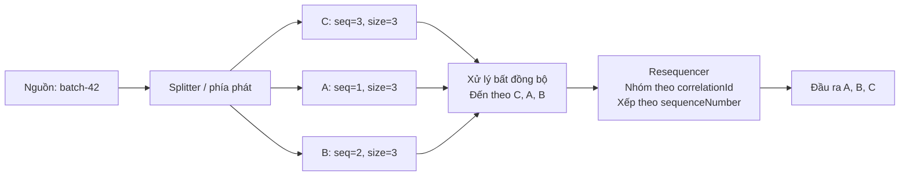

# Sequence number sinh từ nguồn nào?

Trong **SPRING_INTEGRATION_PATTERN**, các Enterprise Integration Patterns như Splitter, Router, Transformer, Aggregator và Resequencer giúp xây dựng luồng thông điệp ít phụ thuộc, dễ mở rộng. Khi một công việc được chia thành nhiều thông điệp và xử lý song song, các nhánh có thể hoàn thành theo thứ tự khác thứ tự ban đầu. **Resequencer** nhận những thông điệp có liên quan và đưa chúng trở lại thứ tự được khai báo bằng `sequenceNumber`.

Điểm mấu chốt: **`sequenceNumber` do phía phát sinh hoặc chia chuỗi thông điệp gán; Resequencer đọc giá trị đó để sắp xếp, không tự suy ra thứ tự đúng từ thời điểm nhận.** Trong Spring Integration, nguồn phổ biến nhất là **Splitter** được cấu hình tạo thông tin chuỗi. Với thông điệp đi từ hệ thống ngoài, ứng dụng phải mang theo hoặc tự ánh xạ số thứ tự từ dữ liệu nghiệp vụ.

## 1. Sequence number là thứ tự trong một nhóm, không phải mã định danh toàn cục

Ba header cần được xét cùng nhau:

| Header Spring Integration | Vai trò | Ví dụ |
| --- | --- | --- |
| `correlationId` | Xác định các thông điệp thuộc **cùng một chuỗi/nhóm** | `batch-42` |
| `sequenceNumber` | Chỉ vị trí của thông điệp **trong nhóm**, thường bắt đầu từ `1` | `2` |
| `sequenceSize` | Tổng số thông điệp dự kiến trong chuỗi, nếu đã biết | `3` |

Tên hằng Java tương ứng nằm trong `org.springframework.integration.IntegrationMessageHeaderAccessor`: `CORRELATION_ID`, `SEQUENCE_NUMBER` và `SEQUENCE_SIZE`. Phân biệt các header này với `MessageHeaders.ID`: `id` định danh **một message**, còn `correlationId` định danh **một nhóm message**. Hai message khác `id` có thể cùng `correlationId`.

Ví dụ một nguồn phát sinh ba phần của `batch-42`:

| Message | correlationId | sequenceNumber | sequenceSize | Payload |
| --- | --- | ---: | ---: | --- |
| Phần A | `batch-42` | 1 | 3 | `A` |
| Phần B | `batch-42` | 2 | 3 | `B` |
| Phần C | `batch-42` | 3 | 3 | `C` |

Nếu mạng và xử lý song song làm chúng đến theo thứ tự **C → A → B**, Resequencer có thể phát ra **A → B → C** khi các điều kiện giải phóng nhóm đã được đáp ứng. Nó biết thứ tự dự kiến nhờ header, chứ không nhờ nội dung `A`, `B`, `C` hay thứ tự nhận thực tế.



Tất cả các phần trong hình có cùng `correlationId=batch-42`; chỉ `sequenceNumber` thay đổi. Với `batch-43`, số thứ tự có thể bắt đầu lại từ `1` mà không xung đột.

## 2. Những nguồn sinh `sequenceNumber` thường gặp

### 2.1. Splitter: nguồn tự động phổ biến nhất

**Splitter** biến một message chứa tập phần tử thành nhiều message con. Khi chức năng **`applySequence`** được bật, nó gắn metadata chuỗi vào các message con:

1. **`correlationId`**: xác định tập message con xuất phát từ cùng một lần chia; thông thường liên hệ với định danh message đầu vào.
2. **`sequenceNumber`**: tăng theo vị trí phần tử được Splitter phát ra, thường là `1, 2, 3, ...`.
3. **`sequenceSize`**: số phần tử của tập nếu Splitter biết kích thước.

Ví dụ đầu vào là danh sách `["A", "B", "C"]`, một lần split sinh ra ba message với các số thứ tự `1, 2, 3`. **Thứ tự này phản ánh thứ tự Splitter duyệt dữ liệu tại thời điểm chia**, không tự động phản ánh thứ tự theo thời gian, độ ưu tiên hay khóa nghiệp vụ. Nếu danh sách đầu vào đã bị sắp sai, Resequencer vẫn tuân theo thứ tự được Splitter đánh số.

Đoạn Java DSL sau minh họa một luồng chia danh sách và một luồng nhận để sắp lại (ví dụ theo kiểu cấu hình Spring Integration 6):

```java
import org.springframework.context.annotation.Bean;
import org.springframework.context.annotation.Configuration;
import org.springframework.integration.dsl.IntegrationFlow;

@Configuration
class SequenceFlows {

    @Bean
    IntegrationFlow splitFlow() {
        return IntegrationFlow.from("batchInput")
                .split()
                .channel("partOutbound")
                .get();
    }

    @Bean
    IntegrationFlow resequenceFlow() {
        return IntegrationFlow.from("partInbound")
                .resequence()
                .channel("partOrdered")
                .get();
    }
}
```

`partOutbound` và `partInbound` đại diện cho hai phía của công đoạn xử lý/chuyển tiếp, chẳng hạn các worker bất đồng bộ. Cần nối chúng qua hạ tầng truyền thông phù hợp với hệ thống thực tế; hai tên channel ở đây chỉ thể hiện ranh giới. Nếu chỉ có một luồng đồng bộ giữ nguyên thứ tự, có thể chưa quan sát được tình huống đảo thứ tự để kiểm thử Resequencer.

**Lưu ý với kích thước chưa xác định:** không phải nguồn chia nào cũng biết trước số phần tử. Một nguồn dạng iterator/stream có thể khiến `sequenceSize` không thể hiện được tổng chính xác. Khi đó phải thiết kế điều kiện kết thúc chuỗi/giải phóng nhóm thích hợp; không được mặc định rằng Resequencer luôn biết lúc nào đã nhận đủ.

### 2.2. Các thành phần phát tán nhiều nhánh

Một số thành phần phát tán, chẳng hạn **`PublishSubscribeChannel`** khi bật `applySequence`, cũng có thể gắn thông tin chuỗi cho các bản tin gửi tới nhiều subscriber. Cơ chế và giá trị mặc định tùy loại endpoint/cấu hình, vì vậy phải **kiểm tra `applySequence` ngay tại thành phần phát tán**.

Không nên suy ra rằng mọi Router, Filter hay Transformer đều tạo `sequenceNumber`:

- **Router** thường quyết định nơi gửi thông điệp; việc tạo chuỗi chỉ xảy ra nếu thành phần/cấu hình cụ thể hỗ trợ và bật cơ chế đó.
- **Filter** chủ yếu cho phép hoặc loại bỏ message, không biến một luồng bất kỳ thành một chuỗi có thứ tự.
- **Transformer** chủ yếu đổi payload; nếu message/header được giữ lại thì metadata chuỗi có thể tiếp tục đi theo, nhưng transformer không mặc nhiên xác định thứ tự nghiệp vụ.

Một chuỗi hợp lệ phải có **một bên chịu trách nhiệm đánh số nhất quán**. Đừng để nhiều nhánh tự gán `1, 2, 3` một cách độc lập rồi đưa vào chung một `correlationId`.

### 2.3. Ứng dụng tự gán khi dữ liệu đến từ Kafka, RabbitMQ, HTTP, file…

Nếu các phần tử do hệ thống ngoài gửi đến đã mang `batchId`, `partIndex` và `partCount`, adapter hoặc bước mapping có thể chuyển chúng thành header Spring Integration. Ví dụ:

```json
{
  "batchId": "batch-42",
  "partIndex": 2,
  "partCount": 3,
  "content": "B"
}
```

Phía nhận xây dựng message:

```java
import org.springframework.integration.IntegrationMessageHeaderAccessor;
import org.springframework.messaging.Message;
import org.springframework.messaging.support.MessageBuilder;

record IncomingPart(String batchId, int partIndex, int partCount, String content) {}

static Message<String> toMessage(IncomingPart part) {
    if (part.partCount() < 1
            || part.partIndex() < 1
            || part.partIndex() > part.partCount()) {
        throw new IllegalArgumentException("Thong tin sequence khong hop le");
    }

    return MessageBuilder.withPayload(part.content())
            .setHeader(IntegrationMessageHeaderAccessor.CORRELATION_ID, part.batchId())
            .setHeader(IntegrationMessageHeaderAccessor.SEQUENCE_NUMBER, part.partIndex())
            .setHeader(IntegrationMessageHeaderAccessor.SEQUENCE_SIZE, part.partCount())
            .build();
}
```

Phần mapping này **không phát minh ra thứ tự**: nó đưa thứ tự do hợp đồng dữ liệu cung cấp vào header mà Resequencer hiểu. Cần thống nhất rõ `partIndex` bắt đầu từ `0` hay `1`; nếu bên ngoài đánh số từ `0`, hãy chuyển đổi trước khi gán `sequenceNumber`.

Không dùng máy móc những giá trị sau để thay thế:

| Giá trị | Vì sao không đồng nghĩa với `sequenceNumber` |
| --- | --- |
| `MessageHeaders.ID` | Là định danh riêng của một message, không biểu thị vị trí trong chuỗi. |
| `timestamp` hoặc thời điểm nhận | Có thể thay đổi do độ trễ, retry, đồng hồ lệch và xử lý song song. |
| Kafka `offset` | Có thứ tự trong **một partition**, nhưng không mặc nhiên là số `1..N` của **một nhóm nghiệp vụ**; nhiều nhóm có thể xen kẽ. |
| RabbitMQ delivery tag / JMS message ID | Phục vụ nhận diện, vận chuyển hoặc xác nhận; không phải vị trí của phần trong batch. |
| Chỉ số của danh sách sau khi đã xử lý song song | Có thể phản ánh thứ tự hoàn thành thay vì thứ tự gốc. |

Nếu nguồn không có thứ tự đáng tin cậy, cần xây dựng **quy tắc thứ tự nghiệp vụ** ở upstream (ví dụ `eventVersion` trong cùng aggregate, `lineNumber` trong file) rồi chuyển thành vị trí liên tục phù hợp. Chỉ thêm Resequencer vào cuối luồng không khôi phục được thông tin thứ tự vốn chưa từng tồn tại.

## 3. Resequencer sử dụng các header ra sao?

Với một cấu hình Resequencer thông thường, vòng đời khái quát là:

1. **Nhận message** và dùng khóa tương quan (thường là `correlationId`) để tìm đúng nhóm trong `MessageGroupStore`.
2. **Lưu và đối chiếu `sequenceNumber`** của các message trong nhóm; nhận biết vị trí còn thiếu.
3. **Kiểm tra điều kiện release**. Việc chờ đủ nhóm, có cho phép phát sớm các phần liên tục hay không, timeout và cách xử lý nhóm thiếu phần phụ thuộc cấu hình.
4. **Phát message theo thứ tự đã đánh số** khi thỏa điều kiện release. Các nhóm khác nhau được xử lý độc lập, không tạo một thứ tự toàn cục.

Ví dụ `sequenceSize=4`, nhóm `G1` nhận thứ tự `3, 1, 4, 2`. Trong trường hợp chờ đủ chuỗi rồi giải phóng, đầu ra là `1, 2, 3, 4`. Nếu cho phép giải phóng chuỗi con liên tục (partial sequences), thời điểm từng message được phát có thể sớm hơn, nhưng **không được vượt qua vị trí chưa có** trong cùng nhóm.

Một hệ quả quan trọng: `correlationId` sai có thể khiến hai batch trộn chung hoặc một batch bị tách thành nhiều nhóm; `sequenceNumber` sai làm đầu ra sai ngay cả khi hệ thống resequence hoạt động đúng theo cấu hình.

## 4. Các tình huống khó của Resequencer nâng cao

### Thiếu phần tử hoặc không biết tổng số phần tử

Với `1, 3, 4` và mong đợi `1..4`, vị trí `2` chưa xuất hiện. Resequencer không thể tự tạo phần `2`. Thiết kế cần định nghĩa:

- **`sequenceSize` đáng tin cậy**, hoặc tín hiệu kết thúc và chiến lược release riêng khi không biết tổng.
- **`groupTimeout`**, chính sách hết hạn và nơi gửi lỗi/phần tử chưa xử lý để tránh nhóm tồn tại mãi.
- Cách theo dõi `correlationId`, các số còn thiếu và số message đã nhận.

Không được xem timeout như bằng chứng rằng thứ tự đã đủ; nó chỉ là chính sách vận hành khi chuỗi chưa hoàn chỉnh.

### Trùng số thứ tự, phát lại và retry

Message số `2` có thể được gửi hai lần do cơ chế at-least-once hoặc retry. **Resequencer không thay thế cơ chế khử trùng lặp nghiệp vụ**. Cần gắn định danh phần tử ổn định, chọn chính sách idempotency và quyết định cách xử lý hai payload khác nhau cùng `correlationId + sequenceNumber`. Không tự gán số thứ tự mới cho mỗi lần retry; làm vậy biến một phần tử thành hai vị trí giả trong chuỗi.

### Chia lồng nhau và nhiều lần phát tán

Một message đã có `correlationId` và `sequenceNumber` có thể được Splitter khác chia tiếp. Khi thiết kế chuỗi lồng nhau, cần xác định **đang sắp theo cấp nào**: các phần của batch cha hay các phần của nhánh con. Kiểm tra header thực tế tại mỗi ranh giới và giữ metadata tương quan của từng cấp theo cơ chế được hỗ trợ; đừng dùng một bộ `correlationId/sequenceNumber` cho hai cấp có cách đánh số khác nhau.

### Qua message broker hoặc ranh giới dịch vụ

Các header phải tồn tại qua serialize/deserialize và adapter mapping. Kiểm tra kiểu dữ liệu: `sequenceNumber` và `sequenceSize` nên được khôi phục thành giá trị số nguyên phù hợp, không tùy tiện lưu chuỗi `"2"`. Nếu broker hoặc mapper loại bỏ các header này, Resequencer ở dịch vụ kế tiếp sẽ thiếu thông tin.

Bản thân việc dùng `MessageGroupStore` bền vững, khả năng xử lý cạnh tranh, timeout và dọn nhóm hoàn thành cũng cần được cấu hình theo yêu cầu về khởi động lại và khối lượng thông điệp. Những cơ chế đó bảo toàn/vận hành trạng thái nhóm; chúng **không tự sửa số thứ tự do phía nguồn gán sai**.

## 5. Quy trình kiểm thử và quan sát

Với một batch có `correlationId=test-100`, `sequenceSize=3`, chủ động gửi `sequenceNumber` theo thứ tự **3 → 1 → 2** vào `partInbound`. Khi cấu hình chờ đủ nhóm, kỳ vọng nhận **1 → 2 → 3** từ `partOrdered`. Bổ sung các trường hợp để xác định hành vi thực tế của cấu hình:

| Ca kiểm thử | Dữ liệu đầu vào | Điều cần kiểm tra |
| --- | --- | --- |
| Đảo thứ tự | `3, 1, 2` | Đầu ra được sắp theo `1, 2, 3`. |
| Hai nhóm xen kẽ | `A:2, B:1, A:1, B:2` | Mỗi nhóm giữ thứ tự riêng, không trộn payload. |
| Thiếu một phần | `1, 3`, `size=3` | Group bị giữ/chịu timeout theo chính sách đã đặt; không âm thầm coi là hoàn chỉnh. |
| Lặp một vị trí | `1, 2, 2, 3` | Quan sát xử lý trùng và kiểm tra idempotency downstream. |
| Sai metadata | `sequenceNumber=0` hoặc khác `sequenceSize` | Phát hiện và từ chối/cách ly dữ liệu đầu vào không hợp lệ. |
| Mất header qua broker | Message không còn `correlationId` | Phát hiện lỗi mapping trước khi mất khả năng nhóm đúng. |

Trong log/metric, tối thiểu ghi **correlationId, sequenceNumber, sequenceSize**, thời điểm nhận, thời điểm phát, thời gian chờ nhóm và nguyên nhân timeout. Không cần ghi toàn bộ payload nhạy cảm. Dựa vào các dữ liệu này có thể phân biệt: nguồn đánh số sai, thiếu message trên đường truyền, retry gây trùng, hay Resequencer chờ theo release strategy.

## 6. Checklist khi xác định nguồn gốc sequence number

1. **Tìm điểm hình thành một chuỗi**: Splitter, fan-out được bật `applySequence`, hay nhà sản xuất ngoài ứng dụng.
2. **Xác nhận quy ước đánh số**: bắt đầu từ `1`, tăng theo đúng thứ tự nghiệp vụ, không trùng vị trí.
3. **Xác nhận khóa nhóm**: tất cả phần của một batch dùng cùng `correlationId`; batch khác dùng khóa khác.
4. **Xác nhận cách biết chuỗi đã hoàn tất**: `sequenceSize` chính xác hoặc một chiến lược kết thúc/release được định nghĩa rõ.
5. **Kiểm tra qua mọi nhánh và adapter**: header không bị ghi đè, loại bỏ hoặc đổi kiểu.
6. **Kiểm thử message đến sai thứ tự, thiếu, lặp và xen kẽ nhóm** trước khi dùng Resequencer trong luồng bất đồng bộ.

**Ghi nhớ:** Nguồn tạo thứ tự phải được xác định **trước Resequencer**. Splitter thường tự gán `sequenceNumber` nếu cấu hình sequencing phù hợp; với message từ ngoài, ứng dụng lấy nó từ dữ liệu có quy ước rõ ràng. Resequencer thực hiện việc **xếp lại theo thứ tự đã được gán**, cùng với `correlationId` và chiến lược release, chứ không quyết định thứ tự nghiệp vụ thay cho nguồn.
