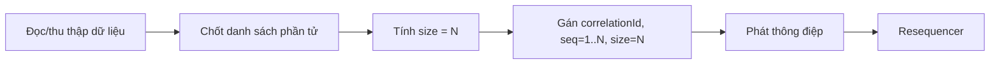

# Sequence size biết trước hay suy ra?

Trong chương **Resequencer nâng cao** của **SPRING_INTEGRATION_PATTERN**, một câu hỏi quyết định cách thiết kế luồng thông điệp là: **hệ thống biết trước một nhóm có bao nhiêu phần tử, hay phải xác định thời điểm nhóm kết thúc theo cách khác?**

Trong Spring Integration, header `sequenceSize` mô tả **tổng số message dự kiến của một chuỗi**. Nó đặc biệt hữu ích khi Splitter chia một công việc thành nhiều phần rồi các Router, Filter, Transformer, Gateway hoặc worker xử lý các phần theo tốc độ khác nhau. Aggregator và Resequencer có thể dựa vào thông tin chuỗi để quyết định khi nào một nhóm đủ điều kiện phát ra; song **không thể lấy số message đã nhận làm bằng chứng chắc chắn rằng đó là toàn bộ nhóm**.

Bài này phân biệt ba trường hợp: *biết trước chính xác*, *tính được ở phía tạo chuỗi*, và *không thể biết nếu thiếu tín hiệu kết thúc*. Đó là cơ sở để thiết kế retry, error channel, correlation và kiểm thử luồng mà không làm mất message hoặc chờ mãi.

## 1. Hiểu đúng ý nghĩa của `sequenceSize`

Ba header cần được xem như một bộ:

| Header | Câu hỏi nó trả lời | Ví dụ |
| --- | --- | --- |
| `correlationId` | Những message nào thuộc cùng một nhóm? | `order-2026-42` |
| `sequenceNumber` | Message này nằm ở vị trí thứ mấy trong nhóm? | `2` |
| `sequenceSize` | Nhóm **dự kiến có tổng cộng bao nhiêu** message? | `4` |

Giả sử một đơn hàng có bốn dòng. Nếu phía nguồn tạo bốn message với cùng `correlationId=order-2026-42`, lần lượt có `sequenceNumber=1, 2, 3, 4` và `sequenceSize=4`, Resequencer có cơ sở để nhận biết vị trí còn thiếu và sắp thứ tự theo số đã gán.

```text
Nguồn: nhóm G, sequenceSize = 4

Đến thực tế:     #3  →  #1  →  #4  →  #2
Vị trí cần có:    1      2      3      4
Sau khi đủ nhóm: #1  →  #2  →  #3  →  #4
```

Một số nguyên tắc cần giữ:

- `sequenceSize` là **tổng dự kiến**, không phải số đã nhận, số còn thiếu hoặc số lớn nhất đã quan sát.
- Giá trị này có ý nghĩa **trong phạm vi một `correlationId`**. Hai nhóm khác nhau có thể đều dùng `sequenceNumber=1`.
- Khi biết trước tổng số, các message cùng nhóm nên mang **một `sequenceSize` nhất quán** và các vị trí hợp lệ thường là `1..sequenceSize`.
- `sequenceSize=0` có thể được một số nguồn/Splitter dùng để biểu thị **chưa biết tổng số**; header vắng mặt cũng cần được xem là metadata chưa đủ. Phải kiểm tra hành vi của endpoint và phiên bản đang dùng, không mặc định `0` là một nhóm rỗng đã hoàn thành.
- Một message có `sequenceNumber=4` **không chứng minh** nhóm có đúng bốn phần nếu `sequenceSize` chưa biết: vẫn có thể có phần `5` đến sau.

Header này mô tả **kỳ vọng của phía sản xuất chuỗi**. Nếu metadata sai, bộ xử lý phía nhận không thể tự làm cho kỳ vọng đó đúng.

## 2. Khi nào biết trước được `sequenceSize`?

### 2.1. Payload đầu vào là tập hợp hữu hạn có kích thước rõ ràng

Trường hợp đơn giản nhất là một Splitter nhận danh sách hoặc mảng đã hình thành đầy đủ. Ví dụ:

```java
List<String> items = List.of("A", "B", "C", "D");
// Nguồn biết chính xác items.size() == 4 trước khi chia.
```

Khi Splitter được cấu hình **áp dụng thông tin chuỗi** (`applySequence`), nó có thể đánh số các phần và gắn `sequenceSize=4` cho các message sinh ra. Đây là số phần tử của **kết quả thực sự được chia**, không phải số message tình cờ đến trước ở downstream.

Một luồng minh họa bằng Java DSL:

```java
import org.springframework.context.annotation.Bean;
import org.springframework.context.annotation.Configuration;
import org.springframework.integration.dsl.IntegrationFlow;

@Configuration
class SplitKnownBatchFlow {

    @Bean
    IntegrationFlow splitKnownBatch() {
        return IntegrationFlow.from("batchInput")
                .split()
                .channel("partsToProcess")
                .get();
    }
}
```

Ví dụ trên dùng một Splitter trong luồng; để dùng `sequenceSize` như hợp đồng giữa nhiều bước, cần **kiểm tra `applySequence` và các header tại `partsToProcess`** trong phiên bản/cấu hình thực tế. Khi đầu vào là một danh sách bốn phần và sequencing được bật, kỳ vọng có bốn message cùng nhóm với số thứ tự tương ứng.

**Giới hạn quan trọng:** nếu dữ liệu đầu vào được sinh động, có thể thay đổi trong lúc duyệt hoặc bị cắt bởi logic khác, kích thước của cấu trúc ban đầu chưa chắc bằng số message thực sự sẽ phát.

### 2.2. Hợp đồng nghiệp vụ truyền sẵn tổng số

Nguồn bên ngoài cũng có thể cho biết tổng chính xác qua manifest, metadata của lô, API hoặc bản ghi mở đầu:

```json
{
  "batchId": "shipment-42",
  "partNo": 2,
  "totalParts": 4,
  "payload": "package-B"
}
```

Adapter ánh xạ `batchId → correlationId`, `partNo → sequenceNumber`, `totalParts → sequenceSize`. Cách này phù hợp cho các phần được gửi qua Kafka, RabbitMQ, HTTP hoặc hàng đợi công việc, **miễn là nhà sản xuất cam kết `totalParts` là tổng của đúng batch đó**.

Một ví dụ mapping có xác thực dữ liệu đầu vào:

```java
import org.springframework.integration.IntegrationMessageHeaderAccessor;
import org.springframework.messaging.Message;
import org.springframework.messaging.support.MessageBuilder;

public final class BatchPartMapper {

    private BatchPartMapper() { }

    public static Message<String> toMessage(
            String batchId,
            int partNo,
            int totalParts,
            String payload) {

        if (batchId == null || batchId.isBlank()) {
            throw new IllegalArgumentException("batchId is required");
        }
        if (totalParts < 1 || partNo < 1 || partNo > totalParts) {
            throw new IllegalArgumentException("Invalid sequence metadata");
        }

        return MessageBuilder.withPayload(payload)
                .setHeader(
                        IntegrationMessageHeaderAccessor.CORRELATION_ID,
                        batchId)
                .setHeader(
                        IntegrationMessageHeaderAccessor.SEQUENCE_NUMBER,
                        partNo)
                .setHeader(
                        IntegrationMessageHeaderAccessor.SEQUENCE_SIZE,
                        totalParts)
                .build();
    }
}
```

Bên nhận chỉ đang **chuyển metadata đáng tin cậy sang header Spring Integration**. Nếu một nguồn đánh số từ `0`, phải thống nhất chuyển sang thứ tự bắt đầu từ `1` trước khi đưa vào luồng resequencing. Nếu `totalParts` có thể sai hoặc thay đổi giữa các message, hãy xem đó là lỗi hợp đồng dữ liệu.

### 2.3. Fan-out có số nhánh xác định

Một thành phần phát nhiều bản sao như `PublishSubscribeChannel` có thể áp dụng sequence metadata nếu bật `applySequence`. Khi đó kích thước chuỗi có thể được xác định theo số bản sao/subscriber thực tế trong đợt phát. Cần kiểm tra cơ chế cụ thể của endpoint, đặc biệt khi danh sách subscriber hoặc điều kiện nhận có thể thay đổi.

**Cảnh báo:** số nhánh đăng ký, số nhánh nhận message và số kết quả cuối cùng có thể khác nhau. Không lấy cấu hình fan-out làm `sequenceSize` cho kết quả cuối nếu phía sau còn Filter, lỗi xử lý hoặc nhánh không tạo đầu ra.

## 3. Khi nào không thể biết trước?

Nhiều luồng thực tế không có tổng số cố định tại thời điểm bắt đầu:

| Nguồn hoặc thao tác | Vì sao `sequenceSize` có thể chưa biết? | Cách thiết kế phù hợp |
| --- | --- | --- |
| Iterator/stream được sinh dần | Chưa duyệt đến cuối nên chưa biết có bao nhiêu phần | Truyền tín hiệu kết thúc hoặc tạo danh sách hoàn chỉnh trước khi split nếu khả thi |
| API phân trang chưa trả `totalCount` | Chưa biết số trang tiếp theo | Dựa vào trang cuối, cursor kết thúc hoặc manifest của batch |
| Message từ thiết bị theo phiên | Sự kiện phát sinh cho đến khi phiên đóng | Xác định sự kiện kết thúc phiên và chính sách chờ bản tin trễ |
| Fan-out phụ thuộc điều kiện động | Số nhánh thực tế được chọn có thể thay đổi | Xác định danh sách nhánh trước khi phát hoặc dùng quy tắc hoàn tất riêng |
| Filter loại bớt message sau Splitter | Tổng số Splitter đã đánh trước đó không còn bằng số message sẽ đến | Giữ chỗ cho vị trí bị loại hoặc chủ động đánh số lại một chuỗi mới |
| Retry, timeout, lỗi vận chuyển | Nguồn **biết** tổng nhưng phía nhận chưa có đủ phần | Giữ `sequenceSize` gốc và dùng retry/error handling; không giảm tổng để “cho đủ” |

Phân biệt hai trường hợp cuối rất quan trọng: **chưa biết tổng** khác với **biết tổng nhưng đang thiếu phần tử**. Nếu nhóm được công bố có `sequenceSize=5` mà phía nhận mới thấy bốn phần, số đúng vẫn là `5`. Tự đổi thành `4` có thể làm mất dữ liệu mà không phát hiện được.

## 4. “Suy ra” có nghĩa gì và ở đâu mới suy ra được?

Có ba cách thường bị gọi chung là “suy ra”, nhưng mức độ tin cậy rất khác nhau.

### Cách A — Tính tổng trước khi phát: đáng tin nếu dữ liệu ổn định

Nguồn hoàn tất việc chọn phần tử, tính số phần, sau đó mới gán số thứ tự và phát.



Cách này phù hợp khi số phần vừa phải, có thể materialize trong bộ nhớ hoặc có truy vấn đếm chính xác. Nếu dữ liệu thay đổi giữa lần đếm và lần lấy, cần snapshot/transaction hoặc cơ chế khóa phiên bản để đảm bảo hai lần nhìn thấy cùng một tập. Đếm trước có thể tốn chi phí, độ trễ và bộ nhớ.

### Cách B — Nguồn biết nhóm đã kết thúc rồi công bố tổng: cần giao thức hoàn tất

Nguồn có thể phát dần `#1, #2, #3` mà **chưa biết tổng**, sau đó gặp cuối stream và gửi một thông điệp điều khiển, ví dụ `BatchCompleted(batchId, finalCount=3)`. Bên nhận phải lưu trạng thái của nhóm và áp dụng **release strategy riêng** dựa trên cả tín hiệu kết thúc và các vị trí đã nhận.

Trong thiết kế này, `finalCount=3` là **số được xác nhận bởi nguồn sau khi kết thúc**, không phải một con số Resequencer tự đoán từ ba message đang có. Thông điệp kết thúc cần được đồng bộ về mặt dữ liệu với các phần của nhóm; nếu nó đến trước một phần do mạng đảo thứ tự, hệ thống vẫn phải chờ phần còn thiếu hoặc xử lý timeout.

Có thể bổ sung manifest ở cuối hoặc “end marker”, nhưng cần quy định rõ marker có tham gia chuỗi dữ liệu hay chỉ dùng để kết thúc, và marker bị retry thì xử lý thế nào. Không tùy tiện đưa marker vào `sequenceSize` của payload nếu các bên chưa thống nhất.

### Cách C — Bên nhận lấy số đã thấy làm tổng: không đáng tin

Giả sử Resequencer mới nhận được `#1, #2, #3`. Các giả thuyết “nhóm có ba phần” và “nhóm có năm phần nhưng `#4, #5` chưa đến” đều phù hợp với quan sát hiện tại. Vì vậy:

- `group.size() = 3` chỉ cho biết **hiện có ba message**, không chứng minh `sequenceSize=3`.
- `max(sequenceNumber) = 3` chỉ cho biết **vị trí lớn nhất đã thấy**, không chứng minh rằng không còn vị trí lớn hơn.
- Hết một khoảng thời gian không nhận message chỉ là **chính sách timeout**, không phải bằng chứng nhóm đã hoàn tất.
- Các vị trí `1, 2, 3` liên tục có thể đủ để **phát một tiền tố đúng thứ tự** nếu thiết kế cho phép, nhưng chưa xác nhận rằng toàn bộ batch đã đủ.

Điểm mấu chốt: muốn biết **đã đủ**, phải có một cam kết từ nguồn (size/manifest/end marker) hoặc một quy tắc nghiệp vụ kết thúc được định nghĩa rõ.

## 5. Điều này ảnh hưởng thế nào đến Resequencer và Aggregator?

**Resequencer** gom các message theo khóa tương quan để phục hồi thứ tự trước khi phát chúng tiếp tục dưới dạng từng message. **Aggregator** gom một nhóm rồi tạo kết quả tổng hợp. Cả hai đều phải giải quyết bài toán **khi nào nhóm đủ điều kiện release**, dù đầu ra khác nhau.

### Khi `sequenceSize` chính xác

Với nhóm `G` có size `4`, đã nhận các số `4, 1, 3` thì vị trí `2` còn thiếu. Một chiến lược chờ **đủ cả nhóm** chưa nên xem chuỗi là hoàn chỉnh. Khi `#2` đến, có thể phát/hoàn tất theo cấu hình.

Nếu dùng release theo số lượng, cần để ý **message trùng lặp**: bốn message được lưu không nhất thiết là bốn vị trí khác nhau. Chính sách nhận diện và khử trùng lặp vẫn cần thiết. Thông tin sequence chỉ có ích khi số thứ tự và correlation được giữ nhất quán.

### Khi `sequenceSize` chưa biết

Không thể dựa vào điều kiện “đã nhận đủ N phần” vì chưa có N đáng tin. Cần quyết định rõ một trong những cơ chế sau:

1. **Chờ tín hiệu đóng nhóm:** một end marker hoặc manifest xác nhận tổng/phần cuối; sau đó kiểm tra các vị trí còn thiếu.
2. **Phát dần đoạn liên tục:** nếu nghiệp vụ chấp nhận, có thể giải phóng tiền tố theo đúng `sequenceNumber` và tiếp tục đợi phần sau. Điều này cần cấu hình/chiến lược release phù hợp và không tự chứng minh batch đã hoàn tất.
3. **Đóng nhóm theo cửa sổ thời gian/watermark:** phù hợp cho luồng sự kiện có khái niệm cửa sổ, nhưng phải có chính sách rõ ràng cho dữ liệu đến muộn. Đây là quy tắc nghiệp vụ theo thời gian, không phải phép suy ra kích thước thực tế.
4. **Timeout và xử lý chưa đủ:** gửi thông tin thiếu về error channel, lưu nhóm để retry, hoặc đánh dấu batch không hoàn chỉnh theo yêu cầu nghiệp vụ.

Không nên mặc định rằng cấu hình `.resequence()` hay `.aggregate()` bất kỳ sẽ tự suy ra total khi `sequenceSize` vắng mặt/không xác định. **Release strategy, partial sequence, timeout, expiry và MessageGroupStore** cần được lựa chọn, kiểm thử trên đúng phiên bản Spring Integration và luồng chạy thực tế.

### Ví dụ quan trọng: Filter sau Splitter

Một danh sách năm phần được Splitter đánh:

```text
Trước Filter:
#1/5    #2/5    #3/5    #4/5    #5/5

Filter cố ý loại #2:
#1/5            #3/5    #4/5    #5/5
```

Nếu downstream vẫn kỳ vọng đầy đủ `1..5`, nó có thể chờ mãi `#2`, dù không có lỗi mạng nào xảy ra.

Có ba hướng thiết kế hợp lý, tùy yêu cầu:

- **Giữ chuỗi gốc và báo phần bị loại** (ví dụ sự kiện tombstone/skip mang cùng vị trí): phù hợp khi cần bảo toàn vị trí và truy vết tất cả phần.
- **Lọc trước khi tạo chuỗi, rồi đánh số lại** `1..4` và `sequenceSize=4`: phù hợp khi chỉ các phần hợp lệ mới thuộc batch kết quả. Cần dùng số thứ tự mới nhất quán cho toàn bộ chuỗi.
- **Quy định release cho phép thiếu vị trí đã loại**: chỉ phù hợp nếu phía nhận có bằng chứng đáng tin cậy rằng vị trí đó được loại có chủ đích, và có quy tắc nghiệp vụ rõ ràng.

Tự giảm `sequenceSize` ở một vài message sau Filter mà vẫn giữ số `1,3,4,5` sẽ tạo metadata mâu thuẫn; đổi `size` đơn độc không giải quyết vấn đề.

## 6. Xây dựng hợp đồng dữ liệu và xử lý lỗi

Trước khi triển khai, thống nhất giữa phía phát, broker và phía nhận:

| Điều khoản | Nội dung cần chốt |
| --- | --- |
| Khóa nhóm | `correlationId` tồn tại, duy nhất theo batch/phiên; không dùng lại khi nhóm cũ có thể còn message trễ |
| Quy tắc đánh số | Bắt đầu từ `1`, vị trí tăng theo thứ tự nghiệp vụ, một vị trí chỉ đại diện cho một phần hợp lệ |
| Tổng dự kiến | `sequenceSize > 0` nếu đã biết; nếu chưa biết thì quy định representation và cơ chế đóng nhóm riêng |
| Thời điểm chốt tổng | Trước khi gửi phần đầu tiên, hoặc sau end marker/manifest đáng tin cậy |
| Loại/trùng/mất phần | Quy tắc Filter, retry và idempotency; không đánh số lại một lần retry như phần tử mới |
| Kết thúc và cleanup | Timeout, xử lý nhóm hết hạn, message đến muộn, lưu trạng thái nhóm và gửi lỗi tới kênh phù hợp |

Nên kiểm tra các bất biến sau ở ranh giới tiếp nhận:

- Một message có `correlationId` hợp lệ; nếu biết tổng thì `1 ≤ sequenceNumber ≤ sequenceSize`.
- Các message cùng nhóm không mang `sequenceSize` mâu thuẫn.
- `sequenceNumber` lặp phải được đối chiếu với định danh nghiệp vụ/payload để tránh nhân đôi hiệu ứng.
- Nếu có manifest kết thúc, số vị trí phân biệt thực sự nhận được phải khớp tổng và không có khoảng trống theo quy ước chuỗi.
- Header số thứ tự không bị adapter hoặc serialization chuyển mất/đổi kiểu bất ngờ khi đi qua broker.

Đối với các nguồn có size chưa biết, phải **phân biệt trạng thái “đang mở”, “đã được báo kết thúc”, “đã đủ” và “đã hết hạn”**. Một nhóm có ba phần và trạng thái “đang mở” không tương đương với nhóm có ba phần và trạng thái “đã đủ”.

## 7. Các ca kiểm thử bắt buộc

Để kiểm thử các nhánh xử lý, không chỉ cần dữ liệu đến đúng thứ tự mà còn phải mô phỏng dữ liệu thiếu, trễ và metadata sai:

| Ca | Đầu vào cùng `correlationId` | Kỳ vọng cần xác nhận |
| --- | --- | --- |
| Size biết trước, đến đảo thứ tự | `3/3, 1/3, 2/3` | Khi đủ nhóm, đầu ra có thứ tự `1, 2, 3` theo release strategy đã chọn |
| Size biết trước, thiếu phần | `1/4, 3/4, 4/4` | Không xem nhóm đủ; theo dõi vị trí `2` thiếu và timeout |
| Size chưa biết | `1, 2, 3`, không có end marker | Không tự kết luận tổng là `3` chỉ vì đã thấy ba phần |
| End marker đến trước dữ liệu | `end(count=3), 2, 1, 3` | Hệ thống vẫn đợi đủ dữ liệu theo hợp đồng trước khi hoàn tất |
| Trùng do retry | `1/3, 2/3, 2/3, 3/3` | Không nhân đôi tác động nghiệp vụ; xử lý trùng theo chính sách |
| Filter một phần | Splitter `1..5` rồi loại `2` | Áp dụng một trong ba chiến lược Filter đã xác định, không giữ metadata sai |
| Size không nhất quán | `1/3, 2/4, 3/3` | Phát hiện xung đột metadata và đưa sang kênh xử lý lỗi |
| Hai nhóm xen kẽ | `A:2/2, B:1/3, A:1/2, B:3/3, B:2/3` | Thứ tự đúng trong từng nhóm, không áp cùng một size cho mọi nhóm |

Trong log và metric, nên theo dõi `correlationId`, `sequenceNumber`, `sequenceSize`/trạng thái unknown, số vị trí phân biệt đã nhận, các khoảng thiếu, thời gian chờ, timeout, số lần retry, số nhóm hoàn tất và số nhóm hết hạn. Các chỉ số này giúp xác định lỗi nằm ở nguồn gán count, nhánh Filter, vận chuyển, hay chính sách release.

## 8. Checklist chọn cách xác định size

1. **Biết chính xác số phần trước khi phát?** Nếu có, hãy chốt danh sách/batch, gán một `sequenceSize` nhất quán và kiểm tra bằng test.
2. **Nguồn có thể duyệt đến cuối rồi mới biết?** Cân nhắc đếm/materialize trước; nếu cần streaming, định nghĩa end marker/manifest và chiến lược chờ.
3. **Có Filter hoặc fan-out động không?** Xác định size của chuỗi ở **đúng ranh giới** mà Resequencer sẽ nhận, hoặc bảo toàn thông tin các vị trí bị loại.
4. **Có thể thiếu/trùng/trễ do retry và broker không?** Giữ nguyên tổng đã công bố, kiểm tra số vị trí phân biệt và có chính sách timeout/idempotency.
5. **Chấp nhận phát một phần trước khi biết nhóm kết thúc không?** Cấu hình và kiểm thử release theo đoạn liên tục; không xem “đã phát một đoạn” là “đã hoàn tất batch”.
6. **Có thể xác nhận kết thúc một cách đáng tin cậy không?** Nếu không, chỉ có thể chọn chính sách chấp nhận rủi ro (ví dụ cửa sổ thời gian), chứ không khẳng định đã suy ra tổng chính xác.

**Kết luận:** `sequenceSize` **được biết trước** khi nguồn có danh sách hữu hạn hoặc hợp đồng công bố tổng đáng tin; nó **có thể được tính** khi phía tạo chuỗi chốt tập phần tử trước khi phát; còn bên Resequencer **không thể suy ra chính xác tổng số chỉ từ những message đã tới**. Với chuỗi có kích thước chưa biết, hãy thiết kế tín hiệu kết thúc, release strategy, timeout và xử lý lỗi rõ ràng để vừa giữ thứ tự vừa phát hiện thiếu dữ liệu.

