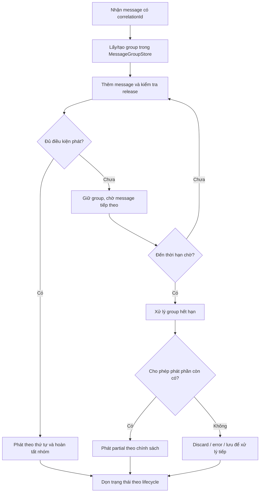
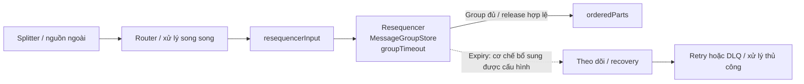

# Sequence group hết hạn

Trong **Resequencer nâng cao** của **SPRING_INTEGRATION_PATTERN**, một nhóm (*sequence group*) có thể nhận một phần các thông điệp rồi không bao giờ nhận đủ phần còn lại. Nếu không quy định thời điểm kết thúc chờ đợi, hệ thống sẽ giữ trạng thái nhóm trong bộ nhớ hoặc trong kho lưu trữ ngày càng lâu. Nhưng nếu kết thúc quá sớm, một thông điệp hợp lệ đến chậm có thể bị loại bỏ hoặc bị xử lý thành nhóm mới.

Bài này giải thích **sequence group hết hạn** là gì, Spring Integration quản lý nhóm như thế nào, cách chọn chính sách timeout, xử lý kết quả thiếu phần và kiểm thử trường hợp message đến muộn. Chủ đề liên hệ trực tiếp đến Splitter, Aggregator, Router, Filter, Transformer, Gateway, retry, error channel và correlation trong các luồng thông điệp ít phụ thuộc, dễ mở rộng.

> **Nguyên tắc thiết kế:** Hết hạn là **một quyết định về thời gian và chính sách xử lý nhóm**, không phải bằng chứng mọi phần tử đã tới. Resequencer không thể tự sinh ra thông điệp còn thiếu.

## 1. Sequence group là gì, và khi nào được xem là hết hạn?

Resequencer nhận những message thuộc cùng một chuỗi, xác định nhóm dựa trên khóa tương quan, và sắp xếp các phần theo số thứ tự. Ba header thường gặp:

| Header | Ý nghĩa | Ví dụ |
| --- | --- | --- |
| `correlationId` | Khóa nhận diện nhóm | `order-781` |
| `sequenceNumber` | Vị trí của phần trong nhóm | `3` |
| `sequenceSize` | Tổng phần được kỳ vọng, nếu đã biết | `4` |

Giả sử một Splitter tạo bốn phần của đơn hàng: `#1/4`, `#2/4`, `#3/4`, `#4/4`. Các worker chạy song song nên Resequencer nhận `#3`, rồi `#1`, rồi `#4`. Nếu `#2` bị kẹt ở hàng đợi hoặc xử lý thất bại, nhóm vẫn chưa có đầy đủ bốn vị trí.

Một **group timeout** cho phép hệ thống quyết định rằng nhóm đã chờ quá lâu theo chính sách cấu hình. Khi tới thời điểm đó, endpoint có thể cố gắng giải phóng những phần đã có, bỏ nhóm, hoặc chuyển sang quy trình xử lý lỗi, tùy thiết kế. **Hết hạn (expiry)** mô tả biến cố nhóm bị xử lý theo chính sách timeout; **hoàn thành (completion)** mô tả trạng thái nhóm đã đáp ứng điều kiện phát theo quy tắc release. Hai khái niệm này không đồng nghĩa.



Lưu ý: đây là **sơ đồ khái niệm**. Khi triển khai, trình tự chính xác giữa kiểm tra release, lịch timeout, xử lý nhóm hết hạn và dọn kho nhóm phụ thuộc endpoint/cấu hình Spring Integration. Thông điệp mới có thể đến ngay trong lúc timeout chạy, nên cả trường hợp cạnh tranh cũng phải được kiểm thử.

## 2. Vì sao nhóm có thể không hoàn tất?

Một số nguyên nhân thường gặp và dấu hiệu nhận biết:

| Nguyên nhân | Ví dụ | Điều cần xác minh |
| --- | --- | --- |
| Mất/chậm message | Phần `#2` chưa tới do mạng hoặc broker tồn đọng | Queue lag, retry, dead-letter queue, thời điểm phát thực tế |
| Xử lý bất đồng bộ chậm | Transformer gọi dịch vụ ngoài quá thời hạn | Latency, timeout của downstream, giới hạn worker |
| Filter loại message | Splitter đánh số `1..4` nhưng Filter bỏ `#2` | Loại có chủ đích hay lỗi? Có thông tin skip không? |
| Metadata không nhất quán | Cùng nhóm có `sequenceSize` khác nhau hoặc trùng số | Mapping header, logic chia nhóm, retry |
| Không biết điểm kết thúc | Nguồn streaming chưa có end marker | Có hợp đồng kết thúc nhóm hay không? |
| Tiến trình khởi động lại | Group lưu trong bộ nhớ bị mất | MessageGroupStore có bền vững, phục hồi được không? |
| Correlation sai | Message cuối mang khóa nhóm khác | Nguồn phát, adapter, loại khóa và phân tách theo tenant/phiên |

**Timeout không chữa được nguyên nhân gốc.** Nó giới hạn thời gian và tài nguyên chờ đợi, đồng thời tạo điểm để kích hoạt xử lý tiếp. Nếu Filter đã loại có chủ đích một vị trí trong chuỗi, hãy thiết kế lại việc đánh số hoặc biểu diễn vị trí bị skip. Chỉ tăng timeout sẽ không khiến vị trí đó xuất hiện.

## 3. Ba quyết định cần phân biệt: release, timeout và cleanup

### 3.1. Release strategy: khi nào được phát?

*Release strategy* quyết định lúc nào một nhóm hoặc một phần nhóm đã đủ điều kiện phát. Với Resequencer có metadata chuỗi đáng tin cậy, bộ xử lý xét các vị trí `sequenceNumber` và thông tin nhóm để xác định thứ tự đầu ra.

Trong luồng cần toàn bộ batch, chính sách phù hợp là chờ nhóm đáp ứng điều kiện đầy đủ. Với luồng ưu tiên độ trễ, có thể cho phép **partial sequences**, tức phát sớm một đoạn liên tục theo thứ tự nếu cấu hình cho phép. Tuy nhiên **“phát được một đoạn” không có nghĩa “cả batch đã hoàn tất”**.

Ví dụ thứ tự đến là `3, 1, 4, 2` với size `4`: khi nhận `1`, một cấu hình partial có thể phát tiền tố hợp lệ nếu điều kiện release được thỏa; một cấu hình chờ đủ sẽ phát sau khi `2` xuất hiện. Hành vi thực tế cần được khẳng định bằng test cho release strategy sử dụng.

### 3.2. Group timeout: chờ đến khi nào?

Thuộc tính **`groupTimeout`** hoặc biểu thức **`groupTimeoutExpression`** của endpoint tương quan cho phép xác lập thời hạn chờ nhóm. Ví dụ đặt `30_000` mili giây là chính sách chờ cỡ 30 giây trước khi xử lý timeout theo cơ chế lập lịch của endpoint.

Không nên mặc định rằng tham số này luôn là **hạn cứng đúng 30 giây từ message đầu tiên**: thời điểm bắt đầu, hành vi lập lịch lại khi nhóm thay đổi, thời gian thực thi scheduler và concurrency cần được xác nhận trên đúng cấu hình/phiên bản. Nếu nghiệp vụ đòi hỏi hạn tuyệt đối (ví dụ “đơn hàng phải được chốt trước 10:00”), nên lưu deadline nghiệp vụ riêng và thiết kế cơ chế áp dụng deadline phù hợp.

Timeout giúp quyết định *khi nào phải hành động*, **không** làm thay đổi `sequenceSize`, không tự phát hiện chính xác số message thiếu khi metadata không đủ và không đảm bảo downstream đã xử lý xong.

### 3.3. Cleanup: giữ trạng thái nhóm bao lâu?

Resequencer/Aggregator dùng **`MessageGroupStore`** để lưu các nhóm đang hoạt động và thông tin vòng đời. Đây là vấn đề riêng với thời điểm phát:

- Một nhóm **hoàn tất** có thể cần giữ lại dấu vết (nhóm rỗng hoặc metadata đã hoàn tất) để ứng xử nhất quán với message đến muộn.
- Một nhóm **hết hạn** cần chính sách loại bỏ, giữ lại hoặc chuyển trạng thái, đồng thời ghi nhận nguyên nhân thất bại.
- Một nhóm **cũ không còn hoạt động** có thể được dọn theo chính sách của kho nhóm, chẳng hạn dùng cơ chế quét nhóm cũ (**`MessageGroupStoreReaper`**) nếu phù hợp.

Cần phân biệt **sự kiện timeout của endpoint** với **lịch quét dọn của store/reaper**. Việc cấu hình quét mỗi phút không có nghĩa business deadline được thực thi chính xác từng giây. Nếu cần giám sát hoặc đánh dấu thất bại, phải thiết kế rõ vị trí nhận thông tin hết hạn, vì hành động dọn kho không mặc nhiên là một thông báo nghiệp vụ đầy đủ.

## 4. Chọn cách xử lý khi nhóm hết hạn

Một nhóm `order-781` có `sequenceSize=4` nhưng mới nhận các vị trí `1, 3, 4`. Khi quá hạn, có một số chính sách khả dĩ.

### Chính sách A — Không phát kết quả thiếu phần

Chọn khi **tính đầy đủ quan trọng hơn độ trễ**, chẳng hạn tính tổng tài chính, xử lý giao dịch hoặc cập nhật trạng thái bắt buộc đủ mọi phần. Khi nhóm hết hạn, không đưa những phần thiếu `#2` xuống downstream như một kết quả hoàn chỉnh.

Hệ thống cần ghi nhận nhóm lỗi, thông tin về vị trí thiếu, lưu dữ liệu cần xử lý lại hoặc thực hiện bù trừ. Tùy cấu hình, message nhóm hết hạn có thể bị loại bỏ khỏi dòng đầu ra bình thường; vì vậy phải **chủ động bố trí quan sát, nhánh discard/error hoặc cơ chế nghiệp vụ để không mất dấu sự cố**.

### Chính sách B — Phát partial result theo hợp đồng

Chọn khi nghiệp vụ **cho phép dữ liệu chưa đủ**, chẳng hạn cập nhật màn hình giám sát, tổng hợp số liệu tạm hoặc trả dữ liệu đã có trước deadline. Với Spring Integration, thuộc tính **`sendPartialResultOnExpiry`** là một phần của chính sách xử lý nhóm hết hạn.

Ví dụ nhóm đã có `#1, #3, #4`. Downstream có thể nhận các phần đã có theo cơ chế resequencing, nhưng **vị trí `#2` không được tái tạo**. Cần đặt một hợp đồng rõ ràng cho kết quả thiếu phần: nó có ý nghĩa tạm thời hay cuối cùng, có được phép ghi vào kho chính thức không, có thể sửa khi phần đến muộn không?

Không được chỉ bật phát partial rồi ngầm coi batch “thành công”. Tùy luồng, cần ghi riêng trạng thái `PARTIAL`, số vị trí thiếu và deadline bằng dữ liệu hoặc event nghiệp vụ để downstream phân biệt với kết quả đầy đủ.

### Chính sách C — Chuyển nhóm sang xử lý bổ sung

Chọn khi muốn giữ tính đầy đủ nhưng không thể chờ trong luồng chính:

1. Đánh dấu batch `TIMED_OUT` trong hệ thống quản lý trạng thái.
2. Ghi lại `correlationId`, các số còn thiếu và thời điểm đã chờ.
3. Kích hoạt retry có giới hạn, truy vấn lại upstream hoặc chuyển sang dead-letter/recovery flow.
4. Khi nhận đủ, chỉ cho phép khôi phục/hoàn tất theo quy tắc nghiệp vụ; tránh phát trùng những phần đã xử lý.
5. Nếu quá thời hạn khôi phục, đóng với trạng thái lỗi hoặc tạo tác vụ bù trừ.

Đây là **quy trình thiết kế ở mức ứng dụng**, không phải chức năng tự động đảm bảo bởi một thuộc tính Resequencer. Error channel của Spring Integration có thể là điểm nhận lỗi xử lý, nhưng **timeout bình thường không nhất thiết ném exception vào error channel**; nếu muốn sinh sự kiện nghiệp vụ về timeout, hãy cấu hình và kiểm thử rõ ràng.

| Tiêu chí | Không phát partial | Phát partial | Recovery flow |
| --- | --- | --- | --- |
| Kết quả ngay khi hết hạn | Không có kết quả thiếu phần trên nhánh thành công | Có thể phát dữ liệu đã nhận | Sự kiện cần xử lý bổ sung |
| Tính đầy đủ | Ưu tiên bảo vệ | Có thể chưa đủ | Hướng tới đủ sau retry/khôi phục |
| Độ phức tạp downstream | Cần theo dõi thất bại | Cần nhận biết partial | Cần trạng thái, idempotency và vòng đời |
| Phù hợp | Batch bắt buộc đủ | Giám sát, dữ liệu tạm | Giao dịch phân tán, batch quan trọng |

## 5. Cấu hình minh họa bằng Java DSL

Một ví dụ cấu hình luồng Resequencer với chính sách **không chủ động phát partial khi nhóm hết hạn**:

```java
import org.springframework.context.annotation.Bean;
import org.springframework.context.annotation.Configuration;
import org.springframework.integration.dsl.IntegrationFlow;

@Configuration
public class ResequencerTimeoutFlow {

    @Bean
    public IntegrationFlow resequenceOrders() {
        return IntegrationFlow.from("receivedParts")
                .resequence(spec -> spec
                        // Thời gian chờ ở mức endpoint; kiểm tra semantics
                        // lập lịch timeout theo phiên bản đang dùng.
                        .groupTimeout(30_000)
                        // Không gửi các phần thiếu như kết quả bình thường
                        // khi xảy ra group expiry.
                        .sendPartialResultOnExpiry(false)
                        // Chính sách xử lý nhóm hoàn tất:
                        // cân nhắc ảnh hưởng đến message đến muộn.
                        .expireGroupsUponCompletion(false))
                .channel("orderedParts")
                .get();
    }
}
```

**Cách đọc cấu hình:**

- `receivedParts` là kênh nhận các phần đã được đánh `correlationId`, `sequenceNumber` và, nếu biết, `sequenceSize`.
- `groupTimeout(30_000)` thiết lập thời gian chờ để xử lý nhóm chưa hoàn tất theo cơ chế của endpoint.
- `sendPartialResultOnExpiry(false)` ngăn việc chủ động gửi kết quả partial khi hết hạn; bạn vẫn phải xây dựng đường theo dõi lỗi, discard hoặc recovery thích hợp.
- `expireGroupsUponCompletion(false)` là ví dụ về việc không xóa ngay dấu vết nhóm hoàn tất. Giá trị và tương tác với việc dọn nhóm cần được kiểm thử theo chính sách lưu trạng thái của hệ thống; nó **không thay thế cơ chế khử trùng lặp nghiệp vụ**.

Mã trên minh họa **cơ chế group timeout**, chưa phải một pipeline recovery đầy đủ. Các hệ thống thực tế cần cấu hình `MessageGroupStore`, scheduler, khả năng lưu qua restart, theo dõi nhóm hết hạn và luồng xử lý lỗi tùy yêu cầu. Nếu muốn thử chính sách phát partial, thay `sendPartialResultOnExpiry(false)` bằng `true`, sau đó kiểm thử chính xác những message được gửi và cách downstream ghi nhận trạng thái incomplete. Việc thay một cờ không đảm bảo yêu cầu nghiệp vụ đã được đáp ứng.

Một sơ đồ triển khai điển hình:



Đường nét đứt là **một phần thiết kế cần xây dựng**, không có nghĩa Spring Integration sẽ tự nối mọi timeout vào `errorChannel` hoặc dead-letter queue.

## 6. Message đến sau khi group đã hết hạn

Đây là một trong những tình huống nguy hiểm nhất của Resequencer khi chạy bất đồng bộ.

Ví dụ:

```text
T+0s      Nhận #1/4, group G được tạo.
T+2s      Nhận #3/4 và #4/4, vẫn thiếu #2.
T+30s     Chính sách timeout kích hoạt cho G.
T+35s     Worker retry thành công; #2/4 mới đến.
```

Ở `T+35s`, hệ thống xử lý `#2` ra sao? Không có một đáp án chung nếu chưa định nghĩa vòng đời của nhóm sau expiry:

- **Nếu trạng thái hoàn tất/hết hạn còn được lưu:** bộ xử lý có thể nhận biết nhóm đã kết thúc; hành vi từ chối, bỏ qua, hay xử lý message trễ phụ thuộc cấu hình. Cần kiểm thử cụ thể.
- **Nếu dữ liệu nhóm bị xóa:** message đến muộn có thể bị nhìn như bắt đầu một nhóm mới cùng `correlationId`. Kết quả là một nhóm thiếu những phần đã xử lý trước đó, hoặc đầu ra bị lặp nếu khóa nhóm được dùng lại.
- **Nếu có recovery flow riêng:** message trễ nên được đối chiếu với trạng thái batch ở kho nghiệp vụ, rồi quyết định chấp nhận, bù trừ hay đưa sang xử lý thủ công.

Vì vậy, chính sách cleanup cần phối hợp với chính sách **late arrival** và **idempotency**. Đừng chỉ dựa vào việc group được xóa hay chưa để xác định một sự kiện nghiệp vụ đã được xử lý.

### Không dùng lại khóa tương quan quá sớm

Nếu `correlationId="order-781"` được dùng cho một batch cũ, đừng dùng lại ngay cho batch mới nếu broker còn lưu thông điệp trễ từ batch cũ. Có thể dùng khóa kết hợp như `orderId + runId`, miễn đó là định danh ổn định và được tất cả các phần của cùng một lần chạy sử dụng nhất quán.

### Đừng đánh số lại mỗi lần retry

Message `#2/4` được gửi lại phải vẫn là `#2/4`, cùng batch id và định danh phần tử phù hợp. Nếu retry biến nó thành `#5/5`, hệ thống có thể chờ một chuỗi không tồn tại hoặc phát sai thứ tự. Resequencer là công cụ khôi phục thứ tự **theo metadata đã gán**, không xác nhận đúng/sai nghiệp vụ của metadata đó.

## 7. Timeout, MessageGroupStore và triển khai nhiều instance

Khi lượng thông điệp lớn, mỗi nhóm chưa hoàn tất chiếm bộ nhớ, bản ghi lưu trữ và chi phí tra cứu. Group expiry là một phần của quản lý tài nguyên hệ thống.

**Lưu trữ:** Kho nhóm in-memory có thể không phù hợp nếu các message cần được bảo toàn qua restart. Có thể cân nhắc các `MessageGroupStore` có tính bền vững được Spring Integration hỗ trợ, nhưng phải xác nhận định dạng message, transaction và hành vi phục hồi. Nếu restart xóa group nhưng broker gửi lại message, cần một chiến lược xử lý lại phù hợp.

**Nhiều instance:** Hai instance có thể nhận message cùng `correlationId`. Cần bảo đảm chúng phối hợp lưu trữ, khóa nhóm, lịch timeout và release sao cho không cùng phát một nhóm hai lần hoặc xóa trạng thái khi instance khác đang xử lý. Dùng chung store chỉ là một phần giải pháp; cần đối chiếu khả năng khóa, điều phối và cấu hình phiên bản cụ thể.

**Dọn nhóm:** Nếu giữ dấu vết hoàn tất/quá hạn để chống nhận lại, cần chính sách thời gian lưu và dọn dữ liệu cũ. Dọn quá sớm làm mất dấu lịch sử; giữ vĩnh viễn làm tăng dung lượng. Một cơ chế như `MessageGroupStoreReaper` có thể hỗ trợ xử lý nhóm cũ theo cấu hình, nhưng phải xem nó phối hợp với timeout của endpoint thế nào để tránh áp dụng hai đường expiry khác nhau gây bất ngờ.

**Scheduler:** Group timeout không phải đồng hồ thời gian thực tuyệt đối. Khi lượng nhóm lớn, scheduler bị quá tải, ứng dụng dừng, hoặc store chậm, thời điểm xử lý thực có thể muộn hơn hạn cấu hình. Đo và cảnh báo độ trễ timeout nếu SLA phụ thuộc vào nó.

## 8. Thiết kế kiểm thử group expiry

Trong kiểm thử tích hợp, gửi các message có header tường minh và quan sát cả output lẫn trạng thái nhóm, sự kiện timeout và đường recovery. Đừng chỉ kiểm tra thứ tự của kết quả thành công.

| Ca thử | Dữ liệu và thời điểm | Kết quả cần xác nhận |
| --- | --- | --- |
| Đủ nhóm trước hạn | `3/3, 1/3, 2/3` trước timeout | Phát đúng thứ tự theo release strategy, nhóm được hoàn tất |
| Thiếu một phần | `1/4, 3/4, 4/4` rồi hết hạn | Không coi batch là đầy đủ; chính sách partial/discard/recovery được áp dụng |
| Phần đến sát hạn | `#2` đến cùng lúc timer kích hoạt | Không phát trùng, không để mất trạng thái; kết quả theo quy tắc cạnh tranh đã chốt |
| Late arrival sau timeout | `#2` đến sau khi group đã expiry | Được xử lý theo chính sách message trễ, không tự tạo batch “thành công” thứ hai |
| Retry trùng | `2/3` gửi hai lần | Downstream không áp dụng hiệu ứng nghiệp vụ hai lần |
| Filter cố ý bỏ phần | `1..4`, Filter loại `#2` | Kiểm tra chính sách skip/đánh số lại, không dùng timeout che thiếu sót |
| Hai nhóm xen kẽ | `A:1/2, B:2/3, A:2/2` rồi B hết hạn | A hoàn tất; B được xử lý timeout độc lập |
| Restart khi còn group | Nhận `#1`, restart, rồi nhận `#2` | Kết quả phù hợp với tính bền vững của store và chính sách replay |
| Scheduler tải cao | Nhiều nhóm hết hạn gần nhau | Không phát trùng; theo dõi độ trễ và tài nguyên |
| Size sai | `1/4, 2/3, 3/4` | Phát hiện metadata xung đột và chuyển vào đường xử lý lỗi |

Nếu có thể, tách logic phát hiện/đánh dấu timeout thành thành phần dễ kiểm thử, dùng đồng hồ điều khiển được hoặc cấu hình timeout ngắn trong môi trường kiểm thử. Tránh dựa hoàn toàn vào những lệnh ngủ lâu vốn làm test chậm và dễ bị lỗi thời điểm. Cần kiểm tra các sự kiện diễn ra sát deadline vì đó là nơi race condition thường xuất hiện.

## 9. Quan sát và vận hành

Với mỗi group, nên có các thông tin sau trong log/metric, gắn với `correlationId` nhưng không cần ghi payload nhạy cảm:

| Trường / metric | Lý do |
| --- | --- |
| `correlationId`, `sequenceSize` | Nhận diện batch và kỳ vọng số phần |
| Tập `sequenceNumber` đã nhận | Phát hiện lỗ hổng, lặp hoặc đánh số sai |
| `firstReceivedAt`, `lastReceivedAt` | Phân biệt nhóm chờ lâu với nhóm vẫn hoạt động |
| `deadline` hoặc timeout được áp dụng | Giải thích tại sao nhóm hết hạn |
| `groupStatus` | Chẳng hạn OPEN, COMPLETE, TIMED_OUT, PARTIAL, RECOVERED |
| `expiryReason` và danh sách phần thiếu | Phục vụ retry, xử lý thủ công và phân tích lỗi |
| Số nhóm đang mở / hết hạn | Phát hiện tình trạng tồn đọng |
| Số message đến muộn / trùng | Đánh giá độ bền của luồng và chính sách khử trùng |
| Thời gian từ timeout dự kiến tới xử lý thực | Theo dõi ảnh hưởng của scheduler và tải hệ thống |

Các tên trường trạng thái trên là **gợi ý cho hệ thống quan sát nghiệp vụ**, không phải toàn bộ header hay metric mặc định do Spring Integration tự tạo. Nên log lúc nhóm được tạo, hoàn tất, hết hạn và lúc message trễ xuất hiện; việc này giúp phân biệt **lỗi nguồn phát** với **lỗi vận chuyển hoặc chính sách release**.

## 10. Checklist trước khi đưa Resequencer vào production

1. **Xác định group được coi là hoàn tất theo quy tắc nào:** đủ `sequenceSize`, có end marker, hay release partial được cho phép.
2. **Định nghĩa timeout theo SLA:** timeout nghiệp vụ, timeout của endpoint và lịch dọn kho có trách nhiệm khác nhau.
3. **Chốt ứng xử khi hết hạn:** không phát, phát kết quả tạm, hoặc đưa nhóm vào recovery; xác định người/hệ thống nhận tín hiệu.
4. **Chốt ứng xử với message đến muộn:** từ chối, đối chiếu trạng thái batch rồi sửa, hoặc bù trừ; kiểm soát idempotency.
5. **Đảm bảo correlation và sequencing đáng tin:** mỗi batch có khóa riêng; retry giữ nguyên số thứ tự; xử lý rõ Filter có chủ đích.
6. **Cấu hình MessageGroupStore và cleanup phù hợp:** cân nhắc restart, nhiều instance, dung lượng và vòng đời dấu vết nhóm.
7. **Theo dõi timeout như một sự kiện vận hành:** cảnh báo nhóm thiếu phần, trễ deadline, tăng số nhóm tồn đọng.
8. **Kiểm thử cạnh tranh:** message cuối đến đúng lúc timeout, retry sau expiry, restart và nhóm xen kẽ.

**Ghi nhớ:** Sequence group hết hạn khi **chính sách chờ của hệ thống quyết định xử lý nhóm chưa hoàn tất**. Chọn `groupTimeout` chỉ là bước đầu; cần kết hợp release strategy, `sendPartialResultOnExpiry`, quản lý `MessageGroupStore`, xử lý message đến muộn, retry và đường quan sát lỗi để dữ liệu không bị coi là hoàn chỉnh khi vẫn thiếu phần.

