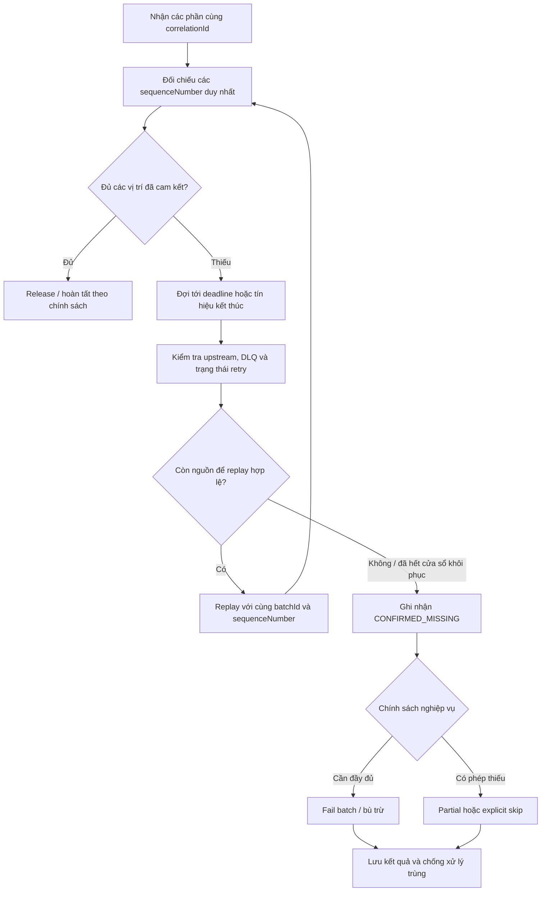
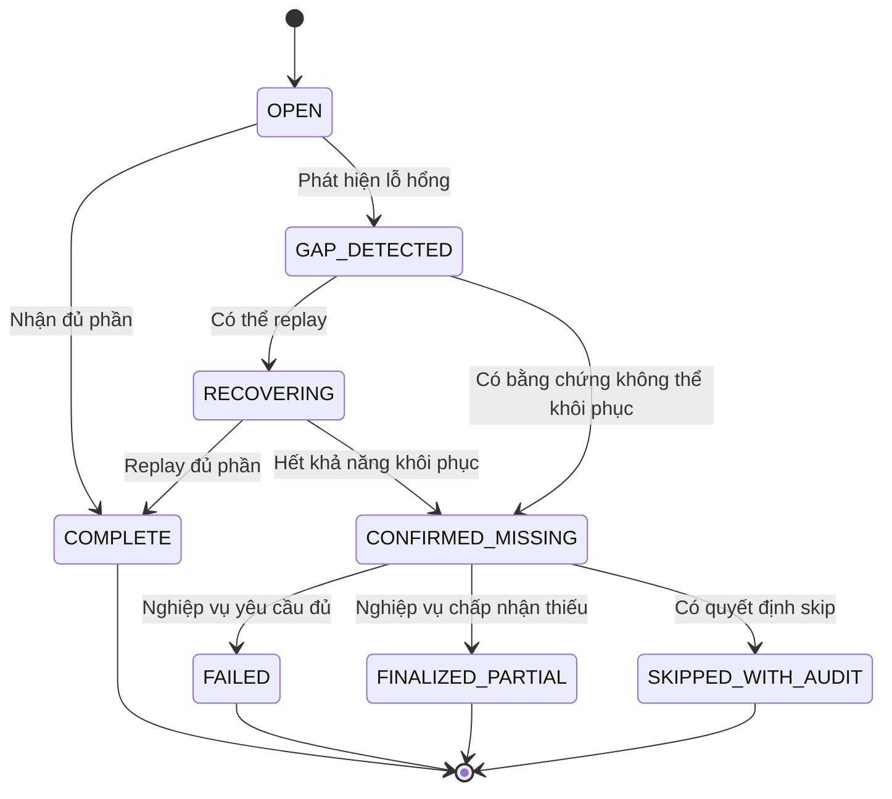
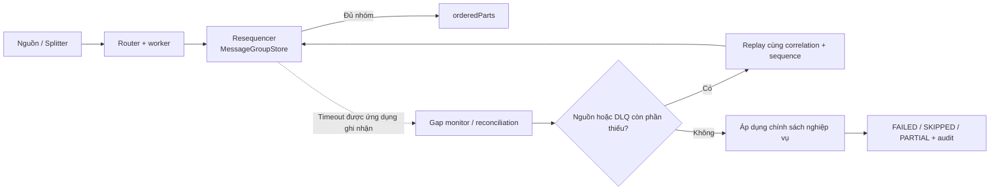

# Xử lý sequence bị thiếu vĩnh viễn

Trong chương **Resequencer nâng cao** của **SPRING_INTEGRATION_PATTERN**, một tình huống khó là một phần tử của chuỗi không bao giờ xuất hiện. Ví dụ Splitter tạo năm thông điệp nhưng phần tử số 3 bị loại ngoài dự kiến, bị mất sau nhiều lần retry, hoặc nguồn xác nhận không thể phát lại. Các phần còn lại vẫn tới Resequencer, song **không có thuật toán sắp xếp nào tự khôi phục được nội dung của phần tử đã mất**.

Spring Integration giúp ghép các nhánh Router, Filter, Transformer, Splitter, Aggregator và Gateway bằng message channel, correlation, retry và error channel. Tuy nhiên, khi một *sequence* bị thiếu vĩnh viễn, ứng dụng phải đưa ra **quyết định nghiệp vụ**: truy xuất lại, bỏ qua có ghi nhận, chấp nhận kết quả không đầy đủ, hay kết thúc toàn bộ nhóm với lỗi. Bài học này tập trung vào cách phát hiện, phân loại, xử lý và kiểm thử những quyết định đó.

> **Điểm cốt lõi:** Không nhận được một sequence trước timeout **chưa chứng minh nó mất vĩnh viễn**. “Mất vĩnh viễn” chỉ nên được xác nhận bởi dữ liệu hoặc quy trình nghiệp vụ đáng tin cậy; timeout thường chỉ là ngưỡng chuyển sang kiểm tra hoặc phục hồi.

## 1. Hiểu chính xác vấn đề

Một nhóm message thường được nhận diện bằng ba header Spring Integration:

| Header | Vai trò | Ví dụ |
| --- | --- | --- |
| `correlationId` | Những message nào thuộc cùng một nhóm? | `batch-2026-51` |
| `sequenceNumber` | Vị trí message trong nhóm | `4` |
| `sequenceSize` | Tổng số phần được kỳ vọng khi đã biết | `5` |

Giả sử nguồn đã chốt batch năm phần: `#1/5`, `#2/5`, `#3/5`, `#4/5`, `#5/5`. Phía nhận chỉ thấy:

```text
Thứ tự đến thực tế:        #4 → #1 → #5 → #2
Các vị trí được kỳ vọng:    1    2    3    4    5
Các vị trí đã có:           ✓    ✓    ?    ✓    ✓
Khoảng trống:                        #3
```

Nếu Resequencer áp dụng chính sách chờ **đủ nhóm** rồi mới phát, nhóm chưa thể hoàn thành vì vị trí `#3` thiếu. Nếu cho phép phát một đoạn liên tục (*partial sequence*), endpoint có thể phát phần hợp lệ đầu chuỗi theo chính sách đã cấu hình, nhưng vẫn chưa thể chứng minh phần còn lại đã đầy đủ.

Ba khái niệm cần tách rõ:

1. **Đến trễ (*late*):** `#3` vẫn tồn tại, đang được vận chuyển, retry hoặc xử lý. Có thể nhận được sau.
2. **Thiếu tạm thời hoặc chưa rõ (*missing/unknown*):** chưa thấy `#3` và chưa có bằng chứng nguồn có thể hay không thể khôi phục.
3. **Không thể khôi phục theo hợp đồng (*confirmed unrecoverable*):** nguồn hoặc hệ thống đối soát xác nhận không còn dữ liệu `#3` và không còn đường phát lại hợp lệ.

Trong nhiều hệ thống phân tán, không thể chứng minh tuyệt đối một message sẽ *không bao giờ* xuất hiện. Vì vậy “thiếu vĩnh viễn” thường là **kết luận có giới hạn theo chính sách**, ví dụ nguồn đã xóa dữ liệu gốc, số lần retry đã hết và quá thời hạn đối soát. Ghi lại lý do và bằng chứng để phân biệt kết luận nghiệp vụ với suy đoán dựa trên đồng hồ.

## 2. Vì sao một vị trí có thể bị mất?

| Nguyên nhân | Ví dụ | Có thể khôi phục? |
| --- | --- | --- |
| Filter loại bỏ có chủ đích | Splitter đánh số trước, Filter loại `#3` | Có thể cần **thiết kế lại chuỗi** hoặc ghi nhận phần được bỏ qua; không nên retry vô nghĩa |
| Bản ghi nguồn không tồn tại | Lệnh phát sinh `#3` bị bỏ qua do lỗi upstream | Tùy nguồn có thể tái tạo bằng dữ liệu gốc |
| Lỗi xử lý sau nhiều lần retry | Worker cho `#3` liên tục báo lỗi | Có thể sửa nguyên nhân và replay; cũng có thể không phục hồi được |
| Lỗi ánh xạ correlation | `#3` mang nhầm `correlationId` | Có thể sửa metadata, nhưng phải tránh thêm cùng một phần hai lần |
| Message nằm trong DLQ | Broker chuyển `#3` sang dead-letter queue | Thường có thể kiểm tra và phát lại theo quy tắc an toàn |
| Dữ liệu đã bị xóa / hết hạn lưu | File nguồn hoặc event trong broker không còn | Có thể thực sự không khôi phục được |
| Số thứ tự sai | Hai phần được đánh cùng `#3`, hoặc chỉ số nhảy từ `2` sang `4` | Phải làm rõ ý nghĩa nghiệp vụ của các phần trước khi đánh số lại |
| End marker đến nhưng có lỗ hổng | Nguồn xác nhận tổng là 5, bên nhận chỉ có 4 | Đã biết **nhóm chưa đủ**; vẫn cần tra cứu nguyên nhân và khả năng replay |

Một lỗi thực tế là nhầm “Filter cố ý loại” với “mất gói”. Nếu một phần không bao giờ phải đi downstream, thứ tự sau Filter phải được xác định lại theo hợp đồng mới, hoặc phải có **tín hiệu skip rõ ràng**. Giữ `sequenceSize=5` và mong Resequencer tự bỏ qua `#3` có thể khiến nhóm chờ mãi.

## 3. Phát hiện lỗ hổng mà không kết luận quá sớm

### 3.1. Điều kiện tiên quyết

Để nói một vị trí bị thiếu, phía nhận cần biết **những vị trí nào được mong đợi**. Trường hợp thuận lợi nhất:

- `correlationId` ổn định cho đúng một batch hoặc một lần chạy.
- `sequenceNumber` được cấp theo thứ tự nghiệp vụ, thông thường `1..N`.
- `sequenceSize=N` đáng tin cậy và nhất quán cho cả nhóm.
- Message có định danh phần tử riêng để xử lý lặp do retry.

Khi `sequenceSize` chưa biết, chỉ quan sát các số `1, 2, 4` **không đủ** để kết luận rằng `3` bị mất hay batch đã kết thúc ở `4`. Cần một manifest, end marker, danh sách ID gốc hoặc một quy tắc đóng nhóm xác thực. Nếu nguồn hỗ trợ đánh số thưa có chủ đích, việc thiếu số `3` cũng có thể **không phải lỗi**; phải dùng hợp đồng phù hợp thay vì áp đặt quy tắc liên tục `1..N`.

### 3.2. Quy trình phát hiện và xác nhận



Timeout chỉ đưa nhóm vào bước **kiểm tra và ra quyết định**. Nhiều hệ thống cần xác nhận thêm: worker đã xử lý xong chưa, queue còn tồn đọng không, nguồn dữ liệu gốc còn không, DLQ có phần bị thiếu không, và hạn phục hồi nghiệp vụ đã tới chưa.

### 3.3. Tính tập vị trí thiếu

Đoạn Java sau kiểm tra metadata và trả về các vị trí thiếu từ **ảnh chụp trạng thái đã nhận**. Đây là logic giám sát/đối soát, không phải API Resequencer tự cung cấp:

```java
import java.util.Collection;
import java.util.HashSet;
import java.util.List;
import java.util.Set;
import java.util.stream.IntStream;

public final class MissingSequenceDetector {

    private MissingSequenceDetector() { }

    public static List<Integer> missingPositions(
            int sequenceSize,
            Collection<Integer> receivedPositions) {

        if (sequenceSize < 1) {
            throw new IllegalArgumentException(
                    "sequenceSize must be positive and known");
        }

        Set<Integer> received = new HashSet<>(receivedPositions);
        boolean invalid = received.stream()
                .anyMatch(n -> n == null || n < 1 || n > sequenceSize);
        if (invalid) {
            throw new IllegalArgumentException("Invalid sequence number");
        }

        return IntStream.rangeClosed(1, sequenceSize)
                .filter(n -> !received.contains(n))
                .boxed()
                .toList();
    }
}
```

Ví dụ `missingPositions(5, List.of(4, 1, 5, 2))` trả về `[3]`. Danh sách này thể hiện **lỗ hổng tại thời điểm chụp**, chưa tự phân biệt đến trễ và mất vĩnh viễn.

Trong thực tế, việc đọc danh sách đã nhận phải nhất quán với các message đang được ghi vào `MessageGroupStore`. Một báo cáo khoảng trống tạo đồng thời với bước nhận `#3` có thể đã cũ. Trước khi đánh dấu mất hẳn, cần kiểm tra trạng thái hiện tại bằng transaction, khóa hoặc cơ chế đối soát tương ứng.

## 4. Chọn chính sách cho phần bị thiếu vĩnh viễn

Không có một chính sách đúng cho mọi hệ thống. Hãy chọn theo mức độ chấp nhận thiếu dữ liệu của nghiệp vụ, tính khả thi của replay và yêu cầu giữ đúng thứ tự.

| Chính sách | Hành động | Phù hợp | Điều kiện an toàn |
| --- | --- | --- | --- |
| **Replay/khôi phục** | Truy xuất lại phần `#3` từ nguồn; giữ metadata ban đầu | Nguồn còn dữ liệu hoặc có DLQ | Idempotency, retry có giới hạn, kiểm tra định danh |
| **Fail toàn bộ nhóm** | Kết thúc với lỗi nghiệp vụ; không xuất kết quả coi là đủ | Thanh toán, đối soát, giao dịch cần đủ dữ liệu | Ghi nhận batch lỗi, compensation hoặc can thiệp |
| **Explicit skip** | Ghi nhận `#3` bị bỏ theo quyết định có thẩm quyền | Pipeline chấp nhận bỏ một phần đã biết | Có bằng chứng skip và quy tắc thứ tự rõ |
| **Partial output** | Phát các phần hợp lệ và đánh dấu kết quả chưa đầy đủ | Dashboard, dữ liệu tạm, xử lý best-effort | Downstream hiểu trạng thái partial và không coi là đầy đủ |
| **Thay thế bằng dữ liệu nghiệp vụ** | Tạo một bản ghi thay thế theo quy tắc được phê duyệt | Nghiệp vụ có giá trị mặc định hoặc phép suy ra hợp lệ | Bản ghi thay thế được nhận diện rõ, có audit, không che giấu mất dữ liệu |

**Không tự tạo một message trống cho `#3` chỉ để Resequencer giải phóng nhóm.** Điều này có thể giả mạo dữ liệu, phá vỡ kiểm toán và gây kết quả sai. Chỉ dùng placeholder/tombstone khi **hợp đồng nghiệp vụ quy định rõ** cách hiểu của nó và downstream nhận diện được nó.

### 4.1. Replay và khôi phục

Nếu phần bị thiếu được tìm thấy trong DLQ hoặc hệ thống nguồn có thể tái tạo, ưu tiên xử lý gốc:

1. Xác nhận `correlationId` và `sequenceNumber` chính xác của phần cần phát lại.
2. Kiểm tra payload, định danh phần tử và version; không phát lại nhầm dữ liệu mới theo vị trí cũ.
3. Phát lại với **cùng batch ID, cùng vị trí**, không dùng số thứ tự mới chỉ vì đây là lần retry.
4. Kiểm tra trạng thái group còn mở hay đã hết hạn. Nếu group đã bị xóa, phải có quy trình recovery riêng.
5. Ghi dấu idempotency để không xử lý lại phần đã được áp dụng thành công.

Nếu có timeout nhưng replay vẫn là lựa chọn hợp lệ, có thể đánh dấu trạng thái `RECOVERING` và tiếp tục chờ theo deadline phục hồi riêng. Hết thời gian chờ trong Spring Integration không nhất thiết đồng nghĩa deadline nghiệp vụ đã cấm mọi replay.

### 4.2. Fail toàn bộ nhóm và bù trừ

Khi một khoản tiền hoặc thao tác quan trọng phải có đủ năm phần, việc thiếu `#3` phải làm **batch không thành công**. Resequencer không phát một nhóm bốn phần rồi ghi thành kết quả hoàn chỉnh.

Thực hiện thêm tại tầng ứng dụng:

- Ghi một bản ghi lỗi có `batchId`, số mong đợi, số đã nhận, vị trí thiếu và bằng chứng không thể khôi phục.
- Kích hoạt quy trình bù trừ nếu các phần trước đó đã tạo tác động ngoài (ví dụ đã đặt giữ hàng nhưng đơn hàng bị hủy).
- Tránh phát sự kiện hoàn tất hai lần nếu timeout và một luồng retry cùng lúc cập nhật batch.
- Chỉ xóa trạng thái nhóm và dữ liệu tạm sau khi các thông tin để kiểm toán và phục hồi được lưu phù hợp.

Không nên phụ thuộc hoàn toàn vào `errorChannel` để nhận timeout. Lỗi xử lý message và sự kiện group expiry là hai luồng có thể khác nhau; muốn thông báo `BATCH_FAILED` cần **tự thiết kế và kiểm thử** điểm tạo sự kiện đó.

### 4.3. Explicit skip và thay đổi quy tắc thứ tự

Giả sử một Filter có chủ đích bỏ `#3` vì dữ liệu không phù hợp:

```text
Sequence gốc:             #1/5   #2/5   #3/5   #4/5   #5/5
Filter bỏ có chủ đích:    #1/5   #2/5          #4/5   #5/5
```

Hai hướng hợp lệ:

**Cách A: lọc trước, tạo sequence mới.** Với các phần còn lại, tạo một batch kết quả có vị trí liên tục `1/4, 2/4, 3/4, 4/4`. Việc đánh số lại phải được thực hiện **tại một ranh giới nhất quán**, có định danh batch/version phù hợp. Không sửa `sequenceSize` của một vài message riêng lẻ rồi để các số cũ `1,2,4,5`.

**Cách B: giữ sequence gốc và xác nhận skip.** Nguồn phát một sự kiện `PartSkipped(batchId, sequenceNumber=3, reason=...)` có thẩm quyền. Một thành phần điều phối chuyên biệt xem vị trí `#3` đã được giải quyết theo trạng thái `SKIPPED` và ra quyết định release theo quy tắc ứng dụng. Nếu dùng tombstone như message trong chuỗi, downstream phải phân biệt **dữ liệu thật** và **vị trí bị skip**; không được giả định Resequencer mặc định hiểu payload tombstone hay tự xử lý skip.

Lựa chọn phụ thuộc mục tiêu: cần giữ số vị trí gốc để kiểm toán hay chỉ cần một chuỗi mới gồm những phần hợp lệ.

### 4.4. Phát partial có kiểm soát

Có những nghiệp vụ cho phép tiếp tục với dữ liệu chưa đủ, nhưng kết quả phải được **đánh dấu thiếu phần**. Ví dụ hệ thống giám sát có thể công bố “4/5 thông điệp đã xử lý; thiếu vị trí 3” trong một phiên bản dữ liệu tạm.

Resequencer phát các **message riêng lẻ theo thứ tự**, khác Aggregator thường tạo một kết quả tổng hợp. Khi cấu hình phát partial do expiry, cần kiểm thử cụ thể endpoint sẽ gửi những phần nào, theo thứ tự nào và nhóm sẽ còn trạng thái gì. Đánh dấu `PARTIAL` là trách nhiệm của thiết kế nghiệp vụ hoặc downstream; không giả định một header tùy biến như `batchStatus=PARTIAL` luôn được Spring Integration tự động sinh.

Lựa chọn partial **không phù hợp** nếu downstream bắt buộc cần đầy đủ mọi phần để tính kết quả đúng. Một số nghiệp vụ cần gửi cả danh sách vị trí thiếu và version, rồi phát một sự kiện điều chỉnh khi dữ liệu được tìm thấy sau đó.

## 5. Group timeout và hết hạn không tự giải quyết sequence mất

Trong các endpoint có tương quan như Resequencer, Spring Integration có thể lưu nhóm trong `MessageGroupStore`, dùng chiến lược release và xử lý nhóm hết hạn. Một ví dụ Java DSL minh họa cấu hình chờ:

```java
import org.springframework.context.annotation.Bean;
import org.springframework.context.annotation.Configuration;
import org.springframework.integration.dsl.IntegrationFlow;

@Configuration
public class ResequencerMissingSequenceFlow {

    @Bean
    IntegrationFlow resequenceParts() {
        return IntegrationFlow.from("incomingParts")
                .resequence(spec -> spec
                        .groupTimeout(20_000L)
                        .sendPartialResultOnExpiry(false))
                .channel("orderedParts")
                .get();
    }
}
```

Đoạn mã minh họa **cơ chế timeout ở endpoint**, chưa cài đặt phần phát hiện “mất vĩnh viễn” hay recovery. Ý nghĩa các thành phần:

- `incomingParts` nhận message đã có `correlationId`, `sequenceNumber` và `sequenceSize` phù hợp.
- `groupTimeout(20_000L)` cấu hình thời gian chờ để xử lý nhóm chưa đáp ứng điều kiện release. Thời điểm lịch chạy thực tế và việc đặt lại timeout theo thay đổi nhóm cần được kiểm tra với endpoint/phiên bản đang dùng; không mặc định là hạn tuyệt đối 20 giây từ message đầu.
- `sendPartialResultOnExpiry(false)` chọn không chủ động phát partial trên đường xử lý expiry. Điều này **không tự gửi cảnh báo nghiệp vụ**, không đảm bảo lưu bằng chứng mất phần và không đồng nghĩa đã retry đủ.
- `orderedParts` là kênh đầu ra cho message được phát theo chính sách resequencing.

Khi thiết kế cho phép phát partial, có thể xem xét `sendPartialResultOnExpiry(true)`, nhưng **phải kiểm thử luồng thực** với sequence bị thủng để xác nhận kết quả, trạng thái và chính sách với message đến muộn. Một cờ cấu hình không thay thế được định nghĩa “thành công” của ứng dụng.

### 5.1. Đừng nhầm ba loại timeout

| Khái niệm | Vai trò | Trả lời điều gì? |
| --- | --- | --- |
| Timeout xử lý một message / Gateway | Giới hạn thời gian một lời gọi hoặc tác vụ chờ | “Lời gọi này có quá chậm?” |
| Group timeout của Resequencer | Kích hoạt xử lý nhóm chưa được release | “Nhóm này đã chờ quá lâu theo cấu hình?” |
| Deadline khôi phục nghiệp vụ | Quy định đến lúc nào hệ thống còn được tìm/replay phần thiếu | “Có còn được phép sửa batch này không?” |

Cần một nguồn trạng thái bền vững nếu muốn đối soát sau restart hoặc qua nhiều instance. `MessageGroupStore` lưu trạng thái nhóm của endpoint; bảng nghiệp vụ có thể lưu thêm deadline, trạng thái recovery, số lần retry, người xác nhận skip và bằng chứng. Việc xóa group trong store không nên làm mất toàn bộ lịch sử quyết định nghiệp vụ.

### 5.2. Lịch quét và message đến muộn

Cơ chế dọn nhóm cũ như `MessageGroupStoreReaper` và timeout do endpoint quản lý có trách nhiệm cần phân biệt. Dọn group sớm có thể khiến message đến muộn cùng `correlationId` bị hiểu như một nhóm mới. Giữ group hoặc dấu hoàn tất quá lâu lại làm tăng dung lượng lưu trữ.

Đối với một batch đã kết thúc bằng `FAILED` hoặc `FINALIZED_PARTIAL`, message `#3` đến muộn cần được xử lý theo trạng thái đã ghi: đưa vào quy trình điều chỉnh, lưu để kiểm toán, hoặc từ chối có giải thích. **Không được tự tạo thêm một batch hoàn tất lần thứ hai**. Hãy dùng khóa idempotency ổn định, trạng thái kết thúc và quy tắc giữ dữ liệu phù hợp.

## 6. Mô hình trạng thái nghiệp vụ cho khoảng trống vĩnh viễn

Một mô hình tham khảo:



Đây là **trạng thái ứng dụng đề xuất**, không phải enum có sẵn trong Spring Integration. Ý nghĩa:

- `OPEN`: batch vẫn nhận phần mới.
- `GAP_DETECTED`: đã quan sát vị trí chưa có; chưa kết luận mất hẳn.
- `RECOVERING`: đang truy vấn nguồn, xử lý retry hoặc replay.
- `CONFIRMED_MISSING`: ghi nhận bằng chứng và mốc kết thúc khả năng khôi phục.
- `FAILED` / `FINALIZED_PARTIAL` / `SKIPPED_WITH_AUDIT`: quyết định cuối đã được lưu và phát cho bên cần biết.

**Sử dụng thao tác có tính nguyên tử** khi chuyển trạng thái cuối. Ví dụ cùng lúc timer xác nhận missing và worker gửi lại `#3`, hệ thống không được vừa đánh dấu `FAILED` vừa phát `COMPLETE`. Trong môi trường nhiều instance, có thể dùng transaction, optimistic locking và outbox cho sự kiện kết thúc; lựa chọn cụ thể dựa trên kho dữ liệu đang dùng.

### 6.1. Ví dụ cấu trúc bản ghi audit

Một bản ghi phục vụ điều tra và retry có thể chứa:

```json
{
  "batchId": "batch-2026-51",
  "status": "CONFIRMED_MISSING",
  "expectedSize": 5,
  "receivedSequences": [1, 2, 4, 5],
  "missingSequences": [3],
  "lastCheckedAt": "2026-11-21T08:30:00Z",
  "reason": "source_record_unavailable",
  "replayAttempts": 3,
  "recoveryDecision": "FAIL_BATCH"
}
```

Đây là **schema minh họa do ứng dụng định nghĩa**, không phải dữ liệu do Resequencer tự xuất. Trong hệ thống thực, nên thêm định danh nguồn, phiên bản dữ liệu và mã xử lý idempotency; chỉ lưu dữ liệu cần thiết, tránh log payload nhạy cảm.

## 7. Kiến trúc phục hồi và thông báo lỗi

Một hướng tổ chức hợp lý:



Đường nét đứt chỉ **cơ chế ứng dụng cần triển khai để theo dõi timeout**. Không ngầm hiểu một sự kiện expiry mặc định được tự động đẩy qua `errorChannel`. Trước khi triển khai monitor, hãy xác định nơi có thể quan sát sự kiện hết hạn theo endpoint và store đang sử dụng; khi cần, phát một sự kiện nghiệp vụ riêng qua channel phù hợp.

Một số nguyên tắc:

- **Retry hữu hạn:** giới hạn số lần, backoff và deadline. Không retry vô hạn với bản ghi nguồn đã được xác nhận không tồn tại.
- **DLQ là nơi cách ly, không phải mặc định là kho phục hồi mãi mãi:** phải có quy trình tra cứu, kiểm tra và replay an toàn, bao gồm TTL/retention.
- **Correlation ổn định:** không dùng lại `batchId` cho một lần chạy mới khi message cũ còn có thể đến trễ. Có thể kết hợp `businessId` và `runId`.
- **Idempotency:** định danh phần tử và kết quả batch phải ngăn cùng một sequence được áp dụng nhiều lần sau retry.
- **Đừng tắt cảnh báo bằng cách giảm sequenceSize:** nếu nguồn đã cam kết năm phần, việc sửa thành bốn chỉ để group release làm che giấu thất lạc.
- **Biết rõ nơi xảy ra mất phần:** trace các nhánh Splitter → Filter/Router → Gateway/worker → adapter → Resequencer. Nếu upstream có Filter, hãy phân biệt nhánh loại có chủ đích với lỗi thực sự.

## 8. Kiểm thử những trường hợp khó

Các test cần quan sát **output, trạng thái nhóm, quyết định nghiệp vụ và hành vi của message đến muộn**. Chỉ assert thứ tự các message được phát chưa đủ.

| Ca kiểm thử | Điều kiện | Kết quả cần xác nhận |
| --- | --- | --- |
| Message đến đảo thứ tự nhưng đủ | `4/5, 1/5, 5/5, 2/5, 3/5` | Không kết luận mất; đầu ra đúng thứ tự theo cấu hình |
| Thiếu tạm thời | Thiếu `#3` trước timeout, sau đó retry thành công | Kết thúc thành công một lần, giữ sequence gốc |
| Thiếu thật sự | Nguồn xác nhận `#3` không còn | Có bản ghi `CONFIRMED_MISSING` và áp dụng chính sách đã chọn |
| Còn message trong DLQ | `#3` ở DLQ | Reconcile và replay đúng phần, idempotent |
| Filter loại chủ đích | Chia năm phần, Filter loại `#3` | Không chờ như lỗi vận chuyển; thực hiện reindex hoặc explicit skip |
| Partial được cho phép | Nhận `1/4, 2/4, 4/4` và kết thúc thời hạn | Downstream biết thiếu `#3`, không đánh dấu đủ dữ liệu |
| Batch bắt buộc đầy đủ | Mất `#3/5` không khôi phục được | Không phát “thành công”; có lỗi nghiệp vụ và quy trình bù trừ |
| Message tới sau quyết định cuối | `#3` tới sau `FAILED`/`PARTIAL` | Theo chính sách late arrival; không tạo kết quả thành công thứ hai |
| Trùng do retry | `#2` lặp, `#3` vẫn thiếu | Không dùng số lượng raw message để coi đủ nhóm |
| Nhóm xen kẽ | Nhóm A đủ, B thiếu `#2` | A hoàn thành độc lập; B được xử lý thiếu riêng |
| Hai tiến trình cùng kết thúc | Timer và replay đến cùng lúc | Chỉ một chuyển trạng thái cuối và một sự kiện kết quả |
| Restart giữa chừng | Group chưa đủ, khởi động lại | Phục hồi đúng theo store và bảng trạng thái đã chọn |
| Sequence metadata sai | `sequenceSize` không nhất quán, `sequenceNumber` ngoài phạm vi | Phát hiện dữ liệu sai; không “tự sửa” âm thầm |

Để test timeout, nên đặt thời hạn ngắn, có điểm đồng bộ kiểm soát được khi cần và kiểm tra kết quả cuối cùng; tránh phụ thuộc vào việc gọi `Thread.sleep` nhiều lần dễ gây test không ổn định. Thử cả ranh giới sát timeout, vì đua giữa “hết hạn” và “message cuối đến” là nơi dễ phát sinh trùng hoặc bỏ sót.

### Ví dụ kiểm thử logic phát hiện khoảng trống

```java
import static org.junit.jupiter.api.Assertions.assertEquals;

import java.util.List;
import org.junit.jupiter.api.Test;

class MissingSequenceDetectorTest {

    @Test
    void findsMissingPositionButDoesNotInferPermanentLoss() {
        List<Integer> missing =
                MissingSequenceDetector.missingPositions(
                        5, List.of(4, 1, 5, 2));

        assertEquals(List.of(3), missing);
        // Bằng chứng "không thể replay" phải được xác nhận ở tầng nghiệp vụ.
    }

    @Test
    void considersAllPositionsPresentAfterReplay() {
        List<Integer> missing =
                MissingSequenceDetector.missingPositions(
                        5, List.of(4, 1, 5, 2, 3));

        assertEquals(List.of(), missing);
    }
}
```

Hai test trên chỉ xác minh **thuật toán tìm khoảng trống**; test tích hợp của Resequencer vẫn cần kiểm tra release strategy, timeout, các channel thật và tính bền vững của state store.

## 9. Quan sát để không biến mất mát thành lỗi âm thầm

Nên thu thập và liên kết theo `correlationId`:

- Tổng phần được cam kết (`sequenceSize`), các vị trí duy nhất đã nhận, vị trí thiếu và vị trí trùng.
- Thời điểm message đầu tiên/ cuối cùng tới, timeout, deadline nghiệp vụ và thời điểm xác nhận `CONFIRMED_MISSING`.
- Tình trạng queue lag, retry, DLQ và kết quả truy vấn lại upstream.
- Số batch `OPEN`, `RECOVERING`, `FAILED`, `PARTIAL`, số batch được sửa thành công.
- Số message đến muộn sau khi batch đã kết thúc và số lần cố phát sự kiện kết quả trùng.
- Lý do skip hoặc thất bại, nguồn xác nhận, người hoặc dịch vụ đưa ra quyết định.

Đặt cảnh báo theo **tỷ lệ nhóm thiếu, tuổi của nhóm đang mở, số batch lỗi và độ trễ recovery**, không chỉ nhìn tổng số message đã nhận. Một hệ thống vẫn có throughput cao trong khi một nhóm nghiệp vụ quan trọng bị giữ vô thời hạn.

## 10. Checklist thiết kế

1. **Xác nhận quy tắc số thứ tự:** `correlationId`, `sequenceNumber`, `sequenceSize` và định danh phần tử có hợp đồng rõ ràng.
2. **Phân biệt đến trễ và mất thật:** timeout kích hoạt xác minh, không tự kết luận mất vĩnh viễn.
3. **Xác định nguồn sự thật:** biết truy vấn manifest, DLQ, nguồn dữ liệu gốc hoặc trạng thái worker để tìm phần thiếu.
4. **Chọn chính sách bằng nghiệp vụ:** replay, fail, skip minh bạch, partial hay thay thế được ủy quyền.
5. **Không thay đổi metadata nhằm che lỗ hổng:** chỉ reindex khi thực sự tạo một chuỗi mới nhất quán.
6. **Tách timeout của endpoint khỏi deadline nghiệp vụ:** cả hai cần được cấu hình, giám sát và kiểm thử.
7. **Bảo toàn trạng thái cuối và idempotency:** tránh phát hai kết quả cho cùng một batch khi timeout và retry cạnh tranh.
8. **Thiết kế xử lý message đến muộn:** có quy tắc đối với group đã xóa, đã fail hoặc đã công bố partial.
9. **Quan sát đầy đủ quyết định:** lưu dấu những phần mất, lý do và hành động khôi phục hoặc bù trừ.
10. **Kiểm thử đường bất thường:** thiếu vĩnh viễn, mất tạm thời, Filter bỏ phần, DLQ, restart, xử lý đồng thời và metadata sai.

**Ghi nhớ:** Khi một sequence bị thiếu vĩnh viễn, Resequencer chỉ cho thấy nhóm chưa thể đạt thứ tự/tính đầy đủ theo hợp đồng. Cách xử lý đúng nằm ở **phục hồi hoặc quyết định nghiệp vụ có ghi nhận**, kết hợp timeout, MessageGroupStore, correlation, retry, idempotency và error handling phù hợp. Đừng để một khoảng trống bị biến thành dữ liệu “đủ” chỉ vì đã chờ lâu.

