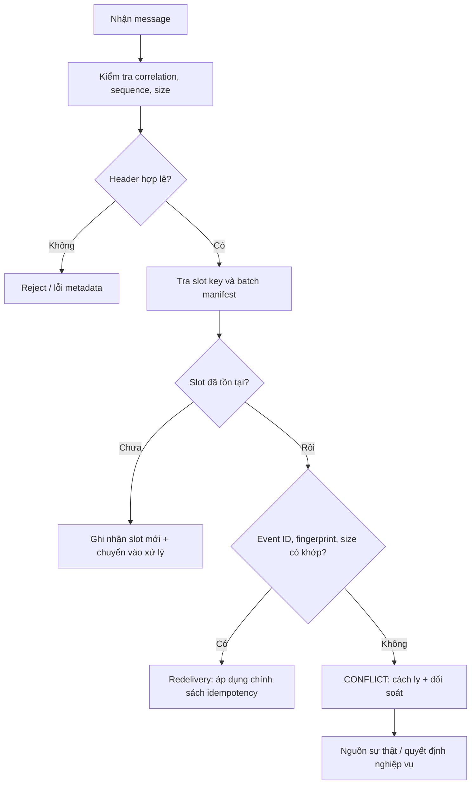
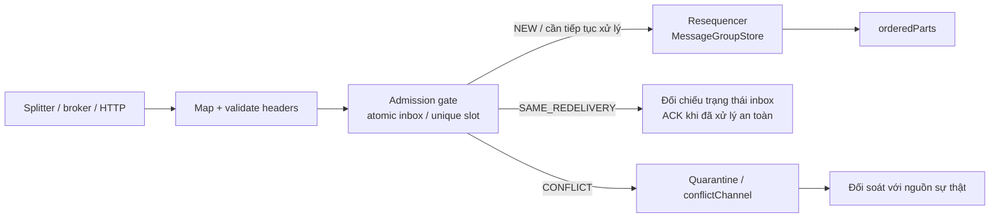

# Duplicate và conflicting sequence

Trong chương **Resequencer nâng cao** của **SPRING_INTEGRATION_PATTERN**, một chuỗi message có thể đến sai thứ tự, đến nhiều lần hoặc mang thông tin thứ tự mâu thuẫn. **Resequencer sắp xếp theo sequence metadata; nó không tự quyết định hai message cùng vị trí là một lần gửi lại hợp lệ hay là hai dữ liệu nghiệp vụ khác nhau.**

Khi xây dựng luồng bằng Splitter, Router, Filter, Transformer, Aggregator, Gateway, retry, error channel và các nhánh xử lý bất đồng bộ, cần phân biệt rõ:

- **Duplicate sequence**: một vị trí đã xuất hiện lại, thường do retry/redelivery hoặc hai nhánh cùng phát.
- **Conflicting sequence**: cùng một vị trí hoặc cùng một nhóm nhưng thông điệp mang **giá trị nghiệp vụ hoặc metadata không nhất quán**.
- **Out-of-order**: các vị trí khác nhau đến không theo thứ tự; đây mới là trường hợp Resequencer được thiết kế để giải quyết.

Hai loại đầu đòi hỏi **quy tắc phát hiện, idempotency, quarantine và đối soát** ở ranh giới dữ liệu. Nếu không, luồng có thể phát trùng tác động nghiệp vụ hoặc chọn nhầm phiên bản của một phần tử.

## 1. Ba header mô tả một chuỗi

Các message liên quan thường dùng bộ header:

| Header | Chức năng | Ví dụ |
| --- | --- | --- |
| `correlationId` | Định danh một nhóm message | `invoice-42:run-7` |
| `sequenceNumber` | Vị trí trong nhóm | `2` |
| `sequenceSize` | Tổng số phần dự kiến, nếu nguồn biết | `4` |

Ví dụ một batch gồm bốn phần, các worker trả kết quả lần lượt `#3/4, #1/4, #2/4, #4/4`: đây là **đảo thứ tự hợp lệ**. Nếu sau đó `#2/4` xuất hiện lại, phải xét vì sao vị trí số 2 có hai lần xuất hiện.

Khóa logic để phát hiện chiếm cùng vị trí thường là:

```text
(tenantId, batchRunId/correlationId, sequenceNumber)
```

Trên thực tế cần một `batchRunId` hoặc định danh lần thực thi không bị tái sử dụng, vì một nghiệp vụ có thể chạy lại nhiều đợt và mỗi đợt đều có `sequenceNumber=1`. Nếu hệ thống chỉ có một tenant thì có thể lược bỏ `tenantId`, nhưng không được gộp nhầm các luồng không liên quan.

**`MessageHeaders.ID` không đồng nghĩa với `sequenceNumber` hoặc định danh phần tử nghiệp vụ.** Một lần retry có thể tạo Spring Message mới với `id` và `timestamp` mới, dù nội dung và vị trí nghiệp vụ hoàn toàn giống trước đó.

## 2. Duplicate và conflict khác nhau thế nào?

Giả sử nguồn gửi ba phần cho `batch-42`:

| Message | Correlation | Sequence | Source event ID | Nội dung | Kết luận |
| --- | --- | ---: | --- | --- | --- |
| A | `batch-42` | 1/3 | `event-A` | `A` | Phần mới |
| B | `batch-42` | 2/3 | `event-B` | `B` | Phần mới |
| B' | `batch-42` | 2/3 | `event-B` | `B` | Redelivery của B |
| B'' | `batch-42` | 2/3 | `event-X` | `X` | **Conflict**: hai sự kiện chiếm vị trí 2 |
| B''' | `batch-42` | 2/4 | `event-B` | `B` | **Conflict**: tổng nhóm đổi từ 3 sang 4 |

**Duplicate giống hệt về ý nghĩa nghiệp vụ** là khi cùng một vị trí được tái gửi với định danh nguồn và dữ liệu bất biến khớp nhau. Nếu cùng vị trí nhưng payload khác, source event ID khác hoặc `sequenceSize` không nhất quán, đó là một **xung đột cần điều tra**. Đừng tự gắn nhãn “duplicate vô hại” chỉ vì số thứ tự trùng.

Đặc biệt, **cùng payload chưa chắc cùng sự kiện**: nếu hai nguồn khác nhau đều phát chuỗi `"OK"` tại vị trí 2 nhưng có business event ID khác, cần làm rõ hợp đồng vị trí. Ngược lại, cùng event ID nhưng nội dung thay đổi có thể phản ánh mutation/version bất hợp pháp và phải được coi là conflict trừ khi nghiệp vụ cho phép cập nhật có phiên bản.

### Trạng thái thực tế thường gặp

| Hiện tượng | Dữ liệu nhận được | Cách hiểu |
| --- | --- | --- |
| Đến sai thứ tự | `3, 1, 2` | Resequencer có thể sắp lại `1, 2, 3` |
| Retry cùng phần | `1:A, 2:B, 2:B, 3:C`, cùng source ID | Duplicate hợp lệ về danh tính; phải tránh xử lý hai lần |
| Trùng vị trí, khác nội dung | `1:A, 2:B, 2:X, 3:C` | Conflict; không chọn ngẫu nhiên B hoặc X |
| Trùng vị trí, size khác | `1/3, 2/3, 2/4, 3/3` | Metadata không nhất quán trong cùng batch |
| Retry sang batch mới | `run-1:2` và `run-2:2` | Không phải duplicate nếu đó là hai lần chạy khác nhau |
| Trùng số vì nhiều Splitter | Hai nhánh tự bắt đầu `1,2,…` với cùng correlation | Lỗi thiết kế phạm vi chuỗi |
| Message đến sau group hết hạn | `#2` đến khi group trước đã cleanup | Cần đối chiếu lifecycle, tránh tạo batch thứ hai |

## 3. Duplicate thường sinh ra ở đâu?

**Vận chuyển theo at-least-once.** Broker hoặc consumer có thể phát lại message khi xử lý xong nhưng ACK thất bại, tiến trình restart, hoặc timeout. Điều này bình thường với nhiều hệ thống phân tán; không thể giả định mỗi message nghiệp vụ chỉ đến một lần.

**Retry sau Gateway/worker.** Một worker thực hiện xong tác động bên ngoài, nhưng phản hồi về Gateway thất bại. Retry tạo lại kết quả cho đúng `sequenceNumber`. Nếu downstream không idempotent, kết quả có thể được ghi hai lần.

**Fan-out và xử lý song song.** Hai nhánh cùng phát lại một phần, hoặc một nhánh gửi nhiều lần khi nhận tín hiệu kết thúc không rõ. Router và PublishSubscribeChannel không tự bảo đảm rằng các message mà downstream thấy là duy nhất theo khóa nghiệp vụ.

**Splitter được gọi lại.** Cùng batch bị split hai lần có thể tạo hai bộ phần. Nếu `correlationId` không ổn định hoặc được tạo lại, hai bộ có thể thành hai nhóm riêng; nếu giữ cùng correlation nhưng không kiểm soát phiên bản, các phần có thể va chạm vị trí.

**Ánh xạ metadata sai.** Lấy offset từ các partition khác nhau làm số thứ tự chung, dùng chỉ số từ `0` mà không chuyển đổi, hoặc để nhiều hệ thống cùng gán `sequenceNumber` có thể tạo conflict ngay cả khi broker không retry.

Một Resequencer chỉ nhìn thấy những gì còn tồn tại trong header và payload. **Không nên mặc định cách cài đặt của `MessageGroupStore`, release strategy hay Resequencer sẽ nhận diện và khử tất cả duplicate theo nghiệp vụ**. Một kho message có thể sử dụng message ID nội bộ, trong khi hai message khác ID vẫn có cùng `sequenceNumber`; hành vi cần được kiểm chứng bằng test trên cấu hình cụ thể.

## 4. Cách nhận diện duplicate đáng tin cậy

### 4.1. Chọn khóa và dấu vân tay nghiệp vụ

Nên xác định rõ một *slot* của chuỗi và một *event signature*:

- **Slot key**: `tenantId + batchRunId + sequenceNumber`.
- **Source event ID**: định danh bất biến do nguồn cấp cho sự kiện ở slot đó.
- **Content fingerprint**: checksum hoặc hash của nội dung đã được chuẩn hóa, kèm schema/version nếu cần.
- **Sequence metadata**: `correlationId`, `sequenceNumber` và `sequenceSize` đã được xác nhận.
- **Provenance**: nguồn phát, topic/partition/offset hoặc delivery attempt để điều tra, không thay cho slot key.

Nếu payload là JSON, hash trực tiếp toàn bộ chuỗi bytes đôi khi sai vì thứ tự field, khoảng trắng và kiểu ngày giờ có thể thay đổi mà ý nghĩa không đổi. Hãy chuẩn hóa theo hợp đồng trước khi băm hoặc so sánh các trường nghiệp vụ bất biến. Dùng thuật toán hash đủ mạnh; khi conflict quan trọng, nên giữ dữ liệu đủ để đối chiếu thay vì chỉ dựa vào giá trị hash.

### 4.2. Quy tắc quyết định



Quyết định phải nhất quán giữa các instance. Nếu hai consumer cùng nhận phần `#2`, thao tác **kiểm tra rồi ghi** tách rời có thể khiến cả hai tin rằng mình là người đầu tiên. Trong production cần một thao tác nguyên tử như unique key ở database, conditional insert hoặc một inbox store có transaction và trạng thái xử lý phù hợp.

### 4.3. Code Java: phân loại slot trước khi chấp nhận

Ví dụ sau dùng Java 17 để diễn giải chính sách. Nó phù hợp minh họa và unit test trong một JVM; **chưa đủ cho production** do dữ liệu giữ trong bộ nhớ, không tồn tại sau restart và chưa phối hợp transaction với downstream.

```java
import java.util.concurrent.ConcurrentHashMap;
import java.util.concurrent.ConcurrentMap;

public final class SequenceAdmission {

    public enum Decision {
        NEW, SAME_REDELIVERY, CONFLICT
    }

    public record Part(
            String tenantId,
            String batchRunId,
            int sequenceNumber,
            int sequenceSize,
            String sourceEventId,
            String contentFingerprint) {
    }

    private record Slot(
            String tenantId, String batchRunId, int sequenceNumber) {
    }

    private record Signature(
            int sequenceSize, String sourceEventId,
            String contentFingerprint) {
    }

    private record BatchKey(String tenantId, String batchRunId) {
    }

    private final ConcurrentMap<BatchKey, Integer> expectedSizes =
            new ConcurrentHashMap<>();
    private final ConcurrentMap<Slot, Signature> acceptedSlots =
            new ConcurrentHashMap<>();

    public Decision classify(Part part) {
        if (part == null
                || blank(part.tenantId())
                || blank(part.batchRunId())
                || blank(part.sourceEventId())
                || blank(part.contentFingerprint())
                || part.sequenceSize() < 1
                || part.sequenceNumber() < 1
                || part.sequenceNumber() > part.sequenceSize()) {
            throw new IllegalArgumentException("Invalid sequence metadata");
        }

        BatchKey batch = new BatchKey(part.tenantId(), part.batchRunId());
        Integer existingSize =
                expectedSizes.putIfAbsent(batch, part.sequenceSize());

        // Cùng batch phải công bố cùng một tổng số phần.
        if (existingSize != null && existingSize != part.sequenceSize()) {
            return Decision.CONFLICT;
        }

        Slot slot = new Slot(
                part.tenantId(), part.batchRunId(), part.sequenceNumber());
        Signature candidate = new Signature(
                part.sequenceSize(), part.sourceEventId(),
                part.contentFingerprint());

        Signature original = acceptedSlots.putIfAbsent(slot, candidate);
        if (original == null) {
            return Decision.NEW;
        }
        return original.equals(candidate)
                ? Decision.SAME_REDELIVERY
                : Decision.CONFLICT;
    }

    private static boolean blank(String value) {
        return value == null || value.isBlank();
    }
}
```

**Diễn giải:**

1. Mọi message hợp lệ được kiểm tra trước khi vào luồng cần thứ tự.
2. Một slot chưa từng thấy trả về `NEW`.
3. Cùng slot và cùng thông tin bất biến trả về `SAME_REDELIVERY`, dù Spring Message có `MessageHeaders.ID` khác.
4. Cùng slot nhưng khác event ID, fingerprint hoặc sequence size trả về `CONFLICT`.
5. Cùng batch nhưng `sequenceSize` khác với tổng đã ghi nhận cũng trả về `CONFLICT`.

**Giới hạn cực kỳ quan trọng:** `classify()` đang ghi dấu “đã thấy” *trước khi* chứng minh message mới đã được lưu/gửi đến downstream bền vững. Nếu luồng xử lý lỗi ngay sau khi trả về `NEW`, một retry giống hệt có thể bị phân loại thành `SAME_REDELIVERY` rồi bị bỏ, gây mất phần tử. Trong hệ thống thực phải gắn việc ghi inbox, trạng thái xử lý và ACK vào một quy trình bền vững, có khả năng retry; kết quả `SAME_REDELIVERY` đôi khi phải **tiếp tục một thao tác đang dở**, thay vì đơn giản drop message.

Đoạn mã cũng chưa giải quyết vòng đời batch, dọn cache, nhiều instance, chuyển trạng thái nhóm cuối, định danh payload từ hệ thống ngoài hay xung đột với việc cập nhật bản ghi. Những phần này thuộc thiết kế lưu trữ/idempotency riêng.

## 5. Thiết kế luồng Spring Integration

Một pipeline có thể bố trí **admission gate trước Resequencer**, sau khi đã ánh xạ và kiểm tra metadata. Trong Java DSL, có thể dùng một service activator/router tùy chỉnh để phân loại:



Luồng này cho phép tách rõ ba loại quyết định. Nên tạo message hoặc header chẩn đoán riêng như `duplicateReason`, `originalEventId` hoặc `conflictType` **tại tầng ứng dụng**, tránh nhầm chúng với header mặc định của Spring Integration.

Một cấu hình Resequencer tối giản, giả sử chỉ message được chấp nhận mới được chuyển tới `validatedParts`:

```java
import org.springframework.context.annotation.Bean;
import org.springframework.context.annotation.Configuration;
import org.springframework.integration.dsl.IntegrationFlow;

@Configuration
class ValidatedResequencerFlow {

    @Bean
    IntegrationFlow resequenceValidatedParts() {
        return IntegrationFlow.from("validatedParts")
                .resequence()
                .channel("orderedParts")
                .get();
    }
}
```

Đoạn mã **không triển khai admission gate** và không đảm bảo duplicate/conflict đã được xử lý; nó chỉ cho thấy nơi Resequencer nên nằm sau một ranh giới kiểm soát đầu vào. Khi cần chạy nhiều instance, inbox lưu lâu dài cùng khóa duy nhất và giao thức trạng thái mới là nơi giữ bất biến của dữ liệu.

### Vai trò của Splitter, Filter và Transformer

- **Splitter** có thể gắn `correlationId`, `sequenceNumber`, `sequenceSize` khi sequencing được bật. Nếu cùng batch được split lại, cần làm rõ retry của batch cũ hay một lần chạy mới.
- **Filter** có thể cố tình loại phần. Một khoảng trống sau Filter không đồng nghĩa duplicate, nhưng dễ làm nhóm chờ thiếu. Nếu đánh số lại, phải tạo chuỗi mới nhất quán ở ranh giới đã chọn.
- **Transformer** có thể thay đổi payload. Nếu content fingerprint được tính **trước** Transformer, nên dùng dấu vân tay của dữ liệu đầu vào bất biến; so sánh payload sau Transformer có thể cho kết quả khác dù cùng sự kiện gốc.
- **Router/fan-out** có thể tạo các đường phát lại khác nhau. Mọi nhánh cần cùng hợp đồng slot; nếu mỗi nhánh định nghĩa lại vị trí, cần correlation riêng.
- **Aggregator và Resequencer** có mục tiêu đầu ra khác nhau, nhưng đều phụ thuộc tính toàn vẹn thông tin nhóm để quyết định release.

## 6. Conflicting sequence: không dùng “first wins” hoặc “last wins” một cách mù quáng

Hai thông điệp khác nhau cùng tuyên bố là `batch-42, sequenceNumber=2` là một **xung đột dữ liệu**. Chọn bản đến trước có thể khiến hệ thống chọn payload lỗi nếu bản đầu đã hỏng. Chọn bản đến sau có thể đảo nghĩa vụ nghiệp vụ và dẫn tới kết quả không tái lập giữa các lần chạy.

Có thể đưa ra một trong các quyết định rõ ràng sau:

| Chính sách | Điều kiện chọn | Điều kiện thực thi |
| --- | --- | --- |
| **Quarantine + điều tra** | Không có cơ chế phân xử đáng tin | Giữ cả hai phiên bản, dừng release nhóm khi cần |
| **Authoritative source** | Có nguồn sự thật và version rõ ràng | Truy vấn lại; ghi nhận quyết định và bản bị loại |
| **Versioned correction** | Nghiệp vụ cho phép sửa sự kiện cũ | Tạo bản sửa có version/event mới, không giả định hai message là một |
| **Fail batch** | Xung đột có thể gây tác động sai nghiêm trọng | Khóa nhóm, báo lỗi nghiệp vụ, phục hồi/bù trừ nếu cần |
| **Deterministic precedence** | Hợp đồng nêu rõ ưu tiên nguồn/version | Quy tắc ổn định, có audit; không phụ thuộc thời điểm message đến |

**Không thể giải quyết một conflict chỉ bằng Resequencer**, vì số thứ tự giống nhau không cung cấp thông tin bản nào đúng. Việc áp dụng một kết quả tùy ý cũng có thể khiến các node chạy khác nhau tạo ra kết quả khác nhau.

### Conflicting group size

Ví dụ `#1/5` và `#2/6` cùng `correlationId`: đây là vấn đề **metadata của cả nhóm**, ngay cả khi sequenceNumber khác nhau. Nếu tổng số phần có thể thay đổi hợp lệ theo nghiệp vụ, cần phiên bản manifest/batch mới hoặc một giao thức điều chỉnh rõ ràng; không trộn các message của hai phiên bản vào cùng nhóm mà kỳ vọng release strategy tự suy ra.

### Conflict giữa group đã hoàn tất và message đến muộn

Sau khi nhóm đã hoàn tất hoặc hết hạn, có thể nhận một message với vị trí cũ và payload khác. Nếu MessageGroupStore đã xóa trạng thái, Resequencer có thể không còn đủ thông tin phát hiện mâu thuẫn. **Đừng dùng riêng sự tồn tại của group trong store làm bằng chứng một batch chưa xử lý**. Hãy đối chiếu một bản ghi lifecycle nghiệp vụ bền vững có TTL/retention phù hợp.

## 7. Idempotency cần bảo vệ cả đầu vào và tác động đầu ra

Một **inbox/idempotency store** có thể lưu khóa slot, định danh nguồn, checksum, trạng thái xử lý và kết quả cuối. Với database, nên có unique constraint tương ứng:

```sql
-- Minh họa bảng inbox; cú pháp và cơ chế khóa cụ thể
-- phụ thuộc hệ quản trị cơ sở dữ liệu được sử dụng.
CREATE TABLE sequence_inbox (
    tenant_id VARCHAR(100) NOT NULL,
    batch_run_id VARCHAR(160) NOT NULL,
    sequence_number INTEGER NOT NULL,
    sequence_size INTEGER NOT NULL,
    source_event_id VARCHAR(200) NOT NULL,
    content_fingerprint VARCHAR(128) NOT NULL,
    processing_status VARCHAR(40) NOT NULL,
    PRIMARY KEY (tenant_id, batch_run_id, sequence_number)
);
```

Một luồng an toàn thường thực hiện:

1. Validate metadata và tìm manifest của batch.
2. Ghi nhận slot bằng insert có điều kiện/transaction; nếu đã có, đọc signature và trạng thái trước khi phân loại.
3. Chỉ ACK message đầu vào khi việc bàn giao hoặc kết quả xử lý đã **bền vững** theo hợp đồng.
4. Nếu cùng signature và trạng thái đang dở, cho phép resume/retry; nếu đã hoàn tất, dùng trạng thái để ngăn áp dụng hiệu ứng hai lần.
5. Nếu conflict, cách ly cả hai sự kiện, giữ thông tin cần đối soát và không âm thầm ghi đè slot.
6. Nếu downstream có tác động ngoài (ghi DB, gọi API), dùng idempotency key phù hợp, transaction/outbox hoặc giao thức bù trừ để tránh lặp tác động khi ACK thất bại.

Unique key đảm bảo **mỗi slot có một bản ghi nguồn sự thật**, nhưng tự nó chưa đảm bảo “exactly once” end-to-end khi nhiều kho, broker và dịch vụ tham gia. Cần xác định ranh giới giao dịch và phương án xử lý sau crash.

### Retention và dọn nhóm

Không xóa bảng dedup ngay khi Resequencer release xong nếu broker vẫn có thể phát lại message cũ. Cần thời gian lưu đủ cho cửa sổ retry/redelivery và late arrival. Với các batch dài hoặc phải kiểm toán, metadata đầu ra có thể cần lưu dài hơn nhóm trong `MessageGroupStore`.

Khi hết retention, định nghĩa rõ có chấp nhận lại một vị trí cũ không. Một `batchRunId` không tái sử dụng giúp giảm nguy cơ message cũ bị xem là dữ liệu batch mới.

## 8. Kiểm thử đầy đủ và có tính đối kháng

### 8.1. Unit test cho quy tắc phân loại

Với lớp `SequenceAdmission` ở trên:

```java
import static org.junit.jupiter.api.Assertions.assertEquals;

import org.junit.jupiter.api.Test;

class SequenceAdmissionTest {

    @Test
    void distinguishesRedeliveryFromConflict() {
        var admission = new SequenceAdmission();

        var original = new SequenceAdmission.Part(
                "tenant-1", "batch-42", 2, 3, "event-B", "sha256-B");
        var sameAgain = new SequenceAdmission.Part(
                "tenant-1", "batch-42", 2, 3, "event-B", "sha256-B");
        var conflicting = new SequenceAdmission.Part(
                "tenant-1", "batch-42", 2, 3, "event-X", "sha256-X");

        assertEquals(SequenceAdmission.Decision.NEW,
                admission.classify(original));
        assertEquals(SequenceAdmission.Decision.SAME_REDELIVERY,
                admission.classify(sameAgain));
        assertEquals(SequenceAdmission.Decision.CONFLICT,
                admission.classify(conflicting));
    }

    @Test
    void detectsGroupSizeConflict() {
        var admission = new SequenceAdmission();
        admission.classify(new SequenceAdmission.Part(
                "tenant-1", "batch-42", 1, 3, "event-A", "sha-A"));

        assertEquals(SequenceAdmission.Decision.CONFLICT,
                admission.classify(new SequenceAdmission.Part(
                        "tenant-1", "batch-42", 2, 4, "event-B", "sha-B")));
    }
}
```

Đây là **test minh họa trong bộ nhớ**. Nó chưa xác minh các điều kiện crash, nhiều instance hoặc trạng thái ACK; cần kiểm thử tích hợp với broker, inbox store và các channel thật.

### 8.2. Ma trận test tích hợp

| Ca thử | Đầu vào | Kỳ vọng |
| --- | --- | --- |
| Đảo thứ tự bình thường | `3:C, 1:A, 2:B` | Thứ tự đầu ra đúng theo release strategy |
| Redelivery giống hệt | `2:B` nhận hai lần, cùng source event ID | Một hiệu ứng nghiệp vụ; trạng thái duplicate được ghi nhận |
| Khác message UUID, cùng event | Cùng slot/payload/event ID, khác Spring `id` | Phân loại redelivery, không conflict giả |
| Cùng slot, khác payload | `2:B` và `2:X` | Conflict được cách ly; không chọn tùy ý |
| Cùng slot, khác source ID | Hai event riêng cùng số 2 | Conflict dù nội dung tình cờ giống |
| Size mâu thuẫn trong nhóm | `1/3, 2/4, 3/3` | Chặn/quarantine metadata sai |
| Duplicate trước ACK | Xử lý xong nhưng ACK thất bại | Retry idempotent; không ghi tác động hai lần |
| Crash sau ghi inbox | Inbox đã ghi, downstream chưa xử lý | Retry có thể tiếp tục message đang dở |
| Hai consumer đồng thời | Cùng slot đến hai node | Một slot được xác nhận nguyên tử; không nhân đôi hiệu ứng |
| Group đã cleanup | Message cũ đến sau retention ngắn | Hành vi late-arrival theo trạng thái nghiệp vụ |
| Filter loại phần | Splitter tạo `1..4`, Filter bỏ số 2 | Không nhầm intentional skip với duplicate |
| Hai batch xen kẽ | `A:1, B:1, A:2, B:2` | Không chặn nhầm vị trí 1 của B do A đã có vị trí 1 |
| Retry với dữ liệu đã sửa | Cùng source ID, payload/version khác | Phân loại conflict hoặc correction theo hợp đồng, không im lặng ghi đè |

Để kiểm thử concurrency, bắt đầu nhiều consumer cùng lúc và quan sát kết quả cuối ở **kho idempotency** và **downstream**, thay vì chỉ kiểm tra số lần hàm classifier trả về. Với timeout, tạo thử nghiệm mà redelivery đến ngay khi group hết hạn để xác nhận không phát trùng batch.

## 9. Quan sát và xử lý sự cố

Theo dõi tối thiểu:

- `correlationId`/`batchRunId`, `sequenceNumber`, `sequenceSize` và source event ID.
- Loại phân loại: `NEW`, `SAME_REDELIVERY`, `CONFLICT`, `INVALID_METADATA`.
- Fingerprint hoặc checksum để đối soát, nhưng hạn chế ghi payload và dữ liệu nhạy cảm.
- Số duplicate theo nguồn, số conflicting slot, số nhóm bị quarantine và thời gian xử lý xung đột.
- Trạng thái inbox/outbox, số message chưa ACK, số retry, DLQ và late arrival.
- Số lần downstream tránh được hiệu ứng trùng và số trường hợp phải bù trừ.

Một mẫu log chẩn đoán:

```json
{
  "batchRunId": "invoice-42:run-7",
  "sequenceNumber": 2,
  "sequenceSize": 4,
  "decision": "CONFLICT",
  "originalEventId": "event-B",
  "incomingEventId": "event-X",
  "reason": "same_slot_different_business_event",
  "action": "QUARANTINE"
}
```

Các tên `decision`, `reason` và `action` là **trường nghiệp vụ gợi ý**, không phải header mặc định của Resequencer. Không đưa toàn bộ nội dung nhạy cảm của message vào log chỉ để phân biệt hai bản phát lại.

## 10. Checklist trước khi triển khai

1. **Xác định slot key và định danh lần chạy.** Không dùng một `correlationId` cho nhiều batch độc lập.
2. **Giữ một quy tắc sequence nhất quán.** Xác thực `sequenceNumber`, `sequenceSize` và metadata nguồn trước khi resequence.
3. **Chọn dấu vân tay nghiệp vụ bất biến.** Không dùng riêng Spring Message ID hoặc thời gian nhận.
4. **Tách redelivery khỏi conflict.** Cùng slot nhưng event ID, nội dung hoặc tổng nhóm khác nhau phải có chính sách xử lý rõ.
5. **Gắn dedup với trạng thái xử lý.** Không đánh dấu “đã xử lý” trước khi bàn giao/kết quả bền vững.
6. **Làm thao tác nhận slot nguyên tử.** Dùng inbox store/unique constraint và transaction phù hợp khi có nhiều instance.
7. **Không âm thầm áp dụng first-wins/last-wins.** Phải có nguồn sự thật hoặc quy tắc ưu tiên có kiểm toán cho dữ liệu xung đột.
8. **Thiết kế timeout và late arrival.** Giữ dedup record đủ lâu cho retry, DLQ và message đến sau khi group hết hạn.
9. **Kiểm thử cùng lúc các nhánh.** Bao gồm out-of-order, duplicate, conflict, crash, retry, nhiều consumer, xóa group và metadata sai.
10. **Quan sát và hỗ trợ phục hồi.** Có conflict channel/quarantine, báo cáo vị trí xung đột và quy trình quyết định cuối.

**Ghi nhớ:** Resequencer khôi phục **thứ tự theo metadata**. Duplicate sequence cần **idempotency dựa trên danh tính nghiệp vụ và trạng thái xử lý**, còn conflicting sequence cần **xác thực nguồn sự thật, cách ly và quyết định có kiểm toán**. Xử lý đúng hai trường hợp này trước ranh giới resequencing giúp luồng thông điệp tránh phát trùng hoặc phát sai dữ liệu ngay cả khi broker và worker hoạt động theo at-least-once.

