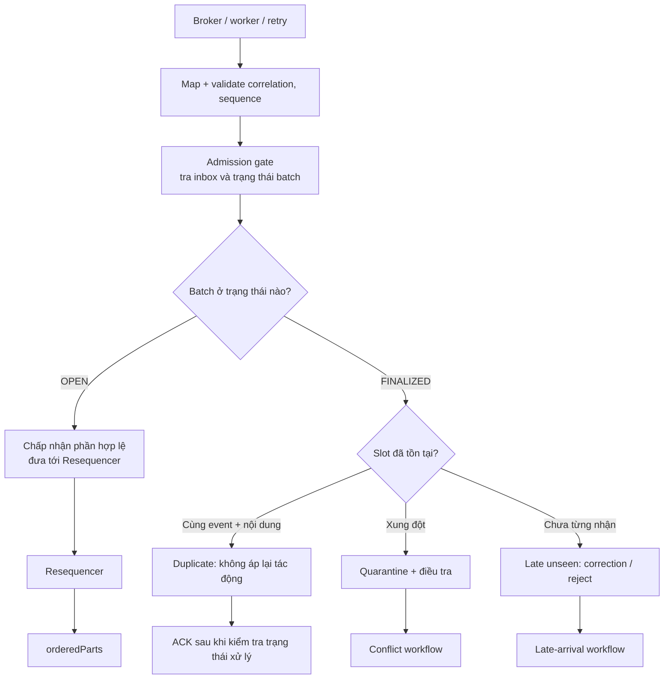
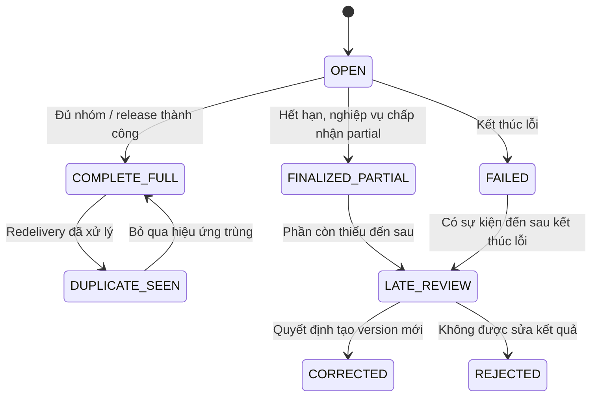

# Late arrival sau khi group hoàn tất

Trong chương **Resequencer nâng cao** của **SPRING_INTEGRATION_PATTERN**, một nhóm thông điệp có thể đã được sắp đúng thứ tự và phát tới downstream, nhưng sau đó một message cũ vẫn xuất hiện. Điều này thường gặp khi broker gửi lại sau lỗi xác nhận, worker xử lý chậm, retry được thực hiện sau timeout, hoặc các nhánh xử lý có độ trễ khác nhau.

**Late arrival sau khi group hoàn tất** là tình huống một message thuộc một `correlationId` đã có quyết định kết thúc hoặc đã phát kết quả cuối, nhưng message ấy chỉ được nhận/xử lý sau thời điểm đó. Câu hỏi quan trọng không chỉ là “nó còn đúng thứ tự không?” mà còn là: **nhóm đã hoàn tất với trạng thái gì, dữ liệu cũ còn được lưu không, và có được phép thay đổi kết quả đã công bố hay không?**

Bài này trình bày cách phân biệt message đến trễ với duplicate và conflict, ảnh hưởng của `MessageGroupStore`, `expireGroupsUponCompletion`, timeout, chính sách xử lý late arrival, Java DSL và các tình huống kiểm thử. Mục tiêu là xây dựng luồng Enterprise Integration Patterns có correlation rõ ràng, retry an toàn, error handling quan sát được và không phát kết quả trùng.

## 1. “Group hoàn tất” có nghĩa gì?

Spring Integration dùng các thông tin chuỗi thường gặp:

| Header | Ý nghĩa | Ví dụ |
| --- | --- | --- |
| `correlationId` | Định danh nhóm các message cùng chuỗi | `invoice-42:run-9` |
| `sequenceNumber` | Vị trí của một message trong chuỗi | `2` |
| `sequenceSize` | Tổng số phần được kỳ vọng nếu nguồn biết | `3` |

Đối với nhóm có ba phần, phía nguồn đánh số `#1/3`, `#2/3`, `#3/3`. Vì các worker xử lý song song, Resequencer có thể nhận `#3` trước, tiếp theo `#1` và `#2`, rồi phát theo thứ tự `1 → 2 → 3`.

```text
Thời điểm     Diễn biến với group G (size=3)
T+00s         Nhận #3/3
T+01s         Nhận #1/3
T+02s         Nhận #2/3
T+02s         Đủ điều kiện release, đầu ra: #1 → #2 → #3
T+09s         Broker redeliver #2/3 (cùng sự kiện nghiệp vụ)
              → Message đến sau khi kết quả của G đã phát.
```

Ở đây cần phân biệt ít nhất ba khái niệm:

1. **Release:** Resequencer đã phát một hoặc nhiều message theo điều kiện release strategy.
2. **Completion:** nhóm đã được xác định hoàn thành theo lifecycle của endpoint; có thể giữ dấu hoàn tất trong kho nhóm hoặc được xóa theo cấu hình.
3. **Finalization nghiệp vụ:** hệ thống ứng dụng đã ghi nhận kết quả cuối cùng và quyết định không chấp nhận sửa trực tiếp kết quả đó nữa.

Ba sự kiện có thể liên quan nhưng **không phải lúc nào xảy ra cùng thời điểm**. Một cấu hình cho phép phát *partial sequences* có thể phát trước một đoạn liên tục trong khi cả nhóm vẫn chờ các phần sau. Trong trường hợp đó, message tiếp theo đến sau một lần release **chưa chắc** là late arrival sau *completion*.

### Phân biệt complete bình thường và kết thúc do timeout

Một nhóm có thể đi tới các trạng thái nghiệp vụ khác nhau:

| Trạng thái ứng dụng (đề xuất) | Điều đã xảy ra | Ý nghĩa khi có message đến sau |
| --- | --- | --- |
| `OPEN` | Nhóm đang chờ hoặc còn chấp nhận các phần | Có thể vẫn nhận message mới hợp lệ |
| `COMPLETED_FULL` | Đã xác nhận đủ các vị trí và phát kết quả cuối | Message cũ thường là retry/duplicate hoặc conflict |
| `FINALIZED_PARTIAL` | Đã quyết định phát/đóng khi còn thiếu phần | Phần bị thiếu đến sau là **late unseen part**, cần chính sách riêng |
| `FAILED` | Nhóm bị kết thúc với lỗi nghiệp vụ | Không được tự “mở lại” và công bố thành công |
| `CANCELLED` | Nhóm được hủy có chủ đích | Message đến trễ cần được từ chối/ghi nhận theo hợp đồng |

Các trạng thái này là **mô hình nghiệp vụ tham khảo**, không phải toàn bộ trạng thái/hằng mặc định của Spring Integration. Đặc biệt, *group expiry* do timeout không chứng minh message đã mất vĩnh viễn; nó chỉ kích hoạt cách xử lý theo cấu hình.

## 2. Vì sao message vẫn tới sau khi group đã đóng?

### 2.1. Retry hoặc redelivery sau lỗi ACK

Consumer đã chuyển `#2` vào Resequencer thành công nhưng chưa kịp ACK với broker. Sau restart, broker gửi lại `#2`. Spring Message mới có thể có `MessageHeaders.ID` khác, nhưng đó vẫn là **cùng sự kiện nghiệp vụ**.

### 2.2. Một nhánh xử lý chậm hơn phần còn lại

Splitter phát nhiều phần; Router đưa chúng qua các worker, mỗi nhánh có độ trễ riêng. Nếu nhóm được đóng theo deadline và cho phép kết quả partial, phần bị chậm có thể đến sau khi kết quả partial đã công bố. Đây là **message từng chưa được nhận**, khác với redelivery một phần đã xử lý.

### 2.3. Nhánh retry hoặc dead-letter được phát lại

Một lỗi trong Transformer, Gateway hoặc dịch vụ ngoài khiến phần `#3` vào retry queue / dead-letter queue. Khi nhân viên vận hành sửa lỗi và replay, nhóm tương ứng có thể đã được finalization hoặc cleanup. Việc replay cần biết kết quả cũ đã xử lý đến đâu.

### 2.4. Cùng nhóm được sinh lại từ upstream

Một job bị chạy lại với cùng `correlationId` và số thứ tự từ `1`. Nếu không phân biệt lần chạy bằng `runId`, hệ thống không biết đây là **retry của batch cũ** hay **batch mới**. Hai lần chạy không nên dùng chung khóa nếu message của lần cũ còn tồn tại.

### 2.5. Phối hợp nhiều instance và race condition

Một instance có thể đang hoàn tất nhóm, trong khi instance khác nhận message cuối hoặc duplicate. Nếu kiểm tra “group đã hoàn tất chưa?” và ghi kết quả là hai thao tác độc lập, cả hai có thể cùng tin rằng message của mình hợp lệ. Cần thiết kế cập nhật trạng thái nguyên tử và kiểm thử đồng thời.

## 3. Phân loại late arrival: không phải tất cả đều là duplicate

Giả sử một hệ thống có `batchRunId=invoice-42:run-9` và `sequenceSize=3`.

| Incoming message sau khi đóng | Lịch sử nhóm | Phân loại | Xử lý gợi ý |
| --- | --- | --- | --- |
| `#2/3`, cùng source event ID và fingerprint | `#2` đã được xử lý | **Same redelivery** | Bỏ qua tác động trùng; ACK khi đã an toàn |
| `#2/3`, event ID hoặc fingerprint khác | `#2` đã có phiên bản được chấp nhận | **Conflicting late event** | Cách ly/đối soát; không ghi đè tùy ý |
| `#3/3` đến sau khi nhóm đóng partial lúc mới có `#1, #2` | `#3` chưa từng được nhận | **Late unseen part** | Correction/recovery hoặc từ chối theo hợp đồng |
| `#4/3` | Nhóm cam kết size `3` | **Invalid metadata** | Từ chối/cách ly lỗi nguồn |
| `#1/4` với cùng batch ID | Các phần trước cam kết size `3` | **Conflicting group metadata** | Đối soát manifest/version |
| `#1/3` của `run-10` | Group cũ là `run-9` | **Batch khác** | Xử lý riêng nếu khóa run mới hợp lệ |

Khóa vị trí thường là `tenantId + batchRunId + sequenceNumber`. Ngoài ra nên dùng **source event ID** và **fingerprint nội dung đã chuẩn hóa** để phân biệt lần gửi lại giống hệt với hai sự kiện khác nhau đang tranh một vị trí.

**Không dùng riêng `MessageHeaders.ID` để quyết định duplicate** vì retry có thể tạo ID mới. Cũng không dựa vào thứ tự đến hay timestamp: chúng phản ánh vận chuyển và xử lý, không xác nhận event nào có thẩm quyền.

## 4. MessageGroupStore và `expireGroupsUponCompletion`

Resequencer thuộc nhóm endpoint tương quan (*correlating endpoint*) và cần lưu các message cùng group trong một `MessageGroupStore`. Kho này tham gia vào việc tập hợp, release và quản lý vòng đời nhóm.

Một lựa chọn quan trọng là **`expireGroupsUponCompletion`**. Về mặt thiết kế, có hai hướng quản lý sau khi hoàn tất:

- **Giữ dấu nhóm đã hoàn tất**: giúp hệ thống nhận biết cùng `correlationId` từng hoàn thành. Với cấu hình có hỗ trợ, nhóm có thể được giữ ở dạng đã đánh dấu complete thay vì xóa ngay toàn bộ dấu vết.
- **Xóa nhóm sau completion**: tiết kiệm trạng thái lưu trữ nhưng làm mất thông tin completion của group trong store. Khi một message cũ đến sau, endpoint có thể nhìn thấy nhóm mới hoặc áp dụng hành vi khác tùy cấu hình.

Chi tiết xử lý message trễ khi group đã complete phụ thuộc **phiên bản Spring Integration, release strategy, cấu hình endpoint, đặc tính store, discard channel và chính sách cleanup**. Không nên mặc định mọi message trễ luôn bị loại, luôn ném exception hay luôn được gom vào nhóm mới.

Quan trọng hơn, **completed marker trong `MessageGroupStore` không tự thay thế một inbox/idempotency store ở tầng nghiệp vụ**. Nếu group bị xóa theo retention, ứng dụng vẫn cần biết batch này đã có kết quả cuối, tránh phát thành công lần nữa khi broker redeliver.

### Ví dụ Java DSL

Ví dụ dưới đây minh họa cấu hình Resequencer có chủ đích giữ lại dấu completion trong endpoint, đồng thời không phát partial khi timeout:

```java
import org.springframework.context.annotation.Bean;
import org.springframework.context.annotation.Configuration;
import org.springframework.integration.dsl.IntegrationFlow;

@Configuration
class OrderedPartsFlow {

    @Bean
    IntegrationFlow resequence() {
        return IntegrationFlow.from("validatedParts")
                .resequence(spec -> spec
                        .expireGroupsUponCompletion(false)
                        .groupTimeout(30_000L)
                        .sendPartialResultOnExpiry(false))
                .channel("orderedParts")
                .get();
    }
}
```

Ý nghĩa:

1. `validatedParts` là channel chỉ nhận những message đã được kiểm tra correlation/sequence và chính sách chấp nhận.
2. `expireGroupsUponCompletion(false)` chọn không xóa ngay dấu nhóm hoàn tất theo cơ chế của endpoint; cần xác minh hành vi thực tế với store và cấu hình dọn nhóm.
3. `groupTimeout(30_000L)` xử lý nhóm chờ quá lâu theo cơ chế lập lịch của endpoint. Giá trị này không phải cam kết deadline tuyệt đối đúng 30 giây kể từ message đầu tiên.
4. `sendPartialResultOnExpiry(false)` tránh chủ động phát dữ liệu partial do expiry; nó **không tự xây dựng nhánh thông báo lỗi nghiệp vụ**.
5. `orderedParts` nhận những phần đã được release theo thứ tự.

Mã minh họa chính sách ở Resequencer, **chưa triển khai admission gate, trạng thái business finalization, durable dedup hoặc xử lý late arrival**. Những phần này cần nằm trong luồng ứng dụng hoặc dịch vụ hỗ trợ phù hợp. Hãy kiểm thử cụ thể các message tới sau completion với phiên bản Spring Integration bạn sử dụng.

### Còn `MessageGroupStoreReaper`?

Một ứng dụng có thể sử dụng cơ chế quét và dọn nhóm cũ như `MessageGroupStoreReaper`. Tuy nhiên, cần phân biệt:

- **Group completion:** endpoint đã đáp ứng điều kiện hoàn thành/release.
- **Group timeout/expiry:** endpoint xử lý nhóm chờ lâu theo cấu hình.
- **Store cleanup/reaping:** chính sách thu hồi trạng thái đã lưu theo tuổi nhóm.

Những cơ chế trên có mục đích và thời điểm khác nhau. Dọn nhóm quá sớm có thể mất dấu completed group; giữ vĩnh viễn làm tăng dung lượng. Tính toán retention dựa trên **cửa sổ retry, thời hạn lưu broker/DLQ, quy định nghiệp vụ và nhu cầu kiểm toán**.

## 5. Quyết định xử lý late arrival ở ranh giới nghiệp vụ

Thay vì để một message bất kỳ đi thẳng vào Resequencer rồi hy vọng endpoint tự xử lý đúng, có thể đặt **admission gate** trước channel này.



Mỗi nhánh cần quyết định rõ: có ACK message đầu vào không, có lưu vào DLQ hoặc kho cách ly không, có phát sự kiện cập nhật kết quả cũ không, và ai là người hoặc dịch vụ có thẩm quyền ra quyết định.

### Chính sách A — Ignore duplicate đã hoàn tất

Chọn khi message chỉ là bản gửi lại của sự kiện đã được xử lý và hiệu ứng downstream đã hoàn tất bền vững. Ghi số lần redelivery và ACK theo giao thức broker để tránh retry vô hạn. Nếu lần trước mới chỉ ghi “đã nhận” nhưng downstream chưa xong, phải **tiếp tục xử lý** thay vì bỏ qua mù quáng.

### Chính sách B — Quarantine conflict

Chọn khi cùng `correlationId + sequenceNumber` nhưng payload, source event ID hoặc manifest khác lịch sử đã chấp nhận. Giữ đủ thông tin để đối soát và phát một sự kiện lỗi nghiệp vụ rõ ràng. Không áp dụng “last wins” chỉ vì message đến sau.

### Chính sách C — Từ chối late unseen part

Chọn khi batch đã hoàn tất theo một quyết định bất biến, chẳng hạn đã chốt thanh toán hoặc gửi kết quả cho bên thứ ba không hỗ trợ sửa. Message tới muộn được ghi nhận và xử lý qua recovery/compensation nếu cần; không âm thầm mở lại group đã đóng.

### Chính sách D — Correction có version mới

Chọn khi nghiệp vụ cho phép sửa kết quả đã công bố, ví dụ báo cáo tạm hoặc dashboard. Thay vì sửa âm thầm lịch sử, tạo một **correction event** có version mới, liên kết với kết quả trước đó:

```json
{
  "batchRunId": "invoice-42:run-9",
  "originalResultVersion": 1,
  "correctionVersion": 2,
  "lateSequenceNumber": 3,
  "reason": "late_part_after_partial_finalization",
  "decision": "RECALCULATE_AND_REPUBLISH"
}
```

Đây là schema nghiệp vụ minh họa, **không phải event mặc định của Spring Integration**. Downstream phải phân biệt bản gốc với bản cập nhật và xử lý idempotency theo `batchRunId + correctionVersion`.

### Chính sách E — Khôi phục batch đã đóng vì timeout

Nếu nhóm được đánh dấu `FINALIZED_PARTIAL` vì deadline, có thể cho phép mở quy trình recovery trong một cửa sổ riêng. Quy tắc phục hồi cần kiểm tra hạn nghiệp vụ, dữ liệu đã xuất ra và tính tương thích của việc chỉnh sửa. Không chỉ đưa phần trễ vào channel Resequencer của nhóm cũ rồi xem như đã sửa thành công; endpoint có thể đã dọn hết trạng thái trước đó.

## 6. Ví dụ mã Java phân loại message đến trễ

Đoạn mã dưới đây minh họa **logic thuần** nhận một snapshot trạng thái batch và một phần mới. Nó không tự ghi dữ liệu; mục tiêu là tách quyết định nghiệp vụ khỏi hành vi bên trong Resequencer.

```java
import java.util.Map;
import java.util.Objects;

public final class LateArrivalPolicy {

    private LateArrivalPolicy() { }

    public enum Decision {
        ACCEPT_ACTIVE,
        IGNORE_CONFIRMED_DUPLICATE,
        QUARANTINE_CONFLICT,
        ROUTE_LATE_UNSEEN,
        REJECT_INVALID
    }

    public record Signature(
            String sourceEventId,
            String contentFingerprint) {
    }

    public record BatchSnapshot(
            String batchRunId,
            int expectedSize,
            boolean finalized,
            Map<Integer, Signature> acceptedSlots) {
    }

    public record IncomingPart(
            String batchRunId,
            int sequenceNumber,
            int sequenceSize,
            Signature signature) {
    }

    public static Decision classify(
            BatchSnapshot batch, IncomingPart part) {

        if (batch == null || part == null
                || batch.batchRunId() == null
                || !batch.batchRunId().equals(part.batchRunId())
                || batch.expectedSize() < 1
                || part.sequenceNumber() < 1
                || part.sequenceNumber() > batch.expectedSize()
                || part.signature() == null
                || blank(part.signature().sourceEventId())
                || blank(part.signature().contentFingerprint())
                || batch.acceptedSlots() == null) {
            return Decision.REJECT_INVALID;
        }

        if (part.sequenceSize() != batch.expectedSize()) {
            return Decision.QUARANTINE_CONFLICT;
        }

        Signature existing =
                batch.acceptedSlots().get(part.sequenceNumber());

        if (existing != null) {
            return Objects.equals(existing, part.signature())
                    ? Decision.IGNORE_CONFIRMED_DUPLICATE
                    : Decision.QUARANTINE_CONFLICT;
        }

        return batch.finalized()
                ? Decision.ROUTE_LATE_UNSEEN
                : Decision.ACCEPT_ACTIVE;
    }

    private static boolean blank(String value) {
        return value == null || value.isBlank();
    }
}
```

Ví dụ:

- Batch còn `OPEN`, vị trí `#3` chưa có: `ACCEPT_ACTIVE`.
- Batch đã `finalized=true`, vị trí `#2` từng có và chữ ký trùng khớp: `IGNORE_CONFIRMED_DUPLICATE`.
- Batch đã finalized, `#2` có event ID khác: `QUARANTINE_CONFLICT`.
- Batch đã finalized partial với các vị trí `1, 2`, phần `#3` tới sau: `ROUTE_LATE_UNSEEN`.

**Giới hạn của ví dụ:** snapshot phải phản ánh trạng thái **đã commit**, không chỉ trạng thái “đã thấy” trước một tác vụ còn dở. Nếu `#2` đã ghi inbox nhưng chưa được chuyển thành công tới downstream, việc xếp vào duplicate rồi bỏ ngay sẽ gây mất message. Trong production, cần thêm processing status, thao tác transaction/unique key và khả năng resume từ inbox.

Đặc biệt, thao tác “đọc snapshot → quyết định → ghi trạng thái/ACK” phải được phối hợp nguyên tử hoặc có cơ chế retry an toàn trong môi trường nhiều consumer. Phương thức `classify()` một mình **không bảo đảm exactly-once**.

## 7. Bảo vệ trạng thái cuối và idempotency khi có nhiều instance

Một mô hình trạng thái nghiệp vụ có thể như sau:



Đây là sơ đồ tầng ứng dụng, không phải machine state của Resequencer. Một cách triển khai là lưu:

| Trường trong bảng nghiệp vụ | Công dụng |
| --- | --- |
| `batchRunId`, `tenantId` | Khóa batch không bị tái sử dụng |
| `status` | `OPEN`, `COMPLETE_FULL`, `FINALIZED_PARTIAL`, `FAILED`... |
| `expectedSize` | Số phần đã được nguồn cam kết |
| `acceptedSlots` | Các vị trí đã commit và chữ ký nguồn |
| `resultVersion` | Phiên bản kết quả đã công bố |
| `finalizedAt` | Thời điểm hoàn tất nghiệp vụ |
| `retentionUntil` | Hạn lưu metadata phục vụ retry/late arrival |
| `lastLateDecision` | Cách xử lý message đến sau cùng gần nhất |

Khi nhiều consumer xử lý cùng batch, cần bảo đảm **chỉ một transition kết thúc** được commit cho một version, ví dụ bằng transaction/optimistic locking. Nếu xuất event kết quả ra broker, xem xét outbox hoặc cơ chế tương đương để tránh một bản ghi “đã complete” tồn tại nhưng sự kiện chưa được phát, hoặc phát cùng event hai lần sau retry.

Một khóa idempotency cho message có thể là `tenantId + batchRunId + sequenceNumber + sourceEventId`. Tuy nhiên cần thêm **unique slot** `tenantId + batchRunId + sequenceNumber` để phát hiện hai event khác nhau tranh cùng vị trí, thay vì coi chúng là hai message hợp lệ vì event ID khác nhau.

Giữ metadata nhóm đủ lâu cho thời gian retry tối đa, thời gian retention của broker/DLQ và độ trễ xử lý hợp lệ. Nếu xóa quá sớm, một phần cũ có thể bị xem là chưa từng tồn tại; nếu giữ vô hạn, hệ thống tốn dung lượng. Quyết định retention cần thể hiện rõ trong hợp đồng dữ liệu và vận hành.

## 8. Kiểm thử late arrival theo thời gian và trạng thái

Nên kiểm thử trên cả **channel đầu ra, trạng thái `MessageGroupStore`, bản ghi finalization và chính sách ACK/retry**. Một test chỉ assert “đầu ra đã sắp đúng” không phát hiện được lỗi phát batch lần thứ hai.

| Trường hợp | Chuỗi sự kiện | Kết quả phải được kiểm chứng |
| --- | --- | --- |
| Nhóm đủ, duplicate đến sau | `3/3, 1/3, 2/3`, rồi `2/3` cùng source event ID | Không áp dụng hiệu ứng downstream hai lần; ghi nhận redelivery |
| Nhóm đủ, cùng slot khác payload | Sau complete nhận `2/3` với nội dung khác | Quarantine conflict, không ghi đè dữ liệu đã commit |
| Partial đã chốt, phần thiếu đến trễ | Nhóm đóng partial tại `1/3, 2/3`; sau đó `3/3` tới | Route late unseen theo chính sách correction/reject |
| Hết hạn nhưng chưa finalization nghiệp vụ | Timeout xảy ra, recovery vẫn mở | Không nhầm timeout endpoint với quyết định cuối |
| Partial release khi group vẫn mở | Phát sớm `#1`, sau đó nhận `#2` và `#3` | Tiếp tục nhóm hợp lệ; không phân loại nhầm thành late after completion |
| Group bị cleanup | Xóa dấu completed group, broker gửi lại `#2` | Inbox/lifecycle nghiệp vụ vẫn ngăn xử lý lại |
| Crash sau inbox trước downstream | Ghi nhận `#2` rồi restart trước khi gửi | Retry có thể resume, không drop như duplicate đã hoàn tất |
| ACK thất bại sau downstream | Downstream thành công nhưng broker redeliver | Idempotency ngăn tác động lần hai |
| Nhiều consumer cùng nhận late message | Hai instance nhận `#2` đồng thời | Quyết định/ghi trạng thái không làm phát hai kết quả |
| Hai batch có cùng vị trí | `run-9:#1` và `run-10:#1` | Không phân loại duplicate giữa hai lần chạy |
| Message sai tổng số | Nhóm `size=3`, message đến sau mang `size=4` | Phát hiện conflict metadata |
| Message vượt phạm vi | Sau full completion của `1..3`, nhận `#4/3` | Từ chối metadata bất hợp lệ |
| Message trễ từ DLQ | Phát lại `#3` sau khi batch đã failed | Đưa tới late-arrival workflow, không tự phát COMPLETE |

Để kiểm thử race condition, tạo tình huống message cuối và thao tác hoàn tất chạy gần đồng thời, cũng như replay sát lúc cleanup. Có thể dùng rào đồng bộ hoặc cấu hình thời gian chờ ngắn trong test integration thay vì các lệnh ngủ dài gây kết quả ngẫu nhiên.

### Ví dụ unit test cho chính sách phân loại

```java
import static org.junit.jupiter.api.Assertions.assertEquals;

import java.util.Map;
import org.junit.jupiter.api.Test;

class LateArrivalPolicyTest {

    @Test
    void recognizesSameRedeliveryAfterFinalization() {
        var sig = new LateArrivalPolicy.Signature("evt-2", "hash-B");
        var batch = new LateArrivalPolicy.BatchSnapshot(
                "batch-42", 3, true, Map.of(1, sig, 2, sig));
        var late = new LateArrivalPolicy.IncomingPart(
                "batch-42", 2, 3, sig);

        assertEquals(
                LateArrivalPolicy.Decision.IGNORE_CONFIRMED_DUPLICATE,
                LateArrivalPolicy.classify(batch, late));
    }

    @Test
    void routesPreviouslyUnseenPartAfterPartialFinalization() {
        var sig = new LateArrivalPolicy.Signature("evt-3", "hash-C");
        var batch = new LateArrivalPolicy.BatchSnapshot(
                "batch-42", 3, true, Map.of());
        var late = new LateArrivalPolicy.IncomingPart(
                "batch-42", 3, 3, sig);

        assertEquals(
                LateArrivalPolicy.Decision.ROUTE_LATE_UNSEEN,
                LateArrivalPolicy.classify(batch, late));
    }

    @Test
    void flagsDifferentEventInCommittedSlotAsConflict() {
        var original = new LateArrivalPolicy.Signature("evt-2", "hash-B");
        var changed = new LateArrivalPolicy.Signature("evt-X", "hash-X");
        var batch = new LateArrivalPolicy.BatchSnapshot(
                "batch-42", 3, true, Map.of(2, original));
        var late = new LateArrivalPolicy.IncomingPart(
                "batch-42", 2, 3, changed);

        assertEquals(
                LateArrivalPolicy.Decision.QUARANTINE_CONFLICT,
                LateArrivalPolicy.classify(batch, late));
    }
}
```

Các unit test chỉ kiểm tra logic phân loại trên snapshot. Test tích hợp cần xác nhận **kho lưu bền vững, channel/adapter thực, cleanup, timeout và idempotency qua restart**.

## 9. Quan sát và xử lý sự cố

Trong log và metric, nên gắn từng late arrival với trạng thái batch, nhưng không ghi payload nhạy cảm:

- `batchRunId/correlationId`, `sequenceNumber`, `sequenceSize`, source event ID và hash nội dung.
- Trạng thái batch trước/sau khi nhận late message, thời điểm hoàn tất, thời điểm nhận lại và độ trễ tương ứng.
- Phân loại `DUPLICATE`, `CONFLICT`, `LATE_UNSEEN`, `INVALID_METADATA`.
- Hành động `IGNORE`, `QUARANTINE`, `CORRECT`, `REJECT`, cùng lý do.
- Số duplicate sau completion, số conflict, số message đến sau partial/failed, số correction version đã công bố.
- Số lần xử lý lại do crash hoặc ACK fail và số trường hợp idempotency ngăn phát trùng.
- Thời gian giữ completed marker, kích thước store/inbox và số nhóm đã dọn.

Ví dụ một event quan sát do ứng dụng tạo:

```json
{
  "batchRunId": "invoice-42:run-9",
  "sequenceNumber": 3,
  "expectedSize": 3,
  "batchStatus": "FINALIZED_PARTIAL",
  "classification": "LATE_UNSEEN",
  "decision": "ROUTE_TO_CORRECTION",
  "resultVersion": 1
}
```

Các tên trường trên là **quy ước ứng dụng đề xuất**; không được hiểu là tất cả đã tồn tại mặc định trong Spring Integration. Nếu muốn gửi sự kiện timeout/conflict vào một channel riêng, cần khai báo và nối nhánh xử lý tương ứng. `errorChannel` xử lý các lỗi được phát theo cơ chế thông điệp lỗi; nó **không mặc nhiên nhận mọi late arrival hay group expiry**.

## 10. Checklist triển khai

1. **Định nghĩa rõ “hoàn tất”.** Phân biệt partial release, group completion, group timeout và finalization nghiệp vụ.
2. **Lưu trạng thái batch bền vững.** Một `correlationId` đã hoàn thành không được mất hoàn toàn lịch sử chỉ vì `MessageGroupStore` cleanup.
3. **Phân loại message trễ bằng slot và chữ ký nghiệp vụ.** Duplicate giống hệt, conflict và phần chưa từng nhận phải đi các nhánh khác nhau.
4. **Quyết định có cho phép correction không.** Nếu có, phải phát version mới và ràng buộc idempotency downstream.
5. **Giữ định danh lần chạy ổn định.** Không tái sử dụng batch ID cho những lần chạy khác khi message cũ còn có thể đến.
6. **Phối hợp `expireGroupsUponCompletion`, timeout và dọn store.** Kiểm thử hành vi late arrival trên phiên bản Spring Integration cụ thể.
7. **Ràng buộc ACK với trạng thái commit.** Không bỏ message đang xử lý dở chỉ vì slot đã có trong inbox.
8. **Kiểm thử cạnh tranh và restart.** Bao gồm ACK fail, cleanup, replay từ DLQ và hai instance nhận cùng vị trí.
9. **Quan sát lý do xử lý late arrival.** Có cảnh báo khi conflict hoặc late unseen tăng bất thường.
10. **Đảm bảo hợp đồng đầu ra.** Downstream phải biết kết quả là final hay correction; không ghi hai lần cùng một tác động nghiệp vụ.

**Ghi nhớ:** Late arrival sau khi group hoàn tất là bài toán **vòng đời và tính nhất quán của kết quả**, không đơn thuần là sắp lại thứ tự. Resequencer sử dụng `correlationId` và `sequenceNumber` để release theo thứ tự, còn hệ thống ứng dụng cần quản lý trạng thái completed, retention, duplicate/conflict, correction, retry và idempotency. Khi hai lớp này được thiết kế cùng nhau, message đến muộn sẽ không âm thầm tạo thêm một kết quả cuối sai hoặc trùng lặp.

