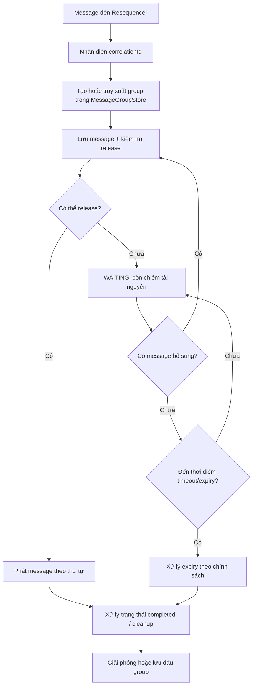
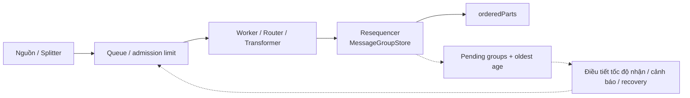

# Bộ nhớ của các group đang chờ

Trong **SPRING_INTEGRATION_PATTERN**, Resequencer giúp khôi phục thứ tự các message đến từ các nhánh Router, Splitter, Filter, Transformer, Gateway hoặc worker bất đồng bộ. Để làm điều đó, Resequencer phải **giữ trạng thái của những group chưa thể phát đầy đủ**. Nếu message đến chậm, thiếu hoặc có lỗi correlation, lượng trạng thái này có thể tăng liên tục.

Chủ đề **“Bộ nhớ của các group đang chờ”** trong chương **Resequencer nâng cao** tập trung vào một câu hỏi vận hành: **bao nhiêu message đang bị giữ lại, chúng được lưu ở đâu, và làm thế nào tránh để các group chờ vô hạn làm cạn tài nguyên?** Bài học kết hợp tư duy Enterprise Integration Patterns với cấu hình Spring Integration, timeout, error handling, retry và kiểm thử dưới tải.

> **Nguyên tắc:** Resequencer có thể cần buffer message để phục hồi thứ tự. Bộ nhớ của group là một phần chi phí của bảo đảm thứ tự; muốn kiểm soát nó phải quản lý đồng thời **số group**, **số message mỗi group**, **kích thước payload**, **thời gian chờ**, và **vòng đời sau completion**.

## 1. “Group đang chờ” lưu những gì?

Một sequence group được xác định theo khóa tương quan, thường lấy từ header `correlationId`. Các message trong group mang `sequenceNumber` để xác định vị trí và có thể mang `sequenceSize` khi nguồn biết tổng số phần.

Ví dụ một Splitter tạo bốn phần của `batch-42`:

| Message | `correlationId` | `sequenceNumber` | `sequenceSize` |
| --- | --- | ---: | ---: |
| A | `batch-42` | 1 | 4 |
| B | `batch-42` | 2 | 4 |
| C | `batch-42` | 3 | 4 |
| D | `batch-42` | 4 | 4 |

Các worker xử lý song song và trả về theo thứ tự `C, A, D`. Tùy release strategy, Resequencer có thể chưa phát được một số phần vì vẫn thiếu `B`.

```text
Kho nhóm ở một thời điểm:

Group batch-42
  expected: [1, 2, 3, 4]
  arrived:  [1, -, 3, 4]
  missing:  [2]
  state:    WAITING

Group batch-43
  expected: [1, 2, 3]
  arrived:  [-, 2, 3]
  missing:  [1]
  state:    WAITING
```

Đây là **sơ đồ logic**: các trường `expected`, `arrived` và `missing` không nhất thiết tồn tại nguyên dạng trong một `MessageGroupStore`. Trong thực tế, group có thể chứa:

- Các message đã nhận nhưng còn cần để sắp xếp hoặc release, gồm payload và header.
- Thông tin nhận diện group, metadata về việc tạo và thay đổi group.
- Trạng thái release/completion, tùy endpoint và cấu hình lưu trữ.
- Các đối tượng, chỉ mục, khóa hoặc serialization overhead do implementation của store sử dụng.

Spring Integration dùng giao diện **`MessageGroupStore`** cho các endpoint có tương quan như Aggregator và Resequencer. Việc group ở đâu — heap JVM, database hay một backend khác — phụ thuộc **store được cấu hình**.

### Khác gì với hàng đợi channel?

**Channel queue** chứa các message đang chờ được consumer lấy ra. **MessageGroupStore** chứa trạng thái các message đã vào endpoint tương quan nhưng cần được giữ để quản lý group. Cả hai có thể tiêu thụ tài nguyên cùng lúc.

Nếu một luồng đi qua `QueueChannel` rồi vào Resequencer, ta phải đo **độ sâu queue** và **lượng group pending** riêng. Chỉ nhìn queue trống không chứng minh rằng hệ thống đã hết message đang chờ: message có thể đã rời queue nhưng vẫn được giữ trong store.

## 2. Vòng đời group quyết định mức chiếm tài nguyên



Sơ đồ mô tả các trạng thái khái niệm; thời điểm thực tế của release, timeout, expiry và việc xóa/giữ group tùy API, release strategy và phiên bản Spring Integration được sử dụng.

Một số quy tắc quan trọng:

1. **Đến sai thứ tự nhưng đủ:** Resequencer có thể giữ message một thời gian ngắn rồi giải phóng; bộ nhớ pending quay về thấp khi lưu lượng bình thường.
2. **Thiếu một vị trí:** group có thể tiếp tục giữ trạng thái, nhất là khi chỉ được phát sau khi đủ toàn bộ chuỗi.
3. **Partial release:** một cấu hình cho phép phát phần liên tục sớm có thể giảm độ trễ và lượng message đang chờ, nhưng không đồng nghĩa group đã hoàn tất hay mọi trạng thái đã được dọn.
4. **Group timeout:** endpoint có thể xử lý group chưa hoàn tất sau thời hạn cấu hình. Timeout là chính sách giải quyết nhóm chờ quá lâu, **không phải bằng chứng các message thiếu sẽ không bao giờ đến**.
5. **Completion và cleanup:** một group đã hoàn tất vẫn có thể giữ dấu để nhận biết message đến muộn, tùy `expireGroupsUponCompletion` và chính sách dọn store.

Từ góc độ bộ nhớ, cần tách **active groups**, **pending message payloads** và **completed markers**. Một ứng dụng có rất ít message đang chờ nhưng giữ hàng triệu dấu completed group vẫn có thể tốn tài nguyên.

## 3. Các thành phần ảnh hưởng đến dung lượng lưu nhóm

Ước lượng ban đầu có thể dùng:

```text
raw_payload_bytes ≈ Σ(payload_size của từng message đang lưu)

heap_or_store_usage ≈ raw_payload_bytes
                    + headers_and_message_objects
                    + group_metadata_and_indexes
                    + serialization/implementation_overhead
```

Nếu giả sử có **200 group** chưa hoàn tất, mỗi group đang giữ trung bình **10 message** với payload **16 KiB**, riêng payload thô đã khoảng **31,25 MiB**. Con số sử dụng heap hoặc database thực sẽ cao hơn do đối tượng message, header, group metadata, index, bản sao và bộ nhớ cần cho xử lý đồng thời.

Không được coi ước lượng “số group × số message × dung lượng payload” là kích thước heap chính xác. Các biến cần đo trong hệ thống chạy thật:

| Biến | Ý nghĩa | Tác động |
| --- | --- | --- |
| Số group mở | Số `correlationId` chưa hoàn tất | Tăng overhead của metadata, khóa và lịch timeout |
| Message pending mỗi group | Số phần đã nhận nhưng chưa thể release | Làm tăng lượng payload chờ |
| Payload size | Đặc biệt với file, byte array, JSON lớn | Có thể lấn át chi phí metadata |
| Header size | Metadata, trace context, các header tùy biến | Nhân lên theo số message |
| Thời gian chờ | Càng lâu group chưa hoàn tất | Số group tích lũy càng lớn |
| Tốc độ tạo group | Batch mới vào mỗi giây | Có thể vượt tốc độ group được hoàn tất |
| Tỷ lệ group không đủ | Nhóm có lỗ hổng, Filter bỏ phần, lỗi worker | Tạo nhóm tồn đọng lâu |
| Chính sách completion | Giữ marker hay xóa ngay | Ảnh hưởng số group đã đóng còn lưu |
| Store implementation | Heap, JDBC hoặc backend bền vững | Thay đổi nơi tiêu thụ tài nguyên và độ trễ |
| Retry và duplicate | Message bị redeliver hoặc phiên xử lý lặp | Có thể gia tăng lưu trữ và tranh chấp |

### Hiệu ứng tích lũy theo thời gian

Giả sử mỗi phút có 100 batch mới nhưng chỉ 95 batch được hoàn tất hoặc đóng đúng cách. Nếu năm batch còn lại tiếp tục chờ mà không có expiry/cleanup hiệu quả, số nhóm tồn đọng sẽ tăng theo thời gian. Một benchmark ngắn có thể trông ổn, trong khi sau nhiều giờ hệ thống mới gặp áp lực heap, GC hoặc tăng kích thước database.

Vì thế cần quan sát **tốc độ group được mở**, **tốc độ group kết thúc**, **số group hiện đang tồn tại**, và **tuổi của group lâu nhất**. Thời gian chờ thực tế quan trọng không kém tốc độ xử lý message.

## 4. Chọn `MessageGroupStore` phù hợp

### 4.1. Store trong bộ nhớ JVM

Một ví dụ quen thuộc là `SimpleMessageStore`, phù hợp để trình bày cơ chế trong bài học hoặc thử nghiệm trên một tiến trình.

Ưu điểm:

- Truy cập nhanh, thiết lập đơn giản.
- Thuận tiện khi kiểm thử cơ bản với group có kích thước nhỏ.

Giới hạn:

- Trạng thái trong heap phụ thuộc vòng đời tiến trình, có thể mất khi ứng dụng restart.
- Payload và metadata chiếm heap; nếu group chờ vô hạn, nguy cơ áp lực GC hoặc lỗi thiếu bộ nhớ tăng lên.
- Không tự bảo đảm phối hợp đúng giữa nhiều instance, kể cả khi những instance xử lý message cùng `correlationId`.

Dùng store in-memory cần có **điều kiện dừng, timeout, giới hạn tải và kịch bản phục hồi** rõ ràng. Không nên dùng nó như một hàng đợi bền vững khi yêu cầu phải giữ message qua restart.

### 4.2. Store bền vững hoặc bên ngoài

Spring Integration có các implementation của `MessageGroupStore` dựa trên những backend như database hoặc hệ thống lưu trữ khác. Một lựa chọn phù hợp có thể được dùng khi:

- Cần phục hồi trạng thái group qua restart.
- Tổng payload chờ lớn và việc giữ tất cả trong heap không phù hợp.
- Cần phối hợp xử lý hoặc theo dõi group qua nhiều instance.

Tuy nhiên **chuyển sang JDBC/Redis hoặc một backend bên ngoài không tự làm bài toán mất đi**:

- Payload vẫn có thể được deserialize vào heap trong lúc xử lý/release.
- Backend cần dung lượng, chỉ mục, retention, transaction, giám sát độ trễ và dọn dữ liệu.
- Nhiều instance cần cơ chế phối hợp/locking và quy tắc release để tránh cùng phát một group hai lần.
- Lỗi kết nối hoặc giao dịch thất bại có thể khiến group bị giữ lâu hoặc được xử lý lại.

Để chọn store, phải cân nhắc cùng lúc **độ bền, khả năng phục hồi, độ trễ, mức đồng thời và chính sách dọn trạng thái**.

### 4.3. Cấu hình Java DSL minh họa

Ví dụ Spring Integration dùng một store in-memory được khai báo rõ ràng để dễ hình dung nơi lưu group:

```java
import org.springframework.context.annotation.Bean;
import org.springframework.context.annotation.Configuration;
import org.springframework.integration.dsl.IntegrationFlow;
import org.springframework.integration.store.MessageGroupStore;
import org.springframework.integration.store.SimpleMessageStore;

@Configuration
public class ResequencerStorageFlow {

    @Bean
    MessageGroupStore resequencerGroupStore() {
        // Chỉ minh họa; trạng thái mất khi JVM dừng.
        return new SimpleMessageStore();
    }

    @Bean
    IntegrationFlow resequenceFlow(MessageGroupStore resequencerGroupStore) {
        return IntegrationFlow.from("partsInput")
                .resequence(spec -> spec
                        .messageStore(resequencerGroupStore)
                        .groupTimeout(30_000L)
                        .sendPartialResultOnExpiry(false)
                        .expireGroupsUponCompletion(true))
                .channel("orderedParts")
                .get();
    }
}
```

**Ý nghĩa các lựa chọn:**

- `messageStore(...)` chỉ rõ nơi các group được quản lý. Khi thay store, phải xem xét cấu hình bổ sung của backend và khả năng phục hồi.
- `groupTimeout(30_000L)` đặt một chính sách xử lý group chờ quá lâu theo cơ chế lập lịch của endpoint. Nó **không đảm bảo** group luôn bị đóng chính xác 30 giây sau khi message đầu tiên đến.
- `sendPartialResultOnExpiry(false)` tránh chủ động phát các phần còn thiếu như kết quả partial khi expiry. Phải thiết kế nhánh quan sát/thông báo lỗi nghiệp vụ nếu không muốn nhóm thất bại biến mất âm thầm.
- `expireGroupsUponCompletion(true)` thể hiện ý định dọn nhóm sau completion. Nếu cần giữ marker completed để xử lý late arrival, hãy đánh giá chính sách khác và có kho trạng thái nghiệp vụ riêng.

Đây là cấu hình **minh họa**, chưa có cơ chế khôi phục message thất lạc, giới hạn dung lượng, cảnh báo vận hành hay chống duplicate đầy đủ. Hành vi chính xác của các tùy chọn liên quan release/expiry phải được xác minh với phiên bản Spring Integration trong dự án.

## 5. Timeout, expiry và dọn group cũ

Tăng số message pending chỉ vì thiếu một phần là nguyên nhân phổ biến làm group sống quá lâu. Có ba lớp thời gian cần phân biệt:

| Cơ chế | Mục tiêu | Giới hạn |
| --- | --- | --- |
| Release strategy | Xác định điều kiện phát dữ liệu có thứ tự | Nếu thiếu phần, có thể không hoàn tất |
| Group timeout / expiry | Định thời điểm xử lý group chưa đủ | Không khôi phục thông điệp thiếu; không nhất thiết là business deadline |
| MessageGroupStore cleanup / reaper | Dọn trạng thái cũ theo tuổi hoặc chính sách lưu trữ | Có thể ảnh hưởng khả năng nhận biết late arrival và retry |

Cơ chế như `MessageGroupStoreReaper` có thể hỗ trợ xem xét các group cũ tùy cách cấu hình store và xử lý expiry. **Reaper không thay thế release strategy hoặc quyết định nghiệp vụ khi dữ liệu thiếu**. Nó cũng cần được phối hợp với group timeout của endpoint để tránh hành vi ngoài mong muốn do hai cơ chế xử lý hết hạn khác nhau.

### Tình huống Filter làm group tồn đọng

```text
Splitter tạo 5 phần:  #1/5 #2/5 #3/5 #4/5 #5/5
Filter bỏ #3:        #1/5 #2/5      #4/5 #5/5

Downstream chờ đủ 1..5 → không thấy #3.
```

Nếu vị trí số 3 bị bỏ có chủ đích, thêm thời gian chờ không giải quyết được vấn đề. Cần **lọc trước khi đánh số chuỗi mới** hoặc giữ một tín hiệu skip theo hợp đồng phù hợp. Nếu đã biết mất phần, hãy chọn chính sách fail/partial/repair minh bạch, thay vì chỉ hy vọng group sẽ tự giảm kích thước.

### Timeout chưa chắc giảm heap như kỳ vọng

Nếu expiry làm group bị đánh dấu nhưng vẫn giữ marker hoặc bản ghi lịch sử trong store, số group được báo “đã hết hạn” có thể vẫn chiếm tài nguyên. Ngược lại, dọn hoàn toàn group có thể giảm bộ nhớ nhưng làm mất dấu trạng thái với message tới muộn. Do đó phải đo **tài nguyên sau expiry** và có kế hoạch retention riêng cho metadata dedup.

## 6. Backpressure và bảo vệ hệ thống khi nhiều group chờ

Nếu downstream xử lý chậm hơn upstream, nhóm mới có thể được tạo nhanh hơn nhóm cũ được giải phóng. Một kiến trúc bền vững cần quản lý lượng công việc **trước khi** bộ nhớ cạn.



Những cách điều tiết có thể áp dụng tùy môi trường:

1. **Giới hạn số batch đang xử lý** ở upstream, bằng semaphore, số worker, giới hạn request hoặc queue có sức chứa hữu hạn.
2. **Kiểm soát payload**: chuyển dữ liệu lớn sang object storage và để message mang khóa tham chiếu nếu nghiệp vụ cho phép. Khi đó cần đảm bảo object còn tồn tại đến khi group hoàn tất.
3. **Giới hạn thời gian giữ nhóm chưa đủ**, kết hợp retry có hạn và chính sách xử lý lỗi rõ ràng.
4. **Kiểm soát độ đồng thời** để không đồng thời tạo ra quá nhiều group đang mở.
5. **Điều tiết theo trạng thái store**: nếu pending group hoặc backend latency vượt ngưỡng, giảm tốc độ nguồn/consumer hoặc chuyển công việc sang hàng đợi bền vững.
6. **Dọn marker đã hoàn tất theo retention** sau khi hết cửa sổ redelivery, với một cơ chế dedup nghiệp vụ giữ đủ lịch sử cần thiết.

Không nên tùy tiện bỏ message đầu vào khi vượt ngưỡng tải mà không có xử lý lỗi/khôi phục. Nếu dùng broker, hãy phối hợp acknowledgment và retry để đảm bảo message chưa nhận không bị “ACK mất” trong lúc store đang quá tải.

### Một giới hạn quan trọng: queue vô hạn

Chỉ chuyển áp lực từ `MessageGroupStore` sang một `QueueChannel` không giới hạn không loại bỏ vấn đề. Bạn có thể tránh giữ nhiều group trong Resequencer trước mắt nhưng lại tăng bộ nhớ/độ trễ ở queue. Mục tiêu là **kiểm soát tổng lượng công việc còn tồn** và xác định cách từ chối hoặc tạm dừng nhận khi hệ thống đã đầy.

## 7. Correlation, duplicate và retry ảnh hưởng đến group storage

### 7.1. Correlation sai làm sinh group rác

Nếu mỗi message của cùng batch lại nhận một `correlationId` mới, Resequencer sẽ thấy nhiều group rời rạc, mỗi nhóm chỉ có một vài phần. Không nhóm nào đạt điều kiện hoàn tất. Đây là nguyên nhân tăng số lượng group mà tăng heap hoặc thay store không thể chữa.

Ngược lại, nếu hai batch khác nhau dùng cùng `correlationId`, các phần có thể trộn vào một group và tạo thứ tự sai hoặc xung đột `sequenceNumber`. Dùng khóa gồm định danh nghiệp vụ và `runId` ổn định khi cần phân biệt mỗi lần thực thi.

### 7.2. Duplicate có thể tiêu tốn tài nguyên

Message gửi lại sau lỗi ACK có thể có Spring `MessageHeaders.ID` khác dù cùng vị trí nghiệp vụ. Resequencer không nên được xem là lớp idempotency tổng quát. Cần xác thực trước:

- Cùng `correlationId + sequenceNumber` và cùng source event ID/fingerprint: redelivery có thể hợp lệ.
- Cùng vị trí nhưng payload/event ID khác: conflict cần quarantine.
- Cùng batch nhưng `sequenceSize` khác: metadata cần được đối soát.

Một inbox/dedup store bền vững giúp tránh xử lý trùng và giữ đường replay an toàn. Nhưng ghi “đã thấy message” chưa có nghĩa xử lý hoàn tất: sau crash phải cho phép tiếp tục một thao tác đang dở, thay vì loại bỏ bản gửi lại rồi khiến group thiếu phần vĩnh viễn.

### 7.3. Retry vô hạn có thể kéo dài thời gian giữ group

Một phần lỗi liên tục có thể khiến group luôn chờ. Nên phân biệt **retry của message**, **deadline của batch**, và **quyết định cuối khi không thể khôi phục**. Ghi nhận vị trí thiếu, số retry và lý do hết hạn để hỗ trợ error channel/DLQ hoặc recovery flow ở tầng ứng dụng.

Không giảm `sequenceSize` chỉ để buộc release nếu nguồn đã công bố tổng rõ ràng. Cách làm này có thể giảm số message pending nhưng làm mất tính đúng đắn của dữ liệu.

## 8. Quan sát bộ nhớ và tình trạng group trong production

Các chỉ số hữu ích cần được thiết lập từ store và cơ chế đo lường thực tế, tùy khả năng endpoint/backend:

| Chỉ số | Ý nghĩa vận hành | Dấu hiệu cần điều tra |
| --- | --- | --- |
| `openGroupCount` | Số group chưa hoàn tất | Tăng liên tục khi lưu lượng ổn định |
| `pendingMessageCount` | Tổng message đang được giữ | Tăng nhanh hơn throughput đầu ra |
| `oldestGroupAge` | Tuổi nhóm chờ lâu nhất | Vượt SLA hoặc deadline xử lý |
| `p95/p99GroupWait` | Phân bố thời gian chờ | Trôi dần lên theo tải |
| `groupCompletionRate` | Số group hoàn tất theo thời gian | Thấp hơn tốc độ tạo nhóm trong thời gian dài |
| `groupTimeoutRate` | Số nhóm phải xử lý timeout | Tăng do thiếu message hoặc downstream chậm |
| `duplicate/conflictCount` | Lần gửi lại hoặc xung đột slot | Lỗi ACK/retry hoặc dữ liệu nguồn |
| `storeLatency` | Độ trễ đọc/ghi group store | Nút cổ chai hoặc backend quá tải |
| `heapUsed/GC pause` | Áp lực trong JVM | Heap tăng và GC pause dài với store in-memory |
| `storeSize/recordAge` | Dung lượng và tuổi bản ghi lưu bền vững | Cleanup/retention không hiệu quả |

**Các tên metric trên là đề xuất đặt tên trong ứng dụng, không phải cam kết rằng Spring Integration tự phát tất cả metric đúng tên này.** Đo từ Micrometer, actuator, kho lưu trữ và instrumentation phù hợp với phiên bản thực tế.

Ngoài số group đang chờ, log/sự kiện phục vụ điều tra nên có:

- `correlationId`, thời điểm group được tạo, lần cập nhật cuối và thời điểm hoàn tất/hết hạn.
- `sequenceSize`, số vị trí duy nhất đã nhận và các vị trí thiếu nếu biết tổng.
- Chính sách release, timeout, partial output và cách xử lý nhóm thất bại.
- Thống kê queue lag, retry, DLQ và tác vụ downstream đang treo.
- Kích thước payload và header theo phân bố, tránh lưu payload nhạy cảm chỉ để debug.

Từ dữ liệu này có thể phân biệt một hệ thống **đông group vì tải cao** với hệ thống **tích tụ group vì một phần không bao giờ đến**.

## 9. Kiểm thử tải và vòng đời dữ liệu

Nên kết hợp test tích hợp ở mức channel/store với test tải dài hơn để phát hiện xu hướng tích lũy. Một ma trận cơ bản:

| Ca thử | Dữ liệu / điều kiện | Điều cần xác nhận |
| --- | --- | --- |
| Đảo thứ tự nhưng đủ | `3/3, 1/3, 2/3` | Group release đúng, tài nguyên về trạng thái mong đợi |
| Thiếu phần không tới | `1/4, 3/4, 4/4` | Group chờ theo chính sách, expiry/recovery được ghi nhận |
| Nhiều group xen kẽ | 1.000 batch cùng mở, kết thúc rải rác | Không trộn nhóm, memory/store tăng trong giới hạn dự tính |
| Filter làm mất vị trí | Splitter `1..5`, Filter bỏ `#3` | Có lỗi/skip được giải quyết; không giữ group vô hạn |
| Redelivery nhiều lần | `#2` được gửi lại với ID khác | Không nhân đôi tác động hoặc tạo thêm trạng thái sai |
| Group complete và late arrival | `1..3` đủ, sau đó redeliver `#2` | Ứng xử đúng khi marker còn hoặc đã cleanup |
| Timeout đồng thời với phần cuối | Message cuối đến lúc timer xử lý | Không phát kết quả hai lần, không để rò group |
| Restart với store in-memory | Group chưa đủ rồi restart | Phát hiện mất trạng thái và có phương án replay |
| Restart với store bền vững | Group chưa đủ rồi restart | Khôi phục group, không phát trùng |
| Nhiều instance cùng correlation | Hai consumer xử lý cùng batch | Phối hợp ghi và release an toàn theo thiết kế |
| Sự cố backend | Store chậm hoặc mất kết nối | Backpressure/retry/error flow không gây ACK mất |
| Retention dài | Nhiều group đã complete | Marker cũ được dọn theo chính sách, số record không tăng mãi |

### Kiểm thử sự tích lũy

Một phép thử có ích là duy trì cùng tốc độ nhận trong thời gian đủ dài, cố ý cho một tỷ lệ nhỏ group thiếu phần cuối. Quan sát đồ thị:

1. **Số group đang mở** có ổn định hay tăng mãi?
2. **Thời gian chờ p95/p99** có trở về bình thường khi tải giảm?
3. **Heap/GC** có giảm sau khi group được xử lý expiry?
4. **Store size** có giảm sau cleanup trong cửa sổ retention?
5. **Kết quả downstream** có bị duplicate hoặc thiếu mà không cảnh báo?

Không cần một benchmark khổng lồ để thấy nguyên nhân: ngay cả tỷ lệ group lỗi thấp cũng làm tồn đọng tăng khi hệ thống không có chính sách kết thúc.

### Ví dụ phép tính dung lượng bằng Java

Đoạn sau chỉ tính **payload thô** để hỗ trợ ước lượng ban đầu. Nó không tính object/header/index overhead hay chuyển đổi qua backend:

```java
public final class GroupPayloadEstimator {

    private GroupPayloadEstimator() { }

    public static long estimatedRawBytes(
            long openGroups,
            long averageMessagesPerGroup,
            long averagePayloadBytes) {

        if (openGroups < 0
                || averageMessagesPerGroup < 0
                || averagePayloadBytes < 0) {
            throw new IllegalArgumentException("Inputs must be non-negative");
        }

        return Math.multiplyExact(
                Math.multiplyExact(openGroups, averageMessagesPerGroup),
                averagePayloadBytes);
    }
}
```

Nếu một payload là tham chiếu tới object storage thay vì toàn bộ nội dung, con số này chỉ mô tả bytes của message đang giữ, không gồm bytes của object bên ngoài hoặc chi phí truy cập. Hãy đo dựa trên **phân bố kích thước thực tế**, không chỉ giá trị trung bình, vì một tỷ lệ nhỏ payload rất lớn có thể làm bộ nhớ tăng đột ngột.

## 10. Checklist vận hành cho group đang chờ

1. **Biết group nằm ở đâu.** Xác định `MessageGroupStore` thực tế và phân biệt với queue/channel backlog.
2. **Đo số nhóm và payload pending.** Theo dõi `openGroupCount`, `pendingMessageCount`, tuổi nhóm và kích thước message.
3. **Định nghĩa điều kiện release chính xác.** Không để metadata sai, Filter hoặc sequence thiếu tạo group không thể hoàn tất.
4. **Thiết kế timeout và expiry.** Có chính sách partial/fail/recovery, tránh biến group hết hạn thành mất dữ liệu không quan sát được.
5. **Phân biệt cleanup và business retention.** Dọn group có thể tiết kiệm bộ nhớ nhưng vẫn cần lưu lịch sử để xử lý late arrival và duplicate.
6. **Giới hạn tải đầu vào và số batch mở.** Chọn queue hữu hạn, admission control hoặc cơ chế backpressure phù hợp với broker.
7. **Chọn store theo yêu cầu phục hồi.** In-memory dùng cho trường hợp chấp nhận mất trạng thái; store bền vững cần transaction, khóa và capacity planning.
8. **Chặn duplicate/conflict từ nguồn.** Bảo đảm correlation và slot key đúng, retry idempotent.
9. **Kiểm thử restart, race và tải lâu.** Quan sát cả heap, store size và đầu ra nghiệp vụ.
10. **Cảnh báo sớm.** Đặt ngưỡng cho tuổi group lâu nhất, tỷ lệ timeout, tốc độ tích lũy và độ trễ store.

**Ghi nhớ:** Bộ nhớ của các group đang chờ không chỉ là một cấu hình dung lượng. Nó phản ánh **sự cân bằng giữa bảo đảm thứ tự, thời gian chờ, độ bền trạng thái và khả năng phục hồi**. Dùng `MessageGroupStore` đúng mục đích, release strategy rõ ràng, group timeout/cleanup có chủ đích, backpressure và metric giúp Resequencer hoạt động ổn định khi các nhánh xử lý nhanh chậm khác nhau.

