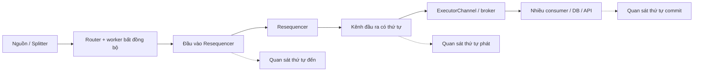
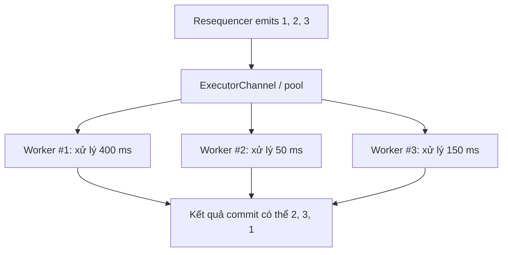

# Kiểm tra thứ tự đầu ra

Trong chương **Resequencer nâng cao** của **SPRING_INTEGRATION_PATTERN**, việc cấu hình Resequencer mới giải quyết một nửa bài toán. Phần còn lại là **chứng minh đầu ra thật sự đúng thứ tự** khi các thông điệp đến sai thứ tự, nhiều nhóm chạy xen kẽ, xảy ra retry, hoặc downstream tiếp tục xử lý bất đồng bộ.

Spring Integration hỗ trợ ghép các Enterprise Integration Patterns như Router, Filter, Transformer, Splitter, Aggregator và Gateway thành luồng message ít phụ thuộc. Resequencer phục hồi thứ tự dựa trên thông tin chuỗi đã được phía phát gán; nhưng thứ tự nhìn thấy trong log, thứ tự phát ra từ endpoint và thứ tự tác động được commit ở dịch vụ ngoài **không nhất thiết giống nhau**. Vì vậy, cần xác định ranh giới đo, hợp đồng về thứ tự, cách kiểm thử và cách theo dõi lỗi trong production.

> **Mục tiêu kiểm tra:** Với mỗi nhóm có `correlationId` riêng, các message được chấp nhận phải được quan sát ở ranh giới đầu ra đã chọn theo đúng `sequenceNumber`, đồng thời không bỏ sót, phát lặp hoặc tráo nội dung trái với hợp đồng nghiệp vụ.

## 1. Xác định “thứ tự đúng” trước khi viết test

Ba header thường dùng để định nghĩa chuỗi:

| Header | Ý nghĩa | Ví dụ |
| --- | --- | --- |
| `correlationId` | Khóa xác định các message thuộc một group | `order-42:run-3` |
| `sequenceNumber` | Vị trí của một message trong group | `2` |
| `sequenceSize` | Tổng số phần dự kiến khi phía phát biết trước | `4` |

Giả sử Splitter tạo bốn phần theo thứ tự nghiệp vụ `A, B, C, D` và gắn số `1, 2, 3, 4`. Sau xử lý song song, đầu vào Resequencer có thể là `C, A, D, B`. Đầu ra cần quan sát là `A, B, C, D` theo số thứ tự đã gắn.

```text
Group G, sequenceSize = 4

Đầu vào Resequencer:     C(#3) → A(#1) → D(#4) → B(#2)
                               │
                               ▼
                          Resequencer
                               │
                               ▼
Đầu ra tại kênh đo:      A(#1) → B(#2) → C(#3) → D(#4)
```

Phải phân biệt ba loại yêu cầu:

1. **Đúng thứ tự theo group:** với cùng `correlationId`, một vị trí nhỏ hơn phải được phát trước vị trí lớn hơn khi cả hai được phát.
2. **Đủ và duy nhất:** nếu hợp đồng yêu cầu đủ `1..N`, kết quả phải có đúng `N` vị trí, mỗi vị trí xuất hiện một lần. Đây là kiểm tra bổ sung cho thứ tự.
3. **Đúng tác động nghiệp vụ:** ghi database, gọi API hoặc gửi broker downstream phải áp dụng tác động theo thứ tự được yêu cầu. Thứ tự phát message ở Resequencer **không tự đảm bảo** thứ tự hoàn thành của nhiều tác vụ downstream bất đồng bộ.

**Không yêu cầu thứ tự toàn cục giữa các group độc lập** nếu hợp đồng chỉ yêu cầu thứ tự *trong từng group*. Group `G1` có thể phát `#1` trước `G2:#1` hoặc ngược lại, tùy tốc độ nhận và điều kiện release; cả hai đều có thể đúng.

### 1.1. Bất biến đầu ra nên kiểm tra

Với một group `G` có `sequenceSize=N`, nếu chỉ chấp nhận kết quả hoàn chỉnh, một cách đặc tả là:

```text
outputSequenceNumbers(G) == [1, 2, ..., N]
outputCorrelationIds(G)  == [G, G, ..., G]
outputEventIds(G)        == event IDs dự kiến ở đúng từng vị trí
```

Nếu cấu hình cho phép xuất **partial result**, đầu ra của một lần release có thể chỉ là một đoạn hoặc một tập con được sắp thứ tự. Khi đó đừng giả định mỗi lần release phải đủ `1..N`. Cần tách kiểm tra “thứ tự trong phần đã phát” với “batch đã hoàn tất theo hợp đồng”.

Một quy tắc kiểm tra khác với đầu ra có thể thiếu vị trí nhưng **không được đảo thứ tự**:

```text
Với mỗi cặp message liên tiếp đã phát cùng group:
    current.sequenceNumber > previous.sequenceNumber
```

Quy tắc này chỉ áp dụng khi hệ thống đã ngăn duplicate hoặc hợp đồng cấm lặp. Với duplicate được phép xuất hiện ở ranh giới đó, phải quy định trước có chấp nhận số bằng nhau hay không; không được vô tình xem phát lặp là “đúng thứ tự”.

## 2. Đặt điểm quan sát tại đúng ranh giới

Một pipeline điển hình:



Ba điểm đo trả lời ba câu hỏi khác nhau:

| Điểm đo | Kiểm tra được | Không tự chứng minh |
| --- | --- | --- |
| Trước Resequencer | Message thực sự đến theo thứ tự nào, có thiếu metadata không | Endpoint đã sắp đúng |
| Ngay sau Resequencer, trước nhánh async khác | Thứ tự message **được phát** từ Resequencer | Consumer ở xa hoàn thành đúng thứ tự |
| Tại nơi commit kết quả nghiệp vụ | Thứ tự tác động thực sự có hiệu lực | Nguyên nhân sai nằm ở Resequencer hay downstream |

**Ví dụ phản trực giác:** Resequencer phát `#1` rồi `#2` vào một `ExecutorChannel`, nhưng worker của `#2` chạy nhanh hơn, nên database ghi `#2` trước `#1`. Kết quả test ở kênh ngay sau Resequencer vẫn đạt, trong khi kiểm tra thứ tự commit thất bại.

Khi yêu cầu thứ tự end-to-end, hãy quy định đường xử lý tiếp theo: một consumer tuần tự cho mỗi group, phân vùng theo khóa `correlationId`, áp dụng kiểm tra version ở database hoặc cơ chế điều phối có thứ tự tương đương. Không chỉ thêm một Resequencer rồi mặc định mọi downstream sẽ giữ thứ tự mãi.

## 3. Cấu hình một luồng có thể kiểm tra trực tiếp

Ví dụ Java DSL dưới đây có kênh đầu vào `DirectChannel` và đầu ra `QueueChannel` để test đọc message theo thứ tự chúng được đưa vào queue. Cấu hình này minh họa một điểm đo ngay sau Resequencer; không phải cấu trúc bắt buộc cho production.

```java
import org.springframework.context.annotation.Bean;
import org.springframework.context.annotation.Configuration;
import org.springframework.integration.channel.DirectChannel;
import org.springframework.integration.channel.QueueChannel;
import org.springframework.integration.config.EnableIntegration;
import org.springframework.integration.dsl.IntegrationFlow;
import org.springframework.messaging.MessageChannel;

@Configuration
@EnableIntegration
public class ResequencerOrderConfig {

    @Bean
    MessageChannel incomingParts() {
        return new DirectChannel();
    }

    @Bean
    QueueChannel orderedParts() {
        return new QueueChannel();
    }

    @Bean
    IntegrationFlow resequenceFlow() {
        return IntegrationFlow.from(incomingParts())
                .resequence()
                .channel(orderedParts())
                .get();
    }
}
```

**Vì sao chọn cách này cho test?**

- `DirectChannel` giúp việc gửi vào endpoint đơn giản, không tự tạo thêm một đoạn chuyển giao bất đồng bộ ở đầu vào ví dụ.
- `resequence()` sử dụng bộ header sequence/correlation để giữ và phát các phần theo chính sách endpoint.
- `QueueChannel` cho phép test chủ động `receive(timeout)` từng message sau khi Resequencer đã phát.
- Test chỉ có một thread đọc queue, nên thứ tự đọc phản ánh thứ tự message được đưa vào queue. Nếu nhiều consumer cùng lấy rồi xử lý, **thứ tự hoàn thành** của họ vẫn có thể thay đổi.

Để Resequencer có thông tin sắp xếp, phía nguồn phải tạo metadata hợp lệ. Ví dụ có thể dùng các hằng trong `IntegrationMessageHeaderAccessor`:

```java
import org.springframework.integration.IntegrationMessageHeaderAccessor;
import org.springframework.messaging.Message;
import org.springframework.messaging.support.MessageBuilder;

record OrderPart(String batchRunId, int position, String value) {}

final class PartMessages {
    private PartMessages() { }

    static Message<OrderPart> part(
            String group, int position, int total, String value) {
        return MessageBuilder
                .withPayload(new OrderPart(group, position, value))
                .setHeader(
                        IntegrationMessageHeaderAccessor.CORRELATION_ID,
                        group)
                .setHeader(
                        IntegrationMessageHeaderAccessor.SEQUENCE_NUMBER,
                        position)
                .setHeader(
                        IntegrationMessageHeaderAccessor.SEQUENCE_SIZE,
                        total)
                .build();
    }
}
```

Trong ví dụ, `position` được đặt cả trong payload mẫu và header. Điều này giúp test kiểm tra **danh tính/ý nghĩa dữ liệu ở từng vị trí** ngay cả nếu một thành phần downstream thay đổi một số header. Với hệ thống thực, nên có `sourceEventId` bất biến và không dựa vào Spring `MessageHeaders.ID` để biểu diễn danh tính nghiệp vụ.

## 4. Integration test: gửi đảo thứ tự, đọc đúng thứ tự

Một kiểm thử tích hợp JUnit 5 với Spring Integration có thể làm như sau (giả sử hai lớp `ResequencerOrderConfig` và `OrderPart` ở trên nằm trong cùng source set phù hợp):

```java
import static org.junit.jupiter.api.Assertions.*;

import java.util.ArrayList;
import java.util.List;
import java.util.UUID;

import org.junit.jupiter.api.Test;
import org.springframework.beans.factory.annotation.Autowired;
import org.springframework.beans.factory.annotation.Qualifier;
import org.springframework.integration.IntegrationMessageHeaderAccessor;
import org.springframework.messaging.Message;
import org.springframework.messaging.MessageChannel;
import org.springframework.messaging.PollableChannel;
import org.springframework.messaging.support.MessageBuilder;
import org.springframework.test.context.junit.jupiter.SpringJUnitConfig;

@SpringJUnitConfig(ResequencerOrderConfig.class)
class ResequencerOrderIntegrationTest {

    @Autowired
    @Qualifier("incomingParts")
    MessageChannel incoming;

    @Autowired
    @Qualifier("orderedParts")
    PollableChannel ordered;

    private void send(
            String group, int number, int size, String value) {
        Message<OrderPart> message = MessageBuilder
                .withPayload(new OrderPart(group, number, value))
                .setHeader(
                        IntegrationMessageHeaderAccessor.CORRELATION_ID,
                        group)
                .setHeader(
                        IntegrationMessageHeaderAccessor.SEQUENCE_NUMBER,
                        number)
                .setHeader(
                        IntegrationMessageHeaderAccessor.SEQUENCE_SIZE,
                        size)
                .build();

        assertTrue(incoming.send(message));
    }

    private List<OrderPart> receiveExactly(int count) {
        List<OrderPart> parts = new ArrayList<>();
        for (int i = 0; i < count; i++) {
            Message<?> message = ordered.receive(2_000);
            assertNotNull(message, "Missing output message " + i);
            parts.add((OrderPart) message.getPayload());
        }
        return parts;
    }

    @Test
    void emitsOneGroupInSequenceOrder() {
        String group = "order-" + UUID.randomUUID();

        send(group, 3, 4, "C");
        send(group, 1, 4, "A");
        send(group, 4, 4, "D");
        send(group, 2, 4, "B");

        List<OrderPart> output = receiveExactly(4);

        assertEquals(List.of(1, 2, 3, 4),
                output.stream().map(OrderPart::position).toList());
        assertEquals(List.of("A", "B", "C", "D"),
                output.stream().map(OrderPart::value).toList());
        assertTrue(output.stream()
                .allMatch(p -> p.batchRunId().equals(group)));

        // Với cấu hình và nguồn mẫu này, không mong đợi
        // thêm đầu ra ngoài bốn phần.
        assertNull(ordered.receive(100));
    }
}
```

Điểm đáng chú ý là test **gửi theo thứ tự cố ý sai**. Nếu chỉ gửi `1, 2, 3, 4`, test có thể đạt dù Resequencer không thật sự khôi phục được thứ tự.

Bốn kiểm tra trong test có ý nghĩa riêng:

1. Có đúng số message mong đợi ở ranh giới quan sát.
2. Các `position` tăng theo thứ tự xác định.
3. Payload/value tương ứng với vị trí, tránh trường hợp chỉ sửa số header nhưng tráo nội dung.
4. Không có message phát thừa trong khoảng quan sát đã quy định.

Việc `receive(100)` trả về `null` **không chứng minh vĩnh viễn sẽ không có message thừa**. Kiểm tra âm tính luôn có một cửa sổ thời gian. Với retry, timer, broker hoặc xử lý bất đồng bộ, cần quan sát đủ cửa sổ hợp đồng và/hoặc kiểm tra trạng thái bền vững để xác định duplicate đến muộn.

## 5. Kiểm tra khi nhiều group xen kẽ

Resequencer sắp xếp **bên trong từng correlation group**, không tự áp đặt trật tự chung giữa các batch. Giả sử đầu vào là:

```text
G1:#2, G2:#2, G2:#1, G1:#1
```

Một đầu ra có thể hợp lệ là `G2:#1, G2:#2, G1:#1, G1:#2`. Một cách xen kẽ khác cũng có thể hợp lệ, miễn mỗi group có thứ tự nội bộ đúng.

Để test, gom những message nhận được theo `batchRunId` rồi so sánh từng dãy:

```java
import static org.junit.jupiter.api.Assertions.assertEquals;

import java.util.ArrayList;
import java.util.HashMap;
import java.util.List;
import java.util.Map;

static void assertPerGroupOrder(List<OrderPart> emitted) {
    Map<String, List<Integer>> observed = new HashMap<>();

    for (OrderPart part : emitted) {
        observed.computeIfAbsent(
                part.batchRunId(), ignored -> new ArrayList<>())
                .add(part.position());
    }

    for (List<Integer> positions : observed.values()) {
        List<Integer> sorted = new ArrayList<>(positions);
        sorted.sort(Integer::compareTo);
        assertEquals(sorted, positions,
                "Output was reordered inside a group");
    }
}
```

Hàm trên chỉ kiểm tra **không giảm thứ tự** trong mỗi nhóm. Nó **không kiểm tra sự đầy đủ, tính duy nhất hoặc tính chính xác của từng payload**. Nếu hợp đồng đòi đủ, hãy so sánh thêm với manifest của nhóm: mỗi `correlationId` cần đúng `[1, 2, ..., sequenceSize]` và đúng danh tính event ở từng slot.

**Cẩn thận:** Đừng cố định assertion rằng `G1` phải xuất hết trước `G2` chỉ vì `G1` được gửi vào trước. Điều đó là một yêu cầu mới về global order, không phải điều Resequencer mặc định hứa hẹn.

## 6. Kiểm tra thuộc tính thứ tự thay vì chỉ một ví dụ

Một ví dụ đảo thứ tự là điểm khởi đầu. Kiểm thử tốt nên thay đổi cả số phần, thứ tự nhận và lịch phát của nhiều nhánh.

Với một group có đủ `N` phần hợp lệ, có thể kiểm tra các bất biến:

```text
Given:
  groupId duy nhất cho mỗi lần thử
  expected positions = [1..N]
  payload ở mỗi position được gắn eventId bất biến

For each permutation of input positions (hoặc một mẫu ngẫu nhiên có seed):
  gửi các phần theo permutation
  thu đủ N output message
  assert output positions == [1..N]
  assert output event IDs == expected event IDs
  assert không có output thừa trong cửa sổ đã định
```

Đối với nhóm nhỏ có thể thử toàn bộ hoán vị. Với nhóm lớn, chọn các mẫu có tác dụng làm lộ lỗi như:

- Đảo ngược hoàn toàn: `N, N-1, ..., 1`.
- Phần đầu đến cuối cùng: `2, 3, ..., N, 1`.
- Phần cuối đến đầu tiên: `N, 1, 2, ..., N-1`.
- Phần ở giữa bị trì hoãn lâu: `1, 3, 4, 2, 5`.
- Nhiều group xen kẽ, thời gian xử lý khác nhau.
- Một nhóm có `sequenceSize=1` và một nhóm có kích thước lớn.

Khi dùng dữ liệu ngẫu nhiên, **ghi lại seed** để có thể tái hiện lần chạy lỗi. Mỗi lần thử nên dùng `correlationId` khác, hoặc phải dọn trạng thái group theo cơ chế test hợp lệ; tái sử dụng khóa khi group cũ chưa được cleanup dễ làm test ảnh hưởng lẫn nhau.

### Không chỉ đo “đúng thứ tự”: cần đo thời gian và tình trạng nhóm

Một nhóm có thể mãi chờ đủ phần, nên việc **không có đầu ra** không chứng minh kết quả đúng. Mỗi test cần deadline và kiểm tra cụ thể: bao lâu được phép chờ, khi nào group phải hoàn tất, và lỗi phải được biểu diễn thế nào nếu một phần không đến.

Nếu downstream cần phát sớm phần liên tục, hãy tạo test riêng cho **partial release policy**; không mặc định endpoint giữ mọi message đến tận khi đủ `sequenceSize`.

## 7. Những trường hợp dễ khiến assertion sai

| Tình huống | Dữ liệu thử | Điều cần kiểm tra |
| --- | --- | --- |
| Đến đảo thứ tự, đủ nhóm | `3/3, 1/3, 2/3` | Đầu ra của group là `1, 2, 3` |
| Hai group xen kẽ | `A:2/2, B:2/2, B:1/2, A:1/2` | Mỗi group đúng `1, 2`, không đòi A trước B |
| Thiếu một vị trí | `1/4, 3/4, 4/4` | Không coi batch hoàn chỉnh; xét release/timeout phù hợp |
| Trùng vị trí | `1/3, 2/3, 2/3, 3/3` | Phân loại redelivery, không nhân đôi hiệu ứng |
| Trùng vị trí, payload khác | `2:B` và `2:X` | Conflict được cách ly; không chọn ngẫu nhiên |
| Tổng số không nhất quán | `1/3, 2/4, 3/3` | Kiểm tra validation metadata ở đầu vào |
| `correlationId` bị sai | Một phần của A mang khóa của B | Không đánh giá hai nhóm trộn như một thành công |
| Filter bỏ một phần | Splitter tạo `1..5`, Filter bỏ `#3` | Bổ sung quy tắc skip hoặc đánh số lại hợp lệ |
| Timeout rồi phần cuối đến | `1/3, 2/3`; timeout; `3/3` đến muộn | Theo chính sách late arrival, không phát kết quả cuối trùng |
| Partial release | Phần `#1` tới, các phần sau tới dần | Đầu ra đã phát có thứ tự; trạng thái completion được kiểm tra riêng |
| ExecutorChannel downstream | Endpoint phát `1, 2`, worker xử lý `2` nhanh hơn | Thứ tự emission đúng nhưng commit có thể sai |
| Broker nhiều partition | Các phần cùng group vào nhiều partition | Kiểm tra khả năng giữ thứ tự end-to-end theo key |
| Restart giữa group | Nhận `#2` rồi restart và nhận `#1, #3` | Đánh giá MessageGroupStore, replay, idempotency |
| Nhiều instance | Cùng group được nhận đồng thời | Không phát trùng, không mất group và thứ tự đúng |

**Không nên coi thiếu một phần là lỗi của thuật toán sắp xếp.** Resequencer không tự tạo được `#2` khi nguồn chỉ gửi `#1` và `#3`. Nếu cần test hoàn thành, phải cung cấp đủ input hoặc có quy tắc kết thúc/skip và release đúng như nghiệp vụ.

## 8. Kiểm tra đúng thứ tự sau xử lý bất đồng bộ

Giả sử Resequencer phát `1 → 2 → 3`, rồi mỗi message được đưa tới một API xử lý song song:



Đây là hành vi có thể xảy ra khi downstream có nhiều tác vụ độc lập cùng ghi kết quả. Test chỉ quan sát channel ngay sau Resequencer sẽ không phát hiện tình trạng này.

Có ba nhóm giải pháp phổ biến:

1. **Tuần tự theo khóa nhóm:** cùng `correlationId` đi qua một luồng consumer tuần tự; các nhóm độc lập vẫn có thể chạy song song. Nếu dùng broker hỗ trợ ordering trong partition, đảm bảo khóa partition ổn định và mọi phần cùng group đi đúng partition.
2. **Kiểm tra version khi commit:** downstream chỉ chấp nhận message có vị trí/version phù hợp với trạng thái hiện tại của đối tượng nghiệp vụ. Nếu `#2` đến trước khi `#1` commit, cần retry/đệm lại theo hợp đồng, không ghi đè thứ tự một cách im lặng.
3. **Áp dụng sự kiện idempotent và phép xử lý không phụ thuộc thứ tự:** chỉ khi nghiệp vụ thật sự cho phép. Không dùng cách này như lời giải chung cho các phép cập nhật thứ tự quan trọng như cộng dồn phụ thuộc trạng thái.

Khi test end-to-end, nên ghi **commit log theo đối tượng nghiệp vụ** với `batchRunId`, `sequenceNumber`, version trước/sau, thời điểm commit, kết quả idempotency. Sau đó assert thứ tự commit cho từng khóa, thay vì chỉ so sánh thứ tự log do nhiều thread ghi ra console.

## 9. Quan sát lỗi thứ tự trong môi trường vận hành

Các bản ghi log hoặc sự kiện quan sát có thể gắn theo group:

```json
{
  "batchRunId": "order-42:run-3",
  "sequenceNumber": 2,
  "sequenceSize": 4,
  "sourceEventId": "event-B",
  "stage": "resequencer-output",
  "observedAt": "2026-11-21T08:00:00Z",
  "result": "EMITTED"
}
```

Đây là schema **minh họa do ứng dụng định nghĩa**, không phải các field mà Spring Integration mặc định tự phát đầy đủ. Ưu tiên theo dõi:

| Chỉ số / tín hiệu | Dùng để phát hiện |
| --- | --- |
| `lastEmittedSequence[group]` | Phát số nhỏ hơn hoặc bằng vị trí đã phát khi hợp đồng cấm lặp |
| Số vị trí thiếu hoặc trùng | Lỗ hổng do nguồn, retry hoặc lỗi metadata |
| `groupWaitTime` | Thời gian chờ để có thể phát đúng thứ tự |
| Số group timeout | Các batch không thể hoàn tất đúng hạn |
| `lateArrivalCount` | Message đến sau completion/expiry |
| `conflictCount` | Hai message tranh cùng vị trí với dữ liệu không giống |
| Thứ tự commit theo aggregate | Lỗi downstream async hoặc broker partitioning |
| Tỷ lệ retry / DLQ | Nguồn phát chậm hoặc mất phần trong luồng |

Đặt phép đo ở **đúng ranh giới** và phân biệt sự kiện `RECEIVED`, `EMITTED`, `COMMITTED`. Một log của `RECEIVED #3` xuất hiện trước `RECEIVED #1` có thể là hành vi hoàn toàn bình thường. Chỉ khi quan sát `EMITTED #3` trước `EMITTED #1` **trong cùng group và theo cùng hợp đồng order** mới cần kiểm tra Resequencer hoặc cấu hình ranh giới đo.

### Tránh kết luận sai do công cụ quan sát

Log từ nhiều instance hoặc các exporter bất đồng bộ có thể được thu thập **không theo đúng thứ tự xảy ra**. Timestamp từ các máy khác nhau cũng có thể lệch. Muốn kết luận thứ tự đầu ra, nên dùng một bộ ghi nhận có thứ tự tại ranh giới xác định, số thứ tự phát do ứng dụng cấp, hoặc dữ liệu commit có version. Chỉ dựa trên thứ tự dòng trong dashboard log tập trung có thể tạo cảnh báo giả.

**Không ghi payload nhạy cảm** chỉ để debug. `correlationId`, vị trí, source event ID, nhóm trạng thái, fingerprint và thông tin thời gian là đủ cho phần lớn hoạt động đối soát.

## 10. Quy trình chẩn đoán khi thứ tự đầu ra sai

Khi test phát hiện `1, 3, 2` thay vì `1, 2, 3`, kiểm tra theo thứ tự sau:

1. **Xác nhận điểm đo:** đó là đầu ra trực tiếp của Resequencer, một ExecutorChannel phía sau, hay kết quả commit của các worker?
2. **Đối chiếu header và payload:** cùng `correlationId` chưa, các `sequenceNumber` đúng kiểu và hợp lệ chưa, `sequenceSize` có nhất quán không?
3. **Đối chiếu dữ liệu nguồn:** Splitter có đánh số dựa trên thứ tự nghiệp vụ đúng không, Transformer có làm mất header hay thay đổi nội dung không?
4. **Kiểm tra cấu hình endpoint:** release strategy, partial sequence, group timeout, cách xử lý expiry, `MessageGroupStore` và retention.
5. **Tách duplicate/conflict:** message lặp cùng vị trí có thể làm assertion fail dù thứ tự những vị trí riêng vẫn đúng; xử lý ở tầng admission/idempotency.
6. **Kiểm tra nhánh đồng thời:** Router, Gateway, broker hoặc worker có tạo thêm một lớp reorder sau Resequencer không?
7. **Kiểm tra retry và crash:** có phát lại output sau ACK fail hoặc restart mà không có dedup bền vững không?
8. **Tái hiện với đầu vào xác định:** thu nhỏ về một group, ba phần có số thứ tự rõ và một consumer ở điểm đo; sau đó thêm dần concurrency để xác định nơi thay đổi thứ tự.

Một failure nên ghi rõ **group, input permutation, expected output, actual output, ranh giới quan sát, seed/test case, cấu hình release và thời gian chờ**. Những dữ liệu này giúp phân biệt lỗi sequencing với lỗi vận chuyển hoặc quan sát.

## 11. Checklist hoàn tất bài kiểm tra thứ tự

1. **Định nghĩa hợp đồng:** thứ tự theo group, tính đầy đủ, tính duy nhất và thứ tự tác động nghiệp vụ.
2. **Có metadata đúng:** `correlationId`, `sequenceNumber` và `sequenceSize` đáng tin cậy; payload/event ID có thể đối chiếu với vị trí.
3. **Đo ngay sau Resequencer:** chọn channel và consumer test không tự tạo thêm reordering.
4. **Gửi input đảo thứ tự có chủ đích:** kiểm thử nhiều hoán vị, nhóm xen kẽ và sự khác biệt độ trễ.
5. **Kiểm tra cả nội dung:** không chỉ assert các số `1..N` mà còn khẳng định payload ở đúng vị trí.
6. **Không nhầm partial release với completion:** quy định rõ hành vi của nhóm thiếu phần, timeout và late arrival.
7. **Kiểm tra duplicate và conflict:** idempotency và quy trình cách ly dữ liệu bất nhất phải hoạt động.
8. **Đo end-to-end khi cần:** sau ExecutorChannel/broker/API, assert thứ tự commit theo khóa nghiệp vụ.
9. **Kiểm thử sự cố và đồng thời:** retry, ACK fail, restart, nhiều instance, cleanup và cạnh tranh sát timeout.
10. **Có chỉ số production:** log được nhóm, cảnh báo sai thứ tự, tuổi group, tỷ lệ timeout và số duplicate/conflict.

**Ghi nhớ:** “Đầu ra đúng thứ tự” chỉ có ý nghĩa khi nêu rõ **đầu ra tại đâu** và **thứ tự theo khóa nào**. Resequencer cung cấp cơ chế phát message theo sequence metadata trong từng group; kiểm thử cần chứng minh tính đầy đủ, đúng vị trí, đúng nội dung và cách xử lý ngoại lệ. Nếu downstream tiếp tục chạy song song, thứ tự commit là một bất biến riêng cần được thiết kế và xác minh.

