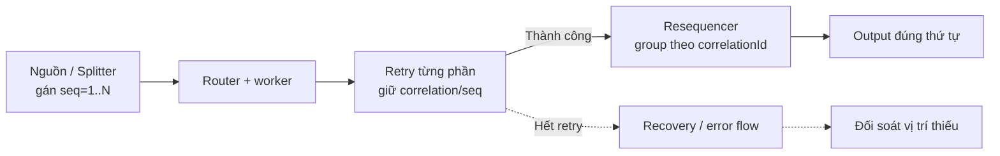

# Ranh giới sequence qua retry

Trong chương **Resequencer nâng cao** của **SPRING_INTEGRATION_PATTERN**, xử lý retry giúp phục hồi khi một nhánh xử lý thất bại tạm thời. Nhưng nếu retry làm thay đổi `correlationId`, đánh lại `sequenceNumber` hoặc chạy lại cả batch mà không kiểm soát trạng thái cũ, Resequencer có thể chờ nhầm nhóm, phát trùng message hoặc kết luận sai rằng một chuỗi đã hoàn tất.

**Ranh giới sequence qua retry** là hợp đồng xác định **đơn vị nào đang được thử lại** và **định danh thứ tự nào phải được giữ nguyên** xuyên suốt lần thử ấy. Đó có thể là một bước xử lý của một message, một lần giao nhận qua broker, một phần tử của batch, hoặc cả batch đã được Splitter chia thành nhiều phần.

Trong Spring Integration, các Enterprise Integration Patterns như Splitter, Router, Filter, Transformer, Aggregator, Gateway, retry, error channel và correlation cần phối hợp để duy trì hợp đồng này. **Retry giúp thực hiện lại công việc; Resequencer phục hồi thứ tự các phần; idempotency ngăn tác động lặp.** Ba trách nhiệm có liên quan nhưng không thể thay thế cho nhau.

## 1. Xác định thứ tự thuộc về cái gì

Một chuỗi thông điệp thường có ba header:

| Header | Ý nghĩa | Ví dụ |
| --- | --- | --- |
| `correlationId` | Khóa định danh nhóm | `order-42:run-7` |
| `sequenceNumber` | Vị trí trong nhóm | `2` |
| `sequenceSize` | Tổng số phần đã cam kết, nếu biết trước | `4` |

Giả sử đơn hàng `order-42:run-7` được Splitter chia thành bốn phần:

```text
Batch gốc:
  A → #1/4
  B → #2/4
  C → #3/4
  D → #4/4

Các phần dùng cùng correlationId = order-42:run-7.
```

Nếu phần `#2/4` gặp lỗi và được thử lại ba lần, **cả ba lần vẫn thuộc vị trí số 2 của cùng batch**. Thay đổi `sequenceNumber` thành `5` vì đó là lần thử tiếp theo sẽ biến số lần retry thành một phần tử giả trong chuỗi.

Một khóa logic hữu ích là:

```text
batch identity = tenantId + businessId + runId
sequence slot  = batch identity + sequenceNumber
event identity = sourceEventId (bất biến cho một phần tử nghiệp vụ)
attempt       = số lần thử xử lý hoặc giao nhận, không phải vị trí sequence
```

Đừng nhầm `MessageHeaders.ID` hoặc `timestamp` do Spring tạo với định danh nghiệp vụ của slot. Khi một broker redeliver, một Spring Message mới có thể có `id` mới nhưng vẫn biểu diễn cùng `sourceEventId` và `sequenceNumber`.

### 1.1. Bất biến xuyên ranh giới retry

Nếu một phần tử đang được thử lại **trong cùng logical batch**, cần bảo đảm:

1. `correlationId` ổn định.
2. `sequenceNumber` ổn định.
3. `sequenceSize` nhất quán với manifest của batch.
4. `sourceEventId` hoặc khóa idempotency ổn định.
5. Số lần retry, thời điểm xử lý, stack trace và thông tin vận chuyển được theo dõi **riêng**; chúng có thể thay đổi giữa các attempt.
6. Nếu payload được biến đổi giữa các bước, phải biết đang so sánh **dữ liệu gốc** hay **kết quả xử lý**, tránh phân loại nhầm một retry thành conflict.

Không nhất thiết giữ mọi header kỹ thuật qua mọi adapter; cần **giữ hoặc ánh xạ chính xác những metadata mà hợp đồng ordering sử dụng**. Khi message đi qua HTTP, Kafka hoặc RabbitMQ, tên/kiểu dữ liệu header có thể phải chuyển đổi.

## 2. Bốn phạm vi retry và hậu quả với sequence

| Phạm vi | Ví dụ | Ranh giới sequence cần giữ |
| --- | --- | --- |
| **Retry trong handler** | Worker thử gọi API tối đa ba lần trước khi trả kết quả | Vẫn là **một phần tử** ở vị trí cũ |
| **Redelivery của message** | Broker gửi lại `#2` sau lỗi ACK | Cùng batch và slot; cần dedup hoặc resume |
| **Replay của một phần từ DLQ** | Sửa lỗi rồi gửi lại `#3` cho batch đang thiếu | Giữ vị trí gốc, đối chiếu group còn mở hay đã đóng |
| **Chạy lại toàn batch** | Job nhập liệu thực hiện lại cả bốn phần | Phải quyết định đó là **phục hồi lần chạy cũ** hay **một run mới** |
| **Retry sau Resequencer** | Endpoint đã phát `#1, #2`; API xử lý `#1` bị lỗi | Có thể ảnh hưởng thứ tự **tác động downstream**, dù thứ tự emission đã đúng |

Điểm dễ sai nhất là lẫn hai tình huống “retry cả batch”:

- **Khôi phục một lần chạy đang dở:** vẫn muốn hoàn tất các vị trí còn thiếu của chính batch cũ. Có thể dùng lại `batchRunId` gốc nếu hệ thống có trạng thái bền vững, biết phần nào đã commit và hỗ trợ replay idempotent.
- **Bắt đầu một lần chạy nghiệp vụ mới:** tạo một `runId` mới và định nghĩa một sequence mới. Batch cũ cần được đóng/đánh dấu rõ để message cũ đến muộn không trộn vào run mới.

Tạo `runId` mới vô điều kiện cho mỗi attempt sẽ làm mất khả năng correlation của các phần đang thử lại. Ngược lại, dùng mã batch cũ cho một công việc nghiệp vụ độc lập cũng có thể trộn hai chuỗi khác nhau.

## 3. Đặt retry ở đâu trong luồng?

### 3.1. Retry ở phía trước Resequencer

Đây là mô hình phổ biến khi từng phần được xử lý bất đồng bộ và chỉ gửi kết quả khi thành công:



Ví dụ `#2` phải thử ba lần, còn `#1, #3, #4` đã xử lý xong. Resequencer nhận theo thứ tự `3, 1, 4, 2` rồi phát `1, 2, 3, 4` khi release strategy cho phép. **Điều kiện:** đường thành công của một phần chỉ chuyển một kết quả đã được chấp nhận; các attempt thất bại không được vô tình trở thành các phần tử khác nhau cùng nhóm.

Nếu xử lý cuối cùng vẫn thất bại, Resequencer có thể phải chờ phần còn thiếu. Hãy xác định **group timeout**, khả năng replay, hoặc cách kết thúc batch khi không thể khôi phục. Retry của handler và timeout của group cần được thiết kế cùng nhau.

### 3.2. Retry bên trong Resequencer hoặc sát đầu vào

Nếu cùng một message bị gửi nhiều lần vào channel đầu vào do lỗi ACK hoặc lỗi chuyển tiếp, hệ thống có thể thấy **hai message có `MessageHeaders.ID` khác nhau nhưng cùng slot**. Resequencer là nơi sắp thứ tự, không phải ranh giới idempotency nghiệp vụ tổng quát.

Một lớp **admission/inbox** trước Resequencer có thể kiểm tra `batchRunId + sequenceNumber` cùng `sourceEventId`:

- Slot chưa có và batch còn mở: chấp nhận.
- Slot đã có, cùng dữ liệu bất biến: nhận diện redelivery; nếu xử lý trước chưa hoàn tất thì tiếp tục, nếu đã commit thì tránh tác động trùng.
- Slot đã có nhưng khác event ID, fingerprint hoặc size: cách ly conflict.
- Batch đã đóng: áp dụng chính sách late arrival thay vì tự thêm vào group mới.

### 3.3. Retry sau Resequencer

Điểm này thường bị bỏ sót: thứ tự message được Resequencer **phát ra** không đồng nghĩa thứ tự **hoàn thành nghiệp vụ** sau đó.

```text
Resequencer emits:     #1 ───────→ #2 ───────→ #3

Worker downstream:     #1 thất bại, đang retry
                       #2 thành công và commit
                       #3 thành công và commit
                       #1 thành công sau cùng

Thứ tự commit thực tế: #2 → #3 → #1
```

Nếu nghiệp vụ chỉ yêu cầu **thứ tự phát ở một channel**, hành vi trên có thể chấp nhận. Nếu yêu cầu **đúng thứ tự commit theo entity**, phải thêm một trong các giải pháp: consumer tuần tự theo `correlationId`, phân vùng cố định theo khóa, kiểm tra version khi ghi dữ liệu, hoặc bộ điều phối chỉ cho `#k+1` commit sau `#k`. Retry có backoff dài càng làm rủi ro đảo thứ tự commit rõ hơn.

### 3.4. Retry trước Splitter

Khi retry bao bọc **toàn bộ việc split**, có thể sinh lại nhiều message con. Nếu đầu vào lần hai có message ID khác, Splitter có thể tạo metadata tương quan mới hoặc thứ tự phần tử khác theo cách cấu hình. Cần quy định rõ:

- Đầu vào phải là cùng snapshot dữ liệu nếu mục đích là replay lần chạy cũ.
- Mapping sang `batchRunId` nghiệp vụ phải ổn định.
- Số phần và thứ tự phải được xác nhận từ manifest, không phụ thuộc ngẫu nhiên vào thứ tự duyệt một collection không ổn định.
- Những phần đã được xử lý ở lần đầu phải được dedup/resume, tránh phát lại toàn bộ tác động ngoài.

Nếu nguồn tạo batch mới có danh sách phần khác, nên công bố **version/run mới** thay vì nhồi hai phiên bản vào cùng một sequence.

## 4. Code: bảo toàn sequence metadata qua một lần retry

Một thao tác retry có thể tạo message kết quả mới sau khi biến đổi payload. Khi đó cần chủ động mang theo thông tin thứ tự từ message gốc. Ví dụ Java dùng Spring Messaging và Spring Integration:

```java
import org.springframework.integration.IntegrationMessageHeaderAccessor;
import org.springframework.messaging.Message;
import org.springframework.messaging.support.MessageBuilder;

public final class SequenceResultMapper {

    private SequenceResultMapper() { }

    public static Message<String> resultOf(
            Message<String> original,
            String processedPayload) {

        Object correlation = original.getHeaders().get(
                IntegrationMessageHeaderAccessor.CORRELATION_ID);
        Integer number = original.getHeaders().get(
                IntegrationMessageHeaderAccessor.SEQUENCE_NUMBER,
                Integer.class);
        Integer size = original.getHeaders().get(
                IntegrationMessageHeaderAccessor.SEQUENCE_SIZE,
                Integer.class);

        if (correlation == null || number == null
                || size == null || size < 1
                || number < 1 || number > size) {
            throw new IllegalArgumentException(
                    "Missing or invalid sequence metadata");
        }

        return MessageBuilder.withPayload(processedPayload)
                .setHeader(
                        IntegrationMessageHeaderAccessor.CORRELATION_ID,
                        correlation)
                .setHeader(
                        IntegrationMessageHeaderAccessor.SEQUENCE_NUMBER,
                        number)
                .setHeader(
                        IntegrationMessageHeaderAccessor.SEQUENCE_SIZE,
                        size)
                .build();
    }
}
```

Hàm trên dùng để minh họa **ba header sequence**, chưa sao chép các header nghiệp vụ khác. Trong hệ thống thật, hãy giữ thêm `sourceEventId`, tenant, trace context và khóa idempotency cần thiết; đồng thời tránh copy nhầm header vận chuyển không còn ý nghĩa trên message mới.

Một lần retry của tác vụ xử lý có thể gọi lại cùng message đầu vào và chỉ tạo kết quả một lần khi thành công:

```java
import org.springframework.messaging.Message;
import org.springframework.retry.support.RetryTemplate;

// Dependency Spring Retry phải được khai báo trong ứng dụng.
final class RetryingPartService {

    private final RetryTemplate retry = RetryTemplate.builder()
            .maxAttempts(3)
            .fixedBackoff(200)
            .build();

    Message<String> process(Message<String> original) {
        return retry.execute(context -> {
            String output = callExternalService(original.getPayload());
            return SequenceResultMapper.resultOf(original, output);
        });
    }

    private String callExternalService(String input) {
        // Thay bằng thao tác thật; lỗi tạm thời cần ném exception
        // để RetryTemplate thử lại theo chính sách.
        return input.toUpperCase();
    }
}
```

**Điều cần hiểu chính xác:** `maxAttempts(3)` là tổng số lần thực hiện callback theo cấu hình ví dụ (lần đầu cộng các lần retry); **nó không tạo ba sequence number**. Việc đặt retry quanh callback làm tăng số lần *thử xử lý một phần*, không làm tăng `sequenceSize` của batch.

Lời gọi dịch vụ ngoài có thể **đã tạo tác động thành công** trước khi client nhận lỗi timeout. Vì thế dù retry chạy trong cùng một handler, downstream vẫn cần idempotency hoặc khóa thao tác có khả năng nhận biết lần gọi lặp.

### 4.1. Kiểm tra metadata sau khi retry

```java
import static org.junit.jupiter.api.Assertions.assertEquals;

import org.junit.jupiter.api.Test;
import org.springframework.integration.IntegrationMessageHeaderAccessor;
import org.springframework.messaging.Message;
import org.springframework.messaging.support.MessageBuilder;

class SequenceResultMapperTest {

    @Test
    void preservesSequenceSlotAfterProcessing() {
        Message<String> original = MessageBuilder
                .withPayload("part-B")
                .setHeader(
                        IntegrationMessageHeaderAccessor.CORRELATION_ID,
                        "batch-42:run-7")
                .setHeader(
                        IntegrationMessageHeaderAccessor.SEQUENCE_NUMBER, 2)
                .setHeader(
                        IntegrationMessageHeaderAccessor.SEQUENCE_SIZE, 4)
                .build();

        Message<String> processed =
                SequenceResultMapper.resultOf(original, "result-B");

        assertEquals("batch-42:run-7", processed.getHeaders().get(
                IntegrationMessageHeaderAccessor.CORRELATION_ID));
        assertEquals(2, processed.getHeaders().get(
                IntegrationMessageHeaderAccessor.SEQUENCE_NUMBER));
        assertEquals(4, processed.getHeaders().get(
                IntegrationMessageHeaderAccessor.SEQUENCE_SIZE));
        assertEquals("result-B", processed.getPayload());
    }
}
```

Test này kiểm tra **bảo toàn metadata sau biến đổi**, chưa thử retry thật hay Resequencer. Nếu dùng `MessageBuilder.fromMessage(...)` hoặc framework tự bảo toàn header ở một bước cụ thể, vẫn phải xác minh trạng thái sau mọi ranh giới adapter/serializer.

## 5. Bảo toàn thứ tự qua retry, broker và error channel

Ranh giới có thể làm thay đổi dữ liệu nhận diện gồm:

| Ranh giới | Nguy cơ | Việc cần kiểm tra |
| --- | --- | --- |
| Splitter → Router | Nhiều nhánh tạo phần có vị trí trùng hoặc khóa nhóm sai | Một nguồn đánh số, correlation ổn định |
| Transformer → retry | Trả message mới làm mất header | Header sequence và event ID còn nguyên |
| Worker → broker | Mapper không chuyển hoặc đổi kiểu header | Kiểu `Integer`, khóa nhóm và manifest ở consumer |
| Broker → consumer redelivery | Một phần được nhận lại với message ID mới | Slot key/idempotency chứ không dựa vào Spring ID |
| Gateway → retry | Lỗi phản hồi sau khi downstream thực sự thành công | Ghi nhận kết quả bền vững và chống side effect lặp |
| Retry exhausted → error flow | Phần không đi vào nhánh thành công | Nhóm được đánh dấu thiếu, có retry/recovery phù hợp |
| DLQ → replay | Group có thể đã timeout hoặc completed | Đối chiếu batch lifecycle trước khi nạp lại |
| Resequencer → async downstream | Thứ tự phát khác thứ tự commit | Kiểm soát tuần tự/version nếu hợp đồng yêu cầu |

### 5.1. Error channel không đồng nghĩa với thành công muộn

Một retry hết số lần có thể kết thúc bằng exception hoặc chuyển sang recovery flow theo cấu hình. Trong Spring Integration, error channel có thể nhận `ErrorMessage` khi lỗi được phát theo mô hình message flow. **Không mặc định rằng mọi lỗi, mọi lần retry hoặc mọi group timeout đều tự xuất hiện trên cùng một `errorChannel`**.

Khi lỗi được chuyển thành message lỗi, payload thường là exception/thông tin lỗi, **không phải một phần tử thành công của chuỗi**. Không đưa thẳng các `ErrorMessage` như payload thông thường vào Resequencer rồi đếm như `#2/4`, trừ khi nghiệp vụ đã định nghĩa rõ kiểu kết quả cho phần lỗi và cách release.

Một recovery flow hữu ích cần mang tối thiểu:

- `batchRunId/correlationId`, `sequenceNumber`, `sequenceSize`, `sourceEventId`.
- Lý do lỗi, attempt count, lần thử cuối và khả năng replay.
- Trạng thái nhóm (mở, timeout, đã chốt partial, failed, completed).
- Hành động được chọn: retry tiếp, replay từ nguồn, quarantine, skip có phê duyệt hoặc fail batch.

### 5.2. Timeout khi một phần vẫn đang retry

Ví dụ `groupTimeout=30s` còn phần `#2` cần retry trong 45s. Có thể xảy ra:

```text
T+0s     Nhóm có #1/3, #3/3; #2 bắt đầu xử lý.
T+30s    Chính sách expiry kích hoạt khi vẫn thiếu #2.
T+45s    #2 retry thành công và đi tới đầu vào Resequencer.
```

Kết quả ở `T+45s` phụ thuộc cấu hình release, cleanup và chính sách **late arrival**. Nếu group đã bị xóa, việc gửi lại `#2` có thể không khôi phục được lịch sử `#1`, `#3`. Nếu group đã được chốt partial hoặc failed ở tầng nghiệp vụ, không được tự thay đổi thành công chỉ vì phần trễ đến.

Vì vậy, khi chọn backoff/số lần retry, cần đặt chúng cùng **batch deadline**, **group expiry**, và **cửa sổ chấp nhận replay**. Tăng retry vô hạn có thể làm group chờ quá lâu; đóng nhóm quá sớm có thể tạo nhiều kết quả partial/recovery.

## 6. Exactly-once, duplicate và trạng thái xử lý

Ranh giới retry thường kéo theo **at-least-once**: một tác vụ có thể được thực hiện hơn một lần dù hệ thống chỉ cần một kết quả nghiệp vụ.

Để tránh phát trùng hoặc mất phần, một **inbox/idempotency store** nên quản lý slot và trạng thái xử lý:

| Trạng thái tham khảo | Ý nghĩa | Khi redelivery cùng slot tới |
| --- | --- | --- |
| `RECEIVED` | Đã tiếp nhận nhưng chưa xử lý bền vững | Resume/tiếp tục, không mặc nhiên drop |
| `PROCESSING` | Có worker đang xử lý | Phối hợp khóa/lease để tránh hai worker cùng commit |
| `COMMITTED` | Kết quả hoặc bàn giao đã bền vững | Không áp lại tác động; ACK theo hợp đồng |
| `FAILED_RETRYABLE` | Có thể thực hiện lại | Retry có kiểm soát |
| `FAILED_FINAL` | Batch/slot đã kết thúc lỗi | Quarantine hoặc recovery được ủy quyền |
| `CONFLICT` | Cùng slot nhưng dữ liệu nguồn khác | Đối soát trước khi tiếp tục |

Các giá trị trạng thái trên là **thiết kế nghiệp vụ**, không phải enum mặc định của Spring Integration.

Một lỗi tinh vi: ghi “đã thấy `#2`” trước khi thực sự chuyển thành công `#2` vào luồng có thứ tự. Nếu hệ thống crash ngay sau đó, redelivery có thể bị drop vì dedup tưởng đã xử lý. Kết quả là Resequencer **thiếu vĩnh viễn phần số 2 do chính cơ chế chống trùng**.

Cần phối hợp trạng thái inbox, ACK broker, giao dịch và xử lý lại theo khả năng của hạ tầng. Không tuyên bố exactly-once end-to-end chỉ từ việc có Resequencer hoặc một bảng khóa duy nhất. Khi có nhiều nguồn lưu trữ và API ngoài, giao thức bền vững có thể cần idempotency key, outbox và bù trừ.

### 6.1. Conflict khi replay khác nội dung

Nếu một bản replay của `batch-42:run-7, #2/4` mang payload khác với bản đã commit, đây là **conflict** trừ khi nghiệp vụ cho phép một sự kiện sửa đổi có version rõ ràng.

Đừng chọn “last wins” vì message đến sau hoặc “first wins” vì message đã nằm trong group trước. Cần một nguồn sự thật, manifest/version và lưu dấu quyết định. Đối với retry của cùng phần, dữ liệu gốc nên bất biến; nếu cần sửa, hãy định nghĩa correction event hoặc run mới.

## 7. Ví dụ topology để kiểm thử sequence qua retry

Một luồng đơn giản để quan sát thứ tự của các phần đã xử lý xong:

```java
import org.springframework.context.annotation.Bean;
import org.springframework.context.annotation.Configuration;
import org.springframework.integration.dsl.IntegrationFlow;

@Configuration
class ResequenceRetryResultsFlow {

    @Bean
    IntegrationFlow resequenceSuccessfulParts() {
        return IntegrationFlow.from("successfulParts")
                .resequence()
                .channel("orderedParts")
                .get();
    }
}
```

`successfulParts` phải chỉ nhận **các kết quả thành công đã được chấp nhận**, với sequence metadata của phần gốc. Đây là **mảnh cấu hình minh họa**: nguồn, chính sách retry, nhánh lỗi, dedup và `MessageGroupStore` bền vững cần được thêm theo yêu cầu ứng dụng.

Test quan trọng không phải chỉ gửi `1,2,3` đúng thứ tự, mà là tạo chậm/trễ có chủ đích ở một phần:

```text
Nguồn:         #1/3       #2/3       #3/3
Worker:        OK         FAIL       OK
                           ↳ retry 1: FAIL
                           ↳ retry 2: OK
Đến Resq:     #3    →    #1    →    #2
Kỳ vọng:      #1    →    #2    →    #3

Kết quả bài test:
  số vị trí unique = 3
  output theo vị trí = [1, 2, 3]
  sourceEventId của #2 không đổi qua retry
  downstream chỉ commit một hiệu ứng cho mỗi vị trí
```

Tùy release strategy, Resequencer có thể phát các đoạn hợp lệ trước khi nhận đủ; hãy assert đúng **hợp đồng của cấu hình đang kiểm thử**, không suy luận mọi endpoint mặc định chờ đủ.

### Kiểm thử hệ thống khi retry cả batch

Giả sử đợt chạy đầu phát đủ `#1` và `#3` nhưng lỗi ở `#2`. Sau restart, job xử lý lại cả ba phần. Một test tốt cần kiểm tra:

1. Batch run cũ đã có những vị trí nào được commit?
2. Job retry đang **resume run cũ** hay tạo **run mới**?
3. Dữ liệu đầu vào và thứ tự có còn như manifest lần đầu không?
4. Có tạo hai kết quả cho `#1` hoặc `#3` không?
5. Message từ lần chạy cũ đến sau khi run mới bắt đầu được phân loại thế nào?

Nếu mục đích là resume, metadata phải nhất quán và các slot đã hoàn thành không được gây side effect mới. Nếu mục đích là run mới, nó phải có định danh tương quan mới và quy tắc nghiệp vụ rõ với kết quả của run cũ.

## 8. Ma trận kiểm thử các ranh giới retry

| Ca kiểm thử | Điều kiện | Kỳ vọng |
| --- | --- | --- |
| Retry handler thành công | `#2` lỗi hai lần rồi thành công | Vẫn đúng slot `#2/N`; một kết quả được chấp nhận |
| Retry exhaustion | `#2` luôn lỗi | Nhánh lỗi được quan sát; group không bị coi là đủ |
| Out-of-order do backoff | `#3, #1` tới trước `#2` | Đầu ra đúng thứ tự theo release strategy |
| Redelivery từ broker | `#2` tới hai lần với message ID khác | Nhận diện cùng event, không commit trùng |
| Crash giữa inbox và xử lý | Slot được ghi nhận, chưa bàn giao bền vững | Redelivery có thể tiếp tục, không bị drop mù quáng |
| ACK thất bại sau thành công | Downstream đã commit rồi broker phát lại | Idempotency ngăn side effect lần hai |
| Conflict payload | Retry cùng slot nhưng khác content fingerprint | Cách ly, không chọn bản tùy ý |
| Retry trước Splitter | Splitter bị gọi lại toàn batch | Không phát lại tác động của slot đã commit |
| Retry sau Resequencer | `#1` đang retry, `#2` commit trước | Phát hiện vi phạm nếu hợp đồng yêu cầu commit tuần tự |
| Timeout trong lúc retry | `#2` thành công sau group expiry | Áp dụng late-arrival/recovery, không tự phát batch thứ hai |
| DLQ replay | Phát lại phần của batch đã closed | Kiểm tra lifecycle và quyền replay |
| Hai nhóm xen kẽ | Cùng số `#2` ở batch A và B | Không dedup nhầm giữa hai nhóm |
| Nhiều worker cùng slot | Hai consumer cùng xử lý `#2` | Một transition/commit có hiệu lực; có khóa/transaction |
| Thay đổi `sequenceSize` | Lần đầu `#2/4`, retry thành `#2/5` | Bắt conflict metadata |
| Mất header qua adapter | `correlationId` hoặc `sequenceNumber` bị loại | Reject/cách ly trước resequencing |

**Kiểm tra thứ tự tại hai ranh giới:** ngay sau Resequencer và tại nơi commit cuối nếu nghiệp vụ cần cả hai. Thứ tự các dòng log ở nhiều worker có thể sai lệch vì thu thập bất đồng bộ; nên dùng số phát/commit do hệ thống ghi và phân nhóm theo batch.

## 9. Theo dõi retry, khoảng trống và vòng đời group

Các trường nên xuất hiện trong sự kiện quan sát:

```json
{
  "batchRunId": "order-42:run-7",
  "sourceEventId": "line-B",
  "sequenceNumber": 2,
  "sequenceSize": 4,
  "attempt": 3,
  "stage": "worker-before-resequencer",
  "outcome": "SUCCESS",
  "batchStatus": "OPEN"
}
```

Đây là **schema minh họa do ứng dụng định nghĩa**, không phải các header/metric được Spring Integration tự tạo đầy đủ.

Các chỉ số nên có:

- Số attempt trên mỗi `sourceEventId` và tỷ lệ retry thành công/thất bại.
- Số group đang chờ, tuổi group lâu nhất và các vị trí thiếu.
- Số redelivery trùng slot, conflict payload/metadata và late arrival sau completion.
- Thời gian từ lần phát đầu tới khi phần thành công, rồi tới lúc Resequencer phát ra.
- Số group timeout trong lúc còn retry, số lần replay từ DLQ, số batch fail/partial/recovered.
- Số hiệu ứng downstream bị ngăn lặp và số trường hợp mất ordering ở nơi commit.

Khi một nhóm chờ quá lâu, trước tiên xác định **slot nào chưa tới** rồi tra nguồn, retry queue và DLQ. Chỉ tăng timeout mà không tìm nguyên nhân có thể khiến trạng thái chờ tích lũy. Ngược lại, timeout quá ngắn có thể làm một phần đang retry hợp lệ trở thành late arrival với logic khôi phục phức tạp.

## 10. Checklist thiết kế

1. **Chốt phạm vi retry.** Một handler, một delivery, một phần của batch hay toàn bộ batch?
2. **Ổn định danh tính sequence.** Với cùng logical run, `correlationId`, `sequenceNumber`, `sequenceSize` và `sourceEventId` không đổi qua attempt.
3. **Tách attempt khỏi sequence.** Không dùng số lần retry làm số thứ tự mới.
4. **Cân nhắc vị trí đặt retry.** Trước Resequencer giúp nhận các phần thành công ở đúng slot; sau Resequencer cần bảo vệ thứ tự commit.
5. **Kiểm soát replay cả batch.** Quyết định resume run cũ hay tạo run mới; giữ manifest nhất quán và dedup những slot đã xử lý.
6. **Bảo vệ qua adapter.** Xác minh header/ID nghiệp vụ không bị mất hoặc đổi kiểu giữa HTTP, broker và channel.
7. **Đồng bộ thời gian.** Backoff, số lần retry, group timeout và deadline nghiệp vụ phải có mối quan hệ được thiết kế rõ.
8. **Áp dụng idempotency bền vững.** Không đánh dấu hoàn tất quá sớm; cho phép resume sau crash và ngăn tác động lần hai.
9. **Phân loại lỗi sau retry exhaustion.** Có error/recovery flow và chính sách với group thiếu phần; không mặc định timeout phát `ErrorMessage`.
10. **Kiểm thử race, late arrival và ordering end-to-end.** Bao gồm ACK fail, DLQ replay, nhiều worker, conflict và thứ tự commit.
11. **Đo theo từng group và slot.** Theo dõi attempt, khoảng trống, group tuổi cao, retry queue và quyết định cuối.

**Ghi nhớ:** Retry **không tạo một vị trí mới trong sequence** khi nó chỉ thực hiện lại cùng phần tử nghiệp vụ. Resequencer chỉ có thể khôi phục thứ tự nếu metadata correlation/sequence được giữ đúng qua retry và các ranh giới vận chuyển. Muốn cả batch đúng và không bị tác động lặp, phải bổ sung idempotency, chính sách timeout, xử lý lỗi và kiểm tra thứ tự tại nơi nghiệp vụ thực sự commit.

