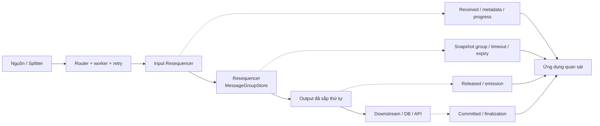

# Theo dõi group chưa hoàn thành

Trong chương **Resequencer nâng cao** của **SPRING_INTEGRATION_PATTERN**, một nhóm message có thể đã nhận nhiều phần nhưng chưa đủ điều kiện để phát toàn bộ theo đúng thứ tự. Khi số nhóm như vậy tăng lên, bài toán không còn là sắp xếp đơn thuần mà trở thành vấn đề **quan sát, chẩn đoán và vận hành**: nhóm nào đang chờ bình thường, nhóm nào bị kẹt, nhóm nào đã quá hạn, và phần tử nào cần được phục hồi?

Trong các luồng **Enterprise Integration Patterns** được xây dựng bằng Spring Integration, Splitter có thể tách batch, Router phân phối qua nhiều nhánh, Filter bỏ một phần, Transformer và Gateway gọi dịch vụ khác, còn retry/error channel xử lý lỗi. Resequencer cần correlation và sequence metadata nhất quán để khôi phục thứ tự. **Giám sát group chưa hoàn thành phải kết nối thông tin của cả các bước này**, chứ không chỉ đọc số message đang nằm trong store.

> **Ý chính:** “Chưa hoàn thành” không tự đồng nghĩa với “bị lỗi”. Cần phân biệt trạng thái nghiệp vụ, số vị trí dự kiến, số vị trí đã nhận, thời gian chờ và tình trạng retry trước khi phát cảnh báo hoặc can thiệp.

## 1. Group chưa hoàn thành là gì?

Các header thường được dùng để diễn tả một chuỗi:

| Header | Ý nghĩa | Ví dụ |
| --- | --- | --- |
| `correlationId` | Khóa nhận diện các message thuộc cùng một nhóm | `shipment-42:run-3` |
| `sequenceNumber` | Vị trí của message trong nhóm | `4` |
| `sequenceSize` | Tổng số phần nguồn dự kiến, nếu được biết | `5` |

Ví dụ một batch có năm phần, các worker xử lý song song và gửi về Resequencer theo thứ tự `4, 1, 5, 2`:

```text
Group shipment-42:run-3
sequenceSize dự kiến:   5
Các vị trí đã nhận:     1, 2, 4, 5
Các vị trí chưa thấy:   3
Số vị trí duy nhất:     4
Trạng thái giám sát:    OPEN / WAITING
```

Vị trí số 3 có thể đang retry, bị kẹt trong broker, đã vào DLQ hoặc bị Filter loại bỏ. Resequencer **không thể tự suy đoán nguyên nhân**. Nếu nguồn chưa cho biết `sequenceSize`, hệ thống thậm chí có thể chưa xác định được đầy đủ tập vị trí cần chờ.

Một nhóm được xem là *chưa hoàn thành* trong công cụ giám sát khi ứng dụng chưa có bằng chứng hoặc quyết định rằng vòng đời của nhóm đã kết thúc. Tuy nhiên, cần phân biệt:

- **Chưa release:** endpoint đang giữ các message hoặc chưa phát đủ phần theo release strategy.
- **Đã release một đoạn nhưng chưa kết thúc:** khi cho phép partial sequence, một số phần có thể đã phát, trong khi nhóm vẫn mở.
- **Đã timeout/expiry:** chính sách chờ đã kích hoạt; nhóm có thể bị xử lý partial, discard, recovery hoặc cleanup tùy cấu hình.
- **Đã hoàn thành ở endpoint nhưng chưa hoàn tất nghiệp vụ:** message đã được phát theo thứ tự, nhưng downstream còn ghi database hoặc gọi API.
- **Đã hoàn tất nghiệp vụ:** ứng dụng có kết quả cuối được commit, đồng thời có quy tắc với retry và late arrival.

Vì vậy, **số group còn trong `MessageGroupStore` không mặc nhiên bằng số batch nghiệp vụ chưa xong**. Một số store/cấu hình có thể giữ dấu completed group; ngược lại, một group bị dọn khỏi store chưa chắc đã được xử lý thành công.

## 2. Phân biệt group đang chờ bình thường và group bị kẹt

Giả sử hai nhóm đều có bốn trong năm phần, nhưng bối cảnh khác nhau:

| Trường hợp | Thời điểm nhận đầu | Lần cập nhật gần nhất | Trạng thái upstream | Nhận xét |
| --- | --- | --- | --- | --- |
| A | 2 giây trước | 1 giây trước | `#3` đang xử lý | Thường vẫn nằm trong cửa sổ chờ hợp lệ |
| B | 40 phút trước | 35 phút trước | `#3` không có trong queue, retry đã hết | Cần đối soát hoặc can thiệp |
| C | 12 phút trước | 1 giây trước | Đang nhận thêm phần từ stream | Nhóm lâu tuổi nhưng chưa hẳn không hoạt động |
| D | 10 phút trước | 10 phút trước | Filter đã chủ động bỏ `#3` | Cần sửa hợp đồng sequence hoặc ghi nhận skip |

Không nên cảnh báo chỉ vì “group có số vị trí chưa đủ”. Một Resequencer đang hoạt động bình thường **luôn có thể có nhóm mở** tại bất kỳ thời điểm nào khi các phần đến lệch nhau.

Nên kết hợp ít nhất bốn tín hiệu:

1. **Age:** thời gian kể từ khi nhóm bắt đầu được quan sát.
2. **Idle time:** thời gian kể từ lần cập nhật hữu ích cuối cùng.
3. **Gap:** số lượng hoặc danh sách vị trí chưa nhận, nếu biết tổng và quy tắc đánh số.
4. **Progress/dependency:** nguồn còn xử lý, retry còn hoạt động, queue đang tồn đọng hay đã có xác nhận không thể replay.

Một nhóm có age lớn nhưng vẫn tiến triển có thể cần tối ưu hiệu năng; một nhóm có idle lớn cùng thông báo mất phần đáng tin cậy có thể cần recovery ngay.

### Không tự coi timeout là kết luận mất vĩnh viễn

Timeout là **ngưỡng chính sách**, không phải bằng chứng một message không bao giờ xuất hiện. Group có thể hết hạn khi phần cuối đang nằm trong broker hoặc đang retry; sau đó message ấy vẫn đến. Giám sát cần ghi nhận **thời điểm expiry** và **kết quả xử lý expiry** riêng với trạng thái missing.

## 3. Dữ liệu tối thiểu để theo dõi một group

Một bản ghi quan sát ở mức ứng dụng có thể dùng các trường:

| Trường | Công dụng | Ghi chú |
| --- | --- | --- |
| `batchRunId` / `correlationId` | Nhận diện đúng một nhóm | Nên tránh dùng lại cho batch khác khi còn late message |
| `expectedSize` | Tổng vị trí dự kiến | Có thể là unknown |
| `receivedPositions` | Tập vị trí duy nhất đã nhận | Không lấy số message thô làm số vị trí duy nhất |
| `firstSeenAt` | Thời điểm bắt đầu quan sát nhóm | Dùng tính age |
| `lastProgressAt` | Lần gần nhất nhóm có tiến triển thực | Redelivery cùng slot không nhất thiết làm mới |
| `lastAttemptAt` | Lần gần nhất có thử xử lý/retry | Có thể thay đổi dù không tiến triển |
| `status` | OPEN, WAITING, RECOVERING, TIMED_OUT, COMPLETE... | Quy ước của ứng dụng |
| `deadline` | Thời hạn nghiệp vụ nếu có | Phân biệt với group timeout của endpoint |
| `missingPositions` | Những số chưa thấy khi biết size | Nên tính từ dữ liệu đã commit tại thời điểm chụp |
| `sourceStatus` | Trạng thái phần thiếu ở upstream/broker | Giúp phân biệt chậm, mất, đang replay |
| `lastDecision` | Retry, skip, fail, partial, complete | Dùng điều tra và audit |

**Các tên trường là mô hình quan sát đề xuất**, không phải một tập header có sẵn được Spring Integration tự động tạo. Đối với lưu trữ bền vững, cần quy định ai ghi các trường này và cập nhật chúng đồng bộ với việc nhận/release message.

### Phân biệt các loại “đếm”

```text
rawReceivedCount      = số lần nhận message (bao gồm redelivery)
uniquePositionCount   = số sequenceNumber khác nhau đã được chấp nhận
expectedSize          = số phần nguồn đã cam kết, khi biết
missingCount          = expectedSize - uniquePositionCount
                        chỉ hợp lệ nếu tập vị trí là 1..expectedSize
                        và metadata nhất quán
releasedCount         = số phần đã phát theo chính sách của endpoint
committedCount        = số tác động nghiệp vụ downstream đã commit
```

Một group có `expectedSize=3` nhưng nhận `#1, #2, #2` **chưa đủ ba vị trí**. Nếu chỉ theo dõi số message thô bằng 3, dashboard có thể đánh dấu hoàn thành sai.

Tương tự, `releasedCount=3` không đảm bảo ba tác động đã commit: downstream có thể retry hoặc thất bại sau khi nhận các message.

## 4. Đo ở đâu trong Spring Integration?

Theo dõi hiệu quả cần phân lớp đo lường:



| Vị trí đo | Nên thu thập | Không nên suy ra |
| --- | --- | --- |
| Trước Resequencer | Correlation, sequence, nhận trễ, duplicate, lỗi metadata | Thứ tự đầu ra đã đúng |
| `MessageGroupStore` | Group còn lưu, số phần đang có, tuổi nhóm tùy implementation | Tất cả batch trong store đều OPEN |
| Sau Resequencer | Message đã phát, thời gian đợi, số vị trí đã giải phóng | Downstream đã commit |
| Retry/error flow | Attempt, lỗi cuối, DLQ, khả năng replay | Group chắc chắn đã fail |
| Downstream finalization | Kết quả commit, version, thời gian chốt | Bộ nhớ endpoint đã được dọn |

**Nguồn sự thật nên được chọn rõ:** dùng store cho trạng thái **kỹ thuật** của endpoint, dùng bảng/nhật ký nghiệp vụ cho trạng thái **đã xử lý cuối cùng**. Đừng trộn chúng thành một metric không rõ định nghĩa.

### 4.1. MessageGroupStore và lifecycle thực tế

Các endpoint như Resequencer sử dụng `MessageGroupStore` để lưu và quản lý nhóm. Một ví dụ in-memory là `SimpleMessageStore`; với hệ thống cần phục hồi qua restart, có thể cân nhắc backend bền vững được Spring Integration hỗ trợ theo phiên bản sử dụng.

Khi giám sát store, cần tính đến:

- **Completion marker:** một nhóm hoàn tất có thể vẫn còn dấu trong store nếu cấu hình giữ lại.
- **Expiry:** nhóm quá hạn có thể được phát partial hoặc loại theo chính sách; hành vi dọn trạng thái không nhất thiết giống hoàn thành thành công.
- **Reaper:** một cơ chế như `MessageGroupStoreReaper` có thể xử lý các group cũ theo cấu hình, nhưng không tương đương deadline nghiệp vụ.
- **Persistence:** store bền vững có thể phục hồi group sau restart nhưng vẫn cần giám sát dung lượng, độ trễ và khả năng tranh chấp.
- **Multi-instance:** các instance dùng chung backend phải phối hợp trạng thái và release; metric tổng hợp không được nhân đôi chỉ vì hai node cùng nhìn thấy group.

Không nên dựa vào một phương thức đếm tổng số group rồi kết luận tất cả đang chờ. Phải kiểm tra **định nghĩa trạng thái và dữ liệu thực** mà store của dự án có thể cung cấp, rồi lọc thành tập group còn mở theo hợp đồng đã chọn.

### 4.2. Không yêu cầu mọi event timeout đều đi vào errorChannel

`errorChannel` xử lý lỗi khi message flow phát lỗi theo cơ chế của Spring Integration; **group expiry không tự động là một exception nghiệp vụ**. Nếu cần gửi cảnh báo “group chưa hoàn thành sau deadline” sang một channel riêng, phải thiết kế nguồn phát sự kiện và đường tiêu thụ tương ứng.

Ví dụ một sự kiện do ứng dụng tạo:

```json
{
  "type": "RESEQUENCER_GROUP_STALLED",
  "batchRunId": "shipment-42:run-3",
  "expectedSize": 5,
  "receivedPositions": [1, 2, 4, 5],
  "missingPositions": [3],
  "ageSeconds": 420,
  "idleSeconds": 380,
  "decision": "RECONCILE_UPSTREAM"
}
```

Đây là **schema minh họa**, không phải event mặc định. Khi có dữ liệu nhạy cảm, chỉ gửi định danh, trạng thái và chẩn đoán cần thiết; không đưa toàn bộ payload vào log/metric.

## 5. Tính các chỉ số sức khỏe từ snapshot của group

Một công cụ chẩn đoán có thể nhận snapshot do ứng dụng hoặc kho trạng thái cung cấp rồi phân loại **mức cần điều tra**. Nó không tự thay thế release strategy, không tự xóa group, cũng không khẳng định một phần đã mất vĩnh viễn.

Đoạn Java 17 sau tính tuổi nhóm, thời gian không tiến triển và các vị trí còn thiếu. Sử dụng `Instant`/`Duration` để tránh trộn đơn vị milliseconds và seconds.

```java
import java.time.Duration;
import java.time.Instant;
import java.util.Collection;
import java.util.HashSet;
import java.util.List;
import java.util.Set;
import java.util.stream.IntStream;

public final class PendingGroupDiagnostics {

    private PendingGroupDiagnostics() { }

    public record Snapshot(
            String correlationId,
            Integer expectedSize,
            Collection<Integer> receivedPositions,
            Instant firstSeenAt,
            Instant lastProgressAt) {
    }

    public record Report(
            String correlationId,
            int uniquePositions,
            boolean sizeKnown,
            List<Integer> missingPositions,
            boolean allExpectedPositionsPresent,
            Duration age,
            Duration idle,
            boolean exceedsAgeLimit,
            boolean exceedsIdleLimit) {
    }

    public static Report inspect(
            Snapshot snapshot,
            Instant now,
            Duration maxAge,
            Duration maxIdle) {

        if (snapshot == null || now == null
                || maxAge == null || maxIdle == null
                || maxAge.isNegative() || maxIdle.isNegative()
                || snapshot.correlationId() == null
                || snapshot.correlationId().isBlank()
                || snapshot.receivedPositions() == null
                || snapshot.firstSeenAt() == null
                || snapshot.lastProgressAt() == null
                || snapshot.firstSeenAt().isAfter(snapshot.lastProgressAt())
                || snapshot.lastProgressAt().isAfter(now)) {
            throw new IllegalArgumentException("Invalid group snapshot");
        }

        Integer expected = snapshot.expectedSize();
        if (expected != null && expected < 1) {
            throw new IllegalArgumentException("Invalid expectedSize");
        }

        Set<Integer> unique = new HashSet<>();
        for (Integer n : snapshot.receivedPositions()) {
            if (n == null || n < 1 || (expected != null && n > expected)) {
                throw new IllegalArgumentException("Invalid position");
            }
            unique.add(n);
        }

        boolean sizeKnown = expected != null;
        List<Integer> missing = sizeKnown
                ? IntStream.rangeClosed(1, expected)
                        .filter(n -> !unique.contains(n))
                        .boxed()
                        .toList()
                : List.of();

        Duration age = Duration.between(snapshot.firstSeenAt(), now);
        Duration idle = Duration.between(snapshot.lastProgressAt(), now);

        return new Report(
                snapshot.correlationId(),
                unique.size(),
                sizeKnown,
                missing,
                sizeKnown && missing.isEmpty(),
                age,
                idle,
                age.compareTo(maxAge) > 0,
                idle.compareTo(maxIdle) > 0);
    }
}
```

**Cách sử dụng đúng:**

- `uniquePositions` đếm vị trí khác nhau, không đếm redelivery.
- `missingPositions` chỉ có nghĩa khi tổng số phần **đã biết và đáng tin**. Nếu `sizeKnown=false`, danh sách rỗng ở đây có nghĩa **chưa tính được**, không phải **đã đủ**.
- `allExpectedPositionsPresent=true` chỉ xác nhận vị trí theo snapshot, **không chứng minh Resequencer đã release hay downstream đã commit**.
- `age` và `idle` hỗ trợ cảnh báo theo chính sách; nếu vượt ngưỡng cần đối soát, không tự kết luận phần thiếu vĩnh viễn.
- Hàm yêu cầu timestamp nhất quán và `now` không sớm hơn lần tiến triển cuối; trong hệ thống phân tán cần xử lý sai lệch đồng hồ và độ trễ truyền dữ liệu khi tạo snapshot.

Code này là **logic chẩn đoán do ứng dụng xây dựng**. Nó chưa cung cấp cách đọc các group từ `MessageGroupStore`, chưa xử lý race giữa snapshot và message mới, và chưa có trạng thái completed/expired. Những phần đó phải được bổ sung tùy store, phiên bản Spring Integration và thiết kế nghiệp vụ.

### 5.1. Ví dụ tình huống

```java
import java.time.Duration;
import java.time.Instant;
import java.util.List;

Instant now = Instant.parse("2026-11-21T09:10:00Z");

var snapshot = new PendingGroupDiagnostics.Snapshot(
        "shipment-42:run-3",
        5,
        List.of(4, 1, 5, 2, 2), // #2 xuất hiện hai lần
        now.minusSeconds(420),
        now.minusSeconds(380));

var report = PendingGroupDiagnostics.inspect(
        snapshot,
        now,
        Duration.ofMinutes(5),
        Duration.ofMinutes(2));

// uniquePositions == 4, missingPositions == [3]
// exceedsAgeLimit == true, exceedsIdleLimit == true
// Chỉ nên chuyển tới đối soát/alert, chưa được tự xóa group.
```

Khi nhận `#3` hợp lệ, tính lại snapshot có thể cho `missingPositions=[]`. Nhưng nếu group vẫn nằm ở trạng thái chờ vì release lỗi, công cụ giám sát phải tiếp tục xem xét endpoint hoặc store; **“đã đủ vị trí” khác “đã xử lý thành công”**.

## 6. Thiết kế metric và dashboard vận hành

Những metric sau nên được định nghĩa và triển khai từ nguồn quan sát của ứng dụng/store. Không mặc định Spring Integration tự xuất tất cả dưới các tên này.

| Metric gợi ý | Kiểu | Ý nghĩa |
| --- | --- | --- |
| `app.resequencer.groups.open` | Gauge | Số nhóm nghiệp vụ/kỹ thuật còn mở theo định nghĩa thống nhất |
| `app.resequencer.messages.pending` | Gauge | Số message/slot còn đang đợi release |
| `app.resequencer.groups.oldest.age.seconds` | Gauge | Tuổi của nhóm đang mở lâu nhất |
| `app.resequencer.groups.idle.p95.seconds` | Distribution/Gauge tổng hợp | Thời gian không tiến triển của các nhóm đang chờ |
| `app.resequencer.groups.started.total` | Counter | Tổng số nhóm được tạo trong cửa sổ hoạt động |
| `app.resequencer.groups.completed.total` | Counter | Nhóm hoàn tất theo điều kiện được định nghĩa |
| `app.resequencer.groups.expired.total` | Counter | Nhóm được xử lý expiry/timeout |
| `app.resequencer.groups.recovery.total` | Counter | Lần chuyển sang điều tra/khôi phục |
| `app.resequencer.sequence.duplicates.total` | Counter | Lần phát hiện redelivery cùng slot |
| `app.resequencer.sequence.conflicts.total` | Counter | Metadata hoặc nội dung tranh cùng slot |
| `app.resequencer.store.operation.duration` | Timer | Độ trễ truy cập store |

**Tách label có cardinality thấp** như `flow`, `status`, `outcome`, `tenantTier` hoặc `errorCategory`; **không đặt `correlationId`, event ID hoặc số thứ tự cụ thể làm label cho mỗi time series**. Hàng triệu group sẽ tạo hàng triệu chuỗi metric, gây quá tải hệ thống giám sát.

Chi tiết theo từng group nên nằm trong **log có cấu trúc, trace, bảng chẩn đoán hoặc giao diện điều tra phân trang**, nơi có thể tìm theo batch ID khi cần.

### 6.1. Ví dụ Micrometer: xuất số nhóm ở trạng thái mở

Giả sử ứng dụng có một service `GroupStateReader` đọc snapshot đã được tổng hợp một cách hiệu quả từ trạng thái nghiệp vụ hoặc store. Có thể đăng ký gauge như sau:

```java
import io.micrometer.core.instrument.Gauge;
import io.micrometer.core.instrument.MeterRegistry;

interface GroupStateReader {
    long countOpenGroups();
    long countPendingMessages();
    double oldestOpenGroupAgeSeconds();
}

public final class GroupMetrics {

    public GroupMetrics(
            MeterRegistry registry, GroupStateReader reader) {

        Gauge.builder("app.resequencer.groups.open",
                        reader, r -> r.countOpenGroups())
                .description("Number of currently open sequence groups")
                .register(registry);

        Gauge.builder("app.resequencer.messages.pending",
                        reader, r -> r.countPendingMessages())
                .description("Messages awaiting release")
                .register(registry);

        Gauge.builder("app.resequencer.groups.oldest.age.seconds",
                        reader, GroupStateReader::oldestOpenGroupAgeSeconds)
                .description("Oldest open group age in seconds")
                .register(registry);
    }
}
```

Đây là **mã mẫu cho tầng quan sát**: `GroupStateReader` chưa có implementation vì cách lấy trạng thái chính xác phụ thuộc store được dùng. Trong production, nên đọc metric từ **snapshot/cache tổng hợp có kiểm soát**, tránh để mỗi lần Prometheus scrape chạy một truy vấn quét tất cả group đang chờ.

Một lưu ý thêm: nếu đọc số nhóm từ nhiều node cùng dùng một database chung, cộng trực tiếp gauge của mọi node có thể **đếm trùng toàn bộ nhóm**. Nên chọn một điểm tổng hợp, phân chia ownership rõ ràng hoặc truy vấn từ nguồn chung theo cách phù hợp.

### 6.2. Dashboard nên trả lời những câu hỏi nào?

Một bảng điều khiển hữu ích có thể tổ chức theo luồng từ tổng quan tới điều tra:

| Góc nhìn | Dữ liệu cần có | Câu hỏi vận hành |
| --- | --- | --- |
| Tồn đọng hiện tại | Open groups, pending messages, oldest age | Có đang tích lũy không? |
| Tiến triển | Tỷ lệ tạo/hoàn tất nhóm theo phút | Tốc độ hoàn tất có theo kịp đầu vào không? |
| Tuổi và độ trễ | p50/p95/p99 thời gian chờ, idle age | Nhóm bị chậm phổ biến hay chỉ vài ngoại lệ? |
| Lỗi | Timeout, missing slot, duplicate, conflict, DLQ | Những nhóm nào cần recovery? |
| Store | Dung lượng, thời gian truy cập, lock/contention | Nút cổ chai có ở backend không? |
| Downstream | Output emission, commit, retry hậu resequencing | Nhóm hoàn tất ở endpoint nhưng nghiệp vụ còn treo? |

Khi `openGroups` tăng, nên đọc đồng thời **group creation rate**, **completion rate**, **store latency** và **queue lag**. Số nhóm tăng có thể do lưu lượng đầu vào tăng ngắn hạn, do downstream chậm hoặc do lỗi làm các nhóm không thể hoàn tất.

## 7. Thiết kế cảnh báo có thể hành động

Cảnh báo tốt không chỉ nói “có group đang chờ” mà phải chỉ ra **điểm can thiệp tiếp theo**. Ví dụ chính sách ban đầu (các ngưỡng dưới đây chỉ là minh họa, cần điều chỉnh theo SLA và phân bố dữ liệu thật):

| Điều kiện | Mức ưu tiên gợi ý | Hành động |
| --- | --- | --- |
| Nhóm age trên 5 phút, SLA thường 1 phút | Warning | Kiểm tra vị trí thiếu và hàng đợi/retry |
| Nhóm idle trên 10 phút, không có worker active | High | Đối soát nguồn, DLQ và trạng thái manifest |
| Tỷ lệ timeout tăng đột biến | Warning/High | Kiểm tra lỗi hệ thống hoặc thay đổi cấu hình |
| Open groups tăng đều nhưng completed rate không tăng | High | Kiểm tra nghẽn, group leak, store/worker |
| Conflict cùng slot hoặc size không nhất quán | High | Cách ly nguồn gửi sai và điều tra |
| Store chậm hoặc gần đầy | High/Critical | Điều tiết đầu vào, ưu tiên bảo toàn message |

Một quy tắc cảnh báo có thể dựa trên đồng thời:

```text
candidateForInvestigation(group) =
    group.status == OPEN
    AND group.age > policy.maxAge
    AND group.idle > policy.maxIdle
    AND NOT alreadyInRecovery(group)

candidateForReconciliation(group) =
    candidateForInvestigation(group)
    AND (
        knownMissingPositions(group) > 0
        OR upstreamDeclaresBatchClosed(group)
        OR expectedSizeIsUnknownTooLong(group)
    )
```

Đây là **pseudo-code chính sách**, không phải release/timeout expression mặc định của Spring Integration. Nếu cần xử lý tự động, cập nhật trạng thái recovery bằng thao tác nhất quán để nhiều instance không cùng mở hai quy trình đối soát cho một group.

### Tránh bão cảnh báo

- Gộp cảnh báo theo `flow`, loại lỗi, dịch vụ và khoảng thời gian; chỉ mở chi tiết theo `correlationId` khi điều tra.
- Cảnh báo trên **xu hướng liên tục**, không chỉ một mẫu đo đơn lẻ lúc traffic tăng.
- Có thời gian chờ/hysteresis và nhánh xác nhận cảnh báo đã được xử lý.
- Phân biệt “không có message mới” do **nguồn ngừng phát theo kế hoạch** với “bị kẹt” do lỗi.
- Cần một khoảng trễ phù hợp cho metric scrape và clock skew trước khi kết luận vi phạm deadline.

Nếu hệ thống nhiều tenant, tránh để một tenant có nhiều group pending che khuất sự cố của tenant khác; có thể tổng hợp theo tầng dịch vụ hoặc tenant tier với cardinality được kiểm soát.

## 8. Runbook khi một group bị cảnh báo chưa hoàn thành

Một quy trình điều tra có thể đi theo thứ tự:

1. **Xác nhận danh tính:** lấy `correlationId/batchRunId`, nguồn dữ liệu, `sequenceSize`, thời điểm bắt đầu và trạng thái nghiệp vụ.
2. **Kiểm tra đúng điểm đo:** đây là group thực sự chưa release hay chỉ là completed marker còn nằm trong store?
3. **Xác định khoảng trống:** so sánh các `sequenceNumber` duy nhất với manifest; nếu chưa biết size, tìm tín hiệu end marker hoặc nguồn xác nhận tổng.
4. **Đối chiếu upstream:** phần thiếu có được Splitter tạo không, Filter có chủ động loại không, Router có gửi sai nhánh không?
5. **Kiểm tra worker và broker:** queue lag, retry attempts, worker crash, ACK fail, DLQ và khóa correlation sau adapter.
6. **Kiểm tra release/timeout:** group có đang chờ theo chiến lược đã chọn không, partial release đã phát phần nào, lịch expiry có chạy đúng không?
7. **Kiểm tra store:** độ trễ, transaction/lock, restart, dữ liệu tồn qua nhiều instance và chính sách cleanup.
8. **Chọn hành động có thẩm quyền:** replay phần thiếu, ghi nhận skip, chốt partial, fail batch hoặc bù trừ; không tự sửa `sequenceSize` để đóng nhóm cho nhanh.
9. **Kiểm tra late arrival và idempotency:** nếu replay sau khi group đã hết hạn/hoàn tất, phải đối chiếu trạng thái cuối để tránh phát kết quả thứ hai.
10. **Lưu kết quả điều tra:** nguyên nhân gốc, vị trí bị ảnh hưởng, timeline, biện pháp khắc phục và cách ngăn tái diễn.

Không chỉnh sửa hoặc xóa trực tiếp bản ghi group trong database của store để “thông tắc” nếu chưa hiểu cơ chế locking và lifecycle của endpoint. Can thiệp thô có thể làm mất dữ liệu chưa release hoặc tạo duplicate khi broker redeliver.

### Tình huống: Filter làm mất một phần

```text
Splitter gán:    #1/4   #2/4   #3/4   #4/4
Filter bỏ #2:    #1/4          #3/4   #4/4
Resequencer:     nhận 1,3,4; vẫn kỳ vọng đủ 4 phần
Monitoring:      missingPositions=[2], idle tăng
```

Cách xử lý đúng nằm ở **hợp đồng dữ liệu**: lọc trước khi gán chuỗi mới hoặc gửi tín hiệu skip đáng tin cậy; nếu đang xử lý một batch cũ bị sai, cần quyết định nghiệp vụ để fail/repair/partial. Chỉ tăng timeout sẽ khiến group tiếp tục chiếm tài nguyên.

## 9. Kiểm thử hệ thống theo dõi group chưa hoàn thành

Nên kiểm thử **hai thứ độc lập**: (1) Resequencer và store có hành vi đúng; (2) công cụ theo dõi phản ánh đúng trạng thái ở ranh giới đã định.

| Ca | Tình huống | Kỳ vọng theo dõi |
| --- | --- | --- |
| Nhóm mở bình thường | Nhận `#1/3`, sau 1 giây nhận `#2/3` | Open, missing hợp lệ, không cảnh báo trước SLA |
| Nhóm hoàn thành | Nhận `3/3, 1/3, 2/3` | Đủ vị trí và được ghi nhận completion; không còn báo đang chờ |
| Thiếu một phần | Nhận `1/4, 3/4, 4/4` | Missing `#2`, age/idle tăng theo thời gian |
| Duplicate | Nhận `1/3, 2/3, 2/3` | Unique positions là 2, không coi là đủ 3 |
| Unknown size | Có `#1, #2` nhưng chưa có manifest | Không báo missingCount=0 như đã hoàn tất |
| Filter chủ động loại | Tạo `1..4` rồi bỏ `#2` | Phát hiện gap, điều tra quy tắc Filter/sequence |
| Retry còn chạy | `#2` chưa tới, worker đang backoff | Theo dõi dependency; chưa kết luận mất vĩnh viễn |
| Retry exhausted | Worker hết retry và message vào DLQ | Group chuyển sang nhánh điều tra/recovery phù hợp |
| Group timeout | Nhóm thiếu phần đến hạn | Ghi nhận expiry và hành động, không tự đánh dấu COMPLETE |
| Partial release | `#1` được phát sớm trong khi `#2` chưa tới | Phân biệt released count với completion |
| Complete marker được giữ | Group đã hoàn tất nhưng record còn trong store | Không tính nhầm là open group |
| Crash/restart | Đang chờ rồi restart instance | Báo cáo đúng trạng thái theo khả năng phục hồi của store |
| Late arrival | Phần còn thiếu tới sau expiry | Quan sát quyết định accept/reject/correct, không duplicate |
| Hai nhóm xen kẽ | A thiếu, B hoàn tất | Chỉ A bị cảnh báo; B không bị ảnh hưởng |
| Store chậm | Truy vấn/ghi group tăng độ trễ | Metric store và cảnh báo phản ánh nút cổ chai |

### Unit test cho phép tính tuổi và vị trí thiếu

Có thể kiểm thử logic `PendingGroupDiagnostics` độc lập với Resequencer:

```java
import static org.junit.jupiter.api.Assertions.*;

import java.time.Duration;
import java.time.Instant;
import java.util.List;
import org.junit.jupiter.api.Test;

class PendingGroupDiagnosticsTest {

    private static final Instant NOW =
            Instant.parse("2026-11-21T09:10:00Z");

    @Test
    void reportsUniquePositionsAndMissingSlot() {
        var snapshot = new PendingGroupDiagnostics.Snapshot(
                "batch-42", 5, List.of(4, 1, 2, 2, 5),
                NOW.minusSeconds(420), NOW.minusSeconds(380));

        var report = PendingGroupDiagnostics.inspect(
                snapshot, NOW,
                Duration.ofMinutes(5),
                Duration.ofMinutes(2));

        assertEquals(4, report.uniquePositions());
        assertEquals(List.of(3), report.missingPositions());
        assertTrue(report.sizeKnown());
        assertFalse(report.allExpectedPositionsPresent());
        assertTrue(report.exceedsAgeLimit());
        assertTrue(report.exceedsIdleLimit());
    }

    @Test
    void doesNotTreatUnknownSizeAsComplete() {
        var snapshot = new PendingGroupDiagnostics.Snapshot(
                "stream-7", null, List.of(1, 2),
                NOW.minusSeconds(10), NOW.minusSeconds(1));

        var report = PendingGroupDiagnostics.inspect(
                snapshot, NOW,
                Duration.ofMinutes(5),
                Duration.ofMinutes(2));

        assertFalse(report.sizeKnown());
        assertFalse(report.allExpectedPositionsPresent());
        assertTrue(report.missingPositions().isEmpty());
    }

    @Test
    void reportsAllPositionsPresentWithoutClaimingCommit() {
        var snapshot = new PendingGroupDiagnostics.Snapshot(
                "batch-43", 3, List.of(3, 1, 2),
                NOW.minusSeconds(20), NOW.minusSeconds(1));

        var report = PendingGroupDiagnostics.inspect(
                snapshot, NOW,
                Duration.ofMinutes(5),
                Duration.ofMinutes(2));

        assertTrue(report.allExpectedPositionsPresent());
        assertEquals(List.of(), report.missingPositions());
        // Endpoint completion và business commit kiểm tra riêng.
    }
}
```

Đây là **unit test của tầng quan sát**; một integration test đầy đủ còn cần gửi message vào Resequencer thật, kiểm tra `MessageGroupStore`, release, timeout, lỗi và trạng thái downstream. Nên dùng đồng hồ có thể điều khiển được trong logic chẩn đoán và kiểm tra các tình huống sát deadline để tránh test chập chờn.

## 10. Những lỗi phổ biến khi theo dõi group

**1. Chỉ dùng tổng message trong store.** Có thể chứa completed marker hoặc duplicate; không phản ánh tập group thực sự đang chờ.

**2. Đếm mọi message thô như một vị trí mới.** Retry có thể tạo nhiều message cùng `sequenceNumber`; dùng số vị trí duy nhất và source event ID để kiểm tra.

**3. Dựa vào idle time nhưng coi retry là tiến triển.** Một worker thất bại và retry liên tục có thể cập nhật `lastAttemptAt`, trong khi tập vị trí hợp lệ không thay đổi. Hãy tách `lastProgressAt` khỏi `lastAttemptAt`.

**4. Cho rằng không còn group trong store là thành công.** Group có thể đã expiry, bị dọn hoặc mất do restart với store in-memory. Cần theo dõi trạng thái nghiệp vụ riêng.

**5. Quên tác động của async downstream.** Resequencer đã phát đúng thứ tự nhưng các tác động sau đó chưa commit. Không đánh dấu toàn bộ nghiệp vụ hoàn tất chỉ từ output channel.

**6. Dùng `correlationId` làm label metric.** Số chuỗi metric tăng theo số group và gây áp lực lớn lên hệ thống quan sát. Dùng log/tracing cho chi tiết từng group.

**7. Quét toàn bộ store theo từng lần scrape.** Query nặng có thể làm tăng độ trễ của chính Resequencer. Dùng chỉ số tổng hợp hoặc cache snapshot với giới hạn thời gian.

**8. Can thiệp vào group khi snapshot đã cũ.** Message cuối có thể vừa tới giữa lần đo và quyết định retry/fail. Phải kiểm tra lại trạng thái bằng cơ chế nhất quán trước hành động không thể hoàn tác.

**9. Không có retention policy cho completed và expired group.** Có thể làm bùng nổ dung lượng dù open group count rất thấp.

**10. Không phân biệt bộ đếm giữa các instance.** Hai node đọc cùng store có thể trả về cùng số nhóm; cộng bừa các gauge tạo báo cáo gấp đôi.

## 11. Checklist triển khai theo dõi group chưa hoàn thành

1. **Định nghĩa trạng thái rõ:** OPEN, WAITING, RECOVERING, TIMED_OUT, COMPLETED, FAILED và phần nào là trạng thái nghiệp vụ.
2. **Có metadata hợp lệ:** `correlationId` không trộn batch, `sequenceNumber` có quy tắc và `sequenceSize`/end marker đáng tin.
3. **Đếm đúng:** tách raw message, unique positions, released messages và committed effects.
4. **Đo age và idle riêng:** chỉ coi tiến triển khi số vị trí hợp lệ hoặc trạng thái xử lý thực sự thay đổi.
5. **Phân biệt endpoint store và bảng nghiệp vụ:** không coi record còn trong store là chưa thành công.
6. **Kiểm tra timeout/expiry/cleanup:** giám sát chính sách release, group timeout, MessageGroupStore và cơ chế reaper.
7. **Có đường đối soát:** liên kết từ group đang thiếu tới upstream, retry, DLQ và manifest.
8. **Bảo vệ tài nguyên quan sát:** metric cardinality thấp, truy vấn snapshot hiệu quả, cache/retention phù hợp.
9. **Cảnh báo có hành động:** dùng SLA, tuổi nhóm, thời gian idle, tốc độ hoàn tất và trạng thái nguồn để giảm báo giả.
10. **Kiểm thử trạng thái bất thường:** retry trùng, thiếu vị trí, unknown size, partial release, late arrival, restart và race quanh timeout.
11. **Không tự kết luận mất vĩnh viễn:** timeout cần kích hoạt xác minh; quyết định fail/partial/skip/replay thuộc hợp đồng nghiệp vụ.
12. **Đối soát cả downstream:** khi yêu cầu end-to-end, xác nhận tác động đã commit chứ không chỉ được Resequencer release.

**Ghi nhớ:** Theo dõi group chưa hoàn thành là bài toán **định nghĩa tiến triển và trạng thái**, không chỉ đếm số group trong bộ nhớ. Kết hợp `MessageGroupStore`, dữ liệu nguồn, metadata correlation/sequence, thời điểm nhận, retry/error flow và trạng thái nghiệp vụ sẽ giúp nhận biết nhóm thực sự bị kẹt, ưu tiên xử lý đúng phần thiếu và giữ cho luồng Spring Integration ổn định khi lưu lượng lớn.

