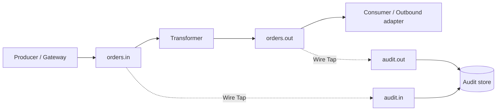

# Audit message vào và ra khỏi flow trong Spring Integration

## 1. Mục tiêu và phạm vi

Trong hệ thống tích hợp, một message có thể đi qua nhiều `MessageChannel`, `Transformer`, `Filter`, `Router`, `Splitter`, `Aggregator` và outbound adapter. Khi có sự cố hoặc cần đối soát, nhóm vận hành phải trả lời được những câu hỏi cụ thể: **flow đã nhận message nào, lúc nào, từ đâu; message nào đi tới ranh giới đầu ra; trường hợp nào bị từ chối, lỗi hoặc xử lý lại?**

**Audit message** là ghi nhận các sự kiện có cấu trúc tại những điểm đã định nghĩa trong hành trình xử lý. Với Enterprise Integration Patterns (EIP), audit giúp kiểm chứng đường đi của message trong một kiến trúc ít phụ thuộc, nhưng bản ghi audit cần được thiết kế độc lập với nghiệp vụ và với cơ chế ghi log thông thường.

Sau bài này, bạn có thể:

- Xác định chính xác **ranh giới vào và ra** của một `IntegrationFlow`, phân biệt sự kiện tiếp nhận/chuyển giao với kết quả xử lý cuối cùng.
- Dùng **Wire Tap** của Spring Integration để đưa một bản sao tham chiếu message sang nhánh audit mà không sửa nghiệp vụ chính.
- Thiết kế bản ghi audit có `flowExecutionId`, business key, trạng thái, thời gian và metadata an toàn.
- Cân nhắc tính đồng bộ, tính bền vững, khả năng xử lý trùng và an toàn thông tin trước khi triển khai thật.
- Kiểm tra được cả đường thành công, bị lọc, lỗi, retry và thiếu sự kiện đầu ra.

## 2. Đặt ranh giới audit đúng chỗ

Ví dụ, hệ thống nhận một đơn hàng, chuẩn hóa dữ liệu rồi đưa lên kênh để thành phần khác tiếp nhận:



Ở ví dụ này, cần thống nhất ý nghĩa trước khi ghi sự kiện:

| Vị trí | Sự kiện gợi ý | Điều có thể kết luận | Điều **chưa** thể kết luận |
| --- | --- | --- | --- |
| Wire Tap trên `orders.in` | `FLOW_INPUT_OBSERVED` | Message đã tới kênh đầu vào và được nhánh audit quan sát | Transformer/flow đã hoàn tất thành công |
| Wire Tap trên `orders.out` | `FLOW_OUTPUT_OBSERVED` | Message đã tới điểm chuyển giao đầu ra | Hệ thống bên ngoài đã nhận hoặc xử lý thành công |
| Sau bước kiểm tra/Filter | `FLOW_REJECTED` | Message bị từ chối theo quy tắc xác định | Message đã đi đến đầu ra thành công |
| Error flow | `FLOW_FAILED` | Một lỗi xử lý được ghi nhận | Lỗi đã được khắc phục hoặc giao dịch đã rollback hoàn toàn |
| Sau ACK/response từ hệ thống đích | `DELIVERY_CONFIRMED` | Có bằng chứng xác nhận theo hợp đồng với đích | Toàn bộ nghiệp vụ phía đích đã hoàn tất nếu ACK chỉ xác nhận đã nhận |

Tên sự kiện nên mô tả **điều đã thực sự quan sát**, tránh đặt `DELIVERED` cho một message mới được gửi tới `MessageChannel`. `WireTap` là channel interceptor: nó hoạt động khi gửi message qua kênh; ở thời điểm đó thao tác phân phối, lưu hàng đợi hoặc gọi hệ thống ngoài vẫn có thể thất bại. Muốn chứng minh đã giao thành công phải ghi nhận kết quả sau một outbound adapter hoặc cơ chế ACK phù hợp.

Nếu một flow có nhiều nhánh ra, mỗi nhánh cần một điểm audit đầu ra với `channel`, `route` hoặc `destination` riêng. Đối với request–reply, cần phân biệt `REQUEST_IN`, `REPLY_OUT` và xác nhận gửi tới downstream. Không mặc định mỗi message vào sẽ tương ứng đúng một message ra: Filter có thể loại bỏ, Splitter tạo nhiều message, Aggregator gộp nhiều message và Router có thể đưa message đến nhiều nhánh.

## 3. Thiết kế bản ghi audit

Audit tốt bắt đầu từ **hợp đồng sự kiện**, không bắt đầu từ câu lệnh `log.info(message.toString())`.

| Trường | Ý nghĩa | Gợi ý |
| --- | --- | --- |
| `auditEventId` | Mã duy nhất của lần ghi nhận | UUID/ULID sinh riêng cho từng sự kiện |
| `eventType` | `FLOW_INPUT_OBSERVED`, `FLOW_OUTPUT_OBSERVED`, `FLOW_FAILED`, ... | Danh sách tên ổn định, có tài liệu |
| `occurredAt` | Thời điểm hệ thống quan sát sự kiện | ISO-8601 UTC; lưu cả `recordedAt` nếu ghi trễ |
| `flowName`, `channel`, `direction` | Ngữ cảnh phát sinh sự kiện | Tên có chủ đích, không phụ thuộc tên bean ngẫu nhiên |
| `flowExecutionId` | Định danh cho **một lượt xử lý logic** | Gán tại ingress rồi truyền qua các bước/nhánh |
| `messageId` | `MessageHeaders.ID` của message tại thời điểm audit | Hữu ích để truy vết cục bộ; có thể thay khi biến đổi message |
| `correlationId`, `causationId` | Liên hệ message cha/con, request/reply, split/aggregate | Không đánh đồng với `messageId` hoặc business key |
| `businessKey` | Mã đơn hàng, giao dịch, chứng từ... | Ưu tiên ID đã chuẩn hóa; tránh PII |
| `attempt`, `outcome`, `errorCode` | Lần thử, kết quả và lỗi có kiểm soát | Không đưa stack trace/bí mật vào audit mặc định |
| `payloadType`, `schemaVersion`, `payloadDigest` | Loại và dấu vân tay dữ liệu | Digest từ biểu diễn canonical thích hợp; không log toàn bộ payload |
| `traceId`, `spanId` | Liên kết sang distributed tracing nếu có | Không dùng trace thay thế định danh audit bền vững |

Một record minh họa (giá trị chỉ là ví dụ):

```json
{
  "auditEventId": "evt-000187",
  "eventType": "FLOW_OUTPUT_OBSERVED",
  "occurredAt": "2026-11-21T08:30:15.230Z",
  "flowName": "orderNormalizationFlow",
  "channel": "orders.out",
  "direction": "OUT",
  "flowExecutionId": "flow-7294",
  "messageId": "cf44d8fe-3d55-40b8-8dd0-cf0e6d74aa46",
  "businessKey": "order-42",
  "attempt": 1,
  "outcome": "OBSERVED",
  "payloadType": "java.lang.String",
  "schemaVersion": 1
}
```

`MessageHeaders.ID` do Spring Messaging quản lý; khi Transformer tạo message mới, ID có thể thay. Vì vậy, **không dùng message ID làm khóa duy nhất để ghép toàn bộ hành trình**. Hệ thống nhận message nên gán `flowExecutionId` một lần, duy trì qua các header cần thiết và ghi rõ quan hệ giữa message cha/con nếu có Splitter, Aggregator hoặc gửi lại. Với một thông điệp được xử lý lại vì retry, `attempt` và `auditEventId` phải cho phép nhìn thấy các lần thử khác nhau. Không lưu trực tiếp header như `replyChannel` hay `errorChannel` nếu chúng là đối tượng nội bộ hoặc mang dữ liệu không phù hợp để serialize.

## 4. Cài đặt Wire Tap tại đầu vào và đầu ra

Ví dụ sau sử dụng Spring Integration Java DSL (dành cho dự án Spring Boot dùng Spring Integration 6.x). Để minh họa ranh giới, flow nhận một chuỗi, chuẩn hóa rồi chuyển sang `QueueChannel` đầu ra. Các nhánh audit chỉ nhận metadata; kho lưu audit được biểu diễn bằng interface `AuditStore` để ứng dụng cài đặt theo chính sách lưu trữ của mình.

```java
import java.time.Instant;
import java.util.UUID;

import org.springframework.context.annotation.Bean;
import org.springframework.context.annotation.Configuration;
import org.springframework.integration.annotation.EnableIntegration;
import org.springframework.integration.channel.DirectChannel;
import org.springframework.integration.dsl.IntegrationFlow;
import org.springframework.integration.dsl.MessageChannels;
import org.springframework.messaging.Message;
import org.springframework.messaging.MessageChannel;
import org.springframework.messaging.PollableChannel;

@Configuration
@EnableIntegration
class OrderAuditConfig {

    // Kênh đầu vào; tap thấy message khi message được gửi vào kênh này.
    @Bean("orders.in")
    MessageChannel ordersInput() {
        return MessageChannels.direct()
                .wireTap("audit.in")
                .get();
    }

    // Kênh đầu ra của flow; việc gửi vào queue chưa phải ACK từ bên ngoài.
    @Bean("orders.out")
    PollableChannel ordersOutput() {
        return MessageChannels.queue()
                .wireTap("audit.out")
                .get();
    }

    @Bean("audit.in")
    MessageChannel auditInputChannel() {
        return new DirectChannel();
    }

    @Bean("audit.out")
    MessageChannel auditOutputChannel() {
        return new DirectChannel();
    }

    @Bean
    IntegrationFlow orderNormalizationFlow() {
        return IntegrationFlow.from("orders.in")
                .transform(String.class, String::strip)
                .channel("orders.out")
                .get();
    }

    @Bean
    IntegrationFlow inputAuditFlow(AuditStore auditStore) {
        return IntegrationFlow.from("audit.in")
                .handle(message -> auditStore.append(
                        AuditEvent.from("FLOW_INPUT_OBSERVED", "orders.in", message)))
                .get();
    }

    @Bean
    IntegrationFlow outputAuditFlow(AuditStore auditStore) {
        return IntegrationFlow.from("audit.out")
                .handle(message -> auditStore.append(
                        AuditEvent.from("FLOW_OUTPUT_OBSERVED", "orders.out", message)))
                .get();
    }

    interface AuditStore {
        void append(AuditEvent event);
    }

    record AuditEvent(
            String auditEventId,
            Instant occurredAt,
            String eventType,
            String channel,
            String flowExecutionId,
            String messageId,
            String businessKey,
            String payloadType) {

        static AuditEvent from(String type, String channel, Message<?> message) {
            var headers = message.getHeaders();
            return new AuditEvent(
                    UUID.randomUUID().toString(),
                    Instant.now(),
                    type,
                    channel,
                    headers.get("flowExecutionId", String.class),
                    headers.getId().toString(),
                    headers.get("orderId", String.class),
                    message.getPayload().getClass().getSimpleName());
        }
    }
}
```

**Điểm cần chú ý khi đọc ví dụ:**

1. `.wireTap("audit.in")` và `.wireTap("audit.out")` gắn interceptor lên **hai kênh được định nghĩa**, giúp quan sát message tại ranh giới. Nhánh business không phải gọi `AuditStore` trực tiếp.
2. `AuditStore` là *hợp đồng cần được cung cấp implementation*; trong thực tế có thể ghi vào bảng append-only, hàng đợi bền vững hoặc event store. Ví dụ cố ý chỉ ghi metadata an toàn, không sao chép toàn bộ payload hoặc mọi header vào audit.
3. `DirectChannel` cho audit xử lý **đồng bộ** trong lời gọi gửi message ở ví dụ này. Nếu `append` chậm hoặc ném exception, flow chính có thể chậm hoặc lỗi. Đây là quyết định có tác động nghiệp vụ, cần chọn rõ trong thiết kế.
4. `QueueChannel` ở đầu ra được dùng để dễ quan sát trong bài thực hành. Nếu ứng dụng thật sử dụng HTTP, Kafka, AMQP hoặc JMS outbound adapter, phải xác định riêng điểm ghi nhận ACK/thành công/thất bại theo đặc tính adapter.

Ở phía producer/gateway, gửi một message có khóa đối soát bền vững:

```java
import org.springframework.messaging.MessageChannel;
import org.springframework.messaging.support.MessageBuilder;

void submit(MessageChannel ordersInput) {
    boolean accepted = ordersInput.send(
            MessageBuilder.withPayload("  new-order-42  ")
                    .setHeader("flowExecutionId", "flow-7294")
                    .setHeader("orderId", "order-42")
                    .build());

    if (!accepted) {
        throw new IllegalStateException("Không gửi được tới orders.in");
    }
}
```

Khi thông điệp này chạy qua flow, audit thường ghi hai sự kiện `FLOW_INPUT_OBSERVED` và `FLOW_OUTPUT_OBSERVED` cùng `flowExecutionId`, trong khi payload đầu ra đã được `strip()` khoảng trắng. Nếu Transformer tạo message mới, hai bản ghi có thể mang `messageId` khác nhau. Lời gọi `send()` thành công chỉ xác nhận hợp đồng gửi của kênh; không đồng nghĩa một hệ thống ngoài đã hoàn tất nghiệp vụ.

### Ghi audit ở đâu nếu luồng có nhiều nhánh?

- **Router:** đặt tap ở ingress và tại mỗi kênh ra thực sự cần đối soát. Lưu `routeName` hoặc `destination`; một message có thể có nhiều sự kiện đầu ra.
- **Filter/validation:** gắn một nhánh riêng vào `discardChannel` hoặc ghi sự kiện tại chỗ từ chối để phân biệt `REJECTED` với `LOST`.
- **Splitter/Aggregator:** dùng `correlationId`, `sequenceNumber`, `sequenceSize` của Spring Integration khi thích hợp, đồng thời duy trì một business/flow correlation ID ổn định. Một message vào có thể sinh nhiều message con, hoặc nhiều message vào tạo một kết quả.
- **Gateway request–reply:** gắn audit tại cả chiều request và reply, ghi rõ timeout, lỗi và việc reply bị thiếu; không suy luận response thành công từ việc request đã được nhận.
- **Outbound adapter:** nếu cần audit về giao nhận, ghi kết quả trả về/ACK của adapter hoặc broker bên cạnh sự kiện message được gửi tới kênh outbound.

## 5. Đồng bộ, bất đồng bộ và độ tin cậy

Wire Tap tách nhánh xử lý về mặt cấu trúc nhưng **không tự động biến việc ghi audit thành bất đồng bộ hay bền vững**. Lựa chọn phụ thuộc yêu cầu đối soát:

| Chiến lược | Lợi ích | Rủi ro/điều kiện sử dụng |
| --- | --- | --- |
| `DirectChannel` + ghi audit đồng bộ | Dễ hiểu, có thể yêu cầu audit thành công trước khi tiếp tục | Tăng độ trễ; lỗi audit có thể làm hỏng flow; đồng bộ tự nó không bảo đảm atomicity |
| `ExecutorChannel`/executor cho nhánh audit | Giảm thời gian xử lý trên thread business khi còn tài nguyên | Hàng đợi trong RAM có thể mất khi tiến trình dừng; đầy queue/rejection vẫn phải được xử lý |
| Hàng đợi/broker bền vững riêng cho audit | Có thể chống mất dữ liệu qua restart, xử lý độc lập | Cần retry, idempotency, theo dõi backlog và dead-letter; không mặc nhiên giao dịch nguyên tử với nghiệp vụ |
| Cùng transaction DB hoặc **transactional outbox** | Thích hợp khi yêu cầu đồng bộ hóa thay đổi nghiệp vụ với sự kiện audit/outbox | Chỉ bảo đảm trong ranh giới giao dịch được cấu hình; dispatcher outbox vẫn có thể gửi trùng |

Trong hệ thống phải lưu audit theo quy định, nên xác định rõ một trong hai chính sách:

- **Fail closed:** nếu không ghi được bản ghi bắt buộc, từ chối hoặc rollback giao dịch nghiệp vụ theo hợp đồng. Điều này chỉ thực sự an toàn khi ranh giới transaction và lỗi được kiểm soát.
- **Fail open:** ưu tiên nghiệp vụ tiếp tục khi audit tạm hỏng; phải chấp nhận lỗ hổng bằng chứng và có cơ chế bù/khôi phục, cảnh báo và theo dõi lượng bản ghi thiếu. Không chọn chính sách này cho dữ liệu bắt buộc phải đối soát nếu chưa được phê duyệt.

**Transactional outbox** là lựa chọn thường dùng khi cùng một transaction có thể lưu dữ liệu nghiệp vụ và một hàng outbox vào cùng cơ sở dữ liệu: dispatcher đọc outbox và gửi sang hệ thống audit, đồng thời retry khi lỗi. Consumer audit cần idempotent vì một bản ghi outbox có thể được phát lại. Nếu nghiệp vụ đi qua nhiều tài nguyên độc lập hoặc API ngoài, không thể suy ra tính nguyên tử toàn cục chỉ từ `@Transactional`.

Một lỗi thường gặp là dùng `log.info("{}", message)` rồi gọi đó là audit. Log có thể bị xoay vòng hoặc mất khi hệ thống đẩy log gián đoạn; cách biểu diễn `message` cũng có thể in ra thông tin nhạy cảm. Tách kho audit khỏi log vận hành và lập chính sách lưu giữ, phân quyền, chống sửa/xóa phù hợp.

## 6. Nhận diện lỗi, retry và message trùng

Chỉ ghi hai mốc `IN`/`OUT` sẽ để lại khoảng trống: message đã vào nhưng không ra có thể đang xử lý, bị Filter bỏ, đang chờ Aggregator, lỗi hoặc đã chuyển sang dead-letter. Do đó, cần ghi nhận trạng thái ở những **điểm quyết định**:

```text
INPUT_OBSERVED
   |-- validation sai ---------> REJECTED
   |-- handler lỗi ------------> FAILED / RETRY_SCHEDULED
   |                                |-- retry --> ATTEMPT_STARTED ...
   |                                '-- hết retry --> DEAD_LETTERED
   '-- qua xử lý --------------> OUTPUT_OBSERVED
                                        '-- ACK thật --> DELIVERY_CONFIRMED
```

Đối với `errorChannel`, `ErrorMessage` chứa exception và thường cho biết failed message. Audit handler chỉ nên trích `errorCode`, tên exception và stage xử lý theo danh sách cho phép, đồng thời đối chiếu bằng `flowExecutionId` từ failed message khi có. Không giả định mọi exception đều đi qua `errorChannel`: với `DirectChannel` đồng bộ, exception có thể truyền ngược về caller; với endpoint chạy bất đồng bộ, lỗi có thể được publish vào error channel được cấu hình. Hãy kiểm thử cách bắt lỗi thật của từng endpoint.

Khi có retry/redelivery, hai sự kiện nhìn giống nhau có thể là hai **lần thử hợp lệ**. Phân biệt:

- `auditEventId`: duy nhất cho **mỗi lần ghi nhận**.
- `businessEventId` hoặc khóa nguồn: định danh **cùng sự kiện gốc** dù bị gửi lại.
- `flowExecutionId`: định danh một vòng xử lý logic theo quy ước của ứng dụng, cần định nghĩa rõ giữ nguyên hay tạo mới khi redelivery.
- `attempt`: số lần thử cho cùng thao tác; có thể cần `step`/`destination` nếu retry theo từng chặng.

Idempotency của kho audit không nên xóa nhầm mọi sự kiện trùng `messageId`: điều đó có thể làm mất lịch sử retry có giá trị. Hãy đặt khóa chống ghi trùng dựa trên **cùng một sự kiện audit logic** (ví dụ `sourceEventId + stage + attempt + eventType`) và giữ lại các attempt thực sự khác nhau.

## 7. Audit và observability bổ trợ nhau thế nào?

| Cơ chế | Trả lời tốt nhất | Lưu ý |
| --- | --- | --- |
| **Audit event** có cấu trúc | “Message nghiệp vụ X đã chạm ranh giới nào, có kết quả gì, vào lúc nào?” | Cần bền vững, đối soát được, có kiểm soát truy cập |
| Application log | “Tại sao code ở bước này lỗi?” | Có thể thay đổi format, xoay vòng, chứa nhiều chi tiết tạm thời |
| **Micrometer metrics** | “Tỷ lệ lỗi, thông lượng, độ trễ tăng ở đâu?” | Không dùng business ID/message ID làm metric tag vì cardinality cao |
| Distributed tracing | “Một request đi qua những service/span nào?” | Trace có thể được sampling; không là bằng chứng audit đầy đủ |
| Spring Integration message history | “Message đã đi qua những component được theo dõi nào?” | Metadata trong header; không tự thay thế audit store |

Spring Integration 6.x hỗ trợ Micrometer Observation cho các thành phần quản lý được cấu hình, chẳng hạn channel, handler, gateway. Có thể dùng `@EnableIntegrationManagement(observationPatterns = "*")` cùng `ObservationRegistry` đã cấu hình để thu observation; nên giới hạn pattern và tag theo nhu cầu. Tính năng `@EnableMessageHistory` giúp theo dõi đường đi của message bằng header `history`, hữu ích khi điều tra lỗi nhưng có thêm chi phí và chỉ bao phủ những thành phần được track. Cả tracing lẫn message history đều phục vụ chẩn đoán, **không thay thế bản ghi audit đã lưu bền vững**.

Khi thiết kế dashboard, các chỉ số hữu ích gồm `flow_input_total`, `flow_output_total`, `flow_failed_total`, số message đang chờ xử lý, độ trễ từ ingress đến egress, số bản ghi audit chưa được lưu/đẩy đi và độ trễ outbox. Chỉ so sánh số vào/ra sau khi tính đến Filter, Splitter, Aggregator, timeout, các nhánh chờ và tính chất bất đồng bộ. Chênh lệch đơn giản `IN - OUT` không tự động chứng minh mất message.

## 8. An toàn dữ liệu và khả năng kiểm toán

Message thường mang PII, access token, thông tin thanh toán hoặc payload chứa dữ liệu bí mật. Nhánh audit có thể làm lộ dữ liệu nếu sao chép nguyên payload/header rồi serialize. Một chính sách thực tế nên gồm:

1. **Allowlist trường**: chỉ lưu ID nghiệp vụ đã được phân loại, loại message, thời gian, trạng thái, digest và metadata cần đối soát; che/redact dữ liệu nhạy cảm. Không ghi token, credential, nội dung yêu cầu đầy đủ theo mặc định.
2. **Kiểm soát truy cập**: tách quyền ghi và đọc audit; bảo vệ dữ liệu khi truyền và lưu, lưu dấu các lần truy cập nhạy cảm.
3. **Tính toàn vẹn**: kho append-only, hạn chế sửa/xóa; cân nhắc chữ ký, hash chain hoặc lưu trữ chống sửa đổi tùy yêu cầu. Hash payload chỉ có ích khi quy tắc canonicalization và thuật toán nhất quán; dữ liệu bí mật có thể cần HMAC để hạn chế dò ngược.
4. **Vòng đời dữ liệu**: định nghĩa retention, phân vùng/lưu trữ dài hạn và thủ tục xóa khi pháp lý yêu cầu. Không mặc định giữ vô hạn.
5. **Hiệu năng**: dùng queue/backpressure, phân lô hợp lý, cảnh báo backlog; chỉ sampling cho telemetry chẩn đoán nếu phù hợp, không tùy tiện sampling các sự kiện audit bắt buộc.

Nếu payload là đối tượng có thể thay đổi (`mutable`), audit xử lý bất đồng bộ không nên giữ nguyên tham chiếu tới payload rồi đọc ở một thời điểm khác. Thay vào đó, trích ngay một **snapshot metadata bất biến** hoặc serialize an toàn ở ranh giới có kiểm soát để tránh bản ghi phản ánh dữ liệu đã bị thay đổi sau khi tap.

## 9. Thực hành kiểm chứng

Với flow ví dụ, có thể xây dựng một `AuditStore` test dùng danh sách thread-safe và gửi message bằng `MessageChannel` `orders.in`, sau đó đọc `PollableChannel` `orders.out`. Xác minh các tiêu chí sau:

| Tình huống | Kỳ vọng kiểm chứng |
| --- | --- |
| Gửi chuỗi `"  new-order-42  "` | Đầu ra là `"new-order-42"`; có một sự kiện IN và một OUT, cùng `flowExecutionId` và business key |
| `flowExecutionId` bị thiếu | Có cảnh báo hoặc từ chối theo hợp đồng ingress đã chọn; không âm thầm mất khả năng đối soát |
| Thêm Filter từ chối message | Có IN và REJECTED; không có OUT cho message bị loại |
| Transformer ném exception | Có IN; ghi FAILED tại cơ chế bắt lỗi đã cấu hình; không suy diễn OUT thành công |
| Retry hoặc redelivery cùng business event | Không mất lịch sử các lần thử; vẫn chống lặp do chính audit store ghi lại cùng sự kiện |
| Audit store chậm, lỗi hoặc queue đầy | Hành vi fail-open/fail-closed đúng thiết kế; có cảnh báo và phép đo backlog |
| Payload chứa thông tin nhạy cảm | Audit chỉ chứa trường allowlist; không có payload/header bí mật |

Trong kiểm thử với luồng đồng bộ, có thể dùng assertions trực tiếp. Với audit bất đồng bộ, chờ theo điều kiện trong thời hạn định trước và kiểm tra cả tính đúng đắn lẫn khả năng backpressure. Không viết test dựa trên `Thread.sleep()` cố định khi có thể chờ một điều kiện quan sát được.

### Checklist trước khi đưa vào môi trường thật

- [ ] Định nghĩa rõ ranh giới `IN`, `OUT`, `ACK`, `REJECTED`, `FAILED` cho từng flow và nhánh.
- [ ] Gán correlation ID ổn định ngay ở ingress; có cách nối message cha/con và retry.
- [ ] Có audit store đủ độ bền và một chính sách xử lý khi ghi audit thất bại.
- [ ] Có phép thử thiếu/đúp bản ghi, restart, retry, hàng đợi đầy và rò rỉ dữ liệu.
- [ ] Có giám sát số sự kiện, backlog, thời gian ghi, tỷ lệ lỗi và cảnh báo độ trễ.
- [ ] Có retention, bảo mật, quyền truy cập và quy trình đối soát theo yêu cầu thực tế.

## 10. Tài liệu tham khảo

- [Spring Integration — Java DSL Wire Tap](https://docs.spring.io/spring-integration/reference/dsl/java-wiretap.html)
- [Spring Integration — Configuring Message Channels / Wire Tap](https://docs.spring.io/spring-integration/reference/channel/configuration.html)
- [Spring Integration — Message History](https://docs.spring.io/spring-integration/reference/message-history.html)
- [Spring Integration — Metrics and Management / Micrometer Observation](https://docs.spring.io/spring-integration/reference/metrics.html)

Khi triển khai EIP bằng Spring Integration, audit đúng nghĩa là **bằng chứng về các sự kiện đã xảy ra tại ranh giới được định nghĩa**. Wire Tap là công cụ thuận tiện để thu thập dữ liệu đó, còn độ tin cậy, tính toàn vẹn, trạng thái giao nhận và quyền truy cập phải được bảo đảm bằng thiết kế tổng thể của hệ thống.
