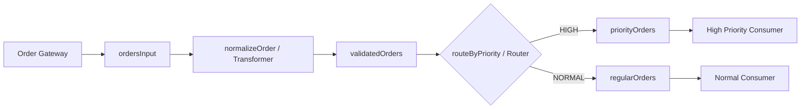

# Message history và vị trí endpoint trong Spring Integration

## 1. Vì sao cần biết message đã đi qua endpoint nào?

Một lợi ích của **Enterprise Integration Patterns (EIP)** là các bước xử lý giao tiếp qua message và channel, không phải gọi trực tiếp vào nhau. Trong Spring Integration, điều này giúp kết hợp linh hoạt `Router`, `Filter`, `Transformer`, `Splitter`, `Aggregator`, `Gateway` và những endpoint kết nối hệ thống ngoài. Tuy nhiên, khi một đơn hàng không xuất hiện ở đầu ra, câu hỏi đầu tiên thường là:

> Message đã đi tới đâu? Thành phần cuối cùng nào đã nhìn thấy nó? Nhánh xử lý tiếp theo ở đâu?

**Message history** cung cấp một phần câu trả lời. Spring Integration có thể tự thêm header `history` khi message đi qua các thành phần được bật theo dõi. Từ header này, ta đọc được tên thành phần, loại thành phần và thời điểm ghi nhận để dựng lại **hành trình logic** của message trong flow.

Bài học thuộc chương **Audit và observability** của module `SPRING_INTEGRATION_PATTERN`, tập trung vào việc triển khai luồng thông điệp ít phụ thuộc và dễ mở rộng, quan sát các nhánh xử lý, hỗ trợ kiểm thử và điều tra lỗi. Sau bài học, bạn sẽ biết cách:

- Bật message history bằng `@EnableMessageHistory` và chọn đúng component cần theo dõi.
- Hiểu cấu trúc header `history`, đọc bằng API `MessageHistory.read()`.
- Phân biệt **channel**, **endpoint**, **handler** và vị trí logic của bước xử lý.
- Suy luận message đã đi qua Router/Filter/Transformer đến đâu, đồng thời nhận biết giới hạn khi flow có nhiều nhánh hoặc chạy bất đồng bộ.
- Kết hợp history với error channel, correlation, log, metrics và tracing để xác định lỗi đáng tin cậy.

## 2. Thành phần nào tạo nên một “vị trí” trong flow?

Trong Spring Integration, không nên đồng nhất **một dòng DSL** với **một endpoint đang chạy**. Java DSL là cách khai báo; khi ứng dụng khởi động, framework đăng ký các channel, message handler và các endpoint tương ứng trong Spring application context.

| Khái niệm | Vai trò | Ví dụ | Khi điều tra lỗi cần biết |
| --- | --- | --- | --- |
| `MessageChannel` | Vận chuyển message giữa producer và consumer | `ordersInput`, `validatedOrders` | Message có được gửi tới kênh này không? |
| Message handler | Thực hiện thao tác nghiệp vụ/kỹ thuật khi nhận message | Transformer, Router, Service Activator | Handler đã nhận và xử lý message ra sao? |
| Consumer endpoint | Kết nối channel với handler, quản lý việc nhận message | Event-driven consumer, polling consumer | Endpoint đang chạy, đang poll hay bị dừng? |
| Inbound endpoint | Nhận dữ liệu từ nguồn ngoài hoặc nguồn nội bộ | HTTP gateway, JDBC inbound adapter | Lúc nào hệ thống thật sự nhận được dữ liệu? |
| Outbound endpoint | Chuyển dữ liệu ra đích | Kafka, AMQP, HTTP outbound adapter | Đã giao tới channel hay đã được bên ngoài xác nhận? |
| Flow | Cấu hình chuỗi các bước tích hợp | `IntegrationFlow` | Message có thể đi theo những nhánh logic nào? |

Ở đây, **vị trí endpoint** nghĩa là vị trí **logic trong đồ thị xử lý thông điệp**: component nào, channel nào, nhánh nào. Message history không tự cung cấp tên file Java, số dòng source code, stack trace hay tên máy chủ đích. Muốn liên hệ một entry với mã nguồn, cần đặt tên endpoint rõ ràng và biết flow/bean nào khai báo nó.

Hãy xem một chuỗi xử lý đơn hàng:



Một message trên nhánh `HIGH` có thể có history chứa những tên như `ordersInput`, `normalizeOrder`, `validatedOrders`, `routeByPriority`, `priorityOrders` (phụ thuộc vào các thành phần đã được đặt tên và cấu hình tracking). Điều này giúp thu hẹp nơi message từng đi qua, nhưng **không** khẳng định message đã được một hệ thống bên ngoài xử lý thành công.

## 3. Message history hoạt động như thế nào?

Spring Integration theo dõi các thành phần có tên (`id`/bean name) được chọn. Khi message qua một thành phần được track, framework ghi một entry vào header `history` của message. Một entry có ba thuộc tính quan trọng:

| Thuộc tính | Ý nghĩa | Ví dụ minh họa |
| --- | --- | --- |
| `name` | Tên component được tracking | `normalizeOrder` |
| `type` | Loại Spring Integration component | `transformer`, `channel`, `gateway`... |
| `timestamp` | Thời điểm ghi nhận (epoch milliseconds) | `1795250400123` |

Giá trị header có dạng tương thích `List<Properties>`. Spring Integration cung cấp `org.springframework.integration.history.MessageHistory` để đọc danh sách này; không cần ép kiểu trực tiếp từ header theo cách thủ công.

Ví dụ minh họa hình thức dữ liệu (tên và loại entry thực tế phụ thuộc cách đăng ký bean):

```text
history = [
  {name=ordersInput, type=channel, timestamp=1795250400123},
  {name=normalizeOrder, type=transformer, timestamp=1795250400125},
  {name=ordersOutput, type=channel, timestamp=1795250400128}
]
```

**Lưu ý quan trọng:** history mô tả **các điểm mà framework đã ghi nhận**, không phải bản đồ đầy đủ của mọi lời gọi phương thức. Một entry thiếu không nhất thiết nghĩa là message đã bị mất: thành phần đó có thể chưa được track, đang nằm sau điểm lỗi, chưa nhận message, hoặc một bước xử lý tùy biến đã làm rơi header.

`MessageHeaders.ID` và `history` phục vụ các mục đích khác nhau. ID là định danh của một message cụ thể; history là danh sách các component mà message đã đi qua. Nếu Transformer tạo message mới, message ID có thể đổi, còn history thường được framework chuyển tiếp theo cơ chế tạo reply message. Để liên kết cả hành trình nghiệp vụ qua nhiều message và service, hãy truyền một **correlation ID** ổn định do ứng dụng xác định.

## 4. Bật history và đặt tên endpoint rõ ràng

Cách đơn giản nhất trong cấu hình Java là dùng annotation `@EnableMessageHistory`:

```java
import org.springframework.context.annotation.Configuration;
import org.springframework.integration.annotation.EnableIntegration;
import org.springframework.integration.config.EnableMessageHistory;

@Configuration
@EnableIntegration
@EnableMessageHistory
class MessageHistoryConfiguration {
}
```

Khi không chỉ định tên, Spring Integration theo dõi các named component phù hợp trong application context. Trong ứng dụng lớn, việc theo dõi tất cả component có thể tạo nhiều entry và thêm chi phí xử lý. Có thể giới hạn theo tên hoặc pattern:

```java
@Configuration
@EnableIntegration
@EnableMessageHistory({
        "ordersInput",
        "normalizeOrder",
        "ordersOutput",
        "routeByPriority",
        "*Gateway"
})
class SelectiveHistoryConfiguration {
}
```

Chỉ dùng **một cấu hình `@EnableMessageHistory` (hoặc một cấu hình tương đương XML) trong cùng application context**; hai đoạn trên là **hai lựa chọn thay thế**, không phải hai class cần bật cùng lúc. Với XML, chức năng tương ứng là `<int:message-history tracked-components="ordersInput,normalizeOrder,ordersOutput"/>` trong namespace Integration.

Lợi ích của đặt tên có chủ đích:

- `normalizeOrder` cho biết một bước có ý nghĩa nghiệp vụ; tên mặc định được tạo tự động thường khó liên hệ với thiết kế.
- `routeByPriority` giúp phân biệt vị trí Router với hai channel ra `priorityOrders` và `regularOrders`.
- `ordersInput` và `ordersOutput` có thể đóng vai trò mốc quan sát khi đối soát.
- Tên ổn định giúp tìm kiếm log và alert, nhưng vẫn cần cập nhật test và tài liệu khi cấu trúc flow thay đổi.

Với Java DSL, có thể định danh endpoint qua `.id(...)` ở overload cho phép cấu hình endpoint:

```java
import org.springframework.context.annotation.Bean;
import org.springframework.context.annotation.Configuration;
import org.springframework.integration.annotation.EnableIntegration;
import org.springframework.integration.channel.DirectChannel;
import org.springframework.integration.channel.QueueChannel;
import org.springframework.integration.config.EnableMessageHistory;
import org.springframework.integration.dsl.IntegrationFlow;
import org.springframework.messaging.MessageChannel;
import org.springframework.messaging.PollableChannel;

@Configuration
@EnableIntegration
@EnableMessageHistory({"ordersInput", "normalizeOrder", "ordersOutput"})
class OrderFlowWithHistory {

    @Bean("ordersInput")
    MessageChannel ordersInput() {
        return new DirectChannel();
    }

    @Bean("ordersOutput")
    PollableChannel ordersOutput() {
        return new QueueChannel();
    }

    @Bean
    IntegrationFlow orderFlow() {
        return IntegrationFlow.from("ordersInput")
                .transform(String.class, String::trim,
                        endpoint -> endpoint.id("normalizeOrder"))
                .channel("ordersOutput")
                .get();
    }
}
```

Đây là ví dụ dùng Java 17 và Spring Integration 6.x. `DirectChannel` chuyển message tới subscriber đồng bộ; `QueueChannel` cho phép nhận lại kết quả để quan sát. `normalizeOrder` là tên endpoint được gán qua DSL; chọn nó trong `@EnableMessageHistory` giúp history của message gắn với một tên dễ hiểu.

Khi dùng Spring Boot, ứng dụng cần các dependency Spring Integration thích hợp (ví dụ `spring-boot-starter-integration`). Nếu dự án đã có cấu hình integration hoặc history, hãy tích hợp đoạn code vào cấu hình hiện hữu và tránh đăng ký trùng tên bean.

## 5. Đọc history trên message đầu ra

Sau khi gửi message tới `ordersInput`, đọc message từ `ordersOutput` và lấy history bằng API của Spring Integration:

```java
import java.util.List;
import org.springframework.integration.history.MessageHistory;
import org.springframework.messaging.Message;

record HistoryHop(String component, String type, String timestamp) {}

final class HistoryInspector {

    static List<HistoryHop> snapshot(Message<?> message) {
        MessageHistory history = MessageHistory.read(message);
        if (history == null) {
            return List.of();
        }

        return history.stream()
                .map(entry -> new HistoryHop(
                        entry.getProperty(MessageHistory.NAME_PROPERTY),
                        entry.getProperty(MessageHistory.TYPE_PROPERTY),
                        entry.getProperty(MessageHistory.TIMESTAMP_PROPERTY)))
                .toList();
    }
}
```

`MessageHistory.read(message)` có thể trả `null` nếu message chưa có history. Lý do có thể là: tracking chưa bật, chưa đi qua component phù hợp hoặc header không còn được giữ. Đoạn code trả danh sách rỗng để người gọi xử lý trường hợp thiếu history một cách tường minh. Trong hệ thống cần chẩn đoán, có thể phát cảnh báo hoặc đính kèm nguyên nhân vào log thay vì in một danh sách rỗng và âm thầm coi là bình thường.

Ví dụ cách gọi trong một phép thử hoặc một service quan sát:

```java
import org.springframework.messaging.Message;
import org.springframework.messaging.MessageChannel;
import org.springframework.messaging.PollableChannel;
import org.springframework.messaging.support.MessageBuilder;

void inspect(MessageChannel ordersInput, PollableChannel ordersOutput) {
    Message<String> request = MessageBuilder.withPayload("  order-42  ")
            .setHeader("flowExecutionId", "flow-7294")
            .build();

    boolean sent = ordersInput.send(request);
    if (!sent) {
        throw new IllegalStateException("Không gửi được tới input channel");
    }

    Message<?> result = ordersOutput.receive(1_000);
    if (result == null) {
        throw new IllegalStateException("Không nhận được output message");
    }

    System.out.println(result.getPayload());     // "order-42"
    HistoryInspector.snapshot(result).forEach(System.out::println);
}
```

Ở môi trường thử nghiệm, xem tên `component` được in ra rồi so sánh với cấu hình `orderFlow`. Đặc biệt, hãy kiểm chứng các tên đã gán `@Bean`/`.id(...)` xuất hiện đúng kỳ vọng trước khi viết assertion cứng về toàn bộ danh sách. Thành phần do framework sinh ra có thể thêm entry hoặc có tên khác giữa những cấu hình và phiên bản.

### Đọc “điểm cuối” trong history

Để lấy **điểm được ghi nhận cuối cùng** của message quan sát được:

```java
List<HistoryHop> hops = HistoryInspector.snapshot(result);
HistoryHop lastObserved = hops.isEmpty() ? null : hops.get(hops.size() - 1);
```

`lastObserved` là **entry cuối trong snapshot history**, không tự động là endpoint đã gây lỗi hoặc endpoint cuối cùng của nghiệp vụ. Cần đối chiếu với cấu trúc flow, nhánh Router và kết quả xử lý thực tế. Thứ tự entry là thứ tự được ghi nhận; timestamp có thể trùng nhau ở độ phân giải millisecond.

## 6. Xác định endpoint ở đâu khi message không tới đích?

Giả sử kỳ vọng message đi qua:

```text
ordersInput -> normalizeOrder -> validatedOrders
            -> routeByPriority -> priorityOrders
            -> priorityConsumer
```

Nhưng history chỉ hiển thị:

```text
ordersInput -> normalizeOrder -> validatedOrders
```

Ta có thể hình thành giả thuyết rằng message đã đến `validatedOrders`, còn bước Router chưa có bằng chứng. Tuy nhiên, **không đủ dữ liệu để kết luận Router làm mất message**. Hãy điều tra theo thứ tự:

1. **Kiểm tra tracking:** `routeByPriority` có được đặt tên và có nằm trong pattern của `@EnableMessageHistory` không?
2. **Kiểm tra flow topology:** `validatedOrders` thực sự kết nối với endpoint Router nào? Có consumer nào được đăng ký, có nhiều subscriber hay không?
3. **Kiểm tra loại channel:** `DirectChannel` có thể chuyển ngay cho handler; `QueueChannel` cần consumer/poller; `ExecutorChannel` chuyển sang thread khác và có thể còn đang chờ.
4. **Kiểm tra điều kiện nghiệp vụ:** Filter có thể loại message; Router có thể gửi sang nhánh khác; Aggregator có thể chờ thêm nhóm message; gateway có thể timeout.
5. **Kiểm tra exception và retry:** lỗi có bị truyền lại đồng bộ, đưa vào `errorChannel`, lên retry hoặc dead-letter không?
6. **Kiểm tra đầu ra:** message có thể đã qua channel nội bộ nhưng outbound adapter chưa có xác nhận từ dịch vụ đích.

| Hiện tượng | Giả thuyết hợp lý | Cần thêm bằng chứng |
| --- | --- | --- |
| Có ingress, thiếu history ở endpoint kế | Component chưa được tracking, message bị dừng hoặc đang đợi | Tên bean, channel subscribers, lifecycle, log lỗi |
| History dừng trước Filter | Predicate trả false hoặc Filter chưa chạy | `discardChannel`, log nhánh loại, test predicate |
| Có Router nhưng không thấy nhánh dự kiến | Định tuyến sang nhánh khác hoặc bị chặn | Header/payload dùng để route, cấu hình channel mapping |
| Có Splitter, nhiều message con | Một message vào sinh nhiều nhánh và nhiều history | Correlation/sequence, ID message con |
| Có Aggregator nhưng chưa có output | Chưa đủ nhóm, chưa hết timeout hoặc release strategy chưa đạt | MessageGroupStore, group key, release/expiry |
| Có `ordersOutput` nhưng không thấy ACK ngoài | Mới tới kênh đầu ra nội bộ | Outbound adapter result, broker ACK hoặc response |
| History dừng đột ngột khi handler ném lỗi | Exception xuất hiện trước bước kế tiếp | `ErrorMessage`, stack trace, failed message, span lỗi |

### Cách xem failed message qua error channel

Nếu lỗi được đưa vào `errorChannel`, một `ErrorMessage` chứa `Throwable`; với `MessagingException`, thường có thể lấy message gây lỗi để kiểm tra history trước khi thất bại:

```java
import org.springframework.integration.history.MessageHistory;
import org.springframework.messaging.Message;
import org.springframework.messaging.MessagingException;
import org.springframework.messaging.support.ErrorMessage;

void examine(ErrorMessage errorMessage) {
    Throwable error = errorMessage.getPayload();

    if (error instanceof MessagingException messagingError) {
        Message<?> failedMessage = messagingError.getFailedMessage();
        if (failedMessage != null) {
            MessageHistory history = MessageHistory.read(failedMessage);
            System.out.println(history == null ? "No history" : history);
        }
    }
}
```

Đây là **đoạn phân tích một `ErrorMessage` đã nhận được**, không phải cấu hình đầy đủ cho error flow. Exception có thể bị wrap hoặc không có `failedMessage`; không nên ép rằng mọi lỗi đều xuất hiện tại một `errorChannel` chung. Với `DirectChannel`, lỗi thường được ném lại về caller; với endpoint bất đồng bộ, lỗi có thể được publish sang error channel tùy cấu hình. Để xác định **endpoint đã ném exception**, phối hợp history với exception, tên endpoint trong log và trace nếu có.

## 7. Các tình huống phức tạp: Router, Filter, Splitter, Aggregator và Gateway

### Router và publish-subscribe

Một Router có thể gửi tới một hoặc nhiều kênh. Không có một chuỗi history tuyến tính duy nhất mô tả mọi nhánh. Hãy quan sát **message thực tế ở từng đầu ra** và dùng `correlationId`, `flowExecutionId` hoặc business ID để đối chiếu. Ở publish-subscribe, hai nhánh có thể xử lý cùng một payload nhưng lịch sử từ sau điểm rẽ nhánh khác nhau.

### Filter

Filter chủ động loại message thường không tạo output tiếp theo. History ở đầu vào Filter cho biết message từng đến điểm theo dõi; muốn biết message **bị loại có chủ đích**, cần thêm discard flow hoặc sự kiện riêng cho `REJECTED`/`FILTERED`. Chỉ nhìn history ngắn không thể phân biệt bị loại hợp lệ với lỗi.

### Splitter và Aggregator

Splitter tạo message con; Aggregator kết hợp các message có correlation thành kết quả. Để nối các history, dùng cả business ID, `correlationId`, `sequenceNumber`/`sequenceSize` nếu có và quy ước về parent-child IDs. Một message sau Aggregator không nhất thiết giữ nguyên ID hoặc nguyên vẹn toàn bộ history của từng input; tùy chiến lược tạo message và header aggregation.

### Gateway và request–reply

Một gateway có thể chờ response hoặc timeout, trong khi request đã đi qua nhiều thành phần. Phải phân biệt history của request với history của reply. History không phải tín hiệu rằng lời gọi remote đã thành công hoặc transaction downstream đã commit.

### ExecutorChannel, QueueChannel và poller

Các channel bất đồng bộ tách thời điểm gửi message khỏi thời điểm consumer chạy. History có thể đã ghi nhận việc qua một channel, trong khi endpoint sau đó chưa xử lý. Hãy kết hợp history với số lượng pending messages, trạng thái poller/thread pool và queue depth. Một entry được ghi nhận sau đó không bảo đảm rằng xử lý trước đó đã commit nếu có transaction, retry hoặc rollback.

## 8. Cẩn thận với phiên bản và việc sao chép header

**Spring Integration 6.3 có thay đổi quan trọng trong cách duy trì history:** trước 6.3, việc ghi history thường tạo một message mới với history mới; từ 6.3, history được cập nhật theo cơ chế **append-only** sau lần khởi tạo đầu tiên, giảm chi phí sao chép. Framework có cơ chế clone history khi fan-out qua các thành phần tích hợp như `PublishSubscribeChannel`, router, Wire Tap hoặc Splitter để hạn chế việc các nhánh trộn lịch sử. Với custom component tự tạo nhiều message, cần kiểm tra cách sao chép header; API `AbstractIntegrationMessageBuilder.cloneMessageHistoryIfAny()` được tài liệu mới khuyến nghị cho trường hợp nhiều đầu ra tùy biến.

Hệ quả khi viết code chẩn đoán:

- Đừng chỉnh sửa trực tiếp danh sách `history` để thêm tên hoặc xóa entry; đó là metadata do framework quản lý.
- Khi cần giữ một snapshot để lưu lại hoặc kiểm chứng bất đồng bộ, **trích các trường cần thiết ra đối tượng độc lập** ở thời điểm quan sát. Không giữ tham chiếu history rồi giả định nội dung không bao giờ thay đổi.
- Nếu tự dựng lại message và thay toàn bộ header, history có thể biến mất; ưu tiên các API builder và quy tắc truyền header chuẩn của Spring Integration.
- Không phụ thuộc số entry chính xác trên mọi phiên bản. Hãy test các **mốc nghiệp vụ quan trọng** và đối chiếu với version Spring Integration đang chạy.

Tùy công nghệ vận chuyển, header `history` có thể **không được bảo toàn qua ranh giới mạng/broker**, hoặc không nên gửi ra ngoài vì lộ thông tin kiến trúc. Khi đi qua các microservice, hãy dùng correlation ID và distributed tracing, đồng thời lưu audit độc lập tại điểm cần đối soát.

## 9. Message history khác audit, log, metric và trace như thế nào?

| Công cụ | Câu hỏi phù hợp | Giới hạn |
| --- | --- | --- |
| **Message history** | “Message này đã qua những named component nào trong flow?” | Nằm trong header; phụ thuộc tracking và truyền header |
| **Audit event** | “Nghiệp vụ X đã được nhận/chuyển/giao với bằng chứng nào?” | Cần thiết kế lưu bền vững, trạng thái, chính sách bảo mật |
| Application log | “Handler bị lỗi ở đoạn code nào?” | Có thể bị xoay vòng và thiếu correlation nếu cấu hình kém |
| Micrometer metrics | “Thông lượng, độ trễ, lỗi của endpoint nào đang tăng?” | Không giải thích đầy đủ từng message đơn lẻ |
| Distributed trace | “Request đi qua những service/span nào và chậm ở đâu?” | Có thể sampling; không bảo đảm có mọi giao dịch |

Thực hành tốt là dùng **cùng một `flowExecutionId` hoặc business correlation ID** giữa audit, log và trace (với quy tắc bảo mật phù hợp), còn `traceId`/`spanId` là định danh quan sát phân tán. Tránh dùng order ID hay message ID làm tag của metric thông lượng vì gây cardinality cao.

Ví dụ một sự cố:

1. Metric cho biết endpoint `normalizeOrder` có tỷ lệ lỗi tăng.
2. Log mang `flowExecutionId` chỉ ra exception từ Transformer.
3. History của failed message xác nhận các mốc đã ghi nhận trước lỗi.
4. Audit store xác định nghiệp vụ đã nhận ở đầu vào nhưng chưa có sự kiện đầu ra được xác nhận.
5. Tracing nối hành trình qua service bên ngoài nếu request đã rời ứng dụng.

Phối hợp nhiều nguồn như vậy thường đáng tin cậy hơn việc xem entry cuối cùng của history là kết luận duy nhất.

## 10. Kiểm thử theo dõi endpoint

Với flow `OrderFlowWithHistory`, hãy tạo một integration test: gửi một message có `flowExecutionId`, nhận kết quả từ `ordersOutput` và kiểm tra các điểm đã đi qua. Ví dụ assertion với JUnit 5 và AssertJ:

```java
import static org.assertj.core.api.Assertions.assertThat;

import java.util.List;
import org.junit.jupiter.api.Test;
import org.springframework.beans.factory.annotation.Autowired;
import org.springframework.boot.test.context.SpringBootTest;
import org.springframework.integration.history.MessageHistory;
import org.springframework.messaging.Message;
import org.springframework.messaging.MessageChannel;
import org.springframework.messaging.PollableChannel;
import org.springframework.messaging.support.MessageBuilder;

@SpringBootTest(classes = OrderFlowWithHistory.class)
class OrderFlowHistoryTest {

    @Autowired
    MessageChannel ordersInput;

    @Autowired
    PollableChannel ordersOutput;

    @Test
    void messageKeepsNamedComponentHistory() {
        Message<String> input = MessageBuilder.withPayload("  order-42  ")
                .setHeader("flowExecutionId", "flow-7294")
                .build();

        assertThat(ordersInput.send(input)).isTrue();

        Message<?> output = ordersOutput.receive(1_000);
        assertThat(output).isNotNull();
        assertThat(output.getPayload()).isEqualTo("order-42");

        MessageHistory history = MessageHistory.read(output);
        assertThat(history).isNotNull();

        List<String> componentNames = history.stream()
                .map(hop -> hop.getProperty(MessageHistory.NAME_PROPERTY))
                .toList();

        assertThat(componentNames).contains("ordersInput", "ordersOutput");
        assertThat(componentNames).contains("normalizeOrder");
    }
}
```

Kiểm thử này phù hợp khi test context chỉ có cấu hình ví dụ, dependency kiểm thử Spring Boot và các component được đặt tên đúng. Nếu framework dùng cách ghi tên khác ở phiên bản thực tế, trước tiên hãy in snapshot, kiểm tra cấu hình bean và điều chỉnh assertion theo contract của flow. Không chuyển test thành kiểm tra mọi entry hay timestamp cụ thể; các chi tiết đó dễ thay đổi mà không làm sai hành vi nghiệp vụ.

Nên bổ sung những ca kiểm thử sau khi mở rộng flow:

| Ca kiểm thử | Kỳ vọng |
| --- | --- |
| Tracking tắt | `MessageHistory.read()` trả `null` hoặc không có entry theo dõi mới |
| Chỉ bật pattern cho một số component | History chỉ chứa các component phù hợp, không phụ thuộc tên tự sinh |
| Transformer thành công | Các mốc được theo dõi xuất hiện theo thứ tự logic; payload đầu ra đúng |
| Filter loại message | Không suy luận có output; có bằng chứng discard hoặc rejected riêng |
| Router chọn hai nhánh khác nhau | Message nhận ở mỗi nhánh có path tương ứng và correlation nhất quán |
| Handler ném exception | Có cách lấy failed message/log để tìm vị trí lỗi, không nhầm entry cuối thành kết luận |
| Async channel hoặc poller bị dừng | History tại ingress tồn tại trong khi endpoint sau chưa chạy; quan sát backlog |
| Splitter/nhánh song song | Lịch sử các nhánh không bị trộn; có khả năng nối parent-child |
| Tự tạo message mới | Header cần thiết được giữ; nhận biết khi history bị loại bỏ có chủ đích |

### Bài thực hành mở rộng

Thử thay Transformer bằng `Filter` + `Router` với hai channel `priorityOrders` và `regularOrders`. Gắn tên `filterInvalidOrder`, `routeByPriority`; bật history cho những tên đó. Gửi ba message: hợp lệ/ưu tiên cao, hợp lệ/thông thường, không hợp lệ. Với mỗi message, ghi lại `flowExecutionId`, các `HistoryHop`, channel nhận được kết quả và bằng chứng từ chối nếu có.

Sau đó thay một nhánh bằng `ExecutorChannel` hoặc consumer có poller và quan sát chênh lệch giữa thời điểm một entry `channel` xuất hiện với thời điểm handler xử lý xong. Mục tiêu là phân biệt **“message đã chạm điểm quan sát”** với **“nghiệp vụ tại điểm đó đã hoàn tất”**.

## 11. Checklist dùng trong dự án

- [ ] Tên channel và endpoint quan trọng có ý nghĩa nghiệp vụ, ổn định và được ghi trong tài liệu flow.
- [ ] Có một nguồn cấu hình `@EnableMessageHistory`; pattern tracking phù hợp với khối lượng hệ thống.
- [ ] Có phương thức `MessageHistory.read()` an toàn khi header không tồn tại.
- [ ] Có `flowExecutionId`/business correlation xuyên suốt các bước quan trọng.
- [ ] Khi thất bại, kiểm tra `ErrorMessage`/exception và trạng thái endpoint trước khi kết luận từ history.
- [ ] Với Router/Splitter/Aggregator, có cách ghép nhiều message/nhánh và hiểu quy tắc header propagation.
- [ ] Với endpoint bất đồng bộ, theo dõi queue backlog, poller, thread pool, timeout và retry.
- [ ] Không gửi history chứa topology nội bộ ra ngoài nếu không có nhu cầu và kiểm soát phù hợp.
- [ ] Test các mốc cần thiết, không phụ thuộc số lượng entry hay timestamp tuyệt đối.

## 12. Tài liệu tham khảo

- [Spring Integration Reference — Message History](https://docs.spring.io/spring-integration/reference/message-history.html)
- [Spring Integration Java DSL — DSL Basics](https://docs.spring.io/spring-integration/reference/dsl/java-basics.html)
- [Spring Integration Java DSL — Endpoint Configuration](https://docs.spring.io/spring-integration/reference/dsl/java-basics.html)
- [Spring Integration Javadoc — MessageHistory](https://docs.spring.io/spring-integration/docs/6.5.7/api/org/springframework/integration/history/MessageHistory.html)
- [Spring Integration Reference — Error Handling](https://docs.spring.io/spring-integration/reference/error-handling.html)

**Ghi nhớ:** message history giúp nhìn thấy **những điểm đã được ghi nhận trên đường đi của message**. Để xác định một endpoint gặp vấn đề, phải đặt tên thành phần có chủ đích, kiểm tra topology và loại channel, đối chiếu exception cùng trạng thái nhánh xử lý. History là công cụ chẩn đoán hữu ích trong Spring Integration, nhưng không tự thay thế audit bền vững hoặc xác nhận xử lý thành công của hệ thống đích.
