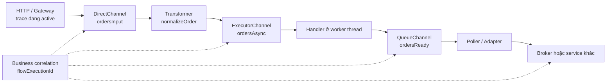
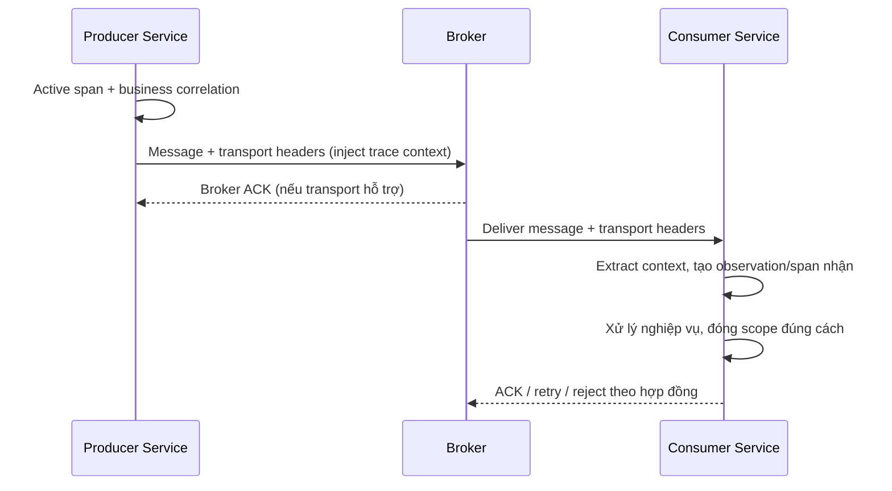

# Trace context qua channel trong Spring Integration

## 1. Bài toán: cùng một nghiệp vụ đi qua nhiều luồng thực thi

Trong **Enterprise Integration Patterns (EIP)**, các bước xử lý được nối với nhau bằng message và channel để giảm phụ thuộc giữa những thành phần. Một yêu cầu tạo đơn hàng có thể đi qua Gateway, Transformer, Router, Filter, Aggregator, các endpoint retry và một outbound adapter. Đôi khi toàn bộ quá trình diễn ra trong cùng thread; đôi khi message được chuyển cho thread pool, giữ trong queue hoặc gửi tới một service khác.

Khi điều tra độ trễ hay lỗi, ta thường cần trả lời:

- Request ban đầu tạo ra trace nào và những bước nào thuộc cùng trace?
- Tại sao log ở Gateway có `traceId`, nhưng log từ handler sau `ExecutorChannel` lại không có?
- Một message được đưa vào queue đã được xử lý hay mới chỉ được nhận để xử lý sau?
- Trace nên được nối tiếp ra Kafka, AMQP, HTTP hoặc một service khác như thế nào?
- Khi Router chia nhánh, Splitter tạo nhiều message hoặc retry chạy lại, quan hệ giữa các span phải được hiểu ra sao?

Đó là chủ đề **trace context qua channel** thuộc chương *Audit và observability* của module `SPRING_INTEGRATION_PATTERN`. Bài học kết hợp thực hành Spring Integration, correlation, theo dõi nhánh xử lý và kiểm thử quan sát hệ thống.

**Mục tiêu:** hiểu được nơi trace context được giữ, nơi nó có thể bị ngắt, cách dùng Micrometer Observation/Tracing và những phép kiểm chứng cần có khi một message chuyển qua các loại channel.

## 2. Phân biệt trace context, message header, MDC và correlation

Các khái niệm sau có liên hệ, nhưng không thay thế được nhau:

| Khái niệm | Dùng để làm gì? | Vòng đời và lưu ý |
| --- | --- | --- |
| **Trace** | Nối các thao tác thuộc cùng hành trình quan sát | Thường nhận diện bằng `traceId`; có thể trải qua nhiều span và service |
| **Span** | Mô tả một thao tác/thời đoạn với parent, thời gian và kết quả | Có `spanId`; span con thường kế thừa `traceId` |
| **Trace context** | Thông tin cần để nối span mới với span trước đó | Bao gồm trace ID, span ID, sampling flags, có thể có `tracestate` |
| **Current observation/span** | Ngữ cảnh đang hoạt động trên thread hoặc context hiện tại | Có thể được triển khai bằng `ThreadLocal`/scope; không mặc nhiên đi theo thread khác |
| **Spring `MessageHeaders`** | Metadata đi kèm message | Có thể mang business correlation hoặc metadata được map; không phải toàn bộ current span tự động biến thành header |
| **MDC** | Gắn metadata, thường là `traceId`/`spanId`, vào log trong thread hiện tại | Không tự lan sang thread pool; phải khôi phục và dọn dẹp theo scope |
| **Business correlation ID** | Ghép các bước của cùng giao dịch hoặc đơn hàng | Do ứng dụng quy định; thường cần ổn định hơn tuổi thọ của trace |
| **Audit ID** | Định danh sự kiện audit lưu bền vững | Không dùng `spanId` hay `traceId` làm khóa chống trùng nghiệp vụ |

Một trace có thể có nhiều span. Một message có thể mang `flowExecutionId` ổn định trong khi span hiện tại thay đổi ở từng handler. Ngược lại, một giao dịch kéo dài qua nhiều ngày, được xử lý lại qua dead-letter hoặc tái chạy thủ công, có thể đi qua **nhiều trace khác nhau** nhưng vẫn thuộc cùng business correlation ID.

Ví dụ minh họa trace gồm ba span:

```text
traceId = aaaaaaaaaaaaaaaaaaaaaaaaaaaaaaaa

span A: HTTP /orders          [spanId=1111111111111111]
  └─ span B: ordersInput     [spanId=2222222222222222, parent=A]
       └─ span C: transform  [spanId=3333333333333333, parent=B]
```

Khi đi qua ranh giới bất đồng bộ hoặc broker, span sau có thể là span con hoặc dùng **span link** thay vì parent–child, tùy mô hình telemetry, cách chuyển context và công cụ. Điều cần giữ là quan hệ nhân quả có ý nghĩa, không phải ép mọi bước vào một span dài.

## 3. Channel là các ranh giới truyền ngữ cảnh

Hình sau mô tả một flow nhận đơn hàng, xử lý ở thread khác rồi chuyển sang broker:



| Kiểu chuyển message | Ngữ cảnh thread | Điểm dễ hiểu sai |
| --- | --- | --- |
| `DirectChannel` | Theo mặc định, handler được gọi trong thread gửi message | Active observation có thể tiếp tục trong cùng thread; exception có thể truyền về caller |
| `ExecutorChannel` | Handler chạy trong thread do executor cấp | `ThreadLocal`/MDC không tự đi theo việc đổi thread; cần cơ chế propagation |
| `QueueChannel` | Producer ghi message, consumer/poller nhận ở thời điểm khác | Việc enqueue thành công chưa chứng minh consumer đã xử lý; context cần được nối lại khi dequeue |
| `PublishSubscribeChannel` | Mặc định có thể xử lý subscriber đồng bộ; dùng executor sẽ bất đồng bộ | Nhiều nhánh cần scope/context riêng; không dùng chung span hiện tại một cách tùy tiện |
| `PriorityChannel` hoặc channel có lưu trữ | Thời điểm consumer và thứ tự xử lý có thể khác producer | Trace timing cần phân biệt thời gian chờ và thời gian xử lý |
| HTTP/Kafka/AMQP/JMS adapter | Qua process hoặc dịch vụ khác | Cần *inject/extract* context qua header của giao thức vận chuyển |

Message đi qua channel và context đi qua ranh giới thực thi là **hai việc cần kiểm chứng riêng**. Message có thể đến đúng đích nhưng current tracing scope trong worker thread vẫn trống. Ngược lại, trace có thể được ghi đầy đủ ở điểm gửi nhưng message chưa nhận được ACK từ đích.

## 4. Micrometer Observation và Micrometer Tracing trong Spring Integration

Hệ sinh thái Spring hỗ trợ quan sát bằng **Micrometer Observation**. Observation mô tả một thao tác có tên, khoảng thời gian và key–value. Khi ứng dụng cấu hình **Micrometer Tracing bridge** (ví dụ OpenTelemetry hoặc Brave), observation có thể được biểu diễn thành span và được xuất tới hệ thống tracing.

Lưu ý những tầng cấu hình:

1. **ObservationRegistry** quản lý các observation. Có registry **không tự bảo đảm** có trace ID hoặc xuất span; cần tracing handlers/bridge và exporter khi muốn xem trace phân tán.
2. **Spring Integration management instrumentation** quyết định channel/handler nào được quan sát. Tên bean và pattern cấu hình ảnh hưởng tới phạm vi thu thập.
3. **Context propagation** nối current observation/span qua thread hoặc transport boundary. Instrumentation của một endpoint không đồng nghĩa mọi đoạn code tự tạo thread hay mọi adapter ngoài đã truyền context đúng.
4. **Trace backend** (Zipkin, Jaeger, Tempo, một OTLP collector...) nhận dữ liệu nếu được cấu hình. Sampling và lỗi xuất telemetry có thể khiến một số trace không xuất hiện ở backend.

Với ứng dụng Spring Boot 3.x dùng Spring Integration 6.x, các dependency thường gặp (ví dụ Gradle):

```groovy
dependencies {
    implementation("org.springframework.boot:spring-boot-starter-integration")
    implementation("org.springframework.boot:spring-boot-starter-actuator")

    // Chọn một tracing bridge tương thích với hệ thống telemetry.
    implementation("io.micrometer:micrometer-tracing-bridge-otel")

    // Cần thiết nếu dùng ContextPropagatingTaskDecorator trên executor.
    implementation("io.micrometer:context-propagation")
}
```

Trong nhiều dự án Boot, Actuator tự cấu hình `ObservationRegistry` và các thành phần tracing khi dependency/phần cấu hình tương ứng đã sẵn có. Nếu không dùng Spring Boot auto-configuration, ứng dụng phải tự đăng ký registry và tracing handlers. Không thêm cả hai bridge OpenTelemetry và Brave nếu không có thiết kế cụ thể cho nhiều tracer.

### 4.1. Cấu hình mẫu qua DirectChannel và ExecutorChannel

Ví dụ này cố ý đặt tên channel để dễ nhận ra trên dashboard và đặt một boundary bất đồng bộ rõ ràng:

```java
import org.springframework.context.annotation.Bean;
import org.springframework.context.annotation.Configuration;
import org.springframework.core.task.TaskExecutor;
import org.springframework.core.task.support.ContextPropagatingTaskDecorator;
import org.springframework.integration.annotation.EnableIntegration;
import org.springframework.integration.channel.DirectChannel;
import org.springframework.integration.channel.ExecutorChannel;
import org.springframework.integration.channel.QueueChannel;
import org.springframework.integration.config.EnableIntegrationManagement;
import org.springframework.integration.dsl.IntegrationFlow;
import org.springframework.messaging.MessageChannel;
import org.springframework.messaging.PollableChannel;
import org.springframework.scheduling.concurrent.ThreadPoolTaskExecutor;

@Configuration
@EnableIntegration
@EnableIntegrationManagement(
        observationPatterns = {"ordersInput", "ordersAsync", "ordersReady"})
class OrderTraceFlowConfiguration {

    @Bean("ordersInput")
    MessageChannel ordersInput() {
        return new DirectChannel();
    }

    @Bean("integrationTaskExecutor")
    TaskExecutor integrationTaskExecutor() {
        ThreadPoolTaskExecutor executor = new ThreadPoolTaskExecutor();
        executor.setCorePoolSize(2);
        executor.setMaxPoolSize(4);
        executor.setQueueCapacity(100);
        executor.setThreadNamePrefix("orders-worker-");
        executor.setTaskDecorator(new ContextPropagatingTaskDecorator());
        executor.initialize();
        return executor;
    }

    @Bean("ordersAsync")
    MessageChannel ordersAsync(TaskExecutor integrationTaskExecutor) {
        return new ExecutorChannel(integrationTaskExecutor);
    }

    @Bean("ordersReady")
    PollableChannel ordersReady() {
        return new QueueChannel();
    }

    @Bean
    IntegrationFlow orderTraceFlow() {
        return IntegrationFlow.from("ordersInput")
                .transform(String.class, String::trim)
                .channel("ordersAsync")
                .transform(String.class, String::toUpperCase)
                .channel("ordersReady")
                .get();
    }
}
```

**Cách đọc ví dụ:**

- `ordersInput` là `DirectChannel`: việc chuyển message tới Transformer trong flow xảy ra đồng bộ.
- `ordersAsync` sử dụng `ExecutorChannel`: message được giao cho executor và handler sau đó chạy trong worker thread. Lệnh `send()` hoàn tất **không chứng minh** Transformer sau ranh giới bất đồng bộ đã chạy xong.
- `ContextPropagatingTaskDecorator` của Spring Framework 6.1+ tạo snapshot ngữ cảnh ở lúc task được submit và khôi phục trong worker thread theo các `ThreadLocalAccessor` đã được đăng ký. Cần Micrometer Context Propagation và cấu hình tracing phù hợp; decorator **chỉ bao phủ những task chạy qua executor đó**.
- `ordersReady` là `QueueChannel`: message có thể chờ poller/consumer. Ở ví dụ này, chưa định nghĩa poller; một consumer khác phải lấy message từ queue.
- `observationPatterns` cho phép chọn các component được quan sát. Cần xem tên component và telemetry thực tế ở phiên bản Spring Integration đang dùng; nếu pattern bỏ sót handler/endpoint cần thiết, sẽ thiếu observation tại vị trí đó.

Khi ứng dụng có nhiều `TaskExecutor`, chỉ trang trí một executor là chưa đủ để giữ context ở các executor còn lại. Với `@Async`, `CompletableFuture`, scheduler, thread tự tạo hoặc callback từ thư viện ngoài, phải rà soát ranh giới của chính cơ chế đó.

### 4.2. Tạo observation ở đầu vào

Có thể tạo một observation bao quanh thao tác nhận/gửi ở ranh giới đầu vào của ứng dụng:

```java
import java.util.UUID;

import io.micrometer.observation.Observation;
import io.micrometer.observation.ObservationRegistry;
import org.springframework.beans.factory.annotation.Qualifier;
import org.springframework.messaging.Message;
import org.springframework.messaging.MessageChannel;
import org.springframework.messaging.support.MessageBuilder;
import org.springframework.stereotype.Service;

@Service
class OrderSubmissionService {

    private final MessageChannel ordersInput;
    private final ObservationRegistry observations;

    OrderSubmissionService(
            @Qualifier("ordersInput") MessageChannel ordersInput,
            ObservationRegistry observations) {
        this.ordersInput = ordersInput;
        this.observations = observations;
    }

    void submit(String orderId, String rawPayload) {
        Observation.createNotStarted("orders.accept", observations)
                .lowCardinalityKeyValue("flow", "orders")
                .observe(() -> {
                    Message<String> message = MessageBuilder
                            .withPayload(rawPayload)
                            .setHeader("flowExecutionId", UUID.randomUUID().toString())
                            .setHeader("orderId", orderId)
                            .build();

                    if (!ordersInput.send(message)) {
                        throw new IllegalStateException(
                                "Không gửi được message vào ordersInput");
                    }
                });
    }
}
```

Ở đây, `orders.accept` mô tả **thao tác submit**. Do flow có `ExecutorChannel`, observation bao quanh `send()` có thể kết thúc trước khi các bước ở worker thread hoàn thành. Instrumentation của channel/handler tạo observation/span phù hợp với điểm theo dõi, nếu đã được bật. Không kéo dài span của HTTP request chỉ để chờ toàn bộ hàng đợi xử lý xong.

Trong dự án thật, `flowExecutionId` nên lấy từ hợp đồng ingress: có thể tạo mới, tiếp tục ID của lần xử lý đang diễn ra, hoặc liên kết với event ID được gửi từ upstream. Cần xác định quy tắc khi retry và redelivery; không phải lần nào cũng tạo ngẫu nhiên một ID mới.

### 4.3. Đọc trace ID tại một handler

Khi Micrometer Tracing bridge đang hoạt động, có thể đọc current span từ tracer:

```java
import io.micrometer.tracing.Span;
import io.micrometer.tracing.Tracer;

final class TraceContextReader {
    static String currentTraceId(Tracer tracer) {
        Span span = tracer.currentSpan();
        return span == null ? null : span.context().traceId();
    }

    static String currentSpanId(Tracer tracer) {
        Span span = tracer.currentSpan();
        return span == null ? null : span.context().spanId();
    }
}
```

Kiểm tra ID ở hai phía của ranh giới bất đồng bộ bằng một handler quan sát hoặc test probe. Khi propagation đúng và cùng một trace được tiếp tục, `traceId` nên giữ nguyên, còn `spanId` có thể khác vì mỗi điểm có span riêng. Nếu `currentSpan()` là `null`, có thể chưa cấu hình tracing bridge, chưa có current span, hoặc scope đã mất ở điểm chuyển thread. **Không suy ra message thất lạc chỉ từ span rỗng**.

## 5. Vì sao ThreadLocal/MDC dễ mất khi đổi thread?

Trong quá trình xử lý đồng bộ, `Tracer`, observation scope và nhiều cơ chế MDC dựa vào context của thread hiện tại. Khi `ExecutorChannel` chuyển việc cho một worker thread, thread mới không tự kế thừa mọi `ThreadLocal` của thread gửi. Hơn nữa, thread pool tái sử dụng thread nên một context bị gán rồi không dọn đúng cách có thể gây log sai quan hệ giữa hai request.

Ví dụ:

```text
http-nio-8080-exec-3
    currentTraceId = T1
    send -> ordersAsync

orders-worker-2
    currentTraceId = null       (nếu không có propagation)
    hoặc currentTraceId = T1   (nếu context đã được capture/restore đúng)
```

**Không nên tự chép `traceId` vào `MDC.put(...)` rồi quên remove.** Một chuỗi ký tự trong MDC chỉ giúp log hiển thị giống nhau; nó không khôi phục parent span, sampling flags, `tracestate` hay ngữ cảnh tracer thực sự. Nếu buộc phải dùng MDC thủ công, phải quản lý phạm vi và cleanup bằng `try/finally` hoặc scope API tương ứng. Cách ưu tiên là dùng instrumentation và propagation chính thức của Spring/Micrometer.

Khi ứng dụng dùng nhiều cơ chế bất đồng bộ, cần phân biệt:

1. **Executor task:** capture context khi task được submit, restore trong worker, đóng scope sau khi task hoàn thành. `ContextPropagatingTaskDecorator` giúp trong phạm vi executor đã cấu hình.
2. **Queue/poller:** không có cùng lời gọi submit–execute trong mọi trường hợp. Context có thể phải lưu/khôi phục theo message và observation instrumentation của endpoint; đo riêng thời gian chờ queue và thời gian xử lý.
3. **Reactor/WebFlux:** context có thể được quản lý qua Reactor Context; không giả định `ThreadLocal` thủ công luôn có giá trị trong mọi operator.
4. **Quá trình ngoài JVM:** cần inject/extract qua carrier của protocol; `TaskDecorator` không thể mang trace qua HTTP hay broker.

## 6. Trace context qua các message channel cụ thể

### 6.1. DirectChannel

`DirectChannel` thường gọi subscriber ngay trên thread gửi. Nếu caller đang có observation/span active, code handler đồng bộ có thể đọc được ngữ cảnh đó. Các thành phần quan sát được cấu hình có thể tạo span con theo instrumented operation.

Tuy vậy, nếu handler **tự** mở thread mới hoặc gọi một thư viện bất đồng bộ chưa được instrument, trace vẫn có thể bị ngắt ở bên trong handler. `DirectChannel` không bảo đảm mọi downstream callback giữ cùng context.

### 6.2. ExecutorChannel

`ExecutorChannel` dùng `TaskExecutor` để dispatch. Một worker nhận message đúng payload nhưng mất trace scope là tình huống rất thường gặp. Hãy kiểm tra:

- Executor nào thực sự chạy task, có dùng `ContextPropagatingTaskDecorator` hoặc cơ chế tương đương không?
- Có Micrometer Context Propagation và các context accessor cần thiết không?
- Parent observation/span có active khi dispatch task không?
- Handler được instrument đúng tên và đúng pattern không?
- Thread pool có đầy, reject task hoặc shutdown khiến message không xử lý không?

Tracing không thay thế đo tải: nếu queue nội bộ của executor đầy, thất bại có thể xuất hiện trước khi handler bắt đầu, ngay cả khi trace ở ingress đầy đủ.

### 6.3. QueueChannel và poller

`QueueChannel` lưu message để nhận sau. Nếu một thread khác gọi `receive()`, thread đó không mặc nhiên có current span của thread gửi. Ngoài ra, message có thể được xử lý sau khi observation của caller đã đóng.

Do đó cần quan sát **ít nhất hai mốc**: `enqueuedAt`/được nhận vào queue và `processingStartedAt`/khi consumer thực sự nhận xử lý. Chênh lệch cho biết độ trễ chờ; khi xử lý xong nên có mốc `processedAt`, ACK hoặc kết quả cụ thể.

Nếu xây dựng custom poller hoặc message store, hãy kiểm tra API truyền/khôi phục context của thư viện và header mapper; không suy luận trace sẽ được nối chỉ vì message vẫn có một header `traceparent`. Việc *extract* và mở span scope ở consumer là một bước riêng.

### 6.4. PublishSubscribeChannel, Router và Splitter

Khi có nhiều subscriber hoặc Router phát tới nhiều kênh, một trace có thể có nhiều span đại diện cho các nhánh. Mỗi nhánh cần được quan sát độc lập. Nếu một nhánh lỗi, việc nhánh còn lại thành công vẫn không có nghĩa toàn bộ flow đã hoàn tất.

Nếu Splitter tạo nhiều message con, các message có thể mang cùng business correlation ID nhưng khác `MessageHeaders.ID` và span tương ứng. Với Aggregator, một kết quả có thể hình thành từ nhiều message đến ở các thời điểm khác nhau; parent–child đơn giản không luôn diễn tả chính xác quan hệ nhiều nguồn. Trường hợp này có thể dùng **span links** hoặc audit với correlation/causation tường minh theo khả năng tracer và collector.

### 6.5. Gateway request–reply

Gateway thường tương ứng với một thao tác request và một phản hồi. Nếu flow có nhánh bất đồng bộ, request có thể đã được gửi thành công nhưng reply chưa về trước timeout. Hãy ghi nhận các mốc request sent, reply received, timeout/error với span và correlation thích hợp.

Không dùng việc span gateway đã kết thúc làm bằng chứng rằng một downstream service đã commit nghiệp vụ. Thông tin giao nhận/commit phải đến từ hợp đồng ứng dụng hoặc transport.

## 7. Qua process và broker: inject/extract theo chuẩn W3C

Trong hệ thống phân tán, trace context cần được mã hóa vào **carrier** của protocol như HTTP headers hoặc Kafka/AMQP/JMS headers/properties, sau đó được bên nhận giải mã.

Chuẩn W3C Trace Context quy định hai header chính:

- `traceparent`: phiên bản, trace ID, parent ID và trace flags. Ví dụ minh họa:

  ```text
  traceparent: 00-4bf92f3577b34da6a3ce929d0e0e4736-00f067aa0ba902b7-01
  ```

- `tracestate`: metadata tracing dành cho vendor/hệ thống tham gia trace nếu có.

`baggage` là cơ chế khác để truyền metadata liên quan qua các hop; không mặc định cho vào baggage dữ liệu cá nhân, bí mật hoặc giá trị có cardinality lớn.



Một số lưu ý khi dùng Spring Integration outbound adapter:

1. **Đừng giả định `MessageHeaders` được đưa nguyên vẹn lên mạng.** HTTP headers, Kafka record headers và AMQP message properties có quy tắc mapping riêng. Một adapter có thể lọc, đổi tên hoặc bỏ header.
2. **Không chỉ tự thêm một chuỗi `traceId` vào payload.** Một consumer cần đủ context và bước extract/instrumentation để tạo span tiếp nối đúng, không chỉ in lại ID trong log.
3. **Ưu tiên instrumented client/consumer.** Micrometer Tracing/OpenTelemetry instrumentation thích hợp với transport có thể làm inject/extract theo chuẩn; hãy xác minh cấu hình riêng cho producer và consumer thực tế.
4. **Không đồng nhất broker ACK với kết quả nghiệp vụ.** ACK của producer có thể chỉ xác nhận broker nhận message; kết quả xử lý của consumer là một sự kiện khác.
5. **Luôn giữ business correlation riêng.** Khi trace bị sampling, message được đưa vào dead-letter, xử lý lại hoặc đi qua một hệ thống không instrument, ID nghiệp vụ vẫn cho phép đối soát.

Ví dụ hai service chia sẻ một `flowExecutionId`:

```text
Service A:
  business correlation: flow-7294
  traceId: T1
  send -> Kafka orders.request

Service B:
  business correlation: flow-7294
  nếu extract đúng: traceId = T1, span mới = S2
  nếu context thất lạc: traceId mới hoặc không có traceId
```

Trường hợp trace bị đứt, business correlation vẫn nối được bản ghi audit của hai hệ thống, còn lỗi về tracing phải được điều tra qua carrier headers, mapping, sampling và instrumentation.

## 8. Retry, error channel và việc tạo span

Retry và error handling là các điểm quan trọng trong Enterprise Integration Patterns vì chúng làm thay đổi đường đi và thời điểm xử lý.

| Tình huống | Cách nhìn bằng trace | Điều cần ghi nhận bổ sung |
| --- | --- | --- |
| Handler lỗi ngay trong `DirectChannel` | Exception có thể truyền ngược trong cùng lời gọi và cùng trace scope | Error code, endpoint, failed message |
| Handler lỗi sau `ExecutorChannel` | Lỗi xảy ra trên worker thread; scope phải được propagate để trace không bị rời rạc | `errorChannel`, task rejection, executor metrics |
| Retry đồng bộ trong cùng lượt xử lý | Có thể có nhiều attempt/span trong một trace | Attempt number, retryable error, thời gian chờ |
| Retry theo lịch hoặc redelivery từ broker | Có thể chạy ở thời điểm khác và trace khác; có thể sử dụng link với lần trước | Message/event ID bền vững, causation, attempt |
| Đưa vào dead-letter | Span ở bước publish không bảo đảm sẽ có xử lý tiếp | Dead-letter destination, reason, trạng thái đối soát |
| Aggregator giữ message chờ | Trace của request ban đầu có thể đã kết thúc | Group key, thời điểm expire, release strategy |

Khi xử lý `ErrorMessage`, hãy thử lấy `MessagingException.getFailedMessage()` để đọc business correlation và metadata hiện có, đồng thời kiểm tra current span tại nơi error handler chạy. Không khẳng định mọi exception đều được chuyển đến `errorChannel`; hành vi phụ thuộc endpoint đồng bộ/bất đồng bộ và cấu hình xử lý lỗi.

**Không dùng trace ID làm idempotency key** cho retry. Một request gửi lại có thể sinh trace mới; một trace cũng có thể chứa nhiều thao tác khác nhau. Key chống xử lý trùng nên dựa vào business event ID hoặc định danh nghiệp vụ có hợp đồng rõ ràng.

## 9. Kiểm thử context qua thread và channel

Để kiểm thử, cần tách **đúng payload/routing** khỏi **đúng trace propagation**. Hai điều này có thể đạt hoặc lỗi độc lập.

### 9.1. Test giao nhận message qua `ExecutorChannel`

Với `OrderTraceFlowConfiguration` ở trên, một phép thử đơn giản có thể gửi chuỗi, đợi output và xác nhận correlation header được bảo toàn:

```java
import static org.assertj.core.api.Assertions.assertThat;

import org.junit.jupiter.api.Test;
import org.springframework.beans.factory.annotation.Autowired;
import org.springframework.boot.test.context.SpringBootTest;
import org.springframework.messaging.Message;
import org.springframework.messaging.MessageChannel;
import org.springframework.messaging.PollableChannel;
import org.springframework.messaging.support.MessageBuilder;

@SpringBootTest(classes = OrderTraceFlowConfiguration.class)
class OrderTraceFlowTest {

    @Autowired
    MessageChannel ordersInput;

    @Autowired
    PollableChannel ordersReady;

    @Test
    void retainsBusinessCorrelationAcrossExecutorChannel() {
        Message<String> input = MessageBuilder.withPayload("  order-42  ")
                .setHeader("flowExecutionId", "flow-7294")
                .build();

        assertThat(ordersInput.send(input)).isTrue();

        Message<?> output = ordersReady.receive(2_000);
        assertThat(output).isNotNull();
        assertThat(output.getPayload()).isEqualTo("ORDER-42");
        assertThat(output.getHeaders().get("flowExecutionId"))
                .isEqualTo("flow-7294");
    }
}
```

Test này xác minh payload và header nghiệp vụ đi qua boundary bất đồng bộ. **Nó chưa chứng minh trace context được propagate.** Để kiểm thử trace, bổ sung một test handler/probe được đặt **sau `ordersAsync`**, lấy `tracer.currentSpan()` trong chính worker thread và ghi `traceId`/span ID vào một đối tượng thread-safe; so sánh với trace ID được capture lúc submit khi một tracing bridge đã được cấu hình.

Để tránh kết luận sai, test về propagation cần:

1. Một `ObservationRegistry` nối với tracing bridge/test tracer; chỉ tạo `ObservationRegistry.create()` chưa đủ để có `Tracer.currentSpan()`.
2. Một parent span/observation đang active ở lúc gửi message và một child observation ở downstream nếu muốn kiểm tra quan hệ span.
3. Cấu hình thực tế cho `ContextPropagatingTaskDecorator` hoặc instrumentation được hỗ trợ, cùng context accessors tương ứng.
4. Probe dùng `CountDownLatch`, `BlockingQueue` hoặc chờ theo điều kiện có timeout; không phụ thuộc `Thread.sleep()` cố định.
5. Assertion về **trace ID cùng lineage** và span ID hợp lệ; không ép mọi điểm phải có cùng span ID, vì đó có thể là các span khác nhau.

### 9.2. Ma trận tình huống cần kiểm chứng

| Ca kiểm thử | Điều cần kiểm tra |
| --- | --- |
| `DirectChannel` đồng bộ | Observation có scope hợp lệ trong handler; tên component/trace hợp lý |
| `ExecutorChannel` có decorator | Downstream worker thấy lineage trace phù hợp, không rò context sang task tiếp theo |
| Bỏ decorator hoặc instrumentation | Test cho thấy chính xác đâu là ranh giới mất scope, trong môi trường đã kiểm soát |
| `QueueChannel` có consumer trễ | Phân biệt enqueue, dequeue và thời gian chờ; kiểm tra cách extract context |
| `PublishSubscribeChannel` dùng executor | Mỗi nhánh có span riêng, không trộn context giữa các subscriber |
| `Router` sang nhiều kênh | Span/tag thể hiện nhánh được chọn, correlation ID không đổi ngoài ý muốn |
| `Splitter`/`Aggregator` | Có correlation và causation đủ để nối message con/nhóm |
| Retry và redelivery | Có attempt/error phù hợp; không dùng trace ID để loại xử lý trùng |
| Gửi qua broker hoặc HTTP | Producer inject header, consumer extract được và tạo span mới đúng quan hệ |
| Sampling thấp hoặc exporter lỗi | Nghiệp vụ vẫn có audit và correlation khi backend trace thiếu dữ liệu |
| Worker thread tái sử dụng | Không để `traceId` của request trước xuất hiện trong request sau |

### 9.3. Quy trình tìm lỗi khi trace bị đứt

Giả sử log ở `ordersInput` có `traceId=T1`, còn log sau `ordersAsync` không có `traceId`. Thực hiện:

1. Xác nhận message vẫn tới downstream bằng payload, business correlation và trạng thái channel.
2. Xem `Tracer.currentSpan()` ngay trước lúc gửi và tại handler được gọi trong worker thread. Đừng chỉ dựa vào MDC log pattern.
3. Kiểm tra executor được dùng đúng bean, decorator được áp dụng và dependencies/accessors đã có.
4. Kiểm tra Spring Integration observation patterns có khớp bean/endpoint thực tế.
5. Nếu lỗi xảy ra sau queue hoặc broker, kiểm tra inject/extract/mapping ở đúng transport boundary.
6. Với hai trace ID khác nhau, xem có một trace mới được cố ý bắt đầu hoặc liên hệ qua span link hay không, thay vì kết luận ngay là mất ngữ cảnh.

## 10. Vận hành và bảo mật khi tracing message

Trace cung cấp khả năng chẩn đoán, nhưng cũng có chi phí và giới hạn. Nên thiết kế telemetry dựa trên những nguyên tắc sau:

- **Tag cardinality thấp:** dùng `flow=orders`, `channel=ordersAsync`, `outcome=success|failure`; không đưa `orderId`, `messageId`, token hoặc nội dung payload vào metric tag. Với trace attribute, vẫn cần giới hạn kích thước, phân loại và bảo vệ dữ liệu.
- **Baggage tối thiểu:** baggage có thể lan qua nhiều service; chỉ cho phép trường được phê duyệt. Không lưu credential, JWT, PII hoặc dữ liệu có thể gây rò rỉ.
- **Sampling có chủ đích:** sampling giúp giảm chi phí, nhưng một trace không xuất hiện ở backend **không** có nghĩa message chưa được xử lý. Audit bắt buộc và sự kiện nghiệp vụ quan trọng cần nguồn ghi nhận riêng.
- **Giới hạn thời gian và độ dài:** queue có thể lưu message lâu hơn tuổi thọ một HTTP span. Nên tạo span phù hợp cho lúc enqueue và process, tránh duy trì một scope active suốt thời gian chờ.
- **Giám sát lỗi telemetry:** quan sát drop/export failures, cấu hình collector, sampling rate và backend availability. Lỗi exporter không được mặc nhiên làm lỗi một giao dịch nghiệp vụ nếu hợp đồng hệ thống không quy định như vậy.
- **Không trộn điều khiển với chẩn đoán:** `traceId` là ID observability; quyết định route, quyền truy cập, idempotency và retry nên dựa trên dữ liệu nghiệp vụ/hợp đồng xác thực.

Đối với flow có nhiều channel, nên duy trì dashboard về throughput, error rate, queue depth, handler duration và thời gian chờ ở channel. Trace cho biết một ví dụ đường đi cụ thể; metrics cho biết mức độ phổ biến của vấn đề; audit giúp đối soát kết quả nghiệp vụ đã được ghi bền vững.

## 11. Checklist triển khai

- [ ] Phân biệt rõ business correlation ID, message ID, trace ID và span ID.
- [ ] Có `ObservationRegistry`, tracing bridge và exporter phù hợp với mục tiêu quan sát.
- [ ] Bật observation cho các component cần thiết; dùng tên channel/endpoint có ý nghĩa.
- [ ] Rà soát ranh giới `DirectChannel`, `ExecutorChannel`, `QueueChannel`, poller và scheduler.
- [ ] Với thread pool, cấu hình propagation trên đúng executor và xác minh context được cleanup.
- [ ] Với HTTP/broker, xác minh inject/extract W3C context và header mapping ở cả hai phía.
- [ ] Kiểm thử Router, Splitter, Aggregator, Gateway, error channel, retry và dead-letter khi có nhiều nhánh.
- [ ] Phân biệt telemetry về gửi message với ACK, commit và xử lý nghiệp vụ thực tế.
- [ ] Tránh PII, credential và business ID nhạy cảm trong baggage/metrics.
- [ ] Giữ audit và correlation độc lập để vẫn đối soát được khi trace bị sampling hoặc gián đoạn.

## 12. Tài liệu tham khảo

- [Spring Integration Reference](https://docs.spring.io/spring-integration/reference/)
- [Spring Integration — Metrics and Management](https://docs.spring.io/spring-integration/reference/metrics.html)
- [Micrometer Observation](https://docs.micrometer.io/micrometer/reference/observation.html)
- [Micrometer Tracing](https://docs.micrometer.io/tracing/reference/)
- [Micrometer Context Propagation](https://docs.micrometer.io/context-propagation/reference/)
- [W3C Trace Context](https://www.w3.org/TR/trace-context/)

**Kết luận:** truyền message thành công qua channel không đồng nghĩa trace context vẫn active ở phía nhận. Khi một flow chuyển thread, tạm giữ message trong queue hoặc gửi qua broker, cần một cơ chế propagation phù hợp với ranh giới đó, kiểm thử quan hệ span thật và duy trì business correlation riêng để chẩn đoán lẫn đối soát được toàn bộ hành trình.
