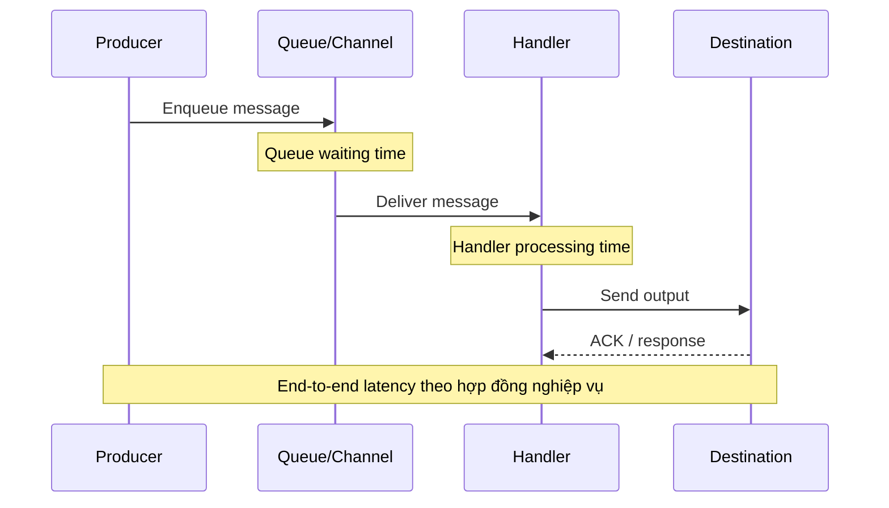

# Metric cho từng pattern trong Spring Integration

## 1. Từ quan sát message đến đo lường vận hành

Một flow dùng **Enterprise Integration Patterns (EIP)** có thể nhận yêu cầu qua Gateway, chuẩn hóa bằng Transformer, loại dữ liệu sai qua Filter, định tuyến bằng Router, chia nhỏ bằng Splitter rồi tổng hợp bằng Aggregator trước khi gửi ra một hệ thống khác. Khi hệ thống tăng tải, chỉ biết “có message đi qua” là chưa đủ. Nhóm vận hành cần biết **bao nhiêu, mất bao lâu, tắc ở đâu, nhánh nào lỗi và khi nào phải cảnh báo**.

Trong chương **Audit và observability** của module `SPRING_INTEGRATION_PATTERN`, bài này hướng dẫn thiết kế **metric cho từng pattern** khi xây dựng luồng thông điệp ít phụ thuộc và dễ mở rộng bằng Spring Integration. Trọng tâm là Router, Filter, Transformer, Splitter, Aggregator, Gateway, retry, error channel và correlation; các pattern khác cũng được đưa vào bảng tham chiếu để tiện mở rộng.

Sau bài học, bạn có thể:

- Chọn đúng **đơn vị đếm** và thời điểm phát metric cho mỗi EIP pattern.
- Phân biệt `Counter`, `Timer`, `DistributionSummary` và `Gauge` trong Micrometer.
- Dùng instrumentation có sẵn của Spring Integration và bổ sung metric nghiệp vụ khi cần.
- Đặt tên metric, tag có giới hạn cardinality; tránh dùng payload, message ID và order ID làm nhãn.
- Tránh tính sai tỷ lệ thành công khi một message tạo nhiều nhánh, được retry hoặc bị Aggregator giữ chờ.
- Thiết kế dashboard, cảnh báo và phép kiểm thử dựa trên **định nghĩa nhất quán**.

## 2. Định nghĩa điều được đo trước khi viết code

Trước khi gọi `meterRegistry.counter(...).increment()`, cần trả lời ba câu hỏi:

1. **Đếm cái gì?** Message được gửi tới channel, message được handler tiếp nhận, một lần thử xử lý (*attempt*), một nhóm Aggregator hoàn tất hay một sự kiện nghiệp vụ cuối cùng?
2. **Đếm lúc nào?** Khi vừa nhận message, khi handler chạy xong, sau khi gửi tới output channel, hay sau ACK/commit từ hệ thống đích?
3. **Mẫu số là gì?** Tỷ lệ từ chối của Filter tính trên số message được đánh giá; tỷ lệ retry thành công tính trên số thao tác cần retry; throughput của Splitter thường tính trên số *fragment*, không phải số yêu cầu gốc.

Các khái niệm dễ nhầm:

| Khái niệm | Mốc đếm | Ví dụ |
| --- | --- | --- |
| `received` | Thành phần quan sát được message tại ranh giới vào | Ingress channel nhận một message |
| `accepted` / `rejected` | Predicate/validation đã ra quyết định | Filter chấp nhận hoặc loại |
| `selected` | Router đã chọn nhánh | Chọn `priority`; chưa chứng minh nhánh xử lý xong |
| `dispatched` | Message đã gửi thành công tới channel/transport theo hợp đồng tương ứng | Không đồng nghĩa downstream đã commit |
| `processed` | Handler hoàn tất thao tác được định nghĩa | Nếu có transaction, cần nói rõ thành công trước hay sau commit |
| `attempted` | Một lần thực thi có thể bị retry | Một nghiệp vụ có thể có nhiều attempts |
| `confirmed` | Nhận được ACK/response theo hợp đồng của đích | ACK từ broker chưa chắc là kết quả nghiệp vụ của consumer |
| `completed` | Một đơn vị logic kết thúc theo quy tắc nghiệp vụ | Aggregator release một nhóm |

Tuyệt đối không đặt tên `message_success_total` cho sự kiện “đã đưa vào queue” rồi dùng nó để tính tỷ lệ giao dịch hoàn tất. **Tên metric phải phản ánh điều thật sự quan sát được**.

## 3. Bốn loại metric cần dùng

| Loại Micrometer | Dùng khi nào | Ví dụ |
| --- | --- | --- |
| `Counter` | Sự kiện tích lũy tăng dần | Số message vào, lỗi, bị Filter loại, số lần retry |
| `Timer` | Đo thời gian và số lần thực thi | Thời gian Transformer, Gateway request–reply, thời gian Aggregator chờ |
| `DistributionSummary` | Đo phân phối **giá trị không phải thời gian** | Số fragment mỗi lần Splitter, kích thước payload, số phần tử một nhóm |
| `Gauge` | Giá trị hiện tại có thể tăng/giảm | Queue depth, số group Aggregator đang mở, số request in-flight |

Micrometer `Timer` đã thống kê `count` và tổng thời gian của các mẫu. Tránh tạo thêm `Counter` có **cùng ý nghĩa** nếu không có lý do thiết kế rõ ràng; điều đó dễ gây sai lệch giữa dashboard.

Với `Gauge`, phải đo **trạng thái thật** từ queue, executor, broker hoặc message group store. Việc `increment` một biến lúc enqueue rồi `decrement` khi dequeued dễ lệch khi restart, exception hoặc consumer khác cùng thao tác; một biến như vậy chỉ đáng tin khi thực sự phản ánh cơ chế lưu trữ và được kiểm chứng.

### Ranh giới thời gian cần phân biệt



Độ trễ **handler** chỉ bao phủ lúc handler thực sự chạy. Độ trễ **queue** bao phủ thời gian chờ trước khi consumer nhận. Độ trễ **end-to-end** có thể bao phủ cả queue, retry, backoff và hệ thống ngoài. Không gộp ba số đo rồi gọi chung là “thời gian xử lý” nếu chưa nêu mốc bắt đầu/kết thúc.

## 4. Bảng metric theo từng pattern

### 4.1. Ingress, xử lý và định tuyến

| Pattern | Metric đề xuất | Ý nghĩa và lưu ý |
| --- | --- | --- |
| **Message Channel** | `channel_send`, `channel_receive`, `channel_send_duration` | Đo số lượt gửi/nhận và thời gian thao tác ở kênh; khác số giao dịch hoàn tất |
| **Messaging Gateway** | `gateway_requests`, `gateway_duration`, `gateway_timeouts` | Đếm request, reply, timeout, lỗi; phân biệt response hợp lệ với việc gửi request thành công |
| **Filter** | `filter_decisions{outcome=accepted\|rejected}`, `filter_duration` | Mẫu số là số quyết định được đưa ra; lỗi predicate cần một outcome riêng |
| **Router / Dynamic Router** | `router_decisions{route=...}`, `router_duration`, `router_dispatch_failures` | Một quyết định route có thể gửi nhiều nhánh; `selected` khác `delivered` |
| **Transformer / Message Translator** | `transform_duration`, `transform_errors`, `payload_size` | Đo thành công/lỗi và kích thước input/output theo giới hạn an toàn |
| **Content Enricher / Service Activator** | `enrichment_duration`, `handler_errors`, `dependency_requests` | Tách thời gian nội bộ và thời gian chờ dependency ngoài |
| **Normalizer** | `normalizer_outputs{format=...}`, `normalizer_errors` | Tag format nên là danh sách cố định, không dùng tên file hoặc header bất kỳ |
| **Publish–Subscribe** | `subscriber_delivery_attempts{subscriber=...}`, `subscriber_errors` | Một message có nhiều subscriber; không so số subscriber-deliveries với ingress theo tỷ lệ 1:1 |

### 4.2. Phân tách, tổng hợp và điều khiển thứ tự

| Pattern | Metric đề xuất | Ý nghĩa và lưu ý |
| --- | --- | --- |
| **Splitter** | `split_operations`, `split_fragments`, `fragments_per_split` | Đếm **lần split** và **số fragment** riêng; một input có thể tạo nhiều output |
| **Aggregator** | `groups_created`, `groups_released`, `group_wait_duration`, `groups_inflight` | Theo dõi release, timeout/expiry và nhóm đang chờ; đừng hiểu thiếu output là mất dữ liệu |
| **Resequencer** | `resequencer_reordered`, `resequencer_expired`, `resequencer_pending` | Đo message lệch thứ tự, chờ, hết hạn và phân phối ra ngoài |
| **Scatter–Gather** | `scatter_targets`, `gather_duration`, `gather_partial_results` | Một request có nhiều target; cần phân biệt đầy đủ/thiếu/timeout |
| **Correlation** | `correlation_misses`, `late_messages`, `groups_expired` | Là metric **tổng hợp**; correlation ID thật dùng trong trace/log/audit, không là metric tag |
| **Barrier** | `barrier_wait_duration`, `barrier_timeouts`, `barrier_waiting` | Đo thời gian khóa/chờ release và số waiter hiện tại |

### 4.3. Độ bền, lỗi, bảo vệ và tích hợp ngoài

| Pattern | Metric đề xuất | Ý nghĩa và lưu ý |
| --- | --- | --- |
| **Retry** | `retry_attempts`, `retry_exhausted`, `retry_success_after_failure` | Số attempt khác số message/transaction gốc; cần thống nhất lần đầu có tính là attempt 1 không |
| **Error Channel** | `error_events{stage=...}`, `error_handler_failures` | Một lỗi có thể được wrap, retry hoặc publish nhiều lần; số error event chưa chắc là số nghiệp vụ lỗi |
| **Dead Letter** | `dead_letter_published`, `dead_letter_replayed`, `dead_letter_backlog` | Đếm khi đưa vào DLQ và khi được xử lý lại; ACK tại DLQ khác xử lý thành công |
| **Idempotent Receiver** | `dedup_accepted`, `dedup_rejected`, `dedup_store_errors` | Phân biệt duplicate hợp lệ với lỗi kho khóa idempotency |
| **Circuit Breaker** | `circuit_state`, `circuit_not_permitted`, `circuit_failures` | Nếu dùng Resilience4j, ưu tiên meter binder chính thức; state là gauge |
| **Rate Limiter** | `permits_granted`, `permits_denied`, `rate_limit_wait` | Đo từ chối và thời gian chờ; không gộp “throttle” vào lỗi business |
| **Delayer** | `delayed_messages`, `scheduled_delay`, `actual_delay` | So sánh delay được yêu cầu với độ trễ thực tế; phát hiện backlog |
| **Transactional Messaging** | `transaction_committed`, `transaction_rolled_back`, `outbox_pending` | Đo theo **giao dịch**; gửi channel thành công chưa phải commit |
| **Channel Adapter / Broker** | `adapter_send_duration`, `broker_ack`, `consumer_lag`, `adapter_errors` | Dùng metric native của client/broker khi có; xác định chính xác ý nghĩa của ACK |
| **Wire Tap / Audit Store** | `audit_events_written`, `audit_write_failures`, `audit_backlog` | Nhánh audit có thể chậm hoặc lỗi độc lập với flow chính |

Các tên trong bảng là **đề xuất thiết kế metric ứng dụng**, không khẳng định tất cả đều được Spring Integration tạo tự động. Một số thư viện (như broker client, Resilience4j) đã có meter binder và naming riêng: khi đó nên ưu tiên metric chính thức để tránh đo trùng.

## 5. Đặt tên và tag để đo được lâu dài

Một bộ metric nội bộ có thể dùng các tên:

```text
eip.flow.events                     Counter
eip.flow.handler.duration           Timer
eip.flow.items.per.operation        DistributionSummary
eip.flow.queue.depth                Gauge
eip.flow.inflight                   Gauge
```

Tên `eip.flow.events` có thể mang những **tag giới hạn trước**:

| Tag | Giá trị hợp lệ ví dụ | Có nên dùng? |
| --- | --- | --- |
| `flow` | `orders`, `payments` | Có, từ cấu hình |
| `pattern` | `filter`, `router`, `transformer`, `retry` | Có, tập hữu hạn |
| `stage` | `validate`, `normalize`, `routeByPriority` | Có, từ code/config |
| `outcome` | `accepted`, `rejected`, `success`, `error`, `selected` | Có, định nghĩa rõ |
| `route` | `priority`, `regular`, `none` | Có nếu danh sách nhỏ, cố định |
| `exception` | `timeout`, `validation`, `other` | Có nếu được chuẩn hóa/allowlist |
| `messageId`, `orderId` | UUID/ID riêng từng message | **Không** |
| `correlationId`, `traceId` | ID riêng từng request | **Không** |
| `payload`, `destinationUrl` | Dữ liệu tự do, có thể nhạy cảm | **Không** |

Lý do: time-series monitoring phân biệt các chuỗi bằng tổ hợp metric name và tags. Gắn `orderId` cho mỗi message có thể tạo hàng triệu chuỗi, làm tăng bộ nhớ, chi phí lưu trữ và chậm dashboard. Hãy đặt ID chi tiết trong **log có cấu trúc, trace hoặc audit event**, rồi liên kết bằng ID khi điều tra.

Ngoài cardinality, tên tag của một meter cần nhất quán. Chẳng hạn, nếu mọi series `eip.flow.events` đều có `route`, hãy dùng `route=none` ở Filter/Transformer thay vì tùy tiện bỏ tag ở một số chỗ. Khi đổi ý nghĩa một metric, cần thay tên/phiên bản và điều chỉnh dashboard: không tái sử dụng tên cũ với semantics khác.

## 6. Instrumentation có sẵn của Spring Integration và metric tự định nghĩa

Với Spring Boot 3.x, Spring Integration 6.x và Micrometer, cấu hình cơ bản thường có:

```groovy
dependencies {
    implementation("org.springframework.boot:spring-boot-starter-integration")
    implementation("org.springframework.boot:spring-boot-starter-actuator")

    // Chỉ khi muốn xuất dữ liệu dạng Prometheus:
    runtimeOnly("io.micrometer:micrometer-registry-prometheus")
}
```

Spring Boot có thể tự cấu hình `MeterRegistry` và `ObservationRegistry` khi các dependency phù hợp hiện diện. Spring Integration hỗ trợ management/observation cho những component được cấu hình. Ví dụ, trong một ứng dụng đã có cấu hình integration:

```java
import org.springframework.context.annotation.Configuration;
import org.springframework.integration.annotation.EnableIntegration;
import org.springframework.integration.config.EnableIntegrationManagement;

@Configuration
@EnableIntegration
@EnableIntegrationManagement(
        observationPatterns = {"ordersInput", "ordersAsync", "priorityOrders"})
class IntegrationMonitoringConfiguration {
}
```

Đây là ví dụ cấu hình **observation cho các component có tên**. Khi có tracing bridge, observation có thể tạo span; với metrics handler phù hợp, có thể xuất chỉ số thời gian/đếm theo cấu hình. Muốn biết metric nào thực tế xuất hiện, hãy kiểm tra `MeterRegistry` hoặc endpoint `/actuator/metrics` của phiên bản đang chạy. **Đừng mặc định** annotation trên tự sinh các chỉ số nghiệp vụ như số message bị Filter loại, số fragment hay số group Aggregator đã release.

Để có metric về **quyết định nghiệp vụ của từng pattern**, gắn bộ đo tại điểm biết chắc kết quả và đặt tên thống nhất. Có thể kết hợp metric có sẵn của framework với metric tự viết, nhưng cần phân biệt giá trị nào đo handler/channel và giá trị nào đo outcome nghiệp vụ.

## 7. Ví dụ thực hành: đo Filter, Transformer và Router

Giả sử hệ thống nhận đơn hàng dạng text, chuẩn hóa, loại chuỗi rỗng và chọn kênh `priorityOrders` hoặc `regularOrders`. Ví dụ sau dùng Spring Integration Java DSL và Micrometer, tương thích ý tưởng triển khai với Java 17/Spring Integration 6.x.

### 7.1. Bộ đo Micrometer đặt tại điểm quyết định

```java
import io.micrometer.core.instrument.MeterRegistry;
import io.micrometer.core.instrument.Timer;

final class OrderFlowMetrics {
    private final MeterRegistry registry;

    OrderFlowMetrics(MeterRegistry registry) {
        this.registry = registry;
    }

    private void event(String pattern, String stage,
                       String outcome, String route) {
        registry.counter(
                "eip.flow.events",
                "flow", "orders",
                "pattern", pattern,
                "stage", stage,
                "outcome", outcome,
                "route", route
        ).increment();
    }

    void inputObserved() {
        event("channel", "ordersInput", "observed", "none");
    }

    String normalize(String input) {
        Timer.Sample sample = Timer.start(registry);
        String outcome = "success";
        try {
            return input.strip();
        } catch (RuntimeException exception) {
            outcome = "error";
            throw exception;
        } finally {
            event("transformer", "normalize", outcome, "none");
            sample.stop(Timer.builder("eip.flow.handler.duration")
                    .description("Thời gian chạy handler đã instrument")
                    .tags("flow", "orders",
                          "pattern", "transformer",
                          "stage", "normalize",
                          "outcome", outcome)
                    .register(registry));
        }
    }

    boolean accept(String normalized) {
        boolean accepted = !normalized.isBlank();
        event("filter", "validate",
                accepted ? "accepted" : "rejected", "none");
        return accepted;
    }

    String chooseRoute(String normalized) {
        String route = normalized.startsWith("VIP:")
                ? "priority" : "regular";
        event("router", "routeByPriority", "selected", route);
        return route;
    }
}
```

**Ý nghĩa của từng điểm đo:** `inputObserved()` đếm message đã tới bước handler đầu vào; `accept()` đếm kết quả predicate Filter; `chooseRoute()` đếm **nhánh đã chọn**. Việc chọn nhánh không đảm bảo gửi thành công tới channel đó. `normalize()` ghi thời gian và outcome của riêng Transformer; nếu cần đo kết quả commit/downstream, phải đặt bộ đo ở điểm khác.

Trong ví dụ, tên pattern, stage, outcome và route là các giá trị hữu hạn do code quyết định. **Không nhận giá trị tag tự do từ payload hoặc header**.

### 7.2. IntegrationFlow có hai kênh kết quả

```java
import io.micrometer.core.instrument.MeterRegistry;
import org.springframework.context.annotation.Bean;
import org.springframework.context.annotation.Configuration;
import org.springframework.integration.annotation.EnableIntegration;
import org.springframework.integration.channel.DirectChannel;
import org.springframework.integration.channel.QueueChannel;
import org.springframework.integration.dsl.IntegrationFlow;
import org.springframework.messaging.MessageChannel;
import org.springframework.messaging.PollableChannel;

@Configuration
@EnableIntegration
class MeasuredOrderFlow {

    @Bean
    OrderFlowMetrics orderFlowMetrics(MeterRegistry registry) {
        return new OrderFlowMetrics(registry);
    }

    @Bean("ordersInput")
    MessageChannel ordersInput() {
        return new DirectChannel();
    }

    @Bean("priorityOrders")
    PollableChannel priorityOrders() {
        return new QueueChannel();
    }

    @Bean("regularOrders")
    PollableChannel regularOrders() {
        return new QueueChannel();
    }

    @Bean
    IntegrationFlow measuredOrderFlow(OrderFlowMetrics metrics) {
        return IntegrationFlow.from("ordersInput")
                .handle((payload, headers) -> {
                    metrics.inputObserved();
                    return payload;
                })
                .transform(String.class, metrics::normalize)
                .filter(String.class, metrics::accept)
                .route(String.class, metrics::chooseRoute,
                        mapping -> mapping
                                .channelMapping("priority", "priorityOrders")
                                .channelMapping("regular", "regularOrders"))
                .get();
    }
}
```

Ứng dụng thực tế cần cung cấp `MeterRegistry` (ví dụ qua Spring Boot Actuator hoặc một bean `SimpleMeterRegistry` ở test). Hai `QueueChannel` chỉ giữ kết quả để đọc lại trong ví dụ; chưa có consumer xử lý nghiệp vụ. Nếu muốn đếm `processed`, phải đặt metric tại handler nhận từ từng queue **sau khi xử lý thành công**. Đừng gọi số `selected` ở Router là số đơn hàng hoàn thành.

Với 3 message ví dụ:

```text
"  VIP:42  " -> normalize "VIP:42" -> accepted -> selected priority
"  REG:43  " -> normalize "REG:43" -> accepted -> selected regular
"     "     -> normalize ""       -> rejected -> không được route
```

Kỳ vọng metric của ví dụ:

| Bộ đếm | Giá trị |
| --- | ---: |
| `pattern=channel,stage=ordersInput,outcome=observed` | 3 |
| `pattern=transformer,stage=normalize,outcome=success` | 3 |
| `pattern=filter,stage=validate,outcome=accepted` | 2 |
| `pattern=filter,stage=validate,outcome=rejected` | 1 |
| `pattern=router,stage=routeByPriority,route=priority` | 1 |
| `pattern=router,stage=routeByPriority,route=regular` | 1 |

Đây là kết quả mong đợi về **số event tại vị trí được instrument**, không phải bằng chứng cả ba message đã hoàn thành một giao dịch ngoài hệ thống.

## 8. Metric cho Splitter, Aggregator, retry và các flow bất đồng bộ

### 8.1. Splitter: một message không còn là một output

Ví dụ 100 đơn hàng đầu vào, mỗi đơn có trung bình 4 dòng hàng. Splitter được gọi 100 lần và có thể tạo khoảng 400 fragment:

```text
split_operations = 100
split_fragments = 400
fragments_per_split (DistributionSummary): 100 mẫu, trung bình 4
```

Tuy nhiên, một số đơn hàng có thể không tạo fragment hoặc tạo nhiều fragment khác nhau. Vì vậy cần đo số fragment thực tế, không cố định `split_fragments = 4 × input`. Nếu muốn tính lỗi từng dòng hàng, mẫu số là số fragment đã xử lý; nếu muốn tính tỷ lệ đơn hàng thành công, mẫu số phải là số đơn hàng gốc được định danh bằng correlation logic.

### 8.2. Aggregator: đo nhóm, thời gian chờ và expiry

Một Aggregator gom các fragment theo correlation key. Nên đo:

- `groups_created`: số nhóm mới xuất hiện.
- `groups_released{reason=complete|timeout|forced}`: số nhóm có quyết định release.
- `groups_expired`: số nhóm bị hết hạn và xử lý theo expiry strategy.
- `group_wait_duration`: thời gian từ khi nhóm bắt đầu chờ tới khi release/expire theo hợp đồng đo.
- `groups_inflight`: số nhóm còn đang chờ (gauge từ MessageGroupStore hoặc nguồn thực).

Nếu chưa có output vì release strategy cần thêm message, đó có thể là trạng thái **đang chờ hợp lệ**. Cảnh báo nên dựa vào số nhóm quá hạn và thời gian chờ vượt ngưỡng, không đơn giản lấy `input - output`.

### 8.3. Retry: phân biệt nghiệp vụ và số lần thử

Ví dụ có 100 giao dịch: 90 thành công ngay; 10 gặp lỗi lần đầu, trong đó 8 thành công ở lần thứ hai và 2 hết retry. Khi tính **attempt** với lần đầu là attempt 1:

```text
logical_operations = 100
handler_attempts = 110        (100 lần đầu + 10 lần thử lại)
retry_attempts = 10          (chỉ những lần sau lần đầu)
retry_success_after_failure = 8
retry_exhausted = 2
logical_success = 98
```

Nếu lấy `handler_attempts` làm mẫu số cho tỷ lệ thành công nghiệp vụ, kết quả sẽ sai. Đồng thời, `errorChannel` có thể nhận nhiều lỗi thuộc một giao dịch; đếm error event như số giao dịch thất bại cũng sẽ sai.

Nên gắn metric tại retry advice/listener hoặc handler theo API thực tế của cơ chế retry đang dùng. Xác định rõ `retry_attempts` là **lần thử lại** hay **tất cả attempts**, ghi thống nhất vào tài liệu và kiểm thử.

### 8.4. Queue, executor và poller: đo áp lực hệ thống

Với `ExecutorChannel`, `QueueChannel`, polling consumer hoặc message broker, cần kết hợp:

| Metric | Loại | Giá trị vận hành |
| --- | --- | --- |
| Queue depth / pending | Gauge | Phát hiện tích tụ, đo từ nguồn queue thật |
| Oldest message age | Gauge/Timer tùy nguồn | Phát hiện message bị giữ lâu dù throughput còn cao |
| Enqueue-to-dequeue latency | Timer | Phát hiện chậm do hàng đợi |
| Handler processing duration | Timer | Phát hiện chậm do code hoặc dependency |
| Executor active threads / rejected tasks | Gauge/Counter | Phát hiện bão hòa thread pool |
| Poll errors / receive timeout | Counter | Phát hiện lỗi poller và vấn đề nguồn |
| Redelivery / duplicate attempts | Counter | Phát hiện vòng lặp retry hoặc lỗi ACK |

Tại điểm gửi, việc `send()` trả thành công chỉ thể hiện **hợp đồng của channel ở thời điểm đó**. Với kênh bất đồng bộ, một handler có thể chưa bắt đầu; với outbound adapter, broker ACK hoặc response cần metric riêng.

## 9. Từ metric thành dashboard và cảnh báo

Một dashboard hiệu quả nên trả lời được ba lớp câu hỏi:

1. **Traffic và tỷ lệ:** message vào, Filter reject, Router distribution, nghiệp vụ đã hoàn tất.
2. **Latency và backlog:** p50/p95/p99 của handler, thời gian chờ queue, số group/queue pending.
3. **Errors và recovery:** handler failures, retry attempts/exhausted, dead-letter rate và độ trễ xử lý lại.

Ví dụ nếu xuất Micrometer sang Prometheus, Counter `eip.flow.events` thường được thể hiện dưới dạng `eip_flow_events_total` (tên chính xác cần kiểm tra ở endpoint metrics/exporter). Có thể tính tỷ lệ rejected của Filter trong 5 phút:

```promql
sum(rate(eip_flow_events_total{
  flow="orders",pattern="filter",outcome="rejected"
}[5m]))
/
clamp_min(
  sum(rate(eip_flow_events_total{
    flow="orders",pattern="filter",outcome=~"accepted|rejected"
  }[5m])),
  0.000001
)
```

Mẫu số trên **chỉ bao gồm những message đã được Filter phân loại**, không gồm message lỗi trước Filter. Cần hiển thị cả request volume để không báo động giả khi chỉ có một vài request trong cửa sổ đo.

So sánh phân bố nhánh Router:

```promql
sum by (route) (
  rate(eip_flow_events_total{
    flow="orders",pattern="router",outcome="selected"
  }[5m])
)
```

Nếu muốn p95 của `Timer` từ Prometheus, cần bật histogram cho timer thích hợp, chẳng hạn thêm `.publishPercentileHistogram()` vào `Timer.builder(...)` hoặc cấu hình distribution tương đương. Khi đó có thể truy vấn:

```promql
histogram_quantile(
  0.95,
  sum by (le) (
    rate(eip_flow_handler_duration_seconds_bucket{
      flow="orders",stage="normalize"
    }[5m])
  )
)
```

Với timer có histogram, p95 là **ước lượng thống kê trong cửa sổ**; nó không thay thế đo một giao dịch cụ thể bằng trace. Việc bật histogram cho tất cả tag/stage có thể tăng số time series đáng kể, vì vậy nên chọn endpoint quan trọng.

### Một số cảnh báo thực tế

| Tín hiệu | Cảnh báo nên xem xét | Cách giảm báo động giả |
| --- | --- | --- |
| `filter_rejected / filter_decisions` tăng bất thường | Dữ liệu đầu vào thay đổi hoặc validation có vấn đề | Có ngưỡng volume tối thiểu và baseline theo loại luồng |
| p95 Gateway/handler tăng | Dependency chậm hoặc handler nghẽn | Kết hợp volume, error rate, backlog |
| Queue depth và oldest age cùng tăng | Consumer không theo kịp producer | Kiểm tra tốc độ in/out, poller, executor, broker |
| Group Aggregator quá hạn tăng | Thiếu fragment, correlation sai hoặc timeout không phù hợp | So cùng `groups_created`, `groups_released`, kiểm tra group store |
| Retry exhausted / dead-letter tăng | Lỗi khó phục hồi | Tách lỗi transient với validation/permanent |
| Outbox backlog tăng | Dispatcher hoặc audit sink chậm | Đo age của bản ghi cũ nhất, không chỉ queue size |

Không nên đặt một con số ngưỡng chung cho mọi pattern. Một Gateway đồng bộ có thể đòi hỏi p95 thấp, còn Aggregator có thể **cố ý** chờ đủ batch trong vài phút. Ngưỡng phải dựa trên hợp đồng thời gian xử lý và dữ liệu vận hành.

## 10. Kiểm thử: xác minh ý nghĩa metric

Test metric cần kiểm tra **hành vi thực và vị trí ghi nhận**. Với flow ở mục 7, các ca kiểm thử có giá trị:

| Tình huống | Điều cần khẳng định |
| --- | --- |
| Gửi một đơn ưu tiên | Counter input +1, Filter accepted +1, Router priority selected +1 |
| Gửi chuỗi trắng | Counter input +1, Filter rejected +1, không có router decision mới |
| Transformer ném exception | Timer có mẫu `outcome=error`, không ghi thành công của bước sau |
| Route đã chọn nhưng channel đích lỗi | `selected` có thể tăng; cần metric dispatch failure riêng |
| Splitter phát 5 fragment | `split_operations` +1, `split_fragments` +5, summary ghi giá trị 5 |
| Aggregator giữ nhóm chưa đủ | Gauge group inflight tăng; `groups_released` chưa tăng |
| Retry thành công ở attempt thứ ba | Một operation hoàn tất, ba handler attempts và hai retry attempts |
| Queue đang chờ poller | Enqueued tăng, processed chưa tăng; backlog phản ánh trạng thái thật |
| Message bị gửi lại/trùng | Counter attempt và logical outcome theo hai quy ước riêng |
| Hai đơn có ID khác nhau | Số lượng series không tăng do dùng order ID hoặc trace ID làm tag |

Khi dùng `SimpleMeterRegistry` trong kiểm thử cấp thành phần, có thể đọc giá trị Counter/Timer như sau:

```java
import static org.assertj.core.api.Assertions.assertThat;
import io.micrometer.core.instrument.simple.SimpleMeterRegistry;

void verifyFilterMetric() {
    try (SimpleMeterRegistry registry = new SimpleMeterRegistry()) {
        OrderFlowMetrics metrics = new OrderFlowMetrics(registry);

        assertThat(metrics.accept("  ")).isFalse();

        double rejected = registry.get("eip.flow.events")
                .tags("flow", "orders",
                      "pattern", "filter",
                      "stage", "validate",
                      "outcome", "rejected",
                      "route", "none")
                .counter()
                .count();

        assertThat(rejected).isEqualTo(1.0);
    }
}
```

Đây là phép kiểm tra **riêng bộ đo**; sau đó vẫn cần integration test chạy message qua `IntegrationFlow` để chứng minh Filter không route message bị loại và Router gửi vào kênh mong muốn. Với flow bất đồng bộ, chờ một điều kiện quan sát được có timeout; tránh `Thread.sleep()` cố định.

Trong test môi trường thật, nếu metric đã được instrumentation tự động của Spring Integration xuất ra, hãy kiểm tra meter thực tế thay vì hard-code tên suy đoán. Không nên viết assertion quá chặt theo timestamp, số span hay số meter framework tạo nếu những chi tiết đó không thuộc hợp đồng cần kiểm chứng.

## 11. Những sai lầm thường gặp

1. **Đếm mỗi fragment như một yêu cầu mới.** Chỉ số throughput sau Splitter không tương ứng 1:1 với ingress; cần hai đơn vị đo riêng.
2. **Đếm attempt như transaction.** Retry làm tăng attempts và số lỗi, trong khi số nghiệp vụ gốc có thể không đổi.
3. **Coi quyết định Router là giao hàng thành công.** Để đo delivery phải ghi nhận từ đúng adapter, consumer hoặc ACK.
4. **Đếm thiếu ở Filter/Aggregator thành mất message.** Message có thể bị loại có chủ đích hoặc chờ đủ nhóm.
5. **Gắn ID động vào tag.** `messageId`, `correlationId`, `orderId`, `traceId` làm nổ số time series và có thể làm lộ thông tin.
6. **Dùng Gauge dựa trên một biến đếm thiếu chính xác.** Khi nhiều consumer/restart, gauge phải đối chiếu với trạng thái nguồn.
7. **Bật cả metric tự động và tự viết cùng ý nghĩa.** Hai nguồn đo có thể lệch định nghĩa hoặc đếm trùng; cần tài liệu rõ về source of truth.
8. **Nhầm audit với metrics.** Metric là dữ liệu tổng hợp; audit có cấu trúc cần chứng minh từng sự kiện nghiệp vụ. Trace/log giúp tìm nguyên nhân cụ thể.
9. **Không kiểm tra sample volume.** Tỷ lệ lỗi 50% từ hai message có ý nghĩa khác nhiều so với 50% từ hai triệu message.
10. **Quên kiểm tra chính sách sampling/retention.** Sampling tracing không nhất thiết ảnh hưởng counters nhưng sẽ ảnh hưởng khả năng truy vết ví dụ đơn lẻ.

## 12. Checklist khi đưa metric vào production

- [ ] Mỗi metric có tên, loại, đơn vị, vị trí ghi nhận và ý nghĩa outcome rõ ràng.
- [ ] Đã phân biệt message, fragment, group, attempt, operation và transaction.
- [ ] Đã xác định mẫu số cho tỷ lệ reject/error/success; có giới hạn volume nhỏ.
- [ ] Đã rà soát các pattern Router, Filter, Transformer, Splitter, Aggregator, Gateway, retry, error channel và correlation.
- [ ] Dùng tag hữu hạn; không có ID nghiệp vụ, payload hoặc thông tin nhạy cảm dưới dạng label.
- [ ] Không đếm trùng metric framework/broker/Resilience4j và metric ứng dụng.
- [ ] Với queue/executor, đo backlog, oldest age, waiting time và lỗi dispatch/consumer.
- [ ] Với outbound adapter, phân biệt gửi channel, broker ACK và kết quả nghiệp vụ đích.
- [ ] Có integration test cho nhánh accepted/rejected, retry, fan-out/fan-in, lỗi và timeout.
- [ ] Dashboard/alert gắn với mục tiêu vận hành thực tế; đã kiểm tra tên metric ở backend.
- [ ] Giữ correlation ID trong log/trace/audit để điều tra những bất thường của metric tổng hợp.

## 13. Tài liệu tham khảo

- [Spring Integration Reference — Metrics and Management](https://docs.spring.io/spring-integration/reference/metrics.html)
- [Spring Integration Reference — Message Channels](https://docs.spring.io/spring-integration/reference/channel.html)
- [Micrometer Reference — Concepts, Counters, Timers và Gauges](https://docs.micrometer.io/micrometer/reference/concepts.html)
- [Micrometer Reference — Distribution Summaries](https://docs.micrometer.io/micrometer/reference/concepts/distribution-summaries.html)
- [Spring Boot Reference — Metrics](https://docs.spring.io/spring-boot/reference/actuator/metrics.html)

**Điểm cốt lõi:** mỗi EIP pattern có một **đơn vị xử lý** và một **mốc kết quả** khác nhau. Đo đúng hai điều đó, đặt tên/tag có kiểm soát và kiểm chứng trên luồng thực tế sẽ giúp metric hữu ích để cảnh báo, tối ưu và điều tra lỗi thay vì tạo ra những tỷ lệ đẹp nhưng sai nghĩa.
