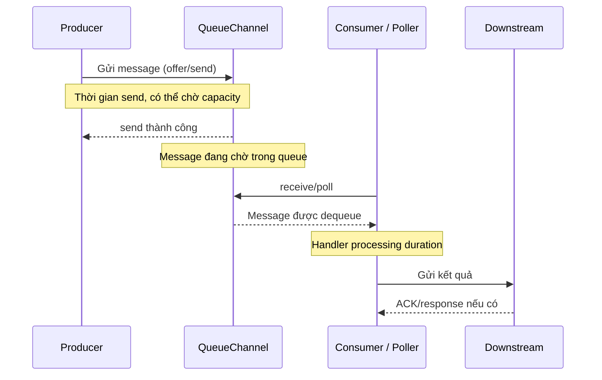

# Đo queue depth và thời gian chờ trong Spring Integration

## 1. Vì sao hai chỉ số này quan trọng?

Trong hệ thống dựa trên **Enterprise Integration Patterns (EIP)**, message thường không được xử lý ngay khi producer gửi. Một `QueueChannel` có thể giữ message để poller đọc sau; `ExecutorChannel` chuyển công việc sang thread pool; Aggregator giữ các phần tử cho tới khi đủ nhóm; outbound adapter có thể chờ một broker hoặc dịch vụ khác. Những cơ chế này tách producer khỏi consumer và tăng khả năng mở rộng, nhưng cũng tạo ra **điểm tích tụ**.

Giả sử một luồng đơn hàng dùng Spring Integration nhận 120 message/giây, trong khi consumer chỉ xử lý được 100 message/giây. Ngay cả khi mỗi handler chạy đúng chức năng, backlog có xu hướng tăng khoảng 20 message/giây trong giai đoạn tải đó. Sau một thời gian, khách hàng sẽ thấy phản hồi chậm, queue đạt giới hạn, producer bị chặn hoặc message bị từ chối.

Bài học **“Đo queue depth và thời gian chờ”** thuộc chương **Audit và observability** của module `SPRING_INTEGRATION_PATTERN`. Mục đích là theo dõi các luồng Router, Filter, Transformer, Splitter, Aggregator, Gateway, retry, error channel và correlation bằng các chỉ số có ý nghĩa, để tìm được vị trí tắc nghẽn khi thiết kế hệ thống message ít phụ thuộc.

Sau bài này, bạn có thể:

- Phân biệt **queue depth**, **thời gian chờ**, **thời gian xử lý** và **độ trễ end-to-end**.
- Đọc độ sâu và dung lượng trống của một `QueueChannel` bằng API Spring Integration.
- Đo `Gauge`, `Timer` và `Counter` với Micrometer, hiểu khi nào framework đã cung cấp metric sẵn.
- Đo khoảng **offer-to-poll** bằng timestamp riêng và biết rõ sai số của cách đo này.
- Thiết kế dashboard/cảnh báo khi backlog tăng, queue gần đầy hoặc message cũ nhất bị giữ quá lâu.
- Kiểm thử hành vi poller, retry, backpressure và các nhánh EIP một cách có thể tái hiện.

## 2. Định nghĩa chính xác các mốc thời gian

Hãy bắt đầu từ một message đi qua queue:



Các khái niệm có ý nghĩa khác nhau:

| Chỉ số | Đơn vị | Mốc bắt đầu → kết thúc | Trả lời câu hỏi |
| --- | --- | --- | --- |
| **Queue depth** | message | Số message đang nằm trong queue ở thời điểm quan sát | Có bao nhiêu message đang chờ được lấy ra? |
| **Remaining capacity** | slot | Số chỗ còn có thể nhận vào queue có giới hạn | Queue còn bao nhiêu chỗ? |
| **Enqueue latency** | thời gian | Bắt đầu `send` → `send` hoàn tất | Producer mất bao lâu để đưa message vào queue? |
| **Queue residence / wait** | thời gian | Enqueue thực sự thành công → dequeue | Message nằm chờ bao lâu? |
| **Offer-to-poll latency** | thời gian | Producer bắt đầu gửi → consumer nhận | Tổng thời gian từ lúc đề nghị gửi tới lúc được nhận; có thể gồm enqueue latency |
| **Processing duration** | thời gian | Handler bắt đầu → xử lý hoàn tất | Handler/dependency chậm bao lâu? |
| **End-to-end latency** | thời gian | Mốc nghiệp vụ ingress → mốc nghiệp vụ hoàn tất được định nghĩa | Một giao dịch mất bao lâu kể cả xếp hàng, retry và downstream? |
| **Oldest pending age** | thời gian | Thời điểm enqueue của message đang chờ lâu nhất → hiện tại | Có message nào đang mắc kẹt chưa được lấy ra không? |

**Điểm cần nhớ:** queue depth giảm khi consumer **lấy** message khỏi queue, không nhất thiết khi consumer **xử lý xong**. Một hệ thống có thể có depth gần bằng 0 nhưng nhiều request đang chạy lâu trong handler hoặc đang chờ response downstream. Vì vậy dashboard cần cả độ sâu queue, in-flight processing, thời gian xử lý và số lỗi.

### Phân biệt kích thước queue và số công việc chưa hoàn tất

Ví dụ queue còn 8 message, consumer đã dequeue 4 message nhưng đang xử lý chúng. Khi đó:

```text
queue_depth           = 8
in_flight_processing  = 4
unfinished_work       = 12 (nếu đúng một queue và không có trạng thái khác)
```

Không thể lấy `queue_depth = 8` để kết luận chỉ có 8 việc còn tồn. Nếu flow có Aggregator, retry scheduler hoặc dead-letter, số công việc chưa hoàn tất còn bao gồm các trạng thái khác và cần quy tắc đối soát riêng.

## 3. Những channel nào có queue depth?

Spring Integration cung cấp nhiều loại `MessageChannel`. Không phải loại nào cũng có hàng đợi để đọc kích thước:

| Thành phần | Có dữ liệu chờ ở đâu? | Cách quan sát phù hợp |
| --- | --- | --- |
| `DirectChannel` | Thường gọi subscriber đồng bộ, không có queue nội bộ kiểu `QueueChannel` | Thời gian `send`/handler, số thao tác in-flight, lỗi |
| **`QueueChannel`** | Queue nội bộ hoặc `MessageStore` cấu hình | `getQueueSize()`, `getRemainingCapacity()`, enqueue/dequeue và wait |
| `PriorityChannel` | Queue có thứ tự ưu tiên | Depth tổng, thời gian chờ theo nhóm ưu tiên nếu có nhãn hữu hạn, starvation |
| `ExecutorChannel` | Hàng đợi của `TaskExecutor` phía dưới nếu executor cấu hình queue | Executor queue size, active threads, rejected tasks, task wait |
| `PublishSubscribeChannel` có executor | Queue/thread pool của executor, có thể có nhiều subscriber | Depth và duration ở từng subscriber/executor |
| Polling endpoint/MessageSource | Nguồn dữ liệu ngoài hoặc cơ sở dữ liệu, tùy adapter | Lag/backlog tại nguồn, poll duration, lần poll không có dữ liệu |
| Aggregator/Resequencer | Message group store hoặc message sequence pending | Số group, kích thước group, oldest age, expiry |
| Kafka, AMQP, JMS | Hàng đợi/broker bên ngoài, consumer group, unacked message | Lag/ready/unacked từ metric của broker và consumer |

Một `ExecutorChannel` không tự cung cấp cùng `getQueueSize()` như `QueueChannel`. Nếu sử dụng `ThreadPoolTaskExecutor`, queue của executor mới là điểm cần đo; nếu tác vụ bị reject, queue depth có thể không tăng nữa nhưng ứng dụng vẫn lỗi. Với broker hoặc store bền vững, metrics ở JVM cục bộ có thể chỉ phản ánh một phần trạng thái tổng thể.

## 4. Bắt đầu bằng các metric có sẵn

Theo tài liệu Spring Integration, `QueueChannel` có thể xuất hai gauge Micrometer khi tích hợp metrics được cấu hình:

| Spring Integration metric | Ý nghĩa | Ghi chú |
| --- | --- | --- |
| `spring.integration.channel.queue.size` | Số message trong queue | Gauge, có tag thành phần như `type=channel` và `name` |
| `spring.integration.channel.queue.remaining.capacity` | Dung lượng còn lại | Gauge; cần hiểu giới hạn queue và phiên bản đang dùng |

Không nên đăng ký lại **chính cùng một tên và tập tag** nếu framework đã cung cấp metric đó. Hãy kiểm tra `/actuator/metrics`, `MeterRegistry` hoặc dữ liệu exporter ở môi trường chạy trước khi tạo metric bổ sung. Chỉ số time-to-dequeue theo yêu cầu nghiệp vụ vẫn thường cần thiết kế thêm vì queue size đơn thuần không cho biết thời gian chờ của từng message.

Với Spring Boot 3.x và Spring Integration 6.x, dependency gợi ý:

```groovy
dependencies {
    implementation("org.springframework.boot:spring-boot-starter-integration")
    implementation("org.springframework.boot:spring-boot-starter-actuator")
    // Chỉ cần nếu ứng dụng xuất metrics theo định dạng Prometheus.
    runtimeOnly("io.micrometer:micrometer-registry-prometheus")
}
```

Ví dụ tạo `QueueChannel` có giới hạn:

```java
import org.springframework.context.annotation.Bean;
import org.springframework.context.annotation.Configuration;
import org.springframework.integration.annotation.EnableIntegration;
import org.springframework.integration.channel.QueueChannel;

@Configuration
@EnableIntegration
class OrdersQueueConfiguration {

    @Bean("ordersQueue")
    QueueChannel ordersQueue() {
        return new QueueChannel(100);
    }
}
```

`QueueChannel(100)` cho phép giữ tối đa 100 message theo hợp đồng queue này. Ở thời điểm đọc:

```java
int depth = ordersQueue.getQueueSize();
int remaining = ordersQueue.getRemainingCapacity();
double occupancy = depth / 100.0;
```

Ví dụ: khi `depth=80` và `remaining=20`, queue đã dùng khoảng 80% capacity. Đây là **ảnh chụp tại một thời điểm**; số liệu có thể thay đổi ngay khi producer/consumer hoạt động. `QueueChannel()` không chỉ định capacity có thể tạo queue không giới hạn thực tế theo cấu hình bộ nhớ, vì vậy nên đặt giới hạn rõ ràng trong hệ thống cần backpressure. Queue mặc định trong bộ nhớ cũng không bền qua restart; nếu cần độ bền phải xem xét `MessageGroupStore` hoặc broker phù hợp.

## 5. Đo Gauge và Timer bằng Micrometer

Trong trường hợp cần metric có tên riêng cho dashboard, có thể đăng ký các meter ứng dụng:

```text
app.queue.depth                 Gauge    số message còn trong queue
app.queue.remaining.capacity    Gauge    dung lượng trống
app.queue.offer.to.poll         Timer    bắt đầu offer -> consumer nhận message
app.queue.enqueued              Counter  số send được chấp nhận
app.queue.rejected              Counter  số send bị từ chối hoặc lỗi
app.queue.dequeued              Counter  số receive trả về message
app.queue.wait.invalid          Counter  thiếu/sai timestamp hoặc clock bất thường
```

### 5.1. Ví dụ hoàn chỉnh: QueueChannel và bộ đo

Đoạn code sau sử dụng Java 17, Spring Integration 6.x và Micrometer. Đây là **một queue trong cùng JVM**; producer gọi `offer()`, consumer gọi `pollOnce()`. Trong thực tế, hai phương thức này cần được gọi tại đúng điểm gửi/nhận message của flow.

```java
import java.time.Clock;
import java.time.Duration;
import java.time.Instant;
import java.time.format.DateTimeParseException;

import io.micrometer.core.instrument.Counter;
import io.micrometer.core.instrument.Gauge;
import io.micrometer.core.instrument.MeterRegistry;
import io.micrometer.core.instrument.Timer;
import org.springframework.beans.factory.annotation.Qualifier;
import org.springframework.context.annotation.Bean;
import org.springframework.context.annotation.Configuration;
import org.springframework.integration.annotation.EnableIntegration;
import org.springframework.integration.channel.QueueChannel;
import org.springframework.messaging.Message;
import org.springframework.messaging.support.MessageBuilder;

@Configuration
@EnableIntegration
class QueueMonitoringConfiguration {

    @Bean("ordersQueue")
    QueueChannel ordersQueue() {
        return new QueueChannel(100);
    }

    @Bean
    Clock queueClock() {
        return Clock.systemUTC();
    }

    @Bean
    OrdersQueueMonitor ordersQueueMonitor(
            @Qualifier("ordersQueue") QueueChannel queue,
            MeterRegistry registry,
            Clock queueClock) {
        return new OrdersQueueMonitor(queue, registry, queueClock);
    }
}

final class OrdersQueueMonitor {
    private static final String OFFER_AT = "queueOfferAt";

    private final QueueChannel queue;
    private final Clock clock;
    private final Timer offerToPoll;
    private final Counter enqueued;
    private final Counter rejected;
    private final Counter dequeued;
    private final Counter invalidTime;

    OrdersQueueMonitor(QueueChannel queue, MeterRegistry registry, Clock clock) {
        this.queue = queue;
        this.clock = clock;

        // Gauge đọc trực tiếp trạng thái QueueChannel khi registry scrape.
        Gauge.builder("app.queue.depth", queue, QueueChannel::getQueueSize)
                .description("Số message đang chờ trong queue")
                .tags("queue", "ordersQueue")
                .register(registry);
        Gauge.builder("app.queue.remaining.capacity",
                      queue, QueueChannel::getRemainingCapacity)
                .tags("queue", "ordersQueue")
                .register(registry);

        offerToPoll = Timer.builder("app.queue.offer.to.poll")
                .description("Từ lúc thử gửi message tới lúc receive trả kết quả")
                .tags("queue", "ordersQueue")
                .publishPercentileHistogram()
                .register(registry);
        enqueued = registry.counter("app.queue.enqueued",
                "queue", "ordersQueue");
        rejected = registry.counter("app.queue.rejected",
                "queue", "ordersQueue");
        dequeued = registry.counter("app.queue.dequeued",
                "queue", "ordersQueue");
        invalidTime = registry.counter("app.queue.wait.invalid",
                "queue", "ordersQueue");
    }

    // Timeout 0: thử gửi ngay, không chờ queue còn chỗ.
    boolean offer(String payload, String flowExecutionId) {
        Message<String> message = MessageBuilder.withPayload(payload)
                .setHeader("flowExecutionId", flowExecutionId)
                .setHeader(OFFER_AT, clock.instant().toString())
                .build();
        try {
            boolean accepted = queue.send(message, 0);
            if (accepted) {
                enqueued.increment();
            } else {
                rejected.increment();
            }
            return accepted;
        } catch (RuntimeException exception) {
            rejected.increment();
            throw exception;
        }
    }

    // Gọi tại consumer, hoặc từ poller được ứng dụng cấu hình.
    Message<?> pollOnce() {
        Message<?> message = queue.receive(0);
        if (message == null) {
            return null;
        }
        dequeued.increment();

        String time = message.getHeaders().get(OFFER_AT, String.class);
        if (time == null) {
            invalidTime.increment();
            return message;
        }

        try {
            Duration elapsed = Duration.between(
                    Instant.parse(time), clock.instant());
            if (elapsed.isNegative()) {
                invalidTime.increment();
            } else {
                offerToPoll.record(elapsed);
            }
        } catch (DateTimeParseException exception) {
            invalidTime.increment();
        }
        return message;
    }
}
```

Ví dụ cách gọi:

```java
boolean accepted = monitor.offer("order-42", "flow-7294");
if (!accepted) {
    // Xử lý backpressure theo hợp đồng: retry có giới hạn,
    // chuyển tới nơi lưu bền vững hoặc trả lỗi rõ ràng.
}

Message<?> next = monitor.pollOnce();
if (next != null) {
    // Ở đây message mới được dequeue.
    // Thời gian xử lý nghiệp vụ và ACK phải được đo riêng.
    handleOrder(next);
}
```

**Cách hiểu đúng số đo trong ví dụ:**

1. `app.queue.depth` và `app.queue.remaining.capacity` là **gauge trạng thái hiện tại**; Micrometer gọi hàm đọc khi thu thập. Spring context giữ reference tới queue, tránh gauge bị mất object quan sát.
2. `app.queue.offer.to.poll` đo từ lúc tạo timestamp **trước** lệnh `send` tới sau `receive`; đó là *offer-to-poll latency*, **không phải số đo tuyệt đối chính xác từ thời điểm enqueue hoàn tất**. Với `send(message, 0)`, thời gian gửi thường ngắn, nhưng vẫn có sai số. Nếu dùng `send` với timeout lớn, chỉ số này còn bao gồm thời gian producer chờ queue có chỗ.
3. Timer ở đây dừng khi **dequeue**, không bao phủ `handleOrder()` hay kết quả giao cho hệ thống ngoài. Cần `Timer` khác bao quanh handler hoặc instrumentation của endpoint để đo processing.
4. Timestamp được lưu dưới dạng chuỗi ISO-8601 phục vụ minh họa. Trước khi đưa message ra ngoài, cần kiểm soát header mapping; không mặc định giữ metadata chẩn đoán qua mọi protocol.
5. Nếu producer khác gửi trực tiếp tới `ordersQueue` hoặc consumer khác gọi `receive()` ngoài wrapper, các Counter/Timer tự viết sẽ **đếm thiếu**, dù gauge vẫn phản ánh queue. Trong flow thực tế, hãy đặt instrumentation ở các ranh giới chung hoặc theo cơ chế interceptor/adapter được kiểm soát.
6. Đồng hồ hệ thống có thể bị điều chỉnh. Khi phát hiện timestamp âm/không hợp lệ, ví dụ tăng `app.queue.wait.invalid` thay vì ghi mẫu âm. Với đo độ trễ trong cùng process và không cần lưu timestamp qua restart, `System.nanoTime()` có độ ổn định hơn; giá trị đó **không** dùng để tính thời gian xuyên process hoặc sau restart.

Đối với một hàng đợi bền vững, muốn đo **queue residence chính xác** nên ghi timestamp enqueue đã xác nhận trong cùng transaction/operation hoặc dùng metadata của broker/store, rồi trừ tại thời điểm dequeue với quy ước clock rõ ràng. Nếu message đi qua nhiều máy, phải tính đến clock skew và timestamp được gán ở bên nào.

### 5.2. Vì sao cần Timer thay vì Gauge thời gian chờ?

`Gauge` phù hợp với **trạng thái hiện tại** như depth hoặc tuổi message cũ nhất đang nằm chờ. `Timer` phù hợp với **phân phối thời gian** của những message đã dequeue: số mẫu, tổng thời gian, histogram và các percentile. Không dùng một `Gauge` được cập nhật bằng “thời gian chờ của message vừa nhận gần nhất” để đại diện cho p95 vì những giá trị trung gian có thể biến mất giữa hai lần scrape.

Hãy nhớ rằng Timer chỉ quan sát **những message đã được lấy ra**. Nếu consumer bị treo và không dequeue gì, p95 Timer có thể không đổi, dù backlog và oldest pending age đang tăng mạnh. Đây là lý do phải xem đồng thời Timer, queue depth và oldest age.

## 6. Đo thời gian chờ chính xác hơn trong flow thực tế

Có ba mức chính xác tùy yêu cầu:

| Cách đo | Cách thực hiện | Phù hợp | Giới hạn |
| --- | --- | --- | --- |
| **Offer-to-poll** | Gắn timestamp trước `send`, đọc tại `receive` | Học tập, giám sát nhanh một luồng có producer được kiểm soát | Có thể gồm enqueue latency |
| **Confirmed enqueue-to-dequeue** | Lưu thời điểm enqueue thành công tại queue/store hoặc dùng metadata nhận từ broker; đo tới lúc dequeue | Đo queue residence theo hợp đồng | Cần hook/metadata tin cậy, clock và transaction rõ ràng |
| **End-to-end business latency** | Lưu ingress timestamp/business correlation rồi ghi khi nghiệp vụ hoàn tất | SLO của sản phẩm | Gồm queue, retry, xử lý và downstream; không thể quy toàn bộ cho queue |

Không mặc định `MessageHeaders.TIMESTAMP` chính là enqueue timestamp: nó thường phản ánh lúc message được tạo, có thể rất lâu trước khi message được gửi vào queue hiện tại. Tương tự, timestamp trong trace/span không tự động là mốc commit của transaction.

Nếu có **poller**:

- Đo khoảng chờ cho từng message ở ranh giới `receive`, sau đó đo handler riêng.
- Đo thời gian từ lúc poller bắt đầu poll đến khi nhận kết quả nếu cần chẩn đoán adapter/source.
- Phân biệt `receive(0)` không có message với `receive` timeout và lỗi; đếm `empty_poll` ở tốc độ phù hợp, tránh tạo log ồn.
- Với `fixedDelay`, `fixedRate` hoặc task executor, cấu hình poller quyết định nhịp độ nhận; một message có thể chờ thêm dù handler nhanh.

Nếu dùng **broker ngoài** (Kafka, AMQP, JMS), nên đối chiếu metric của client/broker: consumer lag, queue ready, unacked, in-flight, redelivery và tuổi message. Không sao chép toàn bộ header để đo nếu có nguy cơ lộ dữ liệu nhạy cảm. Trường hợp fan-out hay retry, mỗi lần queue lại phải xác định có dùng cùng timestamp hay tạo một timestamp mới cho **lượt chờ mới**.

## 7. Thiết kế metric và dashboard

### 7.1. Quy ước tên và tag

Một bộ tag đủ dùng:

| Tag | Giá trị ví dụ | Quy tắc |
| --- | --- | --- |
| `flow` | `orders`, `payments` | Tập flow nhỏ, cố định theo cấu hình |
| `queue` | `ordersQueue`, `priorityOrders` | Tên logical channel, không tạo ngẫu nhiên |
| `outcome` | `accepted`, `rejected`, `processed`, `error` | Định nghĩa mốc đếm rõ |
| `priority` | `normal`, `high` | Chỉ dùng khi thật sự cần so sánh và tập hữu hạn |
| `messageId`, `orderId`, `traceId` | ID riêng của từng message | **Không dùng làm metric tag** |

Correlation ID vẫn cần cho audit/log/trace để điều tra một message cụ thể; metrics phục vụ phân tích tổng hợp. Đối với high-cardinality data, hãy lưu metadata ở log có cấu trúc hoặc trace với chính sách dữ liệu phù hợp.

### 7.2. Ví dụ truy vấn Prometheus

Micrometer thường chuyển tên metric chứa dấu chấm thành dấu gạch dưới khi xuất Prometheus. Hãy **xác nhận tên thật** trong `/actuator/prometheus` trước khi dùng truy vấn.

Độ sâu hàng đợi do ví dụ tự ghi:

```promql
app_queue_depth{queue="ordersQueue"}
```

Nếu chỉ dùng gauge do Spring Integration cung cấp, tên xuất Prometheus dự kiến có dạng:

```promql
spring_integration_channel_queue_size{
  type="channel",name="ordersQueue"
}
```

Tốc độ enqueue/dequeue theo phút hoặc giây:

```promql
rate(app_queue_enqueued_total{queue="ordersQueue"}[5m])
```

```promql
rate(app_queue_dequeued_total{queue="ordersQueue"}[5m])
```

Vì `Timer.builder(...).publishPercentileHistogram()` đã bật histogram, có thể ước lượng p95 **offer-to-poll** qua Prometheus:

```promql
histogram_quantile(
  0.95,
  sum by (le) (
    rate(app_queue_offer_to_poll_seconds_bucket{
      queue="ordersQueue"
    }[5m])
  )
)
```

Đây là p95 cho các message đã dequeue trong cửa sổ 5 phút, **không** đại diện cho message vẫn còn chờ trong queue. Đừng bật histogram cho hàng nghìn queue/tag động mà không đánh giá chi phí series.

### 7.3. Kết hợp các tín hiệu để hiểu nguyên nhân

| Queue depth | Thời gian chờ đã đo | In-flight/handler | Giả thuyết cần kiểm tra |
| --- | --- | --- | --- |
| Thấp | Thấp | Thấp | Luồng có thể đang khỏe nếu throughput và error rate hợp lý |
| Tăng | Tăng | Cao, handler chậm | Consumer/dependency không theo kịp |
| Tăng | Ít mẫu Timer mới | Có thể bằng 0 | Poller dừng, consumer không nhận, lỗi kết nối |
| Thấp | Cao | Thấp | Có thể vừa xử lý backlog cũ; nên xem thời gian và tốc độ theo cửa sổ |
| Gần đầy | Bất kỳ | Producer bị reject hoặc blocked | Backpressure, saturation, cấu hình capacity |
| Thấp | Thấp | Rất cao | Message đã dequeue nhưng kẹt ở downstream; xem processing/in-flight |

Không nhìn riêng một biểu đồ để kết luận. Ví dụ queue depth thấp ngay sau restart có thể do queue trong RAM bị mất, chứ không hẳn vì backlog đã được xử lý.

## 8. Backpressure, saturation và ngưỡng cảnh báo

Với queue capacity hữu hạn `C`, occupancy có thể tính:

\[
\text{occupancy} = \frac{\text{queue depth}}{C}
\]

Nếu producer đạt tốc độ trung bình \(\lambda\) message/giây và consumer xử lý được \(\mu\) message/giây, khi \(\lambda > \mu\) backlog có xu hướng tăng. Trong khoảng thời gian tương đối ổn định, tốc độ tăng có thể xấp xỉ \(\lambda - \mu\) (giả sử không có discard, retry hoặc nhiều nhánh).

Ví dụ: queue capacity 1.000, producer 120 message/giây và consumer 100 message/giây; từ queue trống, lý thuyết cần khoảng 50 giây để đầy nếu các tốc độ đó giữ nguyên và không có biến động. Mô hình này **chỉ minh họa xu hướng**, không phải dự báo chắc chắn cho traffic burst hay số liệu thực.

Khi queue đầy, các lựa chọn gồm:

1. **Backpressure có giới hạn**: `send` với timeout rõ ràng và trả lỗi/response phù hợp khi không nhận thêm.
2. **Giảm tốc producer**: rate limiting, điều tiết pull, điều chỉnh số producer hoặc consumer.
3. **Tăng năng lực consumer**: song song hóa an toàn, giảm thời gian dependency, tối ưu batch hoặc I/O.
4. **Sử dụng hàng đợi bền vững** khi message không được phép mất, kèm retry, idempotency và dead-letter.
5. **Xử lý tải đột biến**: capacity và autoscaling phải gắn với thời gian phục hồi backlog, không chỉ số phần tử chờ.

Hệ thống không nên chỉ cảnh báo ở `depth == C`: lúc đó có thể đã có message bị từ chối. Có thể theo dõi cảnh báo **occupancy cao trong nhiều cửa sổ**, **oldest pending age vượt SLO**, **queue growth rate dương kéo dài**, **tỷ lệ reject tăng** và **consumer throughput giảm**.

Giá trị ngưỡng phải dựa trên SLO của flow. Queue phục vụ batch 5 phút có thể chủ động chờ, còn một request–reply Gateway có giới hạn vài giây cần cảnh báo sớm hơn nhiều.

## 9. Ảnh hưởng của các Enterprise Integration Patterns

Đo backlog trong một flow phức tạp cần hiểu đơn vị xử lý của từng pattern:

| Pattern | Hành vi ảnh hưởng depth/wait | Cần đo thêm |
| --- | --- | --- |
| **Router** | Chuyển message vào các queue khác nhau; có thể phân phối lệch | Depth/wait theo nhánh có tên cố định, routing decisions |
| **Filter** | Loại message có chủ đích, làm giảm output | Accepted/rejected, discardChannel; không coi rejected là thất lạc |
| **Transformer** | Có thể chậm, tạo áp lực lên channel trước đó | Handler timer, lỗi, kích thước input/output |
| **Splitter** | Một input tạo nhiều fragment làm queue phía sau tăng nhanh | Số fragments/split, throughput theo fragment |
| **Aggregator** | Message nằm trong group store, không nhất thiết nằm trong queue | Groups pending, group oldest age, release/expiry duration |
| **Gateway** | Request–reply có thể timeout dù enqueue trước đó thành công | Gateway in-flight, reply timeout, end-to-end latency |
| **Retry** | Một nghiệp vụ có nhiều attempt, có thể re-enqueue | Attempts, backoff wait, redelivery, dead-letter |
| **Error Channel** | Message lỗi được chuyển sang flow riêng, có thể có queue khác | Error backlog, thời gian xử lý lỗi và rate |
| **Correlation** | Nhóm message liên quan qua nhiều queue/nhánh | Business correlation trong audit/trace; không làm metric tag |
| **Resequencer / Priority Channel** | Message có thể chờ điều kiện thứ tự hoặc ưu tiên | Age theo lớp ưu tiên, starvation, out-of-order |

Ví dụ Splitter nhận 100 đơn, mỗi đơn sinh 10 line-item thì queue sau Splitter có thể nhận 1.000 message, dù ingress chỉ có 100 đơn. So sánh `input_count - output_count` giữa hai vị trí mà không quy đổi đơn vị sẽ đưa ra kết luận sai.

Với Aggregator, có thể queue depth bằng 0 nhưng có nhiều **group chưa release**. Với retry scheduler, message chờ backoff có thể chưa nằm trong `QueueChannel`. Với `PublishSubscribeChannel`, một message có thể tạo backlog ở nhiều executor, vì vậy chỉ số của một nhánh không đại diện cho toàn bộ flow.

## 10. Kiểm thử đo queue depth và thời gian chờ

Kiểm thử cần phân biệt **số đo được đăng ký** và **điều kiện vận hành tạo ra số đo đó**.

### 10.1. Kiểm thử đơn giản bằng `SimpleMeterRegistry`

Đoạn kiểm thử sau xác nhận queue depth thay đổi thật, Timer có mẫu sau dequeue và các Counter tương ứng:

```java
import static org.assertj.core.api.Assertions.assertThat;

import java.time.Clock;
import org.junit.jupiter.api.Test;
import io.micrometer.core.instrument.simple.SimpleMeterRegistry;
import org.springframework.integration.channel.QueueChannel;
import org.springframework.messaging.Message;

class OrdersQueueMonitorTest {

    @Test
    void measuresDepthAndOfferToPoll() {
        try (SimpleMeterRegistry registry = new SimpleMeterRegistry()) {
            QueueChannel queue = new QueueChannel(2);
            OrdersQueueMonitor monitor =
                    new OrdersQueueMonitor(queue, registry, Clock.systemUTC());

            assertThat(monitor.offer("order-42", "flow-7294")).isTrue();
            assertThat(queue.getQueueSize()).isEqualTo(1);
            assertThat(queue.getRemainingCapacity()).isEqualTo(1);
            assertThat(registry.get("app.queue.depth")
                    .tag("queue", "ordersQueue")
                    .gauge().value()).isEqualTo(1.0);

            Message<?> dequeued = monitor.pollOnce();
            assertThat(dequeued).isNotNull();
            assertThat(dequeued.getPayload()).isEqualTo("order-42");
            assertThat(queue.getQueueSize()).isZero();
            assertThat(registry.get("app.queue.offer.to.poll")
                    .tag("queue", "ordersQueue")
                    .timer().count()).isEqualTo(1);
            assertThat(registry.get("app.queue.dequeued")
                    .tag("queue", "ordersQueue")
                    .counter().count()).isEqualTo(1.0);
        }
    }
}
```

Vì code đo thời gian từ `Clock.systemUTC()`, test chỉ khẳng định có **một mẫu hợp lệ**. Để kiểm tra duration chính xác mà không phụ thuộc `Thread.sleep()`, inject một `Clock` có thể điều khiển trong test, tăng thời gian giả lập giữa `offer()` và `pollOnce()`, rồi so sánh `Timer.totalTime(...)` với khoảng thời gian đã định.

### 10.2. Ma trận kiểm thử nên có

| Tình huống | Kỳ vọng |
| --- | --- |
| Queue trống, không có message | Depth = 0, `pollOnce()` trả `null`, Timer không tăng |
| Queue capacity = 2, gửi 2 message | Depth = 2, remaining capacity = 0 |
| Gửi thêm khi queue đầy với timeout 0 | Có rejected/exception theo hợp đồng send; không tính thành công |
| Dequeue một message | Depth giảm 1, dequeued tăng 1, Timer ghi một mẫu |
| Consumer xử lý chậm sau dequeue | Depth có thể thấp nhưng processing/in-flight tăng; cần metric riêng |
| Header timestamp thiếu hoặc sai | Tăng `wait.invalid`, không phá vỡ xử lý message |
| Poller dừng | Depth/oldest age tăng hoặc giữ cao; Timer thiếu mẫu mới |
| Retry re-enqueue | Có quy tắc tạo timestamp mới cho lần chờ mới, attempt không bị gộp nhầm |
| Splitter tạo nhiều fragments | Backlog đo theo fragment; correlation vẫn nối được đơn hàng gốc |
| Producer ngoài wrapper gửi thẳng tới queue | Gauge vẫn đúng; Counter/Timer của wrapper có thể thiếu |
| Restart khi queue trong RAM còn dữ liệu | Test phải làm rõ khả năng mất dữ liệu và không gọi depth=0 là đã xử lý xong |
| Queue lưu bền vững/broker | Đối chiếu tuổi message, depth/lag và dấu thời gian từ nguồn thực |

Nếu dùng async executor/poller, nên chờ theo điều kiện với timeout (`CountDownLatch`, `Awaitility` hoặc nhận từ channel có timeout), không dùng thời gian ngủ cố định để “đợi” metric cập nhật.

## 11. Những lỗi quan sát thường gặp

1. **Dùng queue depth thay cho backlog end-to-end.** Message đã dequeue nhưng còn chạy trong handler sẽ không nằm trong queue.
2. **Dùng `MessageHeaders.TIMESTAMP` làm enqueue time vô điều kiện.** Header đó thường được tạo trước khi message vào queue đang đo.
3. **Gắn timestamp trước send rồi gọi phép đo là queue residence tuyệt đối.** Cách đó có thể bao gồm thời gian producer bị chặn trước enqueue.
4. **Chỉ xem p95 các message đã dequeue.** Khi consumer ngừng nhận, Timer có thể im lặng trong lúc queue càng ngày càng cũ.
5. **Đăng ký trùng gauge có sẵn của Spring Integration.** Kiểm tra tên/tag và meter đang tồn tại trước khi instrument thêm.
6. **Gắn message ID, order ID hoặc correlation ID vào tag.** Điều này làm tăng cardinality và chi phí lưu trữ metric.
7. **Đếm `send()` thành công là downstream xử lý xong.** Queue accept khác consumer commit hoặc broker ACK.
8. **Dùng con số depth từ một JVM để kết luận backlog toàn cụm.** Phải xem tất cả partition/instance và metric broker/store nếu có.
9. **Gộp attempt và logical operation.** Retry và redelivery làm tăng số lần gửi/nhận, không nhất thiết tăng số nghiệp vụ gốc.
10. **Thiết kế queue không giới hạn nhưng chỉ theo dõi phần trăm sử dụng.** Không có capacity hữu hạn thì tỷ lệ occupancy không có nghĩa hữu ích; cần depth, memory và tốc độ tăng.

## 12. Checklist đưa vào môi trường thật

- [ ] Xác định rõ queue nào cần quan sát và nguồn lưu thực sự (RAM, store, broker, executor).
- [ ] Chọn đúng định nghĩa depth, enqueue latency, queue wait, processing duration và end-to-end latency.
- [ ] Có metric depth, remaining capacity (nếu bounded), enqueued/dequeued, errors/rejects.
- [ ] Có Timer chờ với mốc bắt đầu/kết thúc rõ; đo oldest pending age nếu có thể.
- [ ] Đã kiểm tra meter Spring Integration có sẵn trước khi tự đăng ký gauge cùng ý nghĩa.
- [ ] Giới hạn queue/worker và định nghĩa hành vi khi hết capacity: chờ, từ chối, retry hay lưu bền.
- [ ] Kiểm thử tình huống queue đầy, poller dừng, consumer chậm, restart, retry, fan-out và Aggregator.
- [ ] Có dashboard hiển thị depth, waiting p95/p99, handler duration, throughput và oldest age.
- [ ] Có alert dựa trên SLO, tốc độ tăng backlog và tín hiệu lỗi; không chỉ đợi queue đầy.
- [ ] Không dùng payload, token, order ID hoặc trace ID làm metric tag.
- [ ] Giữ correlation trong audit/log/trace để truy vết nghiệp vụ khi metrics cho thấy bất thường.

## 13. Tài liệu tham khảo

- [Spring Integration — Configuring Message Channels / QueueChannel](https://docs.spring.io/spring-integration/reference/channel/configuration.html)
- [Spring Integration — Metrics and Management](https://docs.spring.io/spring-integration/reference/metrics.html)
- [Spring Integration — QueueChannelOperations Javadoc](https://docs.spring.io/spring-integration/docs/6.5.0/api/org/springframework/integration/channel/QueueChannelOperations.html)
- [Micrometer — Gauges](https://docs.micrometer.io/micrometer/reference/concepts/gauges.html)
- [Micrometer — Timers](https://docs.micrometer.io/micrometer/reference/concepts/timers.html)
- [Spring Boot — Metrics](https://docs.spring.io/spring-boot/reference/actuator/metrics.html)

**Ghi nhớ:** queue depth trả lời **“còn bao nhiêu message đang chờ?”**, còn waiting time trả lời **“message đã đợi bao lâu trước khi được nhận?”**. Để giám sát Spring Integration chính xác, cần đo cả hai, phân biệt thời điểm enqueue/dequeue với xử lý hoàn tất và bổ sung metric tương ứng với đặc tính của từng Enterprise Integration Pattern.
