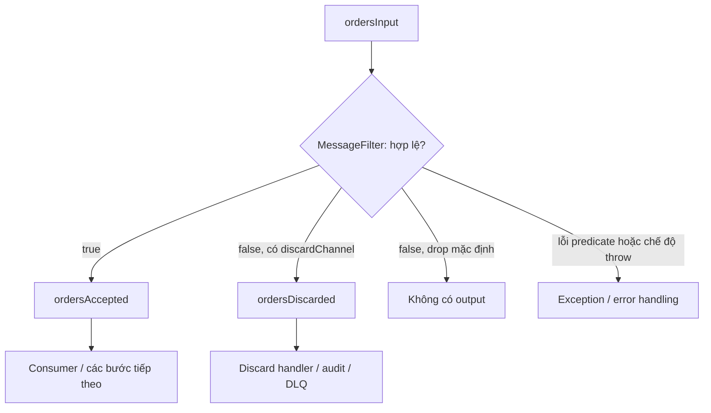

# Đo số message bị filter hoặc discard trong Spring Integration

## 1. Vì sao phải đo message bị loại?

Trong hệ thống tích hợp, **không phải message nào đi vào flow cũng cần đi đến đầu ra**. `Filter` có thể loại một đơn hàng không hợp lệ, bỏ sự kiện không thuộc phạm vi quan tâm hoặc ngăn dữ liệu chưa đạt điều kiện đi vào hệ thống đích. Đây là hành vi có chủ đích của **Enterprise Integration Patterns (EIP)**, nhưng nếu không đo lường, nhóm vận hành rất khó phân biệt:

- Message **bị Filter từ chối hợp lệ** với message **bị mất do lỗi**.
- Filter quyết định loại message với việc message **thực sự tới discard channel**.
- Message tới discard channel với việc nhánh discard **đã xử lý hoặc lưu thành công**.
- Một message nghiệp vụ bị loại với **nhiều lần đánh giá lại** do retry, redelivery hoặc flow chạy qua nhiều Filter.

Bài học thuộc chương **Audit và observability** của module `SPRING_INTEGRATION_PATTERN`: xây dựng flow Spring Integration ít phụ thuộc, dễ mở rộng và theo dõi được Router, Filter, Transformer, Splitter, Aggregator, Gateway, retry, error channel và correlation. Trọng tâm ở đây là **đo số message bị filter hoặc discard** bằng các mốc rõ ràng, kết hợp Micrometer và kiểm thử.

Sau bài học, bạn có thể:

1. Giải thích đường đi của message khi `MessageFilter` trả `true`, `false` hoặc ném lỗi.
2. Ghi metric cho **quyết định của Filter**, **sự kiện tới discard channel** và **kết quả xử lý discard**.
3. Đặt metric/tag phù hợp, tính reject ratio đúng mẫu số, tránh tăng cardinality.
4. Phân tích nguyên nhân lệch số khi có nhiều nhánh, retry, Filter nối tiếp hoặc consumer bất đồng bộ.
5. Kiểm tra cả luồng được chấp nhận, luồng bị loại và luồng lỗi mà không nhầm trạng thái `send()`.

## 2. Vòng đời một message tại Filter

Một `MessageFilter` kiểm tra điều kiện chọn (selector/predicate) để quyết định có gửi message sang kênh đầu ra tiếp theo hay không. Tùy cấu hình, message bị loại có thể **bị bỏ qua**, được **chuyển tới `discardChannel`**, hoặc một lỗi từ chối có thể được ném ra.



**Ba loại sự kiện nên phân biệt**:

| Mốc quan sát | Tên metric ví dụ | Điều được chứng minh | Điều chưa được chứng minh |
| --- | --- | --- | --- |
| Filter đánh giá xong predicate | `app.eip.filter.decisions{outcome=accepted\|rejected}` | Có quyết định nhận/loại tại Filter | Message đã tới consumer đầu ra/discard |
| Handler nhận message ở `discardChannel` | `app.eip.discard.observed` | Message đã tới điểm quan sát discard | Message đã được lưu bền vững hoặc xử lý xong |
| Discard sink ghi nhận thành công | `app.eip.discard.persisted` | Kho/sink xác nhận thành công theo hợp đồng | Hệ thống khác đã tiêu thụ message nếu chỉ ghi vào broker |

Thêm `outcome=error` cho **lỗi trong lúc đánh giá predicate** hoặc trong phạm vi filter được instrument. Không đếm lỗi predicate thành `rejected`: reject là kết quả **đã được xác định**, còn lỗi có thể khiến hệ thống không biết message có hợp lệ hay không.

### Ví dụ đường đi

Giả sử flow nhận ba chuỗi:

```text
"order-42"  -> accepted -> ordersAccepted
"   "       -> rejected -> ordersDiscarded
"order-43"  -> accepted -> ordersAccepted
```

Khi Filter đánh giá đúng một lần cho mỗi message và discard flow hoạt động ổn định:

```text
filter_decisions{outcome="accepted"} = 2
filter_decisions{outcome="rejected"} = 1
discard_observed                      = 1
```

Đây là **số lần đánh giá/quan sát trong ví dụ**, không phải số đơn hàng nghiệp vụ duy nhất trong kho dữ liệu. Nếu cùng một message được gửi lại và đi qua Filter lần nữa, counter có thể tăng tiếp.

## 3. Các kiểu cấu hình discard và cách chúng ảnh hưởng metric

### 3.1. Filter không có discard channel

Ví dụ Java DSL:

```java
IntegrationFlow flow = IntegrationFlow.from("ordersInput")
        .filter(String.class, value -> !value.isBlank())
        .channel("ordersAccepted")
        .get();
```

Với cấu hình Filter thông thường, message không thỏa điều kiện sẽ **không tiếp tục** tới `ordersAccepted`. Nếu không có `discardChannel` và không yêu cầu ném lỗi khi bị loại, message có thể được bỏ qua một cách hợp lệ. Vì vậy, nếu muốn có counter cho số lần bị loại, phải **ghi tại điểm Filter đưa ra quyết định** hoặc gắn một nhánh discard quan sát được. Một consumer ở `ordersAccepted` chỉ thấy message được chấp nhận nên không thể tự suy ra đầy đủ số rejected.

### 3.2. Filter có discard channel

```java
IntegrationFlow flow = IntegrationFlow.from("ordersInput")
        .filter(String.class, value -> !value.isBlank(),
                endpoint -> endpoint.discardChannel("ordersDiscarded"))
        .channel("ordersAccepted")
        .get();
```

Khi predicate trả `false`, Filter gửi message sang `ordersDiscarded`. Một integration flow khác có thể lưu lý do loại, phát metric hoặc chuyển message đến nơi đối soát.

**Discard channel không đồng nghĩa dead-letter queue (DLQ).** Discard có thể là quyết định nghiệp vụ bình thường, trong khi DLQ thường lưu message lỗi sau khi cơ chế xử lý/retry không thể tiếp tục. Nếu muốn lưu message bị loại bền vững, phải cấu hình sink/transaction/ACK phù hợp ở **bước sau** discard channel.

### 3.3. Ném exception khi từ chối

`MessageFilter` cũng hỗ trợ tùy chọn `throwExceptionOnRejection`. Khi bật, điều kiện từ chối được diễn đạt bằng exception theo chính sách xử lý đã chọn. Khi đó, việc message đi vào `errorChannel` còn phụ thuộc channel đồng bộ/bất đồng bộ và cơ chế error handling của endpoint.

Không thiết kế metric với giả định **mọi rejected đều đi qua `errorChannel`**. Nếu cần cùng lúc phân biệt `rejected`, `error` và `discard observed`, hãy thiết kế rõ một đường xử lý nhất quán rồi xác minh bằng integration test.

### 3.4. Các nguồn discard khác

`Filter` không phải nơi duy nhất message dừng trong Spring Integration:

| Cơ chế | Lý do không có output dự kiến | Cần đặt meter ở đâu? |
| --- | --- | --- |
| **Filter** | Predicate trả `false` | Tại quyết định accept/reject; tại discard channel nếu có |
| **Router** | Không có route hợp lệ hoặc dùng default channel | Tại quyết định route và nhánh default/reject |
| **`nullChannel`** | Có chủ đích bỏ message | Trước khi gửi tới `nullChannel` hoặc tại quyết định nghiệp vụ; không kỳ vọng consumer sau `nullChannel` |
| **Gateway** | Request timeout hoặc reply bị thiếu | Tại gateway timeout/error, không suy từ ingress |
| **Aggregator** | Chưa đủ message để release | Group pending/release/expiry; thiếu output chưa chắc là discard |
| **Error flow / DLQ** | Xử lý lỗi hoặc retry hết lần | Tại xử lý lỗi, publish/ACK DLQ, replay |

Để so sánh giữa những pattern, tên `discard` cần có **ý nghĩa nhất quán** trong toàn hệ thống: có thể là “loại theo quy tắc business”, hoặc “đã gửi tới một kênh bỏ qua”. Không trộn hai nghĩa rồi tính chung tỷ lệ.

## 4. Chọn Counter, Timer và tag trong Micrometer

### Counter là phép đo chính

Số lần Filter nhận, từ chối và discard nên dùng **`Counter`** vì đó là các sự kiện tích lũy. Ví dụ:

```text
app.eip.filter.decisions{flow="orders",stage="validate",outcome="accepted"}
app.eip.filter.decisions{flow="orders",stage="validate",outcome="rejected"}
app.eip.filter.decisions{flow="orders",stage="validate",outcome="error"}
app.eip.discard.observed{flow="orders",source="validate"}
app.eip.discard.persisted{flow="orders",source="validate"}
app.eip.discard.persist_failed{flow="orders",source="validate"}
```

`Timer` phù hợp để đo thời gian chạy predicate, thời gian xử lý discard hoặc thời gian ghi audit, còn `Gauge` phù hợp với trạng thái hiện tại như số message đang chờ trong discard queue. Một `Timer` đã có count cho số lần đo; không cần đăng ký counter trùng ý nghĩa nếu không có nhu cầu riêng.

### Tag có cardinality thấp

| Tag | Giá trị hợp lệ ví dụ | Quy tắc |
| --- | --- | --- |
| `flow` | `orders`, `billing` | Tập tên cố định từ cấu hình |
| `stage` | `validate`, `deduplicate` | Tên Filter/endpoint ổn định |
| `outcome` | `accepted`, `rejected`, `error` | Danh sách cố định, không nhận text exception tự do |
| `reason` | `empty`, `invalid_format`, `unsupported_type` | Chỉ dùng khi reason được chuẩn hóa và có giới hạn |
| `source` | `validate`, `deduplicate` | Tên nhánh discard từ cấu hình |
| `messageId`, `orderId`, `correlationId` | UUID/ID theo message | **Không dùng làm metric tag** |
| `payload`, `exceptionMessage` | Chuỗi tùy ý hoặc nhạy cảm | **Không dùng làm metric tag** |

Với nhiều loại lý do từ chối, ưu tiên **enum/codes được kiểm soát**. Tránh gán nguyên văn thông báo validation thành `reason`, vì một thông báo khác nhau cho từng người dùng có thể tạo vô số time series và lộ dữ liệu.

## 5. Ví dụ triển khai: đếm Filter decision và discard observed

Ví dụ sau viết bằng Java 17, Spring Boot 3.x/Spring Integration 6.x, sử dụng **Spring Integration Java DSL** và **Micrometer**. Flow nhận `String`, loại chuỗi rỗng/blank; message hợp lệ được đưa vào `QueueChannel` để test quan sát, còn message không hợp lệ được chuyển tới discard flow.

### 5.1. Bộ đếm tại đúng ranh giới

```java
import io.micrometer.core.instrument.Counter;
import io.micrometer.core.instrument.MeterRegistry;
import org.springframework.messaging.Message;

final class OrderFilterCounters {
    private final Counter accepted;
    private final Counter rejected;
    private final Counter errors;
    private final Counter discardObserved;

    OrderFilterCounters(MeterRegistry registry) {
        accepted = registry.counter("app.eip.filter.decisions",
                "flow", "orders",
                "stage", "validate",
                "outcome", "accepted");
        rejected = registry.counter("app.eip.filter.decisions",
                "flow", "orders",
                "stage", "validate",
                "outcome", "rejected");
        errors = registry.counter("app.eip.filter.decisions",
                "flow", "orders",
                "stage", "validate",
                "outcome", "error");
        discardObserved = registry.counter("app.eip.discard.observed",
                "flow", "orders",
                "source", "validate");
    }

    boolean accept(String payload) {
        try {
            boolean valid = !payload.isBlank();
            if (valid) {
                accepted.increment();
            } else {
                rejected.increment();
            }
            return valid;
        } catch (RuntimeException exception) {
            errors.increment();
            throw exception;
        }
    }

    // Handler này đếm việc message đã tới nhánh discard.
    // Nó KHÔNG khẳng định message đã được ghi bền vững.
    void onDiscard(Message<?> message) {
        discardObserved.increment();
    }
}
```

**Phạm vi bộ đếm:**

- `accept()` được gọi **mỗi lần selector đánh giá**. Retry/redelivery có thể khiến cùng business event được đánh giá lại và tăng counter.
- `rejected` được tăng **trước** khi Filter thử gửi tới discard channel. Nếu bước chuyển tới discard gặp lỗi, metric rejected vẫn có thể tăng; vì vậy mới cần đo `discardObserved` riêng.
- `onDiscard()` được gọi khi message tới discard handler; nó chưa làm lưu trữ hay ACK nào.
- Trong ví dụ đơn giản, `String.isBlank()` gần như chỉ có thể gặp lỗi khi đầu vào không phù hợp. Với selector nghiệp vụ phức tạp, `error` hữu ích để phân biệt exception với kết quả từ chối hợp lệ.

### 5.2. IntegrationFlow và các channel

```java
import io.micrometer.core.instrument.MeterRegistry;
import org.springframework.context.annotation.Bean;
import org.springframework.context.annotation.Configuration;
import org.springframework.integration.annotation.EnableIntegration;
import org.springframework.integration.channel.DirectChannel;
import org.springframework.integration.channel.QueueChannel;
import org.springframework.integration.dsl.IntegrationFlow;
import org.springframework.messaging.MessageChannel;
import org.springframework.messaging.MessageHandler;
import org.springframework.messaging.PollableChannel;

@Configuration
@EnableIntegration
class MeasuredFilterConfiguration {

    @Bean
    OrderFilterCounters orderFilterCounters(MeterRegistry registry) {
        return new OrderFilterCounters(registry);
    }

    @Bean("ordersInput")
    MessageChannel ordersInput() {
        return new DirectChannel();
    }

    @Bean("ordersAccepted")
    PollableChannel ordersAccepted() {
        return new QueueChannel();
    }

    @Bean("ordersDiscarded")
    MessageChannel ordersDiscarded() {
        return new DirectChannel();
    }

    @Bean
    IntegrationFlow ordersFilterFlow(OrderFilterCounters metrics) {
        return IntegrationFlow.from("ordersInput")
                .filter(String.class, metrics::accept,
                        endpoint -> endpoint.discardChannel("ordersDiscarded"))
                .channel("ordersAccepted")
                .get();
    }

    @Bean
    IntegrationFlow ordersDiscardFlow(OrderFilterCounters metrics) {
        return IntegrationFlow.from("ordersDiscarded")
                .handle((MessageHandler) metrics::onDiscard)
                .get();
    }
}
```

Dependency ví dụ cho dự án Spring Boot:

```groovy
dependencies {
    implementation("org.springframework.boot:spring-boot-starter-integration")
    implementation("org.springframework.boot:spring-boot-starter-actuator")
    testImplementation("org.springframework.boot:spring-boot-starter-test")
    testImplementation("org.springframework.integration:spring-integration-test")
}
```

Ứng dụng cần một `MeterRegistry`; Spring Boot Actuator thường cung cấp auto-configuration tương ứng khi dependency phù hợp đã có. Trong unit/integration test dùng cấu hình thuần, có thể cung cấp `SimpleMeterRegistry` riêng.

**Điểm quan trọng của ví dụ:** `ordersDiscarded` dùng `DirectChannel`, nên `onDiscard()` được gọi đồng bộ khi Filter chuyển message sang channel và có subscriber. Nếu thay bằng `QueueChannel` hoặc broker, `discardObserved` phải ghi ở **consumer**, vì lúc enqueue thành công chưa khẳng định message đã tới consumer. Có thể bổ sung counter `discardEnqueued` tại adapter gửi và `discardPersisted` sau xác nhận lưu.

### 5.3. Gửi thử và đọc kết quả

```java
import org.springframework.messaging.MessageChannel;
import org.springframework.messaging.PollableChannel;
import org.springframework.messaging.support.MessageBuilder;

void sendSamples(MessageChannel ordersInput,
                 PollableChannel ordersAccepted) {
    ordersInput.send(MessageBuilder.withPayload("order-42")
            .setHeader("flowExecutionId", "flow-42")
            .build());
    ordersInput.send(MessageBuilder.withPayload("   ")
            .setHeader("flowExecutionId", "flow-rejected")
            .build());

    // Chỉ message hợp lệ có output ở ordersAccepted.
    var accepted = ordersAccepted.receive(1_000);
    if (accepted == null) {
        throw new IllegalStateException("Thiếu message hợp lệ");
    }
}
```

Khi `ordersInput` là `DirectChannel`, `send()` thành công chỉ xác nhận **đã dispatch tới subscriber**, không có nghĩa Filter đã chấp nhận message. Vì thế, **không dùng `send() == true` để đếm `accepted`**. Kết quả predicate, message trên accepted channel và message trong discard flow là các nguồn quan sát khác nhau.

## 6. Kiểm thử metric và nhánh discard

Ví dụ dùng Spring Test + JUnit 5 và AssertJ. Cấu hình test tạo một `SimpleMeterRegistry` cho những counter nghiệp vụ của ví dụ:

```java
import static org.assertj.core.api.Assertions.assertThat;

import io.micrometer.core.instrument.MeterRegistry;
import io.micrometer.core.instrument.simple.SimpleMeterRegistry;
import org.junit.jupiter.api.Test;
import org.springframework.beans.factory.annotation.Autowired;
import org.springframework.beans.factory.annotation.Qualifier;
import org.springframework.context.annotation.Bean;
import org.springframework.context.annotation.Configuration;
import org.springframework.messaging.Message;
import org.springframework.messaging.MessageChannel;
import org.springframework.messaging.PollableChannel;
import org.springframework.messaging.support.MessageBuilder;
import org.springframework.test.context.junit.jupiter.SpringJUnitConfig;

@SpringJUnitConfig(classes = {
        MeasuredFilterConfiguration.class,
        MeasuredFilterTest.TestMeters.class
})
class MeasuredFilterTest {
    @Configuration
    static class TestMeters {
        @Bean
        MeterRegistry testMeterRegistry() {
            return new SimpleMeterRegistry();
        }
    }

    @Autowired
    @Qualifier("ordersInput")
    MessageChannel input;

    @Autowired
    @Qualifier("ordersAccepted")
    PollableChannel accepted;

    @Autowired
    MeterRegistry registry;

    @Test
    void countsAcceptedRejectedAndDiscardObserved() {
        assertThat(input.send(MessageBuilder.withPayload("order-42")
                .build())).isTrue();
        assertThat(input.send(MessageBuilder.withPayload("   ")
                .build())).isTrue();

        Message<?> output = accepted.receive(1_000);
        assertThat(output).isNotNull();
        assertThat(output.getPayload()).isEqualTo("order-42");
        assertThat(accepted.receive(0)).isNull();

        assertThat(decision("accepted")).isEqualTo(1.0);
        assertThat(decision("rejected")).isEqualTo(1.0);
        assertThat(decision("error")).isZero();
        assertThat(registry.get("app.eip.discard.observed")
                .tags("flow", "orders", "source", "validate")
                .counter().count()).isEqualTo(1.0);
    }

    private double decision(String outcome) {
        return registry.get("app.eip.filter.decisions")
                .tags("flow", "orders",
                      "stage", "validate",
                      "outcome", outcome)
                .counter().count();
    }
}
```

Test này kiểm tra cả **hành vi** (chỉ một message tới accepted channel) và **metric** (hai quyết định, một lượt discard). Trong test thực tế, cần đảm bảo không có test khác làm thay đổi cùng registry/queue qua context cache. Nếu dùng `@SpringBootTest`, khai báo cấu hình và bean registry theo thực tế dự án, tránh tạo registry trùng.

Các tình huống nên kiểm thử thêm:

| Tình huống | Kỳ vọng |
| --- | --- |
| Predicate trả `true` | `accepted +1`, có output đúng nhánh, `discardObserved` không tăng |
| Predicate trả `false` | `rejected +1`, không có output accepted, có sự kiện discard nếu đã cấu hình |
| Không có discard channel | `rejected` vẫn tăng khi đo trong predicate, không tự có `discardObserved` |
| Predicate ném lỗi | `error +1`; không đếm lỗi thành rejected |
| Discard handler ném exception | Rejected vẫn được ghi; `persisted` không tăng nếu chưa hoàn tất; exception được xử lý đúng cơ chế endpoint |
| Nhiều Filter nối tiếp | Chỉ Filter thực sự chạy mới tăng counter, phân biệt `stage` |
| Retry đánh giá lại | Tăng số **evaluation attempts**; logical business rejects cần định nghĩa riêng |
| Filter sau Splitter | Số message bị loại tính theo **fragment**, không tự bằng số đơn hàng |
| `discardChannel` là queue bất đồng bộ | Có thể xuất hiện chênh lệch tạm thời giữa rejected và discard observed |
| Header chứa PII | Metrics không chứa payload, người dùng, token hoặc ID riêng của message |

Không viết test chỉ đối chiếu hai counter và coi đó là đủ. Một bug có thể cùng lúc làm mất output và tăng counter sai vị trí. Kiểm thử nên quan sát **channel thực tế**, **kết quả predicate** và **meter**.

## 7. Tính reject ratio và so sánh các counter

### 7.1. Chọn đúng mẫu số

Với một Filter, định nghĩa:

```text
accepted_decisions = số lần predicate trả true
rejected_decisions = số lần predicate trả false
error_decisions    = số lần predicate ném exception (nếu đo)
```

Khi muốn tính **tỷ lệ bị loại trong những lần đã có quyết định hợp lệ**:

\[
\text{Reject ratio} =
\frac{\text{rejected decisions}}
     {\text{accepted decisions} + \text{rejected decisions}}
\]

Nếu muốn tính **tỷ lệ lỗi đánh giá**:

\[
\text{Evaluation error ratio} =
\frac{\text{error decisions}}
     {\text{accepted} + \text{rejected} + \text{error}}
\]

Hai tỷ lệ trả lời hai câu hỏi khác nhau. Không tự lấy `input - accepted` làm rejected nếu message còn ở queue, bị retry, predicate ném lỗi, hoặc một input tạo nhiều output.

Ví dụ có 1.000 lần đánh giá: 930 accepted, 50 rejected, 20 error. Khi đó reject ratio theo các kết quả hợp lệ bằng `50 / (930 + 50) ≈ 5,10%`; error ratio bằng `20 / 1.000 = 2%`. Nếu 50 rejected nhưng discard handler chỉ quan sát 45 message, **chênh lệch 5** là tín hiệu cần điều tra (chưa được dispatch, queue chưa xử lý hết, lỗi hoặc ghi metric bị thiếu), chưa thể khẳng định 5 message đã mất.

### 7.2. Truy vấn Prometheus

Micrometer thường xuất Counter `app.eip.filter.decisions` dưới tên `app_eip_filter_decisions_total` với Prometheus, nhưng phải **kiểm tra tên thật trong exporter** của ứng dụng. Tỷ lệ reject của `orders/validate` theo cửa sổ 5 phút:

```promql
sum(rate(app_eip_filter_decisions_total{
  flow="orders",stage="validate",outcome="rejected"
}[5m]))
/
clamp_min(
  sum(rate(app_eip_filter_decisions_total{
    flow="orders",stage="validate",outcome=~"accepted|rejected"
  }[5m])),
  0.000001
)
```

Tốc độ các quyết định theo outcome:

```promql
sum by (outcome) (
  rate(app_eip_filter_decisions_total{
    flow="orders",stage="validate"
  }[5m])
)
```

So sánh tốc độ rejected và số message tới discard handler:

```promql
sum(rate(app_eip_filter_decisions_total{
  flow="orders",stage="validate",outcome="rejected"
}[5m]))
-
sum(rate(app_eip_discard_observed_total{
  flow="orders",source="validate"
}[5m]))
```

**Không đọc ngay hiệu số trên như “số message bị mất”**. Hai counter ở hai điểm quan sát, có thể khác thời điểm (đặc biệt với channel bất đồng bộ); counter còn có thể reset khi restart và các pod có thời gian hoạt động khác nhau. Hãy xem cùng queue backlog, số lỗi dispatch, thời gian chờ, retry và quyền truy cập dữ liệu khi điều tra.

## 8. Retry, Splitter, Aggregator và correlation làm thay đổi ý nghĩa số đếm

### Retry và redelivery

Nếu cùng một message được Filter đánh giá ba lần do retry hoặc redelivery, `filter.decisions` có thể tăng ba lần. Đây là **counter theo lượt đánh giá**, phù hợp với throughput và tải xử lý. Nếu cần biết số business event **duy nhất** bị từ chối, phải có ID nghiệp vụ bền vững, một nguồn lưu sự kiện/idempotency đáng tin cậy và định nghĩa rõ một lần loại duy nhất tính như thế nào. **Không đưa ID đó vào metric tag**.

### Splitter và Aggregator

Sau Splitter, một đơn hàng có thể thành mười message con; Filter loại ba phần tử nghĩa là **ba fragment rejected**, không phải ba đơn hàng rejected. Aggregator có thể đang chờ group hoặc bỏ phần tử theo một chính sách khác. Muốn báo cáo tỷ lệ đơn hàng hoàn tất, cần đếm theo **business operation** với correlation, không cộng trực tiếp số fragment của Filter.

### Router, publish–subscribe và nhiều Filter

Một message có thể đi qua hai Filter nối tiếp hoặc hai nhánh song song. Khi đó:

- **Theo stage:** `validateOrder` và `checkFraud` có counter riêng; tổng toàn flow có thể lớn hơn ingress.
- **Theo route:** một nhánh có thể reject phần tử nhưng nhánh khác vẫn thành công; không tự gọi toàn bộ nghiệp vụ là thất bại.
- **Theo output cuối:** nếu chỉ muốn đếm message bị loại **một lần cho toàn giao dịch**, cần một nguồn tổng hợp cuối và quy tắc correlation/outcome cụ thể.

### Error channel và dead-letter

Lỗi predicate/handler có thể đi qua `errorChannel` (tùy endpoint và cấu hình), được retry rồi cuối cùng vào DLQ. Đừng cộng `filter.rejected`, `errorChannel.events` và `dead_letter.published` để tính “tổng số message thất bại”: các số đo có thể nói về **cùng** một business event tại các giai đoạn khác nhau. Muốn đối soát, phải dùng audit có cấu trúc hoặc hệ thống lưu trạng thái nghiệp vụ.

## 9. Ghi lý do discard mà không làm phình metric

Trong production, chỉ biết “bị loại” có thể chưa đủ. Ví dụ:

```text
reason=empty_payload
reason=invalid_schema
reason=duplicate
reason=unsupported_version
reason=other
```

Nếu business cần reason, một cách thiết kế là để validator trả một **kết quả có cấu trúc** như `ValidationResult(accepted, reasonCode)`. Filter hoặc một service trước Filter ghi metric theo enum reason rồi route/drop. Khi dùng một selector trả `boolean`, muốn đo reason chi tiết phải có cách thu được reason từ cùng phép đánh giá, tránh chạy validation hai lần dẫn tới kết quả/counter không nhất quán.

Tuyệt đối không dùng nội dung `exception.getMessage()`, payload, địa chỉ email, token hoặc order ID làm `reason` tag. Dữ liệu chi tiết (nếu được phép lưu) phải đặt trong **audit event** hoặc log có kiểm soát quyền truy cập và retention.

Một sự kiện audit cho message bị loại có thể gồm:

```json
{
  "eventType": "FLOW_REJECTED",
  "flowName": "orders",
  "stage": "validate",
  "reasonCode": "empty_payload",
  "flowExecutionId": "flow-7294",
  "occurredAt": "2026-11-21T08:00:00Z",
  "outcome": "REJECTED"
}
```

Đây chỉ là **ví dụ dữ liệu**, không phải khẳng định framework tự sinh record audit. Muốn record bền vững và có khả năng đối soát, cần kho lưu append-only, idempotency, retention và xử lý lỗi ghi.

## 10. Dashboard và cảnh báo

Một dashboard cho Filter/discard nên có:

| Biểu đồ / chỉ số | Câu hỏi hỗ trợ |
| --- | --- |
| Accepted/rejected/error per second theo Filter | Lưu lượng thay đổi ở stage nào? |
| Reject ratio trong 5–15 phút | Có thay đổi chất lượng đầu vào hoặc rule validation không? |
| Discard observed vs rejected decisions | Nhánh discard có đang tụt lại hoặc lỗi? |
| Discard queue depth / oldest pending age | Message bị loại có đang nằm chờ xử lý lâu? |
| Discard persisted / persist failed | Đã ghi bằng chứng/lưu bền vững thành công chưa? |
| Top reason codes có giới hạn | Nhóm lý do bị loại nào tăng đột biến? |
| Error channel events, retry exhausted | Có phải lỗi kỹ thuật đang bị đếm nhầm là rejected? |

Gợi ý cảnh báo theo **hành vi**:

1. Reject ratio tăng bất thường **và** lượng message đủ lớn để kết luận có ý nghĩa.
2. `rejected` vẫn tăng nhưng `discard.observed`/persisted không tăng trong thời gian dài, sau khi loại trừ queue delay và metric collector lỗi.
3. Discard backlog hoặc oldest pending age vượt giới hạn phục vụ.
4. Predicate errors/dispatch failures tăng; cần điều tra nguyên nhân kỹ thuật thay vì coi đó là validation reject.
5. Dữ liệu audit bắt buộc không được ghi đầy đủ, cần cơ chế cảnh báo theo hợp đồng dữ liệu.

Ngưỡng cảnh báo phải phụ thuộc ngữ cảnh: trong luồng lọc spam, tỷ lệ rejected cao có thể là bình thường; trong luồng xác thực đơn hàng, tỷ lệ tăng đột ngột có thể báo lỗi schema từ upstream. Một ngưỡng cố định cho mọi Filter thường không có ý nghĩa.

## 11. Các lỗi thiết kế thường gặp

1. **Đếm rejected bằng `input - output`.** Flow có Filter, Splitter, Aggregator, queue và retry thì hai mốc có thể khác đơn vị.
2. **Đếm `send() == true` là Filter accepted.** `DirectChannel` có thể dispatch thành công tới Filter ngay cả khi Filter drop message.
3. **Chỉ đo discard channel.** Filter drop mặc định không có discard output, nên số rejected có thể lớn hơn số discard observed.
4. **Coi discard observed là discard persisted.** Handler được gọi không đồng nghĩa sink đã ACK/commit.
5. **Gộp reject và error.** Predicate ném lỗi cần phân loại riêng; lỗi kỹ thuật không tự là quyết định business.
6. **Đếm retry thành nhiều nghiệp vụ khác nhau.** Counter theo evaluation attempts và số business event duy nhất phải được định nghĩa riêng.
7. **Gắn `messageId`, `orderId`, `traceId` vào tag.** Điều này tạo high cardinality, tăng chi phí và có nguy cơ lộ thông tin.
8. **Gửi message vào `nullChannel` rồi kỳ vọng biết lý do.** Muốn đo, phải instrument trước điểm discard.
9. **Đăng ký cả metric framework và metric ứng dụng cùng nghĩa nhưng khác nơi đếm.** Dashboard dễ hiển thị hai giá trị tưởng tương đương; cần một định nghĩa rõ ràng.
10. **Bỏ qua discard flow khi kiểm thử.** Filter đếm rejected đúng nhưng discard channel thiếu subscriber hoặc downstream bị lỗi vẫn là sự cố cần phát hiện.

## 12. Checklist triển khai

- [ ] Định nghĩa rõ accepted, rejected, predicate error, discard observed và discard persisted.
- [ ] Chọn đúng đơn vị đếm: message evaluation, fragment, attempt hay business operation.
- [ ] Ghi counter tại điểm Filter đưa ra quyết định; ghi counter discard ở điểm thật sự quan sát được.
- [ ] Có chính sách rõ khi Filter drop, dùng discard channel hoặc ném exception.
- [ ] Đặt `flow`, `stage`, `outcome`, `reason` từ danh sách hữu hạn; không dùng ID động làm tag.
- [ ] Kiểm thử accepted/rejected/error, discard handler failure, retry và queue bất đồng bộ.
- [ ] Với nhiều Filter/Router/Splitter, hiểu rõ một message có thể được tính nhiều lần.
- [ ] Có dashboard reject ratio, error rate, discard backlog và dấu hiệu mất đồng bộ giữa các mốc.
- [ ] Với audit bắt buộc, lưu reason/correlation bền vững và xử lý lỗi lưu trữ theo hợp đồng.
- [ ] Đối chiếu tên metric thực tế trong `MeterRegistry`/exporter trước khi tạo cảnh báo.

## 13. Tài liệu tham khảo

- [Spring Integration — Filtering Messages](https://docs.spring.io/spring-integration/reference/filter.html)
- [Spring Integration — Java DSL](https://docs.spring.io/spring-integration/reference/dsl/java-basics.html)
- [Spring Integration — Message Channels](https://docs.spring.io/spring-integration/reference/channel.html)
- [Spring Integration — Error Handling](https://docs.spring.io/spring-integration/reference/error-handling.html)
- [Spring Integration — Metrics and Management](https://docs.spring.io/spring-integration/reference/metrics.html)
- [Micrometer — Counters](https://docs.micrometer.io/micrometer/reference/concepts/counters.html)

**Ghi nhớ:** đo message bị Filter loại là đo **quyết định của Filter**; đo discard là đo **một mốc khác trên nhánh xử lý sau quyết định đó**. Khi giữ hai khái niệm tách biệt, gắn tag có kiểm soát và kiểm thử retry, routing cùng error flow, hệ thống sẽ giải thích được chênh lệch số liệu thay vì nhầm một message bị loại hợp lệ với message thất lạc.
