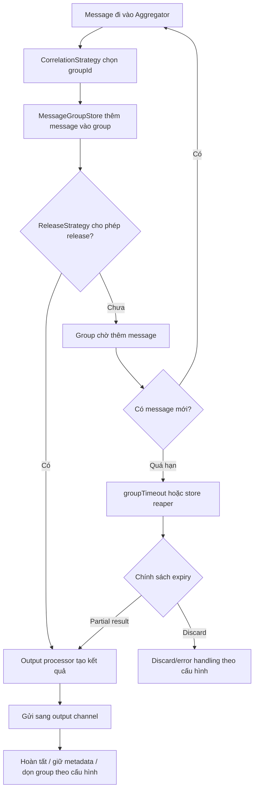

# Theo dõi group của Aggregator trong Spring Integration

## 1. Vấn đề: message đã tới nhưng Aggregator chưa có output

Trong **Enterprise Integration Patterns (EIP)**, `Aggregator` gom nhiều message liên quan thành một kết quả. Ví dụ, một đơn hàng gồm ba dòng hàng được xử lý song song; Aggregator phải đợi đủ các dòng trước khi phát kết quả. Một message đã tới input channel nhưng chưa xuất hiện ở output có thể đang **chờ hợp lệ**, bị thiếu phần tử, gặp lỗi trong release strategy hoặc đã hết thời gian chờ.

Muốn xử lý tình huống này, ta cần quan sát **trạng thái từng nhóm message (message group)**, đồng thời đo tổng số nhóm đang chờ, kích thước nhóm, thời gian chờ, nhóm được release, nhóm hết hạn và message đến muộn.

Đây là bài **“Theo dõi group của aggregator”** thuộc chương **Audit và observability** của module `SPRING_INTEGRATION_PATTERN`. Module hướng đến thực hành Router, Filter, Transformer, Splitter, Aggregator, Gateway, retry, error channel và correlation, đồng thời kiểm thử, theo dõi nhánh xử lý trong các flow ít phụ thuộc và dễ mở rộng.

Sau bài học, bạn có thể:

- Mô tả vòng đời `MessageGroup` từ lúc nhận phần tử đầu tiên tới release, timeout, expiry.
- Phân biệt **số group tồn tại trong store** với **số group thật sự đang chờ**.
- Sử dụng `MessageGroupStore`, `MessageGroup` và Micrometer để đo backlog và tuổi nhóm.
- Chọn thời điểm đúng để đếm group được tạo, kết quả được tạo và kết quả đã được downstream xác nhận.
- Điều tra thiếu fragment, correlation sai, duplicate, late arrival, timeout và group tồn đọng sau restart.
- Viết integration test cho group chưa đủ, đủ phần tử và các chính sách xử lý group quá hạn.

## 2. Vòng đời của một message group



**Ba quyết định độc lập** thường bị nhầm lẫn:

1. **Correlation:** message thuộc nhóm nào? Mặc định Aggregator dùng header correlation của Spring Integration; ứng dụng có thể cấu hình `CorrelationStrategy` riêng.
2. **Release:** nhóm đã đủ điều kiện phát kết quả chưa? Mặc định `SimpleSequenceSizeReleaseStrategy` dựa vào thông tin sequence; cũng có thể định nghĩa theo số lượng, trạng thái hoặc nội dung group.
3. **Expiry:** nhóm sẽ ra sao nếu không đủ điều kiện release trong thời gian cho phép? Có thể release một phần hoặc discard, sau đó xóa nhóm hay giữ metadata tùy cấu hình.

Một group có thể có trạng thái *chờ*, *đủ điều kiện release*, *đã tạo output*, *đã hoàn tất nhưng còn metadata*, hoặc *đã bị xóa*. Bản ghi `MessageGroupStore` không nhất thiết cho biết message đã được ứng dụng bên ngoài xử lý thành công.

### Minh họa đơn hàng ba phần tử

Giả sử `batchId=order-42`, kỳ vọng ba fragment:

| Thời điểm | Dữ liệu đến | Group trong store | Hành vi |
| --- | --- | --- | --- |
| T1 | item A | size = 1 | Chưa release |
| T2 | item B | size = 2 | Tiếp tục chờ |
| T3 | item C | size = 3 | Release strategy cho phép tạo kết quả |
| T4 | Aggregate output được gửi | Group hoàn tất hoặc được xóa | Tùy `expireGroupsUponCompletion` |
| T5 | item D đến muộn cùng ID | Có thể bị loại hoặc tạo group mới | Tùy chính sách giữ group metadata/expiry |

Không thể kết luận rằng item A hoặc B “bị mất” chỉ vì chưa có output tại T2. Nếu số fragment dự kiến là ba nhưng item C không đến, group có thể chờ mãi nếu không có chính sách timeout hoặc cleanup phù hợp.

## 3. Correlation ID, group ID và sequence

Để theo dõi đúng nhóm, phải phân biệt:

| Trường | Ý nghĩa | Phạm vi |
| --- | --- | --- |
| `MessageHeaders.ID` | ID của một message cụ thể | Có thể khác khi Transformer/Splitter tạo message mới |
| `CORRELATION_ID` | Gom các message liên quan | Có thể dùng làm group key của Aggregator |
| `SEQUENCE_NUMBER` | Vị trí message trong một chuỗi | Ví dụ 1, 2, 3 |
| `SEQUENCE_SIZE` | Kích thước chuỗi dự kiến | Ví dụ 3; không phải flow nào cũng biết trước |
| `batchId` / business key | Định danh nhóm theo hợp đồng nghiệp vụ | Thường cần ổn định xuyên service và retry |
| `traceId`, `spanId` | Liên kết tracing/observability | Không dùng làm group ID hoặc khóa chống trùng mặc định |

Nếu phía trước có **Splitter**, Spring Integration thường gắn sequence/correlation headers để Aggregator nhận biết các message con. Với `PublishSubscribeChannel` hoặc recipient list router, cần kiểm tra cấu hình `applySequence` khi muốn dùng release strategy mặc định dựa trên sequence.

Nếu tự chọn khóa `batchId`, cần đảm bảo:

- Không có hai phiên xử lý khác nhau tình cờ dùng cùng một khóa khi chúng không được phép gộp.
- Mọi fragment thuộc cùng batch truyền đúng ID qua Filter, Router, Gateway và các channel bất đồng bộ.
- Có chiến lược rõ với fragment đến muộn, redelivery hoặc duplicate.
- ID nghiệp vụ có thể xuất hiện trong **audit/log có quyền truy cập phù hợp**, nhưng **không** đưa raw ID vào tag metric.

Một nhóm sai correlation có thể trông như hai vấn đề khác nhau: một nhóm bị treo vì thiếu message, một nhóm khác có message không mong đợi. Khi điều tra, hãy đối chiếu business key, số fragment kỳ vọng và các mốc audit đầu vào.

## 4. Đọc trạng thái từ MessageGroupStore

Spring Integration có `MessageGroupStore` để giữ trạng thái các nhóm trong lúc đợi release. Các API hữu ích:

| API | Giá trị | Cách diễn giải |
| --- | --- | --- |
| `getMessageGroup(groupId)` | `MessageGroup` của một khóa | Kiểm tra một group cụ thể khi điều tra |
| `getMessageGroupCount()` | Số group đang được lưu | **Có thể bao gồm group đã hoàn tất nhưng vẫn giữ metadata** |
| `getMessageCountForAllMessageGroups()` | Số message trong tất cả group | API tùy chọn; implementation có thể không hỗ trợ |
| `messageGroupSize(groupId)` | Kích thước một group | Có thể dùng khi đã biết group ID |
| `MessageGroup.size()` | Số message của group tại thời điểm đọc | Không tự đồng nghĩa số phần tử khác nhau về nghiệp vụ |
| `MessageGroup.isComplete()` | Metadata group đánh dấu hoàn tất | Không chứng minh downstream đã ACK |
| `MessageGroup.getTimestamp()` | Thời điểm group được tạo (epoch milliseconds) | Gợi ý thời gian tồn tại của group |
| `MessageGroup.getLastModified()` | Lần cập nhật gần nhất | Dùng phân biệt group lâu không đổi và group đang tăng |
| `MessageGroup.getSequenceSize()` | Kích thước sequence dự kiến nếu biết | Có thể bằng 0 khi chưa biết số lượng |

Ví dụ kiểm tra một group khi đang điều tra:

```java
import java.time.Duration;
import java.time.Instant;
import java.time.Clock;
import org.springframework.integration.store.MessageGroup;
import org.springframework.integration.store.MessageGroupStore;

void inspectGroup(MessageGroupStore store, Object batchId, Clock clock) {
    MessageGroup group = store.getMessageGroup(batchId);
    if (group == null || group.size() == 0) {
        return; // Có thể chưa có group hoặc đã bị xóa/hoàn tất.
    }

    Duration age = Duration.between(
            Instant.ofEpochMilli(group.getTimestamp()),
            clock.instant());
    Duration idle = Duration.between(
            Instant.ofEpochMilli(group.getLastModified()),
            clock.instant());

    System.out.println("group size=" + group.size());
    System.out.println("expected sequence size=" + group.getSequenceSize());
    System.out.println("complete=" + group.isComplete());
    System.out.println("age=" + age);
    System.out.println("idle=" + idle);
}
```

Đây là đoạn **chẩn đoán**: in thông tin size/age, không ghi group ID hoặc nội dung payload. Với kho dữ liệu bền vững, `getMessageGroup()` có thể phải tải các message; khi chỉ cần metadata nên ưu tiên `getGroupMetadata(groupId)` nếu implementation hỗ trợ. Đừng quét tất cả group và tải toàn bộ payload trong mỗi chu kỳ scrape metrics.

### Group count khác pending group count

Theo cấu hình mặc định, một group hoàn tất bình thường có thể giữ lại metadata dạng group rỗng để nhận diện và bỏ message đến muộn. Khi đó:

```text
group_count_in_store = 120
group_pending        = 10
completed_tombstones = 110
```

Nếu đặt biểu đồ `getMessageGroupCount()` với nhãn `pending_groups` trong trường hợp này thì sẽ cảnh báo sai. Muốn dùng group count như backlog, cần một quy tắc lưu trữ rõ: chẳng hạn xóa nhóm ngay sau khi release bình thường bằng `expireGroupsUponCompletion(true)` hoặc có phép lọc group chưa hoàn tất đã được kiểm chứng. Xóa metadata sớm có thể khiến **late message** được coi là nhóm mới; đó là đánh đổi về idempotency và chính sách nghiệp vụ.

## 5. Bộ metric nên theo dõi

| Metric gợi ý | Loại | Điểm đo | Điều cần cảnh giác |
| --- | --- | --- | --- |
| `app.aggregator.groups.in.store` | Gauge | `MessageGroupStore.getMessageGroupCount()` | Gồm metadata nhóm đã hoàn tất nếu store vẫn giữ |
| `app.aggregator.messages.in.groups` | Gauge | Tổng message còn trong group store | API tùy chọn, có thể tốn chi phí ở DB |
| `app.aggregator.group.output.built` | Counter | Output processor tạo kết quả | Chưa chứng minh gửi kênh/ACK thành công |
| `app.aggregator.group.age.at.output` | Timer | Group được tạo → output processor chạy | Không bao gồm downstream processing |
| `app.aggregator.group.size.at.output` | DistributionSummary | Số message lúc output được tạo | Đơn vị là **message trong group**, không phải số batch |
| `app.aggregator.group.expired` | Counter | Callback/điểm xử lý expiry đã phân loại | Phải tách partial release với discard |
| `app.aggregator.group.late.discarded` | Counter | Luồng từ chối late message xác nhận | Không suy luận chỉ từ ID trùng |
| `app.aggregator.output.confirmed` | Counter | Downstream ACK/commit theo hợp đồng | Không được cộng từ output channel send |
| `app.aggregator.oldest.pending.age` | Gauge | Tuổi lớn nhất của các group thật sự pending | Cần snapshot/metadata thích hợp; quét DB có thể đắt |

Các tên trên là **quy ước đề xuất cho ứng dụng**, không phải cam kết Spring Integration tự xuất đủ mọi meter. Micrometer Observation của handler/channel cung cấp thông tin về thao tác, nhưng không tự định nghĩa các outcome nghiệp vụ như *group expired due to missing fragment*.

### Chọn tag

Các tag có thể dùng:

```text
flow=orders
aggregator=orderItems
outcome=normal|partial|discard|error
reason=timeout|missing_part|invalid_sequence|other
```

Không dùng `groupId`, `orderId`, `correlationId`, `messageId`, `traceId` hoặc payload làm tag vì mỗi giá trị có thể tạo một time series mới và có nguy cơ lộ dữ liệu. Những ID này thuộc log, trace hoặc audit event có phân quyền và thời hạn lưu phù hợp.

## 6. Ví dụ Java DSL: theo dõi group đang tích lũy

Ví dụ sử dụng Java 17, Spring Boot 3.x, Spring Integration 6.x và Micrometer. Flow gom **đúng ba message** có cùng `batchId` thành một đối tượng `BatchSummary`. Mục đích là minh họa cách theo dõi group, không đặt quy tắc rằng mọi ứng dụng thật chỉ có ba fragment.

### 6.1. Cấu hình lưu trữ, meter và flow

```java
import java.time.Clock;
import java.time.Duration;
import java.util.List;

import io.micrometer.core.instrument.Counter;
import io.micrometer.core.instrument.DistributionSummary;
import io.micrometer.core.instrument.Gauge;
import io.micrometer.core.instrument.MeterRegistry;
import io.micrometer.core.instrument.Timer;
import org.springframework.beans.factory.annotation.Qualifier;
import org.springframework.context.annotation.Bean;
import org.springframework.context.annotation.Configuration;
import org.springframework.integration.annotation.EnableIntegration;
import org.springframework.integration.channel.DirectChannel;
import org.springframework.integration.channel.QueueChannel;
import org.springframework.integration.dsl.IntegrationFlow;
import org.springframework.integration.store.MessageGroup;
import org.springframework.integration.store.MessageGroupStore;
import org.springframework.integration.store.SimpleMessageStore;
import org.springframework.messaging.MessageChannel;
import org.springframework.messaging.PollableChannel;

@Configuration
@EnableIntegration
class AggregationMonitoringConfiguration {

    @Bean("batchInput")
    MessageChannel batchInput() {
        return new DirectChannel();
    }

    @Bean("batchOutput")
    PollableChannel batchOutput() {
        return new QueueChannel();
    }

    @Bean("batchGroupStore")
    MessageGroupStore batchGroupStore() {
        // Store trong RAM chỉ dùng cho demo/test, mất khi process restart.
        return new SimpleMessageStore();
    }

    @Bean
    BatchGroupMetrics batchGroupMetrics(
            @Qualifier("batchGroupStore") MessageGroupStore store,
            MeterRegistry registry) {
        return new BatchGroupMetrics(store, registry, Clock.systemUTC());
    }

    @Bean
    IntegrationFlow batchAggregationFlow(
            @Qualifier("batchGroupStore") MessageGroupStore store,
            BatchGroupMetrics metrics) {
        return IntegrationFlow.from("batchInput")
                .aggregate(a -> a
                        .messageStore(store)
                        .correlationStrategy(
                                message -> message.getHeaders().get("batchId"))
                        .releaseStrategy(group -> group.size() >= 3)
                        .outputProcessor(metrics::buildSummary)
                        // Để số group trong store phản ánh group chưa release
                        // trong ví dụ này; xem đánh đổi với late messages.
                        .expireGroupsUponCompletion(true))
                .channel("batchOutput")
                .get();
    }
}

record BatchSummary(String batchId, List<String> items) {}

final class BatchGroupMetrics {
    private final Counter outputBuilt;
    private final Timer ageAtOutput;
    private final DistributionSummary sizeAtOutput;
    private final Clock clock;

    BatchGroupMetrics(
            MessageGroupStore store, MeterRegistry registry, Clock clock) {
        this.clock = clock;

        // Dùng một store riêng cho aggregator này.
        Gauge.builder("app.aggregator.groups.in.store",
                      store, MessageGroupStore::getMessageGroupCount)
                .description("Số group hiện còn được lưu trong store")
                .tag("aggregator", "orderItems")
                .register(registry);

        // API đếm message có thể không được mọi store hỗ trợ.
        // Với SimpleMessageStore của ví dụ, API này được hỗ trợ.
        Gauge.builder("app.aggregator.messages.in.groups",
                      store, MessageGroupStore::getMessageCountForAllMessageGroups)
                .tag("aggregator", "orderItems")
                .register(registry);

        outputBuilt = registry.counter(
                "app.aggregator.group.output.built",
                "aggregator", "orderItems");
        ageAtOutput = Timer.builder("app.aggregator.group.age.at.output")
                .description("Thời gian từ khi tạo group tới lúc tạo output")
                .tag("aggregator", "orderItems")
                .register(registry);
        sizeAtOutput = DistributionSummary.builder(
                        "app.aggregator.group.size.at.output")
                .baseUnit("messages")
                .tag("aggregator", "orderItems")
                .register(registry);
    }

    BatchSummary buildSummary(MessageGroup group) {
        // Đây là mốc output được *tạo*, không phải downstream ACK.
        long ageMillis = Math.max(
                0L, clock.millis() - group.getTimestamp());
        ageAtOutput.record(Duration.ofMillis(ageMillis));
        sizeAtOutput.record(group.size());
        outputBuilt.increment();

        // Tạo một payload mới, tách khỏi collection nội bộ của store.
        List<String> items = group.getMessages().stream()
                .map(message -> (String) message.getPayload())
                .toList();
        return new BatchSummary(String.valueOf(group.getGroupId()), items);
    }
}
```

**Ý nghĩa của ví dụ:**

1. `SimpleMessageStore` thuộc bộ nhớ tiến trình; chỉ thích hợp minh họa, unit test và các trường hợp chấp nhận mất trạng thái khi restart. Production cần xem xét một `MessageGroupStore` bền vững theo yêu cầu.
2. `correlationStrategy` chọn group theo header `batchId`. Ở ingress, cần kiểm tra header này **không null**, đúng kiểu và đủ duy nhất; ví dụ giả định producer đã thực hiện điều đó.
3. `releaseStrategy(group -> group.size() >= 3)` chỉ áp dụng khi số lượng cố định, không bảo vệ được trường hợp một fragment bị gửi trùng dưới ID message khác. Khi cần đảm bảo đủ thành phần *duy nhất*, phải dùng sequence/event ID và idempotency thích hợp.
4. `outputProcessor` được gọi lúc framework tạo output cho group. Counter `output.built` và Timer không chứng minh `batchOutput` đã nhận thành công hoặc consumer đã ACK.
5. `expireGroupsUponCompletion(true)` làm group đã release bình thường được xóa khỏi store để dễ quan sát backlog trong demo. Điều này đổi cách xử lý **late arrival**: cùng group ID đến sau có thể tạo một group mới. Cần thay cấu hình khi nghiệp vụ yêu cầu chặn late message.
6. `getMessageGroupCount()` và `getMessageCountForAllMessageGroups()` là phép đo trạng thái tại thời điểm scrape. Trong store phân tán, performance/semantics có thể khác; không dùng các phép đọc này để điều khiển giao dịch nghiệp vụ.

### 6.2. Gửi ba fragment theo cùng batch

```java
import org.springframework.messaging.MessageChannel;
import org.springframework.messaging.support.MessageBuilder;

void sendItem(MessageChannel batchInput, String batchId, String item) {
    boolean accepted = batchInput.send(
            MessageBuilder.withPayload(item)
                    .setHeader("batchId", batchId)
                    .build());
    if (!accepted) {
        throw new IllegalStateException("Không gửi được fragment tới Aggregator");
    }
}
```

Giả sử gửi `A`, `B`, `C` với `batchId=order-42`: sau A và B, store có một group với size lần lượt là 1 và 2; sau C, `BatchSummary` được tạo. Vì cấu hình xóa group sau completion, group count trở về 0 khi xử lý hoàn tất. **Thứ tự `items` không được giả định là thứ tự gửi** nếu không có chính sách sequence/order cụ thể; ví dụ kiểm thử nên kiểm tra tập phần tử.

## 7. Theo dõi timeout, partial result và group hết hạn

Một group có thể không bao giờ đạt release strategy vì mất fragment, Filter bỏ fragment, router gửi nhầm nhánh hoặc producer ngừng hoạt động. Khi đó cần chính sách hết hạn phù hợp.

Trong Java DSL, có thể bổ sung các tùy chọn ở cấu hình Aggregator:

```java
.aggregate(a -> a
        .messageStore(store)
        .correlationStrategy(message -> message.getHeaders().get("batchId"))
        .releaseStrategy(group -> group.size() >= 3)
        .outputProcessor(metrics::buildSummary)
        .groupTimeout(30_000)
        .sendPartialResultOnExpiry(true)
        .expireGroupsUponCompletion(true)
        .expireGroupsUponTimeout(true))
```

Đây là **phương án thay thế** cho đoạn `.aggregate(...)` ở mục 6, không ghép thêm một Aggregator thứ hai vào flow. Với `groupTimeout` dương, nếu group vẫn chưa đủ điều kiện release khi hết thời gian chờ sau lần cập nhật gần nhất, framework lập lịch kiểm tra/force completion; release strategy có thể được hỏi lại. Nếu chưa đủ điều kiện và `sendPartialResultOnExpiry(true)`, framework có thể phát một kết quả **partial**. Nếu `false` (mặc định), group chưa đủ có thể bị discard theo chính sách expiry. `expireGroupsUponTimeout` quyết định việc loại metadata sau khi xử lý timeout theo cấu hình.

**Không ghi nhãn `normal` cho mọi lần `buildSummary()`** nếu đã bật partial result: output processor có thể chạy cả khi timeout. Để có counter `normal_released`, `partial_released`, `expired_discarded`, hãy dùng dữ liệu về completion và callback/discard flow từ **đúng ranh giới**; có thể bổ sung business status ở payload kết quả hoặc instrument điểm force completion. Đừng suy ra nguyên nhân chỉ từ `group.size() < 3` khi release strategy có nhiều điều kiện.

### GroupTimeout khác MessageGroupStoreReaper

| Cơ chế | Cách kích hoạt | Phù hợp khi nào? |
| --- | --- | --- |
| `groupTimeout` | Lập lịch cho từng group khi cập nhật mà chưa release | Muốn không chờ vô hạn sau lần message cuối đến |
| `groupTimeoutExpression` | Biểu thức chọn thời điểm/độ trễ theo group | Cần timeout linh hoạt theo trạng thái group |
| `MessageGroupStoreReaper` | Job chạy định kỳ, gọi expiry callback trên store | Dọn nhóm cũ/orphaned và metadata rỗng còn tồn |
| `expireTimeout` / `expireDuration` của correlation handler | Cơ chế purge định kỳ gắn với handler trong phiên bản hỗ trợ | Dọn group cũ sau restart với store bền vững |

Nếu cần timeout tính theo **thời điểm group được tạo**, không mặc định xem `groupTimeout(30_000)` là “30 giây từ fragment đầu tiên”. Với group timeout dạng thời lượng, lịch có thể được thiết lập lại khi có message mới; nên dùng biểu thức dựa trên `MessageGroup.getTimestamp()` hoặc chính sách thời hạn tuyệt đối nếu hợp đồng yêu cầu.

Với reaper chạy mỗi phút và timeout 30 giây, một group có thể hết hạn **muộn hơn** 30 giây do lịch quét. Khi dùng cả các cơ chế, cần tránh cleanup sai thời điểm và xác định rõ xử lý trường hợp timeout/late message.

## 8. Late message, duplicate và tính bền vững

### 8.1. Late arrival

Nếu `expireGroupsUponCompletion(false)`, group đã hoàn tất có thể giữ **metadata rỗng** để chặn message đến muộn cùng ID. Điều này làm tăng số group trong store dù không có fragment đang chờ. Cần `MessageGroupStoreReaper` hoặc cleanup có kiểm soát để tránh metadata tích tụ vô hạn.

Nếu `expireGroupsUponCompletion(true)`, metadata được xóa ngay sau completion; một message đến muộn với cùng correlation key có thể khởi tạo group mới. Trong flow xử lý đơn hàng, điều đó có thể gây phát kết quả trùng hoặc group giả đang chờ. Cần thêm idempotent receiver, business event ID hoặc trạng thái batch đã hoàn tất ở kho bền vững nếu muốn chặn.

### 8.2. Duplicate fragment và số lượng giả

Giả sử batch kỳ vọng `A`, `B`, `C`, nhưng upstream gửi `A`, `A`, `B` dưới các `MessageHeaders.ID` khác nhau. Release strategy dựa vào `group.size() >= 3` có thể release dù thiếu `C`. Nên cân nhắc:

- Dùng `SEQUENCE_NUMBER`/`SEQUENCE_SIZE` đúng hợp đồng và release strategy có tính đến sequence phù hợp.
- Dùng idempotency dựa trên khóa fragment nghiệp vụ nếu redelivery có thể tạo ID message mới.
- Định nghĩa chính sách khi sequence trùng, thiếu hoặc sai size.
- Ghi audit của fragment bị duplicate/late cùng business correlation; không dùng chúng làm metric tag.

### 8.3. Store bền vững và nhiều instance

`SimpleMessageStore` trong RAM không giữ group qua restart. Với yêu cầu khôi phục trạng thái, có thể dùng store JDBC, Redis, MongoDB hoặc implementation phù hợp phiên bản và hạ tầng. Tuy nhiên, **store bền vững không tự giải quyết concurrency**:

- Nhiều instance cần cấu hình locking phù hợp để tránh cạnh tranh cập nhật/release cùng group.
- Việc lưu state, tạo output và ACK downstream có thể ở những transaction khác nhau; vẫn có nguy cơ gửi lại/trùng sau lỗi.
- Không dùng cùng một `MessageGroupStore` instance cho các aggregator độc lập khi có expiry callback; framework có cảnh báo/ràng buộc về thao tác expiry của nhiều correlation handler trên cùng store.
- Nếu dùng chung tài nguyên DB, hãy phân vùng/tạo region riêng và đảm bảo group key không va chạm.
- Có chiến lược phục hồi các group tồn sau restart; một lịch timeout đang nằm trong RAM có thể cần được lập lại hoặc quét theo store.

## 9. Dashboard và cảnh báo nhóm bị kẹt

Một dashboard Aggregator nên nhìn đồng thời:

1. **Số group/message trong store**: có đang tăng liên tục không?
2. **Oldest pending age** và số group quá hạn: có group nào rất lâu không được release?
3. **Thời gian tạo output** p50/p95/p99: các group release mất bao lâu tính từ lúc được tạo?
4. **Output built / output confirmed**: có tạo kết quả nhưng downstream không xử lý được?
5. **Expiry/partial/discard/late**: bao nhiêu nhóm bị xử lý do timeout và tại sao?
6. **Input fragment rate và group release rate**: có chênh lệch bất thường so với kích thước group kỳ vọng?

Nếu dùng Prometheus exporter, các metric ví dụ của mục 6 thường có dạng:

```promql
# Tổng số group còn được store giữ (không tự suy là pending).
app_aggregator_groups_in_store{aggregator="orderItems"}
```

```promql
# Tốc độ tạo output group, đơn vị group/giây.
rate(app_aggregator_group_output_built_total{
  aggregator="orderItems"
}[5m])
```

Khi bật histogram trên Timer `app.aggregator.group.age.at.output` bằng `.publishPercentileHistogram()` hoặc cấu hình distribution tương đương, có thể tính p95:

```promql
histogram_quantile(
  0.95,
  sum by (le) (
    rate(app_aggregator_group_age_at_output_seconds_bucket{
      aggregator="orderItems"
    }[5m])
  )
)
```

**Truy vấn p95 chỉ hoạt động khi histogram đã được xuất**; mã ví dụ ở mục 6 chỉ đăng ký Timer thông thường. Ngoài ra, p95 này chỉ bao gồm group **đã tới output processor**, không tính các group đang chờ vô hạn. Vì vậy phải kết hợp với oldest pending age và group backlog.

| Tín hiệu | Câu hỏi cần điều tra | Bằng chứng bổ sung |
| --- | --- | --- |
| Group store count tăng đều | Group chưa release hay metadata rỗng tích tụ? | `isComplete`, cấu hình expiry, pending count |
| Group size mãi dưới expected | Thiếu fragment hay correlation sai? | Header sequence, audit input, Filter/Router |
| Oldest pending age tăng mạnh | Có consumer/timeout/reaper bị dừng? | Scheduler, task errors, group store |
| Partial/discard tăng | Upstream mất fragment hoặc timeout quá ngắn? | Retry, Filter, error channel, latency của nhánh |
| Output built tăng nhưng confirmed không tăng | Downstream chậm/lỗi hoặc thiếu ACK? | Output channel, adapter errors, broker lag |
| Store write latency tăng | Backend store nghẽn? | DB pool, lock wait, store metrics |
| Late messages tăng | Timeout sớm, redelivery hoặc trùng ID? | Producer logs, business key, dedup state |

Khi nghi ngờ group treo, điều tra theo thứ tự **input fragments → correlation key → store group size → release strategy → timeout/scheduler → output/ACK**. Đừng kết luận group mất message chỉ bằng `input_count - output_count`: Splitter có thể tạo nhiều fragment, Filter có thể loại hợp lệ và Aggregator thực hiện fan-in.

## 10. Kiểm thử trạng thái group và metric

### 10.1. Integration test: group chưa đủ rồi release

Kiểm thử sau sử dụng JUnit 5, AssertJ và Spring Test. Vì cấu hình ví dụ không có auto-configuration Spring Boot, tạo `SimpleMeterRegistry` trong test:

```java
import static org.assertj.core.api.Assertions.assertThat;

import io.micrometer.core.instrument.MeterRegistry;
import io.micrometer.core.instrument.simple.SimpleMeterRegistry;
import org.junit.jupiter.api.Test;
import org.springframework.beans.factory.annotation.Autowired;
import org.springframework.beans.factory.annotation.Qualifier;
import org.springframework.context.annotation.Bean;
import org.springframework.context.annotation.Configuration;
import org.springframework.integration.store.MessageGroupStore;
import org.springframework.messaging.Message;
import org.springframework.messaging.MessageChannel;
import org.springframework.messaging.PollableChannel;
import org.springframework.messaging.support.MessageBuilder;
import org.springframework.test.context.junit.jupiter.SpringJUnitConfig;

@SpringJUnitConfig(classes = {
        AggregationMonitoringConfiguration.class,
        AggregatorGroupTest.TestMeterConfiguration.class
})
class AggregatorGroupTest {

    @Configuration
    static class TestMeterConfiguration {
        @Bean
        MeterRegistry meterRegistry() {
            return new SimpleMeterRegistry();
        }
    }

    @Autowired
    @Qualifier("batchInput")
    MessageChannel input;

    @Autowired
    @Qualifier("batchOutput")
    PollableChannel output;

    @Autowired
    @Qualifier("batchGroupStore")
    MessageGroupStore store;

    @Autowired
    MeterRegistry registry;

    private void send(String batchId, String value) {
        assertThat(input.send(MessageBuilder.withPayload(value)
                .setHeader("batchId", batchId)
                .build())).isTrue();
    }

    @Test
    void groupIsPendingUntilThreeMessagesArrive() {
        send("order-42", "A");
        send("order-42", "B");

        assertThat(store.getMessageGroupCount()).isEqualTo(1);
        assertThat(store.getMessageGroup("order-42").size()).isEqualTo(2);
        assertThat(output.receive(0)).isNull();

        send("order-42", "C");

        Message<?> result = output.receive(1_000);
        assertThat(result).isNotNull();
        BatchSummary summary = (BatchSummary) result.getPayload();
        assertThat(summary.batchId()).isEqualTo("order-42");
        assertThat(summary.items())
                .containsExactlyInAnyOrder("A", "B", "C");

        // Cấu hình ví dụ xóa group sau completion.
        assertThat(store.getMessageGroupCount()).isZero();
        assertThat(registry.get("app.aggregator.group.output.built")
                .tag("aggregator", "orderItems")
                .counter().count()).isEqualTo(1.0);
        assertThat(registry.get("app.aggregator.group.age.at.output")
                .tag("aggregator", "orderItems")
                .timer().count()).isEqualTo(1);
    }
}
```

Test này kiểm chứng **chính sách ba message** của ví dụ, mốc tạo output và việc dọn group. Nó không chứng minh xử lý broker hoặc database downstream thành công. Khi dự án dùng store bền vững, phải có test phục hồi/restart và xử lý transaction riêng.

### 10.2. Ma trận kiểm thử cần bổ sung

| Ca kiểm thử | Kỳ vọng và lý do |
| --- | --- |
| Hai fragment cùng batch | Group size = 2, chưa có output |
| Fragment thứ ba đến | Group release một lần; output chứa đủ ba phần tử |
| Hai batch xen kẽ | Mỗi batch có group ID riêng, không trộn message |
| Thiếu fragment, hết timeout | Tạo partial hoặc discard đúng hợp đồng; có metric expiry |
| Có fragment đến sát hạn | Timeout/release không làm mất hoặc phát trùng kết quả theo chính sách |
| Late fragment sau completion | Từ chối hoặc tạo group mới **theo cấu hình đã chọn** |
| Duplicate fragment có ID mới | Không giả định `group.size() >= 3` đủ chống trùng |
| Filter loại một fragment | Có thể khiến group chờ; đối chiếu metric Filter và aggregator |
| Router chia nhiều nhánh | Group chỉ nhận những fragment định tuyến tới nó |
| Store không hỗ trợ group-count API | Meter không phá hoạt động nghiệp vụ; có fallback hoặc metric khác |
| Store bền vững + restart | Group còn lại được khôi phục; timeout/orphan cleanup hoạt động |
| Nhiều producer đồng thời | Không release trùng/race condition; kiểm tra locking |
| Downstream send thất bại | Phân biệt `output.built` và `output.confirmed` |
| Group đã hoàn tất nhưng metadata còn | Group-count không được gán nhãn pending sai |

Với test timeout, dùng `TaskScheduler` kiểm soát được trong môi trường test hoặc thời gian chờ có timeout/điều kiện quan sát, tránh phụ thuộc `Thread.sleep()` cố định. Với các phép thử liên quan retry và transaction, đảm bảo test đo đúng trạng thái sau commit hoặc sau rollback theo chính sách của flow.

## 11. Lỗi thiết kế thường gặp

1. **Dùng `getMessageGroupCount()` làm pending count trong mọi cấu hình.** Completed tombstone có thể vẫn được lưu để chặn late message.
2. **Giả định mọi group có một số fragment cố định.** Với scatter-gather hoặc dữ liệu không đủ sequence, release strategy có thể cần điều kiện khác.
3. **Gọi `groupTimeout` là hạn từ lúc group được tạo.** Với dạng thời lượng, lịch có thể được gia hạn khi message mới đến.
4. **Đếm mỗi lần `ReleaseStrategy` được gọi là một group release.** Strategy có thể được gọi nhiều lần trước khi thật sự release và có thể được hỏi lại ở timeout.
5. **Đếm việc build output như ACK.** Output processor chạy không đồng nghĩa downstream đã commit.
6. **Chỉ xem p95 của group đã release.** Group treo chưa tạo output nên không góp vào Timer; cần oldest pending age.
7. **Gắn group ID vào metric tag.** Điều này gây cardinality rất cao và có thể tiết lộ thông tin nghiệp vụ.
8. **Quét toàn bộ group và tải payload mỗi lần scrape.** Có thể làm nghẽn JDBC/Redis store, tăng CPU và khóa.
9. **Xóa metadata quá sớm mà không có idempotency.** Fragment đến muộn có thể mở nhóm mới rồi tạo output trùng.
10. **Dùng chung một store cho nhiều aggregator có expiry.** Callback của handler khác có thể tác động nhầm group, cần phân vùng và ownership rõ ràng.

## 12. Checklist đưa vào production

- [ ] Xác định group key, sequence contract và uniqueness cho từng Aggregator.
- [ ] Có metric số group lưu trong store, số message trong group, output built/confirmed.
- [ ] Định nghĩa pending, completed tombstones và cách loại metadata khỏi số liệu backlog.
- [ ] Có oldest pending age và số group quá hạn; đo cả nhóm chưa release.
- [ ] Đo release latency, size distribution và số lần partial/discard theo nguyên nhân.
- [ ] Có chính sách `groupTimeout`, `MessageGroupStoreReaper` hoặc cleanup orphaned groups.
- [ ] Xác định late arrival, duplicate, retry và dead-letter theo hợp đồng nghiệp vụ.
- [ ] Với store bền vững/nhiều instance, kiểm tra lock registry, transaction và khả năng phục hồi.
- [ ] Không dùng correlation ID, payload hoặc ID message trong metric tag.
- [ ] Có integration test cho group đủ/thiếu fragment, timeout, late, duplicate và downstream error.
- [ ] Dashboard hiển thị backlog, oldest age, output rate, expiry, timeout và store errors.
- [ ] Có audit/log/trace để đối soát từng batch khi metric tổng hợp báo bất thường.

## 13. Tài liệu tham khảo

- [Spring Integration Reference — Aggregator](https://docs.spring.io/spring-integration/reference/aggregator.html)
- [Spring Integration Reference — Metrics and Management](https://docs.spring.io/spring-integration/reference/metrics.html)
- [Spring Integration Javadoc — MessageGroupStore](https://docs.spring.io/spring-integration/docs/6.5.x/api/org/springframework/integration/store/MessageGroupStore.html)
- [Spring Integration Javadoc — MessageGroup](https://docs.spring.io/spring-integration/docs/6.5.x/api/org/springframework/integration/store/MessageGroup.html)
- [Spring Integration Javadoc — AggregatorSpec](https://docs.spring.io/spring-integration/docs/6.5.x/api/org/springframework/integration/dsl/AggregatorSpec.html)
- [Micrometer Reference — Meters](https://docs.micrometer.io/micrometer/reference/concepts.html)

**Ghi nhớ:** theo dõi Aggregator cần nhìn cả **những group đang chờ** lẫn **những kết quả đã được tạo**. Group count phải được hiểu theo chính sách lưu metadata; timeout, late arrival và duplicate phải được xác định bằng hợp đồng rõ ràng. Kết hợp group store, metric, correlation và audit giúp phát hiện đúng nút nghẽn mà không nhầm group đang chờ hợp lệ với message thất lạc.
