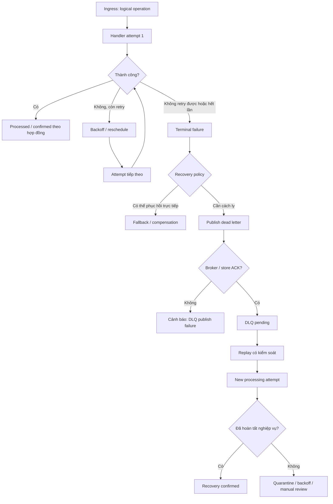

# Theo dõi retry, dead letter và recovery trong Spring Integration

## 1. Một message thất bại có thể đi qua nhiều trạng thái

Trong hệ thống dùng **Enterprise Integration Patterns (EIP)**, lỗi ở một handler không nhất thiết đồng nghĩa message đã mất. Spring Integration có thể thử lại thao tác bằng **Retry**, chuyển lỗi sang **Error Channel**, giữ message không thể xử lý trong **dead-letter queue (DLQ)** rồi chạy quy trình **Recovery** hoặc replay khi nguyên nhân đã được khắc phục.

Ví dụ một flow đặt hàng đi qua `Gateway → Transformer → Router → Service Activator → Outbound Adapter`. API kho hàng tạm thời mất kết nối; lần thử thứ nhất và thứ hai thất bại, lần thứ ba thành công. Trường hợp khác, payload bị sai schema nên không nên thử lại; message cần được cách ly để sửa hoặc điều tra. Nếu chỉ đếm số exception, nhóm vận hành sẽ không biết **bao nhiêu nghiệp vụ thất bại cuối cùng**, **bao nhiêu message đang ở DLQ** và **bao nhiêu message replay đã được xử lý thành công**.

Bài học thuộc chương **Audit và observability** của module `SPRING_INTEGRATION_PATTERN`, nơi thực hành thiết kế flow ít phụ thuộc, dễ mở rộng và kiểm thử các nhánh Router, Filter, Transformer, Splitter, Aggregator, Gateway, retry, error channel và correlation.

Sau bài này, bạn có thể:

- Phân biệt **attempt**, **logical operation**, **terminal failure**, **DLQ publish**, **replay** và **recovery confirmed**.
- Chọn vị trí ghi metric trong `RequestHandlerRetryAdvice`, error channel, DLQ publisher và replay consumer.
- Hiểu khi nào một exception đi ngược về caller hoặc được đóng gói thành `ErrorMessage`.
- Ghi dữ liệu giúp đối soát một message qua các lần thử nhưng không tạo metric tag có cardinality cao.
- Thiết kế dashboard/cảnh báo cho retry storm, poison message, DLQ backlog và recovery lỗi.
- Kiểm thử retry thành công, hết retry, replay trùng, lỗi gửi DLQ và lỗi downstream.

## 2. Phân biệt các mốc để tránh đếm sai



| Khái niệm | Đơn vị đếm | Mốc quan sát và ý nghĩa |
| --- | --- | --- |
| **Logical operation** | Một yêu cầu nghiệp vụ được định danh | Có thể có nhiều attempts, nhiều trace và nhiều lần gửi |
| **Handler attempt** | Một lần gọi handler thực tế | Bao gồm lần đầu và lần retry; có thể thất bại |
| **Retry attempt** | Một lần thử **sau** lần đầu | Nếu có 3 attempts tổng cộng, thường có 2 retries |
| **Attempt failure** | Một lần thử ném exception | Có thể thuộc cùng nghiệp vụ cuối cùng thành công |
| **Terminal failure** | Lỗi không được xử lý thành công trong chính sách hiện tại | Có thể do không retryable hoặc hết giới hạn |
| **Recovery callback invoked** | Recovery callback được gọi | Chưa chứng minh lưu DLQ hoặc fallback hoàn tất |
| **DLQ publish acknowledged** | Broker/store xác nhận đã nhận bản ghi lỗi | Không đồng nghĩa consumer replay đã xử lý |
| **Replay started** | Consumer nhận/quyết định replay | Có thể bị redelivery và chạy nhiều lần |
| **Recovery confirmed** | Nghiệp vụ hoàn tất theo mốc đã định nghĩa | Cần tín hiệu kết thúc thật từ handler/transaction/đích |

**Ví dụ:** Một yêu cầu lỗi hai lần rồi thành công ở lần ba tạo `handler_attempts=3`, `attempt_failures=2`, `retry_attempts=2`, `logical_success=1` và `terminal_failures=0`. Nếu chọn số lần gọi handler làm mẫu số của tỷ lệ nghiệp vụ thành công thì kết quả sai.

## 3. Phân loại lỗi quyết định nên retry hay dead letter

Không phải exception nào cũng nên retry:

| Nhóm lỗi | Ví dụ | Chính sách gợi ý |
| --- | --- | --- |
| **Transient** | Network timeout, HTTP 503 tạm thời, deadlock có thể hồi phục | Retry có giới hạn, backoff và jitter phù hợp |
| **Permanent** | Payload sai schema, thiếu trường bắt buộc, lỗi validation chắc chắn | Không retry lặp lại vô ích; reject/quarantine theo hợp đồng |
| **Unknown** | Ngoại lệ mới, thiếu thông tin phân loại | Chính sách bảo thủ, ghi error code và kiểm tra trước khi cho replay |
| **Rate-limited** | HTTP 429 hoặc thiếu permit | Tôn trọng `Retry-After`/rate limit; tránh tạo retry storm |
| **Partial side effect** | Đích đã commit nhưng client timeout trước khi nhận ACK | Xử lý idempotency/đối soát trước khi gửi lại |

Trong Spring Integration, một exception ở endpoint có thể bị bao bằng `MessagingException` hoặc exception khác. **Retry policy cần phân loại theo chuỗi nguyên nhân hợp lệ**, không chỉ so tên exception ở lớp ngoài. Cần kiểm thử loại lỗi retryable và non-retryable của adapter/handler thực tế.

Một số nguyên tắc vận hành:

1. Giới hạn tổng số attempts và tổng thời gian retry theo SLO.
2. Dùng exponential backoff/jitter khi nhiều producer cùng truy cập một hệ thống đang suy giảm.
3. Không giữ thread nghiệp vụ ngủ lâu khi retry kéo dài; có thể chuyển sang retry có lịch hoặc hàng đợi bền vững.
4. Khi side effect không idempotent, thêm idempotency key và cơ chế kiểm tra trạng thái trước khi retry.
5. Định nghĩa rõ một lần retry diễn ra **trong cùng lượt xử lý** hay là **redelivery mới** sau rollback/restart.

## 4. RequestHandlerRetryAdvice, error channel và DLQ khác nhau thế nào?

**`RequestHandlerRetryAdvice`** là advice có thể gắn vào endpoint handler của Spring Integration để gọi lại handler theo `RetryTemplate`. Nó hoạt động ở **phạm vi handler được gắn advice**. Nếu lỗi xảy ra trước khi message tới handler, trong router hoặc trong adapter khác chưa được advice, retry của handler này không tự bao phủ lỗi đó.

**`errorChannel`** là một `MessageChannel` nhận `ErrorMessage` khi cơ chế báo lỗi publish vào channel này. Với flow đồng bộ dùng `DirectChannel`, exception có thể truyền ngược về caller; với endpoint/poller bất đồng bộ, lỗi có thể được gửi đến error channel đã cấu hình. Do đó không giả định mọi lỗi đều xuất hiện ở global `errorChannel`.

**DLQ/dead-letter store** là nơi giữ message không thể xử lý và metadata lỗi để điều tra hoặc replay. Gửi một `ErrorMessage` tới channel `recoveryEvents` mới chỉ tạo **sự kiện recovery nội bộ**. Nếu channel là `QueueChannel` trong RAM, đó **chưa phải** dead-letter storage bền vững. Muốn xác nhận dead letter đã được lưu, cần một outbound adapter/broker/database và mốc ACK/commit phù hợp.

| Thành phần | Vai trò | Không nên suy luận |
| --- | --- | --- |
| `RequestHandlerRetryAdvice` | Thử lại thao tác của handler | Có retry mọi lỗi ở mọi endpoint |
| `RetryTemplate` | Quyết định có thử lại và thời gian chờ | Một retry luôn an toàn với side effect |
| `ErrorMessageSendingRecoverer` | Dùng recovery callback để phát `ErrorMessage` đến channel chỉ định | Bản ghi đã nằm trong DLQ bền vững |
| `errorChannel` | Đường xử lý lỗi bằng message | Mọi exception đồng bộ đều được đưa tới đây |
| DLQ publisher/consumer | Lưu thông tin lỗi để cách ly và replay | Broker ACK là xác nhận nghiệp vụ đã khôi phục |
| Replay worker | Lấy và xử lý lại theo chính sách | Mỗi lần replay chắc chắn chỉ chạy một lần |

Điểm tinh tế: khi `RecoveryCallback` xử lý hết retry bằng cách **gửi message lỗi sang một channel**, nó có thể **trả về bình thường** cho endpoint. Vì vậy `input.send(...) == true` hoặc không có exception không đồng nghĩa handler đã xử lý nghiệp vụ thành công. Hãy đo kết quả nghiệp vụ ở điểm thực sự có bằng chứng hoàn tất.

## 5. Bộ metric nên có

Một bộ metric có ý nghĩa rõ ràng có thể đặt như sau:

| Metric ứng dụng đề xuất | Loại | Đơn vị và mốc |
| --- | --- | --- |
| `app.eip.retry.handler.attempts` | Counter | Một lần handler được gọi, gồm attempt đầu |
| `app.eip.retry.attempt.outcomes` | Counter | Một attempt trả `success` hoặc `error` |
| `app.eip.retry.attempt.duration` | Timer | Thời gian chạy **từng attempt**, không gồm backoff |
| `app.eip.retry.recovery.invoked` | Counter | Recovery callback bắt đầu chạy |
| `app.eip.retry.terminal.errors` | Counter | Một logical processing cycle kết thúc vì lỗi không hồi phục |
| `app.eip.dlq.publish.acked` | Counter | Đích lưu dead letter đã ACK theo giao thức |
| `app.eip.dlq.publish.failed` | Counter | Gửi/lưu DLQ thất bại |
| `app.eip.dlq.pending` | Gauge | Backlog thực tế từ broker/store |
| `app.eip.dlq.oldest.age` | Gauge | Tuổi message chờ lâu nhất từ timestamp đáng tin cậy |
| `app.eip.replay.started` | Counter | Một lượt xử lý lại được bắt đầu |
| `app.eip.replay.outcomes` | Counter | Kết quả của một lượt replay: `success\|error\|skipped` |
| `app.eip.recovery.confirmed` | Counter | Nghiệp vụ được xác nhận hoàn tất sau recovery |

Đây là **tên metric tự thiết kế cho ứng dụng**, không phải tất cả đều được Spring Integration xuất tự động. Spring Integration/Micrometer có thể cung cấp observation và metric cho channel/handler; client broker và Spring Retry có thể có telemetry riêng. Trước khi instrument thêm, kiểm tra `MeterRegistry` hoặc exporter để tránh đặt hai counter khác nhau cho cùng một sự kiện nhưng khác định nghĩa.

### Quy ước tag an toàn

| Tag | Ví dụ hợp lệ | Lưu ý |
| --- | --- | --- |
| `flow` | `orders`, `inventory` | Tên cố định trong cấu hình |
| `stage` | `reserveStock`, `publishOrder` | Tên handler có giới hạn |
| `outcome` | `success`, `error`, `recovered`, `skipped` | Bộ giá trị cố định |
| `error_class` | `timeout`, `validation`, `dependency`, `other` | Dùng allowlist; không lấy `exception.getMessage()` |
| `destination` | `ordersDlq`, `manualReview` | Logical name, không gắn URL/token |
| `attempt` | `first`, `retry`, `exhausted` | Phân nhóm hữu hạn nếu thực sự cần |
| `messageId`, `orderId`, `traceId`, `correlationId` | Giá trị riêng từng message | **Không dùng làm metric tag** |

Để điều tra một message cụ thể, hãy dùng business ID hoặc `flowExecutionId` trong **audit/log/trace có kiểm soát**, không phải trong metric labels. Cũng không đưa stack trace, raw payload, JWT hoặc dữ liệu cá nhân vào tags/baggage.

## 6. Ví dụ Java DSL: retry handler và đẩy terminal error sang recovery channel

Ví dụ dùng Java 17, Spring Integration 6.x, Spring Retry 2.x và Micrometer. Một handler giả lập xử lý đơn hàng; `retry-ok-42` thất bại hai lần rồi thành công, còn `always-fail-43` thất bại cả ba attempts. `terminalEvents` là queue **trong RAM để thử nghiệm đường lỗi**, cần thay bằng sink bền vững khi triển khai thật.

### 6.1. Cấu hình advice, flow và bộ đếm

```java
import java.util.concurrent.ConcurrentHashMap;
import java.util.concurrent.ConcurrentMap;
import java.util.concurrent.TimeUnit;
import java.util.concurrent.atomic.AtomicInteger;

import io.micrometer.core.instrument.MeterRegistry;
import org.springframework.beans.factory.annotation.Qualifier;
import org.springframework.context.annotation.Bean;
import org.springframework.context.annotation.Configuration;
import org.springframework.integration.annotation.EnableIntegration;
import org.springframework.integration.channel.DirectChannel;
import org.springframework.integration.channel.QueueChannel;
import org.springframework.integration.dsl.IntegrationFlow;
import org.springframework.integration.handler.advice.ErrorMessageSendingRecoverer;
import org.springframework.integration.handler.advice.RequestHandlerRetryAdvice;
import org.springframework.messaging.MessageChannel;
import org.springframework.messaging.MessageHandler;
import org.springframework.messaging.PollableChannel;
import org.springframework.retry.policy.SimpleRetryPolicy;
import org.springframework.retry.backoff.FixedBackOffPolicy;
import org.springframework.retry.support.RetryTemplate;

@Configuration
@EnableIntegration
class RetryObservationConfiguration {

    @Bean("ordersInput")
    MessageChannel ordersInput() {
        return new DirectChannel();
    }

    @Bean("terminalEvents")
    PollableChannel terminalEvents() {
        // Dùng để quan sát ErrorMessage trong bài thực hành.
        // Chưa phải DLQ bền vững.
        return new QueueChannel(100);
    }

    @Bean
    DemoOrderService demoOrderService() {
        return new DemoOrderService();
    }

    @Bean
    RetryTemplate orderRetryTemplate() {
        RetryTemplate template = new RetryTemplate();
        template.setRetryPolicy(new SimpleRetryPolicy(3));
        FixedBackOffPolicy backoff = new FixedBackOffPolicy();
        backoff.setBackOffPeriod(25L);
        template.setBackOffPolicy(backoff);
        return template;
    }

    @Bean
    RequestHandlerRetryAdvice orderRetryAdvice(
            RetryTemplate orderRetryTemplate,
            @Qualifier("terminalEvents") MessageChannel terminalEvents,
            MeterRegistry registry) {
        RequestHandlerRetryAdvice advice = new RequestHandlerRetryAdvice();
        advice.setRetryTemplate(orderRetryTemplate);
        ErrorMessageSendingRecoverer recoverer =
                new ErrorMessageSendingRecoverer(terminalEvents);
        advice.setRecoveryCallback(context -> {
            // Chỉ khẳng định callback được gọi.
            registry.counter("app.eip.retry.recovery.invoked",
                    "flow", "orders").increment();
            return recoverer.recover(context);
        });
        return advice;
    }

    @Bean
    MessageHandler meteredOrderHandler(
            DemoOrderService service, MeterRegistry registry) {
        return message -> {
            registry.counter("app.eip.retry.handler.attempts",
                    "flow", "orders").increment();
            String outcome = "success";
            long started = System.nanoTime();
            try {
                service.process((String) message.getPayload());
            } catch (RuntimeException exception) {
                outcome = "error";
                throw exception;
            } finally {
                registry.counter("app.eip.retry.attempt.outcomes",
                        "flow", "orders", "outcome", outcome).increment();
                registry.timer("app.eip.retry.attempt.duration",
                        "flow", "orders", "outcome", outcome)
                        .record(System.nanoTime() - started, TimeUnit.NANOSECONDS);
            }
        };
    }

    @Bean
    IntegrationFlow orderFlow(
            MessageHandler meteredOrderHandler,
            RequestHandlerRetryAdvice orderRetryAdvice) {
        return IntegrationFlow.from("ordersInput")
                .handle(meteredOrderHandler, endpoint ->
                        endpoint.advice(orderRetryAdvice))
                .get();
    }

    static class DemoOrderService {
        private final ConcurrentMap<String, AtomicInteger> invocations =
                new ConcurrentHashMap<>();

        void process(String orderId) {
            int number = invocations.computeIfAbsent(
                    orderId, key -> new AtomicInteger()).incrementAndGet();

            if (orderId.startsWith("always-fail")
                    || (orderId.startsWith("retry-ok") && number < 3)) {
                throw new IllegalStateException(
                        "Lỗi giả lập ở attempt " + number);
            }
        }
    }
}
```

**Cách đọc ví dụ:**

1. `SimpleRetryPolicy(3)` cho phép tối đa **ba attempts tổng cộng**, tức tối đa hai lần thử lại sau lần đầu. Chính sách minh họa retry các exception theo mặc định; **production phải giới hạn theo lỗi transient**, kiểm tra cả exception wrapper và tổng thời gian.
2. `FixedBackOffPolicy(25 ms)` giúp test chạy nhanh; ngoài production nên chọn backoff, jitter và timeout theo SLO/dependency, không copy máy móc 25 ms.
3. `RequestHandlerRetryAdvice` gắn vào endpoint `meteredOrderHandler`; mỗi lần retry sẽ gọi lại handler này. `app.eip.retry.handler.attempts` vì thế đếm số lần handler được gọi, còn `app.eip.retry.attempt.outcomes` ghi thành công/lỗi của từng attempt.
4. Recovery callback tăng `recovery.invoked` rồi gọi `ErrorMessageSendingRecoverer`. Counter này **không** khẳng định message lỗi đã được lưu bền vững; nếu gửi tới channel thất bại, callback vẫn đã được gọi.
5. `terminalEvents` là `QueueChannel` trong bộ nhớ. Khi nhận được `ErrorMessage`, cần consumer riêng phân loại và ghi vào DLQ bền vững. Không đặt tên số lần `terminalEvents.send()` là số dead letter đã commit.
6. `DemoOrderService` chỉ mô phỏng lỗi có kiểm soát trong test. Không dùng trạng thái `ConcurrentMap` theo ID nghiệp vụ để chống trùng hoặc làm state lưu dài hạn; production cần persistence/idempotency thực.

Nếu ứng dụng dùng Spring Boot, các dependency thường gặp:

```groovy
dependencies {
    implementation("org.springframework.boot:spring-boot-starter-integration")
    implementation("org.springframework.boot:spring-boot-starter-actuator")
    implementation("org.springframework.retry:spring-retry")
    testImplementation("org.springframework.boot:spring-boot-starter-test")
    testImplementation("org.springframework.integration:spring-integration-test")
}
```

Trong trường hợp đã có Spring Boot dependency management, không cố định phiên bản các dependency riêng lẻ; dùng bộ phiên bản tương thích với Spring Integration/Spring Retry của ứng dụng.

### 6.2. Kết quả mong đợi ở hai đường đi

| Message gửi tới `ordersInput` | Handler attempts | Attempt failures | Terminal recovery callback |
| --- | ---: | ---: | ---: |
| `retry-ok-42` | 3 | 2 | 0 |
| `always-fail-43` | 3 | 3 | 1 |
| **Tổng** | **6** | **5** | **1** |

Nếu recovery callback gửi `ErrorMessage` tới `terminalEvents` và trả về bình thường, message `always-fail-43` có thể không khiến `ordersInput.send()` ném exception. Đó là **đã chuyển sang đường xử lý lỗi**, không phải đã hoàn tất nghiệp vụ đặt hàng.

### 6.3. Đọc `ErrorMessage` sau khi hết retry

```java
import org.springframework.messaging.Message;
import org.springframework.messaging.MessagingException;
import org.springframework.messaging.PollableChannel;
import org.springframework.messaging.support.ErrorMessage;

void inspectTerminalError(PollableChannel terminalEvents) {
    Message<?> event = terminalEvents.receive(1_000);
    if (!(event instanceof ErrorMessage errorMessage)) {
        throw new IllegalStateException("Chưa nhận được ErrorMessage");
    }

    Throwable failure = errorMessage.getPayload();
    System.out.println("error type=" + failure.getClass().getSimpleName());

    if (failure instanceof MessagingException messagingFailure) {
        Message<?> failedMessage = messagingFailure.getFailedMessage();
        if (failedMessage != null) {
            System.out.println("messageId=" + failedMessage.getHeaders().getId());
            // Nếu có flowExecutionId thì lấy để đối soát; không đưa vào tag metric.
        }
    }
}
```

`ErrorMessage` mang exception; `failedMessage` có thể không tồn tại hoặc nằm trong chuỗi exception được wrap. Không in toàn bộ payload/headers/stack trace vào metric hoặc log không có kiểm soát. Trong thực tế, hãy trích xuất các trường theo allowlist như mã lỗi chuẩn hóa, `flowExecutionId`, thời điểm, tên stage, số lần thử và đối tượng lỗi đã được che dữ liệu nhạy cảm.

## 7. Chuyển terminal failure thành dead-letter record có thể replay

Một DLQ record nên chứa **đủ dữ liệu để tái hiện có kiểm soát**, đồng thời tuân thủ bảo mật. Ví dụ sự kiện trung gian:

```json
{
  "eventType": "PROCESSING_TERMINAL_FAILURE",
  "sourceFlow": "orders",
  "stage": "reserveStock",
  "sourceEventId": "src-event-8841",
  "flowExecutionId": "flow-7294",
  "originalMessageId": "msg-2394",
  "occurredAt": "2026-11-21T08:55:00Z",
  "attemptCount": 3,
  "errorClass": "dependency_timeout",
  "destination": "ordersDlq",
  "schemaVersion": 1,
  "payloadReference": "secure-object-ref-91"
}
```

Mẫu JSON trên chỉ là **hợp đồng ứng dụng tham khảo**, không phải format do framework tự sinh. `payloadReference` chỉ nên trỏ tới dữ liệu được lưu đúng chính sách, mã hóa và phân quyền; đôi khi cần lưu bản sao payload đã được kiểm soát để replay. Không lưu raw access token, mật khẩu, JWT, PII hoặc stack trace tùy tiện.

### Tách ba mốc xuất bản

1. **`DLQ_PUBLISH_REQUESTED`**: đã quyết định gửi vào dead-letter sink.
2. **`DLQ_PUBLISH_ACKNOWLEDGED`**: broker/database xác nhận theo contract; mới tăng `app.eip.dlq.publish.acked`.
3. **`DLQ_CONSUMED`**: một worker hoặc người vận hành bắt đầu xử lý lại record; chưa có nghĩa nghiệp vụ đã khôi phục.

Nếu không thể ghi DLQ, **không được lặng lẽ bỏ message** rồi chỉ tăng counter attempt. Tùy yêu cầu độ tin cậy có thể rollback transaction, lưu outbox cùng transaction nghiệp vụ, chuyển sang storage dự phòng hoặc giữ trạng thái cần can thiệp, kèm cảnh báo. Gửi DLQ trong cùng thread với nghiệp vụ **không tự tạo transaction nguyên tử** giữa database và broker.

### Dead letter và message bị Filter discard

Một Filter có thể loại message theo quy tắc nghiệp vụ bình thường, ví dụ một sự kiện không thuộc nhóm cần đồng bộ. Đó là `REJECTED` hoặc `DISCARDED`, **không mặc nhiên là xử lý lỗi**. Nếu chính sách yêu cầu lưu các message này, hãy tách metric `filter.rejected` khỏi `dlq.published` và ghi rõ nguyên nhân. Một message đã vào DLQ có thể phát sinh từ validation lỗi, timeout hệ thống ngoài, retry exhausted hoặc dead-letter routing; mỗi nguồn có cách phục hồi khác nhau.

## 8. Recovery và replay: khi nào mới thật sự hoàn tất?

**Recovery** là một quy trình xử lý sau lỗi: fallback, compensation, sửa dữ liệu, replay, hoặc manual review. **Replay** chỉ là hành động đưa lại message vào một flow xử lý. Replay không tự chứng minh đã recovery thành công.

```text
DLQ_PENDING
    |
    +-- inspect / classify
    |      +-- PERMANENT -> QUARANTINED / MANUAL_REVIEW
    |      '-- RETRYABLE -> REPLAY_REQUESTED
    |                            |
    |                            '-- REPLAY_STARTED
    |                                  +-- FAILED -> RETRY_SCHEDULED / DLQ_PENDING
    |                                  '-- SUCCEEDED -> RECOVERY_CONFIRMED
    '-- retention / security policy
```

Để replay an toàn:

1. **Phân loại nguyên nhân:** đã sửa bug/schema/permission hay dependency đã phục hồi? Không replay hàng loạt khi lỗi gốc vẫn còn.
2. **Giữ lineage:** lưu `sourceEventId`, `originalMessageId`, `flowExecutionId`, `replayJobId`, `attempt` và mối quan hệ `replayedFrom` trong audit. ID này không đặt trong metric labels.
3. **Idempotency:** downstream có thể đã commit trước khi nhận ACK; kiểm tra khóa idempotency và trạng thái nghiệp vụ trước khi xử lý lại.
4. **Giới hạn tải:** batch nhỏ, rate limit, concurrency và backoff để không làm hệ thống vừa hồi phục sụp lại.
5. **Xác nhận kết quả:** đánh dấu recovery confirmed sau kết quả business/commit/ACK đúng hợp đồng, không chỉ sau `channel.send() == true`.
6. **Ngăn vòng lặp DLQ:** đặt giới hạn số lần redrive, xử lý poison message bằng quarantine/manual review.
7. **Có khả năng dừng:** theo dõi tỷ lệ replay lỗi và cho phép tạm dừng đợt replay khi vượt ngưỡng.

Một message được replay có thể tạo **trace mới**, nhưng phải giữ business correlation. `traceId` không phải idempotency key; các lần replay có thể khác trace ID dù thuộc cùng event gốc.

## 9. Audit, retry và transaction

Metric chỉ thể hiện số liệu tổng hợp. Muốn trả lời *“Đơn hàng 42 đã bị retry mấy lần và hiện ở đâu?”*, cần audit event có cấu trúc, correlation và lưu trữ bền vững.

| Event audit | Khi nào phát? | Trường cần chú ý |
| --- | --- | --- |
| `PROCESSING_ATTEMPTED` | Handler bắt đầu một lần thử | `flowExecutionId`, stage, attempt |
| `ATTEMPT_FAILED` | Lần thử ném lỗi | `errorCode`, attempt, thời điểm |
| `RETRY_SCHEDULED` | Có quyết định chạy lại sau backoff | Dự kiến retry lúc nào, lý do |
| `TERMINAL_FAILURE` | Không tiếp tục retry trong chính sách hiện hành | Lý do terminal, stage |
| `DEAD_LETTER_CONFIRMED` | DLQ storage/broker đã ACK | Destination, DLQ record ID |
| `REPLAY_REQUESTED` | Lệnh replay được tạo | Operator/system, job ID, lineage |
| `REPLAY_STARTED` | Worker thực sự bắt đầu xử lý lại | Replay attempt |
| `RECOVERY_CONFIRMED` | Kết quả nghiệp vụ đã được xác nhận | Business outcome, commit/ACK |

Nếu hệ thống dùng JDBC transaction để lưu nghiệp vụ và bản ghi outbox, có thể ghi chúng trong **cùng một transaction** rồi dispatcher gửi outbox sau commit. Nhưng khi dispatcher gửi lại sau crash, consumer vẫn cần idempotency. Nếu flow đi qua broker, HTTP và database ở nhiều hệ thống, `@Transactional` của một service không tạo ra exactly-once end-to-end.

Để phân biệt phản ứng của Spring Integration:

- Handler đồng bộ có thể ném lỗi về caller; retry advice có thể lặp lại trong cùng thread.
- Với polling consumer, rollback/redelivery có thể khiến **cùng message bị xử lý lại toàn bộ**, khác với lần lặp bên trong một advice.
- `ErrorMessageSendingRecoverer` phát `ErrorMessage`, nhưng lưu trữ dead letter và status recovery phải do một bước riêng đảm nhiệm.
- Khi Router/Splitter tạo nhiều message con, outcome của một fragment không tự là outcome của toàn đơn hàng; cần correlation/group status ở nơi tổng hợp.

## 10. Dashboard và cảnh báo cho retry, DLQ, recovery

Một dashboard có ích khi đặt cạnh nhau **sức khỏe xử lý** và **khả năng phục hồi**:

| Tín hiệu | Cách đọc | Cần cảnh báo khi |
| --- | --- | --- |
| Handler attempts và attempt error rate | Lỗi tạm thời có tăng hay không? | Attempts tăng bất thường dù traffic gốc ổn định |
| Terminal failure rate | Bao nhiêu lượt xử lý kết thúc thất bại? | Vượt SLO hoặc tăng đột ngột |
| Retry latency/backoff | Retry có kéo dài request hoặc giữ thread? | p95/p99 tăng, worker exhaustion |
| DLQ publish failures | Có mất khả năng cách ly lỗi? | Có lỗi ghi DLQ hoặc outbox backlog tăng |
| DLQ pending và oldest age | Backlog còn bao nhiêu và cũ tới đâu? | Số lượng/tuổi vượt ngưỡng vận hành |
| Replay success/error rate | Đợt recovery có hiệu quả? | Tỷ lệ lỗi tăng, phải dừng/giảm tốc replay |
| Recovery confirmed | Bao nhiêu nghiệp vụ thật sự đã phục hồi? | Số recovery không theo kịp terminal failures |
| Duplicate/idempotency conflicts | Có redelivery gây tác động lặp? | Số conflict tăng hoặc có side effect bị nhân đôi |

### Ví dụ PromQL

Nếu dùng Prometheus, Counter `app.eip.retry.handler.attempts` thường được xuất thành `app_eip_retry_handler_attempts_total`. **Luôn kiểm tra tên thật** trong exporter trước khi sao chép truy vấn.

Tốc độ gọi handler theo giây:

```promql
sum(rate(app_eip_retry_handler_attempts_total{
  flow="orders"
}[5m]))
```

Tỷ lệ attempt lỗi (không phải tỷ lệ **nghiệp vụ** lỗi):

```promql
sum(rate(app_eip_retry_attempt_outcomes_total{
  flow="orders",outcome="error"
}[5m]))
/
clamp_min(
  sum(rate(app_eip_retry_attempt_outcomes_total{
    flow="orders",outcome=~"success|error"
  }[5m])),
  0.000001
)
```

Tốc độ callback xử lý terminal retry:

```promql
sum(rate(app_eip_retry_recovery_invoked_total{
  flow="orders"
}[5m]))
```

Chỉ số này có nghĩa **recovery callback được gọi**, không phải DLQ đã được ghi hay replay thành công. Muốn theo dõi DLQ rate, cần counter `app.eip.dlq.publish.acked` tại callback/adapter nhận được xác nhận thực sự.

### Ví dụ số liệu để đọc đúng

Trong 10 phút, giả sử:

```text
logical_operations               = 1.000
handler_attempts                 = 1.180
attempt_errors                   =   200
terminal_failures                =    20
dlq_publish_acked                =    20
replays_started                  =    15
replays_succeeded                =    12
replays_failed                   =     3
recovery_confirmed               =    12
dlq_pending                      =     8  (giả sử không có nhập/xuất khác)
```

Các con số hợp lý nếu có 180 lần thử lại, trong đó một số thao tác thất bại cuối cùng. **Không** suy ra `logical_operations = handler_attempts`; cũng không gọi `replays_started=15` là 15 nghiệp vụ đã phục hồi. `dlq_pending=8` chỉ đúng khi mô hình queue, ACK, retry, nhập/xuất và cửa sổ đo thực sự cho phép đối soát như vậy.

## 11. Kiểm thử retry và đường terminal error

### 11.1. Integration test kiểm chứng số attempt

Ví dụ dùng cấu hình ở mục 6, JUnit 5, AssertJ và Spring Test. Test tạo `SimpleMeterRegistry` để đo metric trong cùng context:

```java
import static org.assertj.core.api.Assertions.assertThat;

import io.micrometer.core.instrument.MeterRegistry;
import io.micrometer.core.instrument.simple.SimpleMeterRegistry;
import org.junit.jupiter.api.Test;
import org.springframework.beans.factory.annotation.Autowired;
import org.springframework.beans.factory.annotation.Qualifier;
import org.springframework.context.annotation.Bean;
import org.springframework.context.annotation.Configuration;
import org.springframework.messaging.Message;
import org.springframework.messaging.MessageChannel;
import org.springframework.messaging.PollableChannel;
import org.springframework.messaging.support.ErrorMessage;
import org.springframework.messaging.support.MessageBuilder;
import org.springframework.test.context.junit.jupiter.SpringJUnitConfig;

@SpringJUnitConfig(classes = {
        RetryObservationConfiguration.class,
        RetryObservationTest.TestMetrics.class
})
class RetryObservationTest {
    @Configuration
    static class TestMetrics {
        @Bean
        MeterRegistry testRegistry() {
            return new SimpleMeterRegistry();
        }
    }

    @Autowired
    @Qualifier("ordersInput")
    MessageChannel input;

    @Autowired
    @Qualifier("terminalEvents")
    PollableChannel terminalEvents;

    @Autowired
    MeterRegistry meters;

    @Test
    void measuresAttemptsAndTerminalRecovery() {
        input.send(MessageBuilder.withPayload("retry-ok-42").build());
        assertThat(terminalEvents.receive(0)).isNull();

        input.send(MessageBuilder.withPayload("always-fail-43").build());
        Message<?> terminal = terminalEvents.receive(1_000);
        assertThat(terminal).isInstanceOf(ErrorMessage.class);

        assertThat(meters.get("app.eip.retry.handler.attempts")
                .tag("flow", "orders")
                .counter().count()).isEqualTo(6.0);
        assertThat(meters.get("app.eip.retry.attempt.outcomes")
                .tags("flow", "orders", "outcome", "success")
                .counter().count()).isEqualTo(1.0);
        assertThat(meters.get("app.eip.retry.attempt.outcomes")
                .tags("flow", "orders", "outcome", "error")
                .counter().count()).isEqualTo(5.0);
        assertThat(meters.get("app.eip.retry.recovery.invoked")
                .tag("flow", "orders")
                .counter().count()).isEqualTo(1.0);
    }
}
```

Test chứng minh hai đường **thành công sau retry** và **kết thúc bằng recovery callback**, cùng số lần handler được gọi. Nó **chưa kiểm thử lưu DLQ bền vững hoặc replay**; cần test với broker/store thực tế và xác nhận sau commit/ACK.

### 11.2. Ma trận kiểm thử quan trọng

| Kịch bản | Kỳ vọng |
| --- | --- |
| Handler thành công ngay lần đầu | 1 attempt, 0 retry, không recovery callback |
| Lỗi transient rồi thành công | N attempts, N − 1 thất bại, outcome cuối thành công |
| Lỗi permanent không retryable | Không lặp lại vô ích; có một terminal failure rõ ràng |
| Hết số attempts | Recovery callback được gọi theo policy, có terminal event |
| Recovery channel đầy/không có subscriber | Có báo lỗi publish/recovery; không đánh dấu DLQ ACK |
| DLQ publisher gửi lỗi | `dlq.publish.failed` tăng, có chiến lược lưu lại hoặc rollback |
| Broker ACK nhưng chưa replay | DLQ pending còn, recovery confirmed chưa tăng |
| Replay thành công | Ghi replay outcome success, có business completion evidence |
| Replay lỗi lần nữa | Ghi attempt mới, có giới hạn redrive/quarantine |
| Duplicate/redelivery | Idempotency ngăn side effect trùng, vẫn cho phép audit các lần thử |
| Downstream commit nhưng mất ACK | Retry không nhân đôi nghiệp vụ; dùng idempotency/đối soát |
| Splitter/Aggregator | Phân biệt fragment failure với toàn bộ group/batch |
| Trace context bị ngắt | Business correlation vẫn giúp nối audit qua retry/replay |

Với luồng bất đồng bộ, chờ theo điều kiện có timeout thay vì `Thread.sleep()` cố định. Kiểm thử metric cùng payload/output/error channel để tránh trường hợp counter đúng nhưng nghiệp vụ bị route sai.

## 12. Những sai lầm hay gặp

1. **Đếm mọi exception là một message thất bại.** Một nghiệp vụ có thể thất bại ở hai attempts rồi thành công.
2. **Coi `SimpleRetryPolicy(3)` là ba lần retry sau lần đầu.** Đó là tối đa ba attempts tổng cộng trong cấu hình ví dụ.
3. **Retry cả validation/permanent error.** Tăng tải vô ích và có thể che lỗi schema upstream.
4. **Coi gửi `ErrorMessage` vào `QueueChannel` là DLQ bền vững.** Queue RAM có thể mất khi restart.
5. **Dùng `send() == true` làm logical success.** Recovery callback có thể đã chuyển lỗi sang nhánh khác và trả về bình thường.
6. **Đếm DLQ publish requested như acknowledged.** Nếu broker/database thất bại, message vẫn chưa an toàn.
7. **Đánh dấu replay started là recovered.** Chỉ outcome/commit/ACK phù hợp mới chứng minh recovery.
8. **Không giới hạn replay.** Poison message có thể chạy vòng lặp DLQ vô hạn.
9. **Dùng trace ID/message ID làm idempotency key.** Chúng có thể đổi giữa các lần xử lý; cần ID nghiệp vụ bền vững.
10. **Gắn ID động và error message vào metric tag.** Dễ tăng cardinality, tốn chi phí và lộ dữ liệu.
11. **Bỏ qua lỗi từ error flow hoặc DLQ publisher.** Một sự cố thứ cấp có thể gây mất khả năng đối soát.
12. **Không tính đến side effect một phần.** Timeout không chứng minh hệ thống đích chưa commit; phải có idempotency.

## 13. Checklist cho production

- [ ] Định nghĩa rõ logical operation, attempt, retry attempt, terminal failure, DLQ ACK và recovery confirmed.
- [ ] Phân loại lỗi transient/permanent và xử lý exception wrapper của Spring Integration/Spring Retry.
- [ ] Có giới hạn attempts, backoff/jitter, tổng thời gian retry và chính sách rate limit.
- [ ] Ghi metric ở handler thực, recovery callback, DLQ publisher và replay consumer theo mốc chính xác.
- [ ] Có audit events đủ correlation, attempt, source event ID, outcome và timestamp để đối soát.
- [ ] DLQ có lưu trữ đủ bền, giới hạn, phân quyền, retention, encryption và chính sách xử lý khi publish lỗi.
- [ ] Replay có approval/quyền truy cập theo yêu cầu, idempotency, rate limit, quarantine và cơ chế dừng.
- [ ] Có dashboard retry attempt/error, terminal failures, DLQ pending/oldest age, replay outcome và recovery confirmed.
- [ ] Kiểm thử retry thành công, exhausted, nonretryable, DLQ failure, duplicate, redelivery và lost ACK.
- [ ] Không nhầm Filter discard với dead-letter; không gộp fragment và logical operation.
- [ ] Không dùng order ID, message ID, trace ID, payload hoặc exception message làm metric tag.
- [ ] Kiểm tra telemetry có sẵn của framework và client broker trước khi đăng ký meter trùng nghĩa.

## 14. Tài liệu tham khảo

- [Spring Integration — Handler Advice và Retry Advice](https://docs.spring.io/spring-integration/reference/handler-advice/classes.html)
- [Spring Integration — Error Handling](https://docs.spring.io/spring-integration/reference/error-handling.html)
- [Spring Integration — Metrics and Management](https://docs.spring.io/spring-integration/reference/metrics.html)
- [Spring Retry Reference](https://docs.spring.io/spring-retry/reference/)
- [Micrometer — Counters](https://docs.micrometer.io/micrometer/reference/concepts/counters.html)
- [Micrometer — Timers](https://docs.micrometer.io/micrometer/reference/concepts/timers.html)

**Ghi nhớ:** theo dõi retry, dead letter và recovery cần phân biệt **lần thử đã chạy**, **lỗi kết thúc một lượt xử lý**, **dead letter đã được lưu**, và **nghiệp vụ đã phục hồi thật sự**. Kết hợp metric, audit, trace, correlation và cơ chế idempotency sẽ giúp hệ thống quan sát được tiến độ xử lý lỗi mà không đánh đồng gửi sang đường lỗi với xử lý thành công.
