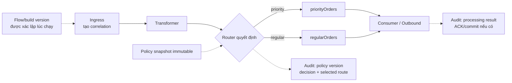

# Ghi version của flow hoặc route trong Spring Integration

## 1. Vì sao version là một phần của audit?

Một ứng dụng triển khai **Enterprise Integration Patterns (EIP)** có thể chạy ổn định trong nhiều tháng, nhưng luồng xử lý không đứng yên. Nhóm phát triển thay đổi điều kiện Filter, bổ sung nhánh Router, chuyển Transformer sang phiên bản mới, điều chỉnh retry hoặc triển khai thêm một Gateway. Trong giai đoạn rolling deployment, hai phiên bản ứng dụng còn có thể xử lý message **đồng thời**.

Giả sử lúc 09:00, đơn hàng `VIP:42` được đưa vào nhánh `priorityOrders`, nhưng đến 10:00 đơn hàng tương tự lại đi vào `regularOrders`. Điều này có thể hoàn toàn đúng nếu một chính sách routing mới vừa được kích hoạt. Nếu log chỉ ghi `route=regular` mà không ghi **phiên bản luật định tuyến đã ra quyết định**, người vận hành khó trả lời vì sao hai message giống nhau có kết quả khác nhau.

Bài **“Ghi version của flow hoặc route”** thuộc chương **Audit và observability** của module `SPRING_INTEGRATION_PATTERN`. Trong mục tiêu xây dựng các flow Spring Integration ít phụ thuộc, dễ mở rộng, kiểm thử và theo dõi các nhánh Router, Filter, Transformer, Splitter, Aggregator, Gateway, retry, error channel và correlation, **version** giúp nối một hành vi quan sát được với đúng cấu hình và quy tắc đã tạo ra hành vi đó.

Sau bài học, bạn sẽ có thể:

- Phân biệt version của **flow definition**, **routing policy**, **deployment**, **message schema** và **business operation**.
- Quyết định nên ghi version tại ingress, lúc Router chọn nhánh, khi handler hoàn tất và tại audit sink.
- Đưa version vào message headers một cách có kiểm soát, không tin giá trị do upstream tự khai báo.
- Lưu version đã dùng tại thời điểm quyết định, kể cả khi routing policy được thay đổi động trong lúc ứng dụng chạy.
- Truy vấn log, trace, audit và metric để đối chiếu hành vi giữa các lần triển khai.
- Thiết kế test cho rollout, rollback, replay, message trong queue và thay đổi luật định tuyến.

## 2. Những khái niệm version không nên đánh đồng

| Loại version | Nó định danh điều gì? | Ví dụ | Có thể thay đổi khi nào? |
| --- | --- | --- | --- |
| **Flow definition version** | Đồ thị endpoint/channel, thứ tự bước, contract xử lý được phát hành | `orders-flow/3.2.0` | Khi thay đổi cấu trúc flow, handler hoặc các quy tắc gắn với flow |
| **Routing policy version** | Tập quy tắc/decision table mà Router dùng để chọn nhánh | `routing-orders/r17` | Khi thay rule, mapping hoặc dữ liệu quyết định được quản trị |
| **Deployment revision** | Bản phần mềm/container/config đã được triển khai trên một instance | `build-2026.11.21.1` | Mỗi lần build, release hoặc redeploy theo chính sách |
| **Message schema version** | Cấu trúc và hợp đồng dữ liệu của payload/event | `order-event/v2` | Khi payload schema thay đổi |
| **Business workflow version** | Phiên bản quy trình nghiệp vụ được chấp thuận | `fulfillment-policy/2026-11` | Có thể đổi độc lập với triển khai kỹ thuật |
| **Trace/span ID** | Lần thực thi/thao tác được instrument | `traceId`, `spanId` | Mỗi trace/span; **không phải version** |
| **Message/correlation ID** | Một message hoặc một phiên xử lý nghiệp vụ | `messageId`, `flowExecutionId` | Tùy cách tạo message hoặc nghiệp vụ; **không phải version** |

Một build có thể chạy **nhiều routing policy version** nếu cho phép thay rule bằng kho cấu hình hoặc bảng quyết định động. Ngược lại, hai deployment revision có thể cùng dùng một `flowDefinitionVersion` nếu chỉ thay logging hoặc thay đổi không liên quan đến contract flow.

### Quy ước khuyến nghị

Trong bài này, ta dùng những **header do ứng dụng tự định nghĩa**:

```text
flowDefinitionVersion   = "orders-flow/3.2.0"
routingPolicyVersion    = "routing-orders/r17"
deploymentRevision      = "build-2026.11.21.1"
selectedRoute           = "priority"
routeDecidedAt          = "2026-11-21T09:00:00Z"
flowExecutionId         = "flow-7294"
messageSchemaVersion    = "order-event/v2"
```

Đây **không phải danh sách Spring Integration reserved headers tự có sẵn**. Ứng dụng phải đặt, kiểm tra và truyền chúng theo hợp đồng. Không dùng mỗi tên `version` vì sẽ không rõ đó là version schema, flow hay routing policy.

## 3. Tại thời điểm nào cần “đóng dấu” version?



Nên phân biệt các mốc:

1. **Ingress accepted:** ứng dụng nhận một message vào phiên xử lý; có thể đóng dấu `flowDefinitionVersion`, `deploymentRevision` và một correlation ID đã được kiểm chứng.
2. **Route decided:** Router dùng **một snapshot nhất quán** của chính sách, chọn nhánh và gắn `routingPolicyVersion`, `selectedRoute`, `routeDecidedAt`.
3. **Route dispatched:** Spring Integration đã giao message tới channel mà Router chọn. Đây là mốc khác với *route decided*, vì delivery có thể thất bại.
4. **Handler processed:** endpoint đã xử lý message theo hợp đồng của handler; nếu chạy bất đồng bộ, mốc này có thể đến sau khi `send()` của upstream trả về.
5. **External delivery confirmed:** downstream/broker/service xác nhận theo hợp đồng. Một ACK của broker chưa chắc là xác nhận giao dịch nghiệp vụ của consumer.

**Nguyên tắc quan trọng:** version được ghi tại **lúc quyết định có hiệu lực**. Nếu trước khi ghi audit, code gọi lại “lấy policy version hiện tại”, kết quả có thể đã là phiên bản mới và **không còn đúng với rule đã chọn route**.

### Ví dụ về thay rule khi flow đang chạy

```text
09:00:00  Policy đang active = routing-orders/r17
09:00:01  Message M1 đọc snapshot r17 -> selectedRoute=priority
09:00:02  Operator kích hoạt policy r18
09:00:03  Message M2 đọc snapshot r18 -> selectedRoute=regular
09:00:04  M1 mới được consumer xử lý (sau hàng đợi)
```

Nếu M1 đã được định tuyến bằng r17, **không được ghi đè** `routingPolicyVersion` của M1 thành r18 chỉ vì đến lúc consumer nhận thì r18 đang active. Consumer có thể ghi thêm `consumerDeploymentRevision` và `processedAt`, nhưng phải giữ lịch sử quyết định của M1.

## 4. Nguồn sự thật cho version và quy tắc cập nhật

### 4.1. Flow version từ bản phát hành

`flowDefinitionVersion` nên được lấy từ **artifact hoặc cấu hình release bất biến** đã gắn với triển khai. Một số dự án dùng semantic version; dự án khác dùng revision/hash của một tài liệu flow. Điều quan trọng không phải hình thức chuỗi mà là khả năng tìm lại **đúng nội dung đã dùng**.

Để version hữu ích khi audit:

- Có lịch sử thay đổi về topology, endpoint, mapping channel, retry policy và hợp đồng payload.
- Có liên kết từ version tới commit/artifact và cấu hình môi trường ở thời điểm triển khai.
- Không tái sử dụng cùng một version cho **hai** tập logic khác nhau.
- Khi rollback sang artifact cũ, dùng lại flow version tương ứng với artifact cũ, đồng thời lưu deployment/rollback event riêng.

### 4.2. Routing policy version phải đi cùng snapshot nội dung

Nếu route được điều khiển bằng config/decision table có thể cập nhật lúc chạy, `routingPolicyVersion` phải định danh **một bộ rule bất biến**. Ví dụ có thể lưu:

```text
policyId: orders-priority
policyVersion: routing-orders/r17
policyChecksum: sha256:...
activatedAt: 2026-11-21T09:00:00Z
activatedBy: approved-deployment
```

`policyChecksum` có thể giúp phát hiện cấu hình bị thay nội dung nhưng giữ nguyên tên version; không bắt buộc copy checksum dài thành metric tag. Bản đầy đủ và dấu vết phê duyệt nên nằm trong kho cấu hình/audit.

Khi hot reload, nên thay **nguyên snapshot** một cách nguyên tử thay vì cập nhật từng cấu hình `routeA`, `routeB` rồi mới cập nhật `version`. Nếu không, một message có thể đọc một nửa rule cũ và một nửa rule mới, không thể giải thích bằng version nào.

### 4.3. Phân biệt “đã kích hoạt” với “đã sử dụng”

Một event `ROUTING_POLICY_ACTIVATED` báo r18 đang active không chứng minh message M2 đã dùng r18. Khi rolling deployment nhiều instance, mỗi pod có thể còn chạy bản policy khác. Cần lưu **decision version theo từng message**, ngoài log activation ở cấp môi trường.

## 5. Thiết kế dữ liệu audit cho version và route

Một bản ghi audit về quyết định định tuyến có thể trông như sau:

```json
{
  "eventType": "ROUTE_DECIDED",
  "eventId": "evt-9081",
  "flowName": "orders",
  "flowExecutionId": "flow-7294",
  "messageId": "msg-42",
  "flowDefinitionVersion": "orders-flow/3.2.0",
  "routingPolicyVersion": "routing-orders/r17",
  "deploymentRevision": "build-2026.11.21.1",
  "messageSchemaVersion": "order-event/v2",
  "selectedRoute": "priority",
  "plannedChannel": "priorityOrders",
  "occurredAt": "2026-11-21T09:00:01Z",
  "decisionOutcome": "SELECTED"
}
```

Đây là **schema minh họa do ứng dụng định nghĩa**, Spring Integration không tự phát sự kiện JSON này. Nên giữ riêng những bản ghi:

| Event | Khi nào ghi? | Ý nghĩa |
| --- | --- | --- |
| `FLOW_INGRESS_ACCEPTED` | Ingress được chấp nhận | Biết message đã đi vào phiên xử lý |
| `ROUTING_POLICY_ACTIVATED` | Operator/config controller kích hoạt rule revision | Biết thay đổi chính sách trên môi trường |
| `ROUTE_DECIDED` | Rule đã chọn kết quả định tuyến | Biết phiên bản rule **thực sự được dùng** |
| `ROUTE_DISPATCHED` | Gửi đến channel thành công theo hợp đồng channel | Chưa chứng minh consumer hoàn tất |
| `ROUTE_DISPATCH_FAILED` | Lỗi gửi/resolve target channel | Cần điều tra, có thể retry |
| `MESSAGE_PROCESSED` | Handler hoàn tất thao tác được định nghĩa | Kết quả ở nội bộ |
| `DELIVERY_CONFIRMED` | Đích xác nhận theo hợp đồng | Phải phân biệt broker ACK với commit nghiệp vụ |
| `MESSAGE_REPLAYED` | Message gốc được đưa vào xử lý lại | Ghi old/new rule version và liên kết attempt |

Nếu audit có yêu cầu bền vững, cần lưu record theo transaction/outbox hoặc sink có chính sách retry rõ ràng. Việc gọi `auditStore.append(...)` trước khi Router dispatch chỉ chứng minh **đã ghi quyết định**; nó không chứng minh dispatch thành công. Ngược lại, nếu Router đã dispatch rồi audit ghi lỗi, phải có cơ chế phục hồi bằng correlation/transaction, thay vì âm thầm coi audit là đầy đủ.

## 6. Ví dụ Java DSL: gắn version tại thời điểm quyết định

Ví dụ dùng **Java 17, Spring Integration 6.x**. Flow nhận payload `String`, dùng một routing policy snapshot bất biến để chọn `priority` hoặc `regular`, rồi gắn phiên bản policy **cùng lúc** với kết quả route. Hai `QueueChannel` đầu ra giúp quan sát message trong bài thực hành.

### 6.1. Versioned policy và bộ phận đóng dấu

```java
import java.time.Clock;
import java.util.Map;
import java.util.Objects;
import java.util.concurrent.atomic.AtomicReference;

import org.springframework.messaging.Message;
import org.springframework.messaging.support.MessageBuilder;

record RoutingPolicySnapshot(String version, boolean vipUsesPriority) {
    RoutingPolicySnapshot {
        Objects.requireNonNull(version, "version");
    }

    String chooseRoute(String payload) {
        boolean isVip = payload.startsWith("VIP:");
        return (isVip && vipUsesPriority) ? "priority" : "regular";
    }
}

final class RoutingPolicyRegistry {
    private final AtomicReference<RoutingPolicySnapshot> active =
            new AtomicReference<>(
                    new RoutingPolicySnapshot("routing-orders/r17", true));

    RoutingPolicySnapshot snapshot() {
        return active.get();
    }

    void activate(RoutingPolicySnapshot next) {
        // Demo: thay snapshot atomically.
        // Production cần kiểm tra revision, quyền, checksum, audit activation.
        active.set(Objects.requireNonNull(next));
    }
}

final class VersionedRouteDecision {
    private final RoutingPolicyRegistry registry;
    private final Clock clock;

    // Hai giá trị này đại diện cho metadata của bản phát hành đang chạy.
    // Production nên lấy từ build/config đã được quản trị.
    private final String flowVersion = "orders-flow/3.2.0";
    private final String deploymentRevision = "build-2026.11.21.1";

    VersionedRouteDecision(RoutingPolicyRegistry registry, Clock clock) {
        this.registry = registry;
        this.clock = clock;
    }

    Message<String> stamp(String payload, Map<String, Object> inputHeaders) {
        RoutingPolicySnapshot snapshot = registry.snapshot();
        String route = snapshot.chooseRoute(payload);
        String target = route.equals("priority")
                ? "priorityOrders" : "regularOrders";

        // Trước flow phải kiểm tra/lọc headers từ nguồn không đáng tin cậy.
        // setHeader thay các giá trị version/route do upstream khai báo.
        return MessageBuilder.withPayload(payload)
                .copyHeaders(inputHeaders)
                .setHeader("flowDefinitionVersion", flowVersion)
                .setHeader("routingPolicyVersion", snapshot.version())
                .setHeader("deploymentRevision", deploymentRevision)
                .setHeader("selectedRoute", route)
                .setHeader("plannedChannel", target)
                .setHeader("routeDecidedAt", clock.instant().toString())
                .build();
    }
}
```

Ở mỗi lời gọi `stamp()`, biến cục bộ `snapshot` được đọc **một lần duy nhất**. Cả `route` và `routingPolicyVersion` lấy từ đúng snapshot đó. Nếu policy đổi ở thread khác ngay sau `snapshot()`, message hiện tại vẫn mang đúng revision đã quyết định đường đi.

Lưu ý: `copyHeaders(inputHeaders)` phục vụ ví dụ nội bộ. Với HTTP, broker hoặc một nguồn không đáng tin, hãy **allowlist** header được nhận và validate `flowExecutionId`, schema version, payload. Một client không được có quyền tự ấn định authoritative `routingPolicyVersion` hoặc `selectedRoute`. Ở code trên, các header quan trọng đó được ghi lại từ phía server.

### 6.2. Cấu hình Spring Integration flow

```java
import java.time.Clock;
import org.springframework.context.annotation.Bean;
import org.springframework.context.annotation.Configuration;
import org.springframework.integration.annotation.EnableIntegration;
import org.springframework.integration.channel.DirectChannel;
import org.springframework.integration.channel.QueueChannel;
import org.springframework.integration.dsl.IntegrationFlow;
import org.springframework.messaging.MessageChannel;
import org.springframework.messaging.PollableChannel;

@Configuration
@EnableIntegration
class VersionedRoutingConfiguration {

    @Bean
    RoutingPolicyRegistry routingPolicyRegistry() {
        return new RoutingPolicyRegistry();
    }

    @Bean
    VersionedRouteDecision versionedRouteDecision(
            RoutingPolicyRegistry policies) {
        return new VersionedRouteDecision(policies, Clock.systemUTC());
    }

    @Bean("ordersInput")
    MessageChannel ordersInput() {
        return new DirectChannel();
    }

    @Bean("priorityOrders")
    PollableChannel priorityOrders() {
        return new QueueChannel();
    }

    @Bean("regularOrders")
    PollableChannel regularOrders() {
        return new QueueChannel();
    }

    @Bean
    IntegrationFlow versionedOrderFlow(VersionedRouteDecision decision) {
        return IntegrationFlow.from("ordersInput")
                .handle((payload, headers) ->
                        decision.stamp((String) payload, headers))
                // Expression đọc header do server vừa đóng dấu.
                .route("headers['selectedRoute']", router -> router
                        .channelMapping("priority", "priorityOrders")
                        .channelMapping("regular", "regularOrders"))
                .get();
    }
}
```

**Quan sát:**

- `ordersInput` là `DirectChannel`, nên thao tác `stamp()` thường chạy đồng bộ trên thread gửi.
- `RoutingPolicyRegistry` được tiêm dưới dạng bean và có thể được cập nhật bởi một admin service được kiểm soát.
- `.route("headers['selectedRoute']", ...)` sử dụng biểu thức SpEL để lấy kết quả từ header và chuyển tới channel được khai báo.
- `priorityOrders` và `regularOrders` là `QueueChannel`; một message được nhận tại queue **chưa có nghĩa consumer đã xử lý thành công**.
- `plannedChannel` trong header là **ý định định tuyến** tại thời điểm quyết định. Nó không phải xác nhận dispatch, nên nếu cần event `ROUTE_DISPATCHED`, hãy ghi ở điểm có bằng chứng gửi thành công.

Khi có route không hợp lệ, cần cấu hình rõ `defaultOutputChannel`, `resolutionRequired` hoặc chính sách error handling thích hợp. Không nên âm thầm bỏ message chỉ vì policy đã chọn một key không có mapping.

### 6.3. Thử với hai policy revision

```java
import org.springframework.messaging.MessageChannel;
import org.springframework.messaging.PollableChannel;
import org.springframework.messaging.Message;
import org.springframework.messaging.support.MessageBuilder;

void tryTwoPolicies(
        MessageChannel ordersInput,
        PollableChannel priorityOrders,
        PollableChannel regularOrders,
        RoutingPolicyRegistry policies) {

    ordersInput.send(MessageBuilder.withPayload("VIP:42")
            .setHeader("flowExecutionId", "flow-42")
            .build());
    Message<?> first = priorityOrders.receive(1_000);
    if (first == null) {
        throw new IllegalStateException("Thiếu kết quả của r17");
    }
    System.out.println(first.getHeaders().get("routingPolicyVersion"));
    // routing-orders/r17

    policies.activate(new RoutingPolicySnapshot("routing-orders/r18", false));

    ordersInput.send(MessageBuilder.withPayload("VIP:43")
            .setHeader("flowExecutionId", "flow-43")
            .build());
    Message<?> second = regularOrders.receive(1_000);
    if (second == null) {
        throw new IllegalStateException("Thiếu kết quả của r18");
    }
    System.out.println(second.getHeaders().get("routingPolicyVersion"));
    // routing-orders/r18
}
```

`r17` đưa `VIP:42` sang priority; `r18` của ví dụ thay rule để đưa `VIP:43` sang regular. Sự thay đổi được thể hiện ở **cả kết quả route và version**, không chỉ ở log kích hoạt policy.

## 7. Message history, log, trace, metric và audit giữ version như thế nào?

| Nguồn quan sát | Dùng version ra sao? | Giới hạn |
| --- | --- | --- |
| **Message headers** | Mang `flowDefinitionVersion`, `routingPolicyVersion` tới bước sau | Có thể bị loại ở boundary/adapter; không tự bền vững |
| **Message history** | Cho biết những named endpoint/channel message đi qua | Không tự ghi version của rule; tên endpoint không thay thế revision |
| **Structured log** | Ghi `route_decided`, `flow`, `version`, `selectedRoute` và correlation | Không bảo đảm bền vững, có thể sampling/retention |
| **Distributed trace** | Gắn flow/route revision vào span attribute ở điểm decision | Không phải mọi trace đều được lưu; có sampling |
| **Micrometer metrics** | So sánh request/latency/error theo flow/route; thêm version nếu cardinality được kiểm soát | Không phù hợp ID động hoặc phiên bản phát sinh liên tục |
| **Audit store** | Giữ phiên bản, quyết định, event/causation và trạng thái xác nhận | Cần retention, consistency, idempotency và phân quyền |

Không nên coi `MessageHistory` là hệ thống audit rule version. History mô tả component Spring Integration đã đi qua; một Router bean vẫn tên `routeByPriority` trong cả r17 và r18. Muốn biết **rule nào** đã được áp dụng cần ghi thêm `routingPolicyVersion` tại quyết định.

### Ví dụ log có cấu trúc

```json
{
  "event": "route_decided",
  "flow": "orders",
  "routingPolicyVersion": "routing-orders/r18",
  "flowDefinitionVersion": "orders-flow/3.2.0",
  "selectedRoute": "regular",
  "flowExecutionId": "flow-7294",
  "traceId": "4bf92f3577b34da6a3ce929d0e0e4736"
}
```

Trong logs/traces, những ID động có thể được ghi theo chính sách bảo mật để tìm từng giao dịch. Trong **metric tags**, không được đưa `flowExecutionId`, `messageId`, `orderId`, `traceId`, payload hoặc URL tùy ý vì chúng làm tăng cardinality và có thể lộ thông tin.

### Metric dành cho version rollout

Có thể thiết kế metric ứng dụng:

```text
app.eip.route.decisions{flow="orders",route="priority"}  Counter
app.eip.route.decisions{flow="orders",route="regular"}   Counter
app.eip.route.dispatch.errors{flow="orders"}            Counter
app.eip.flow.handler.duration{flow="orders",stage="reserve"} Timer
```

Khi triển khai đồng thời chỉ vài phiên bản, có thể thêm `flow_version` hoặc `policy_version` **đã được allowlist** để so sánh canary/rollback. Nhưng nếu mỗi message có một revision, hoặc hệ thống luôn tạo build hash mới, tag version có thể gây cardinality cao. Có thể thay bằng `release_track=stable|canary` ở metrics, còn revision chính xác nằm trong audit/log/trace.

Ví dụ truy vấn Prometheus cho phân bố route:

```promql
sum by (route) (
  rate(app_eip_route_decisions_total{flow="orders"}[5m])
)
```

Nếu thêm tag version có giới hạn:

```promql
sum by (policy_version, route) (
  rate(app_eip_route_decisions_total{
    flow="orders",policy_version=~"r17|r18"
  }[5m])
)
```

**Không mặc định** Spring Integration tự sinh `app.eip.route.decisions`: đây là meter do ứng dụng chủ động ghi ở điểm quyết định. Prometheus có thể đổi cách biểu diễn tên; luôn xác nhận ở exporter thực tế.

## 8. Router, Filter, Splitter, Aggregator, Gateway và retry cần version nào?

| Pattern / tình huống | Version nên ghi ở đâu? | Lưu ý |
| --- | --- | --- |
| **Router** | Khi chọn route, ghi policy snapshot revision và selected route | Dynamic router thay rule cần revision được chụp đúng thời điểm |
| **Filter** | Khi predicate đưa ra accepted/rejected, ghi filter-rule revision | `rejected` phải khác với lỗi predicate |
| **Transformer** | Ở bước transform, ghi transform/schema revision nếu contract thay đổi | Message schema version không đồng nghĩa flow version |
| **Splitter** | Khi tạo message con, giữ lineage/version ở parent và child | Một parent có thể tạo nhiều outputs, correlation/sequence cần rõ |
| **Aggregator** | Lưu processing policy/group rule version khi tạo group hoặc release | Group có thể được tạo ở r17 và release khi r18 đang active |
| **Gateway** | Ghi ingress deployment/flow revision và mốc request–reply | Gateway timeout không tự chứng minh request chưa được xử lý |
| **Retry** | Mỗi attempt cần biết policy/handler version đã áp dụng | Retry trong cùng process và replay sau deploy có thể dùng version khác nhau |
| **Error channel / DLQ** | Ghi flow/rule revision gây lỗi cùng error stage/reason | Không ghi lại version hiện tại như thể nó là version của message cũ |
| **Recovery / replay** | Giữ `originalRuleVersion` và `replayRuleVersion` | Có thể có chủ ý dùng rule mới để xử lý lại |
| **Correlation** | Liên kết các message thuộc cùng logical operation, không phải version | Không sử dụng trace ID làm thay thế business correlation |

### Group Aggregator kéo dài qua một lần cập nhật rule

Giả sử các fragment A, B vào group `order-42` theo policy r17; fragment C tới sau khi r18 được kích hoạt. Có ít nhất hai chính sách hợp lệ:

1. **Pin theo group:** group lưu `groupRuleVersion=r17` từ khi tạo và chỉ áp dụng logic xử lý nhóm tương ứng r17 cho toàn bộ group.
2. **Tính tại thời điểm release:** group được release theo r18 nếu hợp đồng cho phép; audit ghi rõ `groupCreatedRuleVersion=r17` và `releaseRuleVersion=r18`.

Không được âm thầm giả định Aggregator “tự biết” nên dùng rule version nào. Đây là **quyết định nghiệp vụ và kỹ thuật của ứng dụng**; cần kiểm thử với group chưa đủ, timeout, late arrival và restart.

### Retry và replay không giống nhau

Retry advice đồng bộ có thể lặp lại cùng handler trong một deployment, thường vẫn dùng cùng bộ cấu hình nếu không có hot reload. Nhưng một message được đưa vào DLQ rồi replay sau ba ngày có thể chạy qua bản flow khác. Cần thiết kế cách chọn:

- **Reprocess under original rules:** truy hồi đúng policy snapshot r17 đã được lưu, nếu được phép và còn khả dụng.
- **Reprocess under current rules:** cố ý áp dụng r18; audit phải lưu cả r17 ở original attempt và r18 ở replay.
- **Manual migration:** chuyển payload/schema hoặc rule theo quy trình được phê duyệt trước khi replay.

Để chống xử lý trùng, dùng business event ID/idempotency key và trạng thái thực tế, **không** dùng `routingPolicyVersion` hoặc `traceId` làm khóa duy nhất mặc định.

## 9. Rolling deployment, canary và rollback

Khi rollout, nhiều instance có thể khác version:

```text
09:00  pod-A: flow 3.1, routing r17
09:01  pod-B: flow 3.2, routing r18 (canary)
09:02  pod-C: flow 3.1, routing r17
09:10  rollout xong: đa số pod dùng 3.2 / r18
```

Trong khoảng 09:01–09:10, việc hai message có cùng payload nhưng đi hai nhánh khác nhau **có thể đúng**. Để phân tích chính xác cần biết `deploymentRevision`, `flowDefinitionVersion`, `routingPolicyVersion` và kết quả route theo **từng message**.

Trước khi rollout:

1. Ghi changelog về nhánh/behavior, policy revision, schema compatibility và cách rollback.
2. Kiểm thử cả rule cũ/mới; bảo đảm worker phiên bản mới vẫn hiểu message nằm trong queue từ trước.
3. Giới hạn canary theo traffic ổn định, theo dõi route distribution, Filter reject, retry, handler latency và lỗi.
4. Đảm bảo policy version có thể truy vết tới artifact đã phê duyệt.
5. Thiết lập cách giữ hoặc chuyển trạng thái Aggregator/group store qua version boundary.

Khi rollback, **bản triển khai có thể quay về phiên bản cũ**, nhưng message còn trong queue hoặc trace có thể đã được quyết định bởi version mới. Không “sửa” audit cũ để làm mọi message trông như được xử lý bởi bản rollback. Thay vào đó, thêm event `ROLLBACK_ACTIVATED` và để mỗi message giữ version ở từng mốc của chính nó.

## 10. Header propagation và ranh giới tin cậy

Trong cùng một flow Spring Integration, những header tùy biến thường được chuyển tiếp khi framework tạo reply message theo cơ chế chuẩn. Tuy nhiên, **không nên coi chúng là bất biến hoặc được truyền tới mọi nơi**.

### Các ranh giới cần kiểm tra

- **Transformer hoặc custom handler:** nếu tự tạo `Message` mới mà không sao chép metadata cần thiết, version headers có thể mất.
- **Router / Splitter:** nhiều message con cùng giữ lineage nhưng mỗi nhánh có thể phát sinh thêm quyết định route/version; không ghi đè version trước đó khi cần audit nhiều mốc.
- **Aggregator:** output tổng hợp có thể chọn header từ một message hoặc áp dụng chiến lược aggregate headers; không giả định mọi fragment có cùng rule version.
- **ExecutorChannel / QueueChannel:** header có thể tiếp tục đi cùng message nhưng current tracer/MDC scope là chuyện khác; phải kiểm tra propagation riêng.
- **Kafka/AMQP/JMS/HTTP adapters:** mỗi transport có header mapper và quy tắc serialize khác nhau; version tùy biến không tự chắc chắn đi qua mạng.
- **Ingress không đáng tin:** client có thể giả mạo header `routingPolicyVersion`; server phải tạo version quyết định từ policy authoritative của nó.

### Header đơn lẻ hay lịch sử quyết định?

Một message có thể đi qua **nhiều Router**. Nếu mọi Router đều ghi vào cùng `routingPolicyVersion`, Router sau sẽ ghi đè phiên bản của Router trước. Các cách thiết kế tốt hơn:

1. **Có tên theo stage:** `priorityPolicyVersion`, `regionPolicyVersion`; phù hợp số stage ít và ổn định.
2. **Bản ghi audit append-only:** `ROUTE_DECIDED` với `stage`, `policyVersion`, `selectedRoute`, `occurredAt`; phù hợp nhiều nhánh và độ tin cậy cao.
3. **Metadata lineage có cấu trúc:** danh sách decision records trong thông điệp nội bộ nếu thật sự cần, giới hạn kích thước/header và bảo vệ khỏi dữ liệu giả mạo.

Trong hệ thống lớn, **audit event riêng** là nguồn đáng tin hơn một header được ghi đè ở mỗi bước.

## 11. Kiểm thử version và routing trong Java

Với hai channel trong ví dụ ở mục 6, phép thử quan trọng nhất là xác minh **cùng loại payload** được route theo policy revision tương ứng và version đã đóng dấu không thay đổi sau khi activate phiên bản mới.

```java
import static org.assertj.core.api.Assertions.assertThat;

import org.junit.jupiter.api.Test;
import org.springframework.beans.factory.annotation.Autowired;
import org.springframework.beans.factory.annotation.Qualifier;
import org.springframework.messaging.Message;
import org.springframework.messaging.MessageChannel;
import org.springframework.messaging.PollableChannel;
import org.springframework.messaging.support.MessageBuilder;
import org.springframework.test.context.junit.jupiter.SpringJUnitConfig;

@SpringJUnitConfig(VersionedRoutingConfiguration.class)
class VersionedRoutingFlowTest {
    @Autowired
    @Qualifier("ordersInput")
    MessageChannel input;

    @Autowired
    @Qualifier("priorityOrders")
    PollableChannel priority;

    @Autowired
    @Qualifier("regularOrders")
    PollableChannel regular;

    @Autowired
    RoutingPolicyRegistry policies;

    @Test
    void stampsPolicyUsedAtTheTimeOfDecision() {
        assertThat(input.send(MessageBuilder.withPayload("VIP:42")
                .setHeader("flowExecutionId", "flow-42")
                .build())).isTrue();

        Message<?> first = priority.receive(1_000);
        assertThat(first).isNotNull();
        assertThat(first.getHeaders().get("selectedRoute"))
                .isEqualTo("priority");
        assertThat(first.getHeaders().get("routingPolicyVersion"))
                .isEqualTo("routing-orders/r17");
        assertThat(first.getHeaders().get("flowDefinitionVersion"))
                .isEqualTo("orders-flow/3.2.0");

        policies.activate(
                new RoutingPolicySnapshot("routing-orders/r18", false));

        assertThat(input.send(MessageBuilder.withPayload("VIP:43")
                .setHeader("flowExecutionId", "flow-43")
                .build())).isTrue();

        Message<?> second = regular.receive(1_000);
        assertThat(second).isNotNull();
        assertThat(second.getHeaders().get("selectedRoute"))
                .isEqualTo("regular");
        assertThat(second.getHeaders().get("routingPolicyVersion"))
                .isEqualTo("routing-orders/r18");

        // Message đã quyết định theo r17 không bị sửa khi policy đổi.
        assertThat(first.getHeaders().get("routingPolicyVersion"))
                .isEqualTo("routing-orders/r17");
    }
}
```

Test này chứng minh quyết định route và header trong cùng process demo. Nó **chưa chứng minh** event audit đã được lưu bền vững, header được truyền qua broker hay downstream đã commit. Cần test riêng cho các ranh giới đó.

### Ma trận kiểm thử đề xuất

| Ca kiểm thử | Kỳ vọng |
| --- | --- |
| Policy r17 chọn priority | `selectedRoute=priority`, `routingPolicyVersion=r17` |
| Kích hoạt r18 rồi gửi message mới | Message mới dùng rule/version r18 |
| Message r17 đã nằm trong QueueChannel | Header version r17 không bị đổi bởi activation r18 |
| Cập nhật policy khi nhiều thread gửi | Mỗi message dùng trọn một snapshot; không trộn route r17 với label r18 |
| Ingress gửi header giả `routingPolicyVersion=r999` | Server thay bằng revision authoritative |
| Route key không có mapping | Có lỗi/default route đúng hợp đồng; có event chẩn đoán |
| Filter có revision khác | Audit ghi rule Filter riêng, không mượn version Router |
| Splitter tạo nhiều message con | Giữ lineage và snapshot version gốc; không nhầm fragment với request |
| Aggregator giữ group qua deploy | Pin hoặc release theo chính sách được chỉ rõ và test |
| Message qua HTTP/broker | Header mapper/metadata giữ phiên bản cần thiết hoặc audit thay thế |
| Replay sau rollback | Có original version và replay version, không xóa lịch sử cũ |
| Trace sampling làm mất span | Audit/correlation vẫn giải thích được version quyết định |
| Đổi version string nhưng không đổi rule | Có dấu vết activation; không giả mạo khác biệt behavior |
| Đổi rule mà không đổi version | Bị chặn bởi kiểm soát checksum/revision và phép thử cấu hình |

Với trường hợp concurrency, có thể dùng nhiều producer thread, `CountDownLatch` và tập kết quả an toàn thread để xác minh **cặp `(route, version)` luôn nhất quán**. Không khẳng định message nào sẽ vào trước hoặc sau chính xác thời điểm activation nếu không có cơ chế đồng bộ ngoài; chỉ cần không có message chứa cặp “route của r17 + version r18”.

## 12. Quy trình điều tra khi route thay đổi bất thường

Tình huống: sau khi triển khai, tỷ lệ message VIP đi `regularOrders` tăng từ 1% lên 30%.

1. **Kiểm tra định nghĩa metric:** biểu đồ đang đo `ROUTE_DECIDED` hay message consumer đã xử lý? Có tính retry/duplicate không?
2. **Tìm policy activation:** revision nào được kích hoạt, vào lúc nào, trên những instance nào?
3. **Lấy một số audit events:** so sánh `flowDefinitionVersion`, `routingPolicyVersion`, `selectedRoute`, `routeDecidedAt` với deployment revision.
4. **Đối chiếu với input đặc trưng:** một message có bị Transformer thay dữ liệu trước khi Router đọc không? Schema version có khác không?
5. **Kiểm tra mapping channel:** Router có chọn đúng key nhưng channel mapping hoặc default route thay đổi không?
6. **Kiểm tra async/retry:** message ở queue được quyết định từ policy cũ nhưng xử lý sau activation mới? Có replay/redelivery không?
7. **Đối chiếu error/ACK:** route có được dispatch thành công? Consumer có xử lý hay nằm ở dead-letter/retry?
8. **Kết luận dựa trên version và outcome:** tách thay đổi có chủ đích do r18 khỏi lỗi phát sinh ở routing/consumer.

Không thể kết luận chỉ từ `traceId`, tên endpoint hoặc timestamp triển khai vì chúng không chứng minh chính xác rule đã được dùng cho từng message.

## 13. Những lỗi thường gặp

1. **Dùng version ứng dụng thay cho version routing policy.** Một deployment có thể thay rule động hoặc nhiều bản deployment dùng cùng một policy.
2. **Đọc version hiện tại lúc ghi audit**, trong khi quyết định đã dùng snapshot trước đó.
3. **Gắn version trên ingress rồi cho rằng mọi Router dùng cùng rule đó.** Mỗi Router có thể có policy version độc lập.
4. **Dùng header version do upstream cung cấp như sự thật.** Dễ bị giả mạo, lỗi hoặc dữ liệu cũ.
5. **Coi `selectedRoute` là `deliveryConfirmed`.** Quyết định chưa đồng nghĩa dispatch/ACK.
6. **Ghi đè lịch sử ở lần replay.** Cần original và replay versions riêng để điều tra.
7. **Đặt mọi version trong một header tên `version`.** Không thể phân biệt schema, topology, policy và deploy.
8. **Thay rule mà giữ nguyên revision.** Khi audit chỉ có revision, không thể khôi phục đúng logic lịch sử.
9. **Gắn per-message ID hoặc commit hash biến thiên quá nhanh vào metric tags.** Dẫn tới cardinality cao.
10. **Không xem xét message còn trong queue và Aggregator khi rollback.** Message cũ và mới có thể cùng tồn tại trong một phiên triển khai.
11. **Chỉ dựa vào Message History.** Component name không chứng minh version của routing policy đã thực thi.
12. **Coi header propagation qua broker là mặc định.** Phải kiểm tra mapping, trust boundary và trường hợp header bị loại.

## 14. Checklist triển khai

- [ ] Có định nghĩa và ownership rõ cho `flowDefinitionVersion`, `routingPolicyVersion`, `deploymentRevision`, `messageSchemaVersion`.
- [ ] Mỗi revision định danh một nội dung bất biến, có changelog/artifact/checksum truy hồi được.
- [ ] Routing policy được đọc bằng một snapshot nhất quán khi mỗi message được quyết định.
- [ ] Server ghi version authoritative và không tin header version từ nguồn bên ngoài.
- [ ] Có audit event cho `ROUTE_DECIDED`, và tách riêng dispatch/handler/ACK nếu cần đối soát.
- [ ] Có correlation, causation và timestamp ở các mốc phù hợp; không dùng version làm business ID.
- [ ] Đã kiểm tra version propagation qua Transformer, Router, Splitter, Aggregator, async và broker adapters.
- [ ] Có quy tắc pin/migrate group khi Aggregator chờ qua nhiều lần deploy.
- [ ] Retry/replay giữ original version, ghi new processing version và chính sách idempotency.
- [ ] Canary/rollback có dashboard theo route và release track; metric tags có cardinality hữu hạn.
- [ ] Test activation, concurrency, spoof header, queue chờ, mapping lỗi và replay qua version boundary.
- [ ] Có quyền truy cập và retention hợp lý cho audit rules, event IDs và deployment metadata.

## 15. Tài liệu tham khảo

- [Spring Integration Reference — Routers](https://docs.spring.io/spring-integration/reference/router.html)
- [Spring Integration Reference — Java DSL](https://docs.spring.io/spring-integration/reference/dsl/java-basics.html)
- [Spring Integration Reference — Message History](https://docs.spring.io/spring-integration/reference/message-history.html)
- [Spring Integration Reference — Message Headers](https://docs.spring.io/spring-integration/reference/message.html)
- [Spring Integration Reference — Metrics and Management](https://docs.spring.io/spring-integration/reference/metrics.html)
- [Spring Integration Reference — Aggregator](https://docs.spring.io/spring-integration/reference/aggregator.html)
- [Micrometer — Observation](https://docs.micrometer.io/micrometer/reference/observation.html)

**Ghi nhớ:** muốn biết một message *vì sao đi qua một route*, phải lưu **quyết định**, **policy snapshot version thực sự đã áp dụng** và **kết quả ở các mốc tiếp theo**. Flow version, deployment revision và message schema version bổ sung bối cảnh, nhưng không thể thay thế phiên bản của rule định tuyến. Ghi version đúng thời điểm sẽ giúp audit, kiểm thử, canary, rollback và replay có thể giải thích được ngay cả khi nhiều phiên bản flow đang chạy song song.
