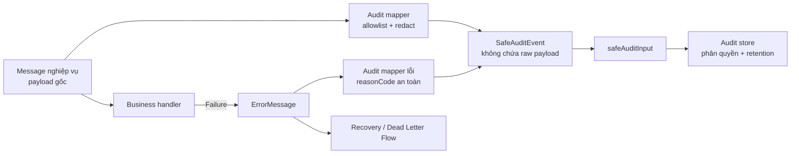
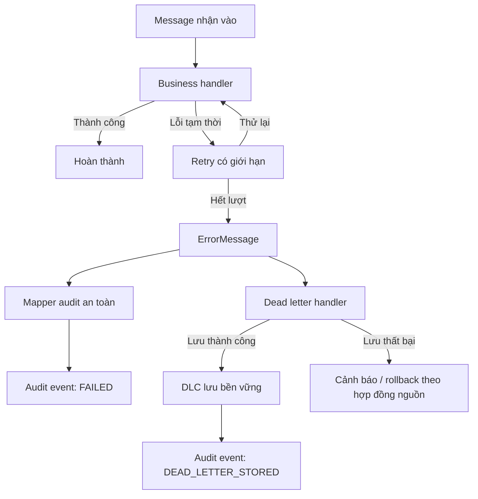

# Che payload khi audit

Trong module **SPRING_INTEGRATION_PATTERN**, Spring Integration giúp triển khai các **Enterprise Integration Patterns** (Router, Filter, Transformer, Splitter, Aggregator, Gateway, retry và error channel) thành luồng message ít phụ thuộc và dễ mở rộng. Audit và observability giúp trả lời: *message nào đi qua bước nào, khi nào thất bại, ai đã can thiệp và kết quả cuối cùng ra sao?* Tuy nhiên, nếu ghi trực tiếp payload và headers vào audit log, chính hệ thống quan sát có thể trở thành nơi rò rỉ dữ liệu.

Bài **“Che payload khi audit”** hướng dẫn thiết kế sự kiện audit có cấu trúc, che hoặc loại bỏ dữ liệu nhạy cảm **trước khi đưa vào kênh audit**, bảo vệ các nhánh thành công/lỗi/replay, giữ correlation phục vụ điều tra và kiểm thử để bảo đảm thông tin không bị lộ qua log, database, metrics hoặc tracing.

> **Nguyên tắc:** Audit cần ghi **điều gì đã xảy ra và có thể kiểm chứng được**, không mặc nhiên cần ghi toàn bộ nội dung message. Chỉ giữ các trường thật sự cần; áp dụng **allowlist**, che/mã hóa khi được phép và bỏ hẳn secrets. Không đặt niềm tin vào việc “sẽ che sau khi đã log”.

## 1. Vì sao cần che payload trước khi audit?

Giả sử một flow nhận yêu cầu thanh toán:

```json
{
  "eventType": "PAYMENT_REQUESTED",
  "orderId": "ORD-908712",
  "email": "customer@example.invalid",
  "phone": "0900000000",
  "paymentToken": "tok-EXAMPLE-SECRET",
  "amount": 125000
}
```

Handler gọi dịch vụ bên ngoài rồi thất bại sau retry. Một cách làm thiếu an toàn là:

```java
// KHÔNG NÊN: có thể đưa payload và header nhạy cảm vào log.
log.info("Incoming message: {}", message);
log.error("Processing failed: {}", errorMessage);
```

Ở đây, `Message.toString()` có thể làm lộ payload và headers, còn `ErrorMessage` chứa `Throwable` và có thể tham chiếu message gây lỗi. Exception message từ thư viện ngoài cũng có thể chứa URL, token, query string, tham số HTTP hoặc dữ liệu người dùng.

Nếu log được gom vào nhiều hệ thống, một lỗi có thể tạo bản sao dữ liệu nhạy cảm tại:

- Application log và terminal của developer.
- Dashboard log tập trung, hệ thống phân tích và hệ thống gửi cảnh báo.
- Bảng audit/dead letter hoặc hàng đợi dùng để xử lý lại.
- Trace span, attribute, baggage và nhãn metric.
- File xuất CSV, dữ liệu hỗ trợ khách hàng và bản sao lưu.

**Che payload trước khi phát sự kiện audit** giúp giảm bề mặt rò rỉ. Cần lưu ý: bản thân business flow vẫn xử lý dữ liệu gốc theo nghiệp vụ; bài này giới hạn phần dữ liệu **được đưa vào hệ thống audit/observability**.

### Phân biệt audit, log, metric và dead letter

| Thành phần | Mục tiêu chính | Nội dung nên mang |
| --- | --- | --- |
| **Audit event** | Ghi nhận hành động và kết quả phục vụ truy vết/kiểm tra | Mã sự kiện, flow, thời điểm, định danh an toàn, kết quả, chủ thể đã được xác minh |
| **Application log** | Chẩn đoán hành vi ứng dụng | Mã lỗi, component, trace/correlation ID; tránh payload thô |
| **Metric** | Đo xu hướng, số lượng, độ trễ | Counter/gauge/histogram với nhãn cardinality thấp; không có PII |
| **Trace** | Theo dõi đường đi giữa các endpoint | Span/trace ID, trạng thái, thời lượng; attribute phải được kiểm soát |
| **Dead Letter Channel** | Cách ly message không xử lý được để điều tra/replay | Metadata lỗi và tham chiếu payload được bảo vệ, không mặc định ghi rõ vào audit |

Một bản ghi audit có thể cho biết sự kiện `ORDER_PROCESSING_FAILED` liên quan đến `correlationId` nào; payload cần phục hồi, nếu bắt buộc, được giữ ở kho riêng có phân quyền và retention. **Audit log không phải kho sao lưu toàn bộ message.**

## 2. Các cách xử lý dữ liệu: bỏ, che, hoặc tham chiếu an toàn

Không có một hàm regex phù hợp cho mọi payload. Quyết định phụ thuộc loại dữ liệu và mục đích sử dụng:

| Chiến lược | Ví dụ | Khi áp dụng |
| --- | --- | --- |
| **Bỏ hẳn (omit)** | Không ghi `password`, `Authorization`, `paymentToken` | Secrets, thông tin không cần điều tra |
| **Che toàn bộ (redact)** | `email: "[REDACTED]"` | Muốn biết trường có tồn tại mà không cần biết giá trị |
| **Che một phần (mask)** | `orderId: "***8712"` | Chính sách cho phép hiển thị một phần định danh để hỗ trợ tra cứu |
| **Thay bằng mã tham chiếu (tokenize)** | `payloadRef: "obj-..."` | Cần phục hồi dữ liệu gốc ở kho có phân quyền riêng |
| **Băm có khóa (HMAC)** | `customerLookupKey` không giải ngược trực tiếp | Cần đối chiếu ổn định mà không lộ giá trị nguồn; quản lý khóa cẩn thận |
| **Tổng hợp (aggregate)** | `amountBucket: "100k–500k"` | Cần phân tích xu hướng, không cần giá trị chính xác |

**Mask không làm dữ liệu tự động trở nên vô hại.** Bốn ký tự cuối của mã tài khoản, email được che một phần hoặc định danh đơn hàng vẫn có thể là dữ liệu cần kiểm soát khi kết hợp với nguồn khác. Với PII có rủi ro cao, ưu tiên `[REDACTED]` hoặc bỏ trường. Trường `orderId` được che trong ví dụ chỉ nhằm minh họa kỹ thuật; dự án phải có chính sách quyết định có được giữ phần cuối hay không.

Không dùng SHA-256 thông thường như một biện pháp ẩn danh chắc chắn cho email/phone có miền giá trị dễ đoán: kẻ tấn công có thể thử lại các giá trị khả dĩ. Nếu cần đối chiếu ổn định, cân nhắc HMAC với khóa quản lý riêng, xoay khóa và giới hạn quyền truy cập, hoặc tokenization.

### Audit record trước và sau khi áp dụng chính sách

**Không an toàn:**

```json
{
  "action": "PAYMENT_FAILED",
  "payload": "{...nguyên JSON người dùng...}",
  "headers": {"Authorization": "Bearer ..."},
  "exception": "POST /payment?token=..."
}
```

**An toàn hơn cho mục tiêu giám sát:**

```json
{
  "action": "PAYMENT_FAILED",
  "flowId": "orders",
  "correlationId": "corr-1007",
  "payloadView": {
    "eventType": "PAYMENT_REQUESTED",
    "orderId": "***8712",
    "email": "[REDACTED]",
    "otherFields": "[OMITTED]"
  },
  "reasonCode": "DOWNSTREAM_TIMEOUT",
  "result": "FAILED"
}
```

Record thứ hai **không chứa token, phone, số tiền chính xác hoặc exception message**. `correlationId` cũng cần được cấp từ nguồn đáng tin và kiểm soát độ dài/nội dung. Các giá trị JSON chỉ phục vụ minh họa, không phải dữ liệu thật.

## 3. Xây chính sách allowlist theo schema, mặc định loại bỏ

Hai mô hình thường gặp:

- **Blocklist:** ghi mọi trường trừ `password`, `token`, `secret`. Khi một DTO thêm trường mới như `nationalId`, dữ liệu có thể bị ghi trước khi nhóm phát triển cập nhật danh sách chặn.
- **Allowlist:** chỉ xuất đúng những trường đã được phép. Khi schema xuất hiện trường mới, nó **không** xuất hiện trong audit nếu chưa được duyệt.

Vì vậy, với audit chứa message, nên mặc định **allowlist và default deny**. Một chính sách rõ ràng cần có:

1. **Phạm vi áp dụng:** theo flow, event type, schema version và môi trường.
2. **Đường dẫn dữ liệu:** chỉ những field/JSON path được phép, bao gồm dữ liệu lồng nhau.
3. **Biến đổi:** omit, redact, mask, tokenize, aggregate.
4. **Giới hạn:** kích thước payload, độ sâu JSON, độ dài chuỗi, số field và lượng dữ liệu xuất.
5. **Lỗi parsing:** ghi một mã như `PAYLOAD_UNPARSEABLE`, tuyệt đối không fallback sang log raw JSON.
6. **Chủ sở hữu chính sách:** phiên bản và thời điểm xét duyệt, kiểm thử thay đổi schema.
7. **Lưu trữ:** phân quyền, thời hạn lưu và nơi lưu tương ứng với độ nhạy cảm còn lại.

Không thực thi masking bằng cách chỉ thay chuỗi `"password"` bằng `"***"` trong JSON thô: có thể có tên trường khác, nested object, mảng, dữ liệu đã escape hoặc exception chứa bản sao của payload.

## 4. Ví dụ Java 17: chỉ xuất payload view đã che

Ví dụ dưới đây giả định business payload đầu vào là **JSON dạng `String`** và dùng Jackson để parse. Nó chỉ lấy `eventType` từ tập cho phép, che `orderId`, thay email bằng `[REDACTED]` và loại bỏ hoàn toàn các trường khác. Với payload sai định dạng hoặc không phải JSON object, hàm chỉ trả về trạng thái an toàn.

Phụ thuộc: `com.fasterxml.jackson.core:jackson-databind`; các dự án Spring Boot thường có Jackson thông qua dependency phù hợp.

```java
package demo.integration;

import java.util.Collections;
import java.util.LinkedHashMap;
import java.util.Map;
import java.util.Set;

import com.fasterxml.jackson.core.JsonProcessingException;
import com.fasterxml.jackson.databind.JsonNode;
import com.fasterxml.jackson.databind.ObjectMapper;

public final class AuditPayloadRedactor {
    private static final int MAX_INPUT_CHARS = 64 * 1024;

    private static final Set<String> ALLOWED_EVENT_TYPES = Set.of(
            "PAYMENT_REQUESTED", "ORDER_CREATED", "ORDER_CANCELLED");

    private final ObjectMapper mapper;

    public AuditPayloadRedactor(ObjectMapper mapper) {
        this.mapper = mapper;
    }

    public Map<String, String> redact(String json) {
        if (json == null) {
            return Map.of("payload", "[ABSENT]");
        }
        if (json.length() > MAX_INPUT_CHARS) {
            // Không trích đầu hoặc cuối chuỗi quá dài để log.
            return Map.of("payload", "[OVERSIZE_OMITTED]");
        }

        try {
            JsonNode root = mapper.readTree(json);
            if (root == null || !root.isObject()) {
                return Map.of("payload", "[UNSUPPORTED_FORMAT]");
            }

            Map<String, String> safe = new LinkedHashMap<>();

            JsonNode eventType = root.get("eventType");
            if (eventType != null && eventType.isTextual()
                    && ALLOWED_EVENT_TYPES.contains(eventType.textValue())) {
                safe.put("eventType", eventType.textValue());
            }

            if (root.has("orderId")) {
                safe.put("orderId", maskOrderId(root.get("orderId")));
            }
            if (root.has("email")) {
                safe.put("email", "[REDACTED]");
            }

            // Mọi trường còn lại (phone, paymentToken, nested objects,
            // metadata tự do...) mặc định bị loại bỏ.
            safe.put("otherFields", "[OMITTED]");
            return Collections.unmodifiableMap(safe);
        } catch (JsonProcessingException exception) {
            // Tuyệt đối không log exception.getMessage():
            // parser có thể nhắc lại một phần nội dung JSON gốc.
            return Map.of("payload", "[UNPARSEABLE]");
        }
    }

    private static String maskOrderId(JsonNode node) {
        if (!node.isTextual()) {
            return "[REDACTED]";
        }

        String value = node.textValue();
        // Chỉ mask mã thuộc format nghiệp vụ minh họa;
        // không cho giá trị tùy ý được xuất theo chuỗi gốc.
        if (!value.matches("[A-Za-z0-9-]{6,64}")) {
            return "[REDACTED]";
        }
        return "***" + value.substring(value.length() - 4);
    }
}
```

Ví dụ sử dụng:

```java
var redactor = new AuditPayloadRedactor(new ObjectMapper());

Map<String, String> safe = redactor.redact("""
    {
      "eventType": "PAYMENT_REQUESTED",
      "orderId": "ORD-908712",
      "email": "customer@example.invalid",
      "phone": "0900000000",
      "paymentToken": "tok-EXAMPLE-SECRET"
    }
    """);

// safe.get("orderId") = "***8712"
// safe.get("email") = "[REDACTED]"
// safe.containsKey("paymentToken") = false
// safe.containsKey("phone") = false
```

Đây là **mẫu chính sách cho một schema minh họa**. Với nhiều loại event, nên thiết kế bộ policy có version và kiểm thử riêng cho từng schema. Với `byte[]`, Protobuf hoặc Avro, phải sử dụng parser/serializer đúng định dạng; không gọi `String.valueOf(byte[])` và coi đó là việc che dữ liệu. Đối với bản ghi cần phục hồi payload nguyên vẹn, hãy giữ raw bytes trong kho mã hóa độc lập với audit và cho audit chỉ tham chiếu opaque có kiểm tra quyền.

**Giới hạn của ví dụ:** việc giới hạn `MAX_INPUT_CHARS` không thay thế cấu hình giới hạn độ sâu/cấu trúc đầu vào của Jackson khi xử lý nguồn không tin cậy. Ứng dụng thật cần cấu hình parser constraints phù hợp, giới hạn tài nguyên và quan sát riêng cho payload quá lớn hoặc không thể parse.

## 5. Ghi event audit có cấu trúc, không chuyển raw Message vào audit sink

Trong Spring Integration, có thể gặp thiết kế `WireTap` chép toàn bộ `Message` sang một channel để log. Nếu subscriber sau đó ghi `message.toString()` hoặc đẩy nguyên message qua hàng đợi khác, raw payload đã đi vào đường audit trước khi được che.

Đường an toàn hơn là **tạo record chỉ chứa trường đã kiểm soát**, rồi mới gửi record đó đến kênh audit:



Sơ đồ là thiết kế logic; một endpoint thực tế cần gắn đúng điểm tạo audit event và xác định thời điểm transaction. **Không đặt raw Message hoặc ErrorMessage lên một audit queue bất đồng bộ rồi chỉ che ở consumer phía sau**, bởi payload đã tồn tại trong queue, broker, trace hoặc backup của hệ thống trung gian.

### 5.1. Audit event và publisher an toàn

Ví dụ sau dùng `SafeAuditEvent` làm payload của message trên `safeAuditInput`. Publisher tạo message mới chỉ từ các trường đã duyệt và **không sao chép headers của message nguồn**.

```java
package demo.integration;

import java.time.Clock;
import java.time.Instant;
import java.util.Map;
import java.util.Objects;
import java.util.UUID;

import org.springframework.messaging.Message;
import org.springframework.messaging.MessageChannel;
import org.springframework.messaging.MessagingException;
import org.springframework.messaging.support.ErrorMessage;
import org.springframework.messaging.support.MessageBuilder;

public final class SafeAuditPublisher {
    private final AuditPayloadRedactor redactor;
    private final MessageChannel safeAuditInput;
    private final Clock clock;

    public record TrustedAuditScope(String tenantId, String flowId) {
        public TrustedAuditScope {
            Objects.requireNonNull(tenantId);
            Objects.requireNonNull(flowId);
        }
    }

    public record SafeAuditEvent(
            UUID auditId,
            Instant occurredAt,
            String tenantId,
            String flowId,
            String action,
            String messageId,
            String correlationId,
            String reasonCode,
            Map<String, String> payloadView) {
        public SafeAuditEvent {
            payloadView = Map.copyOf(payloadView);
        }
    }

    public SafeAuditPublisher(
            AuditPayloadRedactor redactor,
            MessageChannel safeAuditInput,
            Clock clock) {
        this.redactor = redactor;
        this.safeAuditInput = safeAuditInput;
        this.clock = clock;
    }

    public void recordReceived(
            Message<?> source, TrustedAuditScope scope) {
        publish(source, scope, "RECEIVED", "NONE");
    }

    public void recordFailure(
            ErrorMessage error, TrustedAuditScope scope) {
        Message<?> source = findFailedMessage(error);
        // Reason code được suy ra từ loại lỗi, không lấy message thô.
        String reason = classify(error.getPayload());
        publish(source, scope, "FAILED", reason);
    }

    private void publish(
            Message<?> source, TrustedAuditScope scope,
            String action, String reasonCode) {
        Objects.requireNonNull(scope);

        Map<String, String> payloadView =
                source != null && source.getPayload() instanceof String json
                        ? redactor.redact(json)
                        : Map.of("payload", "[NON_TEXT_OR_UNAVAILABLE]");

        var event = new SafeAuditEvent(
                UUID.randomUUID(),
                clock.instant(),
                scope.tenantId(), // Từ ngữ cảnh tin cậy, không từ header ngoài
                scope.flowId(),
                action,
                source == null || source.getHeaders().getId() == null
                        ? null : source.getHeaders().getId().toString(),
                safeOpaqueHeader(source, "correlationId"),
                reasonCode,
                payloadView);

        // Message mới chỉ chứa SafeAuditEvent; KHÔNG copy headers gốc.
        boolean accepted = safeAuditInput.send(
                MessageBuilder.withPayload(event).build());
        if (!accepted) {
            throw new IllegalStateException("AUDIT_SEND_REJECTED");
        }
    }

    private static Message<?> findFailedMessage(ErrorMessage error) {
        if (error.getOriginalMessage() != null) {
            return error.getOriginalMessage();
        }
        for (Throwable current = error.getPayload();
                current != null; current = current.getCause()) {
            if (current instanceof MessagingException me
                    && me.getFailedMessage() != null) {
                return me.getFailedMessage();
            }
        }
        return null;
    }

    private static String classify(Throwable failure) {
        // Quy tắc phân loại mẫu; dự án thật cần taxonomy riêng.
        for (Throwable current = failure;
                current != null; current = current.getCause()) {
            if (current instanceof java.net.SocketTimeoutException) {
                return "DOWNSTREAM_TIMEOUT";
            }
            if (current instanceof IllegalArgumentException) {
                return "VALIDATION_FAILED";
            }
        }
        return "UNCLASSIFIED_FAILURE";
    }

    private static String safeOpaqueHeader(
            Message<?> source, String name) {
        if (source == null) {
            return null;
        }
        Object value = source.getHeaders().get(name);
        return value instanceof String s
                && s.matches("[A-Za-z0-9][A-Za-z0-9._:-]{0,127}")
                ? s : null;
    }
}
```

`TrustedAuditScope` phải được tạo từ **danh tính/tenant đã xác thực và cấu hình flow tin cậy**. Không lấy `tenantId`, `flowId` hay quyền xem dữ liệu từ header mà client được phép tự ghi. Regex kiểm tra `correlationId` chỉ kiểm tra hình thức; nếu đầu vào có thể chứa dữ liệu cá nhân hoặc chuỗi do người ngoài tự chọn, cần ánh xạ sang correlation nội bộ đáng tin hoặc bỏ trường.

### 5.2. Kênh và store chỉ nhận SafeAuditEvent

```java
package demo.integration;

import java.time.Clock;

import com.fasterxml.jackson.databind.ObjectMapper;
import org.springframework.beans.factory.annotation.Qualifier;
import org.springframework.context.annotation.Bean;
import org.springframework.context.annotation.Configuration;
import org.springframework.integration.channel.DirectChannel;
import org.springframework.integration.config.EnableIntegration;
import org.springframework.integration.dsl.IntegrationFlow;
import org.springframework.messaging.MessageChannel;

@Configuration
@EnableIntegration
public class SafeAuditFlowConfiguration {
    @Bean
    MessageChannel safeAuditInput() {
        return new DirectChannel();
    }

    @Bean
    AuditPayloadRedactor auditPayloadRedactor(ObjectMapper mapper) {
        return new AuditPayloadRedactor(mapper);
    }

    @Bean
    SafeAuditPublisher safeAuditPublisher(
            AuditPayloadRedactor redactor,
            @Qualifier("safeAuditInput") MessageChannel auditChannel,
            Clock clock) {
        return new SafeAuditPublisher(redactor, auditChannel, clock);
    }

    @Bean
    IntegrationFlow safeAuditFlow(AuditStore store) {
        return IntegrationFlow.from("safeAuditInput")
                .handle(store, "append")
                .get();
    }

    // Ứng dụng phải cung cấp bean triển khai AuditStore.
    public interface AuditStore {
        void append(SafeAuditPublisher.SafeAuditEvent event);
    }
}
```

Đây là **mảnh cấu hình có các phụ thuộc do ứng dụng cung cấp**: cần bean `ObjectMapper`, `Clock` và `AuditStore`. Business flow có thể gọi `publisher.recordReceived(...)` ở điểm ingress hoặc sau validation, và error/recovery flow có thể gọi `publisher.recordFailure(...)` khi nhận `ErrorMessage`. Ví dụ chủ động dùng `DirectChannel` để thấy rõ lỗi khi sink không ghi được; với kênh bất đồng bộ, cần bảo đảm message đưa vào queue **đã được sanitize** và thiết kế ACK/retry/error handling của audit riêng.

Nếu audit là yêu cầu bắt buộc đối với giao dịch, phải xác định chính sách **fail closed** (không xác nhận giao dịch khi không ghi được audit) cùng cơ chế ghi bền vững/transaction phù hợp. Nếu audit chỉ hỗ trợ chẩn đoán và được phép **fail open**, cần quyết định chính thức về mức độ chấp nhận mất audit, cảnh báo độc lập và giới hạn mất dữ liệu. Không chỉ bắt exception rồi lặng lẽ bỏ qua.

**Không đăng ký thêm subscriber cạnh tranh lên `DirectChannel` recovery hiện có chỉ để audit.** Với `DirectChannel`, mỗi lần gửi thường được xử lý bởi một subscriber, không tự broadcast. Tại error flow đã được giao trách nhiệm xử lý, hãy gọi audit publisher ở điểm thích hợp rồi tiếp tục phân loại/lưu dead letter. Nếu yêu cầu phát cho nhiều nhánh, chọn channel semantics và transaction rõ ràng.

## 6. Khi audit cả thành công lẫn thất bại, không làm mất đường xử lý lỗi

Một transaction/message có thể trải qua nhiều sự kiện audit:

1. `MESSAGE_ACCEPTED`: message được tiếp nhận với định danh/correlation hợp lệ.
2. `PROCESSING_STARTED`: handler bắt đầu xử lý, không ghi payload nhạy cảm.
3. `RETRY_SCHEDULED`: sẽ thử lại, ghi attempt count và reason code an toàn.
4. `PROCESSING_FAILED`: handler không xử lý được, ghi loại lỗi và trace ID.
5. `DEAD_LETTER_STORED`: dữ liệu đã được lưu theo bảo đảm của kho dead letter.
6. `REPLAY_APPROVED` / `REPLAY_DISPATCHED` / `REPLAY_RESOLVED`: hành động và kết quả phát lại.

**Không dùng một audit event “success” để khẳng định cả hệ thống đã thành công** nếu chỉ mới gọi `MessageChannel.send()`. Với `DirectChannel`, thao tác có thể đồng bộ, nhưng với một số loại channel/adapter khác, `send()` chỉ chứng tỏ message được chấp nhận ở một bước. Định nghĩa `COMPLETED` theo hợp đồng nghiệp vụ và ghi event cuối cùng khi có bằng chứng.

Với lỗi sau retry, `ErrorMessage` thường có exception ở payload, message nguồn có thể nằm trong `getOriginalMessage()` hoặc `MessagingException.getFailedMessage()`. **Không log `errorMessage.toString()` hay `Throwable.getMessage()`** để lấy “đầy đủ thông tin”: hãy trích xuất đúng ID, loại lỗi và mã nguyên nhân đã chuẩn hóa.

Trong flow có **Router** hoặc **Splitter/Aggregator**, có thể thêm `routeId`, `correlationId`, `sequenceNumber` và `sequenceSize` nếu cần truy vết. Nhưng hãy kiểm tra tính hợp lệ và độ nhạy cảm, không cho phép header chưa xác thực quyết định tuyến audit hay quyền truy cập. Trường tên flow/component thường phù hợp để làm metric label; message ID hay correlation ID phù hợp cho log/tracing đã bảo vệ hơn là metric label.

### Mối liên hệ với retry và dead letter



Nếu việc ghi audit thất bại cùng lúc với việc ghi DLC, thứ tự và cách xử lý phải theo hợp đồng độ tin cậy. Một số hệ thống dùng transactional outbox để bảo đảm audit event và thay đổi trạng thái nghiệp vụ được ghi trong cùng transaction database rồi phát đi sau. Dù dùng phương án nào, **không phát raw payload sang audit queue** để “xử lý sau”.

## 7. Che payload trong log, trace và metric

Chỉ che record trong audit database chưa đủ nếu công cụ observability khác vẫn thu raw message.

### Application log

- Không ghi `Message.toString()`, `ErrorMessage.toString()`, toàn bộ `MessageHeaders` hoặc JSON đầu vào.
- Không mặc định log request/response body của HTTP adapter hoặc client ở mức debug.
- Log theo schema: `flowId`, `component`, `reasonCode`, `auditId`, trace ID và thời điểm.
- Nếu cần stack trace, log vào hệ thống có quyền chặt chẽ, kiểm soát trường nhạy cảm và retention; không đưa trực tiếp cho người xem dashboard tổng quan.
- Khi JSON parser thất bại, chỉ log mã `PAYLOAD_UNPARSEABLE`; không ghi phần JSON bị lỗi từ exception message.

Ví dụ log có chủ đích:

```java
// Chỉ các giá trị đã được kiểm soát từ SafeAuditEvent.
log.info("auditId={} flow={} action={} reason={}",
        audit.auditId(),
        audit.flowId(),
        audit.action(),
        audit.reasonCode());
```

### Tracing

Trace/span attribute, baggage và log event đều có thể được xuất ra backend bên ngoài. Không đưa `Authorization`, email, order payload hoặc dữ liệu body vào các attribute. Nếu cần liên kết nhiều nhánh, dùng trace/correlation ID được cấp an toàn và kiểm soát quyền xem trace. Sampling không phải giải pháp bảo mật: một trace được lấy mẫu vẫn có thể chứa dữ liệu nhạy cảm.

### Metrics

Ví dụ các metric hữu ích:

| Metric | Nhãn an toàn gợi ý | Không nên làm |
| --- | --- | --- |
| `audit_event_total` | `flow`, `action`, `result` | Gắn email hoặc event ID vào label |
| `audit_redaction_total` | `flow`, `policyVersion` | Gắn giá trị field vừa bị che |
| `audit_sink_failure_total` | `flow`, `errorCategory` | Log kèm raw payload khi sink lỗi |
| `dead_letter_created_total` | `flow`, `reasonCode` | Gắn exception message tùy ý |
| `audit_payload_oversize_total` | `flow` | Gắn bản trích payload để phân tích |

Đây là **tên metric đề xuất**, không phải metric Spring Integration tự sinh mặc định. Giới hạn tập giá trị nhãn; tránh cardinality cao và dữ liệu cá nhân. Có thể dùng Micrometer cùng hệ thống logging/tracing sẵn có, nhưng phải áp dụng cùng chính sách redaction tại từng tầng thu thập.

## 8. Phân quyền và retention cho audit đã che

Dữ liệu đã che một phần vẫn có thể nhạy cảm. Vì vậy, audit store phải có:

- **Phân quyền theo vai trò và phạm vi:** đọc metadata, xem payload đã che, duyệt replay, đọc payload gốc trong kho riêng là các quyền khác nhau.
- **Giới hạn tenant/flow:** người dùng được xác thực thuộc tenant nào, flow nào; không tin `tenantId`/`flowId` do client tự ghi.
- **Bảo vệ khi truyền/lưu:** TLS, quyền DB/object storage giới hạn, encryption at rest và backup được bảo vệ.
- **Retention rõ ràng:** giữ audit theo yêu cầu kiểm tra và thời hạn nghiệp vụ; không mặc định giữ vô thời hạn.
- **Audit của thao tác nhạy cảm:** ai đã xem, xuất dữ liệu, thay policy hoặc phê duyệt replay; log audit lần hai cũng phải tránh payload rõ.
- **Quy trình xóa/ẩn:** xử lý dữ liệu hết hạn hoặc yêu cầu xóa hợp lệ tại cả database, chỉ mục tìm kiếm, bản sao và hệ thống giám sát theo chính sách áp dụng.

Không cho phép một người có quyền xem bảng tổng quan được tự lấy `payloadRef` rồi truy cập raw payload ở kho object storage. Tham chiếu phải được kiểm tra quyền khi truy xuất, không là URL ký sẵn sống lâu hoặc credential lưu trong audit.

## 9. Kiểm thử che payload: kiểm tra thứ được giữ và thứ tuyệt đối không rò rỉ

Ngoài unit test redactor, cần xác nhận **record đi vào audit sink không mang dữ liệu gốc**. Bài này dùng JUnit 5, AssertJ và các API Spring Messaging. Mã dưới đây minh họa quy tắc, chưa thực thi trong repository.

### 9.1. Kiểm thử redactor với payload lồng nhau và trường mới

```java
package demo.integration;

import static org.assertj.core.api.Assertions.assertThat;

import com.fasterxml.jackson.databind.ObjectMapper;
import org.junit.jupiter.api.Test;

class AuditPayloadRedactorTest {
    private final AuditPayloadRedactor redactor =
            new AuditPayloadRedactor(new ObjectMapper());

    @Test
    void masksAndOmitsSensitiveFields() {
        var safe = redactor.redact("""
            {
              "eventType": "PAYMENT_REQUESTED",
              "orderId": "ORD-908712",
              "email": "customer@example.invalid",
              "phone": "0900000000",
              "paymentToken": "tok-EXAMPLE-SECRET",
              "customer": {
                "nationalId": "PRIVATE-NATIONAL-ID"
              }
            }
            """);

        assertThat(safe)
                .containsEntry("eventType", "PAYMENT_REQUESTED")
                .containsEntry("orderId", "***8712")
                .containsEntry("email", "[REDACTED]")
                .containsEntry("otherFields", "[OMITTED]");

        assertThat(safe)
                .doesNotContainKeys("phone", "paymentToken", "customer");

        assertThat(safe.toString()).doesNotContain(
                "customer@example.invalid",
                "0900000000",
                "tok-EXAMPLE-SECRET",
                "PRIVATE-NATIONAL-ID");
    }

    @Test
    void malformedJsonIsNotCopiedToAudit() {
        var safe = redactor.redact("{ token=SECRET-INVALID ");
        assertThat(safe).containsEntry("payload", "[UNPARSEABLE]");
        assertThat(safe.toString()).doesNotContain("SECRET-INVALID");
    }

    @Test
    void unknownFieldIsNotAutomaticallyIncluded() {
        var safe = redactor.redact("""
            {"eventType":"ORDER_CREATED","newPrivateField":"SECRET-NEW"}
            """);

        assertThat(safe).containsEntry("eventType", "ORDER_CREATED");
        assertThat(safe).doesNotContainKey("newPrivateField");
        assertThat(safe.toString()).doesNotContain("SECRET-NEW");
    }
}
```

### 9.2. Kiểm thử record gửi sang channel không giữ raw Message

```java
package demo.integration;

import static org.assertj.core.api.Assertions.assertThat;

import java.time.Clock;
import java.time.Instant;
import java.time.ZoneOffset;
import java.util.concurrent.atomic.AtomicReference;

import com.fasterxml.jackson.databind.ObjectMapper;
import org.junit.jupiter.api.Test;
import org.springframework.integration.channel.DirectChannel;
import org.springframework.messaging.Message;
import org.springframework.messaging.support.ErrorMessage;
import org.springframework.messaging.support.MessageBuilder;

class SafeAuditPublisherTest {
    @Test
    void failureAuditEmitsOnlySanitizedRecord() {
        DirectChannel auditChannel = new DirectChannel();
        AtomicReference<Message<?>> received = new AtomicReference<>();
        auditChannel.subscribe(received::set);

        var publisher = new SafeAuditPublisher(
                new AuditPayloadRedactor(new ObjectMapper()),
                auditChannel,
                Clock.fixed(Instant.parse("2026-11-21T10:00:00Z"),
                        ZoneOffset.UTC));

        var original = MessageBuilder
                .withPayload("""
                    {"eventType":"PAYMENT_REQUESTED",
                     "orderId":"ORD-908712",
                     "email":"private@example.invalid",
                     "paymentToken":"SECRET-TOKEN"}
                    """)
                .setHeader("Authorization", "Bearer SECRET-HEADER")
                .setHeader("correlationId", "corr-42")
                .build();

        var error = new ErrorMessage(
                new IllegalStateException("password=SECRET-EXCEPTION"),
                original);

        publisher.recordFailure(error,
                new SafeAuditPublisher.TrustedAuditScope(
                        "tenant-verified", "orders"));

        Message<?> auditMessage = received.get();
        assertThat(auditMessage).isNotNull();
        assertThat(auditMessage.getPayload()).isInstanceOf(
                SafeAuditPublisher.SafeAuditEvent.class);

        var event = (SafeAuditPublisher.SafeAuditEvent)
                auditMessage.getPayload();

        assertThat(event.flowId()).isEqualTo("orders");
        assertThat(event.tenantId()).isEqualTo("tenant-verified");
        assertThat(event.correlationId()).isEqualTo("corr-42");
        assertThat(event.reasonCode()).isEqualTo(
                "UNCLASSIFIED_FAILURE");
        assertThat(event.payloadView())
                .containsEntry("orderId", "***8712");

        // Kiểm tra cả header message audit: không copy từ nguồn.
        assertThat(auditMessage.getHeaders())
                .doesNotContainKey("Authorization");

        assertThat(event.toString()).doesNotContain(
                "private@example.invalid",
                "SECRET-TOKEN",
                "SECRET-HEADER",
                "SECRET-EXCEPTION");
    }
}
```

**Giới hạn phép kiểm:** `toString()` chỉ là một kiểm tra ban đầu. Trong dự án thật cần kiểm tra cả JSON serializer, JDBC/queue record, stdout/stderr, log framework, tracing exporter và dashboard có dùng cùng chính sách hay không.

### 9.3. Ma trận kiểm thử tích hợp

| Ca thử | Kết quả kỳ vọng |
| --- | --- |
| Payload JSON hợp lệ có token/email/phone | Event audit chỉ chứa field được allowlist và đã che |
| Payload thêm field nhạy cảm mới | Field mới không tự xuất hiện trong audit |
| Payload nested JSON và array | Không bị dump nguyên object con |
| JSON lỗi hoặc quá lớn | Chỉ ghi mã trạng thái an toàn, không ghi nội dung raw |
| Payload `byte[]` hoặc DTO chưa có serializer | Không gọi `toString()` để ghi audit |
| `ErrorMessage` chứa exception có token trong message | Token không xuất hiện trong audit/log/trace |
| Không có `originalMessage` hoặc `failedMessage` | Audit vẫn ghi metadata lỗi có giới hạn, không ném NPE |
| Header `Authorization`/`cookie` từ nguồn | Không được copy sang audit message |
| Header `correlationId` chứa email hoặc chuỗi bất thường | Không lưu hoặc ánh xạ sang ID được kiểm soát |
| Người dùng tenant A xem audit tenant B | Bị từ chối, có audit quyết định truy cập |
| Audit sink hỏng khi policy yêu cầu fail closed | Giao dịch không bị xác nhận là có audit thành công |
| Audit sink hỏng với policy fail open được phép | Có cảnh báo, metric mất audit; không dump payload để “dự phòng” |
| Replay một dead letter | Có audit hành động và actor tin cậy; không phát lại token/header cũ |
| Bật HTTP debug hoặc wiretap ở môi trường test | Kiểm tra không có đường log body thô ngoài policy |

## 10. Sai sót phổ biến và cách phòng tránh

| Sai sót | Hậu quả | Cách xử lý |
| --- | --- | --- |
| Log `Message.toString()` hoặc `ErrorMessage.toString()` | Payload, header, exception bị lộ | Audit event theo schema, chỉ log metadata an toàn |
| Chỉ che trường tên `password` | Bỏ sót field mới, field nested, token đổi tên | Allowlist theo schema, mặc định loại bỏ |
| Mask sau khi gửi raw message vào audit queue | Queue/backup đã chứa dữ liệu nhạy cảm | Sanitize trước khi phát vào audit channel |
| Tin rằng `****1234` luôn vô hại | Có thể còn là dữ liệu nhận diện được | Chính sách phân loại và quyền đọc phần đã mask |
| Dùng SHA-256 không khóa cho email để “ẩn danh” | Dễ bị đoán bằng brute force/dictionary | HMAC có quản lý khóa hoặc tokenization |
| Ghi message exception từ JSON parser | Có thể lộ đoạn payload lỗi | Chỉ dùng mã `UNPARSEABLE` ổn định |
| Copy toàn bộ `MessageHeaders` | Lộ Authorization, cookie và channel object | Cho phép từng header, cấp lại routing khi replay |
| Trả `send()=true` là nghiệp vụ đã xong | Audit trạng thái success sai | Theo dõi kết quả cuối cùng, không đoán |
| Dùng `eventId`/email làm metric label | Cardinality lớn và lộ thông tin | Nhãn theo flow/component/reasonCode |
| Chỉ kiểm tra redactor, bỏ qua log/trace | Vẫn rò dữ liệu ở đường quan sát khác | Test end-to-end với sink/exporter |
| Bắt lỗi ghi audit rồi im lặng | Thiếu bằng chứng, không ai biết | Chọn fail-open/closed theo policy, có cảnh báo |
| Giữ audit và payload gốc vô thời hạn | Tăng rủi ro truy cập, chi phí lưu | Retention và xóa trên mọi bản sao |

## 11. Câu hỏi tự kiểm tra

1. Vì sao audit không nên lưu toàn bộ payload ngay cả khi dead letter cần có khả năng replay?
2. Khác biệt giữa **omit**, **redact**, **mask**, **HMAC** và **tokenize** là gì? Khi nào nên dùng mỗi cách?
3. Vì sao allowlist giúp tránh rò rỉ khi DTO/JSON thêm một trường mới?
4. Nếu `ErrorMessage.getPayload()` là Throwable, có nên đưa `Throwable.getMessage()` thẳng vào audit không?
5. Vì sao che payload **sau** khi đưa message vào queue audit vẫn để lại rủi ro?
6. Nếu payload không phải JSON dạng `String`, mẫu redactor hiện tại nên phản ứng thế nào?
7. `MessageHeaders.ERROR_CHANNEL` hoặc `replyChannel` có nên được copy vào event audit hoặc replay không? Vì sao?
8. Khi trace span có `customerEmail`, việc audit database đã che email có còn đủ để ngăn rò dữ liệu không?
9. Vì sao hash SHA-256 thông thường không đủ bảo vệ email có miền giá trị dễ dự đoán?
10. Nếu `auditChannel.send()` trả về `true`, điều đó chứng minh điều gì và chưa chứng minh điều gì?
11. Một hệ thống bắt buộc có audit trước khi hoàn tất thanh toán nên thiết kế xử lý lỗi sink thế nào?
12. Những test nào cần thiết để chứng minh token trong payload, headers và exception không đi vào event, log, metric hoặc trace?
13. Trong một luồng Splitter/Aggregator, metadata nào giúp truy vết mà không cần sao chép mọi fragment vào audit?
14. Quyền xem audit đã che khác quyền truy cập raw payload để replay ở điểm nào?

## Tài liệu tham khảo

- [Spring Integration Reference — Message Publishing / Wire Tap](https://docs.spring.io/spring-integration/reference/message-publishing.html): các cơ chế publish và kênh quan sát; cần kiểm tra chính sách dữ liệu trước khi sử dụng.
- [Spring Integration Reference — Error Handling](https://docs.spring.io/spring-integration/reference/error-handling.html): `ErrorMessage`, các đường phát lỗi và error channel.
- [Spring Integration Reference — Observability](https://docs.spring.io/spring-integration/reference/observability.html): quan sát endpoint/message trong Spring Integration.
- [Spring Framework API — ErrorMessage](https://docs.spring.io/spring-framework/docs/current/javadoc-api/org/springframework/messaging/support/ErrorMessage.html): API lấy `originalMessage`.
- [OWASP Cheat Sheet Series — Logging](https://cheatsheetseries.owasp.org/cheatsheets/Logging_Cheat_Sheet.html): dữ liệu không nên ghi vào log và cách bảo vệ.
- [OWASP Cheat Sheet Series — Authorization](https://cheatsheetseries.owasp.org/cheatsheets/Authorization_Cheat_Sheet.html): phân quyền theo tài nguyên và hành động.
- [Micrometer Documentation — Meter Filters / Naming](https://docs.micrometer.io/micrometer/reference/concepts/meter-filters.html): cách kiểm soát nhãn/metric trong hệ thống quan sát.

**Ghi nhớ:** Che payload khi audit là **thiết kế từ điểm phát sự kiện**: xác định trường cần giữ, dùng allowlist, bỏ secrets, che PII theo chính sách, phát **SafeAuditEvent** thay vì raw Message, kiểm soát cả exception, headers, logs, traces, metrics và replay. Kiểm thử phải chứng minh không chỉ record audit được che, mà mọi đường xuất dữ liệu liên quan cũng không làm rò thông tin nhạy cảm.
