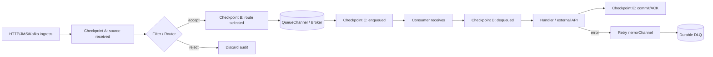
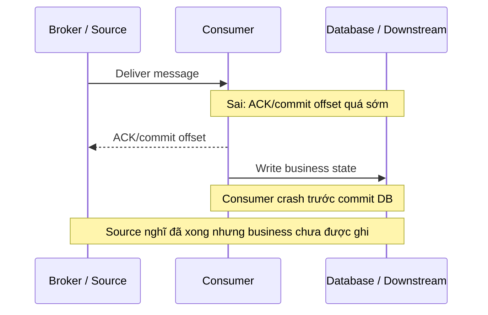

# Xác định điểm mất message trong flow Spring Integration

## 1. “Message biến mất” có thực sự là mất dữ liệu?

Trong một hệ thống sử dụng **Enterprise Integration Patterns (EIP)**, producer báo đã gửi một message nhưng downstream không thấy kết quả. Đây là một triệu chứng, **chưa phải bằng chứng message đã mất**. Tùy kiểu channel và pattern, message có thể:

- Bị `Filter` loại **đúng quy tắc** hoặc được chuyển sang `discardChannel`.
- Được `Router` gửi sang nhánh khác, `defaultOutputChannel` hoặc `nullChannel`.
- Đang nằm trong `QueueChannel`, executor queue hoặc broker.
- Đã được consumer dequeue, nhưng đang xử lý hoặc bị chặn ở I/O.
- Đang được `Aggregator` giữ trong `MessageGroupStore` vì chưa đủ fragment.
- Bị retry, được chuyển qua `errorChannel` hoặc lưu trong dead-letter storage.
- Đã được hệ thống đích **commit**, nhưng ACK/response bị mất nên upstream tưởng thất bại.
- Thật sự bị mất do message chưa được lưu bền, cấu hình ACK sai, lỗi transaction, TTL/retention hoặc crash.

Muốn tìm điểm sai, ta phải **lần theo ranh giới xử lý**, xác định mốc nào đã được xác nhận và mốc nào còn thiếu bằng chứng.

Bài **“Xác định điểm mất message trong flow”** thuộc chương **Audit và observability** của module `SPRING_INTEGRATION_PATTERN`. Nội dung phục vụ mục tiêu học Spring Integration để xây dựng flow ít phụ thuộc, dễ mở rộng, thực hành Router, Filter, Transformer, Splitter, Aggregator, Gateway, retry, error channel và correlation, đồng thời kiểm thử, theo dõi các nhánh xử lý.

Sau bài này, bạn có thể:

1. Phân biệt **mất thật**, **được loại chủ đích**, **đang chờ**, **đã giao nhưng chưa commit**, và **kết quả chưa biết**.
2. Thiết kế các checkpoint từ ingress tới downstream và định nghĩa bằng chứng cho từng mốc.
3. Truy vết message qua transformation, fan-out/fan-in, queue, retry và các ranh giới process.
4. Dùng `ChannelInterceptor`, Micrometer, structured log, Message History và audit để khoanh vùng điểm nghi vấn.
5. Tránh kết luận sai chỉ từ phép trừ `input_count - output_count` hoặc `send() == true`.
6. Viết integration test và fault-injection test nhằm xác minh đường đi, trạng thái ACK và khả năng phục hồi.

## 2. Bốn trạng thái cần phân loại trước khi tìm lỗi

| Phân loại | Ví dụ | Cần kết luận như thế nào? |
| --- | --- | --- |
| **Discard có chủ đích** | Filter từ chối `HEARTBEAT` vì không thuộc scope | Không gọi là mất nếu đúng hợp đồng và đã ghi outcome cần thiết |
| **Pending / in-flight** | Queue còn 20 message; Aggregator thiếu một fragment | Chưa hoàn tất, phải đo tuổi chờ và thời hạn xử lý |
| **Failed / quarantined** | Retry hết hạn, record đã được DLQ xác nhận lưu | Không được xử lý bình thường, nhưng còn bằng chứng để recovery |
| **Unknown / potentially lost** | Producer timeout sau khi broker có thể đã commit | Phải đối soát nguồn–đích; không tự kết luận “chưa nhận” |
| **Confirmed loss** | Có bằng chứng source đã ACK nhưng message không ở queue, store, consumer hoặc sink sau thời hạn và đối soát đầy đủ | Sự cố mất dữ liệu có căn cứ, cần xử lý theo chính sách |

Phân loại cuối cùng cần dựa trên hợp đồng delivery/retention và các bằng chứng có thể kiểm tra. **Thiếu log hoặc không có trace không tự chứng minh message bị mất**: sampling, log retention, ứng dụng crash và instrumentation thiếu đều có thể gây khoảng trống quan sát.

## 3. Bản đồ checkpoint của một message

Xét flow nhận đơn hàng:



Các mốc A–E không thể thay thế nhau:

| Checkpoint | Bằng chứng đã có | Chưa thể khẳng định |
| --- | --- | --- |
| A — ingress observed | Adapter hoặc flow đã nhìn thấy message đầu vào | Message đã được persist hoặc xử lý thành công |
| B — route decided | Filter/Router đã chọn accepted/rejected/route key | Channel đích đã nhận được message |
| C — channel accepted | `send()` thành công theo contract channel hoặc broker ACK tương ứng | Consumer đã chạy và business đã commit |
| D — dequeued / delivered | Consumer đã nhận message khỏi queue | Handler đã hoàn tất hay không có side effect trùng |
| E — business confirmed | Database commit, API result được xác minh hoặc downstream ACK theo contract | Các bước không nằm trong phạm vi contract cũng hoàn tất |
| F — source ACK/offset committed | Broker/adapter đã ghi nhận tiến độ consumer | E đã hoàn tất, trừ khi thứ tự/transaction bảo đảm điều đó |

**Cần viết rõ định nghĩa của từng checkpoint:** `CHANNEL_POST_SEND` trên `QueueChannel` không giống `BROKER_PERSIST_ACK`, `HANDLER_RETURNED` không mặc định giống `BUSINESS_COMMITTED`, và `source offset committed` không đảm bảo downstream đã nhận nếu commit diễn ra quá sớm.

### Timeline để khoanh vùng

```text
10:00:00.001  SOURCE_RECEIVED     src-event-42
10:00:00.004  FILTER_ACCEPTED     src-event-42
10:00:00.006  ORDERS_QUEUE_ACCEPT src-event-42
10:00:10.000  [không thấy QUEUE_DEQUEUED]
```

Với chuỗi này, giả thuyết đầu tiên là message **đang nằm trong queue** hoặc consumer không poll, chứ chưa phải đã mất. Kiểm tra queue depth, oldest age, poller, thread pool và error handling. Nếu queue depth đã bằng 0, cần điều tra transaction/TTL, instance khác đang tiêu thụ, hay sự thiếu sót của instrumentation.

## 4. Dùng một ID ổn định để nối các ranh giới

Spring Messaging có `MessageHeaders.ID` cho mỗi message, nhưng khi Transformer, Splitter, Enricher hoặc adapter tạo một `Message` mới, ID có thể thay đổi. Trace ID cũng có thể đổi khi replay hoặc không được propagate qua process. Vì vậy nên có **khóa nguồn và correlation cấp nghiệp vụ**:

| Trường | Vai trò | Cần lưu ý |
| --- | --- | --- |
| `sourceEventId` | ID sự kiện ổn định do nguồn phát cấp | Giữ qua retry/redelivery/replay, kiểm tra nguồn và tính duy nhất |
| `flowExecutionId` | ID của một lượt xử lý | Có thể thay đổi khi replay; giữ lineage về sự kiện nguồn |
| `messageId` | ID message Spring Messaging tại một bước | Có thể đổi ở các bước biến đổi |
| `correlationId` | Gom các fragment hoặc request/reply cùng operation | Không tự thay thế idempotency key |
| `causationId` | Bản ghi/sự kiện nào tạo ra sự kiện này | Hữu ích khi fan-out, Splitter và saga |
| `sequenceNumber` / `sequenceSize` | Thứ tự và kích thước fragment | Cần nếu Aggregator dựa vào sequence |
| `traceId` / `spanId` | Liên kết distributed trace | Không bảo đảm xuất hiện trong mọi trace do sampling |
| `flowVersion` / `routePolicyVersion` | Quy tắc thực sự đã áp dụng tại điểm quyết định | Ghi version tại thời điểm decision, không đọc lại version hiện tại |

Ví dụ metadata audit một bước:

```json
{
  "eventType": "MESSAGE_CHECKPOINT",
  "sourceEventId": "src-order-42",
  "flowExecutionId": "flow-7294",
  "checkpoint": "ordersQueue",
  "outcome": "ENQUEUED",
  "route": "priority",
  "flowVersion": "orders-flow/3.2.0",
  "occurredAt": "2026-11-21T10:00:00.006Z"
}
```

Đây là **mẫu ứng dụng tự định nghĩa**, không phải schema tự có của Spring Integration. Không đưa `sourceEventId`, `orderId`, `flowExecutionId` hoặc raw payload vào **metric tags**; các ID động thuộc log/trace/audit có quyền truy cập, retention và chính sách bảo mật phù hợp.

### Fan-out: cùng sự kiện nguồn nhưng nhiều message con

Nếu một đơn hàng được Splitter chia thành năm dòng, đầu vào có **một operation** còn đầu ra có **năm fragment**. Mỗi fragment cần lineage như:

```text
sourceEventId=src-order-42
correlationId=batch-42
fragmentKey=item-1 ... item-5
sequenceNumber=1 ... 5
sequenceSize=5
```

Khi đó, việc thiếu fragment số 3 phải được điều tra ở nhánh của fragment số 3, không lấy số `input=1` so với `output=4` để kết luận “thừa ba message”.

## 5. Những chỗ message thường “biến mất” theo từng pattern

| EIP/Thành phần | Triệu chứng | Cách kiểm tra đúng |
| --- | --- | --- |
| **Filter** | Có ingress nhưng không có output | Predicate accepted/rejected/error, `discardChannel`, `throwExceptionOnRejection` |
| **Router** | Message không tới nhánh mong đợi | Route key, mapping, `defaultOutputChannel`, version rule, kết quả gửi |
| **nullChannel** | Message dừng ngay sau một channel | Có cố ý gửi vào `nullChannel` không? Không thể replay từ đó |
| **Transformer** | ID khác hoặc payload loại mới | Giữ sourceEventId/correlation; kiểm tra exception và header propagation |
| **Splitter** | Output count khác input count | Số fragment, sequence, filter từng fragment và nhánh fan-out |
| **Aggregator** | Không có output dù fragment đã đến | `MessageGroupStore`, group size, release strategy, timeout, expiry, late arrivals |
| **Publish–Subscribe** | Một subscriber không nhận hoặc lỗi | Thống kê theo subscriber, executor, `ignoreFailures` và contract delivery |
| **QueueChannel / PriorityChannel** | Producer nhận accepted nhưng consumer chưa thấy | Queue depth, receive/poller, capacity, priority, transaction/expiry |
| **ExecutorChannel** | Có dispatch nhưng task không chạy | Executor queue, active pool, rejection, thread shutdown |
| **Gateway** | Caller timeout nhưng downstream vẫn xử lý | Request/reply correlation, reply channel, timeout, business ACK |
| **Retry / Delayer** | Message không ra output ngay | Backoff, scheduled retry, số attempts, terminal failure |
| **Error Channel / DLQ** | Không ở success path | ErrorMessage, DLQ publish ACK, backlog, replay/repair |
| **Transactional flow** | Handler đã chạy nhưng record không còn | Rollback, commit boundary, source ACK/offset, outbox/inbox |
| **Broker Adapter** | Source cho là đã gửi, consumer không thấy | Broker publish confirm, queue/topic/partition, consumer lag, TTL, ACL |

### 5.1. Filter và Router: “không đi tiếp” có thể là đúng

Một Filter trả `false` là một quyết định loại message. Nếu không có discard channel và không bật throw-on-rejection, message có thể kết thúc hợp lệ tại Filter. Vì thế, để phân biệt mất với loại hợp lệ, phải đếm **quyết định rejected** ở ranh giới Filter hoặc nhận và lưu sự kiện ở discard channel theo yêu cầu.

Router có thể chuyển message sang nhánh khác hoặc nhánh mặc định. Đối chiếu cùng **routing policy version**, route key và channel mapping; log chỉ có tên Router không đủ chứng minh một rule cụ thể đã được sử dụng.

### 5.2. Queue: “đã gửi” không phải “đã xử lý”

Với `QueueChannel`, producer gọi `send()` thành công chủ yếu chứng minh queue đã nhận message theo contract. Consumer phải `receive()` hoặc poll mới lấy được message. Nếu queue depth tăng, kiểm tra poller scheduling, `maxMessagesPerPoll`, thread executor, lock, transaction và sự chậm trễ của handler.

`QueueChannel` trong RAM có thể mất message khi JVM restart. Nếu cần bảo đảm tồn tại qua restart, xem xét broker hoặc `MessageStore` bền vững. Khi dùng broker, phải phân biệt **ready**, **unacked/in-flight**, consumer lag và thời hạn lưu; không chỉ xem một số depth đơn lẻ.

### 5.3. Aggregator: không có output không đồng nghĩa đã mất

Aggregator giữ các message theo correlation key trong `MessageGroupStore`. Nếu release strategy đợi năm fragment mà chỉ có bốn, group có thể chờ cho đến timeout hoặc expiry. Cần quan sát group size, sequence còn thiếu, tuổi group, số group pending, policy partial release và cleanup.

`getMessageGroupCount()` có thể bao gồm **metadata của group đã hoàn tất** còn được giữ để nhận biết late message; không tự coi giá trị đó là pending group count. Muốn tìm fragment thiếu, cần lineage ở từng message con, không chỉ số group.

### 5.4. Retry, error channel và DLQ

Một handler có thể lỗi hai attempts rồi thành công ở attempt thứ ba. Đó là **hai lỗi attempt, một nghiệp vụ thành công**, không phải hai message mất. Nếu retry hết giới hạn, `ErrorMessageSendingRecoverer` có thể phát `ErrorMessage` đến một channel; mốc đó **chưa chứng minh** bản ghi lỗi đã được lưu trong DLQ.

Phải theo dõi ba mốc riêng:

1. `TERMINAL_FAILURE`: không tiếp tục xử lý trong chu kỳ hiện tại.
2. `DLQ_PUBLISH_ACKED`: broker/store xác nhận đã lưu theo hợp đồng.
3. `RECOVERY_CONFIRMED`: replay/repair đã đạt kết quả nghiệp vụ được xác minh.

Nếu DLQ publisher hỏng, cần rollback, outbox hoặc fallback bền vững và cảnh báo; không tự chuyển lỗi này thành một “discard hợp lệ”.

## 6. Mốc ACK và transaction là nơi dễ mất thật nhất

Với nguồn broker, nhiều sự cố bắt nguồn từ **thứ tự commit**:



Ngược lại, commit database **trước** ACK broker giúp tránh mất nghiệp vụ trong trường hợp crash sau commit, nhưng có thể nhận **duplicate delivery**. Consumer phải được bảo vệ bằng idempotency/inbox trong cùng transaction với thay đổi business state nếu dùng cùng DB.

| Thứ tự sự kiện | Rủi ro | Cách xử lý |
| --- | --- | --- |
| ACK source rồi mới commit business | **Mất dữ liệu** khi crash giữa hai mốc | Tránh ACK sớm; dùng transaction/commit discipline |
| Business commit rồi mới ACK source | **Duplicate** nếu ACK mất | Idempotent consumer, business key, inbox |
| Ghi DB rồi publish broker từ ứng dụng | “DB đã commit nhưng event chưa xuất” | Transactional outbox và dispatcher có retry |
| Publish event rồi ghi DB | “Có event nhưng business state chưa commit” | Đổi thứ tự/hợp đồng; không giả định hai hệ thống một transaction |
| External API commit rồi caller timeout | Outcome **UNKNOWN** | Idempotency key phía đích hoặc reconcile trước retry |

Một `@Transactional` quanh JDBC không tự tạo một transaction nguyên tử với HTTP hoặc broker bên ngoài. **Exactly-once effect** phải được xác định theo ranh giới nghiệp vụ và các cơ chế cụ thể, không suy từ một flag “exactly once” ở transport.

## 7. Dụng cụ quan sát: Message History, Wire Tap, interceptor, audit

### 7.1. Message History giúp thấy endpoint đã đi qua

Spring Integration có cơ chế **Message History**, dùng để ghi nhận những component tham gia xử lý khi được bật/cấu hình. Nó giúp trả lời “message đã đi qua endpoint nào?” nhưng có giới hạn:

- Thông tin history chỉ hiện diện khi được bật và được truyền qua message/header đúng cách.
- Một custom Transformer/adapter có thể không giữ nguyên metadata mong muốn.
- History ghi đường đi component, **không** chứng minh database commit, ACK broker hay một rule routing cụ thể.
- Một message bị mất trước khi history được ghi, hoặc trace/log bị sampling, sẽ không có dấu vết đầy đủ.

Dùng history làm **chỉ dấu chẩn đoán**, không dùng làm bằng chứng duy nhất của giao dịch bền vững.

### 7.2. Wire Tap giúp nhìn các nhánh mà không thay đổi ý định xử lý

`WireTap` có thể gửi một bản message sang channel quan sát. Tuy nhiên, tap cũng có những failure modes: channel audit có thể quá tải, ghi dữ liệu trùng hoặc mất sự kiện; thao tác tap có thể tác động tới độ trễ hay đường lỗi tùy cấu hình. Không xem một `WireTap` đưa dữ liệu vào queue RAM là cơ chế kiểm toán chính thức có bảo đảm không mất. Nếu audit là bắt buộc, cần sink bền vững và transaction/outbox phù hợp.

### 7.3. ChannelInterceptor phù hợp cho checkpoint kỹ thuật

`ChannelInterceptor` có các hook như `preSend`, `postSend`, `afterSendCompletion` và `postReceive` để quan sát channel. Cần hiểu chính xác:

- `preSend`: message **sắp** được gửi, chưa có kết quả send.
- `postSend(..., sent=true)`: channel báo gửi thành công theo contract của channel đó; với queue, có thể gọi là **enqueued**, không phải processed.
- `postReceive(message != null)` trên pollable channel: consumer đã nhận/dequeue; không phải committed.
- `afterSendCompletion(..., ex)`: có thể quan sát exception của thao tác send; **không** đại diện cho mọi lỗi downstream đến sau trong flow bất đồng bộ.

Đặt interceptor cho những channel có ý nghĩa về ranh giới; tránh thu thập payload/ID vào tags hoặc chèn I/O đồng bộ nặng vào mỗi lần gửi khi lưu lượng cao.

## 8. Ví dụ Java DSL: đánh dấu checkpoint trước và sau QueueChannel

Ví dụ sau dùng **Java 17**, **Spring Integration 6.x** và **Micrometer**. Flow nhận `String` từ `ordersInput`, Filter chỉ chấp nhận các message bắt đầu bằng `ORDER:`, đưa message hợp lệ sang `ordersQueue`, và đưa message còn lại sang `ordersDiscarded`.

Ta cài `ChannelInterceptor` lên các channel để quan sát **send accepted**, **send failure** và **dequeue**. `CheckpointRecorder` ở ví dụ chỉ giữ dữ liệu **trong RAM để học và kiểm thử**; production phải dùng kho audit bền vững nếu cần đối soát sau crash.

### 8.1. Bộ ghi checkpoint và interceptor

```java
import java.time.Clock;
import java.time.Instant;
import java.util.Queue;
import java.util.concurrent.ConcurrentLinkedQueue;

import io.micrometer.core.instrument.MeterRegistry;
import org.springframework.messaging.Message;
import org.springframework.messaging.MessageChannel;
import org.springframework.messaging.support.ChannelInterceptor;

record CheckpointEvent(
        String sourceEventId,
        String flowExecutionId,
        String checkpoint,
        String outcome,
        Instant occurredAt) {}

final class CheckpointRecorder {
    private final MeterRegistry meters;
    private final Clock clock;
    private final Queue<CheckpointEvent> events =
            new ConcurrentLinkedQueue<>();

    CheckpointRecorder(MeterRegistry meters, Clock clock) {
        this.meters = meters;
        this.clock = clock;
    }

    void record(String checkpoint, String outcome, Message<?> message) {
        String sourceEventId = message.getHeaders()
                .get("sourceEventId", String.class);
        String flowExecutionId = message.getHeaders()
                .get("flowExecutionId", String.class);

        // Dữ liệu có ID chỉ lưu trong record chẩn đoán, không thành meter tag.
        events.add(new CheckpointEvent(
                sourceEventId, flowExecutionId,
                checkpoint, outcome, clock.instant()));

        // checkpoint/outcome là tập cố định theo cấu hình.
        meters.counter("app.flow.checkpoint.events",
                "flow", "orders",
                "checkpoint", checkpoint,
                "outcome", outcome).increment();
    }

    boolean observed(
            String sourceEventId, String checkpoint, String outcome) {
        return events.stream().anyMatch(event ->
                sourceEventId.equals(event.sourceEventId())
                && checkpoint.equals(event.checkpoint())
                && outcome.equals(event.outcome()));
    }
}

final class CheckpointInterceptor implements ChannelInterceptor {
    private final String checkpoint;
    private final CheckpointRecorder recorder;

    CheckpointInterceptor(
            String checkpoint, CheckpointRecorder recorder) {
        this.checkpoint = checkpoint;
        this.recorder = recorder;
    }

    @Override
    public void postSend(
            Message<?> message, MessageChannel channel, boolean sent) {
        recorder.record(checkpoint,
                sent ? "SEND_ACCEPTED" : "SEND_REJECTED", message);
    }

    @Override
    public void afterSendCompletion(
            Message<?> message, MessageChannel channel,
            boolean sent, Exception ex) {
        if (ex != null) {
            recorder.record(checkpoint, "SEND_EXCEPTION", message);
        }
    }

    @Override
    public Message<?> postReceive(
            Message<?> message, MessageChannel channel) {
        if (message != null) {
            recorder.record(checkpoint, "DEQUEUED", message);
        }
        return message;
    }
}
```

Trong ví dụ này, `CheckpointRecorder` giữ các record vô hạn trong RAM nên **chỉ phù hợp với demo/test**. Production cần storage, retention, sampling hoặc batching có giới hạn và quy trình xử lý lỗi audit, không dùng `ConcurrentLinkedQueue` tích lũy mãi trong một JVM.

`SEND_ACCEPTED` chỉ là kết quả mà **channel** trả về. Với `ordersQueue` nó có nghĩa enqueue được chấp nhận; đối với `ordersInput` là `DirectChannel`, message đã dispatch tới subscriber đồng bộ. Không được gán cùng một nhãn này là “business processed” ở mọi loại channel.

### 8.2. Cấu hình IntegrationFlow

```java
import java.time.Clock;
import io.micrometer.core.instrument.MeterRegistry;
import org.springframework.beans.factory.annotation.Bean;
import org.springframework.context.annotation.Configuration;
import org.springframework.integration.annotation.EnableIntegration;
import org.springframework.integration.channel.DirectChannel;
import org.springframework.integration.channel.QueueChannel;
import org.springframework.integration.dsl.IntegrationFlow;

@Configuration
@EnableIntegration
class CheckpointFlowConfiguration {

    @Bean
    CheckpointRecorder checkpointRecorder(MeterRegistry meters) {
        return new CheckpointRecorder(meters, Clock.systemUTC());
    }

    @Bean("ordersInput")
    DirectChannel ordersInput(CheckpointRecorder recorder) {
        DirectChannel channel = new DirectChannel();
        channel.addInterceptor(
                new CheckpointInterceptor("ordersInput", recorder));
        return channel;
    }

    @Bean("ordersQueue")
    QueueChannel ordersQueue(CheckpointRecorder recorder) {
        QueueChannel channel = new QueueChannel(20);
        channel.addInterceptor(
                new CheckpointInterceptor("ordersQueue", recorder));
        return channel;
    }

    @Bean("ordersDiscarded")
    QueueChannel ordersDiscarded(CheckpointRecorder recorder) {
        QueueChannel channel = new QueueChannel(20);
        channel.addInterceptor(
                new CheckpointInterceptor("ordersDiscarded", recorder));
        return channel;
    }

    @Bean
    IntegrationFlow intakeFlow() {
        return IntegrationFlow.from("ordersInput")
                .filter(String.class,
                        value -> value.startsWith("ORDER:"),
                        endpoint -> endpoint.discardChannel("ordersDiscarded"))
                .channel("ordersQueue")
                .get();
    }
}
```

Hai `QueueChannel` trong bài không có poller tự động. Đó là **chủ ý** để nhìn thấy message đã enqueue nhưng **chưa dequeue**. Consumer thực tế cần poller/handler riêng với timeout, error handling và transaction phù hợp.

### 8.3. Gửi hai message và xem checkpoint

```java
import org.springframework.messaging.Message;
import org.springframework.messaging.support.MessageBuilder;

void demonstrate(
        DirectChannel input,
        QueueChannel ordersQueue,
        QueueChannel ordersDiscarded,
        CheckpointRecorder audit) {

    input.send(MessageBuilder.withPayload("ORDER:42")
            .setHeader("sourceEventId", "src-42")
            .setHeader("flowExecutionId", "run-42")
            .build());

    input.send(MessageBuilder.withPayload("HEARTBEAT")
            .setHeader("sourceEventId", "src-hb")
            .setHeader("flowExecutionId", "run-hb")
            .build());

    // Cả hai queue đều đang giữ một message trước khi receive.
    int ready = ordersQueue.getQueueSize();       // 1
    int discarded = ordersDiscarded.getQueueSize(); // 1

    assert ready == 1 && discarded == 1;
    assert audit.observed("src-42", "ordersQueue", "SEND_ACCEPTED");
    assert audit.observed("src-hb", "ordersDiscarded", "SEND_ACCEPTED");

    Message<?> acceptedMessage = ordersQueue.receive(0);
    assert acceptedMessage != null;
    assert audit.observed("src-42", "ordersQueue", "DEQUEUED");

    // DEQUEUED vẫn chưa có nghĩa database hay external service đã commit.
}
```

Lưu ý: `assert` của Java thường bị tắt nếu không bật `-ea`; đoạn trên chỉ là demo minh họa. **JUnit/AssertJ** ở phần tiếp theo mới là cách xác minh cần dùng cho dự án. Sau khi `ordersQueue.receive()` trả message, để kết luận “processed” phải gọi handler thật và ghi checkpoint **sau commit/ACK tương ứng**, không gọi `record("PROCESSED")` khi vừa lấy message khỏi queue.

## 9. Kiểm thử bằng JUnit: tìm đúng ranh giới biến mất

Ví dụ dùng Spring Test, JUnit 5, AssertJ và `SimpleMeterRegistry`. Các queue và registry của mỗi ca được cô lập để kết quả không phụ thuộc thứ tự chạy test.

```java
import static org.assertj.core.api.Assertions.assertThat;

import io.micrometer.core.instrument.MeterRegistry;
import io.micrometer.core.instrument.simple.SimpleMeterRegistry;
import org.junit.jupiter.api.Test;
import org.springframework.beans.factory.annotation.Autowired;
import org.springframework.beans.factory.annotation.Qualifier;
import org.springframework.context.annotation.Bean;
import org.springframework.context.annotation.Configuration;
import org.springframework.integration.channel.DirectChannel;
import org.springframework.integration.channel.QueueChannel;
import org.springframework.messaging.Message;
import org.springframework.messaging.support.MessageBuilder;
import org.springframework.test.annotation.DirtiesContext;
import org.springframework.test.context.junit.jupiter.SpringJUnitConfig;

@SpringJUnitConfig(classes = {
        CheckpointFlowConfiguration.class,
        CheckpointFlowTest.Meters.class
})
@DirtiesContext(classMode = DirtiesContext.ClassMode.AFTER_EACH_TEST_METHOD)
class CheckpointFlowTest {

    @Configuration
    static class Meters {
        @Bean
        MeterRegistry registry() {
            return new SimpleMeterRegistry();
        }
    }

    @Autowired
    @Qualifier("ordersInput")
    DirectChannel input;

    @Autowired
    @Qualifier("ordersQueue")
    QueueChannel ready;

    @Autowired
    @Qualifier("ordersDiscarded")
    QueueChannel discarded;

    @Autowired
    CheckpointRecorder audit;

    @Test
    void acceptedMessageIsQueuedThenDequeued() {
        assertThat(input.send(MessageBuilder.withPayload("ORDER:42")
                .setHeader("sourceEventId", "src-42")
                .setHeader("flowExecutionId", "run-42")
                .build())).isTrue();

        assertThat(ready.getQueueSize()).isEqualTo(1);
        assertThat(audit.observed(
                "src-42", "ordersQueue", "SEND_ACCEPTED")).isTrue();
        assertThat(audit.observed(
                "src-42", "ordersQueue", "DEQUEUED")).isFalse();

        Message<?> message = ready.receive(0);
        assertThat(message).isNotNull();
        assertThat(message.getPayload()).isEqualTo("ORDER:42");
        assertThat(audit.observed(
                "src-42", "ordersQueue", "DEQUEUED")).isTrue();
        assertThat(ready.getQueueSize()).isZero();
    }

    @Test
    void filterDiscardIsNotMessageLoss() {
        assertThat(input.send(MessageBuilder.withPayload("HEARTBEAT")
                .setHeader("sourceEventId", "src-hb")
                .setHeader("flowExecutionId", "run-hb")
                .build())).isTrue();

        assertThat(ready.getQueueSize()).isZero();
        assertThat(discarded.getQueueSize()).isEqualTo(1);
        assertThat(audit.observed(
                "src-hb", "ordersDiscarded", "SEND_ACCEPTED")).isTrue();
        assertThat(audit.observed(
                "src-hb", "ordersQueue", "SEND_ACCEPTED")).isFalse();
    }
}
```

Đây là **test luồng và checkpoint nội bộ**, chưa bảo đảm message bền vững sau crash. Để test “không mất message” end-to-end, cần thêm store/broker thực, transaction, ACK và các ca failover. Đồng thời kiểm tra việc bật Message History hoặc trace không được làm thay đổi kết quả nghiệp vụ.

### Ma trận fault injection quan trọng

| Điểm gây lỗi | Điều phải xác minh |
| --- | --- |
| Filter trả `false` | Có rejected/discard đúng quy tắc, không gọi là lost |
| Router chọn nhánh không có mapping | Có lỗi/default route đúng policy và version |
| Queue đầy, `send` trả `false` hoặc ném lỗi | Không ghi `SEND_ACCEPTED` giả; producer biết xử lý backpressure |
| Consumer/poller dừng | Queue depth/oldest age tăng; không ghi business committed |
| Consumer dequeue rồi crash trước commit | Source có redelivery/recovery hoặc lưu trạng thái rõ, không ACK sớm |
| Handler commit DB rồi crash trước ACK | Message có thể giao lặp; idempotency ngăn side effect lặp |
| External API commit nhưng response timeout | Outcome `UNKNOWN`, phải reconcile trước retry mù |
| Broker publish ACK bị mất | Có thể dữ liệu đã tồn; kiểm tra bằng source event ID / publish key |
| Filter bỏ một fragment trước Aggregator | Group pending/timeout theo policy, lineage chỉ ra fragment thiếu |
| Aggregator chưa đủ group | Không kết luận lost khi chưa tới deadline |
| Retry chạy ba lần | Attempt count khác logical operation count |
| ErrorMessage gửi tới QueueChannel trong RAM | Chưa chứng minh durable DLQ |
| DLQ publisher ném lỗi | Có cảnh báo, rollback/outbox/fallback thay vì im lặng bỏ |
| Message hết TTL/retention | Có bằng chứng expiry/deletion, đánh giá theo SLA |
| Splitter fan-out nhiều nhánh | Đối soát theo fragment/branch thay vì chỉ theo tổng messages |
| Trace bị sampling hoặc logger bị hỏng | Audit/source-of-truth còn đủ để điều tra nếu bắt buộc |
| Restart trong lúc queue RAM còn dữ liệu | Nêu rõ khả năng mất queue, test khôi phục nếu yêu cầu bền vững |

## 10. Bảng chẩn đoán từ “checkpoint cuối cùng”

Đây là cách điều tra thực tế khi có `sourceEventId` hoặc business correlation:

| Checkpoint cuối thấy được | Checkpoint kỳ vọng tiếp theo | Bắt đầu điều tra từ đâu? |
| --- | --- | --- |
| `SOURCE_RECEIVED` | Filter/route decision | Adapter đã ACK quá sớm? Flow chưa dispatch? Input converter lỗi? |
| `FILTER_ACCEPTED` | Channel enqueue/dispatch | Router target mapping, channel send, capacity, exception |
| `FILTER_REJECTED` | Discard handler/audit | Rejection có hợp lệ? Có yêu cầu lưu discard không? |
| `ROUTE_SELECTED` | Route target accepted | Version routing, missing subscriber, target availability |
| `QUEUE_ENQUEUED` | Consumer dequeue | Queue depth, poller, executor, broker lag/retention |
| `QUEUE_DEQUEUED` | Handler start | Thread pool, handler dispatch, consumer crash |
| `HANDLER_STARTED` | Handler result/commit | I/O timeout, DB lock, thread dump, pending futures |
| `HANDLER_SUCCEEDED` | Business commit / external ACK | Transaction commit, lost ACK, downstream side effect |
| `TERMINAL_FAILURE` | DLQ publish ACK | Error flow, DLQ publisher, broker/storage health |
| `DLQ_PUBLISH_ACKED` | Replay/recovery | Pending age, operator approval, retry policy, quarantine |
| `REPLAY_STARTED` | Recovery confirmed | Idempotency, fail reason, business completion |

Để điều tra một khoảng trống, nên tìm **bằng chứng ở cả hai phía**: nhật ký nguồn và sink, trạng thái queue/store, timestamp, retry, transaction và metrics. Nếu một checkpoint không được ghi vì audit publisher lỗi, đó là **lỗ hổng quan sát**, không tự động là message loss.

## 11. Metric và dashboard để phát hiện điểm nghẽn

### 11.1. Bộ metric gợi ý

| Metric | Loại | Ý nghĩa |
| --- | --- | --- |
| `app.flow.checkpoint.events` | Counter | Số event ở mỗi channel/checkpoint/outcome có nhãn hữu hạn |
| `app.flow.filter.decisions` | Counter | Accepted/rejected/error ở Filter |
| `app.flow.route.decisions` | Counter | Route được chọn và outcome dispatch |
| `app.flow.queue.depth` | Gauge | Số message đang chờ ở queue |
| `app.flow.queue.oldest.age` | Gauge | Tuổi message đang pending lâu nhất |
| `app.flow.handler.duration` | Timer | Thời gian handler chạy |
| `app.flow.handler.inflight` | Gauge | Số lượt xử lý đã bắt đầu nhưng chưa hoàn tất |
| `app.flow.business.committed` | Counter | Số kết quả được xác nhận theo contract nghiệp vụ |
| `app.flow.retry.terminal` | Counter | Số chu kỳ xử lý kết thúc lỗi |
| `app.flow.dlq.publish.failed` | Counter | Lỗi lưu DLQ |
| `app.flow.dlq.pending` | Gauge | Backlog DLQ từ broker/store |

Tên trên là **metric ứng dụng đề xuất**, không phải tất cả đều có sẵn trong Spring Integration. Trước khi instrument, kiểm tra channel/handler observations, broker metrics và exporter của phiên bản đang chạy để tránh đếm trùng.

Với `QueueChannel`, có thể đọc `getQueueSize()` và `getRemainingCapacity()`. Với `ExecutorChannel`, cần xem executor queue size/active threads/rejections. Với Kafka, cần consumer lag theo partition; với RabbitMQ, phân biệt ready/unacked. Không dùng một gauge của một pod để đại diện toàn bộ shared backend.

### 11.2. Dùng PromQL để so sánh tốc độ giữa các checkpoint

Counter trong code ví dụ thường được xuất sang Prometheus với tên `app_flow_checkpoint_events_total`. Kiểm tra tên thực tế trước khi dùng:

```promql
# Tốc độ message được nhận vào QueueChannel.
sum(rate(app_flow_checkpoint_events_total{
  flow="orders",checkpoint="ordersQueue",outcome="SEND_ACCEPTED"
}[5m]))
```

```promql
# Tốc độ consumer dequeue từ QueueChannel.
sum(rate(app_flow_checkpoint_events_total{
  flow="orders",checkpoint="ordersQueue",outcome="DEQUEUED"
}[5m]))
```

```promql
# Tốc độ message đi vào nhánh Filter discard.
sum(rate(app_flow_checkpoint_events_total{
  flow="orders",checkpoint="ordersDiscarded",outcome="SEND_ACCEPTED"
}[5m]))
```

**Không mặc định** hai tốc độ enqueue/dequeue phải bằng nhau trong mỗi cửa sổ 5 phút: queue hấp thụ burst, scheduler có thể chậm và số mẫu bị trễ. Muốn chứng minh lost, phải đối soát **tập sự kiện/operation qua một khoảng thời gian đủ dài** và các trạng thái pending, discard, error, retry, expiry, chứ không chỉ so hai đường biểu đồ.

### 11.3. Quy tắc theo dõi có ý nghĩa hơn một phép trừ tổng

- **Queue depth tăng, oldest age tăng:** consumer có thể không theo kịp, dừng poll hoặc bị block.
- **Queue depth thấp, handler inflight cao:** message đã dequeue nhưng còn chờ downstream.
- **Terminal failure tăng nhưng DLQ publish ACK không tăng:** nghi ngờ lỗi ở nhánh error/DLQ.
- **Filter rejected tăng:** kiểm tra quy tắc nghiệp vụ và thay đổi schema/route, không tự báo mất dữ liệu.
- **Gateway timeout tăng nhưng business committed vẫn tăng:** nghi ngờ reply/ACK hoặc latency vượt timeout.
- **Không còn metric:** kiểm tra scrape và application health; thiếu metric không có nghĩa lỗi bằng 0.

Đặc biệt, bộ metric dạng Counter không đủ để truy vấn một event cụ thể vì **không gắn sourceEventId vào label**. Khi cần xác minh “event X đi đâu”, dùng audit/trace/log có retention phù hợp.

## 12. Đối soát có công thức nhưng không dùng công thức mù

Trong một flow đơn giản **một input tạo đúng một output hoặc đúng một terminal outcome**, có thể lập invariant:

```text
received_unique_operations
  = confirmed_success
  + confirmed_business_discard
  + durably_quarantined
  + currently_pending
  + unresolved_unknown
```

Đây là **quy ước đối soát**, chỉ đúng khi các trạng thái **loại trừ nhau**, được quan sát trên cùng một tập operation ID và cùng thời hạn chốt sổ. Nếu có retry/redelivery, cùng operation có thể tạo nhiều attempts; không được cộng attempts vào vế phải.

Với Splitter tạo nhiều fragments, cần invariant khác:

```text
expected_fragment_keys(batch)
  = completed_fragments
  U discarded_fragments
  U pending_fragments
  U unresolved_fragments
```

Ký hiệu `U` ở đây là **hợp của các tập fragment key**, không phải phép cộng số message ở các thời điểm khác nhau. Cần định nghĩa duplicate/redelivery và điều kiện fragment hoàn tất để các tập không bị chồng lấn.

Với Aggregator, đầu ra có thể ít hơn số input mà vẫn đúng thiết kế. Với Publish–Subscribe, một input tạo nhiều nhánh outcome. Với Retry, cùng logical operation tạo nhiều attempts; với Gateway, timeout có thể xảy ra sau khi downstream đã commit. Vì vậy, đối soát phải xuất phát từ **business operation + lineage + checkpoint semantics**, không chỉ từ số lượng channel.

## 13. Runbook xử lý sự cố nghi mất message

Khi nhận thông báo “đã gửi nhưng không tìm thấy”, nên xử lý theo thứ tự sau:

1. **Xác định khóa nguồn và khoảng thời gian:** lấy `sourceEventId` hoặc business ID cùng timeframe; kiểm tra log không đưa payload/PII vào kênh không phù hợp.
2. **Làm rõ kết quả mong đợi:** một output, nhiều fragment, response gateway hay ACK nghiệp vụ? Có Filter discard/Router default hợp lệ không?
3. **Tìm checkpoint cuối có bằng chứng:** ingress, route, queue enqueue, dequeue, handler, commit, DLQ hoặc replay.
4. **Kiểm tra trạng thái đang chờ:** queue depth/oldest age, executor, Aggregator group, retry scheduler, broker lag/unacked, transaction pending.
5. **Đối chiếu hai nguồn sự thật:** adapter/broker bên gửi và sink bên nhận, không chỉ log của một JVM.
6. **Kiểm tra ranh giới ACK và transaction:** có commit offset/ACK trước side effect không? Có commit nhưng mất ACK gây duplicate không?
7. **Kiểm tra lỗi và loại bỏ có chủ đích:** Filter reject, nullChannel, Router default, errorChannel, DLQ publish/expiry.
8. **Đánh giá rủi ro trước khi replay:** nếu kết quả external side effect đang `UNKNOWN`, đối soát hoặc dùng idempotency key trước khi gửi lại.
9. **Khôi phục có kiểm soát:** replay batch nhỏ, giới hạn tốc độ và có stop condition; không replay vô hạn hoặc xóa DLQ trước xác nhận.
10. **Xác minh và hậu kiểm:** business state/ACK đúng, không duplicate, metric pending về mức bình thường, ghi nguyên nhân và biện pháp phòng ngừa.

### Bằng chứng để kết luận các tình huống

| Kết luận | Bằng chứng mong muốn |
| --- | --- |
| “Bị Filter loại đúng quy tắc” | Decision rejected, rule version, discard outcome đúng hợp đồng |
| “Đang chờ Aggregator” | Group tồn tại với size/sequence/age và deadline phù hợp |
| “Đã enqueue nhưng chưa dequeue” | ACK enqueue + message còn trong queue hoặc lag được xác nhận |
| “Đã xử lý nhưng reply thất lạc” | Business commit/transaction ID đáng tin cậy, không có reply tại gateway |
| “Đã được lưu vào DLQ” | Broker/store ACK và record có stable failure key |
| “Có nguy cơ bị mất” | Thiếu checkpoint kế tiếp cộng bằng chứng không còn trong pending/retry/expiry/DLQ, cần điều tra |
| “Đã mất được xác nhận” | Đối soát đầy đủ theo nguồn sự thật, contract và retention; không còn đường phục hồi |

## 14. Những lỗi thường gặp khi điều tra

1. **Coi `send() == true` là ACK nghiệp vụ.** Nó chỉ phản ánh contract của channel ở ranh giới hiện tại.
2. **Coi `input - output` là số message mất.** Splitter, Filter, Aggregator, queue và retry có đơn vị/mốc khác nhau.
3. **Xem absence của span/log là loss.** Trace sampling và log failure có thể tạo lỗ hổng quan sát.
4. **Dùng `MessageHeaders.ID` làm ID nghiệp vụ qua mọi transformer.** Message mới có thể có ID mới.
5. **Gắn ID riêng từng message vào Micrometer tag.** Cardinality cao và nguy cơ lộ dữ liệu.
6. **Coi `nullChannel` hoặc discardChannel là DLQ.** Đó có thể chỉ là nơi chủ đích dừng message.
7. **Chỉ xem queue depth.** Message đã dequeue nhưng handler vẫn in-flight, hoặc pending nằm trong Aggregator/broker.
8. **Đánh dấu xử lý thành công ngay sau dequeue.** Side effect chưa được commit.
9. **ACK offset broker trước DB commit.** Crash giữa hai bước có thể gây mất dữ liệu thực sự.
10. **Retry mù khi external API đã có thể commit.** Có thể nhân đôi thanh toán/giữ kho.
11. **Cho rằng errorChannel đã lưu durable DLQ.** Cần ACK từ sink và chính sách replay.
12. **Dùng history/wire tap trong RAM như bằng chứng duy nhất.** Nó có thể bị mất cùng process.
13. **Không ghi route policy version.** Thay rule làm cùng payload đi nhánh khác mà không thể giải thích.
14. **Không test lỗi phát sinh giữa các checkpoint.** Đường thành công không chứng minh crash consistency.

## 15. Checklist áp dụng cho production

- [ ] Định nghĩa chính xác ingress accepted, route decided, channel accepted, dequeued, business confirmed và source ACK.
- [ ] Có `sourceEventId` ổn định, `flowExecutionId` và lineage qua Splitter/Aggregator/replay.
- [ ] Chỉ dùng ID động ở audit/log/trace có bảo vệ; metric tags có cardinality hữu hạn.
- [ ] Tách Filter reject, Router default, nullChannel, Aggregator pending với error/DLQ.
- [ ] Có metric queue depth, oldest pending age, handler in-flight, retry, DLQ ACK/failure và business commit.
- [ ] Chọn độ bền cho queue/store phù hợp và kiểm thử restart, redelivery, ACK/rollback.
- [ ] Bảo đảm source ACK/offset commit không vượt trước mốc xử lý cần được cam kết.
- [ ] Dùng outbox/inbox và idempotency nếu có giao dịch giữa DB, broker hoặc external API.
- [ ] Audit checkpoint bắt buộc có sink bền vững và retention; Wire Tap/history là dữ liệu hỗ trợ, không phải bảo đảm exactly-once.
- [ ] Có dashboard/alert cho backlog, oldest age, DLQ publisher failure, handler timeout và telemetry missing.
- [ ] Tập test có Filter discard, Router nhầm nhánh, queue full, poller dừng, Aggregator thiếu fragment, lost ACK, crash/replay.
- [ ] Có runbook đối soát theo operation ID và bằng chứng tại từng hop trước khi kết luận mất message.

## 16. Tài liệu tham khảo

- [Spring Integration — Message Channels](https://docs.spring.io/spring-integration/reference/channel.html)
- [Spring Integration — Channel Interceptors](https://docs.spring.io/spring-integration/reference/channel/interceptors.html)
- [Spring Integration — Message History](https://docs.spring.io/spring-integration/reference/message-history.html)
- [Spring Integration — Routers](https://docs.spring.io/spring-integration/reference/router.html)
- [Spring Integration — Filtering Messages](https://docs.spring.io/spring-integration/reference/filter.html)
- [Spring Integration — Aggregator](https://docs.spring.io/spring-integration/reference/aggregator.html)
- [Spring Integration — Error Handling](https://docs.spring.io/spring-integration/reference/error-handling.html)
- [Spring Integration — Metrics and Management](https://docs.spring.io/spring-integration/reference/metrics.html)
- [Spring Integration — Transactions](https://docs.spring.io/spring-integration/reference/transactions.html)
- [Micrometer — Counters](https://docs.micrometer.io/micrometer/reference/concepts/counters.html)
- [Enterprise Integration Patterns — Message History](https://www.enterpriseintegrationpatterns.com/patterns/messaging/MessageHistory.html)

**Ghi nhớ:** để xác định điểm mất message, đừng chỉ tìm **checkpoint cuối cùng** mà phải hỏi checkpoint đó **chứng minh điều gì**. Một message có thể đã được accept nhưng chưa dequeue, đã dequeue nhưng chưa commit, đã commit nhưng mất ACK, hoặc bị Filter/Router loại đúng quy tắc. Dùng lineage ổn định, audit có mốc rõ, queue/store state và kiểm thử crash/retry để phân biệt **mất thực sự** với **chưa hoàn tất hoặc thiếu quan sát**.
