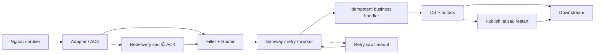
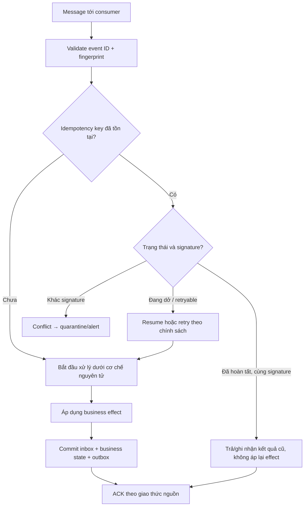

# Kiểm thử duplicate và idempotency

Trong chương **Kiểm thử pattern** của **SPRING_INTEGRATION_PATTERN**, một hệ thống xử lý đúng thứ tự chưa chắc đã xử lý đúng **số lần**. Cùng một business event có thể được gửi lại sau lỗi ACK, retry của Gateway, restart consumer hoặc phát lại từ dead-letter queue (DLQ). Nếu một nghiệp vụ cộng tiền, giữ hàng hay gửi email thực hiện lại toàn bộ tác động mỗi lần message đến, hệ thống có thể tạo kết quả sai dù Router, Filter, Transformer, Splitter, Aggregator hay Resequencer đều hoạt động theo cấu hình.

Bài học này tập trung vào **kiểm thử duplicate và idempotency** trong Spring Integration: xác định danh tính sự kiện, phân biệt redelivery và conflict, kiểm tra tính nguyên tử của xử lý, cố ý gây lỗi ở các thời điểm nguy hiểm và chứng minh tác động nghiệp vụ không bị lặp. Nội dung áp dụng cho message channel, Gateway, retry, error channel, correlation và những nhánh xử lý bất đồng bộ.

> **Kết luận cần kiểm chứng bằng test:** Nhận một message hai lần không nhất thiết là lỗi. **Tạo hai tác động nghiệp vụ cho cùng một sự kiện mà hợp đồng chỉ cho phép một lần** mới là lỗi idempotency.

## 1. Khái niệm và những bất biến phải kiểm thử

### 1.1. Duplicate message là gì?

*Duplicate delivery* là khi cùng một sự kiện hoặc công việc logic được chuyển đến một consumer nhiều lần. Hai message có thể có cùng payload nhưng khác `MessageHeaders.ID`, timestamp, delivery tag hoặc retry count.

Ví dụ sự kiện ghi có tài khoản:

```text
Business event: CreditPosted(eventId="evt-100", accountId="A", +100)

Delivery 1: messageId=m-1, eventId=evt-100 → consumer xử lý
             ... nghiệp vụ đã commit, ACK bị mất ...
Delivery 2: messageId=m-2, eventId=evt-100 → broker redeliver

Mục tiêu: tổng số dư chỉ tăng 100, không tăng 200.
```

Đừng nhận diện duplicate bằng việc hai bản tin có payload nhìn giống nhau. Hai giao dịch độc lập cùng cộng 100 vào tài khoản A **không phải duplicate** nếu có hai `eventId` nghiệp vụ khác nhau.

### 1.2. Idempotency là gì?

Một thao tác được gọi là *idempotent* nếu thực hiện lặp lại với cùng yêu cầu logic không tiếp tục thay đổi kết quả đã đạt được. Với hàm cập nhật trạng thái `f`, trực giác toán học là:

```text
f(f(state, event), event) = f(state, event)
```

Tuy nhiên cần định nghĩa **kết quả nào** phải ổn định:

- **Business state:** số dư, đơn hàng, hàng tồn hoặc trạng thái domain không bị áp thêm tác động.
- **External side effect:** không gửi hai lần yêu cầu thu tiền, email hay lệnh xuất kho nếu hợp đồng yêu cầu đúng một lần.
- **Outbound event:** không công bố hai kết quả có hiệu lực độc lập cho cùng một sự kiện; nếu có redelivery outbound thì consumer phải nhận diện được.
- **Acknowledgment/recovery:** message được ACK khi việc xử lý đã được commit hoặc bàn giao bền vững, không bị ACK mất trước lúc xử lý thật.
- **Conflict:** cùng `eventId` nhưng nội dung bất biến khác nhau phải được phát hiện, không bị bỏ qua như bản gửi lại vô hại.

**Không đồng nhất “xử lý một lần” với “handler chỉ được gọi một lần”.** Trong một hệ thống at-least-once, handler có thể được gọi nhiều lần; test đúng phải chứng minh **tác động có hiệu lực cuối cùng** chỉ xảy ra theo hợp đồng.

### 1.3. Từ vựng trong test

| Thuật ngữ | Ý nghĩa | Cách đo |
| --- | --- | --- |
| Delivery attempt | Một lần message được chuyển tới consumer | Delivery count, retry trace |
| Logical event | Một sự kiện nghiệp vụ có danh tính ổn định | `eventId` / idempotency key |
| Duplicate | Nhiều lần delivery của cùng logical event | Cùng khóa và nội dung bất biến |
| Conflict | Cùng khóa nhưng nội dung/version không khớp | So sánh fingerprint/schema/version |
| Accepted | Consumer đã nhận hoặc ghi inbox | Bản ghi tiếp nhận |
| Committed | Tác động nghiệp vụ đã bền vững | Database/side-effect ledger |
| Acknowledged | Nguồn vận chuyển biết đã nhận trách nhiệm | Broker ACK/offset |
| Replayed | Sự kiện được gửi lại từ nguồn, retry hoặc DLQ | Source event ID và retry reason |

## 2. Chọn khóa idempotency trước khi viết assertion

Một phép kiểm thử duplicate chỉ có ý nghĩa nếu hợp đồng xác định **thế nào là cùng một công việc**.

| Khóa được chọn | Điều gì có thể sai? | Cách tốt hơn |
| --- | --- | --- |
| `MessageHeaders.ID` | Retry có thể tạo Spring Message mới với ID khác | Dùng `sourceEventId` hoặc khóa nghiệp vụ ổn định |
| Hash payload đơn thuần | Hai sự kiện khác nhau có dữ liệu giống hệt bị gộp nhầm | Kết hợp event ID và fingerprint |
| `orderId` đơn thuần | Hai bước hợp lệ của cùng đơn bị xem là duplicate | Dùng `orderId + actionId/version` theo hợp đồng |
| `correlationId` đơn thuần | Splitter tạo nhiều phần hợp lệ cùng group | Dùng thêm `sequenceNumber` và định danh phần nếu là slot |
| `sequenceNumber` đơn thuần | Nhiều batch đều có phần `#1` | Dùng `batchRunId + sequenceNumber` |
| Delivery timestamp | Redelivery có thời điểm mới | Không dùng thời điểm vận chuyển làm danh tính |
| `sourceEventId` bất biến | Thường phù hợp cho một business event | Thêm consumer scope/tenant khi cần |

Một thiết kế thường dùng:

```text
consumer-scope key = (consumerName, tenantId, sourceEventId)

Nếu dedup theo một phần trong chuỗi:
slot key = (tenantId, batchRunId/correlationId, sequenceNumber)
signature = (sourceEventId, normalizedPayloadFingerprint, sequenceSize)
```

**Vì sao thêm `consumerName`?** Cùng một sự kiện có thể được xử lý hợp lệ bởi hai consumer độc lập (ví dụ một consumer ghi sổ và một consumer cập nhật báo cáo). Mỗi consumer phải idempotent trong phạm vi tác động của chính nó; không dùng bảng `eventId` chung khiến consumer thứ hai bị chặn nhầm.

Với dữ liệu thay đổi có version, cần quy định một sự kiện sửa đổi là **event mới** hay là **bản phát lại sai**. Không được dùng một khóa chung rồi tùy tiện áp dụng “first wins” hoặc “last wins”.

## 3. Duplicate xuất hiện ở đâu trong các Integration Patterns?



Điểm tạo duplicate thay đổi theo ranh giới:

- **Broker/adapter:** consumer hoàn tất nhưng ACK chưa được ghi nhận; broker chuyển lại cùng sự kiện.
- **Gateway:** downstream đã thành công nhưng lời hồi đáp timeout, khiến client gửi lại request.
- **Retry advice:** một callback được thử lại; nếu thao tác bên ngoài thành công rồi ném lỗi, lần kế tiếp có thể lặp tác động.
- **Splitter:** cả batch được split lại và tạo lại những phần từng được xử lý. Cần phân biệt replay run cũ với một run mới.
- **Router/fan-out:** một business event được phát tới nhiều consumer là hành vi hợp lệ; không được dedup xuyên consumer tùy tiện.
- **Aggregator/Resequencer:** message cùng slot có thể đến nhiều lần hoặc đến sau khi group đã hoàn tất; correlation và idempotency phải được thiết kế riêng.
- **Error channel/DLQ:** operator replay message lỗi, nhưng trạng thái nghiệp vụ trước lần lỗi có thể đã commit một phần.
- **Outbound publisher:** event có thể được phát lại vì ứng dụng crash trước khi đánh dấu “đã xuất bản”.

Điểm cần kiểm tra không chỉ là **có duplicate đến không**, mà là **từng ranh giới có giữ đúng danh tính và trạng thái xử lý hay không**.

## 4. Kiến trúc kiểm thử: từ nhận message tới hiệu ứng đã commit

Để kiểm thử chính xác, nên tách ba trách nhiệm:

1. **Admission/dedup:** phân loại một event mới, bản gửi lại hay conflict.
2. **Business effect:** áp dụng thay đổi nghiệp vụ hoặc gọi dịch vụ bên ngoài.
3. **Commit/acknowledgment:** ghi kết quả bền vững, phát event theo hợp đồng rồi cho phép nguồn đánh dấu đã nhận.



Sơ đồ mô tả **hợp đồng xử lý**, không phải hành vi mặc định của một endpoint Spring Integration. Nhánh `J → D` cần transaction, lock/lease và điều phối để không có hai tiến trình cùng commit.

### 4.1. Bốn điểm gây lỗi thường gặp

| Điểm lỗi được tiêm trong test | Rủi ro | Kỳ vọng sau retry |
| --- | --- | --- |
| Trước ghi nhận inbox | Không có trạng thái tiếp nhận | Có thể xử lý lại và commit một lần |
| Đã ghi `RECEIVED` nhưng chưa áp dụng nghiệp vụ | Bản gửi lại bị loại nhầm là “đã xử lý” | Resume được; không mất event |
| Đã áp dụng hiệu ứng nhưng chưa ACK | Broker redeliver | Không áp lại hiệu ứng đã commit |
| Đã ghi business state nhưng chưa phát event tiếp theo | Downstream không thấy kết quả | Outbox hoặc cơ chế hồi phục phát kết quả đúng cách |

Một test chỉ gửi cùng message hai lần trong một JVM **không đủ** để chứng minh an toàn qua restart, transaction rollback hoặc lỗi ACK.

## 5. Ví dụ Java: mô hình in-memory để học bất biến

Ví dụ sau cố ý dùng một ledger trong bộ nhớ để diễn giải ý nghĩa duplicate. Hai event khác nhau có thể cùng cộng vào một tài khoản; cùng `eventId` chỉ được áp một lần. Đây **không phải implementation production** vì không bền qua restart và không phối hợp giữa nhiều instance.

```java
import java.util.HashMap;
import java.util.Map;

record CreditPosted(String eventId, String accountId, long amountCents) { }

enum ApplyResult {
    APPLIED, DUPLICATE
}

final class FakeLedger {
    private final Map<String, CreditPosted> committed = new HashMap<>();
    private final Map<String, Long> balances = new HashMap<>();

    synchronized ApplyResult apply(CreditPosted event) {
        if (event == null || event.eventId() == null
                || event.eventId().isBlank()
                || event.accountId() == null
                || event.accountId().isBlank()
                || event.amountCents() <= 0) {
            throw new IllegalArgumentException("Invalid event");
        }

        CreditPosted previous = committed.get(event.eventId());

        if (previous != null) {
            if (!previous.equals(event)) {
                throw new IllegalStateException(
                        "Same event ID, conflicting business data");
            }
            return ApplyResult.DUPLICATE;
        }

        balances.merge(event.accountId(),
                event.amountCents(), Math::addExact);
        committed.put(event.eventId(), event);
        return ApplyResult.APPLIED;
    }

    synchronized long balance(String accountId) {
        return balances.getOrDefault(accountId, 0L);
    }

    synchronized int committedEventCount() {
        return committed.size();
    }
}
```

Khối `synchronized` giúp các thao tác lên mô hình giả diễn ra tuần tự **trong một instance Java**. Trong hệ thống thật, nghiệp vụ và dấu đã xử lý phải được commit cùng một ranh giới bền vững; một `HashMap` không thể thay thế transaction của database hoặc idempotency của API bên ngoài.

### 5.1. JUnit: cùng event nhiều lần, chỉ một hiệu ứng

```java
import static org.junit.jupiter.api.Assertions.*;

import org.junit.jupiter.api.Test;

class FakeLedgerTest {

    @Test
    void sameEventRedeliveredDoesNotCreditTwice() {
        FakeLedger ledger = new FakeLedger();
        CreditPosted event = new CreditPosted("evt-100", "A", 100);

        assertEquals(ApplyResult.APPLIED, ledger.apply(event));
        assertEquals(ApplyResult.DUPLICATE, ledger.apply(event));
        assertEquals(ApplyResult.DUPLICATE,
                ledger.apply(new CreditPosted("evt-100", "A", 100)));

        assertEquals(100L, ledger.balance("A"));
        assertEquals(1, ledger.committedEventCount());
    }

    @Test
    void differentEventsWithSameAmountAreBothValid() {
        FakeLedger ledger = new FakeLedger();

        ledger.apply(new CreditPosted("evt-100", "A", 100));
        ledger.apply(new CreditPosted("evt-101", "A", 100));

        assertEquals(200L, ledger.balance("A"));
        assertEquals(2, ledger.committedEventCount());
    }

    @Test
    void sameEventIdWithDifferentPayloadIsConflict() {
        FakeLedger ledger = new FakeLedger();
        ledger.apply(new CreditPosted("evt-100", "A", 100));

        assertThrows(IllegalStateException.class,
                () -> ledger.apply(
                        new CreditPosted("evt-100", "A", 999)));

        assertEquals(100L, ledger.balance("A"));
        assertEquals(1, ledger.committedEventCount());
    }
}
```

Ba test trên kiểm tra **dedup đúng**, **không dedup nhầm business event mới** và **không nuốt conflict**. Nếu chỉ kiểm tra `balance == 100` sau khi gửi trùng, có thể vẫn bỏ sót lỗi “mọi event cùng số tiền đều bị gộp” hoặc “payload khác bị bỏ qua im lặng”.

### 5.2. Cần phân biệt bộ đếm thực thi và hiệu ứng

Trong test, có thể đếm riêng:

```text
inputDeliveryCount  = 3
handlerInvocation   = 3
committedEventCount = 1
businessBalance     = +100
```

Đừng bắt buộc `handlerInvocation == 1` trong mô hình at-least-once; đó không phải bảo đảm thường có của broker. Kết quả cần bảo vệ là **commit một hiệu ứng**, hoặc một *outcome* idempotent, theo hợp đồng của consumer.

## 6. Ví dụ Spring Integration: kiểm tra lọc duplicate tại channel

Để học cách dùng IntegrationFlow và kiểm tra đầu ra, có thể đặt một bộ lọc in-memory trước một `QueueChannel`. Ví dụ này **chỉ minh họa phát hiện lần xuất hiện thứ hai của event ID**, không phải một consumer an toàn end-to-end.

```java
import java.util.Set;
import java.util.concurrent.ConcurrentHashMap;

import org.springframework.context.annotation.Bean;
import org.springframework.context.annotation.Configuration;
import org.springframework.integration.channel.DirectChannel;
import org.springframework.integration.channel.QueueChannel;
import org.springframework.integration.config.EnableIntegration;
import org.springframework.integration.dsl.IntegrationFlow;

final class DemoDuplicateGate {
    private final Set<String> seen = ConcurrentHashMap.newKeySet();

    boolean firstOccurrence(CreditPosted event) {
        if (event.eventId() == null || event.eventId().isBlank()) {
            throw new IllegalArgumentException("eventId is required");
        }
        return seen.add(event.eventId());
    }
}

@Configuration
@EnableIntegration
class DuplicateTestFlowConfiguration {

    @Bean
    DirectChannel incomingCredits() {
        return new DirectChannel();
    }

    @Bean
    QueueChannel acceptedCredits() {
        return new QueueChannel();
    }

    @Bean
    DemoDuplicateGate demoDuplicateGate() {
        return new DemoDuplicateGate();
    }

    @Bean
    IntegrationFlow duplicateTestFlow(
            DirectChannel incomingCredits,
            QueueChannel acceptedCredits,
            DemoDuplicateGate demoDuplicateGate) {

        return IntegrationFlow.from(incomingCredits)
                .filter(CreditPosted.class,
                        demoDuplicateGate::firstOccurrence)
                .channel(acceptedCredits)
                .get();
    }
}
```

**Điểm cần cảnh giác:** Bộ lọc `seen.add(eventId)` đánh dấu đã thấy **trước khi downstream xử lý bền vững**. Nếu ghi vào `acceptedCredits` xong rồi ứng dụng crash hoặc handler downstream lỗi, redelivery có thể bị loại dù hiệu ứng nghiệp vụ chưa xảy ra. Bộ lọc còn không so sánh fingerprint khi cùng ID mang dữ liệu khác.

Vì vậy, đây là **test harness tối giản để học cơ chế filter**, tuyệt đối không sử dụng độc lập làm bằng chứng bảo đảm exactly-once. Trong production, có thể tìm hiểu `IdempotentReceiverInterceptor` và các `MetadataStore` tương ứng, nhưng vẫn phải hiểu rõ lúc nào dấu “đã nhận” được ghi, khi nào message được coi là duplicate, cơ chế discard/duplicate header và ranh giới giao dịch. **Một interceptor khử trùng lặp không tự bảo đảm hiệu ứng nghiệp vụ đã commit.**

### 6.1. Integration test cho bộ lọc minh họa

```java
import static org.junit.jupiter.api.Assertions.*;

import org.junit.jupiter.api.Test;
import org.springframework.beans.factory.annotation.Autowired;
import org.springframework.beans.factory.annotation.Qualifier;
import org.springframework.messaging.MessageChannel;
import org.springframework.messaging.Message;
import org.springframework.messaging.PollableChannel;
import org.springframework.messaging.support.MessageBuilder;
import org.springframework.test.context.junit.jupiter.SpringJUnitConfig;

@SpringJUnitConfig(DuplicateTestFlowConfiguration.class)
class DuplicateFlowIntegrationTest {

    @Autowired
    @Qualifier("incomingCredits")
    MessageChannel input;

    @Autowired
    @Qualifier("acceptedCredits")
    PollableChannel accepted;

    private void send(CreditPosted event) {
        assertTrue(input.send(MessageBuilder.withPayload(event).build()));
    }

    @Test
    void onlyFirstDeliveryGoesThroughDemoFilter() {
        send(new CreditPosted("evt-100", "A", 100));
        send(new CreditPosted("evt-100", "A", 100));

        Message<?> first = accepted.receive(1_000);
        assertNotNull(first);
        assertEquals("evt-100",
                ((CreditPosted) first.getPayload()).eventId());
        assertNull(accepted.receive(100));
    }
}
```

Kiểm thử này xác minh **đầu ra của một Filter in-memory**, không xác minh commit bền vững hoặc retry sau restart. `accepted.receive(100) == null` chỉ chứng minh không thấy thêm output **trong cửa sổ chờ 100 ms**; với luồng bất đồng bộ, cần thời gian quan sát và cơ chế đồng bộ phù hợp.

## 7. Gắn idempotency với giao dịch bền vững

Với những hiệu ứng nghiệp vụ lưu trong cùng database quan hệ, một cách thiết kế là ghi một bản ghi **inbox** có khóa duy nhất **trong cùng transaction** với business update và, nếu cần, một bản ghi **outbox**.

Ví dụ schema minh họa:

```sql
CREATE TABLE consumer_inbox (
    consumer_name VARCHAR(100) NOT NULL,
    event_id VARCHAR(160) NOT NULL,
    content_fingerprint VARCHAR(128) NOT NULL,
    committed_at TIMESTAMP NOT NULL,
    PRIMARY KEY (consumer_name, event_id)
);

CREATE TABLE account_balance (
    account_id VARCHAR(160) PRIMARY KEY,
    balance_cents BIGINT NOT NULL
);

CREATE TABLE event_outbox (
    event_key VARCHAR(200) PRIMARY KEY,
    event_type VARCHAR(100) NOT NULL,
    payload_json TEXT NOT NULL
);
```

Quy trình xử lý khái niệm trong **một transaction database**:

```text
BEGIN TRANSACTION;

1. Kiểm tra và insert key (consumerName, eventId) theo ràng buộc UNIQUE.
2. Nếu key đã tồn tại:
      - fingerprint giống và giao dịch trước đã commit:
          → không áp lại business effect; trả outcome cũ nếu cần;
      - fingerprint khác:
          → CONFLICT, cách ly hoặc báo lỗi;
      - giao dịch trước còn đang tranh chấp:
          → chờ/đọc lại hoặc retry an toàn.
3. Nếu key là mới:
      - cập nhật business state một lần;
      - ghi outbox cho kết quả cần phát;
      - ghi nhận dấu hoàn tất cùng transaction.

COMMIT;
Chỉ ACK message đầu vào khi commit/bàn giao bền vững đã thành công.
```

Trong trường hợp thật, lệnh insert có thể dùng `INSERT ... ON CONFLICT` của PostgreSQL hoặc cú pháp tương đương; cần cấu hình isolation/locking tương thích. Nếu transaction rollback, cả marker inbox và cập nhật business state phải được rollback để lần sau có thể retry.

**Lưu ý:** Một bảng có `status=RECEIVED` được ghi riêng, rồi cập nhật `COMPLETED` ở transaction khác là bài toán khó hơn: nếu crash giữa hai bước, cần lease, khả năng resume và thời hạn xử lý. Không nên bỏ một message chỉ vì khóa đã tồn tại nếu marker chưa chứng minh hiệu ứng đã commit.

### 7.1. Nếu có API bên ngoài

Một transaction database cục bộ **không thể nguyên tử** với một HTTP API ở dịch vụ khác theo mặc định. Nếu consumer gọi hệ thống thanh toán và timeout sau khi bên kia đã thực hiện, việc retry có thể thu tiền hai lần.

Cần một trong các hợp đồng thích hợp:

- Gửi **idempotency key ổn định** đến API bên ngoài và kiểm tra outcome theo key đó.
- Tra cứu trạng thái giao dịch bên ngoài trước khi retry một hành động không an toàn.
- Dùng outbox để phát một lệnh có event ID bất biến; downstream cũng có inbox/idempotency.
- Nếu không thể đạt hiệu ứng chỉ một lần, xác định quy trình bù trừ và trạng thái *unknown outcome* để điều tra.

**Không khẳng định “exactly once end-to-end” chỉ vì có `@Transactional`, broker hoặc `IdempotentReceiverInterceptor`.** Hãy xác định ranh giới được bảo đảm và test lỗi ngay ở ranh giới đó.

## 8. Những loại test cần có

| Tầng kiểm thử | Phạm vi | Assertion chính |
| --- | --- | --- |
| Unit | Quy tắc khóa, signature và state machine | Nhận diện duplicate/conflict, không chặn event mới |
| Integration — Spring Integration | Channel, Filter/Interceptor, Gateway, advice và error flow | Message được route đúng, headers được giữ, không phát thừa ở ranh giới đo |
| Integration — database | Unique key, transaction, rollback, concurrency | Chỉ một marker và một business effect được commit |
| Integration — broker | ACK, redelivery, retry, DLQ, consumer restart | At-least-once được xử lý idempotent; không mất event |
| Contract — external API | Idempotency key, outcome query, timeout | Không áp lệnh ngoài hai lần hoặc có recovery rõ ràng |
| End-to-end | Toàn flow và downstream | Tổng trạng thái nghiệp vụ đúng, outbound event có thể dedup, không mất/cộng trùng |

### 8.1. Ma trận test duplicate, conflict và failure injection

| Ca kiểm thử | Dữ liệu / lỗi được tạo | Kỳ vọng |
| --- | --- | --- |
| Duplicate giống hệt | Gửi cùng `eventId` hai lần | Một hiệu ứng, bản sau được phân loại duplicate |
| Khác Spring Message ID | Tạo hai `Message<?>` khác UUID nhưng cùng `eventId` | Không áp hai hiệu ứng |
| Hai event hợp lệ giống payload | Khác `eventId`, cùng `accountId` và số tiền | Cả hai được xử lý |
| Conflict payload | Cùng `eventId`, số tiền khác | Không âm thầm bỏ qua hoặc ghi đè; có cảnh báo/quarantine |
| Sai hoặc thiếu idempotency key | `eventId` trống | Reject/validate trước xử lý |
| Failure trước commit | Handler ném exception trước transaction commit | Retry có thể thành công, không mất event |
| Failure sau commit, trước ACK | Commit thành công rồi consumer chết | Redelivery không cộng thêm hiệu ứng |
| Failure sau marker, trước effect | Đã ghi “seen”, downstream chưa xử lý | Phải resume/retry; không drop như complete |
| Gateway timeout | Server đã xử lý, response bị mất | Retry với cùng key trả cùng outcome hoặc kiểm tra trạng thái |
| Retry advice | Callback lỗi tạm rồi thành công | Một kết quả nghiệp vụ cuối, attempt count tăng |
| DLQ replay | Event được phát lại sau sửa lỗi | Không lặp hiệu ứng đã commit; event chưa commit được resume |
| Hai consumer đồng thời | Cùng event tới hai instance | Ràng buộc UNIQUE/transaction bảo đảm một commit |
| Restart instance | Lặp event sau khởi động lại | Kho dedup bền vững vẫn nhận ra |
| Dedup retention hết | Gửi lại event cũ sau TTL | Theo đúng chính sách retention/reconciliation |
| Group có nhiều phần | Cùng `correlationId`, các `sequenceNumber` khác | Không chặn nhầm những phần hợp lệ |
| Duplicate cùng slot | Cùng `batchRunId + sequenceNumber` | Phân loại trùng hoặc conflict theo signature |
| Late arrival | Message tới sau Aggregator/Resequencer completion | Theo chính sách late-arrival; không công bố batch thứ hai |
| Partial result rồi replay | Một phần thiếu tới sau expiry | Correction/recovery rõ ràng, không lặp kết quả cuối |
| Outbox publish lại | DB đã commit, publisher crash trước khi ghi sent | Consumer downstream dedup theo event ID |

### 8.2. Test concurrency phải kiểm tra trạng thái cuối

Với test hai consumer xử lý cùng `eventId`, không chỉ assert “có một lời gọi trả `APPLIED`”. Quan trọng hơn:

```text
T0: thread A và B chuẩn bị nhận cùng event.
T1: cho cả hai bắt đầu đồng thời (barrier/latch).
T2: giữ một đường xử lý tạm thời chậm để tăng cơ hội race.
T3: chờ cả hai kết thúc hoặc timeout.
T4: đọc lại trạng thái đã commit từ database.

Assert:
  consumer inbox count cho event == 1
  business delta của event == 1 lần
  outbox logical event count == 1
  không có transaction treo hoặc side effect chưa rõ trạng thái
```

Trong Java có thể dùng `CountDownLatch` hoặc `CyclicBarrier` để điều khiển thời điểm cạnh tranh. Khi test database, dùng **hai transaction/connection thực sự tách biệt**, không chỉ hai lời gọi trong cùng transaction test. Chạy lại nhiều lần với scheduling khác nhau vì race có thể rất hiếm.

### 8.3. Fault injection phải đặt đúng chỗ

Test “handler throws exception” là chưa đủ. Hãy phân biệt:

1. Lỗi trước khi ghi marker.
2. Lỗi sau khi ghi marker nhưng trước khi effect thành công.
3. Lỗi sau effect thành công nhưng trước khi commit, trong trường hợp có rollback.
4. Lỗi sau khi đã commit nhưng trước khi ACK.
5. Lỗi sau ghi outbox nhưng trước khi publisher gửi.
6. Lỗi sau publisher gửi nhưng trước khi đánh dấu outbox đã xuất bản.
7. Lỗi sau khi bên ngoài xử lý thành công nhưng HTTP response bị mất.

Mỗi mốc tạo ra một bài toán khác nhau về **resume, rollback, dedup và trạng thái kết quả không chắc chắn**. Hãy kiểm tra cả “không có hiệu ứng trùng” lẫn “event hợp lệ không bị mất”.

## 9. Tương tác với Splitter, Aggregator, Resequencer và Filter

### 9.1. Splitter: một batch có nhiều event hợp lệ

Khi Splitter phát ba phần với cùng `correlationId` nhưng số thứ tự `1, 2, 3`, đó là **ba phần tử hợp lệ**, không phải ba duplicate. Nếu dedup theo riêng `correlationId`, phần thứ hai và thứ ba có thể bị loại.

Test cần khẳng định:

```text
batch=run-7:
  #1 sourceEventId=part-A → accepted
  #2 sourceEventId=part-B → accepted
  #3 sourceEventId=part-C → accepted
  #2 sourceEventId=part-B → duplicate
  #2 sourceEventId=part-X → conflict
```

Nếu cả batch được split lại sau retry, hãy giữ ổn định `batchRunId` và source event ID cho những phần thuộc cùng run; nếu thực sự là run mới, phải dùng khóa run mới.

### 9.2. Aggregator: một group có thể bị release hai lần nếu thiếu guard

Aggregator có thể tạo kết quả tổng hợp từ các phần. Duplicate hoặc replay có thể khiến số lần nhận message tăng mà số vị trí duy nhất không tăng. Test nên kiểm tra *manifest/unique slot*, release strategy và idempotency của **kết quả tổng hợp**.

Khi group hết hạn và phát partial, phần đến muộn phải đi theo chính sách correction hoặc từ chối đã công bố. Không mặc định Aggregator tự biết một kết quả đã được hạch toán ở database ngoài.

### 9.3. Resequencer: sắp thứ tự không tương đương dedup

Resequencer xử lý thứ tự dựa trên `sequenceNumber`; nó **không tự thay thế** khóa idempotency nghiệp vụ. Gửi `3,1,2,2` có thể bộc lộ cả vấn đề ordering và duplicate. Test cần tách:

- Thứ tự phát trong cùng `correlationId`.
- Mỗi slot có một danh tính payload/event ID đúng.
- Không có tác động downstream trùng do replay hoặc late arrival.

### 9.4. Filter và retry: đừng tạo lỗ hổng hoặc mất message

Nếu Filter loại một phần có chủ đích sau khi Splitter đánh số, Aggregator/Resequencer có thể chờ vị trí đó. Ngoài ra, bộ lọc duplicate đánh dấu trước commit có thể khiến retry bị chặn và làm thiếu phần **do cơ chế idempotency sai**.

Test cần bao gồm trường hợp Filter loại đúng chính sách, retry đang dở và event đã commit, thay vì gom cả ba thành “message không xuất hiện” rồi coi như thành công.

## 10. Theo dõi và chẩn đoán kết quả test

Đặt metric/log theo ranh giới quan sát, với khóa truy vết nghiệp vụ:

| Tín hiệu | Giải thích |
| --- | --- |
| `input.deliveries.total` | Số lần nhận, kể cả redelivery |
| `idempotency.applied.total` | Số event logic được commit mới |
| `idempotency.duplicates.total` | Bản gửi lại trùng dữ liệu đã xử lý |
| `idempotency.conflicts.total` | Cùng key nhưng signature không nhất quán |
| `idempotency.inprogress.total` | Trạng thái cần resume/chờ xử lý |
| `retry.attempts.total` | Số lần callback hoặc vận chuyển được thử lại |
| `outbox.pending` | Event đã commit nhưng chưa được publish thành công |
| `consumer.commit.duration` | Độ trễ commit kết quả nghiệp vụ |
| `late.arrivals.total` | Message đến sau group đã đóng |
| `downstream.duplicate_prevented.total` | Các hiệu ứng downstream tránh được nhờ idempotency |

Tên metric là **đề xuất của ứng dụng**, không phải tên mặc định Spring Integration luôn có sẵn.

**Tránh dùng `eventId`, `orderId` hay `correlationId` làm label metric** vì chúng có cardinality rất cao. Dùng label thấp như `flow`, `consumer`, `outcome`, `errorCategory`; tra event cụ thể qua structured log, trace và bảng inbox/audit.

Một bản ghi test hoặc audit có thể trông như:

```json
{
  "consumer": "account-credit",
  "eventId": "evt-100",
  "messageId": "delivery-2",
  "attempt": 2,
  "classification": "DUPLICATE",
  "businessEffect": "NOT_REAPPLIED",
  "inboxState": "COMMITTED",
  "acknowledgment": "AFTER_STATE_CHECK"
}
```

Các trường trên do ứng dụng tạo. `attempt=2` không tự tạo event nghiệp vụ thứ hai. Khi kiểm tra log từ nhiều thread hoặc node, không dựa vào thứ tự dòng log để chứng minh commit; hãy đối chiếu bản ghi đã commit và source event ID.

## 11. Những lỗi thường làm test idempotency đánh giá sai

**1. Chỉ assert số message đầu ra.** Một event có thể bị xử lý trùng ở database nhưng chỉ một outbound message thoát ra sau khi Filter loại. Cần kiểm tra **business effect**.

**2. Chỉ gửi một instance của cùng đối tượng Java hai lần.** Retry có thể tạo message mới với UUID khác. Hãy thử bản gửi lại được tái tạo từ serialized payload.

**3. Dùng `orderId` làm idempotency key cho mọi hành động.** Vô tình chặn hai sự kiện nghiệp vụ khác nhau thuộc cùng đơn hàng.

**4. Xem mọi eventId giống nhau là an toàn để bỏ qua.** Cùng ID nhưng payload khác phải được nhận diện là conflict.

**5. Đánh dấu đã xử lý trước khi thật sự commit.** Sau crash, retry có thể bị drop, tạo mất dữ liệu âm thầm.

**6. Không test restart và nhiều instance.** Bộ `HashSet` trong JVM chỉ chứng minh behavior của demo, không chứng minh production.

**7. Dùng test transaction bao luôn cả consumer và assertion.** Có thể che mất isolation/commit thực tế. Cần transaction độc lập khi thử cạnh tranh và crash recovery.

**8. Bỏ qua ACK hoặc phản hồi Gateway thất lạc.** Tình huống “đã commit nhưng caller nghĩ thất bại” là nơi nhiều duplicate nguy hiểm xuất hiện.

**9. Không test bản ghi đã bị hết hạn retention.** Một marker dedup bị dọn quá sớm khiến message cũ được nhận như mới.

**10. Đồng nhất ErrorMessage với một business event mới.** Error flow có thể mang exception và message thất bại; muốn replay phải khôi phục **danh tính nghiệp vụ gốc** và trạng thái xử lý, không chỉ gửi lại payload bất kỳ.

## 12. Checklist hoàn thành bài kiểm thử

1. **Định nghĩa logical event:** khóa idempotency ổn định và phạm vi consumer rõ ràng.
2. **Phân biệt duplicate với event mới và conflict:** so sánh cả định danh và các trường bất biến/fingerprint.
3. **Nêu bất biến có thể đo:** business state, outbound event, kết quả trả về, trạng thái ACK và retry.
4. **Test duplicate message mới tạo:** khác `MessageHeaders.ID` nhưng cùng source event ID.
5. **Test hai sự kiện hợp lệ trông giống nhau:** không gộp nhầm.
6. **Test lỗi giữa các bước:** trước/sau marker, trước/sau commit, trước/sau ACK và lúc publish outbox.
7. **Test concurrency/multi-instance:** có unique constraint, transaction/lease và đọc lại trạng thái cuối.
8. **Test restart và DLQ replay:** marker tồn tại đủ lâu, có đường resume khi đang dở.
9. **Test EIP có correlation:** Splitter, Aggregator, Resequencer, Filter không nhầm các slot.
10. **Kiểm tra ranh giới bên ngoài:** Gateway/API cần idempotency key và cơ chế truy vấn outcome khi response bị mất.
11. **Không đánh đồng broker delivery với business commit:** handler gọi nhiều lần vẫn có thể hợp lệ.
12. **Quan sát và audit:** có metric duplicate/conflict, log theo event ID và cơ chế cảnh báo thay vì im lặng bỏ lỗi.

**Ghi nhớ:** Kiểm thử duplicate và idempotency không nhằm chứng minh message chỉ đi qua hệ thống một lần. Nó nhằm chứng minh **dù cùng sự kiện được giao lại, retry hoặc replay, hệ thống không áp lặp tác động đã commit, không loại nhầm sự kiện hợp lệ và không mất sự kiện chưa xử lý**. Với Spring Integration, các pattern có thể phối hợp xử lý thông điệp ít phụ thuộc, nhưng ranh giới transaction, danh tính nghiệp vụ, ACK và khả năng phục hồi vẫn phải được thiết kế và kiểm thử rõ ràng.

