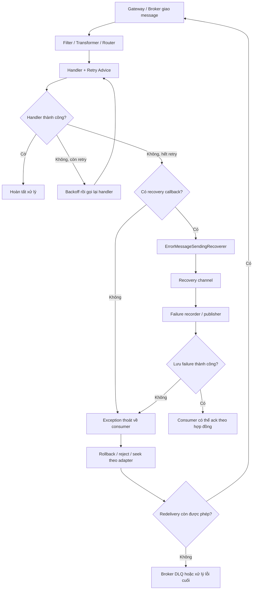

# Kiểm thử retry, recovery và dead letter trong Spring Integration

## 1. Vì sao phải kiểm thử cả ba nhánh?

Trong một luồng **Enterprise Integration Patterns (EIP)**, message có thể đi qua Filter, Transformer và Router trước khi handler gọi API đối tác. Khi API trả HTTP 503 hoặc timeout, handler được cấu hình retry. Nếu tất cả attempts đều lỗi, hệ thống cần ghi nhận thất bại qua recovery hoặc chuyển message sang dead-letter để xử lý sau.

Một bài kiểm thử chỉ kiểm tra “handler cuối cùng trả về thành công” là chưa đủ. Nó không chứng minh được số lần gọi downstream, việc rollback khi thất bại, tính bền vững của bản ghi lỗi hay khả năng tránh xử lý trùng khi broker giao lại message.

Chủ đề **“Kiểm thử retry, recovery và dead letter”** thuộc chương **Kiểm thử pattern** của module `SPRING_INTEGRATION_PATTERN`. Module tập trung triển khai Enterprise Integration Patterns bằng Spring Integration để tạo luồng thông điệp ít phụ thuộc, dễ mở rộng, kết hợp Router, Filter, Transformer, Splitter, Aggregator, Gateway, retry, error channel, correlation và theo dõi từng nhánh xử lý.

Sau bài này, bạn có thể:

- Xây dựng ma trận kiểm thử retry theo loại exception, số attempts và backoff.
- Xác minh recovery callback chỉ được gọi khi policy dừng mà handler chưa thành công.
- Phân biệt **Spring Integration recovery/error channel** với **broker dead-letter queue (DLQ)**.
- Kiểm tra rollback, acknowledgement, redelivery và khả năng xử lý poison message.
- Dùng JUnit 5 và Spring Integration Java DSL để kiểm thử một flow thực tế với handler giả lập.
- Thiết kế integration test với broker và fault injection để phát hiện mất message, side effect lặp và lỗi khi recovery.

## 2. Nhận diện đúng các tầng cần kiểm thử

Một message có thể được xử lý theo các tầng:



Sơ đồ biểu diễn các nhánh **có thể** có, không phải hành vi mặc định giống nhau của mọi adapter. `RequestHandlerRetryAdvice` xử lý attempts ở **handler**; việc broker phát lại hay đưa vào DLQ do nguồn message, consumer error handler và cấu hình broker quyết định.

### Ba con số dễ bị nhầm

| Số đếm | Ý nghĩa | Ví dụ |
| --- | --- | --- |
| **Handler attempts** | Số lần handler chạy trong một retry operation | 3 lần gọi carrier |
| **Broker deliveries** | Số lần nguồn giao một message, gồm cả lượt đầu | 2 lần: giao đầu và một redelivery |
| **Business side effects** | Số giao dịch thật đã commit ở downstream | 1 vận đơn được tạo, dù có 6 lần gọi API |

Nếu mỗi delivery có tối đa `A = 3` attempts và broker giao tối đa `D = 2` lần, handler có thể được gọi tối đa `A × D = 6` lần **khi retry stateless**, mọi attempt đều thất bại và exception tiếp tục khiến broker redeliver. Con số này **không đồng nghĩa** đã tạo 6 giao dịch thật; phải đo side effect riêng.

## 3. Chiến lược kiểm thử theo tầng

Không phải kịch bản nào cũng cần khởi động broker hoặc database thật. Nên chia kiểm thử theo loại bảo đảm cần xác minh:

| Tầng kiểm thử | Công cụ gợi ý | Chứng minh được | Chưa chứng minh được |
| --- | --- | --- | --- |
| **Unit test của retry policy** | JUnit 5, Spring Retry `RetryTemplate` hoặc framework retry của phiên bản đang dùng | Số attempts, phân loại exception, recovery callback | Advice đã gắn đúng handler và broker redelivery |
| **Flow test trong Spring context** | `@SpringJUnitConfig`, `DirectChannel`, `QueueChannel`, fake handler | Message đi đúng endpoint, retry/recovery channel nhận đúng lỗi | Broker ack, retry topic, DLQ thật |
| **Integration test với transaction/broker** | Testcontainers, JMS/RabbitMQ/Kafka test adapter, database test | Commit/rollback, ack/nack/seek, redelivery, DLQ, crash window | Toàn bộ hệ thống production đa node |
| **End-to-end/fault test** | Môi trường staging, mô phỏng timeout/crash/partition | Hành vi liên service, idempotency, quan sát, quy trình khôi phục | Không nên tuyên bố exactly-once tuyệt đối chỉ từ một vài test |

Nguyên tắc thực hành: **kiểm thử nhanh, quyết định bằng dữ liệu**, rồi thêm một số test broker có khả năng tái hiện lỗi khi hệ thống bị gián đoạn. Test chỉ mock API không đủ để kết luận broker redelivery hoạt động đúng.

## 4. Viết ma trận hành vi trước khi viết code

Giả sử handler gọi hãng vận chuyển, policy cho phép **3 attempts tính cả lần đầu**, chỉ retry `TemporaryCarrierException`. Các kịch bản cơ bản:

| ID | Kịch bản | Handler calls kỳ vọng | Recovery messages kỳ vọng | Ý nghĩa |
| --- | --- | ---: | ---: | --- |
| R1 | Thành công ngay | 1 | 0 | Không gọi lại vô ích |
| R2 | Lỗi tạm thời 1 lần, sau đó thành công | 2 | 0 | Retry đúng một lần |
| R3 | Lỗi tạm thời 2 lần, lần ba thành công | 3 | 0 | Thành công ở attempt cuối |
| R4 | Lỗi tạm thời cả 3 attempts | 3 | 1 nếu có recoverer | Hết lượt và kích hoạt recovery |
| R5 | Lỗi validation không retryable | 1 | 1 nếu cấu hình recovery cho lỗi này | Không retry lỗi vĩnh viễn |
| R6 | Recovery recorder ném exception | Theo policy | Recovery gửi/lưu thất bại | Exception không bị nuốt âm thầm |
| R7 | Retry thành công, sau đó Gateway trả timeout | Theo flow | Có thể 0 | Caller không biết kết quả; cần idempotency |
| R8 | Broker redeliver sau rollback | Theo từng delivery | Tùy cấu hình | Tổng calls có thể lớn hơn `maxAttempts` |
| R9 | Vượt broker redelivery limit | Tùy policy | Có thể không dùng application recovery | Message tới DLQ nếu broker được cấu hình |
| R10 | Cùng event được gửi lại sau downstream commit | Có thể nhiều | Tùy | Không tạo side effect nghiệp vụ trùng |

Test nên ghi rõ ba tham số: **policy tại handler**, **chính sách nguồn**, **cơ chế recovery**. Nếu không ghi, rất dễ có hai test đều mang tên “retry hết” nhưng đang mô phỏng hai nhánh khác nhau.

## 5. Ví dụ thực tế: cấu hình flow có retry và recovery

Ví dụ sau dành cho **Spring Integration 6.x và Spring Retry 2.x**, dùng Java 17+, JUnit 5. Để giữ trọng tâm ở semantics, giả lập hãng vận chuyển bằng `FakeCarrier` và dùng `QueueChannel` làm **application recovery channel**.

`QueueChannel` trong ví dụ **không phải broker DLQ**. Nó chỉ giúp test lấy `ErrorMessage` sau khi `ErrorMessageSendingRecoverer` gửi thông tin lỗi, không thay thế persistence hay redelivery của RabbitMQ/JMS/Kafka.

### 5.1. Cấu hình test chạy trong Spring context

```java
import java.util.Map;
import java.util.concurrent.atomic.AtomicInteger;

import org.junit.jupiter.api.BeforeEach;
import org.junit.jupiter.api.Test;
import org.springframework.beans.factory.annotation.Autowired;
import org.springframework.beans.factory.annotation.Qualifier;
import org.springframework.context.annotation.Bean;
import org.springframework.context.annotation.Configuration;
import org.springframework.integration.channel.DirectChannel;
import org.springframework.integration.channel.QueueChannel;
import org.springframework.integration.dsl.IntegrationFlow;
import org.springframework.integration.handler.advice.ErrorMessageSendingRecoverer;
import org.springframework.integration.handler.advice.RequestHandlerRetryAdvice;
import org.springframework.messaging.Message;
import org.springframework.messaging.MessageChannel;
import org.springframework.messaging.PollableChannel;
import org.springframework.messaging.support.ErrorMessage;
import org.springframework.messaging.support.MessageBuilder;
import org.springframework.retry.backoff.NoBackOffPolicy;
import org.springframework.retry.policy.SimpleRetryPolicy;
import org.springframework.retry.support.RetryTemplate;
import org.springframework.test.context.junit.jupiter.SpringJUnitConfig;

import static org.junit.jupiter.api.Assertions.*;

@SpringJUnitConfig(classes = ShipmentRetryFlowTest.Config.class)
class ShipmentRetryFlowTest {

    @Autowired
    @Qualifier("shipmentIn")
    MessageChannel input;

    @Autowired
    @Qualifier("shipmentRecovery")
    PollableChannel recovery;

    @Autowired
    FakeCarrier carrier;

    @BeforeEach
    void resetState() {
        carrier.reset();
        while (recovery.receive(0) != null) {
            // Dọn message còn lại từ test trước.
        }
    }

    @Test
    void succeedsOnThirdAttemptWithoutRecovery() {
        carrier.failFirst(2);

        input.send(MessageBuilder.withPayload(
                new ShipmentCommand("evt-101", "idem-101")).build());

        assertEquals(3, carrier.calls());
        assertNull(recovery.receive(0));
    }

    @Test
    void sendsExactlyOneErrorMessageWhenExhausted() {
        carrier.failFirst(10); // Vượt maxAttempts=3.

        input.send(MessageBuilder.withPayload(
                new ShipmentCommand("evt-102", "idem-102")).build());

        assertEquals(3, carrier.calls());
        Message<?> recovered = recovery.receive(1_000);
        assertInstanceOf(ErrorMessage.class, recovered);
        Throwable error = ((ErrorMessage) recovered).getPayload();
        assertTrue(containsCause(error, TemporaryCarrierException.class));
        assertNull(recovery.receive(0));
    }

    @Test
    void doesNotRetryPermanentValidationError() {
        carrier.failWithValidationError();

        input.send(MessageBuilder.withPayload(
                new ShipmentCommand("evt-103", "idem-103")).build());

        assertEquals(1, carrier.calls());
        assertInstanceOf(ErrorMessage.class, recovery.receive(1_000));
        assertNull(recovery.receive(0));
    }

    private static boolean containsCause(
            Throwable error, Class<? extends Throwable> type) {
        for (Throwable current = error;
                current != null; current = current.getCause()) {
            if (type.isInstance(current)) {
                return true;
            }
        }
        return false;
    }

    record ShipmentCommand(String eventId, String idempotencyKey) {}

    static final class TemporaryCarrierException extends RuntimeException {
        TemporaryCarrierException(String message) {
            super(message);
        }
    }

    static class FakeCarrier {
        private final AtomicInteger calls = new AtomicInteger();
        private volatile int transientFailures;
        private volatile boolean validationError;

        void reset() {
            calls.set(0);
            transientFailures = 0;
            validationError = false;
        }

        void failFirst(int count) {
            transientFailures = count;
        }

        void failWithValidationError() {
            validationError = true;
        }

        int calls() {
            return calls.get();
        }

        public void send(ShipmentCommand command) {
            int attempt = calls.incrementAndGet();
            if (validationError) {
                throw new IllegalArgumentException("invalid shipment");
            }
            if (attempt <= transientFailures) {
                throw new TemporaryCarrierException("carrier unavailable");
            }
        }
    }

    @Configuration
    static class Config {

        @Bean
        MessageChannel shipmentIn() {
            return new DirectChannel();
        }

        @Bean
        PollableChannel shipmentRecovery() {
            return new QueueChannel();
        }

        @Bean
        FakeCarrier fakeCarrier() {
            return new FakeCarrier();
        }

        @Bean
        RequestHandlerRetryAdvice retryAdvice(
                @Qualifier("shipmentRecovery") MessageChannel recovery) {
            RetryTemplate template = new RetryTemplate();
            template.setRetryPolicy(new SimpleRetryPolicy(
                    3,
                    Map.of(TemporaryCarrierException.class, true),
                    true));
            template.setBackOffPolicy(new NoBackOffPolicy());

            RequestHandlerRetryAdvice advice = new RequestHandlerRetryAdvice();
            advice.setRetryTemplate(template);
            advice.setRecoveryCallback(
                    new ErrorMessageSendingRecoverer(recovery));
            return advice;
        }

        @Bean
        IntegrationFlow shipmentFlow(FakeCarrier carrier,
                                     RequestHandlerRetryAdvice retryAdvice) {
            return IntegrationFlow.from("shipmentIn")
                    .handle(carrier, "send",
                            endpoint -> endpoint.advice(retryAdvice))
                    .get();
        }
    }
}
```

Trong dự án, cần dependency phù hợp cho Spring Integration Java DSL, Spring Retry 2.x, `spring-test` và JUnit Jupiter. Test trên dùng `NoBackOffPolicy` để chạy xác định, không phụ thuộc đồng hồ thật. Với `DirectChannel`, handler chạy đồng bộ nên sau khi `send(...)` hoàn tất, test có thể kiểm tra ngay số calls và recovery channel.

### 5.2. Điều ví dụ kiểm chứng và chưa kiểm chứng

- **R3:** `FakeCarrier` thất bại hai lần, thành công ở lần ba; recovery channel không nhận message.
- **R4:** Cả ba attempts đều lỗi; callback chuyển một `ErrorMessage` vào `QueueChannel`.
- **R5:** `IllegalArgumentException` không thuộc tập retryable; handler chỉ chạy một lần. Với cấu hình recoverer minh họa, lỗi dừng policy cũng đi nhánh recovery.
- **Chưa kiểm chứng:** Broker rollback, ack, DLQ, transaction database, việc gửi failure bền vững hay side effect thực. Các điều này cần test tích hợp riêng.

`getPayload()` của `ErrorMessage` là `Throwable` và có thể bao lớp `MessagingException` hoặc wrapper khác. Bởi vậy test tìm loại lỗi trong **cause chain** thay vì ép payload luôn là một loại exception cụ thể. Khi điều tra, có thể thử đọc `ErrorMessage.getOriginalMessage()` hoặc `MessagingException.getFailedMessage()`, nhưng không giả định chúng luôn hiện diện.

### 5.3. Nếu dùng Spring Integration 7.x

Từ Spring Integration 7.x, retry advice dựa vào `org.springframework.core.retry.RetryPolicy` của Spring Framework thay vì `RetryTemplate` của Spring Retry 2.x. Có thể thay phần khai báo policy/advice bằng mẫu:

```java
import org.springframework.core.retry.RetryPolicy;
import org.springframework.integration.handler.advice.ErrorMessageSendingRecoverer;
import org.springframework.integration.handler.advice.RequestHandlerRetryAdvice;
import org.springframework.messaging.MessageChannel;

RequestHandlerRetryAdvice newRetryAdvice(MessageChannel recoveryChannel) {
    RetryPolicy policy = RetryPolicy.builder()
            .maxRetries(2) // Hai lần retry sau lần đầu: tổng 3 attempts.
            .includes(TemporaryCarrierException.class)
            .build();

    RequestHandlerRetryAdvice advice = new RequestHandlerRetryAdvice();
    advice.setRetryPolicy(policy);
    advice.setRecoveryCallback(
            new ErrorMessageSendingRecoverer(recoveryChannel));
    return advice;
}
```

Đoạn trên minh họa một phương thức cấu hình nằm trong lớp Java hợp lệ. **Không trộn import từ Spring Retry 2.x và Spring Framework 7.x** trong cùng cấu hình advice. `SimpleRetryPolicy(3)` ở 6.x tính tổng attempts, còn `maxRetries(2)` ở 7.x là số lần thử **sau** lần đầu.

## 6. Kiểm thử backoff và timeout mà không tạo test chập chờn

Backoff không chỉ ảnh hưởng số lần gọi, mà còn ảnh hưởng deadline của Gateway, thời gian giữ thread và khả năng tạo retry storm.

Ví dụ cố định:

| Attempt | Handler thực hiện | Backoff trước attempt tiếp |
| --- | --- | ---: |
| #1 | Lỗi 503 | 200 ms |
| #2 | Lỗi 503 | 400 ms |
| #3 | Thành công hoặc hết retry | Không còn |

Với exponential backoff `initialInterval=200ms`, `multiplier=2` và tối đa ba attempts, tổng thời gian chờ là **600 ms**. Đây chưa phải tổng latency: cần cộng thời gian gọi downstream và overhead.

### Cách kiểm thử ổn định

1. **Unit test số attempts:** dùng `NoBackOffPolicy` để tránh thời gian thật; kiểm tra policy và callback.
2. **Unit test tính toán backoff:** tách logic chọn tham số và dùng clock/sleeper giả nếu API phiên bản hỗ trợ; kiểm tra khoảng chờ dự kiến, không kiểm tra timestamp đến từng millisecond.
3. **Integration test thời gian:** đo elapsed time có dung sai rộng, tính đến scheduling/CI load. Không dùng `Thread.sleep(600)` rồi đoán handler chắc đã xong.
4. **Gateway timeout:** dùng mock downstream có thời gian hoàn tất xác định, kiểm tra đường timeout và trạng thái thực sau timeout. Timeout phía caller **không bảo đảm** công việc backend dừng ngay.
5. **Jitter:** kiểm tra thời gian nằm trong khoảng giới hạn và phân phối hợp lý thay vì yêu cầu một chuỗi random cố định.

Một thiết kế tốt đặt giới hạn cho cả `maxAttempts`, per-attempt timeout, tổng deadline và concurrency. Test xác minh **không có thêm attempt sau khi policy kết thúc**; tránh chỉ kiểm tra “cuối cùng thành công” mà bỏ qua quá tải downstream.

## 7. Recovery callback phải được kiểm thử như một luồng nghiệp vụ riêng

Khi retry hết, `ErrorMessageSendingRecoverer` gửi `ErrorMessage` tới một channel. Nhưng “send thành công” và “đã có hồ sơ lỗi bền vững” là hai kết quả khác nhau.

### Những câu hỏi phải trả lời trong test

- Có đúng **một** recovery event cho mỗi retry operation bị hết lượt không?
- `ErrorMessage` có giữ được exception cuối, event ID, correlation ID và message gốc khi ngữ cảnh cho phép không?
- Recorder có lưu bản ghi `PENDING_REVIEW`/`FAILED` vào database hoặc queue có xác nhận không?
- Nếu recorder lỗi, exception có bị truyền ngược tới nguồn như thiết kế không?
- Nếu callback trả bình thường, inbound consumer có ack/commit không, và việc đó có đúng hợp đồng?
- Khi replay một failure, idempotency key có được giữ nguyên để không tạo giao dịch trùng không?

### Chú ý khi dùng `DirectChannel` cho recovery

`DirectChannel` chạy subscriber đồng bộ trên cùng thread. Nếu recorder ở subscriber ném lỗi, hành vi lỗi thường được chuyển ngược qua lời gọi gửi của recoverer. Đây là thuận lợi cho test phát hiện thất bại của recorder. Nhưng không nên mặc định mọi recovery channel đều đồng bộ: `ExecutorChannel` hoặc broker publisher có thể xác nhận đã nhận message vào buffer trước khi công việc lưu cuối hoàn thành.

**Thiết kế tách hai outcome:**

| Outcome | Ý nghĩa | Hành động |
| --- | --- | --- |
| `BUSINESS_SUCCESS` | Downstream hoàn tất và outcome đáng tin cậy | Xác nhận message theo hợp đồng |
| `FAILURE_RECORDED` | Nghiệp vụ thất bại, nhưng failure đã lưu an toàn | Có thể xác nhận message để chuyển sang quy trình xử lý lỗi |
| `FAILURE_NOT_RECORDED` | Cả xử lý chính và lưu thất bại đều không an toàn | Không ack thành công một cách âm thầm; để nguồn/error handler xử lý |
| `UNKNOWN` | Timeout sau khi đã gửi request, chưa biết downstream commit hay chưa | Đối soát trước khi replay |

Các outcome này là **trạng thái nghiệp vụ do ứng dụng thiết kế**, không phải enum mặc định của Spring Integration.

## 8. Recovery channel và broker dead-letter queue khác nhau ra sao?

Nhiều lỗi kiểm thử đến từ việc coi một `QueueChannel` có tên “deadLetter” là broker DLQ.

| Đặc tính | Spring Integration recovery/error channel | Broker DLQ |
| --- | --- | --- |
| Cơ chế | `MessageChannel` trong ứng dụng truyền `ErrorMessage` | Broker quản lý một queue/topic đích nhận message lỗi |
| Kiểu dữ liệu | Thường là `ErrorMessage` chứa `Throwable` | Thường là message gốc hoặc message được adapter đóng gói |
| Kích hoạt | Recovery callback / error flow được cấu hình | Reject/nack không requeue, delivery limit, TTL/DLX hoặc error handler tùy broker |
| Có luôn bền vững không? | **Không**; `QueueChannel` in-memory chỉ giữ dữ liệu trong process | Phụ thuộc durability, persistence và broker configuration |
| Khi callback thành công | Lỗi có thể được “handled”, consumer có thể ack | Nếu consumer đã ack thì broker thường không đưa message đó vào DLQ theo đường reject |
| Cách kiểm thử | Flow test với `QueueChannel`/recorder | Integration test với broker thật hoặc test container |

### Hai thiết kế cần kiểm thử riêng

**Phương án A — Application-managed recovery:** Retry advice có `ErrorMessageSendingRecoverer`. Khi attempts hết, callback ghi bản ghi failure hoặc chủ động phát một message lỗi qua publisher đáng tin cậy, sau đó consumer ack nếu đúng hợp đồng. Test phải xác minh **bản ghi đã được lưu**, không chỉ verify send tới một channel trong bộ nhớ.

**Phương án B — Broker-managed dead lettering:** Không có callback nuốt lỗi cuối, hoặc cấu hình cho exception thoát về nguồn. Consumer rollback/reject theo chính sách. Sau số lần redelivery hoặc điều kiện dead-letter, broker chuyển message đến DLQ. Test cần xác minh đường đi **từ queue nguồn sang queue DLQ**, không kết luận chỉ từ một `ErrorMessage` trong ứng dụng.

Hai phương án có thể kết hợp nhưng phải xác định chủ sở hữu quyết định cuối cùng. Nếu callback xử lý thành công và adapter ack, broker có thể **không nhận được tín hiệu reject** cần thiết để dead-letter.

## 9. Kiểm thử broker DLQ thật

Một bài test broker nên có ít nhất:

- Queue/topic nguồn và điểm nhận DLQ được cấu hình rõ ràng.
- Consumer với transaction/ack/retry/error handler tương tự production.
- Một message gốc có `eventId`, `correlationId`, `idempotencyKey` ổn định.
- Handler fake có thể thất bại tạm thời, thất bại vĩnh viễn hoặc thành công sau N deliveries.
- Listener/probe đo attempts, deliveries, bản ghi đã commit và message ở DLQ.

### Quy trình kiểm thử mẫu

```text
Given:
  Broker source queue có message eventId=evt-500
  Handler sẽ luôn ném TemporaryCarrierException
  Retry tại handler tối đa 3 attempts mỗi delivery
  Broker/consumer cho phép 2 deliveries tổng cộng
  Sau đó dead-letter vào queue failure

When:
  Publish evt-500 một lần
  Consumer xử lý và lỗi; broker giao lại theo policy

Then:
  Tổng handler calls theo giả định stateless = 3 × 2 = 6
  Đích DLQ có đúng message tương ứng evt-500
  Source queue không giữ một message gây lặp vô hạn
  Header và dữ liệu cần đối soát được bảo toàn theo hợp đồng adapter
  Inventory/payment/shipment side effect không bị thực hiện trùng
```

Đây là **kịch bản kỳ vọng của một cấu hình cụ thể**. Không được giả định mọi broker đều đếm “2 deliveries” giống nhau: có hệ thống quy định `maxRedeliveries = 2` nghĩa là **hai lần giao lại sau lần đầu**, tức tổng ba deliveries. Test phải ghi rõ liệu số giới hạn **có tính lần đầu hay không**.

### Theo từng broker

| Broker/nguồn | Cơ chế cần kiểm thử | Metadata hay gặp | Lưu ý |
| --- | --- | --- | --- |
| **JMS** | Session/transaction rollback, redelivery policy, broker DLQ | `JMSRedelivered`, delivery-count property nếu provider hỗ trợ | Bật transaction đúng nơi nhận message |
| **RabbitMQ** | Ack, reject/nack, requeue, dead-letter exchange, retry queue | `x-death` trên message dead-lettered nếu broker cung cấp | Requeue tức thì có thể gây vòng lặp nóng; không mặc định có counter redelivery giới hạn |
| **Kafka** | Consumer error handler, seek/reposition, retry topics, dead-letter publishing | Topic, partition, offset, headers của error handler | DLT thường cần publisher/error handler riêng; không phải broker tự đưa record sang DLT sau N lần đọc |

Để kiểm thử hành vi thật, dùng Testcontainers với broker phù hợp, khởi tạo topic/queue/exchange trong test setup và xác nhận message ở đích lỗi bằng consumer riêng. Tránh dùng thời gian chờ cố định để kết luận “không còn message”, nhất là khi broker có độ trễ retry hoặc retry topic. Sử dụng điều kiện có timeout và cửa sổ quan sát hợp lý.

## 10. Transaction, rollback và trạng thái cuối

Với một inbound JMS consumer hoặc poller transactional, cần kiểm thử sự tương tác của retry và transaction chứ không chỉ kiểm tra số attempts.

### Retry ngoài transaction, transaction mỗi attempt

```text
Retry Advice
  ├─ Attempt #1 → BEGIN T1 → handler lỗi → ROLLBACK T1
  ├─ Attempt #2 → BEGIN T2 → handler lỗi → ROLLBACK T2
  └─ Attempt #3 → BEGIN T3 → handler thành công → COMMIT T3
```

Trong cách tổ chức này, lỗi database tạm thời có cơ hội thử lại bằng transaction mới. Tuy nhiên, nếu consumer đã mở transaction bao ngoài toàn bộ flow và các service dùng `PROPAGATION_REQUIRED`, attempts có thể vẫn tham gia cùng một physical transaction. Test phải kiểm tra propagation và thứ tự advice thực tế.

### Transaction ngoài retry

```text
BEGIN T1
  Retry Advice
    Attempt #1 → lỗi đánh dấu T1 rollback-only
    Attempt #2 → handler trả bình thường
COMMIT T1 → có thể UnexpectedRollbackException
```

Một test chỉ assert attempt #2 thành công sẽ **bỏ qua** việc commit thực sự thất bại. Cần đọc dữ liệu sau khi transaction kết thúc bằng một transaction/connection độc lập.

### Những cửa sổ lỗi quan trọng

| Cửa sổ lỗi | Điều cần xác minh |
| --- | --- |
| DB commit trước broker ack, ứng dụng crash | Broker có thể redeliver; idempotent consumer không áp dụng side effect lần hai |
| Broker ack trước DB commit, sau đó rollback | Không được mất sự kiện về mặt nghiệp vụ |
| Recovery gửi message lỗi rồi transaction rollback | Failure có tồn tại thật không; recorder có dùng transaction thích hợp không |
| Outbox publisher gửi xong rồi crash trước đánh dấu `published` | Consumer downstream dedup được message lặp |
| Gateway timeout khi handler vẫn xử lý | Không báo thất bại chắc chắn nếu downstream có thể đã commit |

Không thể suy luận tính nguyên tử giữa database và broker chỉ từ `@Transactional`. Kiểm thử phải xác định tài nguyên nào tham gia một local transaction, có XA/JTA hay đang dùng outbox/inbox.

## 11. Kiểm thử idempotency trước khi replay dead-letter

Dead-letter giữ được message lỗi **không có nghĩa** phát lại luôn an toàn. Ví dụ API tạo vận đơn đã thành công nhưng phản hồi bị mất; message đi vào DLQ vì ứng dụng nhận timeout. Nếu người vận hành replay bằng khóa mới, đối tác có thể tạo vận đơn thứ hai.

Thiết kế test tối thiểu:

1. Handler gửi message có `idempotencyKey = "shipment:evt-501"` tới fake provider.
2. Provider **lưu kết quả tạo vận đơn** nhưng lần đầu ném timeout trước khi gửi response.
3. Retry/recovery đưa sự kiện vào failure record hoặc DLQ theo cấu hình.
4. Replay **cùng event ID, cùng idempotency key**.
5. Fake provider trả về transaction ID ban đầu; **không** sinh thêm side effect.

Đồng thời cần test **cùng key nhưng payload khác**: thay `orderId` hoặc số tiền phải bị coi là xung đột, không âm thầm trả success. Với Splitter, key nên gồm `eventId + partId + operation` nếu mỗi part là một tác vụ độc lập; correlation ID của nhóm không phải khóa chống trùng của mọi part.

### Ma trận replay

| Trạng thái sau lỗi | Replay được không? | Điều kiện |
| --- | --- | --- |
| Chắc chắn chưa xử lý, lỗi tạm thời | Có, có giới hạn | Retry policy và idempotency phù hợp |
| Đã commit trong DB, broker redeliver | Có thể nhận lại, nhưng không áp dụng side effect | Inbox/unique key |
| Provider timeout, outcome `UNKNOWN` | Không replay tùy tiện bằng key mới | Đối soát hoặc retry với cùng key nếu provider hỗ trợ |
| Dữ liệu validation sai | Không tự động retry vô hạn | Sửa dữ liệu hoặc chuyển xử lý thủ công |
| Key đã hết TTL tại provider | Rủi ro tạo trùng | Kiểm tra retention và transaction status |
| Một part Splitter đã thành công, part khác lỗi | Replay đúng phần thiếu | Part identity và trạng thái Aggregator rõ ràng |

## 12. Các lỗi kiểm thử thường gặp

| Sai lầm | Hậu quả | Cách sửa |
| --- | --- | --- |
| Dùng `QueueChannel` rồi gọi nó là broker DLQ | Không kiểm thử được nack/redelivery/durability | Dùng broker test container cho nhánh DLQ thật |
| Chỉ assert exception cuối | Không biết handler đã gọi bao nhiêu lần | Dùng fake/spy đếm attempts và kiểm tra thứ tự |
| Assert payload `ErrorMessage` luôn là exception cụ thể | Test lỗi khi có wrapper `MessagingException` | Kiểm tra cause chain và message context |
| Bật recoverer nhưng vẫn kỳ vọng broker DLQ tự động | Callback có thể xử lý lỗi và nguồn ack | Chọn nhánh recovery ứng dụng hoặc broker-managed DLQ rõ ràng |
| Dùng `Thread.sleep` cố định trong async tests | Test flaky trên CI tải cao | Await condition với timeout, latch hoặc công cụ chờ phù hợp |
| Chỉ test số attempts, không test commit | Test xanh dù transaction rollback-only | Kiểm tra dữ liệu đã commit thực tế |
| Retry mọi exception | Validation sai bị gọi lại nhiều lần | Phân loại exception và test nhánh không retryable |
| Không giới hạn broker redelivery | Poison message lặp vô hạn | Delivery limit, DLT/DLQ và cảnh báo |
| Bật nhiều tầng retry nhưng chỉ đếm một tầng | Downstream chịu tải lớn ngoài dự kiến | Đo total calls theo event và từng adapter |
| Test recovery recorder chỉ bằng mock | Không chứng minh failure được lưu bền vững | Test DB/queue có xác nhận và fault injection |
| Replay DLQ không giữ idempotency key | Tạo trùng vận đơn/thanh toán | Giữ cùng key, đối soát trạng thái trước replay |
| Test dùng chung queue/context nhưng không cleanup | Test sau bị ảnh hưởng message của test trước | Reset fake, drain queue, isolate consumer group/queue |

## 13. Theo dõi kết quả test và vận hành

Một flow tốt cần đủ dữ liệu để giải thích vì sao một event vào recovery, nó đã được thử bao nhiêu lần và có còn an toàn để replay không.

- **`retry_attempts_total`**: đếm calls ở handler, theo endpoint và nhóm exception.
- **`retry_exhausted_total`**: số operation đã hết attempts, tách với lỗi validation không retryable.
- **`recovery_success_total` / `recovery_failure_total`**: số lần lưu failure thành công/thất bại.
- **`broker_deliveries_total`** và số message tới DLQ/DLT: đếm ở nguồn, không suy từ retry count.
- **`side_effects_committed_total`** và `duplicates_blocked_total`: kiểm tra idempotency thực tế.
- **`retry_operation_latency`**: gồm handler, backoff và overhead; theo dõi sát deadline Gateway.

Các tên metric là **đề xuất**, không có nghĩa Spring Integration tự xuất đầy đủ các tín hiệu này. Có thể dùng Micrometer, tracing và instrumentation theo adapter/version. Không đưa `eventId`, `orderId` hoặc `idempotencyKey` trực tiếp vào metric labels vì cardinality cao; đặt chúng trong log/traces có quyền truy cập phù hợp.

Trong test, ghi `eventId`, `correlationId`, endpoint, broker delivery count, số attempts, outcome cuối và ID bản ghi recovery. Khi thất bại, test output phải cho phép phân biệt “handler không retry”, “đã recovery nhưng chưa lưu lỗi”, “message không tới DLQ” và “message tới DLQ nhưng side effect đã xảy ra”.

## 14. Bài thực hành tổng hợp

Xây dựng flow nhận `ShipmentCommand` từ broker, dùng Filter kiểm tra payload, Transformer chuẩn hóa địa chỉ, Router chọn carrier A/B và `RequestHandlerRetryAdvice` cho handler A. Cấu hình lỗi tạm thời được thử tối đa **3 attempts**; lỗi validation không được retry. Khi hết attempts, triển khai lần lượt hai phương án:

1. **Application recovery:** `ErrorMessageSendingRecoverer` gửi lỗi tới `shipmentRecoveryErrors`, một recorder lưu `PENDING_REVIEW` vào database. Kiểm thử recorder ghi thành công và recorder thất bại. Xác nhận broker ack/rollback theo hợp đồng sau mỗi kết quả.
2. **Broker dead lettering:** Bỏ recoverer nuốt lỗi cuối, để exception thoát về consumer; cấu hình broker có giới hạn redelivery và DLQ/DLT. Test bằng broker thật qua Testcontainers. Xác nhận message đã rời nguồn và xuất hiện tại đích lỗi với event ID/correlation ID cần thiết.

Chạy tối thiểu: handler thành công ở lần đầu, ở attempt thứ ba, hết retry, lỗi validation, lỗi recorder, broker redelivery, crash sau database commit trước broker ack, timeout sau downstream side effect và replay message trong dead-letter. Thêm một nhánh Splitter để kiểm chứng part nào bị retry và Aggregator xử lý nhóm có part lỗi thế nào.

**Tiêu chí hoàn thành:** Số attempts, deliveries, recovery messages và business side effects được đếm riêng, khớp ma trận dự kiến; recovery không làm mất failure; DLQ/DLT chỉ được xác nhận qua broker test; lỗi không retryable không lặp vô ích; replay giữ identity/idempotency và không tạo tác động trùng; kết quả Gateway/transaction/ack được báo đúng trạng thái.

## Tài liệu tham khảo

- [Spring Integration — Retry Advice](https://docs.spring.io/spring-integration/reference/handler-advice/classes.html): `RequestHandlerRetryAdvice`, retry/recovery và `ErrorMessageSendingRecoverer`.
- [Spring Integration — Testing Support](https://docs.spring.io/spring-integration/reference/testing.html): kiểm thử message flow và các công cụ Spring Integration Test.
- [Spring Integration — Error Handling](https://docs.spring.io/spring-integration/reference/error-handling.html): `ErrorMessage`, error channel và chiến lược lỗi.
- [Spring Integration — Transaction Support](https://docs.spring.io/spring-integration/reference/transactions.html): transaction/rollback trong message flow.
- [Spring AMQP — Message Listener Container and Error Handling](https://docs.spring.io/spring-amqp/reference/amqp/receiving-messages/async-consumer.html): consumer, acknowledgement và lỗi trong luồng RabbitMQ.
- [Spring for Apache Kafka — Handling Exceptions](https://docs.spring.io/spring-kafka/reference/kafka/annotation-error-handling.html): error handler, seek/retry và dead-letter publishing.
