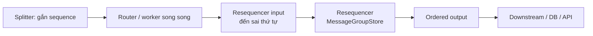
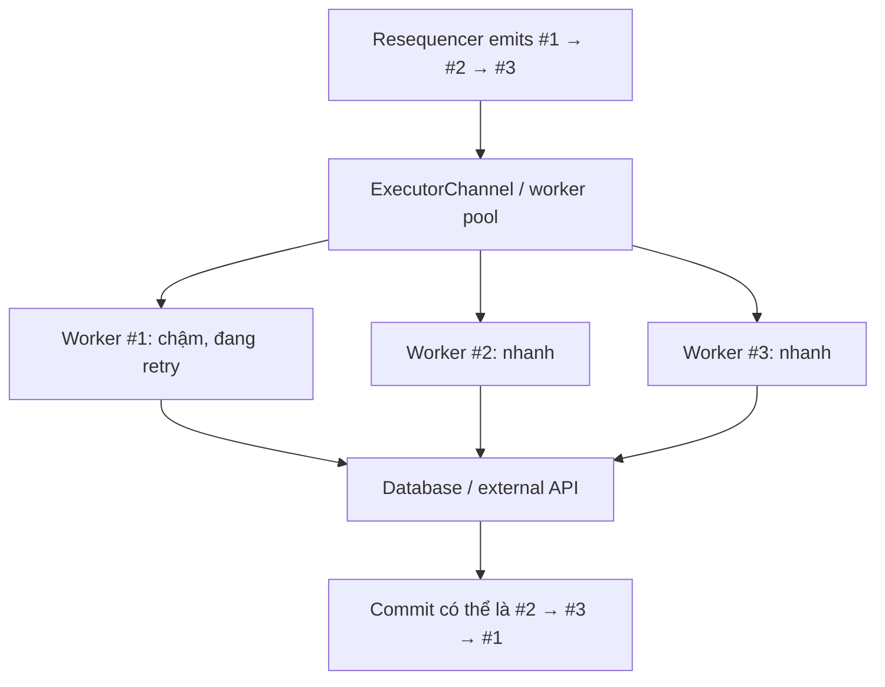

# Kiểm thử thứ tự với resequencer

Trong chương **Kiểm thử pattern** của **SPRING_INTEGRATION_PATTERN**, Resequencer được dùng để khôi phục thứ tự của các message đến sai thứ tự. Tuy nhiên, có một điểm dễ bỏ sót: cấu hình một Resequencer **không đủ để chứng minh** luồng tích hợp đã đáp ứng hợp đồng thứ tự, nhất là khi có Splitter, Router, Filter, Transformer, Gateway, retry và các nhánh xử lý song song.

Bài học này trình bày cách **kiểm thử thứ tự với Resequencer của Spring Integration**: xác định bất biến, tạo dữ liệu đầu vào cố ý đảo thứ tự, quan sát đầu ra ở đúng ranh giới, kiểm tra nhiều correlation group, và bổ sung các ca thiếu phần, duplicate, timeout, late arrival, retry, error channel cũng như downstream bất đồng bộ.

> **Nguyên tắc kiểm thử:** Không chỉ chứng minh rằng message xuất hiện theo thứ tự `1, 2, 3` trong một ví dụ thuận lợi. Cần chứng minh **đúng nhóm, đúng vị trí, đúng nội dung, đúng số lần** và biết rõ ranh giới mà kết luận đó có hiệu lực.

## 1. Resequencer bảo đảm điều gì, và điều gì nằm ngoài phạm vi?

Một luồng điển hình:



Các message cùng batch thường có bộ header:

| Header | Chức năng | Ví dụ |
| --- | --- | --- |
| `correlationId` | Nhóm các message cần xếp thứ tự cùng nhau | `batch-42:run-1` |
| `sequenceNumber` | Vị trí của message trong nhóm | `3` |
| `sequenceSize` | Tổng số phần được kỳ vọng khi biết trước | `4` |

Ví dụ Splitter tạo bốn phần `A, B, C, D` rồi worker trả về theo thứ tự `C, A, D, B`. Resequencer phải phát **các message được release** theo thứ tự vị trí phù hợp với chính sách đã cấu hình.

```text
Một correlation group G, size = 4

Nguồn tạo:          A(#1)     B(#2)     C(#3)     D(#4)
Đầu vào nhận:       C(#3) --> A(#1) --> D(#4) --> B(#2)
                                            |
                                       Resequencer
                                            |
Đầu ra mong đợi:    A(#1) --> B(#2) --> C(#3) --> D(#4)
```

**Phân biệt ba ranh giới:**

1. **Arrival order:** thứ tự message đến **trước** Resequencer. Đảo thứ tự là đầu vào bình thường cần thử.
2. **Emission order:** thứ tự Resequencer **phát** các message ra channel tiếp theo. Đây là bất biến cốt lõi của bài test pattern.
3. **Commit order:** thứ tự downstream thực sự ghi database, gọi API hoặc hoàn tất business effect. Nếu sau Resequencer còn ExecutorChannel, nhiều consumer hoặc broker nhiều partition, thứ tự commit **không tự động giống** emission order.

Khi nghiệp vụ yêu cầu commit đúng thứ tự, phải kiểm thử thêm ranh giới thứ ba và thiết kế consumer tuần tự theo khóa, kiểm soát version hoặc cơ chế sequencing tại nơi commit.

## 2. Viết hợp đồng thứ tự trước khi viết test

### 2.1. Bốn bất biến khác nhau

| Bất biến | Mô tả | Cách assert |
| --- | --- | --- |
| **Order** | Trong cùng group, vị trí sau không được phát trước vị trí trước đã yêu cầu | So sánh dãy `sequenceNumber` |
| **Completeness** | Batch bắt buộc đầy đủ phải có tất cả vị trí `1..N` | So sánh chính xác tập/dãy kỳ vọng |
| **Uniqueness** | Mỗi logical part chỉ có một tác động được phép | Đếm vị trí/event ID duy nhất, kiểm tra business effect |
| **Content identity** | Payload ở vị trí `k` là đúng phần đã được Splitter tạo | Đối chiếu `sourceEventId` hoặc payload theo manifest |

**Chỉ kiểm tra `1 < 2 < 3` là chưa đủ** nếu trong đầu ra thiếu `#4`, bị phát thêm `#2` hoặc dữ liệu của `#2` và `#3` bị tráo. Các assertion về đầy đủ và duy nhất cần có **hợp đồng kết thúc nhóm**; nếu cấu hình cho phép partial release thì không được đánh đồng một đoạn đã phát với batch đã hoàn tất.

Với nhóm đã xác nhận đầy đủ `N` phần, một mục tiêu rõ ràng là:

```text
output.position == [1, 2, ..., N]
output.eventId  == [sourceId(1), sourceId(2), ..., sourceId(N)]
output.groupId  == [G, G, ..., G]
extra effects   == 0 theo idempotency contract
```

### 2.2. Thứ tự theo group, không phải thứ tự toàn cục

Nếu có nhóm A và B độc lập:

```text
Đầu vào:  A#2, B#2, B#1, A#1
Đầu ra hợp lệ: B#1, B#2, A#1, A#2

Một cách xen kẽ khác cũng có thể hợp lệ,
miễn mỗi group xuất các vị trí theo đúng thứ tự.
```

Đừng assert rằng group A luôn phải hoàn tất trước group B chỉ vì phần đầu của A được gửi vào sớm hơn. **Correlation quyết định phạm vi ordering**; thứ tự giữa các group phụ thuộc việc message đến và điều kiện release.

### 2.3. Partial release khác completion

Tùy release strategy, Resequencer có thể phát những phần liên tục trước khi toàn bộ nhóm hoàn tất. Một test kiểu “không có output nào trước khi đủ `N` phần” **chỉ hợp lệ nếu bạn đã cấu hình chính sách chờ đủ**.

Vì thế nên viết hai bộ kiểm tra riêng:

- **Đúng thứ tự phát:** các message quan sát được vẫn có sequence tăng theo hợp đồng.
- **Đúng vòng đời nhóm:** khi nào nhóm được coi là complete/expired, có được phát partial không, và message thiếu đến muộn được xử lý thế nào.

Không nên suy đoán hành vi mặc định từ tên gọi Resequencer; hãy kiểm tra release strategy, phiên bản Spring Integration và cấu hình endpoint đang dùng.

## 3. Chuẩn bị dữ liệu có thể tái hiện

Một mẫu tốt cần chứa cả số thứ tự và định danh dữ liệu gốc, giúp xác minh không chỉ header mà còn payload:

```java
public record OrderPart(
        String batchRunId,
        int position,
        String sourceEventId,
        String value) {
}
```

Mỗi lần chạy test nên dùng một `batchRunId` duy nhất, chẳng hạn `"test-" + UUID.randomUUID()`, để không trộn với completed marker của một lần chạy trước. Các phần phải mang cùng `correlationId`, nhưng mỗi phần có `sequenceNumber` riêng và `sourceEventId` nhất quán.

**Không dùng `MessageHeaders.ID` làm business event ID.** Hai lần redelivery của cùng phần có thể tạo Spring Message khác UUID, trong khi nghiệp vụ vẫn coi đó là cùng một phần tử.

### 3.1. Tạo message có sequence header hợp lệ

```java
import org.springframework.integration.IntegrationMessageHeaderAccessor;
import org.springframework.messaging.Message;
import org.springframework.messaging.support.MessageBuilder;

public final class PartMessages {

    private PartMessages() { }

    public static Message<OrderPart> of(
            String group, int position, int total,
            String eventId, String value) {

        if (group == null || group.isBlank()
                || eventId == null || eventId.isBlank()
                || total < 1 || position < 1 || position > total) {
            throw new IllegalArgumentException("Invalid sequence data");
        }

        return MessageBuilder
                .withPayload(new OrderPart(group, position, eventId, value))
                .setHeader(
                        IntegrationMessageHeaderAccessor.CORRELATION_ID,
                        group)
                .setHeader(
                        IntegrationMessageHeaderAccessor.SEQUENCE_NUMBER,
                        position)
                .setHeader(
                        IntegrationMessageHeaderAccessor.SEQUENCE_SIZE,
                        total)
                .build();
    }
}
```

Ví dụ `PartMessages.of("batch-42", 3, 4, "evt-C", "C")` là phần thứ ba trong batch bốn phần. Dữ liệu ở đây cố ý giữ `position` và `batchRunId` trong payload **để kiểm tra chéo**, tránh một test chỉ xem header vẫn đạt khi payload đã bị ánh xạ sai.

## 4. Java DSL: đặt ranh giới quan sát ngay sau Resequencer

Một cấu hình test tích hợp nhỏ có thể dùng `DirectChannel` làm input và `QueueChannel` làm output:

```java
import org.springframework.context.annotation.Bean;
import org.springframework.context.annotation.Configuration;
import org.springframework.integration.channel.DirectChannel;
import org.springframework.integration.channel.QueueChannel;
import org.springframework.integration.config.EnableIntegration;
import org.springframework.integration.dsl.IntegrationFlow;

@Configuration
@EnableIntegration
public class ResequencerOrderTestConfig {

    @Bean
    DirectChannel shuffledParts() {
        return new DirectChannel();
    }

    @Bean
    QueueChannel orderedParts() {
        return new QueueChannel();
    }

    @Bean
    IntegrationFlow resequenceFlow(
            DirectChannel shuffledParts,
            QueueChannel orderedParts) {

        return IntegrationFlow.from(shuffledParts)
                .resequence()
                .channel(orderedParts)
                .get();
    }
}
```

**Vì sao cấu hình này phù hợp cho test?**

- `DirectChannel` chuyển message vào flow đồng bộ trong ví dụ, giúp loại bớt nguồn đảo thứ tự *trước* ranh giới cần kiểm tra.
- `resequence()` là endpoint cần kiểm chứng.
- `QueueChannel` cho phép test chủ động gọi `receive(timeout)` và quan sát thứ tự được đưa vào queue **ngay sau endpoint**.
- Chỉ một thread trong test đọc queue; nếu dùng nhiều consumer lấy message đồng thời, thứ tự **hoàn thành** có thể khác thứ tự đưa vào queue.

Đây là **harness minh họa**, không phải một hệ thống hoàn chỉnh. Nó chưa cấu hình kho nhóm bền vững, nhánh retry/error, timeout, group cleanup hoặc bảo vệ dữ liệu nhạy cảm. Hành vi của Resequencer liên quan partial release và expiry phải được kiểm tra theo phiên bản thư viện thực tế. Không suy diễn rằng mọi yêu cầu production chỉ cần ba bean này.

## 5. Integration test JUnit 5: chủ động gửi đảo thứ tự

Để chứng minh Resequencer thật sự được sử dụng, **input phải đến sai thứ tự một cách có chủ đích**. Đoạn code sau dùng Spring Test kết hợp JUnit Jupiter, giả định `OrderPart` và `PartMessages` ở trên nằm trong cùng package phù hợp.

```java
import static org.junit.jupiter.api.Assertions.*;

import java.util.ArrayList;
import java.util.List;
import java.util.UUID;

import org.junit.jupiter.api.Test;
import org.springframework.beans.factory.annotation.Autowired;
import org.springframework.beans.factory.annotation.Qualifier;
import org.springframework.integration.channel.DirectChannel;
import org.springframework.integration.channel.QueueChannel;
import org.springframework.messaging.Message;
import org.springframework.test.context.junit.jupiter.SpringJUnitConfig;

@SpringJUnitConfig(ResequencerOrderTestConfig.class)
class ResequencerOrderIntegrationTest {

    @Autowired
    @Qualifier("shuffledParts")
    DirectChannel input;

    @Autowired
    @Qualifier("orderedParts")
    QueueChannel output;

    private void send(
            String group, int position, int size,
            String eventId, String value) {

        assertTrue(input.send(
                PartMessages.of(group, position, size, eventId, value)));
    }

    private List<OrderPart> take(int count) {
        List<OrderPart> results = new ArrayList<>();

        for (int i = 0; i < count; i++) {
            Message<?> message = output.receive(2_000);
            assertNotNull(message, "Missing output at index " + i);
            results.add((OrderPart) message.getPayload());
        }

        return results;
    }

    @Test
    void emitsOneCompleteGroupInSequenceOrder() {
        String group = "test-" + UUID.randomUUID();

        // Đầu vào C, A, D, B; KHÔNG phải thứ tự tự nhiên.
        send(group, 3, 4, "evt-C", "C");
        send(group, 1, 4, "evt-A", "A");
        send(group, 4, 4, "evt-D", "D");
        send(group, 2, 4, "evt-B", "B");

        List<OrderPart> actual = take(4);

        assertEquals(List.of(1, 2, 3, 4),
                actual.stream().map(OrderPart::position).toList());

        assertEquals(List.of("evt-A", "evt-B", "evt-C", "evt-D"),
                actual.stream().map(OrderPart::sourceEventId).toList());

        assertEquals(List.of("A", "B", "C", "D"),
                actual.stream().map(OrderPart::value).toList());

        assertTrue(actual.stream()
                .allMatch(part -> group.equals(part.batchRunId())));

        // Chỉ xác nhận không thấy phần thừa trong cửa sổ ngắn.
        assertNull(output.receive(100));
    }
}
```

**Test này đã kiểm tra được:**

1. Resequencer nhận được bốn message có cùng `correlationId` nhưng khác vị trí.
2. Dãy đầu ra là `1, 2, 3, 4` dù input là `3, 1, 4, 2`.
3. `sourceEventId` và payload khớp chính xác với vị trí.
4. Không thấy thêm output trong khoảng `100 ms` sau bốn phần.

**Giới hạn:** `assertNull(output.receive(100))` **không chứng minh** không bao giờ có message thừa. Nếu hệ thống có retry, timer hoặc adapter bất đồng bộ, cần tăng cửa sổ quan sát theo hợp đồng hoặc đọc trạng thái/idempotency store bền vững. Bài test cũng không xác minh thứ tự commit tại database/API downstream.

## 6. Integration test: nhiều correlation group xen kẽ

Một lỗi thường gặp là lẫn các phần có cùng `sequenceNumber` nhưng thuộc hai group khác nhau. Với hai batch `A` và `B`, có thể gửi:

```text
Input order:   A#2, B#2, B#1, A#1

Expected:
  A: #1 → #2
  B: #1 → #2

Không có yêu cầu cố định A phải phát toàn bộ trước B.
```

Có thể bổ sung phương thức test sau **bên trong cùng lớp** `ResequencerOrderIntegrationTest` đã khai báo `send()` và `take()`:

```java
@Test
void preservesOrderSeparatelyForEachGroup() {
    String a = "batch-A-" + UUID.randomUUID();
    String b = "batch-B-" + UUID.randomUUID();

    send(a, 2, 2, "A2", "payload-A2");
    send(b, 2, 2, "B2", "payload-B2");
    send(b, 1, 2, "B1", "payload-B1");
    send(a, 1, 2, "A1", "payload-A1");

    List<OrderPart> emitted = take(4);

    Map<String, List<Integer>> byGroup = new HashMap<>();
    for (OrderPart part : emitted) {
        byGroup.computeIfAbsent(
                part.batchRunId(), ignored -> new ArrayList<>())
                .add(part.position());
    }

    assertEquals(List.of(1, 2), byGroup.get(a));
    assertEquals(List.of(1, 2), byGroup.get(b));
    assertEquals(2, byGroup.size());
}
```

Khi chép đoạn này vào lớp test, bổ sung imports `java.util.Map` và `java.util.HashMap`. Assertion dùng **dãy quan sát trong mỗi nhóm**, không dùng thứ tự chung của cả bốn phần.

Muốn kiểm tra đầy đủ hơn, có thể đối chiếu `sourceEventId` theo manifest của từng group. Mỗi `sequenceNumber=1` thuộc A và B đều hợp lệ; đừng dùng mỗi `sequenceNumber` làm khóa dedup trên toàn hệ thống.

## 7. Thiết kế test theo thuộc tính, không chỉ một hoán vị

Một ví dụ cố định là cần thiết nhưng chưa đủ. Hãy thử nhiều cách xáo trộn để phát hiện những trường hợp chỉ sai ở biên:

| Kiểu input | Ví dụ với N=5 | Điều dễ bộc lộ |
| --- | --- | --- |
| Đảo hoàn toàn | `5,4,3,2,1` | Sai thứ tự hoặc nhầm phần đầu |
| Vị trí 1 đến cuối | `2,3,4,5,1` | Release quá sớm khi thiếu đầu nhóm |
| Vị trí N đến đầu | `5,1,2,3,4` | Kẹt phần cuối hoặc release strategy |
| Phần giữa đến muộn | `1,3,4,2,5` | Khoảng trống ở giữa |
| Chỉ một phần | `1/1` | Điều kiện biên sequence size |
| Nhiều group xen kẽ | `A2,B2,A1,B1` | Trộn correlation hoặc global-order giả |
| Payload giống nhau | Hai phần cùng value nhưng event ID khác | Lỗi kiểm tra nội dung hoặc dedup nhầm |

Một chiến lược *property-based*:

```text
Với mỗi N trong tập {1, 2, 3, 5, 10}:
  1. Tạo manifest gồm N event ID duy nhất.
  2. Tạo một permutation có seed để tái hiện.
  3. Gắn cùng correlationId, sequenceSize=N, position=1..N.
  4. Gửi message theo permutation.
  5. Đọc N message tại output và assert:
       positions == [1..N]
       event IDs == manifest theo thứ tự vị trí
       correlationId đúng và payload đúng.
  6. Dùng một group ID mới cho lần thử kế tiếp.
```

Với N nhỏ, có thể kiểm tra **toàn bộ hoán vị**; với N lớn, dùng random có seed và thêm những mẫu biên đã biết. Khi test thất bại, log lại **seed, group ID, permutation, expected và actual** để tái hiện.

Không sử dụng thời gian ngủ ngẫu nhiên để tạo “đảo thứ tự”: hãy gửi theo một permutation cố định. Những test đồng thời hoặc timeout nên được viết thành nhóm riêng có đồng bộ kiểm soát được.

## 8. Kiểm thử group thiếu một hoặc nhiều phần

Một group không đủ có thể chờ thêm, bị xử lý expiry hoặc release một phần tùy cấu hình. Test phải nêu rõ **điều kiện hoàn tất**; không được coi “không có output” là thành công một cách im lặng.

Ví dụ:

```text
Expected size: 4
Input đã nhận: #4, #1, #3
Missing:       #2

Cần kiểm tra:
  - Group có được xác định đúng correlationId không?
  - Đầu ra đã phát (nếu có) có còn đúng thứ tự không?
  - Endpoint có coi nhóm là complete sai hay không?
  - Timeout/expiry được xử lý ra sao theo chính sách đã chọn?
  - Nếu #2 xuất hiện sau, kết quả là gì?
```

### 8.1. Tránh assertion sai với partial release

Nếu cấu hình cho phép phát liên tiếp một đoạn hợp lệ, việc nhận `#1` có thể khiến endpoint phát phần đầu **trước khi** tất cả các phần khác đến. Do đó assertion kiểu `assertNull(output.receive(...))` khi nhóm chưa đủ có thể **sai với chính sách release hợp lệ**.

Để kiểm tra “không release trước khi đủ group”, cần **cấu hình rõ một release strategy chỉ cho phép release khi complete** rồi kiểm thử nó. Nếu muốn kiểm tra partial release, hãy mô tả kỳ vọng theo **các đoạn liên tục** và điều kiện release cụ thể.

### 8.2. Timeout không chứng minh mất vĩnh viễn

Một message có thể nằm trong broker/DLQ hoặc đang retry khi group timeout. Test expiry cần làm rõ:

- `groupTimeout` và việc lịch chạy timeout được kích hoạt trong môi trường test.
- `sendPartialResultOnExpiry` và các tùy chọn dọn nhóm.
- Trạng thái nghiệp vụ cuối cùng (full, partial, failed, recovering).
- Hành vi message tới sau expiry, nhất là khi group đã cleanup.
- Thông báo lỗi hoặc sự kiện nghiệp vụ mà ứng dụng **chủ động** phát.

Không giả định mọi expiry tự động sinh `ErrorMessage` vào `errorChannel`; đường lỗi xử lý message và sự kiện timeout nhóm là những cơ chế cần được nối và kiểm thử riêng.

## 9. Duplicate, conflicting sequence và late arrival

Resequencer **xử lý thứ tự**, không thay thế cơ chế idempotency nghiệp vụ. Đối với nhóm có các vị trí `1..3`:

| Kịch bản | Input | Bất biến cần kiểm thử |
| --- | --- | --- |
| Redelivery giống hệt | `1:A, 2:B, 2:B, 3:C` | Không áp hai lần tác động nghiệp vụ của B |
| Trùng slot khác dữ liệu | `1:A, 2:B, 2:X, 3:C` | Conflict được phát hiện/quarantine |
| Metadata size sai | `1/3, 2/4, 3/3` | Reject hoặc đối soát metadata |
| Group đã hoàn tất | Phát đủ `1,2,3` rồi nhận lại `2` | Không mở batch thứ hai ngoài chính sách |
| Partial đã chốt | Chốt `1,2` rồi `#3` tới muộn | Correction/reject theo hợp đồng, không âm thầm đổi kết quả |
| Retry tạo message ID mới | Cùng event ID và slot, khác `MessageHeaders.ID` | Nhận diện redelivery bằng khóa nghiệp vụ |

Trong test tích hợp, nên có **admission gate/inbox** hoặc thành phần kiểm soát idempotency khi ứng dụng yêu cầu ngăn tác động trùng. Gửi duplicate thẳng vào Resequencer rồi mong `.resequence()` luôn tự loại mọi tình huống là assertion không có cơ sở.

Nếu adapter retry sau khi business effect đã commit, cần kiểm tra **trạng thái bên ngoài endpoint** (database, idempotency store, outbound event) chứ không chỉ số message đọc từ `QueueChannel`.

## 10. Test hậu Resequencer: emission đúng nhưng commit sai

Một lỗi thực tế:



Test ngay sau Resequencer có thể đạt vì emission order đúng, trong khi nghiệp vụ yêu cầu thứ tự commit vẫn bị vi phạm.

Nếu phải giữ thứ tự end-to-end, hãy thiết kế một **lane tuần tự theo group**, phân vùng theo `correlationId`, hoặc kiểm tra expected version tại database. Sau đó bổ sung assertion:

```text
commitLog(group G).sequenceNumber == [1, 2, 3]
finalAggregateVersion == 3
businessSideEffects == exactly those allowed by the contract
```

Hãy đọc **commit log hoặc trạng thái đã commit**, không chỉ thứ tự dòng console log từ nhiều thread. Log tập trung có thể về sai thứ tự vì buffering, đồng hồ lệch hoặc exporter bất đồng bộ.

## 11. MessageGroupStore, restart và nhiều instance

Resequencer dùng `MessageGroupStore` để quản lý nhóm thông điệp. Trong môi trường kiểm thử:

- **In-memory store:** nhanh và đơn giản nhưng trạng thái pending có thể mất khi JVM restart.
- **Persistent store:** có thể phục hồi dữ liệu nhóm qua restart nếu cấu hình và transaction phù hợp; đồng thời phát sinh yêu cầu quản lý lưu trữ, locking và cleanup.
- **Nhiều instance:** cần cách phối hợp để tránh một group bị release hai lần hoặc hai node xử lý cùng slot không nhất quán.
- **Completion marker và cleanup:** ảnh hưởng đến việc phân loại message đến sau khi nhóm đã hoàn tất.
- **Reaper và timeout:** có thể xử lý nhóm tồn quá lâu; hành vi phải kiểm tra với store, phiên bản và endpoint cụ thể.

Những trường hợp cần thử:

1. Nhận `#3` vào store, restart ứng dụng, rồi nhận `#1` và `#2`.
2. Message cuối đến sát lúc timeout xảy ra.
3. Hai worker gửi cùng slot gần đồng thời.
4. Group complete rồi broker redeliver một phần.
5. Store chậm, lỗi transaction hoặc không thể truy cập tạm thời.

**Không chạy test restart với store in-memory rồi kết luận Spring Integration “làm mất message” một cách bất ngờ**. Việc đó nằm trong đặc tính không bền của implementation đã chọn. Mục tiêu là đối chiếu hành vi với SLA phục hồi và chính sách replay.

## 12. Xây dựng test ít flaky

### 12.1. Tránh ngủ để “đoán” khi nào output sẵn sàng

Thay vì:

```java
Thread.sleep(500);
assertEquals(4, output.getQueueSize());
```

hãy nhận theo timeout hữu hạn:

```java
Message<?> message = output.receive(2_000);
assertNotNull(message, "Timed out waiting for resequenced output");
```

Cách đọc có timeout giúp test thất bại có thông tin rõ ràng và không cần đợi cố định trong trường hợp output có ngay. Tuy nhiên, timeout phải phù hợp tải CI và thời gian xử lý thực tế; không dùng các giá trị quá nhỏ cho adapter bất đồng bộ.

### 12.2. Test timeout cần điều khiển được lịch

Với logic quyết định timeout do ứng dụng tự xây dựng, có thể inject `Clock` hoặc một scheduler có thể kiểm soát trong test. Nếu kiểm tra chính endpoint Spring Integration, cần quan sát timer/expiry thật và tránh giả định lịch chạy chính xác đến từng mili giây.

Nên dùng đồng bộ như `CountDownLatch` cho worker concurrency và rào “đã vào handler” thay vì hàng loạt `Thread.sleep`. Test ngoại lệ nên giữ riêng để không làm chậm hoặc nhiễm trạng thái các test ordering thông thường.

### 12.3. Cách ly nhóm và trạng thái giữa các test

- Dùng `correlationId` duy nhất.
- Xác định chính sách cleanup và giới hạn thời gian nhận output.
- Không chạy song song những test dùng chung một `QueueChannel` rồi để các thread cùng tiêu thụ kết quả của nhau.
- Khi cần kiểm thử song song, dùng recorder theo group có cơ chế thread-safe, hoặc tạo context/endpoint độc lập.
- Không tự sửa trạng thái `MessageGroupStore` trong test bằng cách xóa tùy tiện nếu muốn xác minh hành vi lifecycle thật.

Một `assertNull(output.receive(100))` chỉ cho thấy **không có thêm output trong cửa sổ 100 ms**, không phải chứng minh hệ thống sẽ không bao giờ phát lại.

## 13. Ma trận kiểm thử thực hành

| Ca test | Input / điều kiện | Kết quả cần kiểm tra |
| --- | --- | --- |
| Đảo thứ tự cơ bản | `3,1,4,2` / size 4 | Output `1,2,3,4` và đúng payload |
| Đảo ngược toàn bộ | `4,3,2,1` | Output tăng đúng thứ tự |
| Nhóm một phần | `1/1` | Hoàn tất hợp lệ |
| Group xen kẽ | `A2,B2,B1,A1` | A và B đều có `1,2` |
| Payload giống nhau | Hai vị trí cùng value, khác ID | Không tráo danh tính |
| Thiếu đầu nhóm | `3/3,2/3` | Không coi là hoàn tất; xử lý partial theo hợp đồng |
| Thiếu giữa nhóm | `1/4,3/4,4/4` | Phát hiện gap, chờ/expiry đúng chính sách |
| Duplicate delivery | `1,2,2,3` | Không tạo hiệu ứng nghiệp vụ trùng |
| Conflicting slot | Hai bản số 2 khác payload | Quarantine hoặc error flow có kiểm soát |
| Size mâu thuẫn | `1/3,2/4,3/3` | Validation chặn metadata sai |
| Filter bỏ phần | Splitter tạo `1..4`, Filter loại `#2` | Có chính sách skip/reindex/fail, không chờ vô hạn |
| Retry trước resequencing | `#2` fail rồi thành công | Vẫn đúng correlation và vị trí 2 |
| Retry sau resequencing | `#1` commit sau `#2` | Test end-to-end phát hiện nếu có yêu cầu commit order |
| Timeout | Nhóm thiếu phần quá deadline | Expiry, partial/fail/recovery đúng chính sách |
| Message đến muộn | `#3` sau finalization | Không tạo kết quả cuối thứ hai |
| Crash / restart | Group chưa đủ rồi restart | Phục hồi hoặc replay theo loại store |
| Hai instance | Cùng group được nhận đồng thời | Không mất/trùng kết quả |
| Đầu ra qua broker | Cùng group bị phân vào nhiều partition | Không khẳng định global ordering khi không có thiết kế phân vùng |

## 14. Quan sát kết quả và chẩn đoán khi test thất bại

Một báo cáo lỗi có ích nên chứa:

```json
{
  "testCase": "resequence-out-of-order",
  "groupId": "test-42",
  "inputPositions": [3, 1, 4, 2],
  "expectedOutputPositions": [1, 2, 3, 4],
  "actualOutputPositions": [1, 3, 2, 4],
  "observationBoundary": "resequencer-output",
  "releasePolicy": "configured-test-policy",
  "note": "illustrative failure record"
}
```

Đây là **schema chẩn đoán do test tự tạo**, không phải dữ liệu Spring Integration mặc định xuất ra. Khi một ca test thất bại, kiểm tra theo thứ tự:

1. **Metadata đầu vào:** có đúng `correlationId`, `sequenceNumber`, `sequenceSize`, kiểu header và source event ID không?
2. **Nơi xảy ra reorder:** đang đo ngay sau Resequencer hay ở một ExecutorChannel/broker phía sau?
3. **Release strategy:** có cho phép partial, timeout/expiry hoặc group đã hoàn tất không?
4. **Duplicate/conflict:** có hai message tranh một slot, hoặc message cũ từ run trước không?
5. **Nhánh lỗi:** Retry/Gateway/Filter có làm mất phần hoặc đổi header không?
6. **MessageGroupStore:** còn trạng thái cũ, có cleanup/reaper hoặc xung đột giữa instance không?
7. **Test harness:** có consumer khác cùng đọc output channel, test khác để lại message, hoặc timeout quá ngắn không?
8. **Commit nghiệp vụ:** endpoint có phát đúng nhưng downstream ghi dữ liệu sai thứ tự không?

Metric production nên theo dõi `groupWaitTime`, số nhóm timeout, số group chưa hoàn tất, vị trí thiếu, duplicate/conflict, late arrival và sai thứ tự emission/commit **theo phạm vi group**. Tránh dùng `correlationId` làm label metric cardinality cao; tra batch cụ thể qua structured log/trace.

## 15. Checklist trước khi kết luận test đạt

1. **Đã viết hợp đồng order:** theo `correlationId`, có cần đủ `1..N` và một tác động cho mỗi slot không?
2. **Có input sai thứ tự thật:** không chỉ gửi `1,2,3` như một ví dụ dễ.
3. **Đối chiếu payload/event ID:** không chỉ xem số header.
4. **Đo đúng ranh giới:** ngay sau Resequencer nếu kiểm tra emission, tại DB/API nếu kiểm tra commit.
5. **Kiểm tra nhiều group:** không ép thứ tự toàn cục giữa các batch độc lập.
6. **Biết rõ chính sách release:** full/partial, timeout và xử lý expiry.
7. **Có tình huống lỗi:** thiếu phần, duplicate, conflict, Filter bỏ phần và retry.
8. **Đã xét late arrival và restart:** hoàn tất một lần, không phát batch thứ hai trái hợp đồng.
9. **Có test concurrency hợp lý:** không dùng các sleep ngẫu nhiên để chứng minh tính đúng.
10. **Cách ly trạng thái test:** dùng group ID mới, queue/test context được quản lý đúng.
11. **Không đánh đồng output với business commit:** downstream async cần bất biến và test riêng.
12. **Có thông tin chẩn đoán tái hiện được:** input permutation, seed, expected/actual, chính sách release và ranh giới đo.

**Ghi nhớ:** Kiểm thử Resequencer phải kiểm tra **thứ tự theo từng correlation group** bằng dữ liệu đảo thứ tự có chủ đích, đồng thời xác minh danh tính và nội dung từng phần. Một bài test tốt nêu rõ điểm quan sát, điều kiện hoàn tất và hành vi với dữ liệu thiếu/trùng/trễ. Khi downstream còn xử lý bất đồng bộ, thứ tự commit là **một hợp đồng bổ sung** cần được thiết kế và kiểm chứng riêng; Resequencer không thể thay thế idempotency, recovery hoặc điều phối giao dịch nghiệp vụ.

