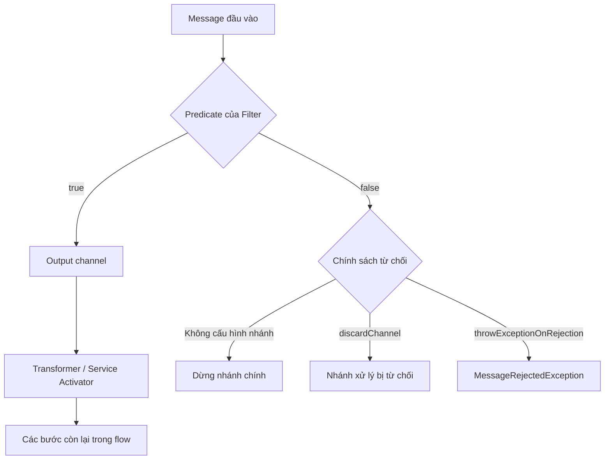
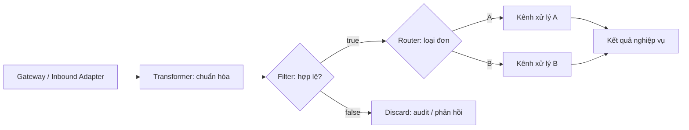
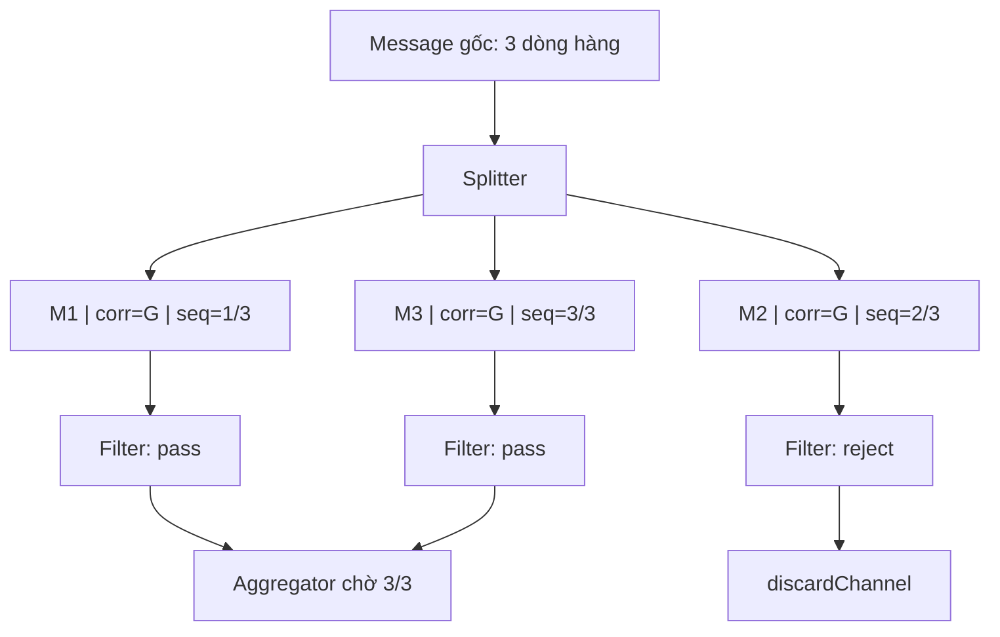

# Filter và điều kiện tiếp tục flow trong Pipes and Filters

Mẫu kiến trúc **Pipes and Filters** xây dựng một luồng xử lý bằng cách nối các *filter* (bước xử lý) qua các *pipe* (đường truyền dữ liệu). Mỗi bước tập trung vào một trách nhiệm: kiểm tra dữ liệu, chuẩn hóa, định tuyến, tách thành phần, gọi dịch vụ hoặc tổng hợp kết quả. Trong Spring Integration, các bước này thường là **message endpoint**, còn đường nối giữa chúng là **message channel**.

Trong mô hình đó, **Message Filter** là một bước đặc biệt: nó quyết định **một Message có đủ điều kiện để đi tiếp trên nhánh chính của flow hay không**. Một điều kiện đặt sai vị trí hoặc một đường xử lý từ chối không rõ ràng có thể khiến Message âm thầm biến mất, Gateway chờ mãi hoặc Aggregator thiếu thành phần để hoàn tất nhóm.

Bài này thuộc module `SPRING_INTEGRATION_PATTERN`: học triển khai Enterprise Integration Patterns với Spring Integration để xây dựng luồng thông điệp ít phụ thuộc và dễ mở rộng; thực hành Router, Filter, Transformer, Splitter, Aggregator, Gateway, retry, error channel, correlation và kiểm thử, theo dõi các nhánh xử lý. Trọng tâm ở đây là **thiết kế điều kiện tiếp tục flow**, từ predicate đến hành vi của những bước nằm sau Filter.

## 1. Filter là một cổng quyết định trong pipeline

Một Message của Spring Integration mang hai phần chính:

- **Payload:** dữ liệu nghiệp vụ cần xử lý, ví dụ `Order`, `PaymentEvent` hoặc một dòng hàng.
- **Headers:** metadata như `id`, `timestamp`, `correlationId`, `sequenceNumber`, `replyChannel` và các khóa nghiệp vụ.

**Predicate** (điều kiện lọc) là hàm trả về một giá trị boolean. Nếu trả `true`, Message được phép đi vào endpoint tiếp theo. Nếu trả `false`, Message **không đi ra output channel chính**; hành vi kế tiếp phụ thuộc cấu hình từ chối.



Ví dụ, hệ thống nhận sự kiện đơn hàng và chỉ xử lý các đơn ở trạng thái `NEW` có giá trị dương:

```text
Order(id="ORD-101", status=NEW, total=250000)       -> PASS  -> tiếp tục
Order(id="ORD-102", status=CANCELLED, total=250000) -> REJECT -> nhánh từ chối
Order(id="ORD-103", status=NEW, total=-500)         -> REJECT -> nhánh từ chối
```

Hãy phân biệt ba kết quả:

1. **Accepted:** điều kiện trả `true`; Message tiếp tục nhánh chính.
2. **Rejected:** điều kiện trả `false`; đây có thể là quyết định nghiệp vụ hoàn toàn bình thường.
3. **Failed:** đánh giá điều kiện ném exception, ví dụ không kết nối được dịch vụ kiểm tra chính sách; đây là lỗi thực thi cần xử lý theo error policy.

`false` không mặc định là lỗi kỹ thuật. Ngược lại, nuốt exception rồi trả `false` có thể che giấu sự cố vận hành.

## 2. Vị trí của Filter quyết định hành vi của toàn flow

Một pipeline có thể có nhiều bước, nhưng không phải vị trí nào cũng có cùng ý nghĩa:



Trong sơ đồ này, chuẩn hóa dữ liệu đặt **trước Filter** nếu predicate cần giá trị đã chuẩn hóa. Filter đặt **trước Router** nếu cả hai nhánh xử lý A và B phải tuân theo cùng một chính sách. Nếu mỗi nhánh có tiêu chí riêng, có thể đặt Filter sau Router.

| Nơi đặt Filter | Mục đích | Rủi ro cần tính |
| --- | --- | --- |
| Trước Transformer | Loại dữ liệu rác sớm, giảm chi phí biến đổi | Predicate phải hiểu đúng payload chưa chuẩn hóa |
| Sau Transformer | Kiểm tra trên dữ liệu nhất quán | Mất tài nguyên biến đổi cả Message sẽ bị loại |
| Trước Router | Áp dụng một quy tắc chung cho mọi nhánh | Có thể chặn Message mà một nhánh riêng vốn xử lý được |
| Sau Router | Dùng điều kiện riêng theo từng nhánh | Khó tổng hợp lý do từ chối nếu thiếu giám sát |
| Trước Splitter | Loại cả nhóm trước khi tạo Message con | Không phù hợp nếu chỉ một phần tử con không hợp lệ |
| Sau Splitter | Kiểm tra từng phần tử | Có nguy cơ làm Aggregator thiếu Message trong nhóm |
| Trước bước tác động bên ngoài | Tránh gọi database/API cho dữ liệu không hợp lệ | Cần phân biệt reject bình thường với lỗi khi truy vấn chính sách |

Mục tiêu không phải đặt Filter càng sớm càng tốt, mà là **đặt tại nơi có đủ dữ liệu để ra quyết định chính xác và hiểu rõ hậu quả đối với những bước kế tiếp**.

## 3. Filter, Router và Transformer khác nhau ở điểm nào?

Trong Pipes and Filters, từ *filter* đôi khi được dùng rộng để chỉ bất kỳ bước biến đổi dữ liệu. Nhưng **Message Filter của Spring Integration** có ngữ nghĩa cụ thể là chấp nhận hoặc loại Message.

| Thành phần | Câu hỏi nó giải quyết | Đầu ra thường gặp |
| --- | --- | --- |
| `Filter` | Message này có được đi tiếp không? | Message cũ ở nhánh chính hoặc Message bị từ chối |
| `Router` | Message nên đi đến nhánh nào? | Một hoặc nhiều channel được chọn |
| `Transformer` | Dữ liệu cần chuyển thành biểu diễn gì? | Payload/Message đã biến đổi |
| `Splitter` | Có thể chia Message thành những phần tử nào? | Một chuỗi Message con |
| `Aggregator` | Các phần tử nào thuộc cùng nhóm và đã đủ chưa? | Một kết quả tổng hợp |
| `Service Activator` | Cần thực thi nghiệp vụ gì? | Tác dụng nghiệp vụ hoặc Message kết quả |

Nếu mọi trạng thái đơn hàng đều cần xử lý nhưng theo các kênh khác nhau, hãy dùng Router. Nếu chỉ đơn hàng hợp lệ mới được đến bước ghi nhận, Filter phù hợp. Nếu cần đổi `OrderRequest` thành `OrderCommand`, hãy dùng Transformer. Phân biệt đúng giúp flow dễ đọc, kiểm thử và thay đổi hơn.

## 4. Cấu hình một flow có điều kiện bằng Java DSL

Ví dụ sau dùng Java 17+, Spring Integration và Spring Messaging. Flow nhận `Order`, lọc theo điều kiện, sau đó biến đổi đơn được chấp nhận thành `AcceptedOrder`. Đơn bị loại đi đến `rejectedOrders` để hệ thống theo dõi; đơn hợp lệ đi đến `acceptedOrders`.

```java
package example.integration;

import java.math.BigDecimal;

import org.springframework.context.annotation.Bean;
import org.springframework.context.annotation.Configuration;
import org.springframework.integration.channel.DirectChannel;
import org.springframework.integration.channel.QueueChannel;
import org.springframework.integration.config.EnableIntegration;
import org.springframework.integration.dsl.IntegrationFlow;
import org.springframework.messaging.MessageChannel;
import org.springframework.messaging.PollableChannel;

@Configuration
@EnableIntegration
public class OrderPipelineConfiguration {

    public enum OrderStatus { NEW, CANCELLED, COMPLETED }

    public record Order(String id, BigDecimal total, OrderStatus status) {}

    public record AcceptedOrder(String id, BigDecimal total) {}

    @Bean
    public MessageChannel ordersInput() {
        return new DirectChannel();
    }

    @Bean
    public PollableChannel acceptedOrders() {
        return new QueueChannel(20);
    }

    @Bean
    public PollableChannel rejectedOrders() {
        return new QueueChannel(20);
    }

    @Bean
    public IntegrationFlow orderPipeline() {
        return IntegrationFlow.from("ordersInput")
                .filter(Order.class,
                        order -> order.id() != null
                                && !order.id().isBlank()
                                && order.total() != null
                                && order.total().signum() > 0
                                && order.status() == OrderStatus.NEW,
                        spec -> spec.discardChannel("rejectedOrders"))
                .transform(Order.class,
                        order -> new AcceptedOrder(
                                order.id(), order.total()))
                .channel("acceptedOrders")
                .get();
    }
}
```

Luồng này có các đặc điểm:

- `DirectChannel` dẫn Message từ producer vào pipeline đồng bộ.
- `filter(Order.class, ...)` đánh giá predicate trên payload kiểu `Order`. Trong điều kiện có kiểm tra `id`, `total` trước khi sử dụng để tránh lỗi vì trường thiếu.
- Nếu predicate trả `false`, Message ban đầu được gửi tới `rejectedOrders`; nó **không chạy qua Transformer**.
- Nếu predicate trả `true`, Transformer tạo payload `AcceptedOrder` và output được gửi đến `acceptedOrders`.
- Hai `QueueChannel` chỉ đóng vai trò điểm quan sát trong ví dụ. Khi triển khai thực, cần có consumer hoặc poller đọc các kênh đó.

Các `record` lồng trong cấu hình nhằm giữ ví dụ tự chứa; ứng dụng thật có thể đặt DTO/domain type ở file riêng. `@EnableIntegration` được dùng trong cấu hình Spring không dựa vào auto-configuration có sẵn. Ví dụ có thể kiểm thử mà không gọi database hay dịch vụ bên ngoài.

### 4.1. Tự gửi Message để quan sát hai đường đi

```java
package example.integration;

import java.math.BigDecimal;

import org.springframework.context.annotation.AnnotationConfigApplicationContext;
import org.springframework.messaging.Message;
import org.springframework.messaging.MessageChannel;
import org.springframework.messaging.PollableChannel;
import org.springframework.messaging.support.MessageBuilder;

import example.integration.OrderPipelineConfiguration.Order;
import example.integration.OrderPipelineConfiguration.OrderStatus;

public class OrderPipelineDemo {

    public static void main(String[] args) {
        try (var context = new AnnotationConfigApplicationContext(
                OrderPipelineConfiguration.class)) {
            MessageChannel input =
                    context.getBean("ordersInput", MessageChannel.class);
            PollableChannel accepted =
                    context.getBean("acceptedOrders", PollableChannel.class);
            PollableChannel rejected =
                    context.getBean("rejectedOrders", PollableChannel.class);

            input.send(MessageBuilder.withPayload(new Order(
                            "ORD-101", new BigDecimal("250000"), OrderStatus.NEW))
                    .setHeader("businessOrderId", "ORD-101")
                    .build());

            input.send(MessageBuilder.withPayload(new Order(
                            "ORD-102", new BigDecimal("-1"), OrderStatus.NEW))
                    .setHeader("businessOrderId", "ORD-102")
                    .build());

            Message<?> ok = accepted.receive(0);
            Message<?> rejectedOrder = rejected.receive(0);

            System.out.println(ok.getPayload());            // AcceptedOrder(...)
            System.out.println(rejectedOrder.getPayload()); // Order(..., total=-1)
        }
    }
}
```

Các đoạn mã dùng package minh họa `example.integration` và nên được đặt vào các file Java tương ứng trong package này. Các thao tác `receive(0)` chỉ trả Message nếu queue đã có dữ liệu; ứng dụng thật cần kiểm tra kết quả `null` trước khi gọi `getPayload()`.

**Kết quả quan trọng:** `ORD-102` bị từ chối theo predicate và không xuất hiện ở `acceptedOrders`; `ORD-101` được biến đổi thành `AcceptedOrder`. `businessOrderId` có thể được dùng để đối chiếu quyết định ở hai nhánh và ở hệ thống giám sát.

## 5. Điều gì thực sự xảy ra khi predicate trả `false`?

Một trường hợp từ chối có thể được xử lý theo nhiều cách. Chúng có ý nghĩa nghiệp vụ rất khác nhau.

### 5.1. Không có `discardChannel`

Theo hành vi lọc thông thường, Message không đi ra output của Filter. Các endpoint phía sau **không được gọi** cho Message đó. Việc dừng nhánh chính có thể phù hợp với luồng fire-and-forget, chẳng hạn bỏ dữ liệu không liên quan mà hệ thống không cần lưu lại.

Tuy vậy, nếu đây là yêu cầu khách hàng phải nhận phản hồi, một Message bị bỏ mà không có nhánh reply có thể làm Gateway hết thời gian chờ.

### 5.2. Có `discardChannel`

Khi cấu hình `discardChannel`, Message không đạt điều kiện sẽ được chuyển sang nhánh riêng. Nhánh này có thể:

- Ghi audit với mã quy tắc bị vi phạm.
- Tạo phản hồi từ chối nghiệp vụ.
- Đưa vào một queue để kiểm tra thủ công.
- Thu thập thống kê dữ liệu đầu vào không hợp lệ.

Nhánh discard **cũng là một integration flow** nếu có endpoint tiêu thụ. Nó cần được giám sát, có chính sách xử lý lỗi và có đủ khả năng tiêu thụ. Một `QueueChannel` ở nhánh discard có thể đầy hoặc mất dữ liệu khi JVM dừng nếu chỉ lưu trong bộ nhớ.

### 5.3. Ném exception khi từ chối

Filter hỗ trợ cấu hình `throwExceptionOnRejection` khi một kết quả `false` cần được coi là tình huống lỗi. Cơ chế này có thể ném `MessageRejectedException` thay vì coi reject là một quyết định âm thầm. Lựa chọn này phù hợp với các hợp đồng đã quy định một số yêu cầu không hợp lệ là lỗi phải trả về người gọi.

Không nên bật cơ chế ném exception cho mọi Filter theo thói quen. Ví dụ, bỏ qua một sự kiện không thuộc chủ đề mà dịch vụ đang quan tâm là một kết quả bình thường; ngược lại, yêu cầu thanh toán không hợp lệ có thể cần trả lỗi có cấu trúc.

### 5.4. Predicate tự ném exception

Nếu predicate truy cập một trường không tồn tại, gọi dịch vụ khác bị timeout hoặc xử lý không đúng kiểu payload, nó có thể ném exception. Đó là **lỗi đánh giá**, khác với reject hợp lệ. Với flow đồng bộ qua `DirectChannel`, lỗi có thể lan ngược về producer. Với flow dùng poller, executor hay broker, lỗi đi theo cơ chế xử lý của thành phần bất đồng bộ được cấu hình.

| Tình huống | Nhánh chính | Cách xử lý điển hình |
| --- | --- | --- |
| Predicate `true` | Tiếp tục | Gọi Transformer/Service Activator |
| Predicate `false`, không có discard | Dừng tại Filter | Đếm, log hoặc bỏ qua theo chính sách |
| Predicate `false`, có discard | Dừng nhánh chính; gửi nhánh discard | Audit hoặc phản hồi từ chối |
| Predicate `false`, cấu hình ném lỗi | Không tiếp tục bình thường | Xử lý `MessageRejectedException` theo hợp đồng |
| Predicate ném exception | Không hoàn tất quyết định | Retry nếu là lỗi tạm thời, hoặc chuyển error flow |

**`discardChannel` và `errorChannel` có nhiệm vụ khác nhau.** `discardChannel` dùng cho quyết định từ chối; `errorChannel` xử lý lỗi khi hạ tầng/endpoint tạo ra ErrorMessage theo cấu hình. Đừng mặc định rằng lỗi ở bất kỳ đâu cũng tự động đến một channel lỗi mong muốn.

## 6. Điều kiện tiếp tục của flow có Gateway và phản hồi

Một Gateway thường chuyển lời gọi phương thức Java thành Message, sau đó chờ kết quả nếu được khai báo theo kiểu request-reply. Khi một Filter loại Message trước khi có bước tạo reply, Gateway có thể phải chờ đến `replyTimeout`.

Ví dụ một dịch vụ nhận yêu cầu `approve(order)`: nếu Filter chỉ cho `OrderStatus.NEW` đi tiếp, mọi yêu cầu `CANCELLED` cần được xử lý bằng một hợp đồng rõ ràng. Có ít nhất ba lựa chọn:

1. **Trả kết quả nghiệp vụ** như `REJECTED`, `reason=INVALID_STATUS` qua một nhánh tạo reply.
2. **Ném exception được ánh xạ thành lỗi API** nếu yêu cầu bị coi là không hợp lệ.
3. **Chấp nhận sự kiện theo kiểu fire-and-forget**, nơi producer chỉ cần biết hệ thống đã tiếp nhận mà không cần reply nghiệp vụ.

Nếu có `replyChannel` hoặc `errorChannel` trong headers, cần thiết kế đường trả về tương ứng cho từng nhánh. Không nên dùng một `discardChannel` ghi log đơn thuần để thay thế phản hồi cho Gateway đang chờ.

Đối với `QueueChannel` hoặc `ExecutorChannel`, Filter có thể chạy sau thời điểm producer gửi Message. Vì vậy, **`send()` thành công không đồng nghĩa predicate đã trả `true` hay nghiệp vụ đã hoàn thành**. Hợp đồng API cần phân biệt “đã tiếp nhận”, “được chấp nhận sau kiểm tra” và “đã xử lý”.

## 7. Filter và các nhánh Router, Transformer

Filter không quyết định Message đến channel nào khi được chấp nhận; nhiệm vụ đó thường thuộc Router hoặc cấu trúc flow. Một cách phối hợp dễ hiểu là:

```text
input
  |
  v
Transformer (chuẩn hóa)
  |
  v
Filter (hợp lệ?) ---- false ----> discard/audit
  |
 true
  v
Router (standard / priority)
  |             |
  v             v
StandardFlow   PriorityFlow
```

Khi điều kiện áp dụng chung cho mọi nhánh, Filter trước Router giúp mỗi nhánh không phải lặp lại quy tắc. Khi điều kiện mang ý nghĩa riêng cho từng nhánh, đặt Filter ở các nhánh tương ứng và gắn tên quy tắc vào log/metric để biết chính xác nơi quyết định được đưa ra.

Một Transformer thường giúp Filter có dữ liệu nhất quán, nhưng cũng có thể tạo Message mới hoặc thay đổi kiểu payload. Trước khi sử dụng header của đầu vào trong predicate, cần kiểm tra thành phần Transformer có truyền tiếp metadata cần thiết hay không; nhất là header nghiệp vụ và context dùng để correlate.

### Ví dụ điều kiện thay đổi theo thời gian

Nếu Filter chỉ cho phép một sự kiện có `occurredAt` trong 15 phút gần đây đi tiếp, điều kiện phụ thuộc đồng hồ. Hãy tách thời gian nghiệp vụ (`occurredAt`) khỏi thời điểm tạo Message (`timestamp`), dùng `Clock` có thể inject để kiểm thử và quy định rõ sự kiện đến muộn:

```java
import java.time.Clock;
import java.time.Duration;
import java.time.Instant;

public boolean recentEnough(Instant occurredAt, Clock clock) {
    if (occurredAt == null) {
        return false;
    }
    Instant now = clock.instant();
    return !occurredAt.isAfter(now)
            && !occurredAt.isBefore(now.minus(Duration.ofMinutes(15)));
}
```

Predicate dựa vào trạng thái ngoài hoặc thời gian có thể cho kết quả khác khi retry. Nếu hệ thống cần quyết định bất biến, hãy ghi nhận quyết định hoặc dùng dữ liệu đầu vào có phiên bản, thay vì mặc định thử lại sẽ cho cùng kết quả.

## 8. Filter sau Splitter: nguy cơ Aggregator chờ mãi

Đây là lỗi quan trọng trong việc kết hợp Pipes and Filters với **correlation**.

Giả sử Splitter nhận một đơn hàng chứa ba dòng và phát ba Message con:



Nếu Aggregator sử dụng điều kiện hoàn tất dựa trên số lượng phần tử dự kiến (`sequenceSize=3`), nó có thể chỉ nhận được hai Message và không bao giờ thỏa điều kiện thông thường. Một Filter được đặt ở **nhánh con** đã thay đổi tập phần tử thực sự đi đến điểm ghép, nhưng **không tự sửa `sequenceSize`**.

Có một số cách thiết kế, tùy yêu cầu:

| Hướng giải quyết | Phù hợp khi | Điều cần lưu ý |
| --- | --- | --- |
| Lọc cả nhóm trước Splitter | Toàn đơn hàng không đủ điều kiện | Quy tắc không thể thay thế lọc riêng từng dòng |
| Loại các phần tử không cần thiết **trước khi split** | Biết trước tập phần tử cần xử lý | `sequenceSize` được xác định theo tập thực sự phát |
| Điều chỉnh release strategy | Một kết quả nhóm thiếu thành phần vẫn hợp lệ | Quy định rõ “đủ” có nghĩa gì và xử lý thứ tự đến |
| Có timeout và expired-group handling | Có khả năng thiếu Message không tránh được | Phải quyết định trả lỗi, bù trừ hay xuất kết quả một phần |
| Gửi kết quả từ chối như một phần tử đã xử lý | Aggregator cần nhận đủ trạng thái mỗi phần | Phải định nghĩa kiểu kết quả có `ACCEPTED`/`REJECTED` |

Một phương án thường hữu ích là **biến một phần tử bị loại thành kết quả nghiệp vụ “bị từ chối”** để Aggregator vẫn nhận đủ ba kết quả, thay vì bỏ hoàn toàn Message con. Đây là quyết định ở cấp thiết kế flow; đừng giả định chỉ thêm `discardChannel` là Aggregator tự biết nhóm đã xong.

## 9. Filter, retry và idempotency

Retry chỉ có ý nghĩa với lỗi **có khả năng hồi phục**, chẳng hạn timeout khi tra cứu trạng thái ở dịch vụ phụ thuộc. Nếu predicate luôn trả `false` cho `total <= 0`, việc retry cùng Message không giúp đơn hàng trở nên hợp lệ.

Nguyên tắc xử lý:

- **Kết quả `false` có chủ đích:** chuyển tới discard flow hoặc phản hồi theo hợp đồng, thường không retry.
- **Lỗi kỹ thuật tạm thời:** retry có giới hạn, backoff hợp lý và đưa đến error flow khi hết số lần thử.
- **Lỗi dữ liệu không thể hồi phục:** trả lỗi rõ ràng hoặc chuyển kiểm tra thủ công.
- **Bước nghiệp vụ có side effect:** sử dụng khóa idempotency ổn định khi có khả năng thực thi lại.

Không dùng Message ID do framework tạo làm khóa duy nhất cho mọi trường hợp chống trùng. Cùng một sự kiện có thể được gửi lại dưới dạng Message mới. `eventId` hoặc một khóa nghiệp vụ có quy tắc ổn định phù hợp hơn với idempotency xuyên các lần gửi.

### Từ chối một Message có cần dead-letter không?

**Không mặc định.** Dead-letter queue thường dành cho thông điệp không thể xử lý sau chính sách thử lại hoặc gặp lỗi theo quy ước hệ thống. Một sự kiện không thuộc phạm vi dịch vụ có thể được bỏ hợp lệ. Nếu yêu cầu kiểm toán đòi hỏi giữ mọi sự kiện bị từ chối, phải có một kho/transport bền vững và consumer phù hợp. Một QueueChannel trong bộ nhớ không tự bảo đảm điều đó.

## 10. Quan sát quyết định tại mỗi Filter

Khi một integration flow có nhiều Filter, log “Message missing” không đủ để tìm nguyên nhân. Cần ghi nhận quyết định **ở từng cổng**.

| Tín hiệu | Cách diễn giải | Công dụng |
| --- | --- | --- |
| `filter.evaluated` | Số Message được Filter đánh giá | Tính lưu lượng đầu vào |
| `filter.accepted` | Số Message trả `true` | Tính tỉ lệ đi tiếp |
| `filter.rejected` | Số Message trả `false` | Nhận diện đầu vào không đạt điều kiện |
| `filter.errors` | Số lần predicate ném exception | Phát hiện lỗi kỹ thuật |
| `filter.duration` | Thời gian thực thi predicate | Xác định bottleneck |
| `discard.queue.depth` | Message đang chờ xử lý trong nhánh discard | Phát hiện nhánh từ chối bị nghẽn |
| `gateway.reply.timeout` | Gateway không nhận reply trong thời hạn | Kiểm tra Filter làm dừng request-reply |
| `aggregator.expired.groups` | Nhóm hết hạn trước khi hoàn tất | Phát hiện thiếu Message sau Filter/Splitter |

Tên metric trên chỉ là **gợi ý để instrument**, không phải tên metric Spring Integration bảo đảm có sẵn. Có thể dùng Micrometer, Spring Boot Actuator, logging hoặc tracing kết hợp điểm đo phù hợp.

Một bản ghi log quyết định có cấu trúc:

```json
{
  "stage": "order-validation-filter",
  "decision": "REJECTED",
  "rule": "ORDER_MUST_BE_NEW_AND_POSITIVE",
  "messageId": "<uuid>",
  "businessOrderId": "ORD-102",
  "correlationId": null,
  "reasonCode": "NON_POSITIVE_TOTAL"
}
```

Khi log, cần giữ được các khóa đủ để liên hệ với Gateway, Router và Aggregator. `correlationId` có thể không tồn tại nếu Message chưa nằm trong một nhóm; không nên tạo giá trị giả. Tránh đưa toàn bộ payload, token, thông tin thanh toán hoặc dữ liệu cá nhân vào log.

## 11. Kiểm thử điều kiện đi tiếp và nhánh bị từ chối

Ngoài kiểm thử riêng predicate, nên có test xác minh Message thật sự đi qua pipeline đúng cách. Dưới đây là JUnit 5 dùng cấu hình ở mục 4:

```java
package example.integration;

import static org.junit.jupiter.api.Assertions.*;

import java.math.BigDecimal;

import org.junit.jupiter.api.Test;
import org.springframework.context.annotation.AnnotationConfigApplicationContext;
import org.springframework.messaging.Message;
import org.springframework.messaging.MessageChannel;
import org.springframework.messaging.PollableChannel;
import org.springframework.messaging.support.MessageBuilder;

import example.integration.OrderPipelineConfiguration.Order;
import example.integration.OrderPipelineConfiguration.OrderStatus;
import example.integration.OrderPipelineConfiguration.AcceptedOrder;

class OrderPipelineTest {

    @Test
    void acceptedContinuesAndRejectedSkipsTransformation() {
        try (var context = new AnnotationConfigApplicationContext(
                OrderPipelineConfiguration.class)) {
            MessageChannel input =
                    context.getBean("ordersInput", MessageChannel.class);
            PollableChannel accepted =
                    context.getBean("acceptedOrders", PollableChannel.class);
            PollableChannel rejected =
                    context.getBean("rejectedOrders", PollableChannel.class);

            Order valid = new Order(
                    "ORD-101", new BigDecimal("250000"), OrderStatus.NEW);
            Order invalid = new Order(
                    "ORD-102", BigDecimal.ZERO, OrderStatus.NEW);

            assertTrue(input.send(MessageBuilder.withPayload(valid).build()));
            assertTrue(input.send(MessageBuilder.withPayload(invalid).build()));

            Message<?> passed = accepted.receive(0);
            Message<?> discarded = rejected.receive(0);

            assertNotNull(passed);
            assertNotNull(discarded);
            assertInstanceOf(AcceptedOrder.class, passed.getPayload());
            assertEquals("ORD-101",
                    ((AcceptedOrder) passed.getPayload()).id());
            assertEquals(invalid, discarded.getPayload());
            assertNull(accepted.receive(0));
            assertNull(rejected.receive(0));
        }
    }
}
```

Test chạy flow đồng bộ qua `DirectChannel`; việc đọc `QueueChannel` ngay sau `send` phù hợp vì các bước xử lý trung gian không được giao sang thread khác. Với flow bất đồng bộ, hãy dùng điều kiện chờ có timeout hữu hạn.

Những kịch bản nên kiểm tra tiếp:

1. **Giá trị biên:** `total=0`, `total<0`, `status=CANCELLED`, ID rỗng, trường bắt buộc thiếu.
2. **Nhánh chấp nhận:** đúng payload đã transform, header nghiệp vụ cần thiết được giữ hoặc tái tạo đúng.
3. **Nhánh từ chối:** đúng Message nằm ở discard flow; Transformer/handler nghiệp vụ không chạy.
4. **Exception:** predicate ném lỗi theo đường xử lý được cấu hình, không bị ghi nhận là reject bình thường.
5. **Gateway:** có phản hồi hợp lệ cho cả yêu cầu được chấp nhận và bị từ chối; không chờ đến timeout ngoài ý muốn.
6. **Splitter/Aggregator:** Filter loại một Message con; kiểm tra release/timeout strategy và kết quả nhóm.
7. **Retry:** lỗi tạm thời được retry đúng giới hạn; quyết định `false` không bị retry vô ích.
8. **Backpressure:** discard channel đầy hoặc consumer chậm; ứng dụng xử lý trạng thái quá tải đúng hợp đồng.

Mục tiêu của test không chỉ là xác nhận `predicate.test(value)` trả boolean đúng. Test phải chứng minh **Message nào đã đi đến endpoint nào**, những phần tử bị loại không tạo ra tác dụng nghiệp vụ và metadata cần thiết vẫn hỗ trợ theo dõi.

## 12. Những lỗi thiết kế cần tránh

| Biểu hiện | Nguyên nhân | Cách khắc phục |
| --- | --- | --- |
| Message không xuất hiện ở bước sau | Predicate trả `false` nhưng không có audit | Thiết lập chính sách discard và metric quyết định |
| Gateway chờ hết timeout | Message bị lọc trước bước tạo reply | Thiết kế phản hồi từ chối có cấu trúc |
| Một nhánh Router không bao giờ có dữ liệu | Filter ở trước Router loại hết dữ liệu hợp lệ của nhánh đó | Xác định rõ điều kiện chung và điều kiện riêng |
| Aggregator không hoàn tất nhóm | Filter loại Message con sau Splitter | Lọc trước Splitter hoặc điều chỉnh chính sách gom nhóm |
| Hệ thống retry mãi một sự kiện không hợp lệ | Coi `false` là lỗi kỹ thuật | Phân biệt reject với exception |
| Thông điệp bị từ chối mất khi restart | Discard queue chỉ lưu trong bộ nhớ | Dùng cơ chế lưu trữ bền vững nếu cần kiểm toán/phục hồi |
| Predicate chậm làm nghẽn input | Gọi API/DB đồng bộ trong điều kiện lọc | Chuyển tác vụ tốn thời gian sang bước chuyên biệt, đặt timeout |
| Log không lần được nguyên nhân từ chối | Thiếu rule ID, business key hoặc correlation | Ghi metric/log có cấu trúc theo từng Filter |

## 13. Checklist trước khi đưa Filter vào flow thật

- **Xác định ý nghĩa `true`, `false` và exception.** Mỗi trường hợp phải có kết quả nghiệp vụ dễ giải thích.
- **Chọn đúng vị trí của Filter.** Kiểm tra dữ liệu trước/sau Transformer, Router và Splitter.
- **Thiết kế nơi đến của Message bị từ chối.** Nếu cần audit, phải có consumer và chính sách lưu trữ.
- **Giữ hợp đồng request-reply.** Gateway đang chờ phải nhận phản hồi hoặc lỗi có chủ đích.
- **Kiểm tra tương quan nhóm.** Filter sau Splitter có thể thay đổi số phần tử thực đến Aggregator.
- **Phân biệt retry và reject.** Chỉ retry lỗi hồi phục; dùng idempotency khi có tác dụng nghiệp vụ.
- **Kiểm thử hai nhánh và các tình huống lỗi.** Không dừng ở unit test cho predicate.
- **Đo lường flow.** Có chỉ số accepted/rejected/error và khóa truy vết theo từng bước.

Filter là điểm quyết định nhỏ trong một pipeline nhưng tác động trực tiếp đến mọi bước phía sau. Khi điều kiện tiếp tục, nhánh từ chối, cơ chế lỗi và correlation được thiết kế rõ ràng, Pipes and Filters trong Spring Integration sẽ dễ mở rộng, kiểm thử và vận hành ngay cả khi luồng có nhiều Router, Transformer, Splitter, Aggregator và Gateway.
