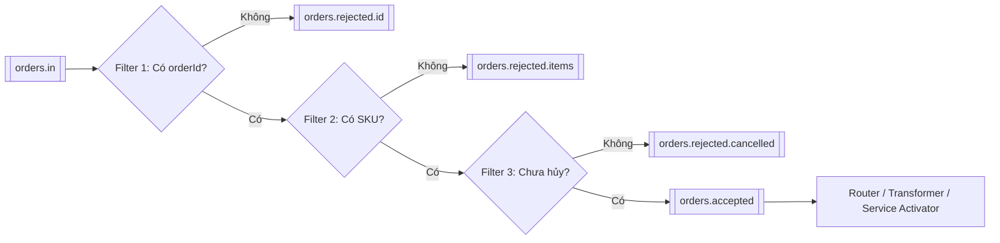
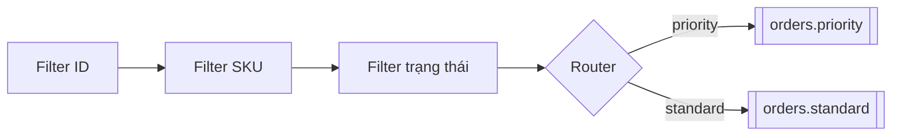
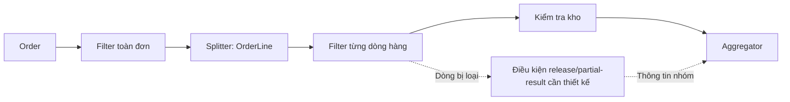

# Chuỗi filter tuần tự

Một hệ thống tích hợp thường không thể quyết định nhận hay từ chối thông điệp chỉ bằng một điều kiện. Ví dụ, trước khi chuyển đơn hàng sang hệ thống kho, ta có thể cần kiểm tra **mã đơn có hợp lệ không**, **đơn có dòng hàng không** và **đơn có đang ở trạng thái được phép xử lý không**. Các phép kiểm tra có thể được xếp thành một **chuỗi filter tuần tự**: chỉ thông điệp vượt qua bước trước mới được bước sau xem xét.

Trong chương **Pipes and filters** của module `SPRING_INTEGRATION_PATTERN`, đây là một cách áp dụng **Enterprise Integration Patterns (EIP)** với Spring Integration. Thay vì dồn mọi điều kiện vào một `if` lớn, ta tổ chức những bộ lọc có trách nhiệm riêng, nối nhau bằng **Message Channel** và các endpoint. Cách này giúp giảm phụ thuộc, dễ bổ sung điều kiện, dễ kiểm thử, có thể quan sát thông điệp bị loại ở bước nào và kết hợp tốt với Router, Transformer, Gateway, Splitter, Aggregator, retry, error channel và correlation.

> **Ý chính:** Filter trong chuỗi xử lý giống một cổng kiểm tra. **Đúng (`true`) → đi tiếp; sai (`false`) → dừng ở bước đó hoặc chuyển sang tuyến từ chối được cấu hình.** Bộ lọc kế tiếp không nhận thông điệp đã bị loại. Chuỗi là tuần tự về **thứ tự logic các phép kiểm tra**, không mặc nhiên là cam kết tất cả thông điệp chạy một luồng hay được xử lý theo thứ tự toàn cục.

## 1. Mục tiêu học tập

Sau bài này, bạn có thể:

1. Giải thích pattern **Pipes and Filters** và sự khác nhau giữa một bộ lọc với nhiều bộ lọc nối tiếp.
2. Mô tả quy tắc **short-circuit**: thất bại ở một filter thì không qua các filter sau trên tuyến thành công.
3. Triển khai chuỗi `filter(...)` trong Spring Integration Java DSL và chỉ định `discardChannel` cho từng lý do từ chối.
4. Thiết kế thứ tự filter hợp lý theo chi phí, mức độ an toàn và phụ thuộc dữ liệu.
5. Phân biệt thông điệp bị từ chối với **lỗi kỹ thuật**, timeout, retry và error channel.
6. Kiểm thử đường đi thành công, từng đường từ chối, khả năng không phát sinh tác dụng phụ và khả năng theo dõi luồng.

## 2. Pipes and Filters là gì?

**Pipes and Filters** tách một phép xử lý lớn thành nhiều bước nhỏ:

- **Pipe:** đường chuyển dữ liệu/thông điệp từ bước này sang bước khác. Trong Spring Integration, một `MessageChannel` thường đảm nhiệm vai trò này.
- **Filter (theo nghĩa tổng quát của kiến trúc):** một bước xử lý có trách nhiệm rõ ràng, nhận đầu vào và tạo đầu ra hoặc quyết định không cho dữ liệu đi tiếp.
- **Pipeline:** chuỗi các bước được liên kết, nơi đầu ra của bước trước là đầu vào của bước sau.

Trong thuật ngữ EIP/Spring Integration, cần phân biệt **mẫu kiến trúc Pipes and Filters** với **Message Filter** cụ thể:

| Khái niệm | Ý nghĩa | Ví dụ |
| --- | --- | --- |
| *Pipes and Filters* | Phân rã luồng thành các xử lý nhỏ có thể ghép nối. | `Validate → Normalize → Route → Handle`. |
| *Message Filter* | Endpoint xét một điều kiện và quyết định cho message đi tiếp hay từ chối. | `orderId != null`, `!items.isEmpty()`. |
| *Transformer* | Endpoint tạo payload/kiểu dữ liệu mới để bước kế tiếp sử dụng. | Chuyển JSON đầu vào thành `OrderCommand` chuẩn. |
| *Router* | Endpoint chọn channel/nhánh đích. | Đơn ưu tiên đi `orders.priority`, đơn thường đi `orders.standard`. |

Vì vậy, chuỗi filter tuần tự là **một trường hợp cụ thể** của Pipes and Filters: nhiều endpoint `MessageFilter` được nối liên tiếp, mỗi endpoint có một predicate cho phép/từ chối.

## 3. Tình huống: lọc đơn hàng trước khi chuyển đến ERP

Giả sử ứng dụng nhận sự kiện tạo đơn `OrderCommand` gồm mã đơn, danh sách SKU và cờ hủy. Hệ thống chỉ cho thông điệp vào tuyến xử lý tiếp khi thỏa cả ba điều kiện:

| Thứ tự | Filter | Điều kiện hợp lệ | Khi không đạt |
| --- | --- | --- | --- |
| 1 | **Kiểm tra mã đơn** | `orderId` khác `null` và không rỗng. | Chuyển đến `orders.rejected.id`. |
| 2 | **Kiểm tra dòng hàng** | Danh sách SKU tồn tại và có ít nhất một phần tử. | Chuyển đến `orders.rejected.items`. |
| 3 | **Kiểm tra trạng thái** | Đơn chưa bị hủy (`cancelled == false`). | Chuyển đến `orders.rejected.cancelled`. |
| Sau cùng | **Tuyến được chấp nhận** | Cả ba filter đều đạt. | Gửi đến `orders.accepted`. |

Luồng logic:



Nếu một đơn **thiếu mã đơn và cũng không có SKU**, nó bị từ chối **ở filter thứ nhất**. Filter thứ hai không nhận đơn đó và không thể tự báo thêm lý do. Đây là hành vi **short-circuit** chủ ý, không phải hệ thống đã kiểm tra toàn bộ điều kiện.

### 3.1. Điều gì xảy ra với mỗi thông điệp?

| Thông điệp mẫu | Filter 1 | Filter 2 | Filter 3 | Kết quả |
| --- | --- | --- | --- | --- |
| Mã hợp lệ, có SKU, chưa hủy | Đạt | Đạt | Đạt | `orders.accepted` |
| Không có mã, có SKU, chưa hủy | **Trượt** | Không chạy | Không chạy | `orders.rejected.id` |
| Có mã, danh sách SKU rỗng | Đạt | **Trượt** | Không chạy | `orders.rejected.items` |
| Có mã, có SKU, đã hủy | Đạt | Đạt | **Trượt** | `orders.rejected.cancelled` |

Thông điệp bị loại không phải mặc nhiên là exception. Nếu nghiệp vụ yêu cầu báo *tất cả* lỗi cùng lúc thay vì chỉ lỗi đầu tiên, nên cân nhắc **một bước validation tổng hợp** trả danh sách vi phạm, rồi Router phân tuyến theo kết quả. Không nên kỳ vọng chuỗi filter short-circuit có thể tạo đủ mọi lỗi nếu điều kiện trước đã chặn thông điệp.

## 4. Vì sao tách thành chuỗi thay vì một predicate lớn?

Một biểu thức duy nhất có thể làm được cùng phép kiểm tra:

```java
boolean accepted = command.orderId() != null
    && !command.orderId().isBlank()
    && command.skus() != null
    && !command.skus().isEmpty()
    && !command.cancelled();
```

Tuy nhiên, khi điều kiện mở rộng và có nhiều nhóm cùng phụ trách, tách từng filter mang lại một số lợi ích:

1. **Tên trách nhiệm rõ:** một bước kiểm tra cấu trúc, bước khác kiểm tra trạng thái.
2. **Tuyến từ chối riêng:** theo dõi thông điệp thiếu mã khác với đơn bị hủy mà không phải phân tích lại toàn bộ biểu thức.
3. **Đổi chính sách cục bộ:** bổ sung điều kiện kiểm tra SKU mà không sửa flow gửi ra ERP.
4. **Kiểm thử từng nhánh:** có thể tạo test cho từng loại thất bại và khẳng định không có downstream side effect.
5. **Observability:** đếm số message qua từng bước, số bị từ chối ở các nhóm lý do.

Nhưng **không phải cứ có ba phép `if` là phải tạo ba endpoint**. Nếu mỗi predicate quá nhỏ, việc cấu hình nhiều channel/handler có thể khiến sơ đồ và vận hành khó hiểu hơn. Chọn ranh giới filter theo **quy tắc có ý nghĩa và cần quan sát riêng**, không theo số dòng code.

## 5. Hiện thực bằng Spring Integration Java DSL

Ví dụ sau trình bày một flow thuần trong một ứng dụng Spring, không cần broker. Các channel kết quả dùng `QueueChannel` có dung lượng giới hạn để dễ kiểm thử. Trong môi trường thật, thay chúng bằng endpoint xử lý từ chối hoặc xử lý nghiệp vụ theo yêu cầu.

### 5.1. Kiểu dữ liệu đầu vào

```java
import java.util.List;

record OrderCommand(
    String orderId,
    List<String> skus,
    boolean cancelled
) {}
```

Đây là DTO minh họa. Không có thông tin cá nhân hay token trong payload; ví dụ cố tình tối giản để tập trung vào thứ tự filter.

### 5.2. Định nghĩa channel và chuỗi filter

```java
import org.springframework.context.annotation.Bean;
import org.springframework.context.annotation.Configuration;
import org.springframework.integration.channel.QueueChannel;
import org.springframework.integration.config.EnableIntegration;
import org.springframework.integration.dsl.IntegrationFlow;

@Configuration
@EnableIntegration
class OrderFiltersConfiguration {

    @Bean("orders.accepted")
    QueueChannel acceptedOrders() {
        return new QueueChannel(32);
    }

    @Bean("orders.rejected.id")
    QueueChannel rejectedMissingId() {
        return new QueueChannel(32);
    }

    @Bean("orders.rejected.items")
    QueueChannel rejectedMissingItems() {
        return new QueueChannel(32);
    }

    @Bean("orders.rejected.cancelled")
    QueueChannel rejectedCancelled() {
        return new QueueChannel(32);
    }

    @Bean
    IntegrationFlow sequentialOrderFilters() {
        return IntegrationFlow.from("orders.in")
            .filter(OrderCommand.class,
                cmd -> cmd.orderId() != null && !cmd.orderId().isBlank(),
                spec -> spec.discardChannel("orders.rejected.id"))
            .filter(OrderCommand.class,
                cmd -> cmd.skus() != null && !cmd.skus().isEmpty(),
                spec -> spec.discardChannel("orders.rejected.items"))
            .filter(OrderCommand.class,
                cmd -> !cmd.cancelled(),
                spec -> spec.discardChannel("orders.rejected.cancelled"))
            .channel("orders.accepted")
            .get();
    }
}
```

Đọc flow từ trên xuống:

1. `IntegrationFlow.from("orders.in")` là **đầu vào messaging**; bên gửi phải đưa `OrderCommand` đến channel này.
2. Filter đầu tiên đánh giá tính hợp lệ của `orderId`. Nếu `false`, message chuyển tới `orders.rejected.id` theo `discardChannel` và **không đi tiếp trong luồng thành công**.
3. Filter thứ hai chỉ chạy với các message vượt qua bước 1. Nó kiểm tra danh sách SKU, từ chối tại `orders.rejected.items` nếu thiếu.
4. Filter thứ ba chỉ chạy với message vượt qua cả hai bước trước; đơn đã hủy đi tới `orders.rejected.cancelled`.
5. Message đạt cả ba điều kiện tới `orders.accepted`, tại đó một consumer/poller hoặc flow khác có thể tiếp tục.

**Giới hạn ví dụ:** Các `QueueChannel(32)` dùng làm điểm quan sát đơn giản. Chúng không tự gọi ERP, không tự lưu bền qua restart, không tự tạo HTTP response và không thay thế hệ thống audit/DLQ. Nếu queue từ chối cũng đầy thì phải xử lý tình huống không thể chuyển giao; không nên coi `discardChannel` là bảo đảm lưu sự kiện trong mọi điều kiện. Trong ứng dụng chạy thật, cần consumer phù hợp, cấu hình timeout/backpressure và chính sách lưu trữ khi yêu cầu không mất dữ liệu.

### 5.3. Từng `.filter(...)` đang làm gì?

Một lời gọi `.filter(PayloadType.class, predicate, endpointSpec)` tạo endpoint lọc trong flow. Về mặt logic:

```text
Message<OrderCommand> → Filter
    predicate == true  → output tiếp tục sang bước sau
    predicate == false → discardChannel nếu được cấu hình
```

`discardChannel` không đồng nghĩa `errorChannel`: **reject theo chính sách** là kết quả hợp lệ của predicate; **lỗi kỹ thuật** là exception/hỏng hệ thống cần quản lý theo đường lỗi riêng. Nếu không chỉ định discard behavior, message không đạt có thể bị loại khỏi luồng mà không có kết quả nghiệp vụ trả về, tùy cấu hình endpoint.

### 5.4. Vì sao dùng channel kết quả riêng?

Việc tách `orders.rejected.id`, `orders.rejected.items`, `orders.rejected.cancelled` giúp downstream có thể gắn **mã từ chối khác nhau** và thống kê. Chẳng hạn, một handler ở `orders.rejected.items` có thể tạo sự kiện `MISSING_ITEMS`, còn nhánh `orders.rejected.cancelled` có thể ghi `ORDER_ALREADY_CANCELLED`.

Tuy nhiên, **không nên ghi nguyên message** ra log ở nhánh từ chối. Một đơn có thể chứa dữ liệu nhạy cảm hoặc header xác thực đã được chuyển từ inbound adapter. Hãy chỉ log mã lỗi chuẩn, tên filter, correlation ID mờ và các trường đã được cho phép.

## 6. Kiểm thử đường đi và thứ tự với JUnit 5

Do ví dụ dùng `QueueChannel`, test có thể gửi message vào kênh đầu vào rồi đọc từ kênh kết quả. Test không cần dịch vụ ERP hay mạng bên ngoài.

### 6.1. Cấu hình test

Đặt test trong cùng package với `OrderCommand` và `OrderFiltersConfiguration`:

```java
import static org.junit.jupiter.api.Assertions.*;

import java.util.List;
import org.junit.jupiter.api.Test;
import org.springframework.beans.factory.annotation.Autowired;
import org.springframework.context.ApplicationContext;
import org.springframework.integration.channel.QueueChannel;
import org.springframework.messaging.MessageChannel;
import org.springframework.messaging.support.MessageBuilder;
import org.springframework.test.context.junit.jupiter.SpringJUnitConfig;

@SpringJUnitConfig(OrderFiltersConfiguration.class)
class SequentialOrderFiltersTest {

    @Autowired
    ApplicationContext context;

    private MessageChannel input() {
        return context.getBean("orders.in", MessageChannel.class);
    }

    private QueueChannel channel(String name) {
        return context.getBean(name, QueueChannel.class);
    }

    @Test
    void validOrderPassesAllFilters() {
        var valid = new OrderCommand("ORD-42", List.of("SKU-01"), false);

        assertTrue(input().send(MessageBuilder.withPayload(valid).build()));

        var accepted = channel("orders.accepted").receive(0);
        assertNotNull(accepted);
        assertEquals(valid, accepted.getPayload());
        assertNull(channel("orders.rejected.id").receive(0));
        assertNull(channel("orders.rejected.items").receive(0));
        assertNull(channel("orders.rejected.cancelled").receive(0));
    }

    @Test
    void missingIdStopsAtFirstFilter() {
        var invalid = new OrderCommand("", List.of(), true);

        assertTrue(input().send(MessageBuilder.withPayload(invalid).build()));

        assertNotNull(channel("orders.rejected.id").receive(0));
        assertNull(channel("orders.rejected.items").receive(0));
        assertNull(channel("orders.rejected.cancelled").receive(0));
        assertNull(channel("orders.accepted").receive(0));
    }

    @Test
    void missingItemsStopsAtSecondFilter() {
        var invalid = new OrderCommand("ORD-43", List.of(), false);

        assertTrue(input().send(MessageBuilder.withPayload(invalid).build()));

        assertNotNull(channel("orders.rejected.items").receive(0));
        assertNull(channel("orders.accepted").receive(0));
    }

    @Test
    void cancelledOrderStopsAtThirdFilter() {
        var invalid = new OrderCommand("ORD-44", List.of("SKU-02"), true);

        assertTrue(input().send(MessageBuilder.withPayload(invalid).build()));

        assertNotNull(channel("orders.rejected.cancelled").receive(0));
        assertNull(channel("orders.accepted").receive(0));
    }
}
```

**Điều mà các test chứng minh:**

- Message hợp lệ có thể đi hết chuỗi.
- Message thiếu ID bị loại tại filter đầu tiên, dù đồng thời có lỗi ở filter sau.
- Message qua được bước đầu nhưng thiếu SKU bị loại tại bước thứ hai.
- Message đạt hai bước đầu nhưng đã hủy bị loại ở bước thứ ba.
- Không có message hợp lệ bị phát ra kênh kết quả ở những trường hợp bị từ chối.

**Điều chúng chưa chứng minh:** độ bền queue, sự đồng bộ giữa nhiều producer, xử lý ngoại lệ của downstream, logging an toàn, hay hành vi của gateway request–reply. Những phần này cần test thêm ở ranh giới tương ứng. Khi chạy nhiều test dùng cùng Spring context cache, cần tránh để queue dư message hoặc chạy song song trên cùng queue; ví dụ trên đọc message đã đưa vào ở từng test, còn project thật nên cô lập fixture/khởi tạo trạng thái test phù hợp.

### 6.2. Kiểm tra “không chạy filter sau” chặt hơn

Kiểm tra kênh từ chối là một cách chứng minh gián tiếp. Nếu cần xác nhận tuyệt đối **filter phía sau không được gọi**, có thể cung cấp một predicate instrumented bằng bộ đếm giả lập (ví dụ `AtomicInteger`) trong cấu hình test và khẳng định giá trị bằng 0 khi filter trước thất bại. Nhưng không nên đưa bộ đếm/side effect vào predicate production chỉ để phục vụ test. Trong phần lớn trường hợp, kiểm tra **đường đi thực tế và không có downstream side effect** có giá trị hơn.

## 7. Thứ tự filter: tối ưu chi phí nhưng không đổi ý nghĩa

Một chuỗi tuần tự có **thứ tự quan trọng**. Nếu filter đầu chặn phần lớn thông điệp, các phép kiểm tra sau sẽ ít được gọi hơn; nhưng thay thứ tự không chỉ là bài toán hiệu năng.

### 7.1. Các tiêu chí sắp xếp

| Tiêu chí | Lý do | Ví dụ |
| --- | --- | --- |
| **Phụ thuộc dữ liệu** | Bước sau có thể giả định đầu vào đã được kiểm tra. | Kiểm tra `skus != null` trước khi đọc danh sách SKU. |
| **Chi phí kiểm tra** | Lọc rẻ và có tỷ lệ từ chối cao trước giúp tiết kiệm tải. | Kiểm tra trường bắt buộc trước khi tra cứu dịch vụ ngoài. |
| **An toàn dữ liệu** | Tránh dùng dữ liệu chưa kiểm tra hoặc chưa được cho phép. | Kiểm tra schema/phạm vi quyền ở biên trước khi gọi ERP. |
| **Lý do từ chối** | Thứ tự quyết định lỗi nào được báo nếu cùng lúc có nhiều lỗi. | Đơn thiếu ID và đã hủy: lỗi nào được coi là ưu tiên? |
| **Tác dụng phụ** | Bước trước không nên làm thay đổi nghiệp vụ rồi mới phát hiện thông điệp phải loại. | Không trừ tồn kho trước khi kiểm tra trạng thái đơn. |

Một khuyến nghị thực tế: **kiểm tra cấu trúc → kiểm tra điều kiện chung → kiểm tra chính sách/đủ điều kiện → chuyển xử lý nghiệp vụ**. Nhưng nếu authorization là điều kiện bắt buộc trước khi được phép đọc dữ liệu, phải đặt kiểm tra quyền tại biên an ninh thích hợp **trước cả những bước có thể lộ dữ liệu**. Không có thứ tự cứng áp dụng cho mọi hệ thống.

### 7.2. Vì sao không nên đặt thao tác có tác dụng phụ vào predicate?

Predicate nên là một phép kiểm tra **dễ dự đoán, nhanh và không gây side effect**. Nếu một filter gọi API thanh toán, cập nhật tồn kho rồi mới trả `true/false`, retry hoặc replay có thể gây tác dụng phụ lặp; lỗi mạng cũng làm mờ ranh giới giữa **“không đạt điều kiện”** và **“không kiểm tra được điều kiện”**.

Nếu cần truy vấn một trạng thái ở dịch vụ ngoài, hãy cân nhắc tách bước làm giàu dữ liệu/kiểm tra nghiệp vụ bằng endpoint phù hợp, có timeout và chiến lược lỗi rõ ràng, rồi Filter dựa trên **kết quả đã chuẩn hóa**. Không có nghĩa mọi truy vấn trong predicate đều bị cấm tuyệt đối, nhưng cần tính rõ chi phí, đồng thời, transaction và idempotency.

### 7.3. Filter không phải Validator tổng hợp

Một chuỗi filter trả lời: *“Thông điệp này có được phép đi tiếp không?”* Nếu yêu cầu là *“hãy trả về tất cả lỗi của đơn hàng”*, hãy dùng một bước validation trả danh sách `ValidationError`, sau đó dùng Router/Transformer/Gateway để tạo response phù hợp.

Đừng cố cho một message đã bị Filter chặn “đi tiếp để lấy thêm lỗi” trừ khi bạn thực sự đang thiết kế một pipeline kết quả validation khác với luồng nghiệp vụ chính.

## 8. Filter từ chối khác với exception và error channel

Đây là phân biệt quan trọng trong Spring Integration:

| Tình huống | Ý nghĩa | Hướng xử lý |
| --- | --- | --- |
| Predicate trả `true` | Thông điệp đạt điều kiện. | Đi tiếp tới filter/endpoint sau. |
| Predicate trả `false` | Thông điệp không đạt chính sách. | Chuyển `discardChannel`, bỏ theo hợp đồng hoặc báo từ chối. |
| Predicate ném exception | Không thể hoàn tất phép kiểm tra bình thường. | Xử lý theo ranh giới lỗi đồng bộ/bất đồng bộ của flow. |
| Không có consumer cho kênh đích | Vấn đề routing/wiring hoặc chờ/dispatch. | Cấu hình lại endpoint, kiểm tra log, test integration. |
| Outbound ERP timeout | Lỗi/không chắc chắn ở dịch vụ ngoài. | Timeout, retry có điều kiện và đối soát trạng thái; không coi là “predicate false”. |

### 8.1. `discardChannel` không phải `errorChannel`

`discardChannel` của một Filter nhận message **không đạt điều kiện**. `errorChannel` nhận thông điệp lỗi theo cơ chế xử lý lỗi được cấu hình cho endpoint/adapter tương ứng. Nếu predicate trả `false` thì không mặc nhiên có exception và không mặc nhiên đi vào error channel.

Một số cấu hình Filter có thể **ném lỗi khi bị từ chối**, chẳng hạn chính sách `throwExceptionOnRejection(true)`. Đây là **lựa chọn thiết kế thay thế** khi ứng dụng muốn coi rejection là lỗi cần lan truyền; không nên bật bừa bãi ở cả ba filter nếu yêu cầu thực chất là phân tuyến từng lý do từ chối.

### 8.2. Hành vi theo kiểu thực thi

Với các endpoint nối bằng `DirectChannel` hoặc các kết nối đồng bộ tương đương, exception có thể truyền ngược đến sender. Nếu có ranh giới bất đồng bộ (`ExecutorChannel`, poller, adapter), lỗi có thể được đưa thành `ErrorMessage` đến error flow phù hợp khi được cấu hình. **Không giả định mọi exception đều đến một `errorChannel` chung**, và cũng không giả định send timeout có thể ngắt một handler đang chạy đồng bộ.

### 8.3. Nếu Gateway đang đợi reply thì sao?

Giả sử `@MessagingGateway` khai báo:

```java
@MessagingGateway(defaultRequestChannel = "orders.in")
interface OrderGateway {
    OrderReceipt submit(OrderCommand command);
}
```

Flow minh họa ở mục 5 chỉ đưa message hợp lệ hoặc bị loại vào **các queue để quan sát**. Nó **không tạo `OrderReceipt`**, nên **chưa đủ** làm flow request–reply phục vụ interface này. Nếu caller cần kết quả, hãy thiết kế handler tạo reply ở tuyến được chấp nhận **và cả các tuyến từ chối theo hợp đồng**, rồi bảo toàn reply path/correlation. Nếu không, gateway có thể không nhận reply hoặc gặp timeout tùy cấu hình/kiểu channel.

Không nên thay thông báo “thiếu mã đơn” bằng việc để client đợi reply timeout. **Từ chối hợp lệ cần được biểu diễn bằng một kết quả nghiệp vụ rõ ràng.**

## 9. Chuỗi filter tương tác với Transformer, Router và Splitter như thế nào?

### 9.1. Transformer trước hay sau Filter?

Nếu input là JSON thô nhưng filter cần `OrderCommand`, phải **chuyển đổi/giải mã đúng hợp đồng** trước. Tuy nhiên, các kiểm tra đầu vào có thể được chia theo giai đoạn: giới hạn kích thước và xác thực payload ở adapter, giải mã an toàn, kiểm tra DTO, rồi mới áp dụng filter nghiệp vụ.

```text
Inbound Adapter
    → Kiểm tra đầu vào ở biên
    → Transformer: JSON → OrderCommand
    → Filter: ID hợp lệ
    → Filter: Có dòng hàng
    → Filter: Chưa hủy
    → Router: tuyến ưu tiên / thường
    → Service Activator
```

**Không dùng Filter để thay toàn bộ data validation hoặc security validation.** Nó chỉ là một điểm trong thiết kế kiểm soát dữ liệu và quyền truy cập.

### 9.2. Router khác Filter tuần tự

Chuỗi Filter quyết định message **được phép tiếp tục không**; Router quyết định message **đi đâu**. Nếu sau ba filter có hai nhóm xử lý, Router là lựa chọn rõ hơn việc đặt nhiều Filter độc lập rồi kỳ vọng một nhánh sẽ tự được chọn.



### 9.3. Filter trước hoặc sau Splitter

Giả sử một đơn chứa năm dòng hàng:

- **Filter trước Splitter:** kiểm tra điều kiện của **toàn bộ đơn** (mã đơn, trạng thái, quyền xử lý).
- **Filter sau Splitter:** kiểm tra điều kiện của **từng dòng hàng** (SKU, số lượng, vùng giao hàng).

Nếu một trong năm phần bị loại, **Aggregator** có thể không nhận đủ số phần ban đầu. Khi đó cần quy định rõ: bộ phận bị loại có được tính là một kết quả từ chối của nhóm không, có cần phản hồi thay thế không, và khi nào Aggregator được phép release?



**Điểm dễ sai:** Splitter có thể gắn metadata correlation/sequence để phục vụ Aggregator, nhưng một filter sau Splitter có thể loại mất một phần. **Không mặc định** Aggregator sẽ tự biết phần đã bị loại và phát kết quả đúng lúc. Cần thiết kế completion/timeout/expiry và trạng thái phần bị loại theo nghiệp vụ.

## 10. Cẩn trọng với đồng thời, ordering và trạng thái

**Tuần tự theo topology** không giống **toàn hệ thống chỉ chạy một việc tại một thời điểm**.

- Nếu producer A và B cùng gửi message, chúng có thể được xử lý xen kẽ tùy channel/executor.
- Nếu flow chứa `ExecutorChannel` hoặc các ranh giới async, thứ tự hoàn tất của các message khác nhau có thể không trùng thứ tự đến.
- Nếu filter dùng biến trạng thái dùng chung có thể thay đổi (counter, cache không đồng bộ), kết quả có thể phụ thuộc cuộc đua thread.
- Nếu Router đưa message sang các nhánh có tốc độ khác nhau, kết quả có thể về không đúng thứ tự yêu cầu.

### 10.1. Ưu tiên predicate thuần

Một filter như:

```java
boolean hasOrderId(OrderCommand cmd) {
    return cmd.orderId() != null && !cmd.orderId().isBlank();
}
```

thường dễ kiểm thử và ổn định hơn predicate truy cập mutable global state. **Tính idempotent của việc kiểm tra** không đồng nghĩa idempotency của handler sau filter. Nếu một message được replay, Filter có thể chạy lại an toàn, nhưng bước “thu tiền” phía sau vẫn phải được bảo vệ riêng.

### 10.2. Khi cần bảo đảm thứ tự

Nếu nghiệp vụ cần xử lý các sự kiện theo thứ tự cho từng `orderId`, phải thiết kế thêm cơ chế partition/serialization thích hợp ở broker hoặc consumer, đồng thời xét transaction và xử lý lỗi. **Không dùng việc xếp `.filter()` theo thứ tự** làm bằng chứng rằng mọi message sẽ được xử lý toàn cục theo FIFO.

## 11. Retry và timeout trong chuỗi filter

Một filter thuần và nhanh thường không cần retry riêng. Nhưng khi filter phụ thuộc external lookup hoặc policy service, nhiều lỗi có thể xuất hiện:

| Tình huống | Nên làm gì? |
| --- | --- |
| Predicate xác định chắc chắn không hợp lệ. | Từ chối theo lý do đã định nghĩa; retry y nguyên thường vô ích. |
| Dịch vụ kiểm tra điều kiện bị timeout. | Phân loại là **không kiểm tra được**, không đánh đồng với “không hợp lệ”; retry giới hạn hoặc chuyển tuyến chờ. |
| Channel từ chối đầy. | Xử lý backpressure hoặc cơ chế lưu bền theo hợp đồng; không bỏ thông điệp âm thầm. |
| Downstream xử lý thành công nhưng mất reply. | Đối soát trạng thái và retry có **idempotency key**, không cho rằng timeout là chưa xử lý. |
| Splitter đã tạo nhóm nhưng một phần bị Filter loại. | Xác định correlation, group completion/expiry và kết quả thiếu. |

Trong Spring Integration, timeout có nhiều ý nghĩa: `MessageChannel.send(timeout)` liên quan đến gửi, `PollableChannel.receive(timeout)` liên quan đến đợi message, Gateway request/reply timeout liên quan đến đợi phản hồi, còn timeout của HTTP client/broker/DB là các giới hạn khác. **Không có một `timeout` chung tự động chặn mọi endpoint trong chuỗi**.

Nếu dùng retry advice, cần đặt ở nơi **đúng ranh giới thất bại**, giới hạn số lần, có backoff khi thích hợp và bảo vệ tác dụng phụ. Không retry toàn bộ pipeline một cách mù quáng sau khi các handler trước đã ghi dữ liệu vào hệ thống ngoài.

## 12. Quan sát: message bị từ chối ở filter nào?

Một ưu điểm của chuỗi filter có ranh giới rõ là bạn có thể đo **tỷ lệ chấp nhận/từ chối** theo bước. Các chỉ số hữu ích:

- Số message vào `orders.in` và số tới `orders.accepted`.
- Số bị loại ở `orders.rejected.id`, `.items`, `.cancelled`.
- Tỷ lệ bị loại theo từng bước và sự thay đổi bất thường theo thời gian.
- Thời gian xử lý từng endpoint và thời gian chờ ở channel sau filter.
- Error count/timeout/retry của các endpoint hoặc adapter tham gia.
- Correlation/trace ID mờ giúp lần theo thông điệp qua các bước, đặc biệt trong các nhánh Splitter/Aggregator.

Ví dụ log có cấu trúc:

```text
event=integration_filter_rejected
flow=orderIntake
filter=hasItems
reason_code=MISSING_ITEMS
correlation_id=96cdf626-00f6-4ff3-8b03-b541174cfb87
```

Đây chỉ là **format đề xuất**. Spring Integration không tự sinh những trường này trong log nếu bạn chưa cấu hình quan sát/ghi nhận. Hãy tránh log nguyên `Message`, payload, header chứa token/email và tránh dùng correlation ID khác nhau theo mỗi request làm **metric label**, vì sẽ gây high cardinality và có thể lộ dữ liệu liên kết.

### 12.1. Một chỉ số dễ gây hiểu nhầm

Nếu Filter 1 loại 40% thông điệp, Filter 2 loại 20% **trong số thông điệp còn lại**, thì không thể nói Filter 2 loại 20% tổng đầu vào. Cần phân biệt:

- **Tỷ lệ reject của một bước:** `rejected_at_step / received_by_step`.
- **Tỷ lệ reject trên tổng đầu vào:** `rejected_at_step / total_flow_input`.

Ví dụ nhận 100 đơn: Filter 1 loại 40, còn 60 đi tiếp; Filter 2 loại 12, tương đương **20% đầu vào của Filter 2** nhưng chỉ **12% tổng đơn ban đầu**. Đo sai mẫu số có thể khiến dashboard đánh giá sai chất lượng dữ liệu hoặc nhánh đang có vấn đề.

## 13. Những sai lầm phổ biến

### Sai lầm 1 — Nhầm Filter với Transformer

Filter theo EIP chỉ quyết định message tiếp tục hay bị loại. Nếu cần chuẩn hóa payload trước khi kiểm tra, dùng Transformer hoặc bước xử lý chuyên trách; tránh giấu phép thay đổi dữ liệu trong predicate.

### Sai lầm 2 — Mặc định Filter trượt sẽ gửi `ErrorMessage`

Predicate `false` là một nhánh điều khiển bình thường. Muốn xử lý rejection, cấu hình `discardChannel`/chính sách lỗi rõ ràng. `errorChannel` là khái niệm khác, phụ thuộc đường đi ngoại lệ.

### Sai lầm 3 — Dùng chuỗi Filter để lấy tất cả lỗi validation

Do short-circuit, chỉ filter đầu tiên trượt được quan sát trên tuyến chính. Nếu API phải trả mọi vi phạm, thiết kế validation tổng hợp thay vì ép pipeline tuần tự làm việc đó.

### Sai lầm 4 — Đặt bước kiểm tra tốn kém trước điều kiện cơ bản

Không nên gọi dịch vụ ngoài để kiểm tra điều kiện đắt đỏ trước khi đã xác thực dữ liệu tối thiểu. Nhưng cũng không được hoãn kiểm tra **quyền truy cập** cần thiết đến sau bước có thể tiết lộ dữ liệu.

### Sai lầm 5 — Cho Filter thực hiện thao tác có side effect

Một predicate làm thay đổi database rồi trả `false` khiến việc replay/retry và giải thích trạng thái khó khăn. Hãy giữ predicate đơn giản; đặt tác vụ nghiệp vụ trong handler/service phù hợp với transaction, timeout và idempotency.

### Sai lầm 6 — Đặt tên channel từ chối nhưng không có nơi nhận

Một tên như `orders.rejected.items` không tự bảo đảm message được lưu và xử lý. Cần xác định rõ subscriber, poller, queue capacity, retention và chính sách vận hành khi nhánh từ chối bị quá tải.

### Sai lầm 7 — Kết luận “tuần tự” nghĩa là có FIFO toàn cục

Các bước được khai báo theo thứ tự logic nhưng nhiều message có thể xen kẽ, chạy trên các thread khác hoặc đổi thứ tự hoàn tất. Nếu cần thứ tự theo khóa nghiệp vụ, phải thiết kế và kiểm thử cơ chế riêng.

## 14. Bài tập thực hành

**Bài tập 1 — Mở rộng filter đầu vào.** Thêm điều kiện `market != null` vào `OrderCommand`. Hãy lựa chọn nên ghép điều kiện này với Filter 1 hay tạo Filter 4; giải thích dựa trên nhu cầu tách trách nhiệm, báo lý do từ chối và kiểm thử.

**Bài tập 2 — Nhánh từ chối có phản hồi.** Thay các `QueueChannel` từ chối bằng handler tạo `OrderRejected(reasonCode)`. Nếu request bắt đầu từ `@MessagingGateway` có kiểu trả về, hãy thiết kế đường reply để caller nhận lỗi nghiệp vụ rõ ràng thay vì đợi timeout.

**Bài tập 3 — Splitter và Aggregator.** Một đơn gồm ba dòng hàng được tách ra. Filter sau Splitter loại một SKU hết hàng. Hãy đề xuất cách đánh dấu kết quả phần bị loại để Aggregator không chờ vô hạn và không kết luận toàn đơn thành công khi thiếu kết quả.

**Bài tập 4 — Kiểm thử lỗi.** Viết test cho trường hợp Filter 2 ném exception (khác với trả `false`). Quan sát caller/nhánh lỗi theo cấu hình thật; không giả định exception được đưa vào error channel trong mọi mô hình thực thi.

**Bài tập 5 — Theo dõi dashboard.** Với 1.000 message đầu vào, Filter 1 loại 100, Filter 2 loại 90 trong 900 message đi tiếp, Filter 3 loại 81 trong 810 message còn lại. Hãy tính tỷ lệ reject của từng filter theo **đầu vào của filter** và tỷ lệ chấp nhận cuối cùng theo **toàn bộ flow**.

Gợi ý bài 5: các tỷ lệ theo bước lần lượt là **10%**, **10%**, **10%**; cuối cùng có **729/1.000 = 72,9%** thông điệp được chấp nhận. Đừng cộng ba tỷ lệ theo bước thành tỷ lệ reject chung, vì các mẫu số khác nhau.

## 15. Checklist trước khi đưa chuỗi filter vào production

| Câu hỏi | Kỳ vọng |
| --- | --- |
| Mỗi filter có một trách nhiệm có nghĩa không? | Tên predicate/endpoint rõ, không trộn routing/side effect không cần thiết. |
| Thứ tự có dựa trên dữ liệu và bảo mật không? | Bước sau chỉ dùng giả định đã được bảo đảm, kiểm tra quyền đúng chỗ. |
| Trường hợp `false` được xử lý thế nào? | Có tuyến từ chối, lý do chuẩn hoặc chính sách drop tường minh. |
| Có phân biệt false với exception không? | Error flow, retry và xử lý rejection được thiết kế riêng. |
| Có cần trả tất cả lỗi validation không? | Nếu cần, dùng validation tổng hợp thay vì mong đợi short-circuit. |
| Có consumer cho các channel kết quả không? | Không có kênh chờ vô hạn, thiếu subscriber hoặc lưu trữ ngoài ý muốn. |
| Filter có tác dụng phụ hoặc truy vấn chậm không? | Ưu tiên pure predicate; kiểm soát timeout/idempotency nếu phụ thuộc ngoài. |
| Có request–reply Gateway không? | Luồng chấp nhận/từ chối đều có hợp đồng kết quả rõ, không trả lỗi qua timeout mơ hồ. |
| Có Splitter/Aggregator không? | Xác định correlation, completion, expiry và xử lý phần bị loại. |
| Có test tất cả nhánh không? | Positive path, từng reject, exception, timeout, retry, concurrency khi cần. |
| Logs/metrics có đủ và an toàn không? | Đo theo filter/flow, không lộ secret/PII hay làm metric label bùng nổ. |

## Kết luận

**Chuỗi filter tuần tự** áp dụng Pipes and Filters bằng cách nối nhiều **Message Filter** theo một thứ tự rõ ràng: message chỉ đi tiếp khi từng predicate chấp nhận; thất bại ở bước nào thì **dừng tại bước đó** và theo tuyến từ chối được cấu hình. Spring Integration Java DSL cho phép biểu đạt chuỗi này trực tiếp bằng `.filter(...)` kết hợp `discardChannel` và các Message Channel để tạo ranh giới có thể kiểm thử.

Một pipeline tốt không chỉ có đủ các filter. Nó còn cần **thứ tự hợp lý, chính sách từ chối minh bạch, phân biệt lỗi với điều kiện không đạt, quản lý timeout/retry, bảo vệ idempotency, correlation và observability**. Khi ghép với Transformer, Router, Gateway, Splitter và Aggregator, chuỗi filter trở thành một thành phần rõ ràng trong kiến trúc tích hợp **ít phụ thuộc, dễ mở rộng và dễ vận hành**, thay vì một tập điều kiện khó truy vết trong phương thức nghiệp vụ lớn.
