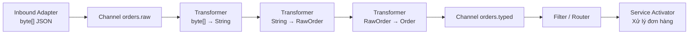
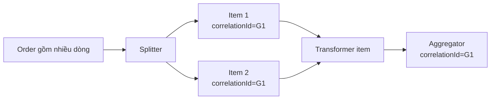

# Transformer giữa các kiểu payload

## 1. Vì sao một flow cần chuyển đổi kiểu payload?

Trong kiến trúc **Pipes and Filters**, mỗi bước xử lý nhận một thông điệp, thực hiện một nhiệm vụ rõ ràng, rồi chuyển kết quả đến bước tiếp theo qua *pipe* (thường là `MessageChannel`). Những hệ thống tích hợp hiếm khi dùng chung một kiểu dữ liệu: file có thể cung cấp `byte[]`, HTTP gửi JSON, adapter tạo `String`, còn nghiệp vụ Java cần một DTO hoặc đối tượng miền (*domain object*).

**Transformer** là mẫu *Enterprise Integration Pattern* (EIP) chuyển đổi nội dung hoặc hình dạng của thông điệp để các thành phần ở hai đầu giao tiếp được với nhau. Trong Spring Integration, Transformer thường là một message endpoint: nó nhận `Message<TIn>`, biến đổi dữ liệu và đưa thông điệp kết quả có payload kiểu `TOut` sang channel kế tiếp.

Ví dụ luồng nhận đơn hàng:

```text
byte[]                    String                  RawOrder                  Order
JSON UTF-8         →      Văn bản JSON      →     DTO nguồn           →    Kiểu nghiệp vụ
{"orderId":"..."}          {"orderId":"..."}        amountVnd: String        amountVnd: long
```

Trong chương **Pipes and filters** của module **SPRING_INTEGRATION_PATTERN**, mục tiêu là triển khai các Enterprise Integration Patterns bằng Spring Integration để xây dựng luồng thông điệp ít phụ thuộc và dễ mở rộng. Hiểu Transformer là bước cơ sở để phối hợp Router, Filter, Splitter, Aggregator, Gateway, retry, error channel và correlation, đồng thời kiểm thử, theo dõi các nhánh của flow.

Sau bài này, bạn sẽ biết cách:

1. Phân biệt **payload**, **headers**, Transformer và Converter.
2. Ghép các Transformer có đầu vào/đầu ra thuộc những kiểu Java khác nhau.
3. Sử dụng Spring Integration **Java DSL** và `@Transformer`.
4. Giữ metadata quan trọng khi đổi payload, đồng thời xử lý lỗi parse/validation.
5. Kiểm thử độc lập từng phép chuyển đổi và kiểm thử việc truyền message qua flow.

## 2. Mô hình tư duy: đổi payload, giữ ý nghĩa thông điệp

Một `Message<T>` trong Spring Messaging gồm:

| Thành phần | Ví dụ trước khi biến đổi | Ví dụ sau khi biến đổi |
| --- | --- | --- |
| **Payload** | `byte[]` chứa JSON đơn hàng | `Order(orderId, amountVnd)` |
| **Kiểu payload** | `byte[]` | `Order` |
| **Header nghiệp vụ/điều phối** | `tenantId=store-hcm`, `eventId=evt-42` | Thường tiếp tục được truyền theo quy tắc của endpoint |
| **Header về định dạng** | `contentType=application/json` | Cần xem lại: payload mới không còn là JSON thô |
| **Header do framework quản lý** | Message ID, timestamp và các header điều phối | Có thể được tạo lại, kế thừa hoặc thay đổi theo cách tạo message |

Transformer cần giải quyết ba câu hỏi:

- **Chuyển cái gì?** Giá trị và kiểu payload đầu vào/đầu ra.
- **Bảo toàn cái gì?** Khóa nghiệp vụ, correlation, trace và các headers có hợp đồng rõ ràng.
- **Khi lỗi thì sao?** Thông điệp không parse được, kiểu sai, trường bắt buộc thiếu hoặc dữ liệu không hợp lệ.

Sơ đồ kiến trúc:



Điểm quan trọng: **Transformer làm cho dữ liệu phù hợp với hợp đồng của bước kế tiếp**; nó không có nghĩa vụ tự gửi dữ liệu tới broker, bắt mọi exception hoặc bảo đảm giao dịch.

### 2.1. Transformer khác Filter và Service Activator thế nào?

| Mẫu | Câu hỏi chính | Đầu ra điển hình |
| --- | --- | --- |
| **Transformer** | Dữ liệu này phải có hình dạng/kiểu gì? | Payload mới, có thể có kiểu mới |
| **Filter** | Thông điệp có đủ điều kiện đi tiếp không? | Giữ hoặc loại message theo policy |
| **Router** | Thông điệp phải đến nhánh nào? | Chọn channel nhận |
| **Service Activator** | Ứng dụng cần thực hiện hành vi gì? | Kết quả nghiệp vụ hoặc không có reply |
| **Splitter/Aggregator** | Cần chia/gom những đơn vị nào? | Nhiều message con hoặc message tổng hợp |

Ví dụ **đổi `"125000"` thành `125000L`** là chuyển đổi kiểu/chuẩn hóa payload. **Từ chối đơn có số tiền âm** thuộc validation (có thể thực hiện trong Transformer khi xác lập bất biến của kiểu đích, hoặc ở Filter/validator riêng). **Lưu đơn hàng vào database** là hành vi của Service Activator; không nên nhét hiệu ứng phụ này vào một Transformer chỉ làm nhiệm vụ ánh xạ dữ liệu.

## 3. Những phép chuyển đổi kiểu payload thường gặp

| Từ kiểu | Sang kiểu | Khi nào dùng | Điểm cần chú ý |
| --- | --- | --- | --- |
| `byte[]` | `String` | Giải mã body/file thành văn bản | Charset phải được xác định rõ, ví dụ UTF-8 |
| `String` | DTO / `record` | Deserialize JSON/XML/CSV | Schema, trường thiếu, kiểu sai, phiên bản định dạng |
| DTO nguồn | DTO đích | Đổi hợp đồng giữa hai ứng dụng | Mapping đầy đủ, các giá trị mặc định, mất dữ liệu |
| DTO | Domain object | Chuẩn hóa và xác lập bất biến | Không để giá trị không hợp lệ lọt vào tầng nghiệp vụ |
| Domain object | DTO của đích | Chuẩn bị outbound API/broker event | Tránh rò dữ liệu nội bộ |
| Java object | `String`/`byte[]` | Serialize để gửi qua wire | Content type, charset, định dạng và version |

### 3.1. Chuyển đổi kiểu không đồng nghĩa chỉ ép kiểu

Một phép ép kiểu Java như `(Order) payload` chỉ có tác dụng khi đối tượng **đã là** một `Order`. Nó không biến `String` JSON thành đối tượng `Order`.

```java
Object payload = "{\"orderId\":\"ORD-42\"}";
// Không hợp lệ: String không phải Order.
// Order order = (Order) payload;
```

Muốn chuyển JSON thành một kiểu Java, phải **deserialize** bằng parser phù hợp, sau đó kiểm tra dữ liệu. Tương tự, `Long.parseLong("125000")` là phép chuyển giá trị có kiểm tra định dạng; không phải phép cast.

### 3.2. Transformer, Converter, Serializer có liên quan nhưng không trùng nhau

**Transformer** là một endpoint/pattern ở cấp luồng message. Nó có thể gọi bên trong:

- **Converter/mapper**: đổi dữ liệu từ kiểu này sang kiểu khác.
- **Serializer/deserializer**: mã hóa hoặc giải mã một định dạng dữ liệu (JSON, XML, Avro, bytes...).
- **Validator**: kiểm tra cấu trúc và bất biến của kết quả.

Trong Spring Integration có cả các transformer dựng sẵn (ví dụ biến đổi JSON/đối tượng theo module và cấu hình liên quan) lẫn lựa chọn viết transformer bằng phương thức Java hoặc lambda trong DSL. Chọn cơ chế nào phụ thuộc vào mức tùy biến và các thư viện đã có. Với quy tắc nghiệp vụ đặc thù, một mapper Java thuần thường dễ kiểm thử hơn.

## 4. Ví dụ thực tế: `byte[] → String → RawOrder → Order`

Giả sử một adapter nhận JSON UTF-8 như sau:

```json
{
  "orderId": "ORD-42",
  "amountVnd": "125000",
  "currency": "VND"
}
```

Hệ thống nhận biểu diễn `amountVnd` dưới dạng **chuỗi** vì đó là hợp đồng của nguồn bên ngoài. Trong nội bộ, chúng ta muốn lưu số tiền bằng `long` theo **đơn vị VND**, yêu cầu giá trị dương, và chỉ chấp nhận `currency=VND` cho ví dụ này. Vì vậy, xây hai kiểu khác nhau:

```java
// Schema của nguồn ngoài: amountVnd là chuỗi.
record RawOrder(String orderId, String amountVnd, String currency) {}

// Schema nội bộ đã được chuẩn hóa.
record Order(String orderId, long amountVnd) {}
```

Không có phép chuyển đổi tự động an toàn cho mọi trường hợp. Nếu dữ liệu đầu vào chứa `"125.5"`, `"12,500"`, `null` hoặc `"-1"`, bộ chuyển đổi phải có chính sách rõ ràng: từ chối, đưa qua nhánh làm sạch dữ liệu, hoặc xử lý bằng quy tắc chuyển đổi đã được thỏa thuận.

### 4.1. Tách mapper thành mã Java thuần

Đặt các bước chuyển đổi trong một class dễ kiểm thử:

```java
import com.fasterxml.jackson.core.JsonProcessingException;
import com.fasterxml.jackson.databind.ObjectMapper;
import java.nio.charset.StandardCharsets;

record RawOrder(String orderId, String amountVnd, String currency) {}
record Order(String orderId, long amountVnd) {}

final class OrderPayloadMapper {
    private final ObjectMapper objectMapper;

    OrderPayloadMapper(ObjectMapper objectMapper) {
        this.objectMapper = objectMapper;
    }

    String decode(byte[] bytes) {
        return new String(bytes, StandardCharsets.UTF_8);
    }

    RawOrder parseJson(String json) {
        try {
            return objectMapper.readValue(json, RawOrder.class);
        } catch (JsonProcessingException e) {
            throw new IllegalArgumentException("Invalid order JSON", e);
        }
    }

    Order normalize(RawOrder raw) {
        if (raw == null || raw.orderId() == null
                || raw.orderId().isBlank()) {
            throw new IllegalArgumentException("orderId is required");
        }
        if (!"VND".equals(raw.currency())) {
            throw new IllegalArgumentException("Unsupported currency");
        }

        final long amount;
        try {
            amount = Long.parseLong(raw.amountVnd());
        } catch (NumberFormatException e) {
            throw new IllegalArgumentException(
                    "amountVnd must be an integer", e);
        }
        if (amount <= 0) {
            throw new IllegalArgumentException(
                    "amountVnd must be positive");
        }
        return new Order(raw.orderId().trim(), amount);
    }
}
```

Ba phương thức trả đúng kiểu mà bước sau cần:

| Phương thức | Kiểu tham số | Kiểu trả về |
| --- | --- | --- |
| `decode` | `byte[]` | `String` |
| `parseJson` | `String` | `RawOrder` |
| `normalize` | `RawOrder` | `Order` |

**Lưu ý về charset:** `new String(bytes, UTF_8)` dễ hiểu nhưng bộ giải mã mặc định có thể thay thế chuỗi byte không hợp lệ bằng ký tự thay thế. Ở hệ thống cần kiểm tra tính toàn vẹn của văn bản, hãy dùng `CharsetDecoder` với `CodingErrorAction.REPORT` để *từ chối* chuỗi byte UTF-8 lỗi thay vì sửa ngầm.

**Lưu ý về số tiền:** ví dụ dùng đơn vị VND nguyên, `long` và `Long.parseLong` nhằm tránh sai số floating-point. Khi làm việc với tiền có phần thập phân hoặc nhiều đơn vị, cân nhắc `BigDecimal` và quy tắc scale/rounding công khai; không ép `double` sang `long` rồi làm mất phần lẻ.

### 4.2. Ghép các Transformer bằng Spring Integration Java DSL

Phần cấu hình sau dành cho ứng dụng Spring có **Spring Integration** và **Jackson**. `AcceptedOrderService` là hợp đồng nghiệp vụ, ứng dụng phải cung cấp bean triển khai. Các khai báo `RawOrder`, `Order` và `OrderPayloadMapper` ở mục trước được dùng lại.

```java
import com.fasterxml.jackson.databind.ObjectMapper;
import org.springframework.context.annotation.Bean;
import org.springframework.context.annotation.Configuration;
import org.springframework.integration.channel.DirectChannel;
import org.springframework.integration.config.EnableIntegration;
import org.springframework.integration.dsl.IntegrationFlow;
import org.springframework.messaging.MessageChannel;

interface AcceptedOrderService {
    void accept(String tenantId, Order order);
}

@Configuration
@EnableIntegration
class OrderTransformerConfig {

    @Bean("orders.raw")
    MessageChannel ordersRaw() {
        return new DirectChannel();
    }

    @Bean
    OrderPayloadMapper orderPayloadMapper(ObjectMapper objectMapper) {
        return new OrderPayloadMapper(objectMapper);
    }

    @Bean
    ObjectMapper objectMapper() {
        return new ObjectMapper();
    }

    @Bean
    IntegrationFlow transformOrderFlow(
            OrderPayloadMapper mapper,
            AcceptedOrderService service) {
        return IntegrationFlow.from("orders.raw")
                .transform(byte[].class, mapper::decode)
                .transform(String.class, mapper::parseJson)
                .transform(RawOrder.class, mapper::normalize)
                .handle(Order.class, (order, headers) -> {
                    String tenantId = (String) headers.get("tenantId");
                    if (tenantId == null || tenantId.isBlank()) {
                        throw new IllegalArgumentException(
                                "tenantId is required");
                    }
                    service.accept(tenantId, order);
                    return null; // Endpoint cuối của flow một chiều.
                })
                .get();
    }
}
```

Với Spring Boot đã tự cung cấp `ObjectMapper`, dùng bean đó và **bỏ khai báo `objectMapper()` nếu không cần cấu hình riêng**. Khai báo record cần Java hỗ trợ `record` (thường dùng Java 17+) và Jackson có khả năng đọc record. Đây là mã minh họa một flow đồng bộ trong bộ nhớ; không có database, broker hoặc transaction manager được cấu hình trong ví dụ.

Một producer gửi message đến channel đầu vào:

```java
import java.nio.charset.StandardCharsets;
import org.springframework.beans.factory.annotation.Qualifier;
import org.springframework.messaging.Message;
import org.springframework.messaging.MessageChannel;
import org.springframework.messaging.MessageHeaders;
import org.springframework.messaging.support.MessageBuilder;
import org.springframework.stereotype.Component;
import org.springframework.util.MimeTypeUtils;

@Component
class OrderProducer {
    private final MessageChannel rawChannel;

    OrderProducer(@Qualifier("orders.raw") MessageChannel rawChannel) {
        this.rawChannel = rawChannel;
    }

    void sendExampleOrder() {
        String json = """
                {"orderId":"ORD-42","amountVnd":"125000","currency":"VND"}
                """;

        Message<byte[]> incoming = MessageBuilder
                .withPayload(json.getBytes(StandardCharsets.UTF_8))
                .setHeader("tenantId", "store-hcm")
                .setHeader("eventId", "evt-42")
                .setHeader("traceId", "trace-42")
                .setHeader(MessageHeaders.CONTENT_TYPE, MimeTypeUtils.APPLICATION_JSON)
                .build();

        rawChannel.send(incoming);
    }
}
```

Kết quả kỳ vọng ở Service Activator cuối:

```text
order: Order(orderId="ORD-42", amountVnd=125000)
tenantId: "store-hcm"
```

Các phép chuyển đổi được áp dụng **theo thứ tự**. Đầu ra của bước trước trở thành đầu vào của bước kế tiếp. Ví dụ, sau `decode` payload là `String` nên `parseJson` có thể nhận đúng kiểu; sau `parseJson` payload là `RawOrder` để `normalize` hoạt động.

Với `DirectChannel`, exception tại một Transformer thường truyền ngược về luồng đang gửi (có thể được bọc trong exception của messaging framework). Việc trả `null` trong handler cuối thể hiện không tạo reply; một Gateway đồng bộ đợi reply cần một flow và contract trả kết quả khác.

### 4.3. Chọn kích thước mỗi Transformer

Việc tách thành ba Transformer giúp:

- **Tái sử dụng**: bước parse JSON có thể dùng ở những luồng đầu vào khác nhau.
- **Kiểm thử độc lập**: byte → text, text → DTO và DTO → domain có từng bộ kiểm thử riêng.
- **Đặt tên rõ ràng**: log và quan sát lỗi dễ xác định lỗi giải mã, lỗi JSON hay lỗi dữ liệu.
- **Điều chỉnh pipeline**: có thể chèn Filter/Router hoặc validator vào chỗ cần thiết.

Tuy nhiên, một handler chỉ đổi vài trường đơn giản có thể không cần tạo một endpoint riêng. Trong ứng dụng có throughput cao, số bước cũng làm tăng chi phí xử lý và độ phức tạp quan sát. Chọn ranh giới dựa trên hợp đồng dữ liệu, khả năng tái sử dụng và cách phục hồi khi lỗi.

## 5. Viết Transformer bằng `@Transformer`

Ngoài Java DSL, Spring Integration hỗ trợ annotation `@Transformer` trên phương thức Java. Cách này tiện khi muốn nêu rõ input/output channel và giữ logic mapping trong một class.

```java
import org.springframework.integration.annotation.Transformer;
import org.springframework.stereotype.Component;

@Component
class OrderTransformEndpoint {
    private final OrderPayloadMapper mapper;

    OrderTransformEndpoint(OrderPayloadMapper mapper) {
        this.mapper = mapper;
    }

    @Transformer(
            inputChannel = "orders.json",
            outputChannel = "orders.normalized")
    public Order transform(String json) {
        RawOrder raw = mapper.parseJson(json);
        return mapper.normalize(raw);
    }
}
```

**Đây là phương án thay thế**, chỉ nhận `String` JSON và sinh `Order`. Khi dùng thực tế, phải có channel `orders.json`, `orders.normalized` và consumer tiếp theo; không đăng ký phương thức này thêm vào cùng flow của mục 4.2 trừ khi chủ động thiết kế chuỗi kênh tương ứng. Nếu không, dễ tạo hai subscriber hoặc biến đổi lặp.

Spring Integration sẽ gọi phương thức với payload tương thích và tạo message đầu ra để gửi sang output channel. Nếu phương thức cần đọc header, có thể dùng `@Header` hoặc nhận `Message<T>` theo quy tắc ánh xạ phương thức của framework. Không bắt tầng domain phải phụ thuộc vào `Message` chỉ để lấy một giá trị `tenantId`.

### 5.1. Khi nào nên trả `Message<T>` thay vì payload?

Nếu chỉ chuyển đổi nội dung, thường **trả về đối tượng payload mới** để hạ tầng Spring Integration xây dựng output message và xử lý header propagation. Nếu cần **đổi metadata một cách có chủ đích**, có thể tạo message đầu ra:

```java
import org.springframework.messaging.Message;
import org.springframework.messaging.support.MessageBuilder;

Message<Order> toDomainMessage(
        Message<RawOrder> input, OrderPayloadMapper mapper) {
    return MessageBuilder
            .withPayload(mapper.normalize(input.getPayload()))
            .copyHeaders(input.getHeaders())
            .setHeader("schemaVersion", "2")
            .build();
}
```

Đây là phương thức minh họa độc lập, có thể được dùng làm logic bên trong Transformer thích hợp. Khi copy headers, phải xem xét đặc biệt những header được framework quản lý (`id`, `timestamp`, `replyChannel`, `errorChannel`) và định dạng payload mới. Không nên copy mù mọi header vào message gửi ra hệ thống khác.

## 6. Headers đi qua Transformer như thế nào?

Payload thay đổi nhưng **ngữ cảnh điều phối** có thể cần giữ lại. Ví dụ `eventId` giúp chống xử lý trùng, `tenantId` giúp chọn dữ liệu của đúng tenant, `traceId` giúp lần theo một yêu cầu, `correlationId` giúp gom message từ Splitter.

Spring Integration thường **truyền các header phù hợp** khi Transformer chỉ trả payload, nhưng cách xử lý chính xác phụ thuộc loại transformer, header propagation và cách message được tạo. Không nên giả định mọi header (nhất là đối tượng không thể serialize) đều sống sót qua mọi endpoint hoặc broker.

| Header | Có nên giữ khi đổi payload? | Lưu ý |
| --- | --- | --- |
| `eventId` | Thường có | Khóa idempotency ổn định khi nhận lại |
| `tenantId` | Tùy hợp đồng, thường có | Phải xác thực nguồn của header |
| `traceId` | Có nếu flow dùng tracing | Tránh đánh mất dấu vết giữa các bước |
| `correlationId` | Có trong chuỗi cần correlation | Không tự sinh một group mới giữa chừng |
| `contentType` | Cần xem xét lại | `application/json` có thể không còn đúng với payload `Order` |
| `replyChannel` / `errorChannel` | Theo cơ chế message nội bộ | Không phải giá trị có thể gửi nguyên dạng qua mọi broker |
| `id` / `timestamp` | Do framework quản lý | Không dùng message ID làm event ID xuyên hệ thống |

### 6.1. `contentType` cần khớp với **biểu diễn**

Ở đầu flow, `contentType=application/json` mô tả bytes chứa JSON. Sau khi đổi thành `Order` (đối tượng Java), một header “định dạng wire” giữ nguyên có thể gây hiểu nhầm nếu downstream sử dụng nó để serialize hoặc chọn converter.

Vì vậy:

1. Phân biệt metadata biểu diễn **đầu vào** với hợp đồng của **đầu ra**.
2. Điều chỉnh/xóa header định dạng ở ranh giới phù hợp, đặc biệt khi chuyển sang outbound adapter.
3. Kiểm thử adapter/serializer thực tế để tránh tình trạng header thông báo JSON nhưng payload lại là đối tượng không được converter hỗ trợ.

### 6.2. Transformer với Splitter và Aggregator

Nếu một Splitter tạo các message con có `correlationId`, `sequenceNumber` và `sequenceSize`, Transformer nằm giữa Splitter và Aggregator phải tránh phá metadata mà Aggregator dùng để xác định nhóm và điều kiện release:



Đổi payload từng dòng hàng vẫn có thể giữ `correlationId=G1` để gom các phần về cùng đơn. Nếu Transformer tạo lại group ID tùy tiện hoặc làm mất sequence metadata, Aggregator có thể không bao giờ đủ điều kiện release, hoặc gom nhầm dữ liệu.

## 7. Lỗi chuyển đổi và chính sách phục hồi

Không phải mọi lỗi trong Transformer đều nên retry. Cần phân biệt:

| Lỗi | Ví dụ | Hướng xử lý thường hợp lý |
| --- | --- | --- |
| **Encoding không hợp lệ** | Bytes không đúng UTF-8 | Từ chối/cách ly; tránh giải mã rồi mất ký tự |
| **Sai cú pháp định dạng** | JSON thiếu dấu ngoặc | Trả lỗi parse; không retry vô hạn |
| **Không khớp schema** | `amountVnd` là mảng thay vì chuỗi | Validation/nhánh schema mismatch |
| **Giá trị vi phạm bất biến** | `amountVnd=-100`, tiền tệ không hỗ trợ | Từ chối nghiệp vụ, ghi nguyên nhân |
| **Lỗi phụ thuộc tạm thời** | Transformer có gọi dịch vụ ngoài và bị timeout | Có thể retry có giới hạn nếu thao tác an toàn |
| **Payload quá lớn** | JSON hàng chục MB vượt giới hạn | Giới hạn kích thước, chia dòng hoặc xử lý streaming |

Nếu Transformer là **hàm thuần**, lỗi do dữ liệu thường lặp lại y hệt mỗi lần gọi; retry không giải quyết được. Với những mapping phức tạp cần tra cứu thông tin bên ngoài, nên cân nhắc tách tác vụ I/O thành Service Activator để áp dụng retry, circuit breaker và timeout một cách minh bạch.

Trong flow đồng bộ qua `DirectChannel`, exception có thể truyền về bên gọi; trong executor/poller hoặc các adapter bất đồng bộ, cần kiểm tra cách error handler phát `ErrorMessage` tới error channel. Việc cấu hình `errorChannel` **không tự lưu lỗi bền vững** và **không tự retry**. Muốn có recovery, cần lưu payload nguồn hoặc tham chiếu tới bản nguồn, loại lỗi, số lần xử lý, `eventId` và `traceId` vào nơi bền vững, sau đó hỗ trợ replay có kiểm soát.

### 7.1. Tránh chuyển đổi gây hiệu ứng phụ

Một Transformer chỉ chuyển DTO → domain thường có tính xác định:

```text
normalize(RawOrder("ORD-42", "125000", "VND"))
  → Order("ORD-42", 125000)
```

Nếu trong lúc normalize lại gửi email hoặc trừ tiền, retry parse/mapping có thể kích hoạt hiệu ứng phụ nhiều lần. Giữ Transformer thuần, đặt hiệu ứng phụ vào handler nghiệp vụ có khóa idempotency và transaction phù hợp.

## 8. Kiểm thử Transformer ở hai cấp độ

### 8.1. Unit test các phép chuyển đổi

Vì `OrderPayloadMapper` là class Java thuần, ta có thể kiểm thử mà không cần khởi động Spring context:

```java
import com.fasterxml.jackson.databind.ObjectMapper;
import org.junit.jupiter.api.Test;
import static org.junit.jupiter.api.Assertions.*;

class OrderPayloadMapperTest {
    private final OrderPayloadMapper mapper =
            new OrderPayloadMapper(new ObjectMapper());

    @Test
    void convertsJsonIntoDomainOrder() {
        String json = """
                {"orderId":" ORD-42 ","amountVnd":"125000","currency":"VND"}
                """;

        RawOrder raw = mapper.parseJson(json);
        Order actual = mapper.normalize(raw);

        assertEquals("ORD-42", actual.orderId());
        assertEquals(125_000L, actual.amountVnd());
    }

    @Test
    void rejectsInvalidAmount() {
        RawOrder raw = new RawOrder("ORD-42", "12.5", "VND");
        assertThrows(IllegalArgumentException.class,
                () -> mapper.normalize(raw));
    }

    @Test
    void rejectsBrokenJson() {
        assertThrows(IllegalArgumentException.class,
                () -> mapper.parseJson("{bad json"));
    }
}
```

Các test này kiểm tra **tính đúng của phép biến đổi**: schema, giá trị đầu ra, quy tắc lỗi. Chúng chưa chứng minh headers được chuyển tiếp qua endpoint.

### 8.2. Integration test flow và header propagation

Khi chạy trong Spring Test context với `OrderTransformerConfig` và một bean `AcceptedOrderService` giả lập, cần gửi message vào `orders.raw`, sau đó xác minh service nhận đúng `Order`, `tenantId` và không được gọi khi dữ liệu sai.

| Kịch bản | Kết quả mong đợi |
| --- | --- |
| JSON hợp lệ, VND hợp lệ | `AcceptedOrderService.accept("store-hcm", Order("ORD-42", 125000))` |
| JSON sai cú pháp | Flow đi vào chính sách lỗi; không gọi service |
| Dữ liệu thiếu `orderId` | Chuyển đổi báo lỗi; không sinh `Order` không hợp lệ |
| `amountVnd` không parse được | Nhánh từ chối; không retry lỗi dữ liệu vô ích |
| `tenantId` bị thiếu | Handler cuối báo lỗi theo contract |
| Payload đi qua nhiều Transformer | Kiểu từng bước đúng, `traceId`/`eventId` cần thiết vẫn còn |
| Payload qua broker/adapter khác | Kiểm tra charset, schema, content type và header mapping |
| Splitter/Transformer/Aggregator | Correlation và sequence đủ để gom kết quả chính xác |

**Điểm cần kiểm tra riêng:** một test chỉ xác nhận `OrderPayloadMapper.normalize(...)` hoạt động sẽ không phát hiện lỗi làm mất header giữa hai endpoint. Hãy quan sát message hoặc dùng handler/Service Activator cuối để assert các header cần thiết theo hợp đồng của luồng.

### 8.3. Quan sát pipeline khi chạy

Với nhiều Transformer, nên theo dõi ít nhất số message vào/ra từng bước, lỗi parse, lỗi schema, thời gian xử lý, độ lớn payload, số message bị cách ly, và chỉ số retry của những bước có I/O. Gắn `eventId` và `traceId` xuyên flow để biết lỗi nằm ở bước decode, deserialize hay chuẩn hóa. Tránh log toàn bộ payload chứa dữ liệu nhạy cảm.

## 9. Những lỗi thiết kế thường gặp

1. **Dùng ép kiểu thay cho deserialize.** `String` không thể cast trực tiếp thành DTO.
2. **Dùng `double` cho tiền.** Có thể gây sai số hoặc làm tròn ngoài ý muốn.
3. **Thao tác I/O trong Transformer thuần.** Làm retry và tính xác định khó kiểm soát.
4. **Quên thay đổi `contentType`.** Header đầu vào có thể không còn mô tả đúng payload đầu ra.
5. **Làm mất `correlationId`/sequence headers.** Splitter/Aggregator không ghép đúng nhóm.
6. **Sửa trực tiếp payload mutable.** Message envelope không tự deep-copy payload; khi chạy song song dễ phát sinh lỗi dữ liệu.
7. **Bắt mọi exception rồi trả DTO rỗng.** Che giấu lỗi dữ liệu, khiến downstream nhận một thông điệp tưởng như hợp lệ.
8. **Chỉ test mapper, bỏ qua integration test.** Không phát hiện lỗi channel, headers và cấu hình endpoint.

## 10. Bài tập thực hành và tiêu chí hoàn thành

**Bài tập:** Xây flow nhận `byte[]` JSON hóa đơn từ adapter, chuyển thành `InvoiceInput`, chuẩn hóa thành `Invoice`, sau đó Service Activator gọi dịch vụ ghi sổ.

Yêu cầu thực hiện:

1. Khai báo rõ kiểu đầu vào và đầu ra của từng Transformer.
2. Dùng `MessageBuilder` gửi payload byte UTF-8 kèm `tenantId`, `eventId`, `traceId` và `contentType`.
3. Tách `decode`, `parseJson` và `normalize` thành các hàm độc lập, ít hiệu ứng phụ.
4. Từ chối dữ liệu sai định dạng, thiếu trường bắt buộc và số tiền không hợp lệ.
5. Kiểm tra đầu ra tới Service Activator nhận đúng domain object và header `tenantId`.
6. Thêm nhánh xử lý lỗi dữ liệu có lưu trữ phù hợp; không retry vô hạn thông điệp JSON hỏng.
7. Đặt một Splitter và Aggregator ở hai đầu một Transformer, kiểm tra correlation và sequence metadata không bị phá vỡ.

Một Transformer tốt có **hợp đồng đầu vào/đầu ra rõ**, chuyển đổi dữ liệu có kiểm soát, giữ metadata cần thiết và tạo lỗi dễ quan sát khi gặp đầu vào không hợp lệ. Ghép các Transformer theo từng kiểu payload giúp xây dựng pipeline EIP rõ trách nhiệm, có thể kiểm thử độc lập và dễ mở rộng khi nguồn dữ liệu hoặc schema thay đổi.
