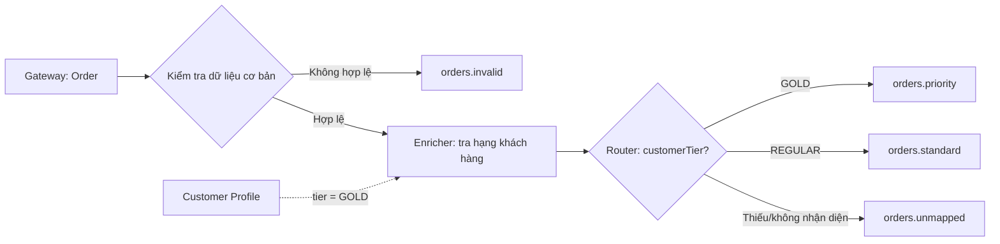
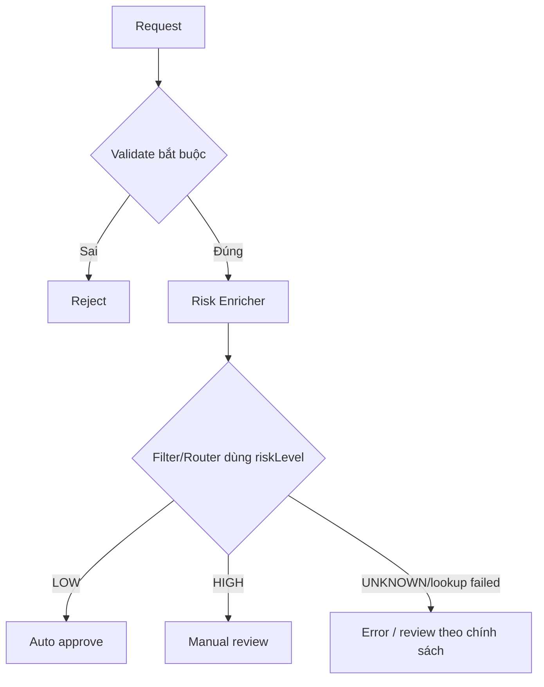
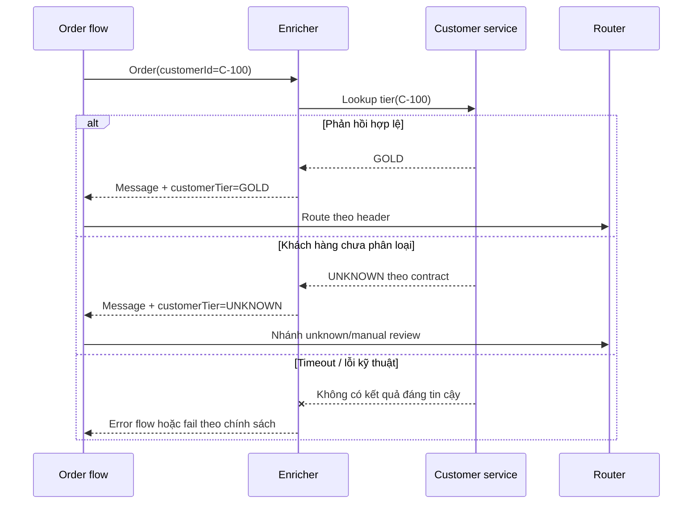

# Đặt enrichment trước bước cần metadata

> **Chương:** Pipes and filters  
> **Module:** `SPRING_INTEGRATION_PATTERN` — học cách triển khai Enterprise Integration Patterns với Spring Integration để xây dựng luồng thông điệp ít phụ thuộc, dễ mở rộng; thực hành Router, Filter, Transformer, Splitter, Aggregator, Gateway, retry, error channel, correlation, đồng thời kiểm thử và theo dõi các nhánh. Bài này giải thích **vì sao và đặt bước enrichment ở đâu** để những endpoint phía sau có đủ metadata trước khi đưa ra quyết định.

## 1. Mục tiêu học tập

Sau bài này, bạn có thể:

1. Giải thích **Message Enricher** bổ sung thông tin còn thiếu cho một message như thế nào trong kiến trúc Pipes and Filters.
2. Phân biệt **Header Enricher**, **Content Enricher** và Transformer; xác định metadata nên nằm trong header hay payload.
3. Sắp xếp đúng thứ tự **validation → enrichment → bước sử dụng metadata** khi triển khai Filter, Router, Service Activator hoặc outbound Gateway.
4. Viết một `IntegrationFlow` có `enrichHeaders(...)` để Router chọn channel dựa trên dữ liệu tra cứu được từ hệ thống khác.
5. Thiết kế chính sách cho metadata thiếu/cũ, lookup chậm hoặc thất bại, retry, idempotency, correlation, bảo mật và quan sát luồng.
6. Kiểm thử được rằng metadata đã có **trước** endpoint sử dụng nó, chứ không chỉ chứng minh kết quả cuối cùng của một nhánh.

## 2. Vấn đề: quyết định cần một thông tin chưa có trong message

Giả sử hệ thống đặt hàng nhận message sau từ Gateway:

```json
{
  "orderId": "ORD-701",
  "customerId": "C-100",
  "amount": 1500000,
  "destinationCountry": "VN"
}
```

Router cần biết đơn của khách hàng thuộc **hạng GOLD hay REGULAR** để chọn channel xử lý ưu tiên. Tuy nhiên, dữ liệu hạng khách hàng không có trong yêu cầu đặt hàng; nó nằm trong dịch vụ hồ sơ khách hàng.

Nếu Router tự gọi dịch vụ hồ sơ mỗi lần định tuyến, endpoint này sẽ vừa làm nhiệm vụ **tra cứu dữ liệu**, vừa **chọn đích**. Khi một Filter khác cũng cần hạng khách hàng, nó lại phải gọi lần nữa. Thiết kế đó gây trùng logic, tăng độ trễ, khó kiểm thử và khó xử lý khi dịch vụ hồ sơ tạm thời không khả dụng.

Thay vào đó, ta thêm **Enricher** trước điểm dùng metadata:



**Nguyên tắc cốt lõi:** trước khi endpoint dùng một thuộc tính để quyết định, phải có bước **tạo hoặc xác nhận thuộc tính đó** ở một vị trí có trách nhiệm rõ ràng. Với ví dụ trên: *kiểm tra đầu vào → tra cứu tier → thêm tier vào message → Router đọc tier*.

## 3. Enrichment là gì trong Pipes and Filters?

Trong mô hình **Pipes and Filters**, một flow được tổ chức thành các bước xử lý độc lập (**filters**, theo nghĩa tổng quát của kiến trúc) nối với nhau bằng **pipes/channels**. Mỗi bước nhận message theo một contract và tạo ra kết quả cho bước sau. **Enrichment** là bước **bổ sung thông tin**, thay vì chỉ chọn đường đi hoặc bỏ message.

Nguồn dữ liệu để enrich có thể là:

- **Ngay trong message:** suy ra vùng giao hàng từ mã quốc gia; thêm nhãn loại payload hoặc schema version.
- **Từ configuration/context tin cậy:** tenant đã được xác thực, ứng dụng nguồn, phiên bản quy tắc xử lý.
- **Từ một dịch vụ hoặc kho dữ liệu khác:** hạng khách hàng, hạn mức giao dịch, cấu hình giao hàng, quy tắc sản phẩm.
- **Từ một nhánh xử lý trước đó:** kết quả tra cứu SKU, trạng thái kiểm tra rủi ro, response từ outbound Gateway.

Ví dụ dữ liệu sau enrichment:

```text
Trước enrichment:
  payload: Order(orderId=ORD-701, customerId=C-100, amount=1500000)
  headers: sourceSystem=web-store

Sau enrichment:
  payload: Order(orderId=ORD-701, customerId=C-100, amount=1500000)
  headers:
    sourceSystem=web-store
    customerTier=GOLD

Router:
  customerTier=GOLD -> orders.priority
```

Ở ví dụ này, payload **không cần thay đổi**; metadata mới được thêm vào header. Với trường hợp cần tạo đơn hàng đã kèm đầy đủ địa chỉ giao, ưu đãi hay chi tiết tồn kho để gửi hệ thống khác, thông tin có thể thuộc **payload được làm giàu**.

### 3.1. Header Enricher và Content Enricher

| Tiêu chí | Header Enricher | Content Enricher |
| --- | --- | --- |
| Mục tiêu | Bổ sung metadata vào **message headers** | Bổ sung thông tin vào **nội dung nghiệp vụ/payload** |
| Ví dụ | `customerTier`, `routingZone`, nhãn tenant tin cậy | Thêm thông tin khách hàng, chi tiết sản phẩm, địa chỉ chuẩn hóa vào đối tượng đơn |
| Bước phía sau | Router theo header, kiểm soát nhánh, logging/tracing | API đích cần dữ liệu đầy đủ, tính toán hoặc lưu một aggregate |
| Lợi ích | Giữ payload nghiệp vụ gọn; routing không phụ thuộc thêm trường nội dung | Contract payload tự thể hiện tập dữ liệu cần thiết ở đích |
| Rủi ro | Header bị mất khi qua adapter/protocol; có thể bị giả mạo ở ingress | Payload phình to; schema coupling, dữ liệu cũ hoặc nhạy cảm |

**Header không đồng nghĩa với “dữ liệu không quan trọng”.** Nếu Router, bảo mật hoặc correlation dùng một header, header đó đã trở thành **một phần contract của flow**. Cần xác thực nguồn, định nghĩa ý nghĩa, phiên bản và cách ánh xạ qua ranh giới hệ thống.

### 3.2. Enricher khác Transformer như thế nào?

| Pattern | Ý định chính | Minh họa |
| --- | --- | --- |
| **Enricher** | Thêm thông tin chưa có để bước tiếp theo dùng | Tra hạng khách hàng và thêm `customerTier` |
| **Transformer** | Chuyển biểu diễn, kiểu hoặc cấu trúc dữ liệu | `ExternalOrder` → `NormalizedOrder` |
| **Filter** | Giữ hoặc loại message theo điều kiện | Không nhận đơn có số tiền âm |
| **Router** | Chọn channel đích | Tier GOLD → nhánh ưu tiên |
| **Gateway** | Kết nối code/giao thức và luồng messaging; có thể là request–reply | Hỏi dịch vụ khách hàng và nhận profile |

Một bước có thể vừa transform vừa làm giàu về mặt kỹ thuật, nhưng **tách trách nhiệm** giúp rõ ràng hơn khi nhiều endpoint dùng chung metadata. Trong Spring Integration, `enrichHeaders(...)` hỗ trợ làm giàu header; **Content Enricher** có thể lấy kết quả từ một request–reply flow và hợp nhất thông tin vào payload theo cấu hình. Với biến đổi đơn giản, một `Transformer` tạo payload mới cũng có thể đáp ứng yêu cầu làm giàu dữ liệu, nhưng cần đặt tên/contract cho rõ.

## 4. Quy tắc bố trí: enrich gần nhu cầu nhưng trước khi cần

Không phải cứ có Enricher là đặt nó ở đầu flow. Vị trí tốt phụ thuộc **metadata được sử dụng ở đâu**, **chi phí tra cứu** và **khả năng loại message trước đó**.

### 4.1. Kiểm tra tối thiểu trước khi tra cứu tốn kém

Nếu đơn không có `customerId`, việc gọi customer service là vô ích. Nên:

```text
Gateway -> Validate structure -> Filter invalid -> Enrich(customerTier)
        -> Router by tier -> Downstream
```

Không nên:

```text
Gateway -> Enrich(customerTier via remote API) -> Validate/Filter invalid
```

Trừ khi validation **cần chính dữ liệu enrichment**, hãy loại những yêu cầu sai cấu trúc/sai dữ liệu cơ bản trước khi thực hiện I/O. Điều này làm giảm áp lực lên dịch vụ tra cứu và giúp đường lỗi dễ xác định.

### 4.2. Nhưng nếu Filter cần metadata, enrichment phải đứng trước Filter đó

Giả sử chỉ các đơn có `riskLevel=LOW` mới được tự động phê duyệt, còn `riskLevel=HIGH` chuyển kiểm duyệt. `riskLevel` lấy từ dịch vụ đánh giá rủi ro. Nếu Filter dùng trường này **trước** Enricher, kết quả có thể sai hoặc phụ thuộc vào một giá trị mặc định nguy hiểm.



Tức là **“Filter trước Enricher” chỉ đúng với những Filter không cần dữ liệu enrichment**. Với Filter phụ thuộc metadata, thứ tự ngược lại mới chính xác.

### 4.3. Enrich một lần trước điểm phân nhánh nếu mọi nhánh cần cùng dữ liệu

Nếu cả `orders.priority` và `orders.standard` đều dùng `customerTier`, việc làm giàu **trước Router** cho phép dùng một giá trị nhất quán và giảm lookup trùng:

```text
                       +--> Priority handler
Enrich(customerTier) -> Router
                       +--> Standard handler
```

Nhưng nếu chỉ một nhánh cần dữ liệu đắt tiền, có thể **Router trước dựa trên metadata đã có** rồi chỉ enrich tại nhánh cần thiết. Không nên enrich tất cả các trường của mọi hệ thống ngay tại ingress nếu phần lớn message không dùng tới chúng.

### 4.4. Chọn thời điểm enrichment dựa trên độ mới của dữ liệu

Tier, tồn kho, hạn mức giao dịch hoặc chính sách bảo mật có thể thay đổi giữa lúc tạo đơn và lúc thực thi. Lấy metadata quá sớm rồi giữ trong queue lâu có thể khiến quyết định dùng dữ liệu cũ. Hãy xác định:

- Metadata là **snapshot tại thời điểm nhận**, hay phải **đúng tại thời điểm ra quyết định**?
- Có cần `metadataVersion`, `resolvedAt`, TTL hoặc ETag không?
- Nếu message bị retry sau nhiều phút, tái sử dụng snapshot hay tra cứu lại? Việc tra cứu lại có thay đổi quyết định nghiệp vụ không?
- Với giao dịch quan trọng, bên nhận có cần xác minh lại điều kiện trước khi commit không?

Đặt enrichment càng gần bước sử dụng càng giúp dữ liệu tươi, nhưng có thể tăng số lần lookup ở những nhánh đồng thời. Đây là bài toán **tính nhất quán, độ trễ và tải**, không có một vị trí tối ưu cho mọi flow.

## 5. Ví dụ Spring Integration Java DSL: enrich header trước Router

Ta dựng một flow nhận đơn hàng, kiểm tra dữ liệu cơ bản, lấy hạng khách hàng từ một catalog rồi Router dựa trên header `customerTier`. Catalog trong ví dụ là **dữ liệu giả lập in-memory**, nhằm cho thấy đúng thứ tự xử lý; khi dùng API thật phải bổ sung timeout, retries và chính sách lỗi.

### 5.1. Message contract và dịch vụ tra cứu

```java
import java.math.BigDecimal;
import java.util.Map;

record PurchaseOrder(String orderId, String customerId,
                     BigDecimal amount) {}

class CustomerTierCatalog {
    private final Map<String, String> tiers = Map.of(
        "C-100", "GOLD",
        "C-200", "REGULAR"
    );

    String resolveTier(String customerId) {
        // UNKNOWN là kết quả tra cứu nghiệp vụ, không giả là tier hợp lệ.
        return tiers.getOrDefault(customerId, "UNKNOWN");
    }
}
```

Ở đây, `customerId` nằm trong payload; `customerTier` không được client tự quyết định mà lấy từ nguồn được ứng dụng kiểm soát. Nếu dùng cache hay một dịch vụ ngoài, catalog phải đảm bảo contract trả về rõ ràng cho khách hàng không tồn tại hoặc lỗi truy cập.

### 5.2. Gateway và IntegrationFlow

```java
import org.springframework.context.annotation.Bean;
import org.springframework.context.annotation.Configuration;
import org.springframework.integration.annotation.Gateway;
import org.springframework.integration.annotation.IntegrationComponentScan;
import org.springframework.integration.annotation.MessagingGateway;
import org.springframework.integration.config.EnableIntegration;
import org.springframework.integration.dsl.IntegrationFlow;

@MessagingGateway
interface PurchaseOrderGateway {
    @Gateway(requestChannel = "orders.input")
    void submit(PurchaseOrder order);
}

@Configuration
@EnableIntegration
@IntegrationComponentScan
class OrderFlowConfiguration {

    @Bean
    CustomerTierCatalog customerTierCatalog() {
        return new CustomerTierCatalog();
    }

    @Bean
    IntegrationFlow orderFlow(CustomerTierCatalog catalog) {
        return IntegrationFlow.from("orders.input")
            // 1. Chỉ kiểm tra dữ liệu đã có, trước khi lookup metadata.
            .filter(PurchaseOrder.class,
                order -> order.orderId() != null
                    && !order.orderId().isBlank()
                    && order.customerId() != null
                    && !order.customerId().isBlank()
                    && order.amount() != null
                    && order.amount().signum() > 0,
                spec -> spec.discardChannel("orders.invalid"))

            // 2. Enricher phải chạy trước Router sử dụng customerTier.
            .enrichHeaders(spec -> spec.headerFunction(
                "customerTier",
                message -> catalog.resolveTier(
                    ((PurchaseOrder) message.getPayload()).customerId())))

            // 3. Router chỉ đọc header đã được thiết lập.
            .route("headers['customerTier']", spec -> spec
                .channelMapping("GOLD", "orders.priority")
                .channelMapping("REGULAR", "orders.standard")
                .defaultOutputChannel("orders.unknownTier"))
            .get();
    }

    @Bean
    IntegrationFlow priorityOrders() {
        return IntegrationFlow.from("orders.priority")
            .handle(message -> System.out.println(
                "PRIORITY tier=" + message.getHeaders().get("customerTier")
                    + " order=" + message.getPayload()))
            .get();
    }

    @Bean
    IntegrationFlow standardOrders() {
        return IntegrationFlow.from("orders.standard")
            .handle(message -> System.out.println(
                "STANDARD tier=" + message.getHeaders().get("customerTier")
                    + " order=" + message.getPayload()))
            .get();
    }

    @Bean
    IntegrationFlow invalidOrders() {
        return IntegrationFlow.from("orders.invalid")
            .handle(message -> System.out.println(
                "INVALID order=" + message.getPayload()))
            .get();
    }

    @Bean
    IntegrationFlow unknownTierOrders() {
        return IntegrationFlow.from("orders.unknownTier")
            .handle(message -> System.out.println(
                "UNKNOWN TIER order=" + message.getPayload()))
            .get();
    }
}
```

Ví dụ gọi gateway từ một bean ứng dụng đã inject `PurchaseOrderGateway`:

```java
purchaseOrderGateway.submit(new PurchaseOrder(
    "ORD-701", "C-100", new BigDecimal("1500000")));

purchaseOrderGateway.submit(new PurchaseOrder(
    "ORD-702", "C-200", new BigDecimal("400000")));

purchaseOrderGateway.submit(new PurchaseOrder(
    "ORD-703", "C-999", new BigDecimal("200000")));

purchaseOrderGateway.submit(new PurchaseOrder(
    "ORD-704", "C-100", BigDecimal.ZERO));
```

Kết quả minh họa:

```text
PRIORITY tier=GOLD order=PurchaseOrder[orderId=ORD-701, ...]
STANDARD tier=REGULAR order=PurchaseOrder[orderId=ORD-702, ...]
UNKNOWN TIER order=PurchaseOrder[orderId=ORD-703, ...]
INVALID order=PurchaseOrder[orderId=ORD-704, ...]
```

**Điểm mấu chốt:** `orders.priority` và `orders.standard` không phải tự gọi catalog. Router đọc `customerTier` đã được Enricher gắn vào message. Đơn sai cấu trúc bị loại **trước lookup**; khách hàng chưa phân loại đi nhánh **unknown**, không âm thầm được coi là REGULAR.

### 5.3. Những giới hạn cố ý của ví dụ

- Catalog là `Map`, không có network I/O. Thực tế phải thiết kế timeout, bulkhead, cache và bảo vệ dịch vụ tra cứu.
- Sink chỉ in console. `void submit(...)` không xác nhận một nghiệp vụ phân tán đã hoàn tất.
- Routing key `customerTier` là header ứng dụng, không phải header framework bắt buộc. Qua HTTP/broker, cần cấu hình ánh xạ nếu bên khác còn sử dụng.
- Ví dụ chưa dùng retry/error channel và chưa bảo đảm lưu bền. Lỗi kỹ thuật khi lookup **khác** với việc catalog trả `UNKNOWN` hợp lệ về mặt contract.
- Không truyền toàn bộ hồ sơ khách hàng vào header; chỉ thêm dữ liệu tối thiểu phục vụ quyết định.

## 6. Khi nào enrich payload thay vì header?

Header thích hợp cho metadata điều khiển luồng như `customerTier`, `routingZone`, `sourceSystem`, `correlationId`. Nhưng nếu hệ thống vận chuyển yêu cầu địa chỉ đã chuẩn hóa và kích thước từng kiện ngay trong contract API, nội dung đó nên được đưa vào một **payload có kiểu rõ ràng**, ví dụ:

```java
record ShippingOrder(PurchaseOrder order, String normalizedAddress,
                     String serviceLevel) {}

// Tạo payload mới thay vì sửa PurchaseOrder tại chỗ.
ShippingOrder enrichPayload(PurchaseOrder order,
                            String normalizedAddress,
                            String serviceLevel) {
    return new ShippingOrder(order, normalizedAddress, serviceLevel);
}
```

Đoạn trên là hàm thuần minh họa **kết quả làm giàu payload**, không phải cấu hình Content Enricher hoàn chỉnh. Trong Spring Integration có thể dùng **Content Enricher** để hỏi một flow tra cứu rồi hợp nhất dữ liệu vào đối tượng đích; với trường hợp đơn giản, Transformer tạo một immutable payload mới cũng dễ hiểu. Dù cách nào, phải quyết định có giữ headers hay không, payload có đổi schema/version hay không và consumer có chấp nhận kiểu mới hay không.

**Không nên:** gắn địa chỉ, token API, thông tin thanh toán, full customer profile hoặc dữ liệu nhạy cảm vào header chỉ vì Router muốn truy cập dễ hơn. Header thường được sao chép/ghi log/ánh xạ qua nhiều adapter và có nguy cơ lan truyền vượt phạm vi cần thiết.

## 7. Enrichment qua dịch vụ ngoài: request–reply và lỗi lookup

Trong production, enrichment thường cần đọc một hệ thống khác như customer profile, service định tuyến giao hàng hay policy engine. Bước này tạo ra một **phụ thuộc runtime** mới; vì vậy phải xác định cách thất bại và thời gian chờ.



### 7.1. Tách “không có metadata” khỏi “không thể truy cập metadata”

| Tình huống | Ví dụ | Hành vi nên được thiết kế |
| --- | --- | --- |
| **Dữ liệu thiếu hợp lệ** | Customer ID không tồn tại | Trả `UNKNOWN`/`NOT_FOUND` có ý nghĩa hoặc nhánh từ chối nghiệp vụ |
| **Lỗi dịch vụ tra cứu** | HTTP 503, timeout, kết nối bị từ chối | Retry hữu hạn cho lỗi có thể phục hồi; sau đó error/review/dead-letter theo contract |
| **Metadata không hợp lệ** | API trả tier `PLATINUM` chưa được hỗ trợ | Validate/allowlist, route fallback có cảnh báo; không route tùy ý |
| **Metadata đã cũ** | Cache tier lỗi thời trong lúc khách vừa nâng hạng | TTL/version/freshness check; quy tắc khi stale |
| **Metadata thiếu quyền** | Nguồn yêu cầu tier của tenant khác | Xác thực và từ chối; không coi lỗi quyền là tier REGULAR |

Một default như `REGULAR` khi lookup gặp lỗi có vẻ thuận tiện nhưng có thể vi phạm SLA, phân quyền hoặc chính sách rủi ro. Chỉ dùng fallback nếu đó là **quyết định nghiệp vụ được chấp thuận**, có dấu vết, metric và khả năng khôi phục.

### 7.2. Retry không được nhân bội tác dụng phụ

Nếu Enricher chỉ gọi một API đọc thuần, retry có giới hạn với backoff có thể hợp lý. Nhưng nếu bước tra cứu đồng thời **ghi trạng thái, đăng ký hạn mức hoặc tạo tài nguyên**, việc thử lại có thể thực hiện lặp khi lần đầu timeout nhưng đã thành công ở đích. Tách API đọc khỏi command gây side effect, hoặc dùng idempotency key và kiểm tra trạng thái theo hợp đồng.

Không nên viết retry bằng cách đưa message quay lại đầu pipeline vô hạn: bạn có thể lặp Filter, Router, Splitter và cả những handler đã thực hiện xong. Hãy đặt retry **tại vùng phụ thuộc đang thất bại**, giới hạn số lần thử và xác định đường cuối khi hết lượt.

### 7.3. Thời gian chờ, độ trễ và backpressure

Một Enricher gọi đồng bộ customer service trên `DirectChannel` sẽ kéo dài thời gian xử lý của thread gửi; nhiều đơn đồng thời có thể làm đầy thread pool và tạo nghẽn dây chuyền. Nếu tách qua queue/executor thì cần quản lý số message chờ, giới hạn đồng thời, thứ tự và error handling bất đồng bộ.

Có thể giảm chi phí bằng cache có TTL, batch lookup hoặc preload dữ liệu đáng tin cậy. Tuy nhiên, tối ưu hiệu năng **không được phá vỡ tính đúng đắn** khi policy cần dữ liệu tươi. Hãy đo tỷ lệ cache hit, p95/p99 thời gian lookup, timeout, retry count và số message chuyển nhánh unknown/error.

## 8. Header và metadata qua nhiều bước: correlation, bảo mật, tính bất biến

### 8.1. Enrich không được vô tình làm mất correlation

Một flow có Splitter/Aggregator có thể tạo nhiều message con cho cùng một đơn. Để gom đúng, các message cần giữ/thiết lập **correlation key** và sequence theo contract, hoặc có chiến lược tương quan riêng. Nếu message qua broker/HTTP, hãy kiểm tra header có được ánh xạ qua ranh giới hay không.

```text
Order ORD-701
  -> Enrich(customerTier=GOLD)
  -> Splitter(lineItems)
      -> Line A: correlation=ORD-701, tier=GOLD
      -> Line B: correlation=ORD-701, tier=GOLD
  -> Handlers
  -> Aggregator(group by ORD-701)
```

Nếu mọi message con cần cùng tier, enrich **trước Splitter** tránh lookup lặp. Nếu tier phụ thuộc **từng SKU hoặc từng kho**, enrich **sau Splitter** ở nhánh item mới chính xác. Với dữ liệu dùng để Aggregator release, cần bảo đảm metadata tới được tất cả kết quả tương quan hoặc áp dụng chiến lược riêng tại Aggregator.

`messageId` do Spring tạo không nhất thiết ổn định qua các bước tạo message mới; **không dựa vào message ID làm business correlation key**. `correlationId` phục vụ liên kết các phần, còn **idempotency key** dùng để ngăn xử lý trùng nghiệp vụ — hai mục đích khác nhau.

### 8.2. Cẩn thận khi ghi đè header

`MessageHeaders` được thiết kế bất biến từ góc nhìn người dùng; khi bổ sung header, framework thường xây dựng **message mới** với bộ metadata thích hợp. Do đó, đừng sửa trực tiếp `message.getHeaders().put(...)`. Với các header đã có như tenant, trace, security context hoặc correlation, hãy xác định rõ **nguồn dữ liệu nào có quyền thiết lập/ghi đè**, thay vì tin header do client gửi tới.

Ví dụ: client có thể gửi `customerTier=GOLD` nhằm vào nhánh ưu tiên. Nếu flow chỉ gắn header khi chưa có thì giá trị client có thể được giữ lại. Hãy xác định chiến lược **loại bỏ header không đáng tin ở ingress hoặc ghi đè có chủ đích bằng giá trị từ nguồn tin cậy**, và kiểm thử hành vi đó. Chính sách ghi đè cụ thể phụ thuộc cấu hình API Header Enricher mà ứng dụng chọn.

### 8.3. Metadata tối thiểu, đủ mục đích

Không nên mang cả hồ sơ PII trên mọi message chỉ để Router đọc một nhãn nhỏ. Cần giới hạn dữ liệu theo mục đích, mask khi log, không đưa token bí mật vào header được truyền rộng, và xác định thời hạn tồn tại của metadata.

Metadata đôi khi là **dữ liệu quyết định chính sách** (như quyền truy cập, hạn mức, phân vùng tenant), không chỉ là hỗ trợ logging. Những quyết định bảo mật quan trọng cần được xác thực tại ranh giới tin cậy và có cơ chế bảo vệ khỏi metadata giả mạo/cũ.

## 9. Quan sát enrichment để chứng minh thứ tự đúng

Giả sử Router chọn sai nhánh. Để chẩn đoán, không chỉ log `orderId`, mà cần thấy Enricher đã chạy **trước** Router và tạo ra giá trị nào.

| Điểm đo | Tín hiệu | Câu hỏi cần trả lời |
| --- | --- | --- |
| Ingress/Gateway | `orderId`, `customerId`, nguồn, schema | Input ban đầu có những trường gì? |
| Validation/Filter | accepted/rejected, mã lý do | Message có đủ điều kiện để lookup không? |
| Enricher request | Tên nguồn dữ liệu, lookup key dạng an toàn, start time | Có thực sự gọi catalog/service không? |
| Enricher result | `customerTier` thuộc tập hợp cho phép, metadata version, latency | Đã thêm giá trị nào, có stale/unknown không? |
| Router | Routing key, tên channel được chọn | Quyết định có dựa trên header đã enrich không? |
| Outbound handler | Kết quả nghiệp vụ, latency, retry attempts | Đích đã xử lý thành công hay chưa? |
| Error flow | Failure type, correlation, số lần retry | Lỗi lookup hay lỗi sau routing? |

Có thể dùng `ChannelInterceptor`, Wire Tap, logging, metrics/tracing và test endpoint để quan sát các channel; nhưng tránh ghi cả payload nhạy cảm. Với metrics, nên dùng tag có cardinality thấp (`channel`, `lookupStatus`, `tier`) thay vì `orderId`/`messageId`.

**Quan sát có thể chứng minh:** message đã đi qua channel *trước* Router, metadata đã được gắn, và Router đã chọn đích tương ứng. Chỉ thấy `postSend(sent=true)` ở một channel **không chứng minh** kết quả cuối tại ERP/kho đã commit, nhất là khi có executor, queue hoặc broker ngoài.

## 10. Kiểm thử: xác nhận thứ tự và hành vi khi metadata thiếu

Kiểm thử một Enricher không chỉ là kiểm tra service lookup trả đúng tier. Cần xác minh **flow sử dụng đúng tier sau khi enrichment**. Có thể chia test thành ba tầng:

1. **Unit test** cho hàm tra cứu/classify: `C-100 → GOLD`, `C-200 → REGULAR`, mã không có → `UNKNOWN`.
2. **Integration test** với Spring Integration flow: gửi message qua Gateway, bắt message tại các nhánh và assert header `customerTier` cùng payload.
3. **Failure/timeout test** khi gọi dependency: kiểm tra giới hạn retry, error flow, không gửi sang nhánh hợp lệ khi metadata không đáng tin.

### 10.1. Ma trận kiểm thử đề xuất

| Đầu vào/điều kiện | Dữ liệu sau Enricher | Nhánh mong đợi | Điều bắt buộc kiểm tra |
| --- | --- | --- | --- |
| `ORD-701`, `C-100`, tổng tiền dương | `customerTier=GOLD` | `orders.priority` | Không gửi sang `orders.standard` |
| `ORD-702`, `C-200`, tổng tiền dương | `customerTier=REGULAR` | `orders.standard` | Không gửi sang `orders.priority` |
| `ORD-703`, `C-999` | `customerTier=UNKNOWN` | `orders.unknownTier` | Không tự phân loại thành REGULAR |
| `ORD-704`, `amount=0` | **Không lookup** | `orders.invalid` | Catalog không được gọi; không có tier giả |
| Catalog timeout/HTTP 503 | Không có tier đáng tin | Error/retry theo chính sách | Không phát sang nhánh thành công |
| Client gửi header `customerTier=GOLD` nhưng nguồn thật trả REGULAR | Giá trị tin cậy theo chính sách | `orders.standard` | Không bị header giả mạo thay đổi route |
| Router chạy trước Enricher (thử nghiệm lỗi) | Chưa có `customerTier` | Fallback/error | Test phát hiện lỗi thứ tự ngay |
| Message đi qua broker/adapter | Header được map theo contract | Nhánh đúng sau deserialize | Không mất metadata cần thiết |

### 10.2. Ví dụ unit test cho catalog

```java
import static org.junit.jupiter.api.Assertions.assertEquals;

import org.junit.jupiter.api.Test;

class CustomerTierCatalogTest {
    private final CustomerTierCatalog catalog = new CustomerTierCatalog();

    @Test
    void resolvesKnownCustomerTiers() {
        assertEquals("GOLD", catalog.resolveTier("C-100"));
        assertEquals("REGULAR", catalog.resolveTier("C-200"));
    }

    @Test
    void unknownCustomerIsNotSilentlyPromotedOrDowngraded() {
        assertEquals("UNKNOWN", catalog.resolveTier("C-999"));
    }
}
```

Đây chỉ là **unit test dữ liệu tra cứu**. Trong integration test, dùng fake service có thể ghi số lần gọi; gửi một đơn invalid để assert **catalog được gọi 0 lần**, một đơn hợp lệ để assert **catalog gọi 1 lần** và các test handler để assert header + số message trên từng channel.

### 10.3. Kiểm thử khi có Splitter/Aggregator

Với đơn có ba dòng hàng, đặt Enricher trước Splitter nếu tier là metadata chung cho cả đơn. Assert các message con mang cùng tier và cùng business correlation key; với metadata riêng từng SKU thì đặt enrichment sau Splitter và assert mỗi item có giá trị đúng. Aggregator phải gom đúng nhóm và có test thiếu phần, phần đến trễ hoặc gửi lại; không kết luận từ việc đủ message vào channel là group chắc chắn được release.

## 11. Những anti-pattern cần tránh

| Anti-pattern | Vấn đề | Cách cải thiện |
| --- | --- | --- |
| **Route before enrich** | Router đọc `null`, key mặc định sai hoặc dữ liệu chưa đáng tin | Enrich và validate metadata trước router cần nó |
| **Enrich quá sớm mọi thứ** | Tốn I/O cho cả message bị loại hoặc nhánh không cần | Validate trước; enrich đúng vị trí sử dụng |
| **Lookup lặp ở từng handler** | Tăng latency, metadata không nhất quán giữa các nhánh | Enrich một lần trước nhánh khi dùng metadata chung |
| **UNKNOWN = STANDARD khi API lỗi** | Che sự cố và có thể vi phạm chính sách | Phân biệt not-found, timeout, stale và lỗi quyền |
| **Tin header do client gửi** | Spoofing tier/tenant/route | Xác thực/strip/overwrite từ nguồn tin cậy |
| **Header quá lớn** | Tăng kích thước message, lộ PII, mất tương thích adapter | Giữ metadata tối thiểu, payload riêng theo contract |
| **Retry toàn flow vô hạn** | Lặp các tác dụng phụ và làm tăng tải | Retry hữu hạn quanh dependency, idempotency tại side effect |
| **Dựa vào message ID để gom** | Message con có ID riêng, có thể đổi ID qua bước xử lý | Dùng correlation key nghiệp vụ và sequence/release strategy |
| **Enricher gọi API chậm trong hot path** | Nghẽn producer, timeout dây chuyền | Timeout, bulkhead, cache có TTL, đo latency, tách ranh giới phù hợp |

## 12. Checklist thiết kế production

- [ ] Xác định chính xác endpoint nào **cần metadata nào** và mức độ tin cậy/yêu cầu độ mới.
- [ ] Kiểm tra trường đầu vào cơ bản trước lookup nếu không phụ thuộc metadata cần tra cứu.
- [ ] Đặt Enricher **trước** Filter/Router/handler sử dụng metadata đó.
- [ ] Chọn header hay payload dựa vào hợp đồng nghiệp vụ, không chỉ sự tiện lợi khi code.
- [ ] Định nghĩa kết quả `UNKNOWN`/not-found và lỗi kỹ thuật **khác nhau**.
- [ ] Cấu hình timeout, retry có giới hạn, backoff và đường xử lý khi lookup thất bại.
- [ ] Tính đến idempotency nếu có side effect; giữ correlation/sequence khi chia/gom message.
- [ ] Xác định khi nào metadata có thể stale và cách xử lý cache, TTL, version.
- [ ] Không tin header đầu vào chưa xác thực; giới hạn PII và kích thước header.
- [ ] Đo latency, lookup error rate, nhánh routing, queue depth và kết quả nghiệp vụ đúng ranh giới.
- [ ] Có unit/integration/failure tests chứng minh **thứ tự enrichment → điểm sử dụng**, bao gồm cả nhánh sai và trường hợp lỗi.

## 13. Bài tập vận dụng

Một hệ thống nhận thông điệp `CreateShipment` từ website. Message có `orderId`, `customerId`, danh sách SKU và quốc gia đích. Router cần chọn nhánh xử lý quốc tế/nội địa; Filter chống gian lận cần `riskScore` từ Risk Service; từng SKU có nhà kho ưu tiên riêng; kết quả từ các kho phải được gom về một đơn.

Hãy thiết kế flow và trả lời:

1. Metadata nào có thể xác định trực tiếp từ payload (ví dụ quốc gia), metadata nào cần tra cứu ngoài (ví dụ `riskScore` và kho ưu tiên)?
2. Filter nào chạy được **trước enrichment**; Filter nào phải chạy **sau enrichment**?
3. Nếu `riskScore` không sẵn có vì API timeout, Router có được tự gửi qua nhánh rủi ro thấp không? Nên có chính sách gì?
4. Enrich thông tin **đơn hàng chung** trước Splitter hay enrich **kho theo SKU** sau Splitter? Vì sao?
5. Trước Aggregator cần những metadata/correlation nào, và test gì chứng minh các kết quả thuộc đúng đơn?
6. Bạn sẽ gắn ChannelInterceptor, Wire Tap hoặc tracing ở đâu để chẩn đoán lookup chậm hoặc mất header khi qua broker?

**Một phương án tham khảo:**

```text
Gateway
   -> Validate cấu trúc / loại input sai
   -> Enrich(riskScore từ Risk Service)
   -> Filter/Router theo riskScore
        -> Nhánh kiểm duyệt khi HIGH/UNKNOWN theo chính sách
        -> Nhánh đủ điều kiện:
             Router quốc gia (dữ liệu đã có)
             -> Splitter từng SKU
             -> Enrich(warehouse theo SKU)
             -> Router tới kho
             -> Tính toán/giữ hàng có idempotency
             -> Aggregator theo orderId
             -> Kết quả / event sau khi hoàn tất
```

Không có một thứ tự duy nhất cho mọi bài toán: thứ tự đúng phụ thuộc **contract và dữ liệu mà từng bước thực sự dùng**. Nhưng luôn phải xác định rõ **ai tạo metadata, khi nào nó có giá trị và endpoint nào được phép tin vào nó**.

## 14. Tổng kết

**Đặt enrichment trước bước cần metadata** là nguyên tắc thiết kế quan trọng trong Pipes and Filters. Một Enricher bổ sung ngữ cảnh còn thiếu để Router, Filter, handler hoặc outbound Gateway ra quyết định chính xác. Đặt quá muộn khiến bước dùng metadata phải đoán hoặc xử lý sai; đặt quá sớm, quá rộng khiến flow chậm, dữ liệu cũ và phụ thuộc hệ thống tra cứu không cần thiết.

Với Spring Integration, có thể dùng **Header Enricher** (`enrichHeaders`) hoặc cơ chế làm giàu payload theo contract. Để flow ít phụ thuộc và dễ kiểm thử, hãy tách **validation, enrichment, routing và xử lý nghiệp vụ**; chủ động xử lý **metadata thiếu/lỗi/cũ, retry, error channel, correlation, idempotency**; và đo/kiểm thử đúng thứ tự mà thông điệp đi qua từng channel.

**Tham khảo:** Gregor Hohpe & Bobby Woolf, *Enterprise Integration Patterns* (Content Enricher, Pipes and Filters); tài liệu Spring Integration về Header Enricher, Content Enricher, Java DSL, Message Channels, Routers, Splitters/Aggregators và Error Handling.
