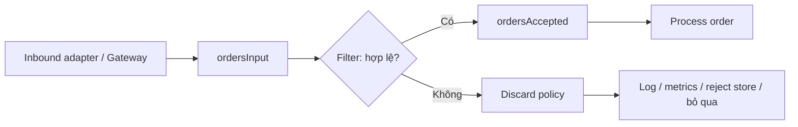
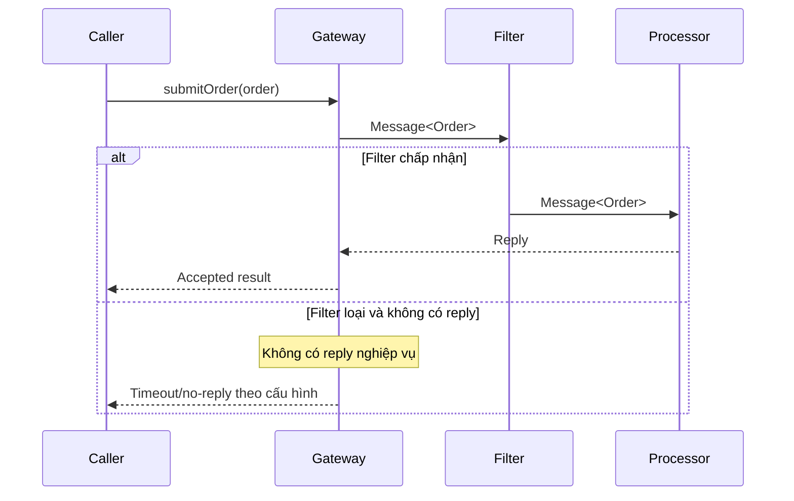
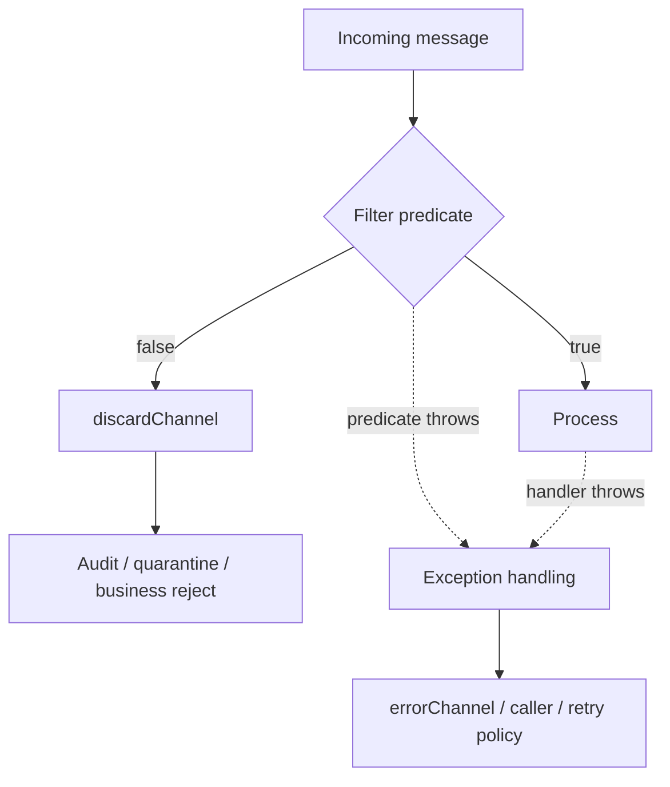
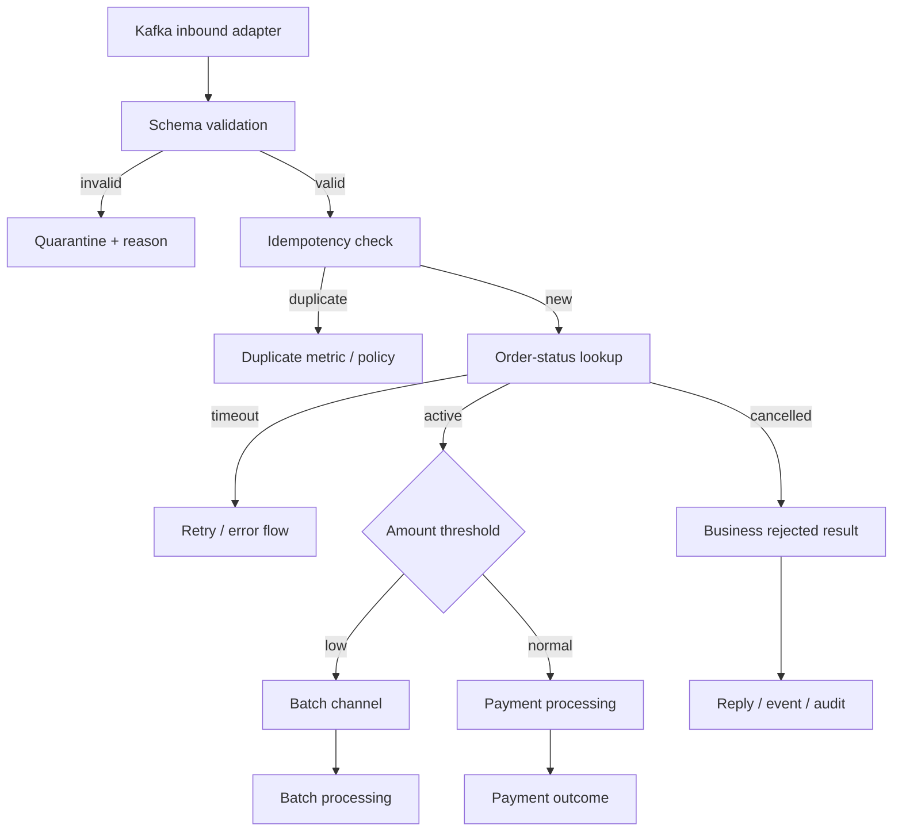

# Xử lý message bị loại khỏi flow

Trong kiến trúc **Pipes and Filters**, message đi qua một chuỗi các bước xử lý độc lập (*filters*) được nối bằng các kênh (*pipes*). Một bước có thể chấp nhận message, biến đổi nội dung, định tuyến hoặc quyết định **không cho message tiếp tục đi theo nhánh chính**. Với **Spring Integration**, điều quan trọng không chỉ là viết điều kiện lọc, mà còn phải quy định rõ message bị loại sẽ **biến mất có chủ đích, được chuyển sang nhánh khác, được ghi nhận để kiểm tra hay gây ra lỗi**.

Bài học thuộc chương **Pipes and filters** của module `SPRING_INTEGRATION_PATTERN`. Mục tiêu là dùng các Enterprise Integration Patterns — đặc biệt **Filter, Router, Transformer, Splitter, Aggregator và Gateway** — để xây dựng luồng message ít phụ thuộc, dễ mở rộng, có thể kiểm thử và quan sát. Việc quản lý message bị loại liên quan trực tiếp đến **retry, error channel và correlation**: xử lý sai có thể làm mất dữ liệu, khiến gateway chờ vô hạn hoặc khiến aggregator không bao giờ đủ số phần tử.

Sau bài học, bạn có thể:

- Phân biệt **rejection** (bị từ chối theo điều kiện) với **exception** (lỗi thực thi), **duplicate** (trùng lặp) và **không có message đầu ra**.
- Chọn giữa **discard mặc định**, `discardChannel`, `nullChannel`, `throwExceptionOnRejection` và nhánh kết quả nghiệp vụ tường minh.
- Hiểu những gì thực sự được gửi vào discard channel, nơi ghi lý do loại bỏ và tác động đến request–reply.
- Thiết kế luồng xử lý batch, splitter/aggregator và nguồn broker sao cho việc loại bỏ không phá hỏng trạng thái giao nhận.
- Viết kiểm thử chứng minh cả message được chấp nhận lẫn message bị loại đi đúng đích, không chỉ kiểm tra predicate.

## 1. “Bị loại khỏi flow” có nghĩa là gì?

Giả sử một hệ thống xử lý yêu cầu đặt hàng. Flow chỉ nhận đơn đã ở trạng thái `READY` và có số tiền dương:



Trường hợp **Filter trả `false`** chỉ có nghĩa là message không được chuyển tới **output channel của Filter**. Nó *không tự động* nói rằng message là lỗi, rằng dữ liệu đã được lưu để xử lý lại, rằng bên gửi nhận được phản hồi từ chối, hoặc rằng broker sẽ phát lại message.

Cần phân biệt các kết quả sau:

| Trạng thái | Ý nghĩa | Ví dụ |
| --- | --- | --- |
| **Accepted** | Predicate trả `true`, message đi tiếp trên nhánh chính. | Đơn `READY` và tiền lớn hơn 0. |
| **Rejected / filtered out** | Predicate trả `false`, message không qua nhánh chính. | Đơn đang `DRAFT`, không phù hợp để thanh toán. |
| **Discarded intentionally** | Ứng dụng quyết định không cần xử lý tiếp. | Sự kiện heartbeat vô ích đối với luồng báo cáo. |
| **Routed elsewhere** | Message không đi nhánh chính nhưng vẫn có nơi tiếp nhận. | Chuyển đơn chưa hợp lệ sang hàng đợi kiểm tra. |
| **Failed** | Có exception trong predicate, handler, transport hoặc quá trình gửi. | CSDL lỗi khi tra cứu điều kiện lọc. |
| **Duplicate suppressed** | Một idempotent policy xác định message đã được xử lý. | Cùng `eventId` được gửi lại sau reconnect. |
| **No reply** | Một luồng request–reply không tạo message trả về. | Gateway gọi luồng mà Filter loại request; bên gọi có thể chờ timeout. |

**Nguyên tắc quan trọng:** *Không gửi tiếp* là một **quyết định điều phối**; *xảy ra lỗi* là một **trạng thái thực thi**. Đừng dùng cùng một đường đi để che giấu cả hai nếu hệ thống cần phản hồi, retry hoặc giám sát khác nhau.

## 2. Cơ chế của Message Filter trong Spring Integration

Trong Spring Integration, **Message Filter** đánh giá một điều kiện dựa trên payload, headers hoặc cả message. Với bộ lọc chuẩn, có ba nhóm hành vi cần biết:

1. **Chấp nhận:** message được chuyển tới output channel như thông thường.
2. **Từ chối và có `discardChannel`:** message bị từ chối được chuyển sang channel đã cấu hình, thay vì tiếp tục qua output channel chính.
3. **Từ chối và không có nhánh discard:** message có thể được bỏ qua theo mặc định; nếu cấu hình **`throwExceptionOnRejection`**, Filter phát sinh `MessageRejectedException` thay vì loại bỏ âm thầm.

Các tùy chọn này cần được sử dụng **có chủ đích**. Không nên cùng lúc thiết kế một message vừa bị loại âm thầm vừa yêu cầu được xử lý bởi error flow mà không kiểm chứng chính sách ưu tiên của cấu hình đang dùng.

```text
                 Message<?> (payload + headers)
                               │
                               ▼
                      Filter / predicate
                        ┌──────┴──────┐
                     true           false
                      │               │
                      ▼               ├──► discardChannel (nếu cấu hình)
                 outputChannel        │
                                      ├──► drop (nếu chính sách cho phép)
                                      │
                                      └──► MessageRejectedException
                                             (khi throwExceptionOnRejection)
```

### Message nào đi vào discard channel?

Thông thường, nhánh discard nhận **message gốc bị Filter từ chối**, gồm payload và headers của nó; đây không tự động là một object `RejectedOrder` mới có lý do thất bại. Nếu muốn lưu `reasonCode`, `rejectedAt`, `filterName` hoặc chi tiết validation, phải **xây dựng cơ chế bổ sung metadata hoặc chuyển đổi payload rõ ràng** tại nhánh xử lý từ chối.

Ví dụ, một message có `payload = OrderRequest("ORD-7", 0, "READY")` không tự nhận thêm header `rejectReason = "amount must be positive"` chỉ vì predicate trả `false`. Có thể kiểm tra lại quy tắc tại reject handler, hoặc thiết kế validator trả về kết quả có kiểu thay vì chỉ `boolean` nếu cần nhiều lý do.

## 3. Ví dụ Java DSL: chuyển message bị loại sang một channel riêng

Ví dụ sau dùng Spring Integration Java DSL, Java 17+ và hai `QueueChannel` để có thể quan sát chính xác cả hai nhánh. Queue trong ví dụ **chỉ phục vụ minh họa và kiểm thử nội bộ**, không phải kho lưu trữ bền vững thay cho broker.

```java
import org.springframework.context.annotation.Bean;
import org.springframework.context.annotation.Configuration;
import org.springframework.integration.channel.QueueChannel;
import org.springframework.integration.dsl.IntegrationFlow;

record OrderRequest(String orderId, long amountCents, String state) {
    boolean eligible() {
        return orderId != null
                && !orderId.isBlank()
                && amountCents > 0
                && "READY".equals(state);
    }
}

@Configuration
class OrderFilterConfiguration {

    @Bean
    QueueChannel acceptedOrders() {
        return new QueueChannel();
    }

    @Bean
    QueueChannel rejectedOrders() {
        return new QueueChannel();
    }

    @Bean
    IntegrationFlow orderScreeningFlow() {
        return IntegrationFlow.from("incomingOrders")
                .filter(OrderRequest.class,
                        OrderRequest::eligible,
                        spec -> spec.discardChannel("rejectedOrders"))
                .channel("acceptedOrders")
                .get();
    }
}
```

Giải thích luồng:

- Producer gửi `Message<OrderRequest>` vào kênh `incomingOrders`.
- Filter gọi `eligible()`; nếu `true`, message được đưa tới `acceptedOrders`.
- Nếu `false`, message được đưa tới `rejectedOrders` theo cấu hình `discardChannel`.
- Nhánh `rejectedOrders` là **điểm tiếp nhận message bị loại**, chứ không phải tự động là *error channel*.
- `QueueChannel` có thể được poll để xem message. Một hệ thống production thường thay chúng bằng channel hoặc handler phù hợp, có lưu trữ và giám sát theo yêu cầu thực tế.

Trong môi trường sử dụng annotation, ý tưởng tương tự có thể được biểu diễn bằng `@Filter(inputChannel = "incomingOrders", outputChannel = "acceptedOrders", discardChannel = "rejectedOrders")` trên một phương thức trả `boolean`. Mục đích cốt lõi không đổi: **xác định rõ đầu ra được chấp nhận và đầu ra bị loại**.

### Giới hạn của ví dụ

Ví dụ chỉ dựng topology để minh họa. Muốn chạy cần Spring Integration và application context; muốn xử lý message thực sự cần thêm producer và consumer phù hợp. `QueueChannel` không tự phát lên HTTP/Kafka, không tự ghi audit, và không tự xác nhận nghiệp vụ đã hoàn thành.

## 4. Bốn chính sách xử lý message bị loại

### 4.1. Loại bỏ âm thầm: chỉ khi có cơ sở nghiệp vụ

Trường hợp phù hợp là message thực sự **không có giá trị đối với flow này**, ví dụ tín hiệu heartbeat của một stream chỉ thu thập giao dịch. Nếu loại bỏ âm thầm là hợp đồng đã được xác nhận, tránh tạo side effect không cần thiết.

Đổi lại, việc loại bỏ âm thầm khiến người vận hành khó phân biệt **không có message** với **có message nhưng bị Filter loại**. Ít nhất, với luồng quan trọng, nên có counter thống kê số lượt `accepted`/`rejected` và tài liệu quy định điều kiện loại bỏ. Nếu không được phép mất giao dịch, không chọn silent drop như cách xử lý mặc định.

### 4.2. `discardChannel`: đưa message sang nhánh xử lý riêng

`discardChannel` phù hợp khi message không được đi tiếp ở luồng chính nhưng cần **quarantine, review, ghi audit hoặc chuyển đến một workflow khác**.

```text
incomingOrders -> Filter ----accepted----> processOrder
                      |
                      +----rejected----> rejectedOrders
                                           |
                                           +-> metrics + audit
                                           +-> manual review / quarantine
```

Trong nhánh này, cần quyết định:

1. Giữ nguyên message gốc để có thể kiểm tra hay chuyển thành một bản ghi từ chối có schema riêng?
2. Có cần `reasonCode` và `eventId` bền vững để audit/khử trùng lặp không?
3. Dữ liệu nhạy cảm có cần che hoặc loại khỏi logs không?
4. Nhánh từ chối có thể lỗi không? Nếu lỗi, message nguồn có thể được retry hoặc cần một nơi lưu dự phòng?
5. Bên phát message có cần được thông báo trạng thái `REJECTED` không?

### 4.3. `nullChannel`: chủ đích tiêu hủy message

Spring Integration cung cấp tên channel đặc biệt **`nullChannel`** để nhận rồi bỏ qua message. Khi không cần giữ lại hoặc chuyển sang bước xử lý khác, có thể cấu hình:

```java
IntegrationFlow.from("incomingOrders")
        .filter(OrderRequest.class, OrderRequest::eligible,
                spec -> spec.discardChannel("nullChannel"))
        .channel("acceptedOrders")
        .get();
```

`nullChannel` **không** có nghĩa payload của message là `null`. Nó là một đích nhận để **discard** message; Spring Message hợp lệ vẫn có payload khác null. Đây cũng không phải dead-letter queue hay bộ đệm để truy hồi sau. Vì vậy, chỉ dùng khi mất message là hành vi **cố ý và đúng hợp đồng**.

### 4.4. `throwExceptionOnRejection`: từ chối là lỗi, không phải discard thông thường

Nếu điều kiện lọc thể hiện **vi phạm hợp đồng bắt buộc** và caller/consumer cần biết để xử lý lỗi, có thể cấu hình Filter ném `MessageRejectedException` khi predicate là `false`:

```java
IntegrationFlow.from("incomingOrders")
        .filter(OrderRequest.class, OrderRequest::eligible,
                spec -> spec.throwExceptionOnRejection(true))
        .channel("acceptedOrders")
        .get();
```

Khi sử dụng chính sách này, **không được coi mọi rejection đều có thể retry**. Ví dụ đơn có `amountCents = -1` là lỗi dữ liệu có tính quyết định; thử lại y nguyên 100 lần không làm dữ liệu đúng hơn. Hãy chỉ retry khi lỗi là tạm thời, không phải vì exception thuộc bất kỳ loại nào. Đường truyền exception đến caller, poller error handling hoặc `errorChannel` còn phụ thuộc luồng đồng bộ/bất đồng bộ và cấu hình endpoint.

| Chính sách | Message bị loại đi đâu? | Hợp với tình huống |
| --- | --- | --- |
| **Discard mặc định** | Không gửi ra output của Filter; có thể không có bước xử lý tiếp. | Dữ liệu không liên quan, được phép bỏ qua. |
| **`discardChannel`** | Đi sang kênh dành cho rejection. | Audit, manual review, lưu thông tin bị loại, nhánh nghiệp vụ khác. |
| **`nullChannel`** | Được nhận rồi bị bỏ qua có chủ đích. | Tín hiệu dư thừa không cần giữ hoặc xử lý. |
| **`throwExceptionOnRejection`** | Phát sinh lỗi từ Filter. | Vi phạm hợp đồng cần cho caller hoặc error policy biết. |
| **Kết quả có kiểu (`Rejected`)** | Message đi qua luồng chứa thông tin chấp nhận/từ chối. | Cần phản hồi nghiệp vụ ngay, theo dõi và tổng hợp chính xác. |

## 5. Filter khác Router, Transformer và validator như thế nào?

Không nên cố dùng Filter `boolean` giải quyết mọi trường hợp không hợp lệ. Chọn EIP theo **ý nghĩa của kết quả**:

**Filter** — chọn cho đi tiếp hoặc không. Thích hợp khi downstream không quan tâm những message bị loại hoặc đã có nhánh discard riêng.

**Router** — chọn một hoặc nhiều nhánh theo trạng thái. Ví dụ `READY` → xử lý thanh toán; `DRAFT` → lưu nháp; `CANCELLED` → cập nhật tồn kho. Các nhánh đều có ý nghĩa, nên một Router thường diễn đạt bài toán tốt hơn một Filter liên tục hủy message.

**Transformer** — đổi payload thành định dạng/kiểu khác. Nếu muốn trả một **kết quả từ chối có lý do rõ ràng**, có thể sử dụng một validator/transformer trả một result type như `AcceptedOrder` hoặc `RejectedOrder` trước khi Router phân nhánh.

**Validator/service** — kiểm tra các quy tắc chi tiết. Một method trả `boolean` thường không thể diễn đạt đầy đủ các lỗi như “thiếu địa chỉ”, “không còn tồn kho”, “chưa đạt hạn mức”. Một result type hoặc danh sách `ValidationIssue` giúp kiểm thử và observability tốt hơn.

Ví dụ mô hình kết quả có kiểu:

```java
record OrderCommand(String orderId, long amountCents) {}

sealed interface OrderDecision permits Approved, Rejected {}

record Approved(String orderId) implements OrderDecision {}

record Rejected(String orderId, String reasonCode)
        implements OrderDecision {}

class OrderPolicy {
    OrderDecision validate(OrderCommand order) {
        if (order.orderId() == null || order.orderId().isBlank()) {
            return new Rejected(order.orderId(), "MISSING_ORDER_ID");
        }
        if (order.amountCents() <= 0) {
            return new Rejected(order.orderId(), "INVALID_AMOUNT");
        }
        return new Approved(order.orderId());
    }
}
```

Trong mô hình này, `Rejected` là **payload nghiệp vụ hợp lệ**, không phải `ErrorMessage` hoặc một Spring message có payload `null`. Một Router có thể chuyển `Approved` sang thanh toán và `Rejected` sang nơi phản hồi/audit. Cách này đặc biệt phù hợp nếu hệ thống phải lưu **lý do từ chối** mà một Filter đơn giản không cung cấp sẵn.

## 6. Message bị loại và Gateway/request–reply

Một **Gateway** thường cung cấp API request–reply. Nếu request bị Filter loại và không có message trả lời, hệ thống bên gọi **không tự động nhận được kết quả `Rejected`**.



Cần quyết định rõ **hợp đồng với caller**:

- Nếu caller cần nhận biết đơn bị từ chối: trả `Rejected(reasonCode)` hoặc một lỗi có ý nghĩa được hợp đồng hóa.
- Nếu đó là API fire-and-forget: tài liệu phải nói rõ thao tác gọi chỉ là gửi yêu cầu, không phải xác nhận hoàn tất xử lý.
- Nếu có khả năng không có reply: cấu hình timeout/no-reply policy và kiểm thử để không chờ vô hạn.
- Nếu rejection là exception: xác định exception nào sẽ được đưa về caller và exception nào được xử lý bất đồng bộ trên error channel.

**Bẫy phổ biến:** Gửi `Message<OrderCommand>` qua Gateway, Filter loại message, sau đó caller nhận `null` hoặc timeout. Việc đó **không chứng minh** một Spring `Message<?>` có payload `null` đã được tạo; nó chỉ chứng minh nhánh request–reply không cung cấp kết quả như caller mong đợi.

## 7. Splitter/Aggregator: loại một message con có thể khiến cả nhóm bị kẹt

Đây là một hệ quả quan trọng trong hệ thống EIP. Giả sử Splitter tách đơn hàng có bốn dòng thành bốn message con. Aggregator gom lại dựa vào `correlationId` và điều kiện hoàn tất nhóm:

```text
Order#A chứa 4 items
      │
      ▼
   Splitter
      │
      ├── Item 1 ─────► Processor ─────► Aggregator
      ├── Item 2 ─────► Processor ─────► Aggregator
      ├── Item 3 ─X   Filter loại
      └── Item 4 ─────► Processor ─────► Aggregator

Aggregator nhận 3/4 phần tử; nếu chờ sequenceSize=4, nhóm có thể không hoàn tất.
```

Các header như `correlationId`, `sequenceNumber` và `sequenceSize` thường giúp Aggregator nhận biết message con thuộc cùng nhóm, nhưng **chúng không tự động cập nhật chỉ vì một phần tử bị Filter loại bỏ**. Vì vậy, không thể tùy tiện đặt Filter giữa Splitter và Aggregator rồi giả định nhóm vẫn sẽ kết thúc đúng.

Có một số cách thiết kế tùy yêu cầu:

1. **Lọc trước khi split:** Nếu có thể xác định những phần tử sẽ xử lý ngay trong payload của message gốc, lọc danh sách trước rồi mới split. Khi đó số phần tử được split phản ánh danh sách đã qua lọc.
2. **Tạo kết quả cho cả phần tử bị loại:** Thay vì bỏ message con, trả một `ItemRejected`/`ItemSkipped` có cùng correlation và sequence cần thiết để Aggregator gom được mọi kết quả.
3. **Định nghĩa điều kiện hoàn tất độc lập:** Thiết kế release strategy hoặc một tín hiệu hoàn tất nhóm dựa trên quy tắc cụ thể, không chỉ số lượng message do Splitter thông báo.
4. **Timeout và xử lý nhóm chưa đủ:** Cấu hình group timeout, partial result/rejection policy và lưu trạng thái theo nghiệp vụ; tránh chờ vô hạn hoặc phát kết quả thiếu một cách âm thầm.

Không có một giải pháp đúng cho tất cả. Nếu mục tiêu là báo lỗi đầy đủ từng dòng trong đơn hàng, **biểu diễn `ItemRejected` là một kết quả** thường rõ ràng hơn bỏ message rồi cố đoán vì sao thiếu phần tử.

## 8. Khi nào được coi message bị loại là “đã xử lý” ở nguồn?

Filter xử lý message **bên trong ứng dụng**, trong khi nguồn ngoài như Kafka, RabbitMQ, file poller hoặc database có cơ chế giao nhận và đánh dấu tiến độ riêng. Sau khi Filter loại message, bạn phải xác định rõ **nguồn có được phép đánh dấu đã xử lý hay không**.

| Nguồn | Vấn đề cần làm rõ khi message bị loại |
| --- | --- |
| **Kafka** | Khi nào offset được commit? Nếu rejection là dữ liệu sai không thể sửa, có chuyển tới quarantine/DLT trước khi commit không? |
| **AMQP/RabbitMQ** | Có ack, reject, requeue hoặc dead-letter? Tránh vòng lặp redelivery vô hạn với poison message. |
| **File inbound adapter** | File đã bị coi là seen chưa? Có chuyển sang thư mục rejected, ghi audit hoặc có thể quét lại sau restart không? |
| **JDBC polling** | Hàng bị lọc có được đánh dấu `REJECTED`/`PROCESSED` không? Nếu không, lần poll sau có lấy lại cùng hàng không? |
| **HTTP inbound gateway** | Caller nhận status và body nào? Drop không phản hồi có thể gây timeout không mong muốn. |

Ví dụ, với một bản ghi Kafka sai schema vĩnh viễn, retry mãi trong ứng dụng có thể gây **poison-message loop**. Một chính sách hợp lý có thể là đưa record cùng thông tin lỗi tối thiểu vào DLT/quarantine, xác nhận việc lưu lại theo contract, rồi mới cho tiến độ consumer tiếp tục. Cách triển khai ack/commit cụ thể tùy adapter, container, transaction và cấu hình; **không có cam kết chung rằng discard ở Spring Filter luôn dẫn đến ack hoặc luôn dẫn đến redelivery**.

### Bỏ message không đồng nghĩa đã kiểm soát idempotency

Nếu Filter cố loại message trùng chỉ bằng `headers.id` của Spring, kết quả có thể sai khi adapter tạo lại message với ID khác. Đối với nghiệp vụ cần khử trùng lặp, dùng **`eventId`/command ID bền vững** hoặc khóa được hợp đồng nguồn xác định. Metadata store cần có chiến lược tồn tại qua restart nếu nguồn có thể replay; cân nhắc idempotent receiver và phạm vi transaction phù hợp.

## 9. Discard flow, error flow và retry phải được tách bạch

### Discard flow không phải error flow

`discardChannel` nhận **message không được Filter chấp nhận** theo một điều kiện. `errorChannel` thường tham gia xử lý exception thông qua `ErrorMessage` khi endpoint/cơ chế gọi hỗ trợ và được cấu hình. Hai luồng mang ý nghĩa khác nhau:



**Không phải mọi exception đều mặc nhiên được đưa đến `errorChannel`**. Với flow đồng bộ qua `DirectChannel`, exception có thể lan về caller. Với endpoint bất đồng bộ hoặc poller, có cơ chế xử lý lỗi khác nhau; hãy kiểm tra cấu hình cụ thể. Tương tự, `discardChannel` không tự động ghi lại stack trace hay exception vì predicate `false` không phải exception.

### Retry hợp lý theo phân loại

| Trường hợp | Có nên retry? | Lý do |
| --- | --- | --- |
| Không đủ điều kiện nghiệp vụ cố định | Thường không | Chạy lại cùng payload không làm điều kiện đổi. |
| Dữ liệu sai schema / thiếu trường bắt buộc | Thường không | Cần sửa nguồn hoặc xử lý quarantine. |
| Tra cứu điều kiện lọc bị timeout | Có thể, có giới hạn | Lỗi tạm thời của phụ thuộc ngoài. |
| Gửi message sang discard store thất bại | Có thể, theo policy | Cần bảo toàn chứng cứ từ chối nếu contract yêu cầu. |
| Sự kiện trùng đã xử lý | Thường không | Nên ghi nhận duplicate và kết thúc idempotently. |

Khi `throwExceptionOnRejection(true)` được bật, cần tránh cấu hình retry bao trùm mọi `MessageRejectedException` không phân biệt nguyên nhân. Nếu cần phản hồi từ chối chi tiết, kiểu kết quả nghiệp vụ thường dễ quan sát hơn việc biến mọi trường hợp thành lỗi kỹ thuật.

## 10. Ghi lý do loại bỏ: thiết kế audit có ý nghĩa

Một log như `message rejected` không đủ cho kiểm toán và vận hành. Đối với luồng quan trọng, cân nhắc tạo **bản ghi rejection** có schema rõ ràng:

```json
{
  "eventId": "evt-6d12",
  "orderId": "ORD-77",
  "decision": "REJECTED",
  "reasonCode": "INVALID_AMOUNT",
  "filterName": "orderEligibility",
  "rejectedAt": "2026-11-21T03:00:00Z",
  "correlationId": "batch-21"
}
```

Đây là **một ví dụ về contract audit do ứng dụng định nghĩa**, không phải format tự động của Spring Filter. Khi đưa vào hệ thống thật:

- `eventId`/`orderId` mang ý nghĩa nghiệp vụ và phải bền vững khi cần truy vết hoặc replay.
- `reasonCode` nên là mã ổn định (`INVALID_AMOUNT`, `NOT_READY`), tránh phụ thuộc vào một câu log có thể thay đổi hoặc chứa dữ liệu nhạy cảm.
- `rejectedAt` là thời điểm **hệ thống quyết định loại**, không nhất thiết là thời điểm sự kiện nghiệp vụ được tạo.
- `correlationId` để liên kết các bước, nhưng không tự thay thế idempotency key.
- Nếu schema bị thay đổi theo phiên bản, đảm bảo consumer audit vẫn diễn giải được trường cũ.

**Không đưa toàn bộ payload nhạy cảm vào logs** nếu không có nhu cầu và kiểm soát phù hợp. Với đơn hàng có dữ liệu cá nhân, log có thể chỉ cần ID, loại sự kiện, reason code và trace ID; dữ liệu đầy đủ nếu cần lưu để khắc phục phải nằm trong kho được quản lý quyền và thời hạn lưu giữ.

### Không làm discard handler thành điểm mất dữ liệu mới

Giả sử một Filter loại đơn không hợp lệ và định ghi audit thông qua dịch vụ ngoài. Nếu việc ghi audit thất bại, bạn cần một chính sách rõ: từ chối ACK ở nguồn, retry có giới hạn, ghi vào hàng chờ bền vững hay cảnh báo vận hành. Việc chỉ đặt `.log()` ở nhánh discard không đảm bảo đã lưu dữ liệu hay đã hoàn tất yêu cầu kiểm toán.

## 11. Metrics và tracing để phát hiện loại bỏ bất thường

Hệ thống chỉ thống kê `processed_total` dễ che giấu sự cố: sau thay đổi predicate, throughput giảm nhưng không rõ do nguồn ít dữ liệu hơn hay do Filter loại quá nhiều.

Nên đo tối thiểu:

| Metric/tín hiệu | Câu hỏi trả lời |
| --- | --- |
| `messages_received_total` | Bao nhiêu message tới bước sàng lọc? |
| `messages_accepted_total` | Bao nhiêu message qua nhánh chính? |
| `messages_rejected_total{reasonCode}` | Bao nhiêu message bị loại và vì sao? |
| `messages_failed_total{stage}` | Bao nhiêu message gặp exception khi kiểm tra/chuyển tiếp? |
| `discard_delivery_failed_total` | Bao nhiêu message bị loại nhưng không chuyển được sang nơi lưu/quan sát? |
| `filter_duration` | Kiểm tra điều kiện có trở thành nút thắt hiệu năng không? |

Đối với Micrometer hoặc một hệ metrics khác, tên metric trên chỉ là **quy ước minh họa của ứng dụng**. Cần thực sự instrument các nhánh và xác minh số liệu không bị nhân đôi khi retry. Không dùng `orderId`, `eventId` hay giá trị payload tự do làm nhãn metric vì sẽ gây **high cardinality**; sử dụng nhóm lý do hữu hạn như `INVALID_AMOUNT`, `NOT_READY`, `DUPLICATE`.

Khi message đi qua executor/reactive channel, `traceId` trong header và tracing context có thể cần propagation rõ ràng. Đừng mặc định mọi `ThreadLocal`/MDC tự động đi theo. Với nhiều nhánh Router/Filter, trace nên giúp phân biệt **bị loại có chủ đích** với **bị lỗi trước khi gửi**.

## 12. Kiểm thử chính sách lọc: chứng minh message đi đâu

Không chỉ viết unit test `assertFalse(order.eligible())`. Unit test predicate là cần thiết nhưng không chứng minh **discardChannel**, **routing**, **timeout** hay **error handling** của flow hoạt động đúng.

### Unit test quy tắc

```java
import static org.junit.jupiter.api.Assertions.assertFalse;
import static org.junit.jupiter.api.Assertions.assertTrue;

import org.junit.jupiter.api.Test;

class OrderPolicyTest {

    @Test
    void acceptsReadyOrderWithPositiveAmount() {
        assertTrue(new OrderRequest("ORD-1", 100, "READY").eligible());
    }

    @Test
    void rejectsInvalidOrNonReadyOrder() {
        assertFalse(new OrderRequest("ORD-1", 0, "READY").eligible());
        assertFalse(new OrderRequest("ORD-1", 100, "DRAFT").eligible());
    }
}
```

### Integration test đọc cả accepted và rejected channel

Ví dụ JUnit 5 + Spring Test sau dùng cấu hình `OrderFilterConfiguration` ở mục 3. Hai queue ở cuối flow giúp kiểm tra không có message đi nhầm nhánh:

```java
import static org.junit.jupiter.api.Assertions.assertEquals;
import static org.junit.jupiter.api.Assertions.assertNotNull;
import static org.junit.jupiter.api.Assertions.assertNull;
import static org.junit.jupiter.api.Assertions.assertTrue;

import org.junit.jupiter.api.Test;
import org.springframework.beans.factory.annotation.Autowired;
import org.springframework.beans.factory.annotation.Qualifier;
import org.springframework.integration.channel.QueueChannel;
import org.springframework.messaging.Message;
import org.springframework.messaging.MessageChannel;
import org.springframework.messaging.support.MessageBuilder;
import org.springframework.test.context.junit.jupiter.SpringJUnitConfig;

@SpringJUnitConfig(OrderFilterConfiguration.class)
class OrderFilterFlowTest {

    @Autowired
    @Qualifier("incomingOrders")
    MessageChannel input;

    @Autowired
    @Qualifier("acceptedOrders")
    QueueChannel accepted;

    @Autowired
    @Qualifier("rejectedOrders")
    QueueChannel rejected;

    @Test
    void routesValidOrderToAcceptedOnly() {
        OrderRequest order = new OrderRequest("ORD-1", 100, "READY");
        assertTrue(input.send(MessageBuilder.withPayload(order).build()));

        Message<?> acceptedMessage = accepted.receive(1_000);
        assertNotNull(acceptedMessage);
        assertEquals(order, acceptedMessage.getPayload());
        assertNull(rejected.receive(0));
    }

    @Test
    void routesInvalidOrderToDiscardChannelOnly() {
        OrderRequest order = new OrderRequest("ORD-2", 0, "READY");
        assertTrue(input.send(MessageBuilder.withPayload(order).build()));

        Message<?> rejectedMessage = rejected.receive(1_000);
        assertNotNull(rejectedMessage);
        assertEquals(order, rejectedMessage.getPayload());
        assertNull(accepted.receive(0));
    }
}
```

Trong ứng dụng thật, lưu ý cấu hình channel/test context, bean lifecycle và các nguồn bất đồng bộ. Test ví dụ kiểm tra luồng đồng bộ vào hai `QueueChannel`; nó **không tự kiểm chứng** broker ACK, file checkpoint hoặc retry khi đích hỏng. Với flow bất đồng bộ, nên dùng timeout có điều kiện, Awaitility hoặc công cụ kiểm thử tích hợp thích hợp; tránh `Thread.sleep()` tùy tiện.

### Bộ test cần có trước production

1. **Accepted path:** message hợp lệ qua output, giữ payload/headers quan trọng, không đi reject path.
2. **Rejected path:** message không hợp lệ tới đúng discard channel hoặc bị loại đúng chính sách, không đi nhánh chính.
3. **Predicate throws:** exception khác với predicate trả `false`; xác nhận error policy theo cách channel/endpoint thực thi.
4. **Reject sink failure:** giả lập audit store/broker từ chối, kiểm tra không mất dấu dữ liệu nếu nghiệp vụ yêu cầu lưu lại.
5. **Gateway no reply:** kiểm tra timeout và phản hồi lỗi/từ chối theo hợp đồng của caller.
6. **Splitter/Aggregator:** có phần tử bị loại, kiểm tra release strategy/timeout và tính đầy đủ kết quả.
7. **Restart/replay:** message bị loại được xử lý lại hay được đánh dấu ổn định theo chính sách nguồn; không giả định exactly-once.
8. **Load/metrics:** tỷ lệ accepted/rejected/failed cộng lại khớp với lượng đầu vào theo định nghĩa đo, không nhân đôi khi retry hoặc fan-out.

## 13. Các lỗi thiết kế thường gặp

| Sai lầm | Rủi ro | Cách khắc phục |
| --- | --- | --- |
| Mặc định bỏ mọi message bị Filter loại | Mất dữ liệu nghiệp vụ, không có đường hỗ trợ. | Phân loại lý do, chọn discard/audit/quarantine theo contract. |
| Xem predicate `false` là exception | Retry vô ích, log lỗi sai, caller nhận kết quả khó hiểu. | Phân biệt business rejection với technical failure. |
| Gửi vào `nullChannel` rồi mong phát lại | `nullChannel` không phải kho lưu message. | Dùng nơi lưu bền vững hoặc discard channel thực sự có consumer. |
| Dùng Filter thay Router cho mọi trạng thái | Những nhánh nghiệp vụ hợp lệ bị mất. | Route theo trạng thái hoặc dùng result type rõ ràng. |
| Tự giả định Filter thêm `reasonCode` | Bản ghi bị loại không giải thích được nguyên nhân. | Tạo lý do từ chối qua validator/transformer/audit handler. |
| Filter message con sau Splitter rồi Aggregator vẫn chờ đủ `sequenceSize` | Nhóm đợi vô hạn hoặc trả thiếu. | Lọc trước split, trả `ItemRejected`, hoặc thiết kế release strategy. |
| Dùng `MessageHeaders.id` để loại trùng qua replay | Message mới có ID khác, trùng vẫn được xử lý. | Dùng `eventId`/khóa bền vững và idempotency policy. |
| Ghi log toàn bộ payload bị từ chối | Rò rỉ dữ liệu cá nhân hoặc làm tăng chi phí lưu trữ. | Ghi ID, reason code, trace có kiểm soát, che trường nhạy cảm. |
| Coi việc loại message là đã ACK ở broker | Sai semantics của ack/commit, có thể replay hoặc mất message. | Xác định chính sách giao nhận tại inbound adapter/container. |
| Chỉ test predicate, không test topology | Nhánh discard sai channel hoặc không có consumer vẫn không bị phát hiện. | Integration test xác minh channel/output/error và restart. |

## 14. Bài tập tình huống: lọc dữ liệu giao dịch theo nhiều lý do

Một hệ thống nhận sự kiện `PaymentRequested` từ Kafka. Dữ liệu đi qua các bước:

- Sự kiện có schema hợp lệ và `eventId` rõ ràng.
- Đơn bị hủy thì không được thanh toán nhưng cần báo lại.
- Giao dịch dưới ngưỡng phải đi sang luồng xử lý batch, không được mất.
- Sự kiện trùng `eventId` không được thanh toán lại.
- Nếu kết nối tới dịch vụ kiểm tra trạng thái đơn hàng bị timeout, hệ thống phải xử lý như lỗi tạm thời, không coi đó là “đơn bị hủy”.

### Phương án thiết kế



Trong bài toán này, một Filter boolean rồi bỏ tất cả các message không đạt điều kiện là **không đủ**. Một số nhánh cần được **Route** thay vì discard; trạng thái bị hủy phải tạo **kết quả từ chối nghiệp vụ**; lỗi timeout phải đi error/retry policy; dữ liệu sai hợp đồng cần quarantine để không bị retry mãi. Nếu Kafka redeliver, `eventId` giúp ngăn thanh toán lặp. Đối với nhánh batch, cần xác nhận message đã được lưu bền vững trước khi coi là xử lý xong.

**Câu hỏi tự đánh giá:** Khi gọi Filter và predicate trả `false`, hệ thống có tự động phát `ErrorMessage` hay đưa dữ liệu vào dead-letter queue không? **Không.** Phải cấu hình rõ hành vi loại bỏ, báo lỗi, chuyển nhánh, lưu trữ và ACK ở đúng thành phần. Nếu message được gửi vào `discardChannel`, nó cũng không mặc nhiên có reason code hoặc exception.

## Tổng kết

- Message bị Filter loại là **không được cho đi tiếp trên output channel**, không nhất thiết là lỗi, không đồng nghĩa có reply hay được lưu để xử lý lại.
- **`discardChannel`** chuyển message bị loại sang nhánh riêng; **`nullChannel`** là đích bỏ qua có chủ đích; **`throwExceptionOnRejection`** biến rejection thành `MessageRejectedException` theo cấu hình.
- Khi caller cần lý do từ chối, dùng **result type/Router/validator** hoặc một nhánh phản hồi rõ ràng; đừng kỳ vọng Filter boolean tự dựng kết quả nghiệp vụ.
- Khi lọc **sau Splitter**, kiểm tra correlation, sequence và điều kiện giải phóng **Aggregator** để không có nhóm bị kẹt.
- **Discard flow, error flow, retry, idempotency và ACK/commit tại nguồn** là những trách nhiệm khác nhau, cần được thiết kế cùng nhau ở ranh giới transport.
- Một luồng đáng tin cậy phải có **kiểm thử cả nhánh accepted và rejected**, cùng metrics, audit, kiểm soát dữ liệu nhạy cảm và chính sách xử lý lỗi rõ ràng.
