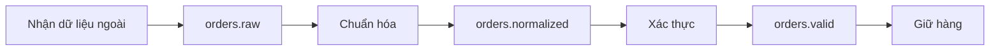
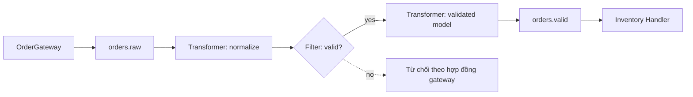
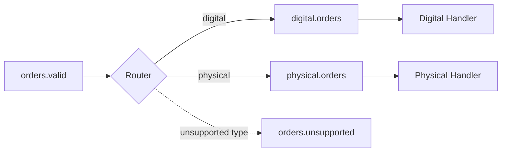
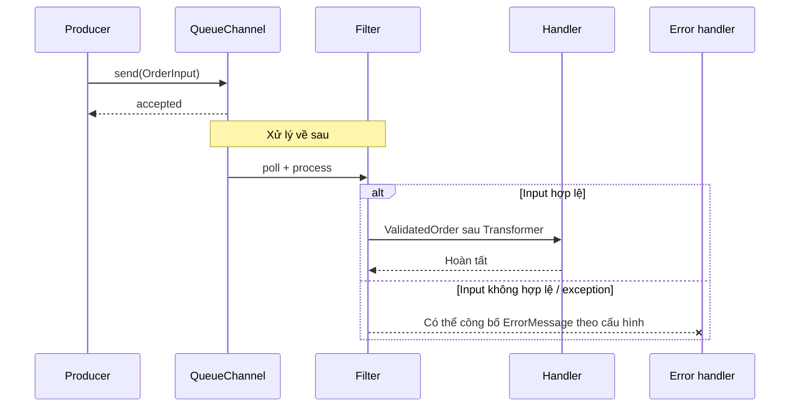

# Đảm bảo output của một filter là input hợp lệ

Trong mô hình **Pipes and Filters** của Enterprise Integration Patterns (EIP), hệ thống được chia thành các bước xử lý độc lập (*filter*) và các kết nối mang thông điệp giữa chúng (*pipe*). Một filter nhận dữ liệu từ đầu vào, thực hiện một trách nhiệm xác định, rồi chuyển kết quả cho bước tiếp theo. Cách ghép này chỉ bền vững khi **thông điệp đi ra từ bước trước đáp ứng đầy đủ yêu cầu đầu vào của bước sau**.

Trong **Spring Integration**, pipe thường được biểu diễn bằng `MessageChannel`, còn các bước xử lý được hiện thực bởi những endpoint như `Filter`, `Transformer`, `Router`, `Splitter`, `Aggregator` và `Service Activator`. Một sơ đồ nối các endpoint chạy được chưa chắc đã an toàn: payload có thể đúng kiểu Java nhưng sai quy tắc nghiệp vụ, thiếu header cần thiết hoặc mất correlation ID khi qua hệ thống ngoài.

Bài học thuộc chương **Pipes and filters** của module **SPRING_INTEGRATION_PATTERN**, nơi bạn học xây dựng luồng thông điệp ít phụ thuộc, dễ mở rộng và kiểm thử được. Mục tiêu của bài là xác định **hợp đồng đầu ra/đầu vào**, đặt đúng bước xác thực và chuẩn hóa, xử lý message không hợp lệ minh bạch, đồng thời quan sát lỗi ở từng ranh giới.

Sau bài này, bạn sẽ biết cách chứng minh rằng một bước chỉ phát message mà bước tiếp theo xử lý an toàn; phân biệt việc **lọc bỏ message** với **biến đổi message**; và vận dụng các nguyên tắc đó trong Java DSL của Spring Integration.

## 1. Một pipeline chỉ đúng khi các hợp đồng nối khớp

Giả sử quy trình nhận đơn hàng gồm ba bước:



Bộ giữ hàng không thể nhận tùy ý một object có trường `orderId` và `amount`. Nó có thể yêu cầu:

- `orderId` phải có giá trị và không chứa chỉ khoảng trắng.
- `amount` phải lớn hơn 0.
- `currency` thuộc tập mã tiền tệ được hỗ trợ.
- Định dạng đã được chuẩn hóa; không còn khoảng trắng thừa hoặc chữ thường ngoài quy ước.
- Một số metadata, như correlation ID, phải hiện diện nếu bước downstream phụ thuộc vào chúng.

Nếu bước xác thực chỉ kiểm tra `amount != null`, rồi gửi message tới `orders.valid`, thì tên channel **không thể biến message thành hợp lệ**. Consumer vẫn có thể nhận số tiền âm, đơn thiếu mã hoặc currency không hỗ trợ.

Ta nên xem mỗi bước như một hợp đồng:

| Thành phần | Tiền điều kiện (input phải đáp ứng) | Hậu điều kiện (output cam kết) |
| --- | --- | --- |
| Chuẩn hóa | Có message mang `OrderInput` có thể đọc được | Trả `OrderInput` với những chuỗi được chuẩn hóa theo quy tắc |
| Xác thực | Đã chuẩn hóa và có cấu trúc mong đợi | Chỉ cho qua dữ liệu thỏa tất cả ràng buộc cần thiết |
| Chuyển sang model được xác thực | Đầu vào đã thỏa quy tắc xác thực | Tạo `ValidatedOrder` và bảo vệ bất biến trong constructor |
| Giữ hàng | Nhận `ValidatedOrder` với hợp đồng ổn định | Thực hiện nghiệp vụ hoặc trả lỗi được phân loại |

**Nguyên tắc nối pipeline:** hậu điều kiện của bước hiện tại phải đáp ứng tiền điều kiện của bước kế tiếp. Nếu một bước chỉ bảo đảm “có trường `amount`” trong khi bước sau đòi “`amount` dương”, pipeline có lỗ hổng hợp đồng.

Có thể diễn đạt ngắn gọn: \(Q_i \Rightarrow P_{i+1}\), trong đó \(Q_i\) là điều kiện đầu ra của bước thứ \(i\) và \(P_{i+1}\) là điều kiện đầu vào của bước tiếp theo.

## 2. "Filter" trong EIP có thể chỉ những trách nhiệm khác nhau

Từ *filter* đôi khi được dùng chung cho mọi bước trong pipeline. Tuy nhiên, trong Spring Integration, **Message Filter** có nghĩa cụ thể: nó quyết định **cho message đi tiếp hay loại bỏ/từ chối** dựa trên một predicate.

| Pattern/Endpoint | Chức năng | Điều gì được gửi tiếp? |
| --- | --- | --- |
| **Filter** | Kiểm tra điều kiện chấp nhận | Thường là message đã nhận nếu predicate đúng; nếu sai thì không phát sang output thông thường |
| **Transformer** | Chuyển đổi payload hoặc biểu diễn message | Payload/message sau chuyển đổi |
| **Header Enricher** | Bổ sung hoặc tính toán header | Message có metadata được bổ sung |
| **Router** | Chọn một hoặc nhiều channel đích | Message theo nhánh được chọn, không nhất thiết qua một output cố định |
| **Splitter** | Chia một message thành nhiều phần | Nhiều message, mỗi phần phải thỏa contract của nhánh tiếp nhận |
| **Aggregator** | Ghép các message có liên quan | Message tổng hợp sau khi đủ điều kiện hoàn thành nhóm |

**Message Filter không tự sửa lỗi dữ liệu.** Chẳng hạn, predicate `amount.signum() > 0` chỉ chấp nhận hoặc từ chối; nó không chuyển `"-10"` thành `BigDecimal`, không thêm currency và không tạo class `ValidatedOrder`.

Nếu muốn downstream nhận dữ liệu ở cấu trúc khác, hãy kết hợp Transformer. Nếu muốn thông báo cho producer lý do bị từ chối, phải thiết kế đường lỗi hoặc kết quả nghiệp vụ tương ứng. Nếu muốn route message sai đến hệ thống xử lý riêng, hãy dùng discard channel hoặc một nhánh phù hợp.

### Ba cấp độ hợp lệ cần phân biệt

1. **Cú pháp và schema:** JSON có parse được không; payload có kiểu và field bắt buộc không; schema version có tương thích không?
2. **Ngữ nghĩa nghiệp vụ:** số tiền có dương không; trạng thái hợp lệ không; currency có được chấp nhận không?
3. **Ngữ cảnh và quy trình:** đã xác thực danh tính chưa; phiên bản sự kiện còn áp dụng không; correlation/key bắt buộc có chưa; command có đang lặp lại không?

Một Filter đơn giản thường xử lý tốt một phần các kiểm tra này. Các quy tắc cần database, giao dịch hoặc quyền truy cập nên được đặt ở endpoint/handler có trách nhiệm tương ứng, không giấu trong một predicate tưởng như thuần túy.

## 3. Bốn cách một output có thể không phải input hợp lệ

### 3.1. Đúng kiểu nhưng sai giá trị

`OrderInput("O-10", -100, "USD")` là một object hợp lệ theo Java record, nhưng không hợp lệ với nghiệp vụ đặt hàng. Nếu consumer chỉ dựa vào việc cast thành `OrderInput`, hệ thống có thể tạo side effect sai.

### 3.2. Dữ liệu chưa được chuẩn hóa nhất quán

Giả sử producer gửi `currency = " usd "`. Filter chỉ chấp nhận đúng `"USD"` sẽ loại bỏ một đơn lẽ ra hợp lệ. Ngược lại, nếu Filter cho qua chuỗi tùy ý rồi handler giả định currency luôn viết hoa, hai bước hiểu khác nhau về cùng một trường.

Quy tắc tốt là **chuẩn hóa trước, xác thực sau** khi việc chuẩn hóa không làm biến đổi ý nghĩa nghiệp vụ. Ví dụ: cắt khoảng trắng ở đầu/cuối và chuẩn hóa mã currency bằng `Locale.ROOT`. Không được “sửa hộ” những thông tin quan trọng bằng cách đoán giá trị thiếu, chẳng hạn tự thay currency rỗng bằng VND nếu hợp đồng không quy định.

### 3.3. Payload hợp lệ nhưng thiếu headers

Một Aggregator có thể cần correlation key để ghép các phần thuộc cùng nhóm; Router có thể chọn nhánh dựa trên header `tenantId`; hệ thống tracing cần thông tin liên kết request.

Filter chỉ kiểm tra payload chưa chứng minh toàn bộ **message** hợp lệ. Cần xác định rõ những header nào bắt buộc tại ranh giới, ai tạo chúng và cách chúng được giữ hoặc ánh xạ khi đi qua Transformer, gateway hay adapter ngoài.

### 3.4. Một nhánh vẫn có thể gửi sai dữ liệu vào channel chung

Giả sử `orders.valid` nhận từ một flow đã xác thực, nhưng một flow khác trực tiếp gửi `OrderInput` chưa kiểm tra vào cùng channel. Downstream có thể gặp sai kiểu, sai schema hoặc vi phạm nghiệp vụ.

Một tên channel mang ý nghĩa chỉ là **quy ước kiến trúc**. Để bảo vệ hợp đồng, cần giới hạn producer của channel, sử dụng model đầu ra thể hiện tính hợp lệ và kiểm thử các nhánh cùng gửi vào channel ấy. Với dữ liệu từ nguồn không tin cậy, consumer nên kiểm tra lại những bất biến bắt buộc thay vì tin tuyệt đối vào tên đường đi.

## 4. Ví dụ Spring Integration Java DSL: chuẩn hóa, lọc và chuyển kiểu

Ta sẽ xây dựng một pipeline xử lý đơn hàng:



Ở ví dụ này, request không hợp lệ tạo exception theo cấu hình Filter và luồng đang dùng channel đồng bộ. Đường nét đứt biểu thị việc **từ chối**, không phải một ErrorMessage được tự động gửi sang error channel.

### 4.1. Hai kiểu dữ liệu với hai mức cam kết

Đầu vào cho phép dữ liệu chưa chuẩn hóa. Đầu ra dùng một record có constructor bảo vệ bất biến.

```java
import java.math.BigDecimal;
import java.util.Locale;
import java.util.Set;

record OrderInput(String orderId, BigDecimal amount, String currency) {
    OrderInput normalized() {
        return new OrderInput(
            orderId == null ? null : orderId.trim(),
            amount,
            currency == null ? null
                : currency.trim().toUpperCase(Locale.ROOT)
        );
    }
}

final class OrderRules {
    private static final Set<String> SUPPORTED = Set.of("VND", "USD");

    private OrderRules() {}

    static boolean isValid(OrderInput input) {
        return input.orderId() != null
            && !input.orderId().isBlank()
            && input.amount() != null
            && input.amount().compareTo(BigDecimal.ZERO) > 0
            && SUPPORTED.contains(input.currency());
    }
}

record ValidatedOrder(
    String orderId, BigDecimal amount, String currency) {

    ValidatedOrder {
        if (!OrderRules.isValid(
                new OrderInput(orderId, amount, currency))) {
            throw new IllegalArgumentException(
                "ValidatedOrder contract violated");
        }
    }
}
```

`OrderInput` mô tả **dữ liệu đầu vào có thể sai**; `ValidatedOrder` mô tả dữ liệu **đã thỏa bất biến**. Dù ai đó tạo `ValidatedOrder` từ nhánh khác, constructor vẫn từ chối bộ giá trị không hợp lệ. Cách làm này không thay thế bảo mật, phân quyền hoặc xác nhận nghiệp vụ có trạng thái; nó chỉ bảo vệ các ràng buộc cục bộ được mô tả trong record.

**Lưu ý về null:** ví dụ cho phép các *field* của `OrderInput` bằng `null` để Filter từ chối. Spring `Message<?>` nói chung không dùng payload `null`; cần xử lý dữ liệu rỗng từ adapter hoặc nguồn vào trước khi cố tạo message.

### 4.2. Gateway và integration flow

```java
import org.springframework.context.annotation.Bean;
import org.springframework.context.annotation.Configuration;
import org.springframework.integration.annotation.Gateway;
import org.springframework.integration.annotation.IntegrationComponentScan;
import org.springframework.integration.annotation.MessagingGateway;
import org.springframework.integration.channel.DirectChannel;
import org.springframework.integration.config.EnableIntegration;
import org.springframework.integration.dsl.IntegrationFlow;
import org.springframework.messaging.MessageChannel;

interface InventoryService {
    void reserve(ValidatedOrder order);
}

@MessagingGateway
interface OrderGateway {
    @Gateway(requestChannel = "orders.raw")
    void submit(OrderInput request);
}

@Configuration
@EnableIntegration
@IntegrationComponentScan
class OrderPipelineConfig {

    @Bean("orders.raw")
    MessageChannel rawOrders() {
        return new DirectChannel();
    }

    @Bean("orders.valid")
    MessageChannel validOrders() {
        return new DirectChannel();
    }

    @Bean
    IntegrationFlow validateAndNormalize() {
        return IntegrationFlow.from("orders.raw")
            .transform(OrderInput.class, OrderInput::normalized)
            .filter(OrderInput.class, OrderRules::isValid,
                spec -> spec.throwExceptionOnRejection(true))
            .transform(OrderInput.class,
                input -> new ValidatedOrder(
                    input.orderId(), input.amount(), input.currency()))
            .channel("orders.valid")
            .get();
    }

    @Bean
    IntegrationFlow reserveInventory(InventoryService inventory) {
        return IntegrationFlow.from("orders.valid")
            .handle(ValidatedOrder.class, (order, headers) -> {
                inventory.reserve(order);
                return null; // endpoint kết thúc luồng một chiều
            })
            .get();
    }
}
```

Để sử dụng, cần cấu hình Spring Integration, đưa interface gateway vào vùng quét bởi `@IntegrationComponentScan` (hoặc đăng ký theo cách tương đương) và cung cấp bean `InventoryService`. Các class trên giả định dùng Java 17+ để có record và những phiên bản Spring Integration hỗ trợ Java DSL tương ứng.

### 4.3. Vì sao thứ tự này quan trọng?

**Bước 1 — Normalize:** `" usd "` được chuyển thành `"USD"`; `" O-1 "` thành `"O-1"`. Transformer tạo một `OrderInput` chuẩn hóa, chưa tuyên bố rằng toàn bộ dữ liệu hợp lệ.

**Bước 2 — Filter:** predicate kiểm tra các điều kiện cục bộ. Message sai bị từ chối bằng exception do `throwExceptionOnRejection(true)`. Filter không tự chuyển payload thành `ValidatedOrder` và không giữ message bị từ chối trên output thông thường.

**Bước 3 — Transformer:** chỉ khi Filter chấp nhận, flow mới tạo `ValidatedOrder`. Constructor kiểm tra lại bất biến trước khi object được phát ra. Lớp dữ liệu này làm rõ contract cho consumer.

**Bước 4 — Handoff:** `orders.valid` nhận message mang `ValidatedOrder`. `InventoryService` có thể sử dụng đúng kiểu dữ liệu mong đợi. Vì cả hai channel được cấu hình là `DirectChannel`, caller thường chờ cho đến khi handler hoàn thành; exception từ handler có thể lan ngược về caller.

Dòng chảy thực tế có thể được nối bằng các channel nội bộ framework tạo ra giữa những bước trong cùng một `IntegrationFlow`; ta chỉ đặt tên rõ hai ranh giới cần quan sát.

### 4.4. Hợp đồng đầu ra cụ thể

| Bước | Đầu vào kỳ vọng | Đầu ra khi thành công | Khi không thành công |
| --- | --- | --- | --- |
| Normalize | `OrderInput` | `OrderInput` có chuỗi được chuẩn hóa | Lỗi chuyển đổi nếu có logic không xử lý được dữ liệu |
| Filter | `OrderInput` chuẩn hóa | **Chính message đầu vào** được cho qua | `MessageRejectedException` theo cấu hình từ chối |
| Create validated model | `OrderInput` đã được chấp nhận | `ValidatedOrder` bảo vệ bất biến | Exception nếu vi phạm bất biến |
| Inventory handler | `ValidatedOrder` | Không phát payload reply trong ví dụ | Exception nghiệp vụ/kỹ thuật theo implementation |

Không nên tuyên bố “Filter sinh ra kiểu `ValidatedOrder`”: kiểu mới chỉ xuất hiện sau Transformer. Phân biệt này ngăn một lỗi thường gặp khi thiết kế hoặc đọc sơ đồ Pipes and Filters.

## 5. Kiểm tra hợp đồng của từng pipe, không chỉ của từng lớp

Khi mỗi endpoint tự kiểm tra đầu vào, pipeline vẫn có thể gặp rắc rối nếu **ý nghĩa dữ liệu** khác nhau giữa các bước.

Ví dụ một hệ thống kho đòi `amount` là **số đơn vị hàng**, nhưng bước trước phát `amount` là **số tiền**. Cả hai có thể dùng `BigDecimal` dương, nên các predicate và type check vẫn qua, nhưng hợp đồng đã sai hoàn toàn.

Nên mô tả contract ở ranh giới theo những thành phần:

| Thành phần contract | Điều cần thống nhất |
| --- | --- |
| **Payload type/schema** | DTO hoặc schema version nào được chấp nhận? |
| **Ý nghĩa field** | `amount` là giá tiền hay số lượng? Đơn vị đo nào? |
| **Bất biến** | Điều kiện bắt buộc, phạm vi giá trị, quan hệ giữa các trường |
| **Headers** | Correlation ID, message key, trace context, tenant ID nào bắt buộc? |
| **Cardinality** | Một input cho ra 0, 1 hay nhiều output? |
| **Timing** | Kết quả đến ngay, đến sau hay có thể không có? |
| **Error** | Điều kiện bị loại, exception và trạng thái nghiệp vụ được xử lý thế nào? |
| **Versioning** | Consumer phiên bản cũ còn đọc được output mới không? |

Một contract nên viết sao cho có thể kiểm thử được. Chẳng hạn, “channel `orders.valid` chỉ nhận `ValidatedOrder` có currency thuộc VND/USD” cụ thể hơn “đơn hợp lệ”.

### Phân biệt các lớp kiểm tra

- **Trước khi vào flow:** kiểm tra cú pháp, xác thực, quyền truy cập và phiên bản schema từ HTTP/Kafka/JMS hoặc nguồn khác.
- **Trong flow:** chuẩn hóa và Filter các quy tắc gần dữ liệu, đủ xác định để kiểm thử.
- **Ngay trước side effect:** kiểm tra những điều kiện cần dữ liệu hiện hành hoặc giao dịch, như số lượng tồn kho, trạng thái đơn và khả năng xử lý trùng.

Nếu một trạng thái có thể thay đổi giữa lúc Filter cho qua và lúc handler ghi database, Filter không thể bảo đảm trạng thái ấy vẫn đúng ở thời điểm commit. Cần kiểm tra hoặc cưỡng chế invariant tại ranh giới giao dịch phù hợp.

## 6. Message bị loại phải đi đâu?

Một Message Filter có thể được cấu hình theo nhiều cách. Chọn cách nào phụ thuộc việc “không qua Filter” là lỗi kỹ thuật, dữ liệu không hợp lệ hay quyết định nghiệp vụ bình thường.

### 6.1. Ném exception khi yêu cầu bị từ chối

Ví dụ `throwExceptionOnRejection(true)` ở trên phù hợp cho API đồng bộ cần biết đơn sai ngay lập tức. Caller có thể chuyển exception thành response validation theo hợp đồng API.

Trong flow `DirectChannel`, exception thường đi ngược đường gọi. **Chỉ khai báo một bean error channel không khiến exception này mặc nhiên trở thành `ErrorMessage`.**

### 6.2. Gửi message bị loại sang discard channel

Với dữ liệu nền, đôi khi cần ghi nhận message không đạt điều kiện để nghiên cứu hoặc điều chỉnh:

```java
@Bean
IntegrationFlow filterToDiscard() {
    return IntegrationFlow.from("orders.raw")
        .transform(OrderInput.class, OrderInput::normalized)
        .filter(OrderInput.class, OrderRules::isValid,
            spec -> spec.discardChannel("orders.rejected"))
        .channel("orders.validatedRaw")
        .get();
}
```

Đây là **biến thể minh họa riêng**, không khai báo đồng thời với `validateAndNormalize()` trên cùng input channel trong ứng dụng ví dụ nếu muốn mỗi message chỉ trải qua một pipeline. Cần cung cấp các channel/endpoint tiêu thụ `orders.rejected` và `orders.validatedRaw` phù hợp. Message vào `orders.validatedRaw` trong biến thể này vẫn là **`OrderInput`**, chưa phải `ValidatedOrder`; muốn dùng handler ở mục 4 thì cần Transformer tương ứng.

**Discard channel khác error channel.** Discard chứa message không được Filter chấp nhận, thường là message gốc hoặc message đã chuẩn hóa; error channel nhận `ErrorMessage` khi một cơ chế bắt lỗi công bố nó. Message bị loại theo quy tắc kinh doanh có thể là hành vi bình thường, không nhất thiết là sự cố cần retry.

### 6.3. Lỗi schema và hạ tầng không nên retry như dữ liệu hợp lệ

Một JSON không parse được là lỗi đầu vào hoặc giao thức; có thể bị từ chối, đưa vào khu vực xử lý riêng hoặc lưu để điều tra. Lặp lại cùng một payload sai schema sẽ không tự biến nó thành hợp lệ.

Ngược lại, timeout khi gọi dịch vụ kho có thể là lỗi tạm thời và phù hợp với retry có giới hạn. Retry phải gắn với cơ chế error handling, backoff và tính idempotent của side effect; không thể giải quyết mọi loại lỗi bằng cách gửi lại message nhiều lần.

## 7. Khi có Router, Splitter và Aggregator, contract phải được xét theo từng nhánh

Trong một flow tuyến tính, ta chỉ cần xét cặp đầu ra/đầu vào liên tiếp. Trong flow có nhánh và gộp, cần xem từng cạnh của đồ thị.



### Router: mỗi nhánh có tiền điều kiện riêng

Nếu handler hàng số cần `downloadLicense`, còn handler hàng vật lý cần `shippingAddress`, việc Filter đầu vào chỉ đảm bảo `orderId` hợp lệ là chưa đủ.

Có hai hướng:

1. Filter kiểm tra tất cả invariant chung trước Router; sau Router, mỗi nhánh kiểm tra thêm invariant đặc thù.
2. Chuyển payload sang các subtype tương ứng, chẳng hạn `DigitalOrder` và `PhysicalOrder`, rồi cho mỗi handler nhận đúng type.

Nếu Router không tìm được nhánh, cần định nghĩa rõ cách xử lý default/unmapped channel hoặc exception. Không nên cho message rơi khỏi luồng mà không có trạng thái để điều tra.

### Splitter: đúng input nhưng từng phần output có thể sai

Một request batch gồm ba dòng hàng; Splitter phát ba message. Một trong ba dòng có thể thiếu SKU. Kiểm tra batch không null **không đồng nghĩa** từng phần được tạo ra thỏa contract của handler xử lý dòng hàng.

Nên xác thực ở cả cấp batch khi cần và ở mỗi phần sau Splitter khi invariant áp dụng theo item. Khi tạo sequence/correlation metadata, cần kiểm tra downstream có nhận đủ thông tin để liên kết các phần sau khi xử lý bất đồng bộ hay không.

### Aggregator: message đã ghép không tự hợp lệ

Aggregator chỉ phát kết quả khi đạt release strategy; nếu có timeout hoặc partial result, output có thể thiếu những phần mà consumer mong đợi. Contract đầu ra cần chỉ rõ “đầy đủ” hay “một phần”, số lượng phần, correlation key, thứ tự và cách biểu diễn lỗi.

Nếu consumer chỉ chấp nhận kết quả đủ toàn bộ item, phải kiểm tra điều kiện hoàn thành trước khi phát qua output channel. Không nên coi “Aggregator đã emit” là bằng chứng business result hợp lệ.

## 8. Headers và correlation cũng là một phần của output hợp lệ

Trong Spring Messaging, message gồm **payload** và **headers**. Một payload tốt có thể trở thành input không hợp lệ nếu downstream yêu cầu header mà bước trước không cung cấp hoặc adapter bên ngoài đã bỏ mất.

Ví dụ hệ thống xử lý một nhóm công việc:

```text
Payload:
  PartResult(orderId="O-100", sku="SKU-1", success=true)

Headers:
  correlationId = "O-100"
  sequenceNumber = 1
  sequenceSize   = 3
```

Các trường này chỉ minh họa hợp đồng cần thiết cho việc ghép nhóm; **không nên giả định chúng luôn tự xuất hiện** trong mọi message. Với Spring Integration, Splitter/Aggregator có hỗ trợ metadata liên quan trong những cách cấu hình nhất định; cần kiểm tra thực tế ở flow, đặc biệt khi có custom transformer, header mapper hoặc broker ở giữa.

Các quy tắc nên tuân thủ:

- Thống nhất dùng business key hoặc correlation ID nào để nối các phần.
- Quy định rõ cách làm giàu/ánh xạ header tại ranh giới hệ thống ngoài.
- Tránh dùng message ID nội bộ như thể nó luôn được giữ nguyên qua serializer/broker.
- Nếu tenant ID quyết định quyền truy cập, kiểm tra header từ nguồn tin cậy, không tin dữ liệu do client tự khai.
- Khi trace xuyên thread hoặc ứng dụng, kiểm thử việc truyền trace context thay vì chỉ ghi log ở producer.

Message header là metadata kỹ thuật/nghiệp vụ theo hợp đồng, không phải một cơ chế bảo mật tự thân.

## 9. Thiết kế trong môi trường đồng bộ và bất đồng bộ

### 9.1. DirectChannel: lỗi có thể về ngay caller

Với `DirectChannel`, các endpoint chạy trên thread gửi theo cấu hình thông thường. Nếu Filter ném exception hoặc Transformer phát hiện dữ liệu sai, người gọi có thể nhận exception tức thời.

Điều này giúp API request-reply báo lỗi sớm và dễ kiểm thử. Tuy vậy, nếu message được gửi trực tiếp vào một downstream channel khác hoặc có producer mới, việc dựa hoàn toàn vào bước Filter upstream là không đủ: record bất biến và xác thực ở ranh giới side effect vẫn hữu ích.

### 9.2. ExecutorChannel/QueueChannel: chấp nhận gửi khác với xử lý hợp lệ

Với `ExecutorChannel`, message có thể chạy trên thread khác. Với `QueueChannel`, message có thể nằm đợi poller. Lúc producer nhận kết quả `send` thành công, Filter downstream có thể chưa chạy.



Sơ đồ minh họa hai khả năng: trên đường lỗi bất đồng bộ, phải có **error publisher/error handling được cấu hình đúng** để error handler nhận thông tin. Không phải mọi Filter rejection tự trở thành ErrorMessage.

Từ góc nhìn API, “đã nhận để xử lý” và “đã kiểm tra hợp lệ” là hai trạng thái khác nhau. Nếu muốn phản hồi chắc chắn một command hợp lệ trước khi trả về, hãy thực hiện validation cần thiết **trước ranh giới bất đồng bộ**; các điều kiện phụ thuộc vào trạng thái hiện hành vẫn cần xác nhận khi consumer thực thi.

### 9.3. Khi đi qua hệ thống ngoài

Một producer ở Java có thể gửi payload hợp lệ, nhưng adapter serialize sai version hoặc consumer đổi schema. Vì vậy:

- Ghi rõ event/command schema, version và các trường bắt buộc.
- Kiểm tra serialization/deserialization và mapping headers.
- Đặt kiểm tra hợp đồng ở inbound adapter hoặc đầu flow bên nhận.
- Định nghĩa đường xử lý message sai schema, timeout và dead-letter phù hợp.
- Làm consumer idempotent khi broker có thể redeliver message.

Một loại DTO dùng trong hai service không tự bảo đảm cả hai hiểu cùng ngữ nghĩa sau khi deploy độc lập.

## 10. Chiến lược kiểm thử bảo đảm input/output khớp nhau

Không chỉ test từng predicate độc lập. Cần kiểm tra được hành vi **tại điểm nối** và hậu quả của đường lỗi.

### 10.1. Bảng kiểm thử mẫu

| Trường hợp | Input | Kỳ vọng |
| --- | --- | --- |
| Hợp lệ | `(" O-1 ", 120000, " vnd ")` | Chuẩn hóa thành `("O-1", 120000, "VND")`; tới handler dưới dạng `ValidatedOrder` |
| Thiếu ID | `(null, 120000, "VND")` | Bị từ chối; không gọi `InventoryService` |
| ID chỉ có khoảng trắng | `("   ", 120000, "VND")` | Bị từ chối |
| Giá trị không dương | `("O-2", 0, "VND")` | Bị từ chối |
| Thiếu amount | `("O-3", null, "VND")` | Bị từ chối trước khi handler xử lý |
| Currency không hỗ trợ | `("O-4", 50, "XYZ")` | Bị từ chối, ghi nhận lý do theo chính sách |
| Producer bypass Filter | Gửi trực tiếp object sai vào channel downstream | Handler/kiểu dữ liệu bất biến không chấp nhận sai contract |
| Handler gặp timeout | Message đã hợp lệ | Lỗi được phân loại riêng với validation; retry có giới hạn nếu thích hợp |

Với test đồng bộ, có thể gọi gateway và xác nhận mock `InventoryService.reserve` nhận đúng `ValidatedOrder`, số lần gọi như kỳ vọng; với dữ liệu sai, dùng assertion exception và xác nhận handler **không** được gọi.

Với queue/poller hoặc executor, hãy chờ theo điều kiện trong thời hạn giới hạn. Test cần phân biệt “message được enqueue” với “handler thực thi”, và kiểm tra riêng đường error channel khi được cấu hình.

### 10.2. Một ví dụ kiểm tra thuần Java cho contract

Các unit test sau tập trung vào logic chuẩn hóa và bất biến, trước khi chạy integration test của toàn flow:

```java
import static org.junit.jupiter.api.Assertions.*;
import java.math.BigDecimal;
import org.junit.jupiter.api.Test;

class OrderContractTest {

    @Test
    void normalizedInputMeetsFilterContract() {
        OrderInput input = new OrderInput(
            " O-1 ", new BigDecimal("120000"), " vnd ");

        OrderInput normalized = input.normalized();

        assertEquals("O-1", normalized.orderId());
        assertEquals("VND", normalized.currency());
        assertTrue(OrderRules.isValid(normalized));
    }

    @Test
    void invalidAmountIsRejected() {
        OrderInput input = new OrderInput(
            "O-2", BigDecimal.ZERO, "VND");

        assertFalse(OrderRules.isValid(input.normalized()));
        assertThrows(IllegalArgumentException.class,
            () -> new ValidatedOrder(
                "O-2", BigDecimal.ZERO, "VND"));
    }
}
```

Các test này kiểm tra hợp đồng Java. Chúng **chưa chứng minh** message thực sự đi qua đúng channel, Header được giữ nguyên hay lỗi đồng bộ được đưa về gateway; những điều đó cần integration test.

### 10.3. Property-based và contract test khi số nhánh tăng

Với Transformer/Filter phức tạp, có thể bổ sung property-based test: phát nhiều input biên, đầu ra bất kỳ được cho qua luôn thỏa tất cả invariant của `ValidatedOrder`. Với nhiều nhánh Router, mỗi nhánh cần bộ contract test riêng. Với consumer triển khai độc lập, kiểm thử tương thích schema giữa producer và consumer sau khi đổi version giúp phát hiện lệch hợp đồng sớm.

## 11. Quan sát dữ liệu sai mà không làm nhiễu error channel

Một pipeline vận hành được cần biết có bao nhiêu message bị loại, bị lỗi transform và đã tới handler thành công.

| Điểm quan sát | Nên đo/ghi lại | Vì sao |
| --- | --- | --- |
| Inbound adapter | Parse/schema failures, nguồn, version | Phát hiện payload không đúng hợp đồng đầu vào |
| Normalize | Số message chuẩn hóa, lỗi parse | Biết dữ liệu có thể chuyển sang chuẩn nội bộ không |
| Filter | Accepted/rejected count, mã lý do | Tách dữ liệu không hợp lệ khỏi lỗi hạ tầng |
| Transformer sang output type | Lỗi tạo model, tên output channel | Bảo đảm record bất biến được phát đúng nơi |
| Consumer | Xử lý thành công/thất bại, business key | Kiểm chứng kết quả nghiệp vụ |
| Error/discard handling | Số message, retry count, hành động cuối | Không để message bất hợp lệ biến mất khỏi giám sát |

Một Filter với boolean predicate thường chỉ cho biết chấp nhận hay không. Nếu cần **mã lý do** như `INVALID_AMOUNT` hoặc `UNSUPPORTED_CURRENCY`, nên tách validation thành một bước tạo kết quả có cấu trúc, hoặc một thành phần chuyên trách trả về nhiều thông tin; đừng cố nhét tất cả logging và side effect vào một predicate.

Với đường reject bất đồng bộ, có thể duy trì một **quarantine channel/dead-letter flow** phù hợp để xem message và nguyên nhân. Tuy nhiên, giữ payload thất bại cần cân nhắc dữ liệu cá nhân, hạn lưu trữ và khả năng phát lại an toàn. Sử dụng message ID, correlation ID, mã lỗi và metadata đủ để đối soát thay vì log toàn bộ payload nhạy cảm.

## 12. Những lỗi thiết kế dễ gặp

**“Filter đã chạy nên output chắc chắn đúng contract.”** Filter chỉ đảm bảo predicate được viết, chưa chắc bao phủ tất cả điều kiện của consumer. Hãy liệt kê invariant cụ thể và kiểm tra tại điểm nối.

**“Filter sẽ chuyển chuỗi sang object hợp lệ.”** Message Filter thường giữ message được chấp nhận; việc chuyển payload là trách nhiệm Transformer.

**“Tên channel `orders.valid` đã là bằng chứng.”** Không có rào chắn tự động ngăn producer khác gửi object chưa kiểm tra vào channel. Dùng model bất biến, quy tắc sở hữu channel và test đa nhánh.

**“Sai dữ liệu cứ retry là được.”** Dữ liệu không thể parse hoặc vi phạm điều kiện cố định thường cần bị từ chối hoặc đưa vào luồng điều tra; retry nên dành cho lỗi tạm thời theo chính sách rõ ràng.

**“Mọi rejected message đều là ErrorMessage.”** Discard channel nhận message bị Filter loại; error channel nhận thông tin lỗi được error publisher công bố. Chúng có ngữ nghĩa khác nhau.

**“Chỉ kiểm tra Java type là đủ.”** Hai payload cùng kiểu có thể khác đơn vị, currency, ý nghĩa trường hoặc version. Cần kiểm tra schema và semantic contract.

**“Trước queue đã validate nên lúc ghi database vẫn an toàn.”** Các điều kiện phụ thuộc trạng thái hiện hành có thể thay đổi; transaction và business invariant cần được thực thi nơi xảy ra side effect.

**“Nếu một phần của Splitter hợp lệ thì Aggregator sẽ luôn đúng.”** Splitter có thể tạo nhiều phần với contract khác nhau; Aggregator có thể phát partial result. Cần kiểm tra từng cạnh và điều kiện release của nhóm.

## 13. Bài tập tự thiết kế

Một hệ thống nhận file CSV chứa đơn hàng, mỗi dòng có `orderId`, `sku`, `quantity` và `warehouseCode`. Sau khi đọc file, Splitter tách từng dòng rồi chuyển sang Router chọn kho. Handler của từng kho yêu cầu mã SKU hợp lệ, số lượng dương và warehouseCode thuộc kho đó.

Hãy thiết kế flow với các ranh giới:

```text
CSV Inbound
  -> Parse / Schema Validation
  -> Splitter
  -> Normalize each row
  -> Filter / Validate each row
  -> Router by warehouseCode
  -> Warehouse-specific Handler
  -> Result / Error / Rejected reporting
```

Tự trả lời:

1. Quy tắc nào áp dụng ở cấp file, quy tắc nào bắt buộc cho **mỗi dòng** sau Splitter?
2. Nếu `quantity = -3`, message sẽ đi vào output thông thường, discard channel hay exception? Caller được báo kết quả bằng cách nào?
3. Nếu `warehouseCode` không tồn tại, đó là dữ liệu sai hay một nhánh Router chưa được cấu hình? Làm thế nào ghi lại lý do?
4. Nếu Router có ba đích, làm sao bảo đảm input contract của cả ba handler?
5. Nếu việc ghi kho được chuyển sang queue bất đồng bộ, lúc nào có thể nói dòng đó đã “xử lý thành công”?
6. Nếu cần Aggregator báo kết quả toàn bộ file, làm sao liên kết từng dòng bằng correlation ID và xử lý những dòng thất bại hoặc bị loại?
7. Những test nào sẽ chứng minh rằng không có dòng không hợp lệ nào được ghi vào kho, kể cả khi có một producer mới nối trực tiếp vào channel?

Một lời giải tốt phải chỉ ra **hợp đồng ở mỗi pipe**, trách nhiệm từng endpoint và trạng thái của message bị loại, thay vì chỉ vẽ các ô nối tiếp nhau.

## Ghi nhớ

Để bảo đảm **output của một filter là input hợp lệ**, hãy xác định rõ **tiền điều kiện và hậu điều kiện** của từng bước; chuẩn hóa trước khi xác thực khi phù hợp; chỉ cho qua message đáp ứng invariant; dùng Transformer và model bảo vệ bất biến khi cần đổi biểu diễn; đồng thời kiểm thử toàn bộ điểm nối từ channel tới consumer.

Trong Spring Integration, **Filter quyết định chấp nhận hay loại bỏ**, còn **Transformer tạo dữ liệu đầu ra mới**. Với Router, Splitter và Aggregator, cần kiểm tra contract cho từng nhánh hoặc phần tử. Các kênh reject, error channel, retry và correlation phải có vai trò và chính sách rõ ràng. Khi đó mô hình Pipes and Filters mới thật sự giảm coupling mà vẫn giữ luồng dữ liệu đúng, dễ quan sát và an toàn trước thay đổi.

