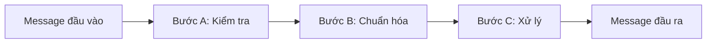
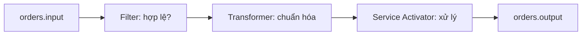
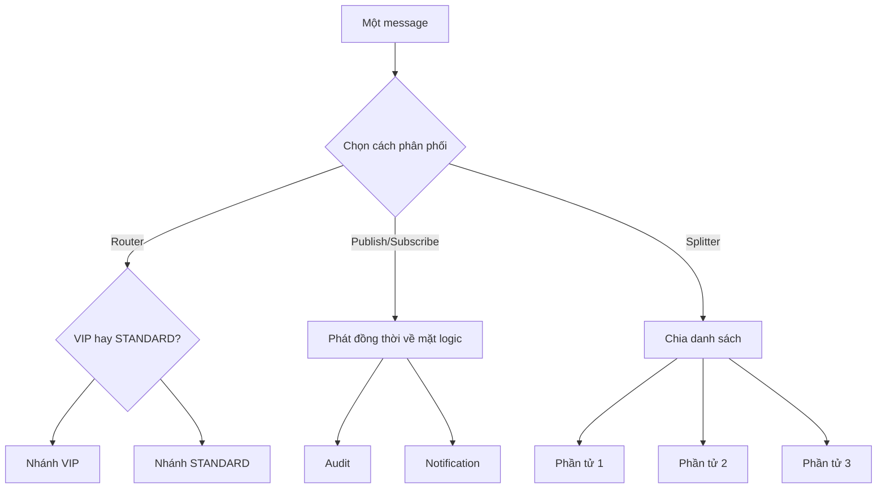
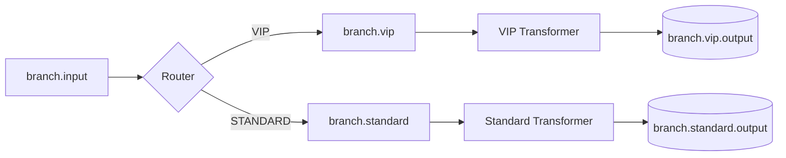
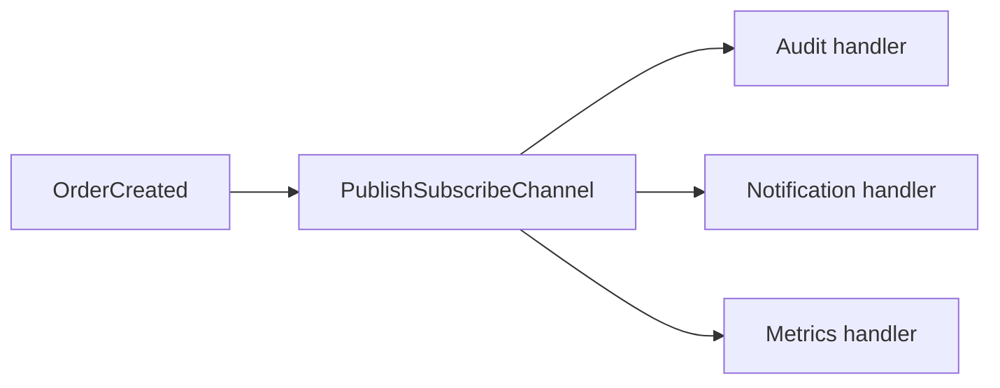
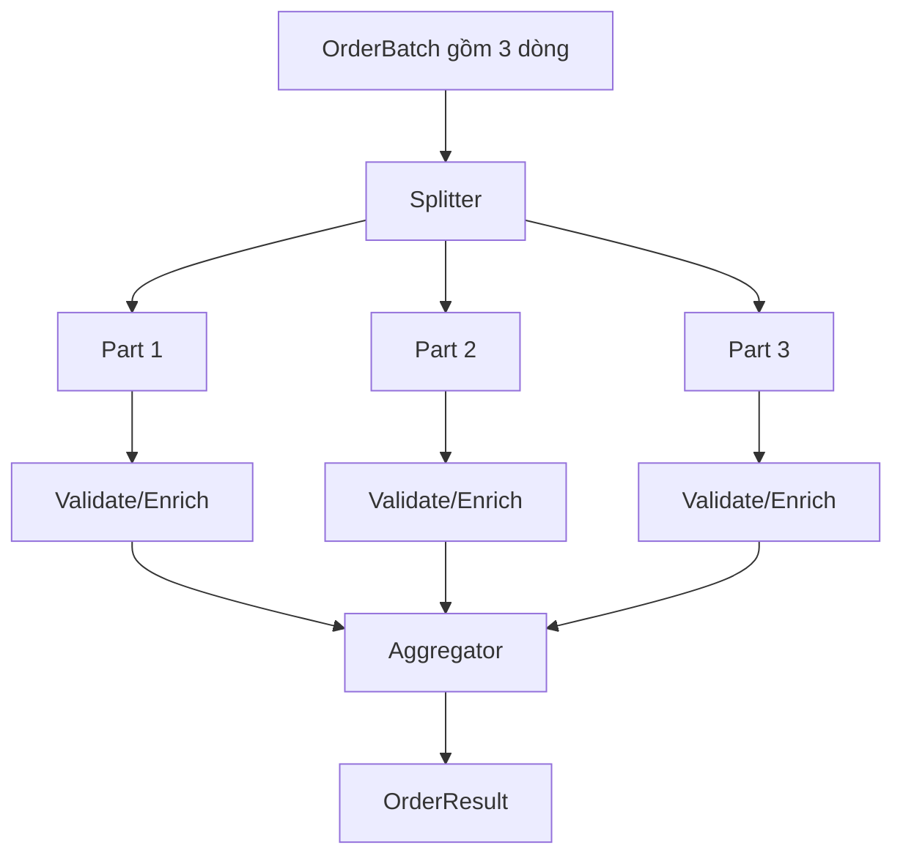
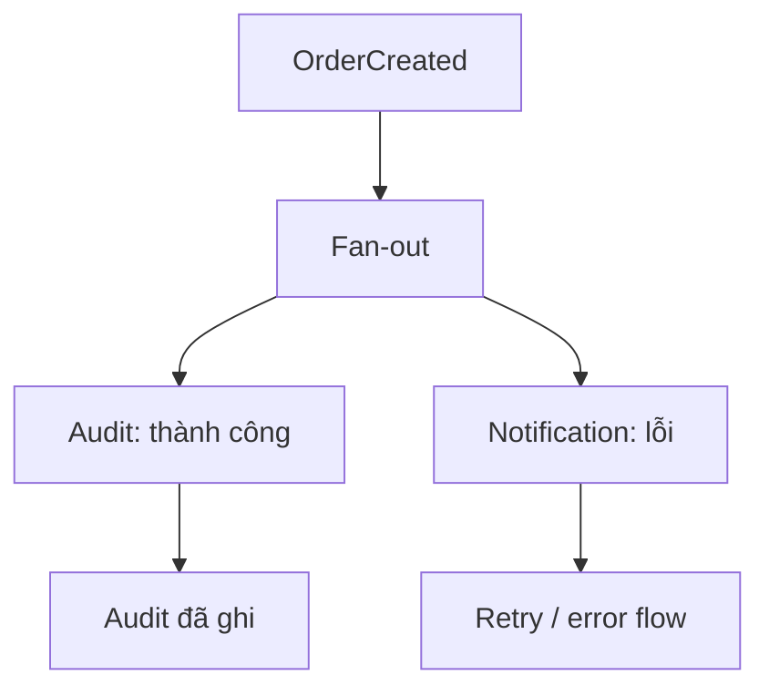

# Flow tuyến tính và flow có nhiều nhánh trong Spring Integration

## Mục tiêu bài học

**Pipes and Filters** là mẫu kiến trúc ghép các bước xử lý độc lập (*filters*) với những đường truyền dữ liệu (*pipes*). Trong Spring Integration, các filter theo nghĩa kiến trúc có thể là Transformer, Filter, Router, Service Activator hay endpoint khác; **`Filter`** viết hoa còn là tên của một endpoint cụ thể dùng để cho phép hoặc loại message.

Bài này thuộc module **SPRING_INTEGRATION_PATTERN**: học cách triển khai Enterprise Integration Patterns để xây dựng các luồng thông điệp ít phụ thuộc, dễ mở rộng; thực hành Router, Filter, Transformer, Splitter, Aggregator, Gateway, retry, error channel và correlation; đồng thời kiểm thử, theo dõi các nhánh xử lý.

Trọng tâm là hai cách tổ chức:

1. **Flow tuyến tính**: một message đi qua một chuỗi bước xác định.
2. **Flow có nhiều nhánh**: message được chọn nhánh theo điều kiện, được phát tới nhiều nơi nhận, hoặc được chia thành các phần độc lập rồi gom kết quả.

Sau bài này, bạn sẽ biết khi nào dùng từng kiểu, cách nối chúng bằng Java DSL và các kiểm thử cần có để tránh mất message, lặp side effect hoặc đợi kết quả mãi.

## 1. Mô hình Pipes and Filters

Một *pipe* chuyển một message từ bước này sang bước khác. Một *filter* theo nghĩa kiến trúc nhận message, thực hiện một nhiệm vụ rõ ràng rồi có thể phát message tiếp theo. Các bước độc lập thông qua hợp đồng message: **payload, headers, kiểu dữ liệu và ý nghĩa của kết quả**.



Ví dụ trong xử lý đơn hàng:

```text
OrderRequest
    |
    v
Validate ──> Normalize ──> Enrich ──> Persist ──> Publish result
```

Các bước có thể chạy trong một tiến trình, nhiều thread hoặc qua broker, nhưng một flow vẽ trên giấy **không tự bảo đảm** thứ tự thực thi, giao dịch chung hay một lần xử lý duy nhất. Các tính chất đó phụ thuộc cách cấu hình channel, handler và cơ chế retry.

### Ba thành phần chính trong Spring Integration

| Thành phần | Ví dụ | Vai trò |
| --- | --- | --- |
| **Message** | `Message<OrderRequest>` | Mang payload và headers như `traceId`, `tenantId`, `correlationId` |
| **Channel** | `DirectChannel`, `QueueChannel`, `ExecutorChannel`, `PublishSubscribeChannel` | Nối các endpoint và quyết định cách message được truyền/phân phối |
| **Endpoint** | Transformer, Filter, Router, Service Activator, Splitter, Aggregator | Xử lý, đổi kiểu, chặn, định tuyến hoặc kết hợp message |

Một `IntegrationFlow` mô tả chuỗi liên kết các thành phần này. Có thể tách một flow dài thành nhiều flow con thông qua các channel đặt tên để từng phần có trách nhiệm và kiểm thử rõ ràng.

## 2. Flow tuyến tính: một đường xử lý chính

**Flow tuyến tính** có thứ tự logic cố định: kết quả bước trước đi vào bước sau.



Giả sử hệ thống nhận chuỗi mã đơn hàng:

- Chuỗi trống bị loại.
- Chuỗi hợp lệ được cắt khoảng trắng và đổi sang chữ hoa.
- Message sau xử lý được gửi tới một channel đầu ra.

Trong ví dụ sau, chúng ta dùng một `QueueChannel` làm đầu ra để có thể đọc message và kiểm thử mà không cần worker chạy nền.

```java
import java.util.Locale;

import org.springframework.context.annotation.Bean;
import org.springframework.context.annotation.Configuration;
import org.springframework.integration.channel.DirectChannel;
import org.springframework.integration.channel.QueueChannel;
import org.springframework.integration.config.EnableIntegration;
import org.springframework.integration.dsl.IntegrationFlow;
import org.springframework.messaging.MessageChannel;
import org.springframework.messaging.PollableChannel;

@Configuration
@EnableIntegration
public class LinearFlowConfig {

    @Bean("linear.input")
    MessageChannel linearInput() {
        return new DirectChannel();
    }

    @Bean("linear.output")
    PollableChannel linearOutput() {
        return new QueueChannel();
    }

    @Bean
    IntegrationFlow linearFlow() {
        return IntegrationFlow.from("linear.input")
            .filter(String.class, value -> !value.isBlank())
            .transform(String.class, String::trim)
            .transform(String.class, value ->
                value.toUpperCase(Locale.ROOT))
            .channel("linear.output")
            .get();
    }
}
```

Trong cấu hình này:

1. `DirectChannel` truyền message tới các handler của flow trong đường gọi đồng bộ thông thường.
2. `filter` loại chuỗi rỗng/blank; không có reply cho message bị loại.
3. Hai `transform` biến đổi payload theo từng bước và thông thường chuyển các header thích hợp sang message đầu ra.
4. `QueueChannel` giữ message đầu ra để một consumer chủ động nhận bằng `receive()`.

`String::trim` và `String::toUpperCase` làm thay đổi payload nhưng không thay mục đích nghiệp vụ của header `traceId`. Tuy nhiên, nếu một handler tự tạo `Message<?>` hoặc flow đi qua adapter giao thức, phải kiểm tra chính sách chuyển header của bước đó.

### Thứ tự logic và thứ tự hoàn thành là hai chuyện khác nhau

Khi các bước liên tiếp được nối bằng `DirectChannel` và xử lý đồng bộ, cùng một message đi qua các bước theo thứ tự khai báo. Nhưng nếu ta thay một đoạn bằng `ExecutorChannel`, chuyển sang queue với nhiều consumer, hoặc đưa message qua broker, các request khác nhau có thể chạy đồng thời và **kết thúc khác thứ tự đến**.

Vì vậy, khẳng định chính xác là: *flow tuyến tính mô tả trình tự xử lý logic của mỗi message trong điều kiện chúng vẫn được chuyển tiếp*, chứ không bảo đảm mọi message trên hệ thống phải hoàn tất theo FIFO.

### Filter không đồng nghĩa với "nếu sai thì trả lỗi"

Trong DSL trên, khi Filter đánh giá `false`, message mặc định không đi tiếp. Nếu caller cần biết lý do, có thể cấu hình `discardChannel`, hoặc sử dụng cơ chế ném exception/chuyển phản hồi tùy hợp đồng. Với Gateway dạng request-reply, việc một message bị loại mà không có reply có thể dẫn đến timeout. Hãy thiết kế đường từ chối tường minh khi nghiệp vụ đòi hỏi xác nhận.

## 3. Flow có nhiều nhánh: ba kiểu cần phân biệt

Không phải mọi sơ đồ có hai mũi tên đều mang cùng ý nghĩa. Có ít nhất ba kiểu phân nhánh phổ biến.

| Kiểu | Quy tắc | Pattern/channels phù hợp | Ví dụ |
| --- | --- | --- | --- |
| **Chọn một nhánh** | Một message được gửi đến một nhánh trong các nhánh hợp lệ | `Router`, một kênh đích theo khóa | VIP vào xử lý nhanh, STANDARD vào xử lý thường |
| **Phát đến nhiều nhánh** | Một message được gửi cho nhiều nơi xử lý | `PublishSubscribeChannel` hoặc recipient-list router | Một sự kiện đơn hàng được xử lý bởi audit và notification |
| **Chia một message thành nhiều phần** | Một payload được phân rã thành nhiều message con | `Splitter`, có thể nối `Aggregator` | Đơn hàng thành nhiều dòng hàng để kiểm kho |



**Chọn nhánh**, **fan-out** và **split** có hợp đồng khác nhau về số message, reply và cách xử lý lỗi. Chọn sai loại thường dẫn đến cập nhật dữ liệu hai lần hoặc bỏ sót một nhánh nghiệp vụ.

## 4. Router: chọn nhánh VIP hay STANDARD

Giả sử message chứa chuỗi:

```text
VIP:ORD-42
STANDARD:ORD-43
```

Chúng ta muốn đưa mỗi message tới đúng **một** nhánh rồi để nhánh đó tự xử lý. Dùng hai channel đặt tên và ba `IntegrationFlow`:



### Cấu hình Java DSL

```java
import org.springframework.context.annotation.Bean;
import org.springframework.context.annotation.Configuration;
import org.springframework.integration.channel.DirectChannel;
import org.springframework.integration.channel.QueueChannel;
import org.springframework.integration.config.EnableIntegration;
import org.springframework.integration.dsl.IntegrationFlow;
import org.springframework.messaging.MessageChannel;
import org.springframework.messaging.PollableChannel;

@Configuration
@EnableIntegration
public class BranchedFlowConfig {

    @Bean("branch.input")
    MessageChannel input() {
        return new DirectChannel();
    }

    @Bean("branch.vip")
    MessageChannel vipChannel() {
        return new DirectChannel();
    }

    @Bean("branch.standard")
    MessageChannel standardChannel() {
        return new DirectChannel();
    }

    @Bean("branch.vip.output")
    PollableChannel vipOutput() {
        return new QueueChannel();
    }

    @Bean("branch.standard.output")
    PollableChannel standardOutput() {
        return new QueueChannel();
    }

    @Bean
    IntegrationFlow routeOrders() {
        return IntegrationFlow.from("branch.input")
            .filter(String.class, value -> !value.isBlank())
            .route(String.class,
                value -> value.startsWith("VIP:") ? "VIP" : "STANDARD",
                router -> router
                    .channelMapping("VIP", "branch.vip")
                    .channelMapping("STANDARD", "branch.standard"))
            .get();
    }

    @Bean
    IntegrationFlow processVip() {
        return IntegrationFlow.from("branch.vip")
            .transform(String.class, value ->
                "FAST|" + value.substring(4).trim())
            .channel("branch.vip.output")
            .get();
    }

    @Bean
    IntegrationFlow processStandard() {
        return IntegrationFlow.from("branch.standard")
            .transform(String.class, value ->
                "NORMAL|" + value.trim())
            .channel("branch.standard.output")
            .get();
    }
}
```

Đối với message `VIP:ORD-42`, Router trả khóa `VIP` nên message đi vào `branch.vip`. Nếu không có lỗi, payload trở thành `FAST|ORD-42` tại `branch.vip.output`. Nhánh STANDARD không nhận message ấy. Với `STANDARD:ORD-43`, Router trả `STANDARD` và payload sau xử lý là `NORMAL|STANDARD:ORD-43`.

Ở ứng dụng thực tế, việc xem mọi chuỗi không có tiền tố `VIP:` là STANDARD có thể quá rộng. Nên dùng DTO đã xác thực, ví dụ `OrderRequest(orderId, serviceClass)`, rồi từ chối giá trị service class không hợp lệ **trước Router**. Ví dụ chuỗi trên chỉ để làm rõ cơ chế routing.

### Header đi qua Router

Router **chọn kênh đích** theo payload hoặc header. Nó không cần sửa payload để định tuyến. Header `traceId`, `tenantId`, `correlationId` nên tiếp tục đến các nhánh cần chúng theo hợp đồng của ứng dụng.

Có thể định tuyến theo header thay vì payload, ví dụ theo `orderType` hoặc `region`. Nhưng trước khi tin một header từ HTTP/Kafka, phải xác thực/chuẩn hóa giá trị. Khi một khóa route không có mapping, cấu hình rõ cách xử lý: yêu cầu route hợp lệ và báo lỗi, hoặc dùng kênh mặc định được theo dõi. Không để dữ liệu không nhận diện bị chuyển nhầm sang nhánh nghiệp vụ quan trọng.

### Router khác Filter

- `Filter` quyết định **cho một message đi tiếp hay chặn**.
- `Router` quyết định **đưa message tới channel nào**.
- Có thể đặt Filter trước Router để loại thông điệp sai định dạng, rồi Router phân loại các message còn lại.
- Nếu nhánh không hợp lệ cần lưu để điều tra, thêm error/discard handling tường minh.

## 5. Publish/Subscribe: một sự kiện đến nhiều consumer

Trong nhiều nghiệp vụ, một event phải đến **nhiều** thành phần: sau khi tạo đơn hàng thành công, hệ thống vừa ghi audit, vừa gửi thông báo, vừa cập nhật dashboard.



Sơ đồ này khác Router chọn một nhánh: **mỗi subscriber hợp lệ** có thể nhận một lần phát event, tùy chính sách lỗi và cấu hình channel.

### Ví dụ cấu hình

```java
@Bean("orders.events")
MessageChannel eventChannel() {
    return new PublishSubscribeChannel();
}

@Bean
IntegrationFlow auditFlow() {
    return IntegrationFlow.from("orders.events")
        .handle(String.class, (payload, headers) -> {
            auditService.record(payload);
            return null;
        })
        .get();
}

@Bean
IntegrationFlow notificationFlow() {
    return IntegrationFlow.from("orders.events")
        .handle(String.class, (payload, headers) -> {
            notificationService.notifyOrder(payload);
            return null;
        })
        .get();
}
```

Đoạn này là **mẫu trích** để đặt trong một lớp cấu hình có `@Configuration`, `@EnableIntegration`, import `PublishSubscribeChannel` từ `org.springframework.integration.channel` và có các bean dịch vụ ứng dụng `auditService`, `notificationService` phù hợp. Cả hai flow cùng subscribe vào channel `orders.events`. Handler trả `null` vì các nhánh side effect này không tạo reply cần chuyển tiếp.

Điểm cần thiết kế rõ:

- `PublishSubscribeChannel` mặc định có thể dispatch đồng bộ. Nếu cấu hình executor, hành vi thứ tự và lỗi sẽ khác.
- **Không nên giả định** mọi subscriber sẽ hoàn tất, hoặc hoàn tất đúng thứ tự đã đăng ký, trong mọi cấu hình.
- Nếu một subscriber ném exception, lỗi có thể ảnh hưởng việc dispatch cho subscriber khác, tùy cấu hình. Khi cần cách ly, có thể tách qua queue/broker với cơ chế retry độc lập.
- Việc phát cùng message đến nhiều nơi **không phải Splitter**: mỗi subscriber thường nhận payload sự kiện đầy đủ, không phải một phần tử trong collection.
- Nếu các subscriber cùng cập nhật một tài nguyên, phải thiết kế idempotency/transaction để tránh trạng thái sai.

**Không dùng fan-out để thay cho workflow cần join có điều kiện** nếu chưa có correlation và bộ phận chờ kết quả. Hai nhánh side effect độc lập có thể không cần gom; hai nhánh bắt buộc tạo kết quả tổng hợp thì phải có bước hội tụ được thiết kế riêng.

## 6. Recipient-list router: phát có chọn lọc đến nhiều nơi

Đôi khi một message cần đi **đồng thời đến một tập nhánh được tính theo điều kiện**: mọi sự kiện tới audit, nhưng chỉ sự kiện quan trọng tới cảnh báo. Recipient-list router cho phép chọn danh sách recipient dựa trên điều kiện.

```text
OrderEvent
   |
   v
Recipient-list Router
   +----> audit (mọi event)
   |
   +----> alert (nếu severity = HIGH)
   |
   +----> reporting (nếu cần thống kê)
```

Cần phân biệt với một Router thông thường trả một khóa: recipient-list có thể có **nhiều đích**. Khi nhiều nhánh nhận message cùng nội dung, hãy xác định liệu các nhánh chỉ đọc hay có side effect, và một lỗi ở nhánh có cần ảnh hưởng cả event hay không.

Một ví dụ DSL thường dùng `.routeToRecipients(...)` với các `recipient(...)` hoặc `recipientFlow(...)` có điều kiện; tên phương thức và overload cần kiểm tra theo phiên bản Spring Integration của dự án. Hợp đồng kiểm thử quan trọng là: một event HIGH đi đến audit **và** alert, còn event NORMAL chỉ đi đến audit nếu đó là quy tắc đặt ra.

## 7. Splitter và Aggregator: nhiều phần, rồi hội tụ

Nếu đầu vào là danh sách dòng hàng, Splitter biến **một message** thành **nhiều message con**, mỗi phần đi qua xử lý của riêng nó. Khi cần tạo một kết quả chung, nối Aggregator ở cuối.



Điều kiện để hội tụ đúng:

1. **Correlation strategy**: xác định các message con cùng nhóm, ví dụ nhờ header `correlationId` hoặc khóa nghiệp vụ.
2. **Release strategy**: định nghĩa khi nào đủ phần để phát kết quả; có thể dựa vào `sequenceSize` nếu biết chính xác số phần mong đợi.
3. **Message group store**: lưu các phần chờ nhau; cần timeout, cleanup và chính sách cho message đến muộn.
4. **Duplicate handling**: khi retry hoặc broker redelivery, một phần có thể xuất hiện lặp.
5. **Ordering**: nếu kết quả cần đúng thứ tự gốc, dùng `sequenceNumber` hoặc một khóa sắp xếp tường minh.

### Lỗi thường gặp: Filter nằm sau Splitter

```text
Splitter tạo 3 phần (sequenceSize=3)
   +-- part 1 ----------> Aggregator
   +-- part 2 --X Filter
   +-- part 3 ----------> Aggregator

Aggregator chỉ nhận 2/3, có thể chờ mãi nếu release theo đủ số.
```

Giải pháp tùy nghiệp vụ: lọc trước khi split, chuyển phần bị loại thành một kết quả trạng thái `SKIPPED`, hoặc viết release strategy có timeout và chấp nhận kết quả thiếu. Không chỉ giảm `sequenceSize` bằng cách viết lại một header tùy tiện: cách tính tập phần tử còn chờ phải đồng nhất ở toàn nhóm.

### Join không tự xảy ra khi vẽ hai mũi tên vào cùng channel

Nếu hai nhánh Router hoặc Publish/Subscribe cùng gửi message đến một channel, channel đích **nhận hai message độc lập**, không tự hợp nhất payload. Muốn tạo một result, dùng Aggregator hoặc logic join rõ ràng. Nếu nhánh chỉ tạo side effect, có thể không cần join; khi đó hợp đồng reply của Gateway phải được giải quyết theo cách khác.

## 8. Thiết kế hợp đồng message giữa các bước

Flow tuyến tính dễ mô tả bằng chuỗi kiểu dữ liệu:

```text
OrderRequest -> ValidatedOrder -> EnrichedOrder -> OrderResult
```

Flow nhiều nhánh có thể có các kiểu trung gian khác nhau:

```text
OrderRequest
   |
   +-- DIGITAL -> DigitalFulfillmentResult
   |
   +-- PHYSICAL -> WarehouseResult
   |
   v
UnifiedOrderResult
```

Để nối được các nhánh:

- Dùng DTO hoặc sealed interface phù hợp với tập kết quả được cho phép.
- Nếu cần một điểm gom chung, chuẩn hóa output về `PartResult`/`OrderResult` trước điểm đó.
- Định nghĩa header tối thiểu: `traceId` cho tracing, `tenantId` cho phạm vi dữ liệu, `orderId` cho nghiệp vụ, `correlationId` cho nhóm message khi cần.
- Không dùng `id` của Spring `Message` làm business key xuyên qua những bước có thể tạo message mới.
- Khi chuyển qua HTTP/Kafka/AMQP/JMS, kiểm tra header mapper, serializer, giới hạn kiểu dữ liệu và danh sách header được phép đi qua.

### Khi nào nên tách thành nhiều IntegrationFlow?

Một flow dài khó kiểm thử nếu có quá nhiều lựa chọn:

```text
Inbound -> Filter -> Transform -> Router
                               +-> VIP Channel -> VIP Flow
                               +-> Regular Channel -> Regular Flow
```

Tách flow tại **named channel** giúp mỗi nhánh có contract rõ, có thể thay channel đồng bộ bằng queue hoặc broker sau này. Nhưng việc tách thêm flow không tự làm hệ thống bất đồng bộ; thời điểm chuyển thread hoặc tiến trình do loại channel/adapter quyết định.

## 9. Chọn channel: topology logic khác cơ chế thực thi

Cùng một sơ đồ kiến trúc có thể hoạt động khác nhau khi chọn channel khác nhau.

| Channel | Cách chuyển message | Tác động đến flow |
| --- | --- | --- |
| `DirectChannel` | Dispatch đồng bộ trong caller thread theo cách thông thường | Dễ theo dõi call stack, exception có thể truyền ngược; không tạo queue |
| `ExecutorChannel` | Giao message cho executor | Chuyển thread; thứ tự hoàn thành và transaction context có thể đổi |
| `QueueChannel` | Lưu message chờ `receive()`/poller | Có buffer, capacity và backpressure; cần consumer chủ động |
| `PriorityChannel` | Lấy message chờ theo priority | Độ ưu tiên khi dequeue khác thứ tự đến; có thể starvation |
| `PublishSubscribeChannel` | Phát cho nhiều subscriber | Fan-out theo subscriber, chính sách exception/executor rất quan trọng |
| Broker adapter | Chuyển message qua tiến trình/dịch vụ | Cần serialization, header mapping, retry, redelivery, idempotency |

**Không có “flow tuyến tính = đồng bộ” hay “flow nhiều nhánh = song song” theo mặc định.** Đây là hai trục thiết kế độc lập: topology mô tả **đường đi**, còn channel/executor/broker mô tả **cách chạy**.

### Mức độ tuần tự trong một flow

Ví dụ một flow tuyến tính có `ExecutorChannel` trước handler tốn thời gian:

```text
Input -> Validate -> ExecutorChannel -> Enrich -> Persist
```

Validate vẫn là bước logic đầu tiên, nhưng hai message đến gần nhau có thể được xử lý song song sau ExecutorChannel. Nếu dữ liệu của một đơn hàng cần cập nhật theo đúng thứ tự, phải bổ sung cơ chế ordering theo `orderId` hoặc giảm concurrency thích hợp.

### Backpressure khi nhiều nhánh

Một nhánh audit có thể rất nhanh nhưng nhánh gửi email chậm. Nếu fan-out dùng dispatch đồng bộ, nhánh chậm có thể làm tăng thời gian xử lý bên gửi. Nếu dùng queue riêng cho mỗi nhánh, cần capacity, timeout, retry và giám sát độ sâu queue.

Không chỉ nhìn tổng throughput. Cần theo dõi **từng nhánh** để biết nơi nào nghẽn và tránh kéo tụt nhánh còn lại.

## 10. Lỗi, retry và giao dịch trong các topology

### Flow tuyến tính và lỗi đồng bộ

Với `DirectChannel` và handler chạy đồng bộ, exception thường truyền về caller nếu chưa được xử lý. Một handler phía trước đã ghi dữ liệu có thể để lại side effect, dù bước sau thất bại. Muốn all-or-nothing phải có giao dịch thực sự bao phủ đúng các thao tác và tài nguyên; chỉ nối các endpoint liên tiếp không tạo transaction tự động.

### Flow nhiều nhánh và partial failure



Ví dụ audit thành công nhưng notification thất bại. Retry cả sự kiện có thể khiến audit chạy lại. Vì vậy nên:

1. Đặt **idempotency key** ổn định cho side effect, ví dụ `eventId + handlerName`.
2. Xác định retry ở cấp message, nhánh hay handler; retry theo nhánh thường dễ cô lập lỗi.
3. Dùng `errorChannel` hoặc error flow phù hợp khi lỗi xảy ra tại điểm xử lý bất đồng bộ; trong đường đồng bộ có thể phải bắt exception ở caller.
4. Cân nhắc outbox hoặc message broker khi cần phát event tin cậy sau thay đổi database.
5. Theo dõi trạng thái từng nhánh nếu thành công toàn bộ là yêu cầu nghiệp vụ.

### Filter và Router có thể tạo “đường cụt”

Nếu Filter loại message, Router không tìm được route, hoặc handler trả `null` khiến không có reply, flow có thể kết thúc tại đó. Đây có thể là chủ đích đối với event một chiều, nhưng với Gateway đồng bộ chờ `OrderResult`, nó có thể tạo timeout.

Trước khi dùng Gateway, phải trả lời: **mọi nhánh được phép có tạo đúng reply không?** Nếu có nhiều reply, bên caller chọn reply nào? Cần Aggregator hoặc contract lựa chọn tường minh, không để hành vi phụ thuộc timing.

## 11. Kiểm thử flow tuyến tính và flow nhiều nhánh

Kiểm thử topology nên xác minh **nội dung**, **đường đi**, **số bản sao** và **headers**. Ví dụ sau sử dụng hai cấu hình ở mục 2 và mục 4; mỗi cấu hình độc lập và có thể được load cùng một test context.

### Test flow tuyến tính

```java
import static org.assertj.core.api.Assertions.assertThat;

import org.junit.jupiter.api.Test;
import org.springframework.beans.factory.annotation.Autowired;
import org.springframework.beans.factory.annotation.Qualifier;
import org.springframework.messaging.Message;
import org.springframework.messaging.MessageChannel;
import org.springframework.messaging.PollableChannel;
import org.springframework.messaging.support.MessageBuilder;
import org.springframework.test.context.junit.jupiter.SpringJUnitConfig;

@SpringJUnitConfig(LinearFlowConfig.class)
class LinearFlowTest {

    @Autowired
    @Qualifier("linear.input")
    MessageChannel input;

    @Autowired
    @Qualifier("linear.output")
    PollableChannel output;

    @Test
    void preservesTraceAndTransformsPayload() {
        Message<String> request =
            MessageBuilder.withPayload("  ord-42  ")
                .setHeader("traceId", "trace-42")
                .build();

        assertThat(input.send(request)).isTrue();

        Message<?> result = output.receive(2_000);
        assertThat(result).isNotNull();
        assertThat(result.getPayload()).isEqualTo("ORD-42");
        assertThat(result.getHeaders().get("traceId"))
            .isEqualTo("trace-42");

        assertThat(output.receive(0)).isNull();
    }
}
```

Kiểm thử này xác nhận một message đi qua Filter và hai Transformer, đồng thời vẫn giữ header tracing. Không assert message `id` bất biến: Spring có thể tạo message mới trong quá trình biến đổi.

### Test Router chọn đúng một nhánh

```java
import static org.assertj.core.api.Assertions.assertThat;

import org.junit.jupiter.api.Test;
import org.springframework.beans.factory.annotation.Autowired;
import org.springframework.beans.factory.annotation.Qualifier;
import org.springframework.messaging.Message;
import org.springframework.messaging.MessageChannel;
import org.springframework.messaging.PollableChannel;
import org.springframework.messaging.support.MessageBuilder;
import org.springframework.test.context.junit.jupiter.SpringJUnitConfig;

@SpringJUnitConfig(BranchedFlowConfig.class)
class BranchedFlowTest {

    @Autowired
    @Qualifier("branch.input")
    MessageChannel input;

    @Autowired
    @Qualifier("branch.vip.output")
    PollableChannel vipOutput;

    @Autowired
    @Qualifier("branch.standard.output")
    PollableChannel standardOutput;

    @Test
    void vipOrderOnlyGoesToVipBranch() {
        assertThat(input.send(
            MessageBuilder.withPayload("VIP:ORD-42")
                .setHeader("traceId", "trace-42")
                .build()
        )).isTrue();

        Message<?> vip = vipOutput.receive(2_000);
        assertThat(vip).isNotNull();
        assertThat(vip.getPayload()).isEqualTo("FAST|ORD-42");
        assertThat(vip.getHeaders().get("traceId")).isEqualTo("trace-42");
        assertThat(standardOutput.receive(0)).isNull();
    }

    @Test
    void standardOrderOnlyGoesToStandardBranch() {
        assertThat(input.send(
            MessageBuilder.withPayload("STANDARD:ORD-43").build()
        )).isTrue();

        Message<?> standard = standardOutput.receive(2_000);
        assertThat(standard).isNotNull();
        assertThat(standard.getPayload())
            .isEqualTo("NORMAL|STANDARD:ORD-43");
        assertThat(vipOutput.receive(0)).isNull();
    }
}
```

Hai test trên chạy các flow sử dụng `DirectChannel` và `QueueChannel`; vì các nhánh xử lý đồng bộ trước khi enqueuing đầu ra, kiểm tra queue rỗng ở nhánh kia có ý nghĩa. Trong hệ thống có thread/broker bất đồng bộ, **không thể chỉ gọi `receive(0)` một lần rồi kết luận chắc chắn nhánh khác sẽ không bao giờ nhận message**. Khi đó cần kiểm thử event/ack và thời hạn quan sát phù hợp.

### Test cho fan-out, Splitter và Aggregator

| Topology | Assertion tối thiểu | Trường hợp khó |
| --- | --- | --- |
| Router chọn một | Đúng channel đích, không vào nhánh sai | Route không tồn tại hoặc header không hợp lệ |
| Fan-out | Mọi subscriber cần nhận đều có eventId, mỗi nhánh xử lý hợp đồng của mình | Một subscriber lỗi, retry gây trùng |
| Splitter | Số message con, payload, `correlationId`, `sequenceNumber` | List rỗng, phần tử lỗi, batch lớn |
| Aggregator | Nhóm đúng correlation và chỉ release theo điều kiện đã chọn | Thiếu phần, phần đến muộn, duplicate |
| Gateway qua nhiều nhánh | Có reply phù hợp trong thời hạn hợp đồng | Nhánh không reply, nhiều reply hoặc lỗi bất đồng bộ |

Một bộ test toàn diện nên bao gồm topology **được kỳ vọng** và **phần bị lỗi**. Chỉ test đường thành công sẽ bỏ sót tình huống nguy hiểm nhất của flow nhiều nhánh: **partial success**.

## 12. Quan sát nhánh và chẩn đoán lỗi

Một flow nhiều nhánh cần khả năng trả lời: message đã qua nhánh nào, đang đợi ở đâu, bị loại vì sao và đã retry bao nhiêu lần?

Các thông tin nên mang hoặc ghi lại:

- **Business ID:** `orderId`, `eventId`, `partId`, tên nghiệp vụ.
- **Trace context:** `traceId` để nối log qua các endpoint và dịch vụ.
- **Correlation:** `correlationId` khi các message con thuộc cùng một nhóm.
- **Branch name:** `vip`, `standard`, `audit`, `notification` ở log/metric để phân biệt.
- **State:** received, filtered, routed, processing, succeeded, failed, retried, timed out.
- **Thời gian:** độ trễ từng handler, độ sâu queue, tuổi nhóm Aggregator.

Ví dụ một log hữu ích:

```text
traceId=trace-42 orderId=ORD-42 branch=vip
event=routed target=branch.vip

traceId=trace-42 orderId=ORD-42 branch=vip
event=processing_completed durationMs=37
```

Tên metric tham khảo do ứng dụng có thể định nghĩa:

| Metric | Câu hỏi trả lời |
| --- | --- |
| `flow_messages_in_total` | Bao nhiêu message vào topology? |
| `flow_messages_filtered_total` | Bao nhiêu message bị loại ở Filter? |
| `flow_messages_routed_total{branch}` | Message phân bố giữa các nhánh ra sao? |
| `flow_handler_latency{branch}` | Nhánh nào đang chậm? |
| `flow_handler_errors_total{branch}` | Lỗi tập trung ở nhánh nào? |
| `flow_queue_depth{channel}` | Queue có tích tụ message? |
| `flow_aggregation_pending_groups` | Có bao nhiêu nhóm chờ kết quả? |

Các tên này là **ví dụ đặt metric**, không khẳng định Spring Integration tự động phát tất cả theo đúng tên đó. Có thể kết hợp Micrometer, Spring Integration management/observation và structured logging tùy cấu hình dự án.

Không log toàn bộ headers hoặc payload một cách vô điều kiện: có thể chứa token, dữ liệu riêng tư, object nội bộ hoặc thông tin không phù hợp với chính sách lưu log.

## 13. Chọn kiến trúc cho từng yêu cầu

| Yêu cầu | Lựa chọn gợi ý | Vì sao |
| --- | --- | --- |
| Kiểm tra → chuẩn hóa → xử lý tuần tự | Flow tuyến tính với DirectChannel | Đường đi đơn giản, dễ debug và test |
| Chọn nhánh theo cấp dịch vụ | Router | Một message đi đúng nhánh nghiệp vụ |
| Một event cần gửi audit và notification | Publish/Subscribe hoặc recipient-list router | Fan-out theo subscriber hoặc điều kiện |
| Một batch có nhiều phần cần xử lý độc lập | Splitter | Mỗi phần trở thành message riêng |
| Cần tổng hợp kết quả nhiều phần | Splitter + Aggregator | Có correlation và quy tắc release |
| Nhánh chậm gây nghẽn producer | Queue/executor/broker với capacity và retry | Tách nhịp xử lý, kiểm soát backpressure |
| Yêu cầu thứ tự tuyệt đối theo orderId | Kênh/consumer tuần tự theo khóa hoặc điều phối riêng | Router hay sơ đồ tuyến tính không tự bảo đảm ordering dưới concurrency |
| Cần kết quả cho Gateway đồng bộ | Route có reply được xác định, hoặc Aggregator | Caller có hợp đồng phản hồi rõ ràng |

Không cần dùng nhiều nhánh chỉ để chia một hàm thành nhiều đoạn. Nhánh nên phản ánh **quyết định định tuyến, độc lập về trách nhiệm, hoặc nhu cầu phân phối công việc** có giá trị thực tiễn.

## 14. Những sai lầm thường gặp

| Triệu chứng | Nguyên nhân cần kiểm tra | Hướng xử lý |
| --- | --- | --- |
| Một message không xuất hiện ở đầu ra | Filter loại, Router không có mapping, handler trả `null` | Kiểm tra discard/default route, reply contract |
| Event chỉ đến một trong hai consumer | Dùng `DirectChannel` với nhiều subscriber thay cho publish-subscribe; dispatcher không phải cơ chế broadcast | Chọn `PublishSubscribeChannel` khi cần phát tới mọi subscriber |
| Event được thực thi hai lần | Fan-out hai nhánh đều ghi cùng tài nguyên, hoặc retry/redelivery | Chia trách nhiệm và idempotency theo handler/event |
| Nhánh chậm khiến cả ingress chậm | Dispatch đồng bộ tới subscriber xử lý lâu | Tách queue, executor hoặc broker có giám sát |
| Gateway timeout ở một số loại yêu cầu | Một nhánh không phát reply, Aggregator chờ thiếu phần | Bổ sung reply/error contract và timeout |
| Payload sai kiểu tại join | Hai nhánh trả DTO khác nhau nhưng downstream ép một kiểu | Chuẩn hóa output hoặc định nghĩa kiểu hợp |
| Trace mất sau đổi thread | Dùng MDC/`ThreadLocal` mà không truyền context | Giữ khóa trong headers và cấu hình propagation riêng |
| Thứ tự hoàn thành không ổn định | Dùng executor, nhiều consumer hoặc broker | Thiết kế ordering theo business key nếu cần |
| Aggregator chờ mãi sau Filter | `sequenceSize` kỳ vọng nhiều hơn số message tới | Lọc trước split, phát kết quả SKIPPED hoặc release strategy phù hợp |

## 15. Bài tập áp dụng

### Bài 1 — Flow tuyến tính

Tạo pipeline `String -> Filter -> trim -> uppercase -> QueueChannel`. Gửi các chuỗi `"  ord-1  "`, `" "`, `"ord-2"`. Kiểm tra chỉ có hai payload được phát và header `traceId` của từng message hợp lệ được giữ.

### Bài 2 — Chọn một nhánh

Mở rộng `BranchedFlowConfig` để Router chọn `VIP`, `STANDARD` và `REVIEW` theo một DTO đã xác thực. Thêm nhánh REVIEW để nhân viên kiểm tra đơn hàng. Kiểm thử cả trường hợp không nhận diện loại đơn.

### Bài 3 — Fan-out

Phát sự kiện `OrderCreated(eventId)` tới audit và notification. Gây lỗi có chủ đích ở notification, xác định audit có bị ảnh hưởng trong cấu hình đồng bộ hiện tại hay không. Sau đó tách hai nhánh qua các queue độc lập và so sánh hành vi retry.

### Bài 4 — Split/aggregate

Nhận một đơn có ba dòng hàng. Splitter chia thành ba message, Router chọn xử lý mặt hàng vật lý/kỹ thuật số, rồi Aggregator gom kết quả. Kiểm tra correlation, sequence, thứ tự hoàn thành và trường hợp một phần bị Filter loại.

### Bài 5 — Gateway và timeout

Tạo một Gateway đồng bộ gọi vào flow có Router. Với mỗi loại yêu cầu, đảm bảo nhánh tương ứng có reply hoặc trả lỗi được xác định. Đo hành vi khi một nhánh chạy lâu hơn `replyTimeout`.

### Bài 6 — Observability

Thêm log có cấu trúc và metric đếm message ở ingress, sau Router và sau từng handler. Dùng `traceId` để liên hệ mọi bước thuộc cùng một request. Xác nhận không ghi dữ liệu nhạy cảm vào log.

## 16. Checklist thiết kế

Trước khi đưa flow vào vận hành, tự kiểm tra:

1. **Topology:** Message cần đi qua một chuỗi, chọn đúng một nhánh, fan-out, hay split thành nhiều phần?
2. **Contract:** Mỗi bước nhận và trả payload kiểu gì, header nào phải giữ, trường hợp nào không có reply?
3. **Routing:** Các khóa route hợp lệ là gì? Khi không có mapping, xử lý ra sao?
4. **Fan-out:** Nếu một subscriber lỗi, các nhánh khác có cần tiếp tục? Có duplicate side effect không?
5. **Join:** Khi nào cần Aggregator? Correlation/release/timeout và message store đã rõ chưa?
6. **Concurrency:** Channel nào đồng bộ, channel nào dùng executor/queue/broker? Có yêu cầu ordering theo business key không?
7. **Reliability:** Retry ở cấp nào, idempotency key là gì, xử lý partial success ra sao?
8. **Verification:** Có test đường thành công, nhánh sai, payload rỗng, lỗi từng nhánh, timeout và header propagation không?
9. **Observability:** Có truy được mỗi message đã qua nhánh nào và đang chờ ở đâu không?

### Ghi nhớ

**Flow tuyến tính** hợp với chuỗi biến đổi có đường đi rõ ràng; **flow có nhiều nhánh** hợp khi có quyết định định tuyến, nhu cầu phát sự kiện đến nhiều consumer hoặc xử lý các phần của một tập dữ liệu. Trong Spring Integration, các endpoint và channel giúp ghép những bước đó theo mẫu Pipes and Filters. Thiết kế tốt cần xác định rõ **một message tạo ra bao nhiêu message tiếp theo, các message đi đâu, khi nào có reply, và điều gì xảy ra khi một nhánh thất bại**. Đây là nền tảng để mở rộng Router, Filter, Transformer, Splitter, Aggregator, Gateway, retry, error channel và correlation mà vẫn kiểm soát được kết quả nghiệp vụ.
