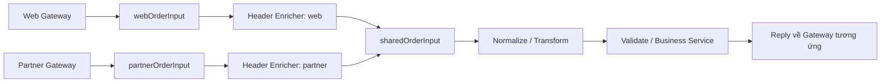
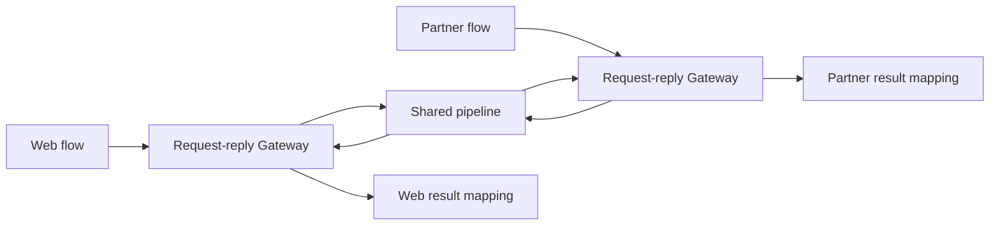
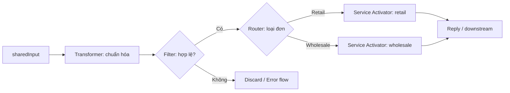
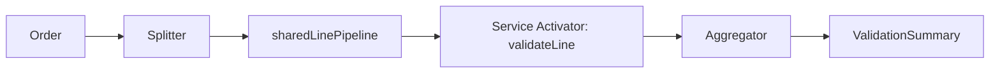

# Tái sử dụng subflow như một pipeline trong Spring Integration

> **Chương:** Pipes and filters  
> **Chủ đề:** Tái sử dụng subflow như một pipeline  
> **Mục tiêu:** Thiết kế một chuỗi xử lý thông điệp có thể dùng lại từ nhiều nguồn, giữ ranh giới trách nhiệm và hợp đồng đầu vào/đầu ra rõ ràng, đồng thời xử lý đúng request-reply, lỗi, correlation và bất đồng bộ.

## 1. Bài toán: nhiều nguồn cần cùng một chuỗi xử lý

Giả sử hệ thống nhận đơn hàng từ hai nguồn:

- Kênh web nhận đơn do khách hàng gửi trực tiếp.
- Kênh đối tác nhận đơn qua một ứng dụng tích hợp.

Cả hai đều cần chuẩn hóa mã đơn, kiểm tra điều kiện nghiệp vụ rồi tạo kết quả tiếp nhận. Viết lại cùng một chuỗi `Transformer → Filter/Validator → Service Activator` ở hai nơi dễ gây lệch logic: một nhánh cập nhật quy tắc mới, nhánh còn lại quên cập nhật.

Thay vì sao chép, ta đưa các bước dùng chung vào một **pipeline** và nối các nguồn đến pipeline qua một message channel có tên rõ ràng.



Trong Spring Integration, *pipes* là các `MessageChannel` kết nối những bước xử lý, còn *filters* theo nghĩa kiến trúc là những component biến đổi, kiểm tra hoặc xử lý message (khác với EIP **Message Filter** chuyên quyết định cho đi tiếp hay loại bỏ). Một **subflow tái sử dụng** là một nhóm bước có thể nhận message từ nhiều nhánh mà vẫn duy trì một hợp đồng thống nhất.

**Điểm cốt lõi:** dùng chung một pipeline nghĩa là dùng chung **định nghĩa và trách nhiệm xử lý**, không nhất thiết tạo nhiều bản sao của cùng các handler. Trong mô hình minh họa, các nguồn khác nhau gửi tới **một** entry channel của pipeline.

## 2. Subflow, IntegrationFlow và pipeline có nghĩa gì?

Trong Spring Integration Java DSL, `IntegrationFlow` mô tả chuỗi các bước nhận, xử lý và chuyển tiếp message. Một flow có thể bắt đầu bằng channel, adapter hoặc Gateway, sau đó đi qua các component như Transformer, Filter, Router và Service Activator.

Các khái niệm gần nhau nhưng cần phân biệt:

| Khái niệm | Ý nghĩa | Ví dụ |
| --- | --- | --- |
| **IntegrationFlow** | Định nghĩa chuỗi xử lý trong Spring Integration | `IntegrationFlow.from("input").transform(...).handle(...).get()` |
| **MessageChannel** | Nơi bàn giao message giữa các bước/flow | `DirectChannel`, `ExecutorChannel`, `QueueChannel` |
| **Subflow** | Chuỗi xử lý nhỏ nằm trong hoặc được gọi bởi một flow lớn hơn | Nhánh xử lý sau Router hoặc flow có entry channel riêng |
| **Reusable pipeline** | Nhóm bước dùng chung có hợp đồng đầu vào/ra và quy tắc lỗi rõ ràng | Chuẩn hóa và tiếp nhận đơn hàng cho web/đối tác |
| **Gateway** | Đưa lời gọi/request vào một flow; có thể nhận reply | `OrderGateway.place(OrderDraft)` |
| **Service Activator** | Gọi phương thức nghiệp vụ từ message | `OrderStages.accept(...)` |

Một pipeline dùng lại được cần tối thiểu bốn phần:

1. **Entry point:** channel hoặc gateway để nguồn gửi message vào.
2. **Input contract:** kiểu payload, headers cần có và ý nghĩa của chúng.
3. **Processing contract:** các bước biến đổi, validation, xử lý lỗi.
4. **Output contract:** message kết quả, nơi gửi reply, hoặc cam kết one-way.

Nếu chỉ tách mã DSL vào một method dùng chung nhưng không định nghĩa những hợp đồng này, hai flow vẫn có thể bị phụ thuộc chặt vào nhau.

### Khi nào nên tạo pipeline dùng chung?

- Nhiều adapter đầu vào đưa dữ liệu về cùng một mô hình nghiệp vụ.
- Cần áp dụng thống nhất chuẩn hóa, validation hoặc enrichment.
- Muốn một nơi đo thời gian xử lý và tỷ lệ lỗi của nghiệp vụ.
- Cần triển khai một logic chung rồi thêm nguồn mới mà không sửa bên trong logic đó.

Không nên gom những xử lý chỉ nhìn có vẻ giống nhau nhưng có quy tắc nghiệp vụ khác biệt đáng kể; ví dụ xác thực thanh toán thật và kiểm tra đơn thử nghiệm có thể cần hai hợp đồng riêng.

## 3. Ba hình thức tái sử dụng thường gặp

### 3.1. Dùng chung một flow qua channel có tên

Mỗi nguồn có flow riêng để chuẩn hóa metadata nguồn, sau đó gửi đến cùng một channel:

```text
sourceA ──> sourceAFlow ──┐
                         ├──> sharedInput ──> sharedPipeline
sourceB ──> sourceBFlow ──┘
```

Đây là cách trực quan để tạo một pipeline độc lập với các adapter nguồn. Nó có thể triển khai bằng Java DSL mà không cần trộn logic source vào xử lý dùng chung.

### 3.2. Gọi pipeline như request-reply

Nếu một bước phía trước cần kết quả của pipeline để xử lý tiếp, ta có thể đặt ranh giới Gateway/request-reply thay cho chuyển tiếp one-way đơn giản.

```text
Flow A -> gọi pipeline -> nhận Result -> A tiếp tục riêng
Flow B -> gọi pipeline -> nhận Result -> B tiếp tục riêng
```

Phải quy định rõ reply path và timeout. Một channel thường chỉ chuyển message tiến lên; việc dùng `.channel("sharedInput")` không mặc nhiên có nghĩa flow nguồn sẽ *tiếp tục ngay sau đó với kết quả trả về* của pipeline chung. Muốn tiếp tục dựa trên kết quả, cần dùng Gateway hoặc cấu trúc request-reply tương đương.

### 3.3. Tách thành subflow cho Router hoặc Publish-Subscribe

Router có thể điều hướng tới các nhánh DSL riêng; Publish-Subscribe cho phép nhiều subscriber nhận cùng một message. Các nhánh này có thể dùng chung phương thức/service và các cấu phần cấu hình để tránh lặp mã.

Tuy vậy, **subflow viết inline trong một Router không tự nhiên trở thành bean có thể gọi lại từ bất kỳ flow nào**. Khi cần chia sẻ cùng một pipeline cho nhiều nguồn, entry channel hoặc Gateway định danh rõ thường dễ quản lý hơn.

## 4. Thiết kế hợp đồng cho shared pipeline

Trước khi viết DSL, giả sử mỗi nguồn gửi dữ liệu đầu vào đã được map thành một `OrderDraft` chung.

| Thành phần | Hợp đồng đề xuất |
| --- | --- |
| Entry channel | `sharedOrderInput` |
| Payload đầu vào | `OrderDraft(orderId, amount, currency)` |
| Header bắt buộc | `sourceSystem` đã được gán tại adapter nguồn đáng tin cậy |
| Bước 1 | Chuẩn hóa mã đơn và currency |
| Bước 2 | Kiểm tra điều kiện và tiếp nhận đơn |
| Reply payload | `OrderReceipt(orderId, currency, sourceSystem, status)` |
| Lỗi dữ liệu | Báo lỗi validation, không retry vô hạn |
| Lỗi tạm thời | Retry có giới hạn nếu nghiệp vụ cho phép |
| Correlation | Giữ metadata reply/correlation cần thiết; dùng `businessKey` riêng cho nghiệp vụ |

**Vì sao cần phân biệt header với payload?** Payload mang dữ liệu nghiệp vụ. Header như `sourceSystem` mô tả nguồn và ngữ cảnh xử lý, có thể phục vụ Router, tracing và audit. Header chỉ đáng tin khi được tạo/xác minh ở ranh giới nguồn; không lấy một giá trị client tùy ý gửi đến rồi dùng làm quyền truy cập.

## 5. Ví dụ Java DSL: hai Gateway dùng chung một pipeline

Các đoạn mã dưới đây minh họa một module Java có package `example.integration`. Mỗi `public` class/interface/record thường nằm trong một file `.java` riêng đúng tên. Có thể dùng trong ứng dụng đã cấu hình Spring Integration và hỗ trợ Java record.

### 5.1. Kiểu dữ liệu chung

```java
package example.integration;

import java.math.BigDecimal;

public record OrderDraft(
        String orderId,
        BigDecimal amount,
        String currency) {}

public record NormalizedOrder(
        String orderId,
        BigDecimal amount,
        String currency) {}

public record OrderReceipt(
        String orderId,
        String currency,
        String sourceSystem,
        String status) {}
```

Cả web và đối tác phải map dữ liệu riêng sang `OrderDraft` trước khi gửi vào pipeline. Nếu hai nguồn gửi JSON khác nhau, đặt Transformer hoặc converter ở nhánh adapter trước điểm hợp nhất.

### 5.2. Bean xử lý các bước dùng chung

```java
package example.integration;

import java.math.BigDecimal;
import java.util.Locale;

import org.springframework.messaging.handler.annotation.Header;

public class OrderStages {

    public NormalizedOrder normalize(OrderDraft draft) {
        if (draft == null
                || draft.orderId() == null
                || draft.orderId().isBlank()
                || draft.currency() == null
                || draft.currency().isBlank()
                || draft.amount() == null) {
            throw new IllegalArgumentException("OrderDraft không hợp lệ");
        }

        return new NormalizedOrder(
            draft.orderId().trim(),
            draft.amount(),
            draft.currency().trim().toUpperCase(Locale.ROOT)
        );
    }

    public OrderReceipt accept(
            NormalizedOrder order,
            @Header("sourceSystem") String sourceSystem) {

        if (order.amount().compareTo(BigDecimal.ZERO) <= 0) {
            throw new IllegalArgumentException(
                "Số tiền phải lớn hơn 0");
        }

        // Minh họa: ứng dụng thực sẽ gọi repository/service nghiệp vụ.
        // Cần cân nhắc transaction và idempotency nếu có side effect.
        return new OrderReceipt(
            order.orderId(),
            order.currency(),
            sourceSystem,
            "ACCEPTED"
        );
    }
}
```

`normalize` làm rõ việc chuyển từ dữ liệu thô sang dạng chuẩn. `accept` là service method thực thi quy tắc tiếp nhận. Chúng không biết input đến từ HTTP, broker hay gateway nào.

Trong dự án thực, các bước có thể là những bean khác nhau để dễ kiểm thử và quản lý transaction. Ví dụ gộp hai method trong một class ở đây chỉ nhằm đơn giản hóa bài học.

### 5.3. Khai báo message channels và ba flow

```java
package example.integration;

import org.springframework.context.annotation.Bean;
import org.springframework.context.annotation.Configuration;
import org.springframework.integration.annotation.IntegrationComponentScan;
import org.springframework.integration.channel.DirectChannel;
import org.springframework.integration.config.EnableIntegration;
import org.springframework.integration.dsl.IntegrationFlow;
import org.springframework.messaging.MessageChannel;

@Configuration
@EnableIntegration
@IntegrationComponentScan
public class ReusableOrderPipelineConfig {

    @Bean
    public MessageChannel webOrderInput() {
        return new DirectChannel();
    }

    @Bean
    public MessageChannel partnerOrderInput() {
        return new DirectChannel();
    }

    @Bean
    public MessageChannel sharedOrderInput() {
        return new DirectChannel();
    }

    @Bean
    public OrderStages orderStages() {
        return new OrderStages();
    }

    // Nhánh web: gắn metadata rồi đưa vào pipeline chung.
    @Bean
    public IntegrationFlow webOrderFlow() {
        return IntegrationFlow.from("webOrderInput")
            .enrichHeaders(h -> h.header("sourceSystem", "web"))
            .channel("sharedOrderInput")
            .get();
    }

    // Nhánh đối tác: dùng cùng schema nhưng source khác.
    @Bean
    public IntegrationFlow partnerOrderFlow() {
        return IntegrationFlow.from("partnerOrderInput")
            .enrichHeaders(h -> h.header("sourceSystem", "partner"))
            .channel("sharedOrderInput")
            .get();
    }

    // Chỉ MỘT pipeline chung: cả hai nguồn cùng gọi.
    @Bean
    public IntegrationFlow sharedOrderPipeline(OrderStages stages) {
        return IntegrationFlow.from("sharedOrderInput")
            .transform(OrderDraft.class, stages::normalize)
            .handle(stages, "accept")
            .get();
    }
}
```

Chú ý ranh giới:

- `webOrderFlow` và `partnerOrderFlow` chịu trách nhiệm đặt metadata cho nguồn tin cậy.
- Cả hai gửi tới một `sharedOrderInput`; pipeline không cần biết tên channel nguồn.
- `sharedOrderPipeline` luôn nhận `OrderDraft`, tạo `NormalizedOrder` rồi gọi `accept`.
- Nếu service trả `OrderReceipt`, framework có thể tạo reply tới địa chỉ trả lời có trong headers của message theo cơ chế request-reply.
- Pipeline không phụ thuộc cụ thể vào hai Gateway; nguồn thứ ba chỉ cần đáp ứng input contract.

`DirectChannel` là channel unicast: với một endpoint subscriber xử lý ở entry của pipeline, mỗi lần gửi dẫn đến một lần dispatch qua endpoint đó. Nếu cấu hình thêm các consumer cùng đọc `sharedOrderInput`, `DirectChannel` có thể phân phối luân phiên thay vì gửi cho mọi consumer; đó là vấn đề khác với việc có nhiều producer.

### 5.4. Hai Messaging Gateway

```java
package example.integration;

import org.springframework.integration.annotation.MessagingGateway;

@MessagingGateway(defaultRequestChannel = "webOrderInput")
public interface WebOrderGateway {
    OrderReceipt submit(OrderDraft draft);
}
```

```java
package example.integration;

import org.springframework.integration.annotation.MessagingGateway;

@MessagingGateway(defaultRequestChannel = "partnerOrderInput")
public interface PartnerOrderGateway {
    OrderReceipt submit(OrderDraft draft);
}
```

Hai Gateway nhận cùng kiểu dữ liệu và cùng kiểu kết quả. Chúng gửi vào hai channel đầu vào khác nhau nhưng cuối cùng cùng đi qua `sharedOrderPipeline`.

Ví dụ gọi từ service/controller của ứng dụng, với hai gateway đã được inject:

```java
import java.math.BigDecimal;

OrderDraft webDraft =
    new OrderDraft(" WEB-101 ", new BigDecimal("250000"), "vnd");
OrderReceipt webResult = webGateway.submit(webDraft);

OrderDraft partnerDraft =
    new OrderDraft(" PARTNER-202 ", new BigDecimal("750000"), "usd");
OrderReceipt partnerResult = partnerGateway.submit(partnerDraft);

// webResult:
//   orderId = "WEB-101", currency = "VND", sourceSystem = "web"
// partnerResult:
//   orderId = "PARTNER-202", currency = "USD", sourceSystem = "partner"
```

Khi Gateway gửi request, Spring Integration cung cấp ngữ cảnh request-reply, bao gồm địa chỉ nhận reply thích hợp. Trong luồng đồng bộ qua `DirectChannel`, reply từ `Service Activator` cuối flow có thể quay về đúng Gateway nguồn, dù hai Gateway dùng chung pipeline. Nói cách khác, pipeline không cần tự đoán reply phải đi về web hay đối tác theo `sourceSystem`.

**Điều kiện vận hành:** các Gateway phải nằm trong phạm vi component scan của `@IntegrationComponentScan`, và các bean/flow phải thuộc cùng Spring context hoặc được nối bằng cơ chế integration thích hợp.

## 6. Điều gì thật sự được tái sử dụng?

Ta đang tái sử dụng:

- **Một định nghĩa luồng nghiệp vụ:** `sharedOrderPipeline`.
- **Một hợp đồng input/output:** mọi nguồn cùng gửi `OrderDraft` và nhận `OrderReceipt`.
- **Một tập quy tắc xử lý:** `OrderStages.normalize` và `accept`.
- **Một điểm quan sát:** có thể gắn metrics, logging hoặc advice xung quanh các bước của pipeline.

Ta không tự động có được:

- Một queue bền vững: `DirectChannel` hoạt động trong tiến trình; không lưu message lên disk.
- Exactly-once processing: message có thể bị gửi lại ở adapter hoặc do retry; service phải tính đến idempotency.
- Transaction xuyên mọi thread/service: việc đổi channel và gọi hệ thống ngoài cần chiến lược nhất quán riêng.
- Khả năng tự mở rộng vô hạn: giới hạn concurrency, DB connection và sức chịu tải của downstream vẫn tồn tại.

### Dùng chung pipeline có khiến các nguồn phụ thuộc chặt không?

Các nguồn phụ thuộc vào **hợp đồng chung** chứ không phụ thuộc triển khai từng handler. Nếu pipeline thay đổi `OrderDraft` hoặc ý nghĩa `OrderReceipt` mà không có versioning, tất cả nguồn đều bị ảnh hưởng.

Vì vậy, khi thay đổi hợp đồng, hãy cân nhắc:

1. Giữ schema chuẩn ổn định hoặc nâng phiên bản có kiểm soát.
2. Đặt chuyển đổi đặc thù source trước entry channel.
3. Không lồng các điều kiện `if (sourceSystem.equals(...))` khắp nơi trong pipeline nếu nghiệp vụ khác biệt rõ.
4. Kiểm thử riêng từng nguồn và kiểm thử hợp đồng pipeline chung.

## 7. Tái sử dụng bằng hàm Java hay dùng chung một flow bean?

Hai cách này dễ bị nhầm.

**Tái sử dụng cấu hình DSL** là trích các bước giống nhau vào một helper, sau đó xây nhiều flow độc lập. Mỗi flow có các endpoint/channel instance riêng nhưng dùng lại logic cấu hình. Cách này hữu ích nếu từng nguồn cần một pipeline có tài nguyên và quyền triển khai tách biệt.

**Tái sử dụng một flow đang chạy** là để nhiều producer cùng gửi tới một entry channel, như ví dụ `sharedOrderInput`. Các nguồn cùng dùng một pipeline instance, chia sẻ tài nguyên và cách xử lý.

| Tiêu chí | Dùng lại helper cấu hình | Dùng chung flow qua channel |
| --- | --- | --- |
| Số pipeline runtime | Có thể nhiều pipeline riêng | Một pipeline chung |
| Cập nhật logic | Helper là nguồn mã chung; mỗi flow có thể thêm bước riêng | Thay đổi pipeline ảnh hưởng tất cả producer |
| Giám sát | Metrics theo từng flow dễ tách | Metrics chung, cần metadata nguồn để phân tích |
| Cách gọi | Mỗi flow có đầu vào và đầu ra riêng | Các nguồn gửi đến một entry channel |
| Khi phù hợp | Các nhánh có mức tải, SLA khác nhau | Các nguồn cùng chung hợp đồng và nghiệp vụ |

Đừng cố đăng ký **cùng một bean `IntegrationFlow`** nhiều lần như thể mỗi lần sẽ tạo một bản sao độc lập. Các component trong flow có tên, lifecycle và quyền sở hữu trong application context. Muốn có nhiều pipeline instance, hãy xây những flow độc lập với tên endpoint/channel phân biệt; muốn chia sẻ một pipeline, dùng một entry point.

## 8. Khi nguồn cần tiếp tục xử lý sau pipeline dùng chung

Ở ví dụ mục 5, các Gateway nhận trực tiếp reply cuối pipeline. Nhưng có trường hợp flow web cần chuyển `OrderReceipt` thành phản hồi HTTP, còn flow đối tác cần đổi kết quả sang một định dạng khác.

Sơ đồ ý định:



Tại điểm gọi pipeline, có hai kiến trúc thường dùng:

**Cách A — Gateway tại ranh giới source:** mã ứng dụng gọi `WebOrderGateway.submit(...)` hoặc `PartnerOrderGateway.submit(...)`, nhận `OrderReceipt` rồi map phản hồi tại lớp adapter. Đây chính là ví dụ hoàn chỉnh ở mục 5.

**Cách B — Gateway endpoint bên trong IntegrationFlow:** nếu muốn tiếp tục hoàn toàn bằng DSL, cần một bước request-reply hướng đến `sharedOrderInput`, sau đó mới nối Transformer/handler đặc thù nguồn. Đối với phiên bản Spring Integration sử dụng trong dự án, kiểm tra overload `gateway(...)` của Java DSL và cấu hình request channel/reply timeout phù hợp.

Ví dụ mang tính mô tả:

```text
webInput
  -> enrichHeaders(source=web)
  -> gateway(requestChannel=sharedOrderInput)   // chờ reply
  -> transform(OrderReceipt -> WebResponse)
  -> webOutput

partnerInput
  -> enrichHeaders(source=partner)
  -> gateway(requestChannel=sharedOrderInput)
  -> transform(OrderReceipt -> PartnerResponse)
  -> partnerOutput
```

**Không thể thay `gateway` bằng `channel("sharedOrderInput")` rồi giả định phần DSL bên phải sẽ nhận `OrderReceipt`.** `channel` chuyển message đi tiếp; request-reply phải được thiết kế rõ. Sự phân biệt này là lỗi phổ biến khi học ghép flow.

### Tránh vòng lặp reply

Nếu một message đi qua pipeline chung rồi reply lại chính channel đầu vào của pipeline, có thể hình thành chu trình vô hạn hoặc kết quả bị gửi tới handler sai. Dùng reply channel do Gateway quản lý hoặc channel trả lời được xác định rõ, và kiểm tra đường đi ở cả tình huống thành công lẫn lỗi.

## 9. Header và correlation khi tái sử dụng pipeline

Khi nhiều nguồn dùng chung pipeline, payload có thể giống nhau nhưng metadata không giống nhau. Một số header cần quy ước rõ:

| Header | Vai trò | Chính sách |
| --- | --- | --- |
| `sourceSystem` | Nguồn phát sinh đáng tin cậy | Gán tại adapter nguồn; không coi client header là chứng thực |
| `businessKey` | Định danh đơn để audit/idempotency | Lấy từ dữ liệu đã validate hoặc domain ID |
| `traceId` | Liên kết quan sát xuyên các nhánh | Theo chuẩn tracing đang dùng; tránh sinh ID mới ở mọi bước |
| `replyChannel` | Đường trả lời request-reply | Để framework/Gateway quản lý; không ghi đè tùy tiện |
| `errorChannel` | Đường gửi thông báo lỗi | Phụ thuộc kiểu endpoint và chiến lược lỗi |
| `correlationId` | Nhóm message trong mô hình Splitter/Aggregator | Giữ theo hợp đồng grouping của framework |
| `sequenceNumber`, `sequenceSize` | Thứ tự và kích thước nhóm message | Giữ đúng khi xử lý message con |

Nhờ những header này, một pipeline dùng chung vẫn có thể ghi nhận nguồn và liên kết kết quả, đồng thời tránh tự tạo mapping riêng từng nguồn ở mọi bước.

Nếu pipeline gồm các Transformer chỉ trả payload, framework thường xây dựng message mới và có cơ chế duy trì headers phù hợp. Nếu bạn tự dựng `Message<?>` hoặc loại bỏ metadata tại một adapter, cần kiểm tra những header quan trọng còn tồn tại qua các bước.

**Lưu ý:** header metadata không thay thế kiểm tra bảo mật. Các header như `tenantId`, `userId` cần đến từ ngữ cảnh đã xác thực; không truyền token hoặc dữ liệu nhạy cảm qua pipeline một cách tùy tiện.

## 10. Kết hợp với Filter, Router và Service Activator

Một pipeline tái sử dụng không chỉ gồm Transformer và một method. Nó có thể tổ chức nhiều pattern khi thật sự cần:



Tuy nhiên, đặt Filter trong request-reply flow đòi hỏi quyết định rõ về message bị loại. Nếu Filter chỉ bỏ message mà không có reply, Gateway có thể chờ đến timeout. Có thể chọn exception có nghĩa nghiệp vụ, kênh discard hoặc result riêng, tùy hợp đồng.

Router nên định tuyến theo quy tắc chung áp dụng cho mọi nguồn. Nếu một số nhánh chỉ dành cho web, cân nhắc đẩy phần đặc thù đó về trước hoặc sau pipeline để tránh trộn lẫn trách nhiệm.

### Khi nào không nên dùng chung service handler?

Nếu hai nguồn có transaction, SLA, quy tắc validation hay mức độ tin cậy khác nhau đến mức phải phân nhánh sâu trong code service, tách hai pipeline sẽ dễ hiểu hơn. Có thể tái sử dụng riêng những biến đổi thực sự chung như `normalizeCurrency`.

## 11. Subflow và Splitter/Aggregator: có thể dùng chung nhưng cần giới hạn nhóm

Giả sử một đơn gồm nhiều dòng sản phẩm. Sau khi Splitter tách message thành từng `OrderLine`, các message con có thể đi qua một pipeline chung để tính thuế hoặc kiểm tra tồn kho.



Ở mô hình này, pipeline phải **giữ metadata correlation** cần cho Aggregator, ví dụ `correlationId`, `sequenceNumber` và `sequenceSize` do Splitter/framework thiết lập. Nếu chỉ vài message con đến Aggregator vì Filter đã loại các message khác, release strategy dựa trên `sequenceSize` có thể không bao giờ hoàn tất nhóm.

Một số chiến lược xử lý:

- Biến dòng không hợp lệ thành kết quả `LineValidationFailure` để Aggregator vẫn nhận đủ số phần tử dự kiến.
- Cấu hình timeout/expire và quy tắc hoàn tất nhóm khi kết quả có thể thiếu.
- Dùng correlation strategy riêng khi kiến trúc yêu cầu nhóm theo business ID.
- Tránh trộn các message của nhiều đơn hàng vào cùng group vì tái sử dụng channel chung.

Khi kết hợp `ExecutorChannel` để xử lý message con song song, thứ tự kết thúc có thể khác thứ tự ban đầu. Aggregator cần giữ nguyên quy tắc nhóm; nếu kết quả yêu cầu đúng thứ tự, phải thiết kế lại thứ tự dựa trên sequence metadata.

## 12. Đồng bộ, bất đồng bộ và tài nguyên của pipeline dùng chung

Trong ví dụ mục 5, `sharedOrderInput` là `DirectChannel` nên các bước thường chạy trên thread gửi. Một pipeline chung đôi khi muốn tách khối xử lý nặng sang pool riêng:

```text
web / partner
      |
      v
sharedDirectChannel
      |
      v
ExecutorChannel ----> worker pool ---> business handler
```

Bạn có thể thay `DirectChannel` ở một ranh giới thích hợp bằng `ExecutorChannel` có `TaskExecutor` được quản lý. Nhưng thay đổi này kéo theo:

1. **Transaction theo thread gửi không tự động truyền qua worker.**
2. **ThreadLocal** (MDC, security context, transaction) cần phương thức propagation được hỗ trợ.
3. **Thứ tự hoàn tất** có thể thay đổi nếu có nhiều worker.
4. **Sender có thể trở về trước khi handler hoàn tất**, nhưng Gateway request-reply vẫn phải đợi reply hoặc timeout.
5. **Queue/rejection policy của executor** quyết định quá tải; ExecutorChannel không phải broker bền vững.

Nếu pipeline có yêu cầu không mất message khi ứng dụng bị dừng đột ngột, cần broker hoặc persistent store với acknowledgement, retry và cơ chế phục hồi phù hợp. Chỉ dùng một thread pool không bảo đảm giao nhận bền vững.

### Một pool chung hay nhiều pool tách biệt?

Một pipeline chung giúp giảm trùng logic nhưng có thể khiến nguồn tải cao lấn át nguồn khác. Ví dụ, đối tác đẩy 10.000 đơn/giây làm đầy queue, còn người dùng web bị tăng độ trễ. Khi SLA khác nhau, có thể:

- Giới hạn tốc độ đầu vào theo nguồn.
- Dùng concurrency riêng theo các loại yêu cầu và giữ bước normalize chung.
- Thêm hàng đợi/partition theo khóa nghiệp vụ.
- Tách pipeline xử lý nặng thành từng nhánh nhưng dùng lại service/transformer thật sự chung.

Khả năng dùng lại logic và cô lập tài nguyên là hai quyết định kiến trúc riêng cần cân bằng.

## 13. Lỗi, retry và trách nhiệm của mỗi tầng

Một pipeline dùng chung là nơi thích hợp để áp dụng thống nhất xử lý lỗi cho các bước chung, nhưng lỗi phát sinh ở ranh giới nguồn có thể cần phản hồi riêng.

| Lỗi | Xảy ra ở đâu? | Hướng xử lý |
| --- | --- | --- |
| Payload không map được từ nguồn | Adapter hoặc Transformer nguồn | Trả lỗi định dạng/contract tại nguồn |
| Validation nghiệp vụ thất bại | Shared pipeline | Kết quả lỗi nghiệp vụ thống nhất |
| Service bên ngoài timeout | Shared Service Activator | Retry có giới hạn, idempotency và recovery |
| Gateway chờ reply quá lâu | Request-reply boundary | Timeout rõ ràng và trạng thái yêu cầu xác định |
| Executor từ chối task | Ranh giới bất đồng bộ | Backpressure hoặc phản hồi quá tải |
| Message mất sau crash | Vấn đề độ bền của transport | Outbox/broker/store phù hợp |

Nếu dùng `DirectChannel` và Service Activator ném exception, lỗi có thể được truyền về caller đồng bộ. Nếu luồng có `ExecutorChannel` hoặc adapter broker, lỗi xảy ra ở worker/listener cần error flow và quản lý acknowledgement riêng; sender đã được giải phóng không nhất thiết nhận exception trực tiếp.

### Retry phải đặt đúng phạm vi

Ví dụ, `normalize` thất bại vì thiếu mã đơn là lỗi dữ liệu: thử lại cùng payload không giải quyết được. Ngược lại, một API xác thực đơn có thể tạm thời timeout: retry với backoff và idempotency key có thể phù hợp.

Đừng vô tình retry cả pipeline nếu bước trước đó đã gây tác dụng phụ không thể hoàn tác. Cần phân biệt bước thuần (normalize/validate) với bước tạo trạng thái (ghi DB, thanh toán, publish). Một transaction hoặc outbox pattern có thể giúp bảo vệ tính nhất quán tại ranh giới ghi dữ liệu.

### Lỗi không làm một nguồn ảnh hưởng nguồn khác?

Pipeline chung giúp xử lý thống nhất nhưng lỗi kéo dài hoặc retry chậm có thể chiếm tài nguyên chung. Hãy quan sát tỷ lệ lỗi theo `sourceSystem`, giới hạn retry và tránh một adapter bị lỗi làm cạn thread/connection của toàn bộ pipeline.

## 14. Kiểm thử hợp đồng pipeline với JUnit 5

Ta nên kiểm thử qua cả hai Gateway để xác nhận rằng chúng đều đi qua các bước chung và metadata nguồn được giữ đến khi trả kết quả.

Ví dụ dùng những class trong mục 5:

```java
package example.integration;

import static org.junit.jupiter.api.Assertions.*;

import java.math.BigDecimal;

import org.junit.jupiter.api.Test;
import org.springframework.beans.factory.annotation.Autowired;
import org.springframework.test.context.junit.jupiter.SpringJUnitConfig;

@SpringJUnitConfig(ReusableOrderPipelineConfig.class)
class ReusableOrderPipelineTest {

    @Autowired
    private WebOrderGateway webGateway;

    @Autowired
    private PartnerOrderGateway partnerGateway;

    @Test
    void webOrderUsesSharedPipeline() {
        OrderReceipt receipt = webGateway.submit(
            new OrderDraft(" WEB-101 ",
                new BigDecimal("250000"), "vnd"));

        assertEquals("WEB-101", receipt.orderId());
        assertEquals("VND", receipt.currency());
        assertEquals("web", receipt.sourceSystem());
        assertEquals("ACCEPTED", receipt.status());
    }

    @Test
    void partnerOrderUsesSameNormalizationContract() {
        OrderReceipt receipt = partnerGateway.submit(
            new OrderDraft(" PARTNER-202 ",
                new BigDecimal("750000"), "usd"));

        assertEquals("PARTNER-202", receipt.orderId());
        assertEquals("USD", receipt.currency());
        assertEquals("partner", receipt.sourceSystem());
        assertEquals("ACCEPTED", receipt.status());
    }

    @Test
    void invalidAmountFailsConsistently() {
        assertThrows(RuntimeException.class, () ->
            webGateway.submit(
                new OrderDraft("WEB-BAD", BigDecimal.ZERO, "vnd")));

        assertThrows(RuntimeException.class, () ->
            partnerGateway.submit(
                new OrderDraft("PARTNER-BAD",
                    BigDecimal.ZERO, "vnd")));
    }
}
```

Test thứ ba kiểm tra nhánh lỗi trong trường hợp Gateway đồng bộ; framework có thể bọc exception gốc, vì vậy kiểu exception cụ thể trong dự án cần được xác minh từ contract thực tế.

### Những kiểm tra nên có khi mở rộng

- **Hai nguồn, cùng hợp đồng:** cùng quy tắc normalize/validation, chỉ khác metadata nguồn.
- **Headers:** `sourceSystem` và `businessKey` được bảo toàn hoặc chuẩn hóa theo nguồn tin cậy.
- **Reply:** Gateway nào gửi request thì Gateway đó nhận đúng reply; không trộn lẫn khi nhiều request đồng thời.
- **Số lần gọi:** tránh đăng ký thêm consumer ngoài ý muốn trên shared input.
- **Filter/Router:** message bị loại hoặc không có route phải có đường lỗi đã được định nghĩa.
- **Correlation:** với Splitter/Aggregator, các nhóm song song vẫn kết thúc đúng.
- **Bất đồng bộ:** dùng `CountDownLatch`/Awaitility để kiểm thử kết quả, tránh `Thread.sleep` cố định.
- **Quá tải:** kiểm tra rejection/backpressure nếu dùng ExecutorChannel.
- **Phục hồi:** nếu có broker, test hành vi retry, ack và xử lý trùng sau khi restart.

**Phân biệt unit test và integration test:** gọi thẳng `OrderStages.normalize(...)` chỉ kiểm tra method; gọi `webGateway.submit(...)` và `partnerGateway.submit(...)` mới kiểm tra cách các flow được nối với shared channel/pipeline.

## 15. Bẫy thiết kế khi tái sử dụng subflow

### 15.1. Dùng chung channel nhưng đăng ký nhiều consumer ngoài ý muốn

`DirectChannel` phân phối một message tới một subscriber, không phát bản sao đến tất cả. Nếu cấu hình hai flow cùng `from("sharedOrderInput")`, hành vi có thể trở thành chia tải giữa các consumer và không phải message nào cũng đi đủ hai flow. Dùng một consumer pipeline khi muốn xử lý thống nhất, hoặc `PublishSubscribeChannel` nếu thật sự muốn broadcast.

### 15.2. Lặp lại pipeline thành nhiều bản sao chỉ vì copy/paste

Mỗi bản sao có thể bị cập nhật khác nhau. Tách hợp đồng chung, biến đổi nguồn tại adapter và xây pipeline chung khi trách nhiệm thật sự giống nhau.

### 15.3. Giả định channel forwarding đồng nghĩa với function call có return

`.channel("sharedOrderInput")` gửi message đến channel. Nếu một flow còn muốn chạy bước riêng sau khi nhận kết quả từ shared pipeline, cần xác lập request-reply Gateway hoặc kiến trúc phản hồi phù hợp.

### 15.4. Dùng header nguồn để phân quyền

`sourceSystem` hoặc `tenantId` có thể bị giả mạo. Nếu dùng chúng cho audit/bảo mật, phải xác minh từ kết nối và danh tính nguồn, sau đó mới gán metadata đã tin cậy.

### 15.5. Trộn state giữa nhiều message

Bean xử lý thường là singleton. Nếu lưu đơn hàng hiện tại hoặc ngữ cảnh nguồn vào field của bean, hai message chạy đồng thời có thể ghi đè lẫn nhau. Dùng dữ liệu trong payload/header, biến cục bộ và kho trạng thái có kiểm soát.

### 15.6. Bỏ qua versioning input contract

Khi payload đổi tên field hoặc thêm quy tắc mới, mọi nguồn có thể bị ảnh hưởng. Đặt mapper theo nguồn, duy trì phiên bản schema và test hợp đồng trước khi thay pipeline chung.

### 15.7. Cho rằng reuse đồng nghĩa với isolation

Nhiều nguồn chung pipeline cũng có thể chung queue, thread pool, DB connection và quota API. Nếu nguồn lớn lấn át nguồn nhỏ, phải áp dụng giới hạn tải hoặc tách các tài nguyên cần thiết.

## 16. Bài tập thực hành: pipeline chuẩn hóa và định tuyến yêu cầu

**Bối cảnh:** Hệ thống nhận `TicketRequest` từ ứng dụng web và API đối tác. Cả hai phải kiểm tra mã yêu cầu, chuẩn hóa mức ưu tiên, sau đó chuyển đến dịch vụ xử lý ticket.

**Yêu cầu:**

1. Tạo `TicketRequest(id, priority, description)` và `TicketReceipt(id, priority, status)`.
2. Tạo hai đầu vào `webTickets` và `partnerTickets` với source headers tin cậy.
3. Định nghĩa `sharedTicketInput` và một pipeline duy nhất:
   `normalizePriority → validate → accept`.
4. Bảo đảm Gateway web và Gateway đối tác đều nhận `TicketReceipt`.
5. Viết test mỗi nguồn, test validation thất bại và test hai request đồng thời.
6. Thêm Router chuyển ticket `HIGH` đến luồng ưu tiên nếu nghiệp vụ yêu cầu.
7. Giải thích cách giữ `businessKey` và trace/correlation xuyên Router, Service Activator.
8. Chuyển một bước nặng sang `ExecutorChannel`; đánh giá timeout, thứ tự và khi quá tải.
9. Nêu phương án dùng broker/outbox nếu không được phép mất ticket khi ứng dụng dừng.

Một kiến trúc đích hợp lý:

```text
webTickets ----> source header: web -----+
                                         |
                                         v
                                  sharedTicketInput
                                         |
                                  normalizePriority
                                         |
                                    validate
                                         |
                                route by priority
                                         |
                                 Service Activator
                                         |
                                   TicketReceipt
                                         ^
                                         |
partnerTickets -> source header: partner-+
```

Sơ đồ thể hiện đường đi hợp nhất; kết quả thực tế phải được gửi về đúng Gateway theo reply path, không dựa trên việc hai nguồn tình cờ cùng đi qua một channel.

### Câu hỏi tự đánh giá

**Câu 1.** Tại sao việc tạo một `sharedOrderInput` và một `sharedOrderPipeline` giúp giảm trùng logic?

*Vì nhiều nguồn cùng tuân theo một input contract và sử dụng một tập Transformer/Service Activator chung.*

**Câu 2.** Nếu đặt hai subscriber lên `DirectChannel`, cả hai có tự nhận mỗi message không?

*Không. `DirectChannel` là unicast; với nhiều subscriber, một message chỉ được dispatch tới một handler theo chiến lược của dispatcher.*

**Câu 3.** Khi muốn xử lý kết quả pipeline bên trong flow nguồn sau lời gọi, nên dùng điểm nối nào?

*Một ranh giới request-reply, chẳng hạn Gateway, với reply path và timeout rõ ràng.*

**Câu 4.** Pipeline chung nhận message từ hai nguồn nhưng mỗi nguồn có transaction khác nhau: có thể tự động chung một transaction không?

*Không nên giả định. Transaction gắn với thread, cấu hình channel và hệ thống ngoài; chuyển thread hoặc broker cần thiết kế nhất quán riêng.*

**Câu 5.** Vì sao cần test qua cả hai Gateway?

*Vì unit test method không chứng minh rằng cả hai nguồn được nối đúng vào shared flow và nhận reply/headers phù hợp.*

## 17. Checklist áp dụng trong dự án thật

- **Mục tiêu reuse:** xác định bước nào thật sự chung, bước nào phụ thuộc nguồn.
- **Input contract:** kiểu payload, headers bắt buộc, schema/version và nguồn xác thực.
- **Entry point:** channel/Gateway có tên rõ, tránh đăng ký consumer trùng.
- **Output contract:** reply payload, one-way hay request-reply, timeout và cách xử lý thiếu reply.
- **Error contract:** validation, retry, error channel, discard, backpressure.
- **Correlation:** reply/correlation headers không bị sửa sai, đặc biệt khi Splitter/Aggregator.
- **Concurrency:** chọn DirectChannel/ExecutorChannel theo transaction, ordering và khả năng chịu tải.
- **Idempotency:** xử lý trùng khi handler có side effect và khi transport cho phép redelivery.
- **Observability:** log/metrics/tracing theo pipeline và theo source, tránh lộ dữ liệu nhạy cảm.
- **Verification:** test từng nguồn đi qua cùng pipeline và test những nhánh lỗi khác biệt.

**Kết luận:** Pipeline có thể tái sử dụng khi nó nhận một loại message rõ ràng, thực hiện một trách nhiệm nhất quán và công bố đầu ra/lỗi dự đoán được. Trong Spring Integration, một entry `MessageChannel` nối nhiều nguồn tới cùng một `IntegrationFlow` là cách trực quan để xây dựng shared pipeline. Khi cần trả kết quả cho flow gọi, bổ sung hợp đồng Gateway/request-reply rõ ràng. Điều này giữ cho các nguồn và các bước xử lý ít phụ thuộc, đồng thời vẫn mở rộng được với Transformer, Filter, Router, Service Activator, Splitter, Aggregator và các cơ chế lỗi, retry, tracing của hệ thống.
